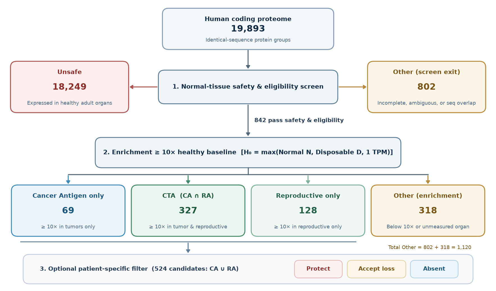
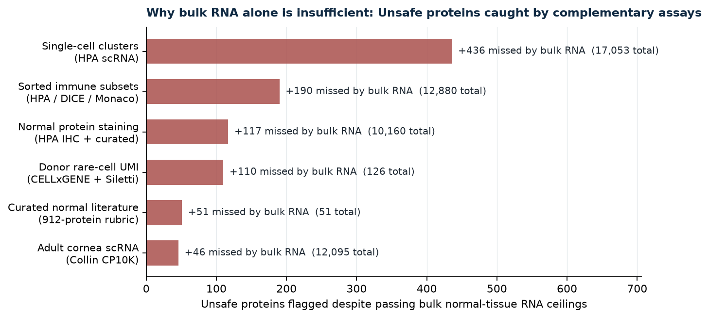
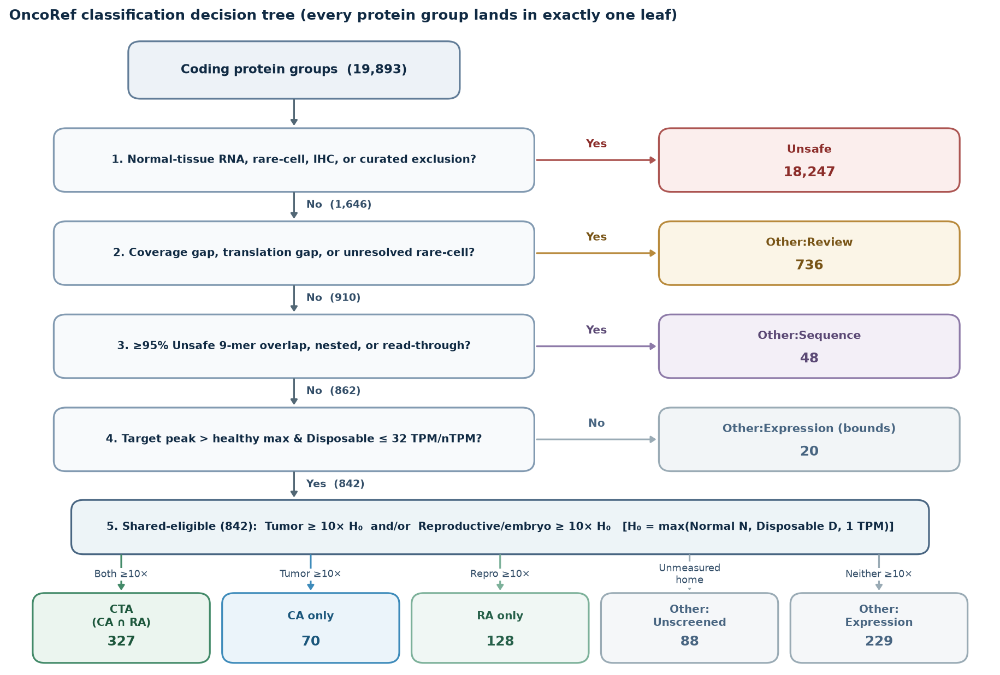
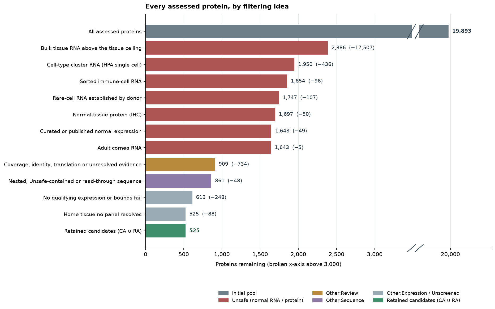
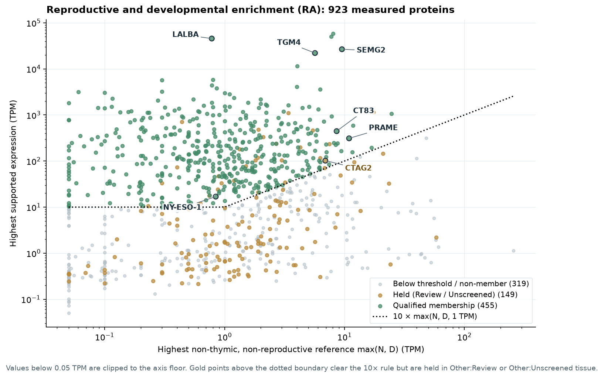
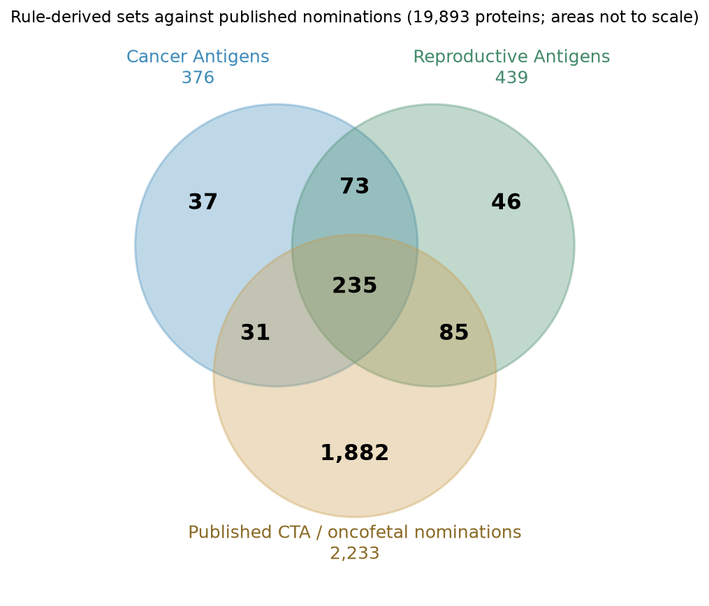
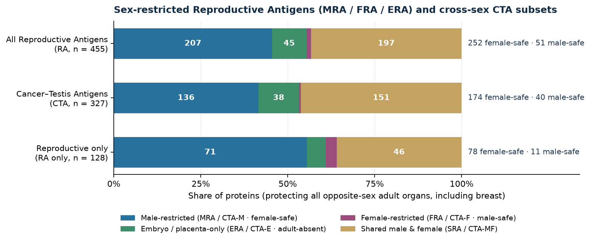
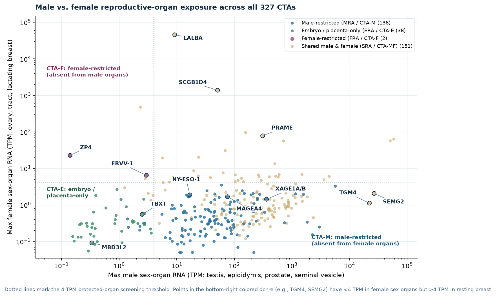
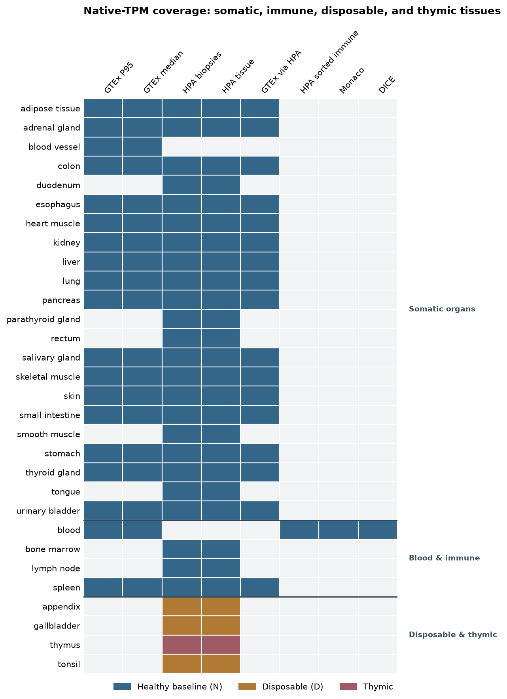
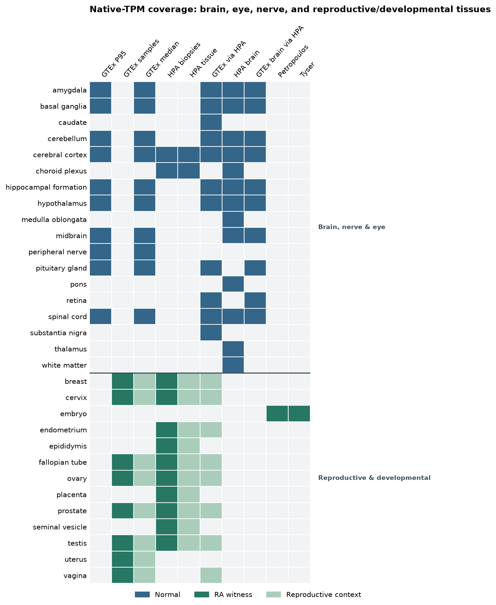

# Cancer-selective and cancer–testis antigens in OncoRef

*[Interactive protein catalog](audits/target-selection-20261110/rebuild/report.html) · [Multi-species whitepaper](species-antigen-whitepaper.md) · [Tissue injury hierarchy](tissue-hierarchy.md) · [Data & downloads](antigen-data.md)*

<p class="section-nav"><strong>Jump to:</strong> <a href="#categories">Categories</a> · <a href="#why-bulk-rna-alone-is-insufficient">Why multi-assay safety</a> · <a href="#decision-tree-attrition-and-the-10-enrichment-rule">Decision tree &amp; 10× rule</a> · <a href="#published-cta-oncofetal-and-placental-lists">Published lists</a> · <a href="#peak-tumor-expression-and-edge-cases">Top tumor targets</a> · <a href="#tissue-injury-tiers-patient-profiles-and-sex-restricted-ctas">Tissue tiers &amp; sex-restricted CTAs</a> · <a href="#methods-protein-grouping-sources-and-thresholds">Methods</a> · <a href="#comparative-multi-species-framework-human-dog-and-mouse">Multi-species</a> · <a href="#reproducing-the-catalog-and-downloads">Reproducibility &amp; downloads</a></p>

Targeted cancer immunotherapies need proteins that are active in tumors and absent from healthy adult organs. Published cancer–testis antigen (CTA) lists often mix historical microarray nominations, incompatible expression scales, and patient-specific clinical assumptions into one table.

OncoRef screens the human coding proteome—**20,099** Ensembl 115 coding loci collapsed into **19,893** identical-sequence protein groups—with one rule set that separates normal-tissue safety, biological enrichment, and patient-specific organ protection.

## Categories

Every protein group lands in one of five mutually exclusive categories:

- <span class="cat cat-unsafe">Unsafe</span> (`18,250`): confirmed expression in vital, protected, or high-expression manageable adult somatic tissues. Normal-tissue expression always takes precedence over tumor expression.
- <span class="cat cat-other">Other</span> (`1,062`): kept out of the candidate sets without being confirmed <span class="cat cat-unsafe">Unsafe</span>—either because required evidence is incomplete or ambiguous (missing normal-tissue coverage, unresolved paralog attribution in single-cell data `Other:Review`, or sequence overlap with <span class="cat cat-unsafe">Unsafe</span> proteins `Other:Sequence`), or because tumor and reproductive expression do not qualify (below the 10× threshold `Other:Expression`, or an adult normal organ missing from bulk panels `Other:Unscreened tissue`).
- <span class="cat cat-ca">Cancer Antigens (CA)</span> (`448`): passes the safety and eligibility screens and reaches **≥10×** the non-thymic healthy adult baseline in at least one QC-passing tumor sample.
- <span class="cat cat-ra">Reproductive Antigens (RA)</span> (`464`): passes the same safety and eligibility screens and reaches **≥10×** the identical healthy baseline in an adult reproductive tissue sample or supported early-embryo lineage.
- <span class="cat cat-cta">Cancer–Testis Antigens (CTA)</span> (`331`): the intersection `CA ∩ RA`, clearing both cancer and reproductive/developmental enrichment while staying silent across healthy somatic organs. The union `CA ∪ RA` contains **581** candidate targets (`331` <span class="cat cat-cta">CTA</span>, `117` <span class="cat cat-ca">CA only</span>, `133` <span class="cat cat-ra">RA only</span>).



*Figure 1.* Proteome partition across the five categories. In `H₀ = max(Normal N, Disposable D, 1 TPM)`, `N` is the protein's highest native TPM across vital, protected, and manageable healthy adult somatic organs and sorted immune subsets, and `D` is its maximum across non-thymic Disposable organs (appendix, gallbladder, tonsil). Biological membership (<span class="cat cat-ca">CA</span>, <span class="cat cat-ra">RA</span>, <span class="cat cat-cta">CTA</span>) is independent of patient anatomy; patient-specific organ protection applies downstream without relabeling biological categories.

> These classifications are expression-screening calls, not clinical target certifications. Translation, antigen processing, peptide–MHC presentation, localization, and modality-specific safety require direct experimental validation.

## Why bulk RNA alone is insufficient

No single assay catches every normal-tissue risk. Each modality in OncoRef covers a blind spot left by the others:

**Multiple bulk RNA atlases and sorted immune panels.** Bulk RNA removes most ubiquitously expressed proteins, but individual atlases differ in organ coverage and donor sampling. Pairing GTEx v11 donor distributions with HPA v23 biopsies and brain subregions prevents single-atlas gaps from reading as silence. Sorted blood subsets (HPA, DICE, Monaco) catch immune-lineage transcripts diluted in whole blood or spleen.

**Single-cell clusters and rare-cell UMI atlases.** Bulk RNA averages across millions of cells, so a gene expressed strongly in 1–5% of a vital population—such as alveolar type 2 cells, cardiomyocytes, or cortical neurons—can sit below bulk cutoffs. Single-cell atlases (HPA clusters, Collin cornea, donor-resolved CELLxGENE Census and Siletti brain) catch these localized risks. Requiring ≥2 UMI per cell replicated across independent studies and donors avoids discarding real targets over ambient RNA, while placing paralog-ambiguous genes in `Other:Review` instead of auto-excluding them.

**Normal-tissue protein staining (IHC).** Steady-state mRNA does not always track protein abundance: stable proteins can persist at modest RNA, while low-level transcript noise does not always yield detectable protein. Reliable positive HPA immunohistochemistry in a vital or protected organ independently excludes a target; consistent negative IHC across routine contexts of a tissue gives calibrated headroom above low bulk RNA.

**Curated normal literature and specialized anatomy.** Standard bulk panels omit small adult organs such as olfactory epithelium and taste buds. Reviewed normal-expression literature and targeted anatomical studies either exclude vital/protected tissues or assign unmeasured adult tissues to `Other:Unscreened tissue`.



*Figure 2.* `Unsafe` proteins passing bulk tissue RNA ceilings that are caught by single-cell clusters, sorted immune subsets, normal IHC, donor-replicated rare-cell UMI counts, curated literature, or adult cornea scRNA. Bulk tissue RNA alone flags **17,507** `Unsafe` proteins; these six assays add **743** more (bars overlap where multiple non-bulk assays agree).

## Decision tree, attrition, and the 10× enrichment rule

Every protein group follows a deterministic decision tree with strict precedence—normal-tissue safety first, then coverage and sequence eligibility, and finally symmetric **10×** enrichment in tumors and reproductive/embryonic compartments—narrowing **19,893** protein groups to **845** safety- and coverage-eligible proteins and **581** retained candidates (`CA ∪ RA`).



*Figure 3.* Exact classification decision tree showing every binary gate, precedence order, and terminal leaf count across all **19,893** protein groups.



*Figure 4.* Sequential attrition from **19,893** protein groups to **581** retained candidates, assigning each excluded protein once at its first failing gate. The broken x-axis above 3,000 keeps post-bulk filters readable. [Step counts (CSV)](audits/target-selection-20261110/rebuild/summary/funnel-all.csv).

Both enrichment routes apply the same threshold—**≥10×** above **H₀ = max(Normal N, Disposable D, 1 TPM)**—across **920** protein groups with complete healthy-panel TPM (**845** eligible groups plus **339** `Other` groups with complete bulk panels). Points above the dotted line in `Other` clear the fold cutoff numerically while remaining held for locus-specific single-cell attribution or unmeasured anatomical sub-niches (`TBATA`, `DSPP`, `CAGE1`).


*Figure 5.* Cancer enrichment (<span class="cat cat-ca">CA</span>) across all **920** compared protein groups (values below 0.05 TPM clipped to the axis floor).



*Figure 6.* Reproductive and developmental enrichment (<span class="cat cat-ra">RA</span>) against the identical healthy adult baseline (values below 0.05 TPM clipped to the axis floor).

Exclusive category and locus counts across the coding proteome:

| Exclusive category | Protein records | Member loci |
| --- | --- | --- |
| CTA | 331 | 363 |
| Cancer Antigen only | 117 | 123 |
| Other:Expression | 255 | 262 |
| Other:Review | 731 | 732 |
| Other:Sequence | 48 | 50 |
| Other:Unscreened tissue | 28 | 28 |
| Reproductive Antigen only | 133 | 134 |
| Unsafe | 18,250 | 18,407 |

## Published CTA, oncofetal, and placental lists

OncoRef maps **149** curated papers across four antigen families: classical CTA / cancer–germline catalogs, oncofetal / DUX4 / early-embryo programs, placental and reproductive catalogs, and focused single-gene or tumor-vasculature studies. Literature citations are provenance metadata; a published nomination never overrides normal-tissue expression.

Retention tracks how strictly each paper screened healthy tissues. Focused modern CTA and DUX4 studies (`Seager et al. 2024`, `Chew et al. 2019`, `Carter et al. 2023`, `Loriot et al. 2025`) retain **34%–67% CTAs**, whereas broad germ-cell, microarray, ZGA, and cancer–placenta lists (`Bruggeman et al. 2018`, `Smith et al. 2023`, `Jamin et al. 2021`, `Bradley et al. 2020`) are **92%–100% `Unsafe`** under modern adult somatic screening.


*Figure 7.* Share of mapped protein groups (`n` shown per study) retained as <span class="cat cat-cta">CTA</span>, <span class="cat cat-ca">CA only</span>, or <span class="cat cat-ra">RA only</span> versus assigned to <span class="cat cat-other">Other</span> or <span class="cat cat-unsafe">Unsafe</span>. [Full 149-source table (CSV)](audits/target-selection-20261110/rebuild/summary/literature-sources.csv).

Of **2,233** published CTA or oncofetal nominations, **371** survive into the candidate union (`CA ∪ RA`)—including **253** of our **331** CTAs—while **78** CTAs are newly identified by the expression rules and **1,862** nominations fail normal-tissue, eligibility, or enrichment screens.



*Figure 8.* Overlap between rule-derived Cancer Antigens (**448**), Reproductive Antigens (**464**), and published CTA/oncofetal nominations (**2,233**).


*Figure 9.* Sequential attrition of **2,233** published CTA/oncofetal nominations through the same gates, leaving **371** candidates. [Step counts (CSV)](audits/target-selection-20261110/rebuild/summary/funnel-published.csv).

### Most-nominated individual proteins

Across **2,238** studied protein groups (**2,233** with a CTA nomination paper plus **5** clinical or familiar reference entries), below are the top ten by distinct curated CTA papers plus five familiar clinical anchors (`NY-ESO-1`, `PRAME`, `CT83`, `CTAG2`, `CAGE1`):

| Protein | CTA papers | Catalog | N TPM · site | RA peak TPM · context | Tumor TPM · cohort |
| --- | --- | --- | --- | --- | --- |
| MAGEA3 | 8 | Unsafe | NR | NR | NR |
| MAGEA4 | 8 | CTA | 2.95 · lymph node | 327.97 · 4-day embryo | 3,201.68 · SCLC |
| DCAF4L2 | 7 | CTA | 0.12 · substantia nigra | 59.96 · testis | 310.77 · NEC_LUNG_LARGECELL |
| MAGEA1 | 7 | CTA | 0.21 · spleen | 31.36 · testis | 346.43 · SCLC |
| MAGEA12 | 7 | Unsafe | NR | NR | NR |
| MAGEB2 | 7 | Unsafe | NR | NR | NR |
| CT83 | 6 | CTA | 8.6 · minor salivary gland | 445.31 · testis | 193.17 · CESC |
| CTCFL | 6 | Unsafe | NR | NR | NR |
| DPPA2 | 6 | CTA | 0.94 · naive B cells | 167.76 · 7-day epiblast | 398.83 · RT |
| GAGE1 | 6 | CTA | 0.7 · retina | 165.18 · 5-day trophectoderm | 1,181.9 · SKCM |
| PRAME | 6 | CTA | 10.93 · adrenal gland | 310.91 · testis | 3,692.46 · SCLC |
| NY-ESO-1 | 5 | CTA | 0.84 · spleen | 16.88 · testis | 944.32 · SARC_SYN |
| CAGE1 | 3 | Other:Review | 0.94 · stimulated CD4 T cells | 32.98 · testis | 17.4 · T_ALL |
| CTAG2 | 3 | CTA | 6.92 · urinary bladder | 101.92 · testis | 604.33 · OV |

`N` and the reproductive peak may come from different assays or donors ([full context table](antigen-whitepaper/studied-proteins.csv)). `NR` ("not run") marks proteins excluded as `Unsafe` in Stage 1 before native-TPM comparison (MAGEA3, MAGEA12, MAGEB2, CTCFL); tumor or testis libraries may still contain those transcripts.

### Studied proteins in Other or Unsafe

Of **58** protein groups in the familiar or clinical reference panels, **28** land in `Other` or `Unsafe`. Neither label predicts clinical toxicity for a specific therapeutic product; each records the strongest normal-tissue or rare-cell finding observed across the healthy adult panels:

| Studied protein | Category | Excluding or review gate | Strongest measured normal signal |
| --- | --- | --- | --- |
| MAGEA3 | Unsafe | Single-cell clusters (HPA) | colon, undifferentiated cells · 53.1 nTPM (ceiling 4) |
| MAGEA12 | Unsafe | Donor rare-cell RNA (qPCR-confirmed) | brain, pericyte · 0.40% of cells (≥2 molecules) |
| CTCFL | Unsafe | Bulk tissue RNA | white matter, bulk · 15 nTPM (ceiling 4) |
| DDX43 | Unsafe | Normal IHC + Single-cell clusters (HPA) + Sorted immune RNA + Donor rare-cell RNA | blood, NK · 21.09 TPM (ceiling 8) |
| SPA17 | Unsafe | Normal IHC + Bulk tissue RNA + Single-cell clusters (HPA) + Adult cornea scRNA + Donor rare-cell RNA | lung, ciliated cells · 345.8 nTPM (ceiling 8) |
| CLDN6 | Unsafe | Bulk tissue RNA + Single-cell clusters (HPA) | pancreas, ductal cells · 64.8 nTPM (ceiling 8) |
| DAZL | Unsafe | #711 confounder rejected (eye astrocyte) | eye, astrocyte · 5.86% of cells (≥2 molecules) |
| POTEC | Other:Review | Donor rare-cell RNA (replicated, paralog-ambiguous) | eye, corneal endothelial cell · 12.07% of cells (≥2 molecules) |
| CAGE1 | Other:Review | Donor rare-cell RNA (replicated, paralog-ambiguous) | brain, dopaminergic neuron · 3.29% of cells (≥2 molecules) |

## Peak tumor expression and edge cases

Across the **581** candidate union, **167** protein groups reach **≥100 TPM** in at least one QC-passing tumor sample, **28** reach **≥1,000 TPM**, and **126** have **≥10 known independent patients** crossing the 10× cutoff. Median peak tumor expression is **73.68 TPM** for `CTA` and **39.77 TPM** for `CA only`.

Each table below ranks the top ten protein groups in its category by peak QC-passing tumor TPM ([all 581 candidates](antigen-whitepaper/tumor-ranks.csv)); `Unsafe` proteins (`18,250`) exit in Stage 1 before tumor comparison. Because `Tumor fold` divides by `max(N, D, 1 TPM)`, fold equals `Tumor TPM` whenever both `N` and `D` are below 1 TPM (`LALBA`, `SCGB1D4`, `VCY/1B`). In `Other`, high tumor peaks (`TBATA`, `DSPP`, `CAGE1`) reflect unresolved single-cell or unmeasured sub-niche reviews rather than low expression. Peak TPM measures single-library abundance, not the fraction of malignant cells expressing the protein.

### CTA

Top 10 of 331 groups by peak tumor sample TPM.

| Rank | Protein | Peak cohort | Tumor TPM | N TPM | Reproductive peak TPM | Tumor fold | Known patients at 10× |
| --- | --- | --- | --- | --- | --- | --- | --- |
| 1 | LALBA | BRCA | 79,700.44 | 0.78 | 45,625.2 | 79,700.44 | 25 |
| 2 | TGM4 | PRAD | 17,629.45 | 5.67 | 22,106.5 | 3,107.11 | 94 |
| 3 | XAGE1A/B | BRCA | 4,068.64 | 5.74 | 362.73 | 709.23 | 988 |
| 4 | SPANXA1/2 | ESCA | 3,700.06 | 3 | 77.07 | 1,233.35 | 61 |
| 5 | PRAME | SCLC | 3,692.46 | 10.93 | 310.91 | 337.97 | 2 |
| 6 | SCGB1D4 | UCEC | 3,576.17 | 0.42 | 1,383.54 | 3,576.17 | 49 |
| 7 | MAGEA4 | SCLC | 3,201.68 | 2.95 | 327.97 | 1,083.95 | 3 |
| 8 | RLN1 | PRAD | 3,039.25 | 5.85 | 268.82 | 519.47 | 127 |
| 9 | SEMG2 | PRAD | 3,033.78 | 9.52 | 26,737.9 | 318.52 | 7 |
| 10 | VCY/1B | SKCM | 2,858.58 | 0.1 | 269.66 | 2,858.58 | 125 |

### CA only

Top 10 of 117 groups by peak tumor sample TPM.

| Rank | Protein | Peak cohort | Tumor TPM | N TPM | Reproductive peak TPM | Tumor fold | Known patients at 10× |
| --- | --- | --- | --- | --- | --- | --- | --- |
| 1 | AMELX | RT | 1,696.17 | 1.9 | 2.29 | 892.72 | 30 |
| 2 | HOXC12 | WILMS | 1,559.28 | 11.6 | 5.51 | 134.47 | 9 |
| 3 | RPS4Y2 | B_ALL | 1,394.88 | 12.19 | 12.74 | 114.4 | 50 |
| 4 | GALP | SARC_DSRCT | 1,332.56 | 1.02 | 1.05 | 1,308.13 | 22 |
| 5 | ZACN | SCLC | 526.62 | 22.49 | 21.96 | 23.41 | 1 |
| 6 | IL36B | SARC_UPS | 498.45 | 20.17 | 9.83 | 24.71 | 1 |
| 7 | SRMS | NET_RECTAL | 463.74 | 12.05 | 39.04 | 38.47 | 0 |
| 8 | CSAG3 | LUSC | 336.48 | 4.27 | 22.46 | 78.72 | 2 |
| 9 | DBX1 | SCLC | 297.51 | 0.78 | 1.65 | 297.51 | 74 |
| 10 | HOXD12 | NBL | 279.91 | 6.2 | 17.97 | 45.12 | 15 |

### RA only

Top 10 of 133 groups by peak tumor sample TPM.

| Rank | Protein | Peak cohort | Tumor TPM | N TPM | Reproductive peak TPM | Tumor fold | Known patients at 10× |
| --- | --- | --- | --- | --- | --- | --- | --- |
| 1 | STPG3 | NEC_MERKEL | 136.45 | 16.79 | 196.89 | 8.13 | 0 |
| 2 | PABPN1L | B_ALL | 58.46 | 11.77 | 585.75 | 4.97 | 0 |
| 3 | PSG7 | NEC_MERKEL | 55.42 | 6.12 | 70.23 | 9.05 | 0 |
| 4 | KRTAP20-4 | NEC_LUNG_LARGECELL | 50.41 | 0.3 | 10.05 | 50.41 | 2 |
| 5 | OR51C1 | PRAD | 50 | 2.37 | 43.5 | 21.08 | 8 |
| 6 | TMEM262 | NEC_LUNG_LARGECELL | 47.43 | 7.03 | 123.95 | 6.74 | 0 |
| 7 | TOMM20L | T_ALL | 46.57 | 6.16 | 73.76 | 7.57 | 0 |
| 8 | ZNF878 | B_ALL | 39.39 | 3.94 | 48.31 | 10 | 0 |
| 9 | RSPH6A | THCA | 37.92 | 11.62 | 157.75 | 3.26 | 0 |
| 10 | ADIG | THCA | 33.82 | 7.04 | 229.73 | 4.8 | 0 |

### Other

Top 10 of 339 groups with complete baseline TPM (out of 1,062 total `Other` groups).

| Rank | Protein | Peak cohort | Tumor TPM | N TPM | Reproductive peak TPM | Tumor fold | Known patients at 10× |
| --- | --- | --- | --- | --- | --- | --- | --- |
| 1 | TBATA | THYM | 2,250.3 | 6.26 | 116.44 | 359.45 | 101 |
| 2 | KRT9 | PCPG | 1,865.83 | 8.65 | 7.03 | 215.65 | 16 |
| 3 | DSPP | HEPB | 1,695.58 | 0.6 | 0.21 | 1,695.58 | 1 |
| 4 | RIPPLY3 | RT | 450.15 | 2.36 | 10.02 | 190.41 | 29 |
| 5 | VCX3B | BRCA | 420.74 | 1.33 | 181.54 | 316.01 | 87 |
| 6 | PSG3 | LUAD | 326.38 | 17.41 | 1,155.62 | 18.74 | 1 |
| 7 | GSX2 | LAML_ELNint | 287.56 | 5.09 | 8.6 | 56.48 | 8 |
| 8 | RGPD3 | T_ALL | 284.71 | 1.91 | 20.78 | 149.32 | 44 |
| 9 | LCE3C | HNSC | 284.56 | 4.57 | 13.98 | 5.43 | 0 |
| 10 | PSMB11 | THYM | 274.75 | 2.39 | 3.36 | 115.13 | 74 |

### Worked edge cases

**`CTAG2` (LAGE-1) → `CTA` (isoform-scoped clinical pMHC clearance, `#766`).** In peripheral bulk TPM, `CTAG2` clears both enrichment rules: its highest peripheral reference is **urinary bladder** at **6.92 TPM** (10× cutoff **69.25 TPM**), testis reaches **101.92 TPM** (**14.72×**), and ovarian cancer reaches **604.33 TPM** across **1** known patients at 10×. In donor-resolved single-cell atlases, **lung** (alveolar type 2 cells) and **brain** (cortical glutamatergic neurons) pass the multi-study donor-replication screen while sharing **50.9%** of transcript 31-mers across the closed `Xq28` `CTAG1A`/`CTAG1B`/`CTAG2` cluster (`0.0%` external `Unsafe` 31-mer overlap):

| Organ | Strongest population | Independent studies | Donor IDs with signal (linked where known) | Cells with ≥2 molecules in top donor | Grading |
| --- | --- | --- | --- | --- | --- |
| lung | pulmonary alveolar type 2 cell | 2 | 3 | 166/3,865 (4.29%) | unresolved |
| brain | L5 extratelencephalic projecting glutamatergic cortical neuron | 2 | 2 | 70/2,201 (3.18%) | unresolved |

Under `oncoref.clinical_organ_clearance` ([audit `#766`](audits/clinical-organ-clearance-20261123/index.md)), adoptive `lete-cel` (`c259`, `HLA-A*02:01 / SLLMWITQC`) TCR-T infusions across synovial sarcoma, MRCLS, NSCLC, and myeloma cohorts without on-target pulmonary or urothelial injury clear `lung` and `urinary bladder` specifically for `ENST00000369585` (`LAGE-1a`, `180 aa`), while `#711` `Xq28` attribution (`0.15 TPM` bulk brain) resolves the cortical nuclear signal—restoring `CTAG2` to **`CTA`**. Because `ENST00000247306` (`LAGE-1b`, `210 aa`) lacks `SLLMWITQC` and a separate heart review recorded a confounded day-161 cardiac event ([heart review](audits/ctag2-heart-evidence.md)), `CTAG2` carries `clinical_clearance_scope = "epitope"` and `clinical_unverified_isoforms = ["ENST00000247306"]` for downstream epitope selection.

**`PLAC1` & `DUX4` → `CTA` (nuclear `snRNA-seq` spillover `#765` + closed `D4Z4` repeat equivalence `#767`).** Intron-inclusive cortical `snRNA-seq` flags `PLAC1` across a `197.7 kb` non-coding 5'-UTR intron `5.2 kb` downstream of somatic `PABIR2` (`54.1 TPM`), yet cytoplasmic polyA bulk brain RNA is `0.0051 TPM`, somatic IHC is `0/4`, and MS immunopeptidomics is strictly `CANCER_ONLY`—clearing `PLAC1` (`152.6 TPM` Wilms tumor, `187.0 TPM` placenta) to `CTA` (`CTA-M`) with `rare_cell_status = "nuclear_only"`, whereas negative-control `MAGEA12` (`0.30 TPM` bulk brain, fatal neurotoxicity precedent) stays `Unsafe` ([audit `#765`](audits/nuclear-rna-spillover-20261123/index.md)). Symmetrically summing `DUX4` with all `20` primary-assembly `D4Z4` `DUX4L*` repeat units confirms `0.00 TPM` donor P95 in GTEx Skeletal Muscle (`FSHD` locus) and Skin, advancing cleavage-stage `DUX4` jointly under `#765 + #767` to `CTA` (`CTA-E`, [audit `#767`](audits/repeat-family-equivalence-20261123/index.md)).

**`GFY` (*Goofy*) & `SP7` → `Unsafe` (adult unmeasured-home panels, `#735`).** `GFY` (`1,575.56 TPM` in `RT`) and `SP7` (`590.49 TPM` in `SARC_OS`) previously sat in `Other:Unscreened tissue` because olfactory epithelium and mineralized bone are absent from GTEx/HPA bulk panels. Integrating SHA-256-pinned adult human olfactory (`GFY`: **94.1%** of mature olfactory sensory neurons, `>300 TPM`) and mandible bone (`SP7`: **193.0 TPM** donor P95 vs. `4.0 TPM` Vital ceiling) panels reclassifies `5` ceiling-violating proteins (`GFY`, `SP7`, `PANX3`, `BPIFB3`, `GLYATL3`) to **`Unsafe`**, promotes `48` adult-silent home-gated genes (`TAS1R2`, `KRTAP*`) to `CA only` (plus `OR10J1` to `CTA`), and keeps unmeasured sub-niches (`DSPP` odontoblast process, `CALHM3` type II taste cells) in `Other:Unscreened tissue`.

## Tissue injury tiers, patient profiles, and sex-restricted CTAs

OncoRef separates three tissue-policy questions: **anatomical role** (healthy baseline vs. <span class="cat cat-ra">RA</span>-qualifying reproductive/embryonic tissue vs. `thymic`), **adult injury tier** (clinical consequence of sustained organ or cell-type loss), and **patient-specific organ protection** (downstream anatomy and tolerance via `--profile`). A tissue can qualify <span class="cat cat-ra">RA</span> while retaining a protective rating—adult testis qualifies <span class="cat cat-ra">RA</span> while carrying a `Protected` injury tier, and breast biopsies are split into lactating versus resting mammary via a coordinated milk-program signature (`LALBA`, `CSN1S1`, `CSN2`, `CSN3`).

| Adult injury tier | Policy interpretation | Examples |
|---|---|---|
| **Vital** | Loss threatens life, essential repair, or major sensory/neurological function | Heart, neurons, corneal endothelium |
| **Protected** | Persistent loss is consequential and clinical compensation is poorly established | Salivary gland, whole skin, adult testis |
| **Manageable** | Defined loss has an established precedent for clinical compensation or replacement | Thyroid, mature B cells |
| **Disposable** | A narrow compartment carries a specific loss allowance | Cutaneous melanocytes, hair follicles, gallbladder, adult whole thymus |

Bulk measurements inherit the organ tier; permissive cell-type exceptions require resolved cell identity, and mixed populations keep the more protective tier ([organ and cell hierarchy](tissue-hierarchy.md), [tissue tier policy](tissue-tiers.md)).

### Adult thymus

Adult whole thymus is rated `Disposable` under the organ-loss hierarchy, while defined immune subsets retain their own injury tiers. Because medullary thymic epithelial cells (mTECs) express tissue-restricted antigens during central tolerance ([human mTEC study](https://pmc.ncbi.nlm.nih.gov/articles/PMC2211762/)), bulk thymus sits in the `thymic` scope and is excluded from both enrichment denominators (`N` and `D`). Independent normal-expression and protein screens still apply, alongside the observational association between adult thymectomy and higher mortality and cancer incidence ([thymectomy cohort](https://pubmed.ncbi.nlm.nih.gov/37530823/)).

### Biological membership versus patient-specific filtering

Biological <span class="cat cat-cta">CTA</span>, <span class="cat cat-ca">CA</span>, and <span class="cat cat-ra">RA</span> labels record where a protein is expressed, not what a particular patient can safely lose. Default biological sets leave reproductive tissues unprotected until you opt in. Downstream patient profiles (`female-patient`, `male-patient`, lactation, pregnancy, or custom overrides) mark each compartment as <span class="cat cat-protect">Protect</span>, <span class="cat cat-loss">Accept loss</span>, or <span class="cat cat-absent">Absent</span> ([rules and limits](host-selection.md)). Protecting testis narrows the **331** biological CTAs to **57** retained candidates; pregnancy leaves **0** retained (**125** unresolved due to incomplete developmental coverage, **206** excluded by expression in a protected organ).


*Figure 10.* Compartment choices (<span class="cat cat-protect">Protect</span>, <span class="cat cat-loss">Accept loss</span>, <span class="cat cat-absent">Absent</span>, or unprotected) across standard patient profiles.


*Figure 11.* Downstream screening outcomes across all **331** biological CTAs under each patient profile. Filtering a candidate out for one patient narrows the target list and expands the peptide-subtraction background without relabeling its biological <span class="cat cat-cta">CTA</span> identity.

### Sex-restricted reproductive antigens and cross-sex CTAs

Because male and female reproductive organs are anatomically distinct, an antigen restricted to one sex's reproductive tract has no normal target organ in non-pregnant patients of the opposite sex. Oncology has no standard shorthand for this cross-sex distinction, so OncoRef partitions Reproductive Antigens (<span class="cat cat-ra">RA</span>) and their cancer intersection (<span class="cat cat-cta">CTA</span>) into four explicit sex-restriction classes under strict protection of all opposite-sex adult organs (including resting and lactating breast):

- **Male-Restricted (`MRA`, `329` RAs · `CTA-M`, `225` CTAs — female-safe):** expressed in male reproductive organs (`testis`, `epididymis`, `prostate`, `seminal vesicle`) and cleanly clearing every female adult reproductive and mammary organ (`XAGE1A/B`, `SPANXA1/2`, `MAGEA4`, `NY-ESO-1`, `VCY/1B`, `PRM1`, `SPATA19`, `CT83`, `ODF1`, `ADAM2`, plus male-accessory/prostate targets such as `TGM4`, `SEMG2`, `PRR23D1/2`, `SPAG11A`, `POTEH`, `EDDM3B`). Because **336 of 514** (`65.4%`) GTEx `Breast_Mammary_Tissue` biopsies come from male cadavers (`#776`), OncoRef stratifies `resting_breast` by biological donor sex (`XX` female vs. `XY` male) and masks stoichiometric `#764` testis/prostate flowcell bleed across opposite-sex GTEx shards (`TGM4` female GTEx breast max = `0.87 TPM` vs. `176.73 TPM` male; `SEMG2` = `0.18 TPM` vs. `117.35 TPM`; `CT83` = `2.10 TPM` vs. `16.65 TPM`). Relaxing female `resting_breast` protection widens `CTA-M` to **227** CTAs for the few male-germline antigens with genuine female mammary expression (`DKKL1`).
- **Embryo / Placenta-Only (`ERA`, `46` RAs · `CTA-E`, `39` CTAs — adult-absent in both sexes):** cleanly clear both all adult male and all non-pregnant adult female organs (`DUX4`, `TBXT`, `MBD3L2`, `SSU72L2`, `TRIM48`, `TRIM43B`). Although **155** RAs (**130** CTAs) reach ≥10× in embryo or placenta, most (`64` RAs / `57` CTAs, including `MAGEA4`, `VCY/1B`, `PAGE2`, and `GAGE1`) remain active in adult testis and therefore classify as `MRA`/`CTA-M`, while another `41` RAs (`33` CTAs) remain active in both male and female adult reproductive tissues; `ERA` retains only developmental factors silenced across every adult gonad and reproductive organ.
- **Female-Restricted (`FRA`, `6` RAs · `CTA-F`, `3` CTAs — male-safe):** confined to female reproductive compartments (`ovary`, tract, `placenta`/`lactating_breast`) while cleanly clearing all male adult organs (`ERVV-1`, `ZP4`).
- **Shared Male & Female (`SRA`, `83` RAs · `CTA-MF`, `64` CTAs):** expressed in adult reproductive or mammary compartments of both sexes (`PRAME`, `LALBA`, `SCGB1D4`, `CTAG2`, `DKKL1`).

The asymmetry is striking: **264** of **331** CTAs (`CTA-M + CTA-E`) clear every adult female organ in non-pregnant women, whereas only **42** (`CTA-F + CTA-E`) clear every adult male organ, because transcriptional scanning in adult testis expresses nearly the entire ovarian, uterine, and mammary repertoire.



*Figure 12.* Historical `2026-11-10` partition snapshot; see the [live promoted sex-restriction table (`sex-restricted-antigens.csv`)](antigen-whitepaper/sex-restricted-antigens.csv) for all **464** Reproductive Antigens, **331** CTAs (`225` `CTA-M`, `39` `CTA-E`, `3` `CTA-F`, `64` `CTA-MF`), and **133** RA-only proteins under `#775`/`#776`.



*Figure 13.* Historical `2026-11-10` landscape of male versus female sex-organ RNA across CTAs (dotted lines mark the 4 TPM protected-organ screening threshold). In that unstratified GTEx `resting_breast` snapshot (`336/514` male cadavers), ochre points in the lower-right (`TGM4`, `SEMG2`) appeared `≥4 TPM` in pooled `resting_breast`; under `#776` biological donor-sex stratification and `#764` stoichiometric bleed QC ([live CSV](antigen-whitepaper/sex-restricted-antigens.csv)), female mammary expression is `1.70 TPM` for `TGM4` and `0.40 TPM` for `SEMG2`, restoring both (`plus PRM1, SPATA19, CT83, ODF1, ADAM2`) to **`CTA-M`**, while genuine female-mammary genes (`DKKL1` at `41.96 TPM`) remain excluded from `CTA-M` when `resting_breast` is protected.

## Methods: protein grouping, sources, and thresholds

### Protein-group counting unit

Source gene identifiers across RNA, single-cell, and protein atlases map to human **Ensembl 115** loci. Each locus gets one qualified reference translation—preferring **MANE Select** on the primary assembly, then **Ensembl canonical**—checked for coding biotype, complete start/stop codons, uninterrupted ORF, and absence of translation conflicts ([transcript selection audit](audits/cta-transcript-selection-20261108/index.md)).

Paralogous loci encoding identical proteins (`SPANXA1/2`, `XAGE1A/B`, `VCY/1B`) collapse into one protein group by representative amino-acid sequence even when cDNAs differ. Wherever sample identities exist, member-locus expression is summed within each sample before comparing across cohorts. The **563** records lacking a qualified representative sequence stay visible; missing translation blocks admission even when RNA is measured ([sequence and peptide-subtraction API](antigen-sequences.md)).

### Evidence sources and native-TPM coverage

OncoRef pins **324** SHA-256-verified files across **1,221** source/context rows and **130** assessed tumor cohorts. Incompatible assay units are never pooled; every dataset stays in its native scale and enters only the layer it supports:

| Evidence pillar | Primary resources | Native statistic and role |
|---|---|---|
| **Healthy baseline (`N`, `D`)** | GTEx v11, HPA v23 biopsies and brain, HPA/DICE/Monaco sorted immune | Within-site donor or biopsy P95 in native TPM (optional `mean_plus_2std` sensitivity mode) sets the non-thymic healthy reference (`N`) and Disposable maximum (`D`). |
| **Normal-tissue safety screens** | HPA consensus and scRNA clusters, HPA normal IHC, CELLxGENE Census + Siletti, Collin cornea, specialized anatomy | Tiered RNA ceilings (TPM/nTPM/CP10K), reliable positive IHC, matched negative-IHC credit, and consortium-deduplicated rare-cell UMI screens. |
| **Tumor and reproductive/embryo RNA** | 130 QC-passing tumor cohorts, GTEx/HPA reproductive biopsies, Petropoulos/Tyser/Molè embryos | Individual QC-passing tumor libraries qualify `CA`; individual reproductive samples or supported embryo lineages qualify `RA`. |
| **Curated literature and clinical controls** | 149 catalog-mapped papers (CTA, oncofetal/DUX4, placental, clinical trials, normal counterevidence) | Provenance metadata and curated normal-expression exclusions; positive nominations alone never grant admission. |



*Figure 14.* Native-TPM tissue coverage across somatic organs, immune subsets, disposable tissues, and thymus (empty out-of-panel columns omitted). Colored cells mark qualifying coverage for at least one assessed protein group; gray marks no qualifying coverage.



*Figure 15.* Native-TPM coverage across brain, eye, nerve, reproductive, and embryonic tissues. **Qualifies RA** marks individual reproductive samples or supported embryo-lineage means capable of qualifying `RA`; **Context only** marks tissue summaries retained for display.

<details markdown="1">
<summary>Exact quantitative gate thresholds and rare-cell provenance rules</summary>

* **Bulk, cluster, and immune RNA ceilings:** Base limits in TPM and nTPM are **4 for Vital, 8 for Protected, 16 for Manageable**. Matched negative IHC across routine contexts of the tissue raises the ceiling by 2× (Approved), 4× (Supported), or 8× (Enhanced), alongside limited registry clinical adjustments. Exceeding a `Vital` or `Protected` ceiling establishes `Unsafe`; `Manageable` establishes `Unsafe` only above **128**.
* **Donor-resolved rare-cell RNA and consortium provenance:** Evaluated in native UMI counts per adult donor and named cell type. In a `Vital` population, a donor signal requires **≥10 cells** and **≥1%** of cells with ≥2 molecules (replicated across independent study groups), or **≥5%** in a single study; `Protected` populations double those frequency cutoffs. Shared consortium collections (Baylor/Chen eye, Sanes eye, Allen reference brain, Michigan kidney, Teichmann heart) and donors embedded in integrated atlases (HLCA, Baylor/Chen eye, SEA-AD) are resolved to their original study group and biological donor ID before counting replication. Replicated signals without locus mapping risk (or with independent bulk or gene-specific confirmation) establish `Unsafe`; unresolved locus attribution or single-study signals go to `Other:Review`.
* **Structural and home-tissue gates:** Unsupported nested sequences, read-through loci, or ≥95% 9-mer containment in `Unsafe` proteins produce `Other:Sequence`. A curated adult normal tissue outside the native-TPM panels (`GFY` in olfactory neurons) assigns `Other:Unscreened tissue` for `CA` while still allowing independent `RA` qualification; fetal-only tissues (`AMELX` in developing tooth epithelium) keep their developmental scope.
* **Eligibility and Disposable cap:** Eligibility requires complete coverage across **35** healthy contexts, target peak above every measured non-reproductive and Disposable value, and Disposable expression ≤ **32** TPM and ≤ **32** nTPM.
* **Embryo lineage support for RA:** Well-sampled lineages require ≥20 cells, ≥5 cells at ≥1 TPM, and ≥10% positive cells; smaller lineages require ≥5 cells, ≥50% positive cells, and replication in two independent embryos of the same stage and lineage. Within-site donor/biopsy **P95** dampens isolated healthy outliers but cannot diagnose carryover or prove absence from an unmeasured rare cell type.

</details>

<details markdown="1">
<summary>Source-family rules and versioned file inventory (324 files across 1,221 contexts)</summary>

| Source family | Evidence provided | Role in classification |
|---|---|---|
| **Ensembl 115, MANE and sequence registry** | Locus IDs, transcript flags, CDS qualification, sequence digests, read-through maps | Define protein-group counting units and test translation, nesting, and `Unsafe` 9-mer containment. |
| **GTEx v11** | Individual site TPM, donor/library IDs, site medians, QC annotations | Non-reproductive sites contribute the within-site linear donor P95 (after within-donor replicate median). Individual reproductive samples can independently qualify `RA`. |
| **HPA bulk tissue and brain** (incl. GTEx via HPA) | Individual tissue biopsies, tissue/brain-region means, consensus nTPM, anatomical mappings | Native TPM enters the healthy reference (within-tissue biopsy P95 where available) or `RA`-qualifying reproductive samples. Consensus nTPM runs its own normal gate. Redistributed GTEx overlaps GTEx v11. |
| **HPA sorted blood, DICE and Monaco** | Sorted immune populations, donor TPM, ranked values, published means, immune nTPM | HPA donor P95 and DICE single-locus P95 enter native comparison; DICE multi-locus groups use the conservative sum of member maxima when donor pairing is unavailable; Monaco retains the published mean. Also evaluated in the immune screen. |
| **HPA single-cell clusters and normal IHC** | Cell-type nTPM, staining grades, antibody IDs, reliability scores | Screen normal cell clusters and reliable positive protein findings (including resolved cell-pattern rules); matched negative IHC can raise RNA ceilings. Reproductive staining/nTPM aids interpretation but never qualifies 10× `RA` on its own. |
| **CELLxGENE Census and Siletti brain** | Versioned H5AD studies, donor IDs, cell types, molecule counts | Grade sparse normal-cell expression by donor penetration, independent study replication, locus mapping risk, and independent confirmation. |
| **Collin cornea and conjunctiva** | Adult, developmental, and disease ocular cell counts with donor metadata | Dedicated adult corneal normal gate in counts per 10,000 (CP10K); non-adult and disease material stays scoped separately. |
| **Specialized anatomy studies** | Olfactory epithelium (Durante, Olender, Verbeurgt, MSSM), fetal dental epithelium, developmental skeletal atlas, adult osteoblast markers | Document localized expression in tissues underrepresented in bulk atlases; age, scale, and marker-list scope constrain what each study can establish (marker lists never prove tissue-wide absence). |
| **Petropoulos, Tyser and Molè embryos** | Per-embryo lineage TPM (preimplantation, Carnegie stage 7) plus day-9/day-11 hypoblast UMI/staining | Supported native TPM can qualify `RA`; hypoblast UMI counts and staining document developmental expression on their native scales. |
| **Tumor cohorts** | Per-sample matrices, sample/patient IDs, cross-cohort sharing, scale and QC checks | **130 assessed cohorts** in the [tumor coverage ledger](audits/target-selection-20261110/rebuild/tumor-source-coverage.csv). Comparable QC-passing libraries qualify `CA` (germ-cell tumors eligible; coordinated reproductive RNA advisory). |
| **Curated papers, proteomics and trials** | Nominated gene lists, normal counterevidence, clinical/epitope records, CT83 RNAscope | Separate positive nominations from reviewed normal counterevidence and literature benchmarks. Curated normal findings can exclude a protein; a positive nomination alone never grants admission. |

| Inventory role | Versioned files |
| --- | --- |
| assay observations | 4 |
| cell atlas | 4 |
| comparison or sample metadata | 9 |
| curated data | 8 |
| curation input | 125 |
| native assay or supplement | 42 |
| tumor expression | 132 |

</details>

## Comparative multi-species framework: human, dog, and mouse

OncoRef applies one mathematical definition of <span class="cat cat-ca">CA</span>, <span class="cat cat-ra">RA</span>, <span class="cat cat-cta">CTA</span>, and sex-restricted subsets (`MRA`/`CTA-M`, `FRA`/`CTA-F`, `ERA`/`CTA-E`, `SRA`/`CTA-MF`) across **human (`9606`)**, **domestic dog (`9615`)**, and **laboratory mouse (`10090`)**, while parameterizing each species with its own verified genome reference, comparative mammalian anatomy, native expression datasets, and unit-specific cutoffs (`oncoref.species_policies`, `oncoref.species_target_selection`). No expression value, safety exclusion, or threshold credit is ever transferred across species by orthology ([full multi-species whitepaper](species-antigen-whitepaper.md), [dataset bindings CSV](antigen-whitepaper/species-datasets.csv)).

| Species (taxon) | Pinned references | Comparison unit(s) | Evidence pillars | Packaged catalog status |
| --- | --- | --- | --- | --- |
| Homo sapiens (`human`, 9606) | `ensembl115` | `TPM` | 8/8 active | 331 CTA · 117 CA only · 133 RA only · 1,062 Other · 18,250 Unsafe |
| Canis lupus familiaris (`dog`, 9615) | `refseq106`, `ensembl98` | `TPM`, `TMM-CPM` | 1/8 active | 14 native nominations in Other:Review (pending_reconciled_panels) |
| Mus musculus (`mouse`, 10090) | `ensembl115` | `TPM` | 8/8 active | 20 CTA · 29 CA only · 296 RA only · 2,593 Other · 18,495 Unsafe |

### *Homo sapiens* (taxon 9606)

All eight screening pillars are active across **19,893** Ensembl 115 protein groups (**20,099** coding loci), combining GTEx v11 and HPA v23 donor P95 baselines, HPA/DICE/Monaco immune panels, consortium-deduplicated CELLxGENE and Siletti rare-cell UMI atlases, HPA immunohistochemistry, Petropoulos/Tyser/Molè embryos, and **130** QC-passing tumor cohorts. Male- versus female-safe classification uses `testis`, `epididymis`, `prostate`, and `seminal vesicle` on the male axis and `ovary`, `fallopian tube`, `uterus`, `endometrium`, `cervix`, `vagina`, and `lactating_breast` (plus `resting_breast`) on the female axis (`225` `CTA-M`, `39` `CTA-E`, `3` `CTA-F`, `64` `CTA-MF`).

### *Canis lupus familiaris* (taxon 9615)

Canine comparative oncology binds two SHA-256-pinned references (`refseq106` UU_Cfam_GSD_1.0 and `ensembl98` CanFam3.1), three ingested normal/embryonic RNA matrices (`bgee-srp009687` 13 libraries in `TPM`, `bgee-srp181218` 75 libraries in `TPM`, and `barkbase` 150 libraries in `TMM-CPM` with 46 shared SRA runs tracked), Pfizer 38-tissue pooled TMT proteomics (`pfizer-dog-protein`, 9,929 groups in `iBAQ`), and **14** curated native nominations (`hindriks2025`, `nemec2019`). Canine anatomy omits organs absent in dogs (`seminal vesicle`, `bulbourethral gland`, vermiform `appendix`) and adds bicornuate `uterine_horn` to female protection (`FRA`/`CTA-F`), while pooled `iBAQ` supplies affirmative normal-protein exclusions without granting negative-IHC RNA ceiling multipliers. Packaged nominations remain `Other:Review` until quantification references and tumor cohorts (`gse304066-osteosarcoma`) are reconciled ([canine whitepaper section](species-antigen-whitepaper.md#canis-lupus-familiaris-domestic-dog-taxon-9615)).

### *Mus musculus* (taxon 10090)

Murine preclinical screening is anchored on the complete Ensembl 115 GRCm39 (`GCA_000001635.9`, C57BL/6J) proteome (**66,668** annotated proteins across **57,314** distinct sequences). Murine anatomy includes `coagulating_gland` (anterior prostate) and `seminal vesicle` on the male axis and `uterine_horn` on the female axis, while omitting `appendix` and palatine `tonsil` from `Disposable` (`D`). Strain provenance stays explicit: `P1A` (`Trap1a`, `ENSMUSG00000051257`) matches the 224-aa DBA/2 `P815` protein (`AAA40475.1` / `ENSMUSP00000059448.4`), while positive BALB/c somatic RT-PCR signals in lung, spleen, liver, and thymus (`sarma1999`) keep `P1A` in `Other:Review` pending strain-matched Ensembl 115 normal (`tabula_muris`, `gxd`), developmental (`moca`, `mouse_gastrulation`), and syngeneic tumor panels ([murine whitepaper section](species-antigen-whitepaper.md#mus-musculus-laboratory-mouse-taxon-10090)).

## Reproducing the catalog and downloads

Every external reference file and per-sample tumor matrix required for a clean rebuild (policy `oncoref.target-selection.2026-11-23.1`) is SHA-256-pinned and fetched through OncoRef's uniform CLI (no out-of-band downloads or machine-local paths):

```sh
# 1. Fetch and verify all pinned reference datasets (add --include-tumors for all 132 tumor cohorts)
python -m oncoref.curation fetch --include-tumors

# 2. Rebuild the full curation graph (catalog, host exposure, figures, reports, whitepaper;
#    pass --normal-stat mean_plus_2std to gtex_sample_evidence.py / bulk_normal_percentiles.py for sensitivity runs)
python -m oncoref.curation build

# 3. Verify every tracked implementation file, catalog table, and whitepaper artifact byte-for-byte
python -m oncoref.curation check
python scripts/render_antigen_whitepaper.py --check
```

### Limitations

Cross-cohort tumor matrices come from distinct studies and processing pipelines; OncoRef enforces nonnegative comparable TPM and library QC rather than cross-study batch correction. In rare-cell atlases, count matrices cannot separate paralog cross-mapping from genuine sparse transcription without read-level realignment or locus-specific assays (as in `CTAG2`), and while known consortium collections and integrated-atlas donor overlaps are deduplicated, undocumented donor reuse across unrelated public studies cannot be ruled out. Single-sample RNA peaks do not measure intratumoral heterogeneity, translated protein abundance, peptide–MHC presentation, or modality-specific clinical tolerability.

### Reference and download index

| Resource | Contents |
|---|---|
| [Interactive protein catalog](audits/target-selection-20261110/rebuild/report.html) | Searchable browser for all **19,893** protein groups, per-gate reasons, top samples, and literature links |
| [Summary figures and distributions](audits/target-selection-20261110/rebuild/summary.md) | Threshold heatmaps, scale distributions, rare-cell plots, and stage breakdowns |
| [Classification rules](target-selection.md) · [Build guide](curation.md) | Policy contract, CLI commands, and reproducible build instructions |
| [Tissue injury hierarchy](tissue-hierarchy.md) · [Tissue tiers](tissue-tiers.md) · [Patient-specific filtering](host-selection.md) | Cited adult organ and cell-type injury assessments and patient-profile filtering |
| [Sequence API and peptide subtraction](antigen-sequences.md) · [Data download API](antigen-data.md) | Ensembl 115 reference translations, k-mer subtraction, and programmatic dataset retrieval |
| [Registered file inventory (`sources.csv`)](antigen-whitepaper/sources.csv) | All **324** pinned source files, catalog selectors, and SHA-256 digests |
| [Studied CTA dispositions (`studied-proteins.csv`)](antigen-whitepaper/studied-proteins.csv) | Full measurements and exclusion reasons for all **2,238** published or clinical anchor proteins |
| [Candidate tumor rankings (`tumor-ranks.csv`)](antigen-whitepaper/tumor-ranks.csv) | Peak tumor TPM, folds, cohort/sample IDs, and patient counts for all **581** candidates |
| [Curated literature sources (`literature-sources.csv`)](audits/target-selection-20261110/rebuild/summary/literature-sources.csv) | Disposition counts across all **149** catalog-mapped papers grouped by antigen class |
| [Sex-restricted antigens (`sex-restricted-antigens.csv`)](antigen-whitepaper/sex-restricted-antigens.csv) | Male-restricted (`MRA`/`CTA-M`), female-restricted (`FRA`/`CTA-F`), embryo/placenta-only (`ERA`/`CTA-E`), and shared (`SRA`/`CTA-MF`) calls with organ TPMs |
| [Normal RNA coverage](audits/target-selection-20261110/rebuild/normal-rna/index.md) · [Tumor coverage ledger](audits/target-selection-20261110/rebuild/tumor-source-coverage.csv) · [Literature adjudication](audits/target-selection-20261110/rebuild/literature.md) | Audit ledgers for healthy panels, tumor cohorts, and literature reviews |
