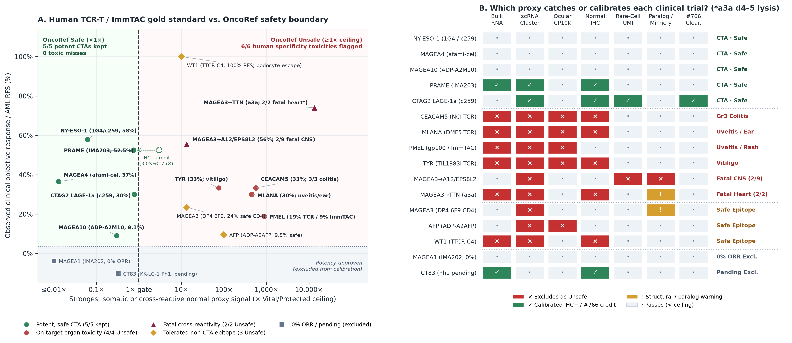
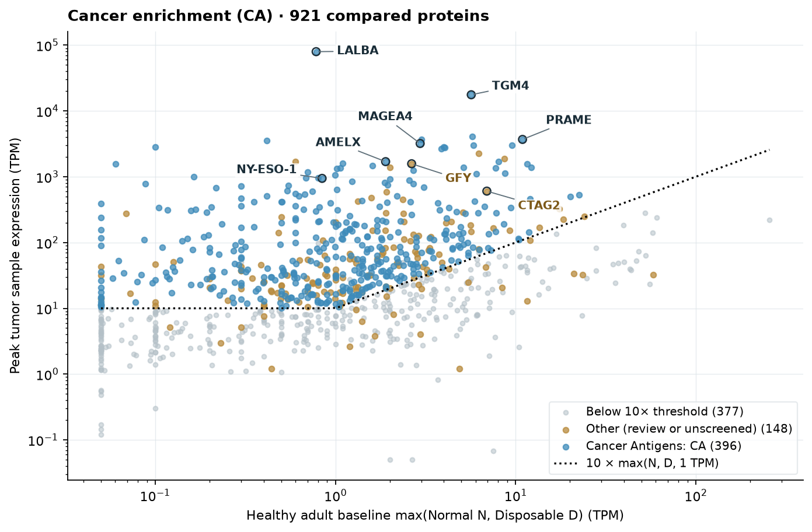
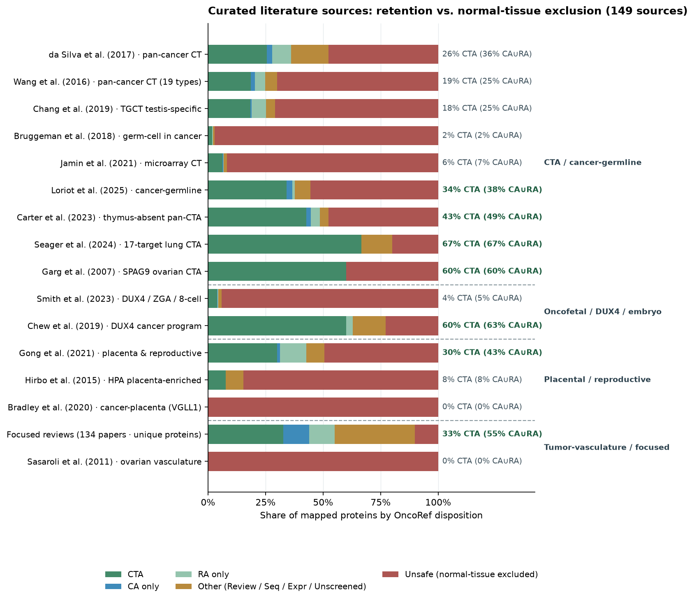
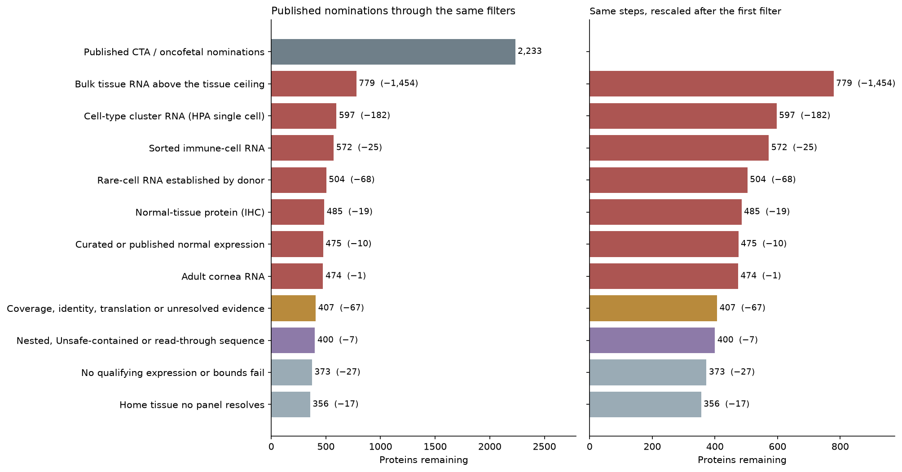
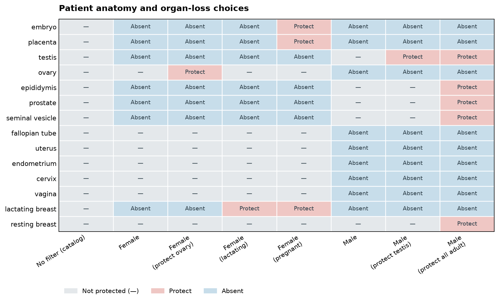
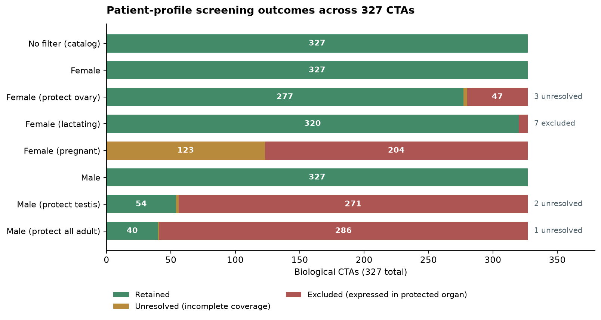
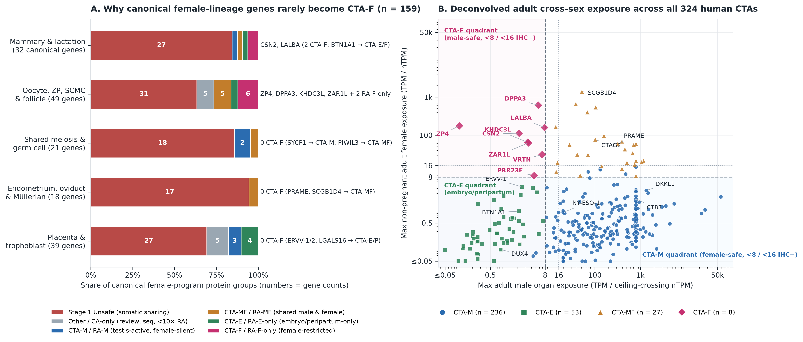
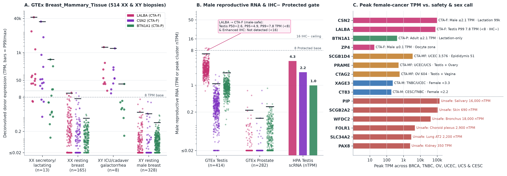

# Cancer-selective and cancer–testis antigens in OncoRef

*[Interactive protein catalog](audits/target-selection-20261110/rebuild/report.html) · [Multi-species whitepaper](species-antigen-whitepaper.md) · [Tissue injury hierarchy](tissue-hierarchy.md) · [Data & downloads](antigen-data.md)*

<p class="section-nav"><strong>Jump to:</strong> <a href="#categories">Categories</a> · <a href="#why-bulk-rna-alone-is-insufficient">Why multi-assay safety</a> · <a href="#clinical-toxicity-gold-standard-potency-proven-tcr-t-and-tcr-bispecific-trials">Clinical TCR gold standard</a> · <a href="#decision-tree-attrition-and-the-10-enrichment-rule">Decision tree &amp; 10× rule</a> · <a href="#published-cta-oncofetal-and-placental-lists">Published lists</a> · <a href="#peak-tumor-expression-and-edge-cases">Top tumor targets</a> · <a href="#tissue-injury-tiers-patient-profiles-and-sex-restricted-ctas">Tissue tiers &amp; sex-restricted CTAs</a> · <a href="#methods-protein-grouping-sources-and-thresholds">Methods</a> · <a href="#comparative-multi-species-framework-human-dog-and-mouse">Multi-species</a> · <a href="#reproducing-the-catalog-and-downloads">Reproducibility &amp; downloads</a></p>

Targeted cancer immunotherapies need proteins that are active in tumors and absent from healthy adult organs. Published cancer–testis antigen (CTA) lists often mix historical microarray nominations, incompatible expression scales, and patient-specific clinical assumptions into one table.

OncoRef screens the human coding proteome—**20,099** Ensembl 115 coding loci collapsed into **19,893** identical-sequence protein groups—with one rule set that separates normal-tissue safety, biological enrichment, and patient-specific organ protection.

## Categories

Every protein group lands in one of five mutually exclusive categories:

- <span class="cat cat-unsafe">Unsafe</span> (`18,249`): confirmed expression in vital, protected, or high-expression manageable adult somatic tissues. Normal-tissue expression always takes precedence over tumor expression.
- <span class="cat cat-other">Other</span> (`1,079`): kept out of the candidate sets without being confirmed <span class="cat cat-unsafe">Unsafe</span>—either because required evidence is incomplete or ambiguous (missing normal-tissue coverage, unresolved paralog attribution in single-cell data `Other:Review`, or sequence overlap with <span class="cat cat-unsafe">Unsafe</span> proteins `Other:Sequence`), or because tumor and reproductive expression do not qualify (below the 10× threshold `Other:Expression`, or an adult normal organ missing from bulk panels `Other:Unscreened tissue`).
- <span class="cat cat-ca">Cancer Antigens (CA)</span> (`424`): passes the safety and eligibility screens and reaches **≥10×** the non-thymic healthy adult baseline in at least one QC-passing tumor sample.
- <span class="cat cat-ra">Reproductive Antigens (RA)</span> (`465`): passes the same safety and eligibility screens and reaches **≥10×** the identical healthy baseline in an adult reproductive tissue sample or supported early-embryo lineage.
- <span class="cat cat-cta">Cancer–Testis Antigens (CTA)</span> (`324`): the intersection `CA ∩ RA`, clearing both cancer and reproductive/developmental enrichment while staying silent across healthy somatic organs. The union `CA ∪ RA` contains **565** candidate targets (`324` <span class="cat cat-cta">CTA</span>, `100` <span class="cat cat-ca">CA only</span>, `141` <span class="cat cat-ra">RA only</span>).


*Figure 1.* Proteome partition across the five categories. In `H₀ = max(Normal N, Disposable D, 1 TPM)`, `N` is the protein's highest native TPM across vital, protected, and manageable healthy adult somatic organs and sorted immune subsets, and `D` is its maximum across non-thymic Disposable organs (appendix, gallbladder, tonsil). Biological membership (<span class="cat cat-ca">CA</span>, <span class="cat cat-ra">RA</span>, <span class="cat cat-cta">CTA</span>) is independent of patient anatomy; patient-specific organ protection applies downstream without relabeling biological categories.

> These classifications are expression-screening calls, not clinical target certifications. Translation, antigen processing, peptide–MHC presentation, localization, and modality-specific safety require direct experimental validation.

## Why bulk RNA alone is insufficient

No single assay catches every normal-tissue risk. Each modality in OncoRef covers a blind spot left by the others:

**Multiple bulk RNA atlases and sorted immune panels.** Bulk RNA removes most ubiquitously expressed proteins, but individual atlases differ in organ coverage and donor sampling. Pairing GTEx v11 donor distributions with HPA v23 biopsies and brain subregions prevents single-atlas gaps from reading as silence. Sorted blood subsets (HPA, DICE, Monaco) catch immune-lineage transcripts diluted in whole blood or spleen.

**Single-cell clusters and rare-cell UMI atlases.** Bulk RNA averages across millions of cells, so a gene expressed strongly in 1–5% of a vital population—such as alveolar type 2 cells, cardiomyocytes, or cortical neurons—can sit below bulk cutoffs. Single-cell atlases (HPA clusters, Collin cornea, donor-resolved CELLxGENE Census and Siletti brain) catch these localized risks. Requiring ≥2 UMI per cell replicated across independent studies and donors avoids discarding real targets over ambient RNA, while placing paralog-ambiguous genes in `Other:Review` instead of auto-excluding them.

**Normal-tissue protein staining (IHC).** Steady-state mRNA does not always track protein abundance: stable proteins can persist at modest RNA, while low-level transcript noise does not always yield detectable protein. Reliable positive HPA immunohistochemistry in a vital or protected organ independently excludes a target; consistent negative IHC across routine contexts of a tissue gives calibrated headroom above low bulk RNA.

**Curated normal literature and specialized anatomy.** Standard bulk panels omit small adult organs such as olfactory epithelium and taste buds. Reviewed normal-expression literature and targeted anatomical studies either exclude vital/protected tissues or assign unmeasured adult tissues to `Other:Unscreened tissue`.


*Figure 2.* `Unsafe` proteins passing bulk tissue RNA ceilings that are caught by single-cell clusters, sorted immune subsets, normal IHC, donor-replicated rare-cell UMI counts, curated literature, or adult cornea scRNA. Bulk tissue RNA alone flags **17,507** `Unsafe` proteins; these six assays add **742** more (bars overlap where multiple non-bulk assays agree).

## Clinical toxicity gold standard: potency-proven TCR-T and TCR-bispecific trials

Healthy-tissue bulk TPM, single-cell clusters, normal immunohistochemistry, donor-resolved rare-cell UMI counts, and `1-mismatch` peptide-overlap screens are **mechanistic proxies**—not direct measurements of human T-cell toxicity. The empirical gold standard for intracellular target safety is **human clinical experience with peptide–MHC-directed T-cell receptors (`TCR-T` and soluble `ImmTAC` bispecifics) targeting endogenous self-encoded proteins in trials that achieved objective anti-tumor responses (`ORR > 0%`)**. Requiring confirmed clinical tumor shrinkage (or fulminant *in vivo* target-cell cytolysis) is essential: when a trial sees `0% ORR` (`IMA202` against `MAGEA1`, `0/16` responses), the absence of healthy-organ injury cannot prove the target tissue is antigen-negative, because TCR avidity, cell dose, or persistence may simply have been insufficient to kill antigen-bearing cells (`oncoref.tcr_trials.gold_standard`, `oncoref tcr-trials --table benchmark`).

Across **16** curated endogenous-protein clinical `TCR-T` / `ImmTAC` benchmark entries (**14** potency-proven regimens plus **2** segregated `0% ORR` or unreadout controls; somatic neoantigens such as `KRAS G12D` and viral antigens such as `HPV16 E6/E7` are excluded because they lack a germline normal-proteome counterpart), OncoRef's `1.0×` gate ceiling cleanly separates clinically safe CTAs from lethal or dose-limiting specificity toxicities ([download full benchmark CSV](antigen-whitepaper/clinical-tcr-gold-standard.csv)):

- **`100%` sensitivity to severe human clinical specificity toxicities (`6/6` flagged `Unsafe`, `0` false-safe misses):**
  - *On-target / off-tumor healthy-organ destruction (`4/4` `Unsafe`):* **`CEACAM5`** (`33%` ORR → `3/3` dose-limiting Grade 3 pan-colitis; `563×` colon enterocyte ceiling), **`MLANA` / MART-1** (`DMF5`, `30%` ORR → `70%` rash/vitiligo, `55%` anterior ocular uveitis, `50%` stria vascularis sensorineural hearing loss; `451×` ocular melanocyte `Vital` ceiling), **`PMEL` / gp100** (`19%` TCR-T ORR → `94%` rash, `25%` uveitis, `31%` hearing loss; soluble `tebentafusp` FDA-approved with `>80%` rash but minimal uveitis/ototoxicity across the blood–ocular/labyrinthine barrier; `889×` ocular melanocyte ceiling), and **`TYR` / tyrosinase** (`TIL1383I`, `33%` ORR → diffuse vitiligo; `75×` ocular melanocyte ceiling). Together, `MLANA`, `PMEL`, and `TYR` directly validate why OncoRef separates `Disposable` cutaneous melanocytes from `Vital` ocular and inner-ear pigment cells.
  - *Fatal paralog and structural off-target cross-reactivity (`2/2` `Unsafe`):* **`MAGEA3` (`HLA-A*02:01 / KVAELVHFL`, `56%` ORR → `2/9` fatal necrotizing leukoencephalopathy)** is missed in `MAGEA12` bulk brain RNA (`0.5 nTPM`, `0.13×`) but caught on primary `MAGEA3` colon `scRNA-seq` (`13.3×`), qPCR-corroborated rare-cell brain RNA on `MAGEA12` (`4.75%` ≥1-UMI, `0.40%` ≥2-UMI), `EPS8L2` (`46.1×`), and `#769` `1-mismatch` peptide overlap (`KVAELVHFL ↔ KMAELVHFL`). **`MAGEA3` (`HLA-A*01:01 / EVDPIGHLY` affinity-enhanced `a3a` TCR → `2/2` fatal cardiogenic shock within 4–5 days)** cross-recognized cardiac **`TTN`** (`ESDPIVAQY`, `53,894 nTPM` cardiomyocytes = `13,473×` ceiling; primary `MAGEA3` itself is also `Unsafe` at `13.3×`); because `4` of `9` residues differ, `a3a` also marks the boundary where sequence k-mers end and experimental X-scan / iPSC-cardiomyocyte screening is required for affinity-matured receptors.
- **`100%` recall on potency-proven clinically safe CTAs (`5/5` retained as `CTA`):** **`NY-ESO-1`** (`58%` ORR in Robbins 2015, `30%–80%` across MRCLS and myeloma, `0.06×`), **`MAGEA4`** (FDA-approved `afami-cel`, `37%` Phase 2 ORR, `0.01×`), **`PRAME`** (`IMA203`, `52.5%` u/cORR [`28.9%` overall / `54.5%` Ph1b cORR] across `40` patients without nephrotoxicity or adrenal insufficiency, `0.75×`), **`CTAG2` (`LAGE-1a`)** (`lete-cel`, `30%` pooled / `40%` standard-LDR MRCLS and `80%` myeloma ORR without pulmonary or urothelial toxicity, `0.78×`), and **`MAGEA10`** (`ADP-A2M10`, `9.1%` ORR, `0.30×`). Notably, **two of the five clinically proven safe CTAs (`PRAME` and `CTAG2`) require OncoRef's multi-modal calibration**—matched negative-IHC RNA headroom (`PRAME` shifts from `3.0×` naive RNA to `0.75×` under negative IHC) and isoform-scoped vascular perfusion clearance (`CTAG2` `ENST00000369585` `#766`)—to avoid false exclusion.
- **Conservative gene-level precision frontier (`3` tolerated non-CTA regimens flagged `Unsafe`):** **`WT1`** (`TTCR-C4`, `100%` post-HCT AML relapse-free survival without podocyte nephrotic syndrome; `9.9×` mesothelial RNA + podocyte IHC `High`), **`MAGEA3` (`HLA-DPB1*04:01` `6F9` CD4 TCR-T, `24%` ORR without CNS/cardiac toxicity; `13.3×` colon `scRNA`)**, and **`AFP`** (`ADP-A2AFP`, `9.5%` HCC ORR without autoimmune hepatitis; `98×` renal proximal tubule `scRNA`) were clinically tolerated for their specific `(peptide, HLA)` complexes—reflecting immunoproteasome-dependent differential processing (`WT1` `RMFPNAPYL`), MHC-II restriction, or sub-threshold parenchymal pMHC density. Gene-level screening intentionally remains `Unsafe` on these proteins because epitope-specific processing escape cannot be generalized across other peptides or surface-targeted modalities.
- **Segregated non-potent or unreadout controls (`2` entries excluded from safety calibration):** **`MAGEA1`** (`IMA202`, `0/16 = 0% ORR`) and **`CT83` / KK-LC-1** (ongoing Phase 1 `NCT05035407` / `NCT05483491`) are retained as `CTA-M` solely on independent multi-assay somatic silence (`0.00×` and `0.33×`), never credited as clinically cleared.



*Figure 3.* **(A)** Observed clinical objective response rate (or post-HCT AML relapse-free protection) versus strongest somatic or cross-reactive normal proxy signal (in multiples of OncoRef's `Vital`/`Protected` gate ceiling) across all **16** curated endogenous-protein `TCR-T` and `ImmTAC` regimens (`1.0×` vertical dashed line = OncoRef `Unsafe` boundary; gray band below `3.5%` = `0% ORR` / unreadout trials excluded from safety calibration). **(B)** Multi-assay proxy attribution matrix showing which screening layer catches each toxic target (`×`) or calibrates each clinically validated CTA (`✓`).

<details markdown="1">
<summary>Full 16-regimen clinical TCR-T &amp; ImmTAC gold-standard calibration table (download CSV)</summary>

Download the complete machine-readable benchmark: [`clinical-tcr-gold-standard.csv`](antigen-whitepaper/clinical-tcr-gold-standard.csv).

| Target (cross-hit) | Product · HLA · peptide | Potency (n, response) | Observed human clinical toxicity | OncoRef call & strongest proxy signal | Stratum |
| --- | --- | --- | --- | --- | --- |
| **NY-ESO-1** | 1G4-a95:LY / lete-cel (c259) · `HLA-A*02:01;HLA-A*02:05;HLA-A*02:06` · `SLLMWITQC` ([Robbins et al. Clin Cancer Res 2015](https://pubmed.ncbi.nlm.nih.gov/25538264/)) | n=38, **57.9%** ORR | Conditioning cytopenias and manageable CRS; zero attributed somatic solid-organ destruction (2 GBS cases across c259 program, 1 confounded day-161 cardiac arrest in MRCLS; separate TBI-1301 TCR had 1 steroid-responsive Gr3 lung infiltrate at 33% ORR) | `CTA` · white matter (0.5 nTPM vs 8 ceiling; N=0.84 TPM spleen) (`0.062×`) | Potent, safe CTA |
| **CTAG2** | lete-cel / NY-ESO-1-LAGE-1a c259 · `HLA-A*02:01;HLA-A*02:05;HLA-A*02:06` · `SLLMWITQC` ([D'Angelo et al. JCO 2025](https://doi.org/10.1200/JCO-24-01466)) | n=20, **30%** ORR | Conditioning cytopenias and CRS; zero pulmonary or urothelial toxicity despite first-pass IV lung perfusion | `CTA` · bronchus basal cells (24.9 nTPM vs 32 Enhanced IHC- ceiling; lung AT2 4.29% rare-cell cleared for LAGE-1a) (`0.778×`) | Potent, safe CTA |
| **MAGEA4** | afami-cel / c1032 (TECELRA; FDA-approved) · `HLA-A*02:01;HLA-A*02:02;HLA-A*02:03;HLA-A*02:06` · `GVYDGREHTV` ([D'Angelo et al. Lancet 2024](https://pubmed.ncbi.nlm.nih.gov/38554725/)) | n=52, **36.5%** ORR | Conditioning cytopenias and CRS (71% any-grade, 2% Gr>=3); zero MAGE-A4-directed solid-organ injury (0 treatment-related deaths in SPEARHEAD-1; 1 MAGE-A4-negative marrow aplasia and 1 stroke in Phase 1) | `CTA` · small intestine (0.1 nTPM vs 8 ceiling; N=2.95 TPM lymph node) (`0.013×`) | Potent, safe CTA |
| **PRAME** | anzu-cel / IMA203 (plus brenetafusp ImmTAC) · `HLA-A*02:01` · `SLLQHLIGL` ([Wermke et al. Nat Med 2025](https://doi.org/10.1038/s41591-025-03650-6)) | n=40, **52.5%** ORR | Conditioning cytopenias and mostly Gr1-2 CRS (1 reversible CRS-associated Gr4 transaminitis); zero clinical nephrotoxicity, adrenal insufficiency, or post-infusion treatment-related deaths | `CTA` · heart fibroblasts (12.0 nTPM vs 16 Supported IHC- ceiling; adrenal bulk N=10.93 TPM with negative IHC) (`0.75×`) | Potent, safe CTA |
| **MAGEA10** | ADP-A2M10 / c796 SPEAR T-cells · `HLA-A*02:01;HLA-A*02:06` · `GLYDGMEHL` ([Blumenschein et al. J Immunother Cancer 2022](https://pubmed.ncbi.nlm.nih.gov/35086946/)) | n=11, **9.1%** ORR | CRS (27%; 1 resolved Gr4 CRS with Gr2 delirium) and 1 day-98 aplastic anemia death post-second lymphodepletion; zero MAGE-A10 solid-organ toxicity | `CTA` · white matter (2.4 nTPM vs 8 ceiling; N=2.20 TPM) (`0.3×`) | Potent, safe CTA |
| **CEACAM5** | NCI murine anti-CEA(691-699) TCR-T · `HLA-A*02:01` · `IMIGVLVGV` ([Parkhurst et al. Mol Ther 2011](https://pubmed.ncbi.nlm.nih.gov/21157437/)) | n=3, **33.3%** ORR | 3/3 (100%) dose-limiting Grade 3 inflammatory pan-colitis from T-cell destruction of normal colonic mucosa (trial halted) | `Unsafe` · colon distal enterocytes (4503.2 nTPM vs 8 Protected ceiling; bulk 949 nTPM; IHC High) (`562.9×`) | On-target organ toxicity |
| **MLANA** | NCI DMF5 anti-MART-1 TCR-T (plus DMF4) · `HLA-A*02:01` · `AAGIGILTV` ([Johnson et al. Blood 2009](https://pubmed.ncbi.nlm.nih.gov/19451549/)) | n=20, **30%** ORR | Severe on-target melanocyte destruction: erythematous skin rash/vitiligo (14/20, 70%), anterior ocular uveitis (11/20, 55%), and inner-ear sensorineural hearing loss/vestibular dysfunction (10/20, 50%) | `Unsafe` · ocular melanocytes (18.05 CP10K vs 0.04 Vital ceiling; skin 110 nTPM) (`451.343×`) | On-target organ toxicity |
| **PMEL** | NCI murine anti-gp100(154) TCR-T & tebentafusp (KIMMTRAK) · `HLA-A*02:01` · `KTWGQYWQV;YLEPGPVTA` ([Johnson et al. Blood 2009](https://pubmed.ncbi.nlm.nih.gov/19451549/)) | n=16, **18.8%** ORR | gp100 TCR-T: skin rash/vitiligo (15/16, 94%), ocular uveitis (4/16, 25%), hearing loss (5/16, 31%); tebentafusp ImmTAC: >80% rash/pruritus (~21% Gr3) + vitiligo with minimal uveitis/ototoxicity | `Unsafe` · ocular melanocytes (35.56 CP10K vs 0.04 Vital ceiling; skin 112 nTPM) (`889.104×`) | On-target organ toxicity |
| **TYR** | TIL1383I CD8-independent anti-tyrosinase TCR-T · `HLA-A*02:01` · `YMDGTMSQV` ([Moore et al. Cancer Immunol Immunother 2018](https://pubmed.ncbi.nlm.nih.gov/29052782/)) | n=3, **33.3%** ORR | Progressive diffuse on-target vitiligo (cutaneous melanocyte destruction); ocular/uveal melanocyte risk flagged | `Unsafe` · ocular melanocytes (3.01 CP10K vs 0.04 Vital ceiling; skin melanocyte scRNA/IHC) (`75.25×`) | On-target organ toxicity |
| **MAGEA3** (`→ MAGEA12;EPS8L2`) | NCI murine anti-MAGE-A3(112-120) TCR-T · `HLA-A*02:01` · `KVAELVHFL` ([Morgan et al. J Immunother 2013](https://pubmed.ncbi.nlm.nih.gov/23377668/)) | n=9, **55.6%** ORR | 3/9 severe neurotoxicity and 2/9 (22%) FATAL necrotizing leukoencephalopathy / coma from cross-recognition of brain MAGEA12 (1-mm KMAELVHFL) and/or EPS8L2 (2-mm SAAELVHFL) | `Unsafe` · MAGEA3 colon scRNA (53.1/4=13.3x); MAGEA12 rare brain RNA (4.75% >=1-UMI & 0.40% >=2-UMI qPCR-confirmed; bulk brain 0.5 nTPM); EPS8L2 46.1x (`13.275×`) | Fatal cross-reactivity |
| **MAGEA3** (`→ TTN`) | Affinity-enhanced anti-MAGE-A3 a3a TCR-T · `HLA-A*01:01` · `EVDPIGHLY` ([Linette et al. Sci Transl Med 2013](https://pubmed.ncbi.nlm.nih.gov/23926201/)) | n=2, lethal d4–5 lysis | 2/2 (100%) FATAL cardiogenic shock and myocardial T-cell necrosis within 4-5 days via 4-mismatch mimicry of cardiac titin (TTN ESDPIVAQY) | `Unsafe` · MAGEA3 colon scRNA (13.3x) & off-target TTN cardiomyocytes (53893.6 nTPM vs 4 Vital ceiling) (`13473.4×`) | Fatal cross-reactivity |
| **MAGEA3** | NCI 6F9 patient-Treg-derived CD4+ TCR-T · `HLA-DPB1*04:01` · `KKLLTQHFVQENYLEY` ([Lu et al. JCO 2017](https://pubmed.ncbi.nlm.nih.gov/28809608/)) | n=17, **23.5%** ORR | Transient febrile CRS; zero neurotoxicity, cardiotoxicity, colitis, or treatment-related deaths | `Unsafe` · colon undifferentiated cells (53.1 nTPM vs 4 Vital ceiling) (`13.275×`) | Tolerated non-CTA epitope |
| **AFP** | ADP-A2AFP SPEAR TCR-T · `HLA-A*02:01` · `FMNKFIYEI` ([Meyer & Sangro et al. J Hepatol 2025](https://doi.org/10.1016/j.jhep.2025.07.033)) | n=21, **9.5%** ORR | Manageable CRS and cytopenias; no primary off-tumor autoimmune hepatitis or clinical nephrotoxicity | `Unsafe` · kidney proximal tubular cells (393.0 nTPM vs 4 Vital ceiling; adult cornea 0.052 CP10K) (`98.25×`) | Tolerated non-CTA epitope |
| **WT1** | TTCR-C4 EBV-specific CD8+ TCR-T · `HLA-A*02:01` · `RMFPNAPYL` ([Chapuis et al. Nat Med 2019](https://pubmed.ncbi.nlm.nih.gov/31235963/)) | n=12, **100%** RFS (44 mo) | Zero glomerular podocyte nephrotoxicity (no proteinuria/nephrotic syndrome) and zero mesothelial serositis (pleuritis/pericarditis) | `Unsafe` · mesothelial cells (79.3 nTPM vs 8 Protected ceiling) + glomerular podocyte IHC High (`9.912×`) | Tolerated non-CTA epitope |
| **MAGEA1** | IMA202 · `HLA-A*02:01` · `KVLEYVIKV` ([Wermke et al. J Immunother Cancer 2024](https://pubmed.ncbi.nlm.nih.gov/39038917/)) | n=16, **0%** ORR | Cytopenias and Gr1-2 CRS without solid-organ toxicity; 0% ORR precludes inferring in vivo cytolytic organ safety | `CTA` · intermediate monocyte (0.0 nTPM vs 16 ceiling; N=0.21 TPM) (`0×`) | Excluded (0% ORR / pending) |
| **CT83** | NCI / Rutgers anti-KK-LC-1 TCR-T · `HLA-A*01:01` · `NTDNNLAVY` ([Marcinkowski et al. J Immunother Cancer 2019 (preclinical)](https://clinicaltrials.gov/study/NCT05035407)) | Phase 1 pending | Pending peer-reviewed clinical readout | `CTA` · salivary gland (2.6 nTPM vs 8 ceiling; N=8.60 TPM cleared by negative IHC & Marcinkowski 2019 RNAscope) (`0.325×`) | Excluded (0% ORR / pending) |

</details>

## Decision tree, attrition, and the 10× enrichment rule

Every protein group follows a deterministic decision tree with strict precedence—normal-tissue safety first, then coverage and sequence eligibility, and finally symmetric **10×** enrichment in tumors and reproductive/embryonic compartments—narrowing **19,893** protein groups to **846** safety- and coverage-eligible proteins and **565** retained candidates (`CA ∪ RA`).


*Figure 4.* Exact classification decision tree showing every binary gate, precedence order, and terminal leaf count across all **19,893** protein groups.


*Figure 5.* Sequential attrition from **19,893** protein groups to **565** retained candidates, assigning each excluded protein once at its first failing gate. The broken x-axis above 3,000 keeps post-bulk filters readable. [Step counts (CSV)](audits/target-selection-20261110/rebuild/summary/funnel-all.csv).

Both enrichment routes apply the same threshold—**≥10×** above **H₀ = max(Normal N, Disposable D, 1 TPM)**—across **921** protein groups with complete healthy-panel TPM (**846** shared-eligible groups plus **75** ineligible `Other` groups with complete bulk panels). Points above the dotted line in `Other` clear the fold cutoff numerically while remaining held for locus-specific single-cell attribution or unmeasured anatomical sub-niches (`TBATA`, `DSPP`, `CAGE1`).



*Figure 6.* Cancer enrichment (<span class="cat cat-ca">CA</span>) across all **921** compared protein groups (values below 0.05 TPM clipped to the axis floor).


*Figure 7.* Reproductive and developmental enrichment (<span class="cat cat-ra">RA</span>) against the identical healthy adult baseline (values below 0.05 TPM clipped to the axis floor).

Exclusive category and locus counts across the coding proteome:

| Exclusive category | Protein records | Member loci |
| --- | --- | --- |
| CTA | 324 | 356 |
| Cancer Antigen only | 100 | 106 |
| Other:Expression | 282 | 289 |
| Other:Review | 731 | 732 |
| Other:Sequence | 48 | 50 |
| Other:Unscreened tissue | 18 | 18 |
| Reproductive Antigen only | 141 | 142 |
| Unsafe | 18,249 | 18,406 |

## Published CTA, oncofetal, and placental lists

OncoRef maps **149** curated papers across four antigen families: classical CTA / cancer–germline catalogs, oncofetal / DUX4 / early-embryo programs, placental and reproductive catalogs, and focused single-gene or tumor-vasculature studies. Literature citations are provenance metadata; a published nomination never overrides normal-tissue expression.

Retention tracks how strictly each paper screened healthy tissues. Focused modern CTA and DUX4 studies (`Seager et al. 2024`, `Chew et al. 2019`, `Carter et al. 2023`, `Loriot et al. 2025`) retain **34%–67% CTAs**, whereas broad germ-cell, microarray, ZGA, and cancer–placenta lists (`Bruggeman et al. 2018`, `Smith et al. 2023`, `Jamin et al. 2021`, `Bradley et al. 2020`) are **92%–100% `Unsafe`** under modern adult somatic screening.



*Figure 8.* Share of mapped protein groups (`n` shown per study) retained as <span class="cat cat-cta">CTA</span>, <span class="cat cat-ca">CA only</span>, or <span class="cat cat-ra">RA only</span> versus assigned to <span class="cat cat-other">Other</span> or <span class="cat cat-unsafe">Unsafe</span>. [Full 149-source table (CSV)](audits/target-selection-20261110/rebuild/summary/literature-sources.csv).

Of **2,233** published CTA or oncofetal nominations, **370** survive into the candidate union (`CA ∪ RA`)—including **246** of our **324** CTAs—while **78** CTAs are newly identified by the expression rules and **1,863** nominations fail normal-tissue, eligibility, or enrichment screens.


*Figure 9.* Overlap between rule-derived Cancer Antigens (**424**), Reproductive Antigens (**465**), and published CTA/oncofetal nominations (**2,233**).



*Figure 10.* Sequential attrition of **2,233** published CTA/oncofetal nominations through the same gates, leaving **370** candidates. [Step counts (CSV)](audits/target-selection-20261110/rebuild/summary/funnel-published.csv).

### Most-nominated individual proteins

Across **2,238** studied protein groups (**2,233** with a CTA nomination paper plus **5** clinical or familiar reference entries), below are the top ten by distinct curated CTA papers plus five familiar clinical anchors (`NY-ESO-1`, `PRAME`, `CT83`, `CTAG2`, `CAGE1`):

| Protein | CTA papers | Catalog | N TPM · site | RA peak TPM · context | Tumor TPM · cohort |
| --- | --- | --- | --- | --- | --- |
| MAGEA3 | 8 | Unsafe | NR | NR | NR |
| MAGEA4 | 8 | CTA | 2.95 · lymph node | 327.97 · 4-day embryo | 3,201.68 · SCLC |
| DCAF4L2 | 7 | CTA | 0.12 · substantia nigra | 59.96 · testis | 310.77 · NEC_LUNG_LARGECELL |
| MAGEA1 | 7 | CTA | 0.21 · spleen | 31.36 · testis | 346.43 · SCLC |
| MAGEA12 | 7 | Unsafe | NR | NR | NR |
| MAGEB2 | 7 | Unsafe | NR | NR | NR |
| CT83 | 6 | CTA | 8.6 · minor salivary gland | 445.31 · testis | 193.17 · CESC |
| CTCFL | 6 | Unsafe | NR | NR | NR |
| DPPA2 | 6 | CTA | 0.94 · naive B cells | 167.76 · 7-day epiblast | 398.83 · RT |
| GAGE1 | 6 | CTA | 0.7 · retina | 165.18 · 5-day trophectoderm | 1,181.9 · SKCM |
| PRAME | 6 | CTA | 10.93 · adrenal gland | 310.91 · testis | 3,692.46 · SCLC |
| NY-ESO-1 | 5 | CTA | 0.84 · spleen | 16.88 · testis | 944.32 · SARC_SYN |
| CAGE1 | 3 | Other:Review | 0.94 · stimulated CD4 T cells | 32.98 · testis | 17.4 · T_ALL |
| CTAG2 | 3 | CTA | 6.92 · urinary bladder | 101.92 · testis | 604.33 · OV |

`N` and the reproductive peak may come from different assays or donors ([full context table](antigen-whitepaper/studied-proteins.csv)). `NR` ("not run") marks proteins excluded as `Unsafe` in Stage 1 before native-TPM comparison (MAGEA3, MAGEA12, MAGEB2, CTCFL); tumor or testis libraries may still contain those transcripts.

### Studied proteins in Other or Unsafe

Of **58** protein groups in the familiar or clinical reference panels, **28** land in `Other` or `Unsafe`. Neither label predicts clinical toxicity for a specific therapeutic product; each records the strongest normal-tissue or rare-cell finding observed across the healthy adult panels:

| Studied protein | Category | Excluding or review gate | Strongest measured normal signal |
| --- | --- | --- | --- |
| MAGEA3 | Unsafe | Single-cell clusters (HPA) | colon, undifferentiated cells · 53.1 nTPM (ceiling 4) |
| MAGEA12 | Unsafe | Donor rare-cell RNA (qPCR-confirmed) | brain, pericyte · 0.40% of cells (≥2 molecules) |
| CTCFL | Unsafe | Bulk tissue RNA | white matter, bulk · 15 nTPM (ceiling 4) |
| DDX43 | Unsafe | Normal IHC + Single-cell clusters (HPA) + Sorted immune RNA + Donor rare-cell RNA | blood, NK · 21.09 TPM (ceiling 8) |
| SPA17 | Unsafe | Normal IHC + Bulk tissue RNA + Single-cell clusters (HPA) + Adult cornea scRNA + Donor rare-cell RNA | lung, ciliated cells · 345.8 nTPM (ceiling 8) |
| CLDN6 | Unsafe | Bulk tissue RNA + Single-cell clusters (HPA) | pancreas, ductal cells · 64.8 nTPM (ceiling 8) |
| DAZL | Unsafe | #711 confounder rejected (eye astrocyte) | eye, astrocyte · 5.86% of cells (≥2 molecules) |
| POTEC | Other:Review | Donor rare-cell RNA (replicated, paralog-ambiguous) | eye, corneal endothelial cell · 12.07% of cells (≥2 molecules) |
| CAGE1 | Other:Review | Donor rare-cell RNA (replicated, paralog-ambiguous) | brain, dopaminergic neuron · 3.29% of cells (≥2 molecules) |

## Peak tumor expression and edge cases

Across the **565** candidate union, **159** protein groups reach **≥100 TPM** in at least one QC-passing tumor sample, **29** reach **≥1,000 TPM**, and **135** have **≥10 known independent patients** crossing the 10× cutoff. Median peak tumor expression is **71.47 TPM** for `CTA` and **31.62 TPM** for `CA only`.

Each table below ranks the top ten protein groups in its category by peak QC-passing tumor TPM ([all 565 candidates](antigen-whitepaper/tumor-ranks.csv)); `Unsafe` proteins (`18,249`) exit in Stage 1 before tumor comparison. Because `Tumor fold` divides by `max(N, D, 1 TPM)`, fold equals `Tumor TPM` whenever both `N` and `D` are below 1 TPM (`LALBA`, `SCGB1D4`, `VCY/1B`). In `Other`, high tumor peaks (`TBATA`, `DSPP`, `CAGE1`) reflect unresolved single-cell or unmeasured sub-niche reviews rather than low expression. Peak TPM measures single-library abundance, not the fraction of malignant cells expressing the protein.

### CTA

Top 10 of 324 groups by peak tumor sample TPM.

| Rank | Protein | Peak cohort | Tumor TPM | N TPM | Reproductive peak TPM | Tumor fold | Known patients at 10× |
| --- | --- | --- | --- | --- | --- | --- | --- |
| 1 | CSN2 | BRCA | 99,761.81 | 2.99 | 28,460.4 | 33,398.2 | 23 |
| 2 | LALBA | BRCA | 79,700.44 | 0.78 | 45,625.2 | 79,700.44 | 25 |
| 3 | TGM4 | PRAD | 17,629.45 | 5.67 | 22,106.5 | 3,107.11 | 94 |
| 4 | XAGE1A/B | BRCA | 4,068.64 | 5.74 | 362.73 | 709.23 | 988 |
| 5 | SPANXA1/2 | ESCA | 3,700.06 | 3 | 77.07 | 1,233.35 | 61 |
| 6 | PRAME | SCLC | 3,692.46 | 10.93 | 310.91 | 337.97 | 1,206 |
| 7 | SCGB1D4 | UCEC | 3,576.17 | 0.42 | 1,383.54 | 3,576.17 | 49 |
| 8 | MAGEA4 | SCLC | 3,201.68 | 2.95 | 327.97 | 1,083.95 | 745 |
| 9 | RLN1 | PRAD | 3,039.25 | 5.85 | 268.82 | 519.47 | 127 |
| 10 | SEMG2 | PRAD | 3,033.78 | 9.52 | 26,737.9 | 318.52 | 7 |

### CA only

Top 10 of 100 groups by peak tumor sample TPM.

| Rank | Protein | Peak cohort | Tumor TPM | N TPM | Reproductive peak TPM | Tumor fold | Known patients at 10× |
| --- | --- | --- | --- | --- | --- | --- | --- |
| 1 | AMELX | RT | 1,696.17 | 1.9 | 1.53 | 892.72 | 30 |
| 2 | HOXC12 | WILMS | 1,559.28 | 11.6 | 2.93 | 134.47 | 9 |
| 3 | RPS4Y2 | B_ALL | 1,394.88 | 12.19 | 9.96 | 114.4 | 49 |
| 4 | GALP | SARC_DSRCT | 1,332.56 | 1.02 | 0.85 | 1,308.13 | 22 |
| 5 | ZACN | SCLC | 526.62 | 22.49 | 9.23 | 23.41 | 1 |
| 6 | IL36B | SARC_UPS | 498.45 | 20.17 | 7.59 | 24.71 | 1 |
| 7 | SRMS | NET_RECTAL | 463.74 | 12.05 | 27.14 | 38.47 | 0 |
| 8 | CSAG3 | LUSC | 336.48 | 4.27 | 5.79 | 78.72 | 401 |
| 9 | DBX1 | SCLC | 297.51 | 0.78 | 1.47 | 297.51 | 74 |
| 10 | HOXD12 | NBL | 279.91 | 6.2 | 11.78 | 45.12 | 15 |

### RA only

Top 10 of 141 groups by peak tumor sample TPM.

| Rank | Protein | Peak cohort | Tumor TPM | N TPM | Reproductive peak TPM | Tumor fold | Known patients at 10× |
| --- | --- | --- | --- | --- | --- | --- | --- |
| 1 | STPG3 | NEC_MERKEL | 136.45 | 16.79 | 196.89 | 8.13 | 0 |
| 2 | PABPN1L | T_ALL | 53.93 | 11.77 | 585.75 | 4.58 | 0 |
| 3 | OR51C1 | PRAD | 50 | 2.37 | 43.5 | 21.08 | 8 |
| 4 | TMEM262 | NEC_LUNG_LARGECELL | 47.43 | 7.03 | 123.95 | 6.74 | 0 |
| 5 | TOMM20L | T_ALL | 46.57 | 6.16 | 73.76 | 7.57 | 0 |
| 6 | RSPH6A | THCA | 37.92 | 11.62 | 157.75 | 3.26 | 0 |
| 7 | CAPZA3 | GBC | 35.6 | 4.46 | 1,435.97 | 7.99 | 0 |
| 8 | ADIG | THCA | 33.82 | 7.04 | 229.73 | 4.8 | 0 |
| 9 | RFPL3 | CLL | 29.22 | 3.2 | 97.06 | 9.13 | 0 |
| 10 | TMCO2 | T_ALL | 29.03 | 2.96 | 636.52 | 9.81 | 0 |

### Other

Top 10 of 356 groups with complete baseline TPM (out of 1,079 total `Other` groups).

| Rank | Protein | Peak cohort | Tumor TPM | N TPM | Reproductive peak TPM | Tumor fold | Known patients at 10× |
| --- | --- | --- | --- | --- | --- | --- | --- |
| 1 | TBATA | THYM | 2,250.3 | 6.26 | 116.44 | 359.45 | 101 |
| 2 | KRT9 | PCPG | 1,865.83 | 8.65 | 7.03 | 215.65 | 16 |
| 3 | DSPP | HEPB | 1,695.58 | 0.6 | 0.17 | 1,695.58 | 1 |
| 4 | RIPPLY3 | RT | 450.15 | 2.36 | 10.02 | 190.41 | 29 |
| 5 | VCX3B | BRCA | 420.74 | 1.33 | 181.54 | 316.01 | 87 |
| 6 | PSG3 | LUAD | 326.38 | 17.41 | 1,155.62 | 18.74 | 1 |
| 7 | GSX2 | LAML_ELNint | 287.56 | 5.09 | 8.6 | 56.48 | 8 |
| 8 | RGPD3 | T_ALL | 284.71 | 1.91 | 20.78 | 149.32 | 43 |
| 9 | LCE3C | HNSC | 284.56 | 4.57 | 6.87 | 5.43 | 0 |
| 10 | PSMB11 | THYM | 274.75 | 2.39 | 3.36 | 115.13 | 74 |

### Worked edge cases

**`CTAG2` (LAGE-1) → `CTA` (isoform-scoped clinical pMHC clearance, `#766`).** In peripheral bulk TPM, `CTAG2` clears both enrichment rules: its highest peripheral reference is **urinary bladder** at **6.92 TPM** (10× cutoff **69.25 TPM**), testis reaches **101.92 TPM** (**14.72×**), and ovarian cancer reaches **604.33 TPM** across **375** known patients at 10×. In donor-resolved single-cell atlases, **lung** (alveolar type 2 cells) and **brain** (cortical glutamatergic neurons) pass the multi-study donor-replication screen while sharing **50.9%** of transcript 31-mers across the closed `Xq28` `CTAG1A`/`CTAG1B`/`CTAG2` cluster (`0.0%` external `Unsafe` 31-mer overlap):

| Organ | Strongest population | Independent studies | Donor IDs with signal (linked where known) | Cells with ≥2 molecules in top donor | Grading |
| --- | --- | --- | --- | --- | --- |
| lung | pulmonary alveolar type 2 cell | 2 | 3 | 166/3,865 (4.29%) | unresolved |
| brain | L5 extratelencephalic projecting glutamatergic cortical neuron | 2 | 2 | 70/2,201 (3.18%) | unresolved |

Under `oncoref.clinical_organ_clearance` ([audit `#766`](audits/clinical-organ-clearance-20261123/index.md)), adoptive `lete-cel` (`c259`, `HLA-A*02:01 / SLLMWITQC`) TCR-T infusions across synovial sarcoma, MRCLS, NSCLC, and myeloma cohorts without on-target pulmonary or urothelial injury clear `lung` and `urinary bladder` specifically for `ENST00000369585` (`LAGE-1a`, `180 aa`), while `#711` `Xq28` attribution (`0.15 TPM` bulk brain) resolves the cortical nuclear signal—restoring `CTAG2` to **`CTA`**. Because `ENST00000247306` (`LAGE-1b`, `210 aa`) lacks `SLLMWITQC` and a separate heart review recorded a confounded day-161 cardiac event ([heart review](audits/ctag2-heart-evidence.md)), `CTAG2` carries `clinical_clearance_scope = "epitope"` and `clinical_unverified_isoforms = ["ENST00000247306"]` for downstream epitope selection.

**`PLAC1` & `DUX4` → `CTA` (nuclear `snRNA-seq` spillover `#765` + closed `D4Z4` repeat equivalence `#767`).** Intron-inclusive cortical `snRNA-seq` flags `PLAC1` across a `197.7 kb` non-coding 5'-UTR intron `5.2 kb` downstream of somatic `PABIR2` (`54.1 TPM`), yet cytoplasmic polyA bulk brain RNA is `0.0051 TPM`, somatic IHC is `0/4`, and MS immunopeptidomics is strictly `CANCER_ONLY`—clearing `PLAC1` (`152.6 TPM` Wilms tumor, `187.0 TPM` placenta) to `CTA` (`CTA-M`) with `rare_cell_status = "nuclear_only"`, whereas negative-control `MAGEA12` (`0.30 TPM` bulk brain, fatal neurotoxicity precedent) stays `Unsafe` ([audit `#765`](audits/nuclear-rna-spillover-20261123/index.md)). Symmetrically summing `DUX4` with all `20` primary-assembly `D4Z4` `DUX4L*` repeat units confirms `0.00 TPM` donor P95 in GTEx Skeletal Muscle (`FSHD` locus) and Skin, advancing cleavage-stage `DUX4` jointly under `#765 + #767` to `CTA` (`CTA-E`, [audit `#767`](audits/repeat-family-equivalence-20261123/index.md)).

**`GFY` (*Goofy*) & `SP7` → `Unsafe` (adult unmeasured-home panels `#735` & `2.5%` OR gDNA tumor QC).** `GFY` (`1,575.56 TPM` in `RT`) and `SP7` (`590.49 TPM` in `SARC_OS`) previously sat in `Other:Unscreened tissue` because olfactory epithelium and mineralized bone are absent from GTEx/HPA bulk panels. Integrating SHA-256-pinned adult human olfactory (`GFY`: **94.1%** of mature olfactory sensory neurons, `>300 TPM`) and mandible bone (`SP7`: **193.0 TPM** donor P95 vs. `4.0 TPM` Vital ceiling) panels—paired with hair-bearing GTEx skin `P99 ≤ 0.50 TPM` / `max < 4.0 TPM` bounds across `1,405` leg/suprapubic biopsies and a tightened **`≤ 2.5%` olfactory-receptor `≥ 5 TPM` genomic-DNA ceiling** across tumor libraries (`94` gDNA-contaminated tumor samples excluded across `NEC_MERKEL`, `SARC_PEC`, `BL`, `HL`, `MCL`, `B_ALL`, `LAML`, and `T_ALL`)—reclassifies `5` ceiling-violating proteins (`GFY`, `SP7`, `PANX3`, `BPIFB3`, `GLYATL3`) to **`Unsafe`**, promotes `36` adult-silent home-gated genes (`TAS1R2`, `KRTAP20-3`, `KRTAP21-2`, `KRTAP21-3`, `KRTAP6-2`) to `CA only` plus **`OR10J1` and `KRTAP20-4` to `CTA` (`CTA-M`)**, demotes `17` ectopic `OR*`s and `10` single-cohort intronless spermatid genes (`CAPZA3`, `DNAJB8`, `IQCF2/6`, `MAGEB18`, `RNASE9`, `TMEM225`, `SPATA31A6`, `SMIM42`, `ZCCHC13`) out of `CA`/`CTA`, and keeps unmeasured sub-niches (`DSPP` odontoblast process, `CALHM3` type II taste cells) in `Other:Unscreened tissue`.

## Tissue injury tiers, patient profiles, and sex-restricted CTAs

OncoRef separates three tissue-policy questions: **anatomical role** (healthy baseline vs. <span class="cat cat-ra">RA</span>-qualifying reproductive/embryonic tissue vs. `thymic`), **adult injury tier** (clinical consequence of sustained organ or cell-type loss), and **patient-specific organ protection** (downstream anatomy and tolerance via `--profile`). A tissue can qualify <span class="cat cat-ra">RA</span> while retaining a protective rating—adult testis qualifies <span class="cat cat-ra">RA</span> while carrying a `Protected` injury tier, and breast biopsies are split into lactating versus resting mammary via a coordinated milk-program signature (`LALBA`, `CSN1S1`, `CSN2`, `CSN3`).

| Adult injury tier | Policy interpretation | Examples |
|---|---|---|
| **Vital** | Loss threatens life, essential repair, or major sensory/neurological function | Heart, neurons, corneal endothelium |
| **Protected** | Persistent loss is consequential and clinical compensation is poorly established | Salivary gland, whole skin, adult testis |
| **Manageable** | Defined loss has an established precedent for clinical compensation or replacement | Thyroid, mature B cells |
| **Disposable** | A narrow compartment carries a specific loss allowance | Cutaneous melanocytes, hair follicles, gallbladder, adult whole thymus |

Bulk measurements inherit the organ tier; permissive cell-type exceptions require resolved cell identity, and mixed populations keep the more protective tier ([organ and cell hierarchy](tissue-hierarchy.md), [tissue tier policy](tissue-tiers.md)).

### Adult thymus

Adult whole thymus is rated `Disposable` under the organ-loss hierarchy, while defined immune subsets retain their own injury tiers. Because medullary thymic epithelial cells (mTECs) express tissue-restricted antigens during central tolerance ([human mTEC study](https://pmc.ncbi.nlm.nih.gov/articles/PMC2211762/)), bulk thymus sits in the `thymic` scope and is excluded from both enrichment denominators (`N` and `D`). Independent normal-expression and protein screens still apply, alongside the observational association between adult thymectomy and higher mortality and cancer incidence ([thymectomy cohort](https://pubmed.ncbi.nlm.nih.gov/37530823/)).

### Biological membership versus patient-specific filtering

Biological <span class="cat cat-cta">CTA</span>, <span class="cat cat-ca">CA</span>, and <span class="cat cat-ra">RA</span> labels record where a protein is expressed, not what a particular patient can safely lose. Default biological sets leave reproductive tissues unprotected until you opt in. Downstream patient profiles (`female-patient`, `male-patient`, lactation, pregnancy, or custom overrides) mark each compartment as <span class="cat cat-protect">Protect</span>, <span class="cat cat-loss">Accept loss</span>, or <span class="cat cat-absent">Absent</span> ([rules and limits](host-selection.md)). Protecting testis narrows the **324** biological CTAs to **75** retained candidates; pregnancy leaves **0** retained (**142** unresolved due to incomplete developmental coverage, **182** excluded by expression in a protected organ).



*Figure 11.* Compartment choices (<span class="cat cat-protect">Protect</span>, <span class="cat cat-loss">Accept loss</span>, <span class="cat cat-absent">Absent</span>, or unprotected) across standard patient profiles.



*Figure 12.* Downstream screening outcomes across all **324** biological CTAs under each patient profile. Filtering a candidate out for one patient narrows the target list and expands the peptide-subtraction background without relabeling its biological <span class="cat cat-cta">CTA</span> identity.

### Sex-restricted reproductive antigens and cross-sex CTAs

Because male and female reproductive organs are anatomically distinct, an antigen restricted to one sex's reproductive tract has no normal target organ in non-pregnant, non-lactating patients of the opposite sex. Crucially, `HostContext` (`oncoref.host_context`) uses the **same `Protected` + negative-IHC calibration as Stage 1 somatic safety (`8.0 TPM / 8.0 nTPM` base ceiling, raised `2×` to `16.0 TPM / 16.0 nTPM` in human compartments where routine IHC is `not_detected`)**—empirically anchored by the Clinical TCR Gold Standard (`IMA203` on `PRAME` at `10.93 TPM` adrenal / `12.0 nTPM` heart fibroblasts with negative IHC and `0` organ toxicity at `52.5%` ORR). To keep reproductive-only (`RA`) and cancer–reproductive (`CTA`) selectors completely symmetric across the API, CLI (`--set`), and coverage tools, OncoRef partitions all **465** Reproductive Antigens and **324** CTAs into four orthogonal non-pregnant adult sex-restriction classes (**`RA-M` / `CTA-M`**, **`RA-E` / `CTA-E`**, **`RA-F` / `CTA-F`**, **`RA-MF` / `CTA-MF`**, with `RA-{M,E,F,MF}-only` denoting `RA \ CA` rows and legacy aliases `MRA`, `ERA`, `FRA`, `SRA`), alongside a non-exclusive peripartum/lactation selector (**`RA-P` / `CTA-P`**, legacy alias `PRA`):

| Sex-restriction class | All RAs (`RA-*`) | CTAs (`CTA-*`) | RA-only (`RA-*-only`) | Adult host-protection criterion | Representative proteins |
| --- | --- | --- | --- | --- | --- |
| **Male-restricted** | `RA-M` (`MRA`): **359** | `CTA-M`: **236** | `RA-M-only`: **123** | Clears all non-pregnant, non-lactating female adult organs (`ovary`, female tract, `XX resting_breast` < 8; < 16 with `IHC−`) | `NY-ESO-1`, `MAGEA4`, `XAGE1A/B`, `VCY/1B`, `CT83`, `TGM4`, `SEMG2`, `PLAC1`, `XAGE3`, `DKKL1`, `SYCP1` |
| **Embryo / peripartum-only** | `RA-E` (`ERA`): **65** | `CTA-E`: **53** | `RA-E-only`: **12** | Clears all non-pregnant, non-lactating adult reproductive and resting-mammary organs in **both** sexes (< 8; < 16 with `IHC−`) | `DUX4`, `ERVV-1`, `ERVV-2`, `LGALS16`, `BTN1A1`, `TBXT`, `OR1N1`, `CER1`, `PSG7` (`RA-E-only`), `BMP15` (`RA-E-only`) |
| **Female-restricted** | `RA-F` (`FRA`): **11** | `CTA-F`: **8** | `RA-F-only`: **3** | Clears all male adult organs (`testis`, `epididymis`, `prostate`, `seminal vesicle`, non-secretory `XY resting_breast` < 8; < 16 with `IHC−`) | `CSN2`, `LALBA`, `ZP4`, `DPPA3`, `KHDC3L`, `ZAR1L`, `VRTN`, `PRR23E`, `PABPN1L` (`RA-F-only`), `WEE2` (`RA-F-only`), `TLE7` (`RA-F-only`) |
| **Shared male & female** | `RA-MF` (`SRA`): **30** | `CTA-MF`: **27** | `RA-MF-only`: **3** | ≥ 8 TPM/nTPM (or ≥ 16 with `IHC−`, or positive IHC) in adult organs of both sexes | `PRAME`, `SCGB1D4`, `CTAG2`, `ACTL8`, `NLRP4`, `OOSP2`, `PIWIL3`, `FOXR1`, `NLRP13` (`RA-MF-only`), `H1-8` (`RA-MF-only`) |
| **Peripartum / lactation** *(non-exclusive)* | `RA-P` (`PRA`): **19** | `CTA-P`: **16** | `RA-P \ CTA-P`: **3** | Qualifies ≥ 10× or crosses calibrated `HostContext` ceiling in `placenta` or `lactating_breast` across any adult class | `LALBA`, `CSN2` (`CTA-F`); `BTN1A1`, `ERVV-1/2`, `LGALS16` (`CTA-E`); `PLAC1`, `XAGE3`, `MAGEA4/8/10` (`CTA-M`); `CTAG2` (`CTA-MF`) |

- **Male-Restricted (`RA-M`, `359` RAs · `CTA-M`, `236` CTAs · `RA-M-only`, `123` — non-pregnant female-safe):** expressed in male reproductive organs (`testis`, `epididymis`, `prostate`, `seminal vesicle`) and cleanly clearing every non-pregnant, non-lactating female adult reproductive and mammary organ (`XAGE1A/B`, `SPANXA1/2`, `MAGEA4`, `NY-ESO-1`, `VCY/1B`, `PRM1`, `SPATA19`, `CT83`, `ODF1`, `ADAM2`, `DKKL1`, `SYCP1`, `GAGE2A`, `PAGE1`, `KRTAP20-4`, plus male-accessory/prostate targets such as `TGM4`, `SEMG2`, `PRR23D1/2`, `SPAG11A`, `POTEH`, `EDDM3B`). Because **336 of 514** (`65.4%`) GTEx `Breast_Mammary_Tissue` biopsies come from genetically `XY` male cadavers (`#776`, `#779`), OncoRef stratifies `resting_breast` by biological donor sex (`XX` female vs. `XY` male) and secretory state on deconvolved GTEx v11 and ambient-soup-cleaned HPA breast `scRNA-seq` (`TGM4` female `resting_breast` = `0.68 TPM` vs. `14.64 TPM` male; `SEMG2` = `0.11 TPM` female vs. `9.64 TPM` male; `CT83` = `1.89 TPM` female vs. `0.80 TPM` male), and backfills GTEx-v11-missing `vagina`/`uterus` measurements from pinned `rna_tissue_gtex:v23` and `hpa_tissue_samples:v23` (`TSSK2` → `RA-M-only`, `IZUMO1R` → `CTA-E`).
- **Embryo / Peripartum-Only (`RA-E`, `65` RAs · `CTA-E`, `53` CTAs · `RA-E-only`, `12` — adult-absent across non-pregnant, non-lactating men & women):** cleanly clear all adult male and non-pregnant, non-lactating adult female reproductive and resting-mammary organs (`DUX4`, `ERVV-1`, `ERVV-2`, `LGALS16`, `BTN1A1`, `TBXT`, `IZUMO1R`, `MBD3L2`, `SSU72L2`, `TRIM48`, `TRIM43B`, `OR1N1`, `CER1`). Why unify `embryo`, `placenta`, and `lactating_breast` in the 4-way adult partition rather than splitting a separate adult-partition `CTA-P` bin? Although **161** RAs (**138** CTAs) reach ≥10× in `embryo`, `placenta`, or `lactating_breast`, most (`70` RAs / `64` CTAs, including `MAGEA4`, `VCY/1B`, `PAGE2`, `PLAC1`, `XAGE3`, and `MAGEA10`) remain active in adult `testis` and classify as `RA-M`/`CTA-M`, while `15` RAs (`13` CTAs) remain active across both sexes (`RA-MF`/`CTA-MF`) and `11` RAs (`8` CTAs, e.g. `LALBA`, `CSN2`, `DPPA3`, `ZP4`, `KHDC3L`) remain active in non-pregnant female oocytes or resting breast (`RA-F`/`CTA-F`). Among the **53** adult-absent `CTA-E` proteins, **49 (`92%`) are pure preimplantation/gastrulation `embryo` factors** and only **4 (`ERVV-1`, `ERVV-2`, `LGALS16`, `BTN1A1`)** qualify via `placenta` or `lactating_breast`. Instead of fragmenting the 4-way adult partition for 4 proteins, OncoRef provides **`CTA-P` (`16` CTAs) / `RA-P` (`19` RAs)** as a **non-exclusive physiological selector** (`antigen_sets.select("CTA-P")` / `--set CTA-P`) spanning every placental and lactation antigen across all adult classes (`LALBA`, `CSN2`, `BTN1A1`, `ERVV-1`, `ERVV-2`, `LGALS16`, `PLAC1`, `XAGE3`, `MAGEA4/8/10`, `DPPA2`, `RFPL4B`, `CTAG2`, `TMEM31`, `C20orf141`).
- **Female-Restricted (`RA-F`, `11` RAs · `CTA-F`, `8` CTAs · `RA-F-only`, `3` — male-safe):** expressed in non-pregnant adult female reproductive or resting-mammary compartments (`ovary`/oocytes, female tract, `XX resting_breast`, alongside lactation/embryo peaks) while cleanly clearing all male adult reproductive organs and non-secretory `XY resting_breast` under the calibrated `Protected` + `IHC−` gate (`CSN2`, `LALBA`, `ZP4`, `DPPA3`, `KHDC3L`, `ZAR1L`, `VRTN`, `PRR23E`).
- **Shared Male & Female (`RA-MF`, `30` RAs · `CTA-MF`, `27` CTAs · `RA-MF-only`, `3`):** exceed the calibrated `HostContext` ceiling (`≥8 TPM/nTPM`, `≥16` with `not_detected` IHC, or positive IHC) in adult reproductive or resting-mammary organs of both sexes (`PRAME`, `SCGB1D4`, `CTAG2`, `ACTL8`, `NLRP4`, `OOSP2`, `PIWIL3`, `FOXR1`).

The cross-sex asymmetry remains stark even under harmonized `Protected` + `IHC−` thresholds: **289** of **324** CTAs (`CTA-M + CTA-E`, **89.2%**) clear every adult female organ in non-pregnant, non-lactating women, whereas **61** (`CTA-F + CTA-E`, **18.8%**) belong to the male-safe `CTA-F + CTA-E` sets, with **`CTA-M` outnumbering `CTA-F` by 30 to 1 (`236` vs. `8`)** and **`RA-M` outnumbering `RA-F` by 33 to 1 (`359` vs. `11`)** ([download full sex-restricted table](antigen-whitepaper/sex-restricted-antigens.csv)).



*Figure 13.* **(A)** Fate of **159** canonical mammary, oocyte/follicular, meiotic, Müllerian/endometrial, and placental protein groups across OncoRef's safety, enrichment, and sex-restriction gates ([full `159`-gene audit CSV](antigen-whitepaper/female-lineage-audit.csv)). **(B)** Live deconvolved adult male versus non-pregnant, non-lactating adult female exposure across all **324** human CTAs (`8 TPM / 8 nTPM` `Protected` base dashed lines; `16 TPM / 16 nTPM` `IHC−` ceiling dotted lines).

#### Why so few `CTA-F` and `RA-F` antigens exist—even across `BRCA_TNBC`, `OV`, `UCEC`, `UCS`, and `CESC`

Across the entire human coding proteome (`19,893` protein groups), **10,000** protein groups reach `≥10 nTPM` in at least one non-placental adult female reproductive or mammary organ (`ovary`, `endometrium`, `fallopian tube`, `cervix`, `vagina`, `breast`), yet **9,993 (99.93%) fail Stage 1 normal-tissue safety (`Unsafe`)** (`9,980` by bulk somatic RNA, `9,924` by HPA somatic `scRNA-seq` clusters, and `6,805` by HPA somatic immunohistochemistry), leaving just **27** protein groups in the entire genome with non-placental female consensus `≥10 nTPM` and somatic consensus `<4 nTPM`. Auditing **159** canonical female-program genes across five biological lineages reveals four distinct quantitative mechanisms driving this attrition:

| Canonical female program | Genes | Stage 1 Unsafe | Other / CA-only | RA-M / CTA-M | RA-MF / CTA-MF | RA-E / CTA-E | RA-F (`CTA-F` / `RA-F-only`) |
| --- | --- | --- | --- | --- | --- | --- | --- |
| **Mammary & lactation** | 32 | 27 (84%) | 0 | 1 | 1 | 1 | **2** (`LALBA` (CTA-F), `CSN2` (CTA-F)) |
| **Oocyte, ZP, SCMC & follicle** | 49 | 31 (63%) | 5 | 0 | 5 | 2 | **6** (`ZP4` (CTA-F), `WEE2` (RA-F-only), `PABPN1L` (RA-F-only), `ZAR1L` (CTA-F), `KHDC3L` (CTA-F), `DPPA3` (CTA-F)) |
| **Shared meiosis & germ cell** | 21 | 18 (86%) | 0 | 2 | 1 | 0 | **0** (none) |
| **Endometrium, oviduct & Müllerian** | 18 | 17 (94%) | 0 | 0 | 1 | 0 | **0** (none) |
| **Placenta & trophoblast** | 39 | 27 (69%) | 5 | 3 | 0 | 4 | **0** (none) |

1. **Evolutionary exocrine and ciliated mucosal homology (`Stage 1 Unsafe` eliminates 63%–94% of canonical female-organ markers).** Unlike seminiferous tubules—which evolved a specialized blood–testis barrier and dedicated chromatin/sperm-tail machinery—adult female reproductive and mammary epithelia share developmental origin and secretory machinery with vital or protected somatic organs:
   - *Mammary gland as a modified cutaneous apocrine gland:* Luminal breast markers massively expressed in `BRCA` and `BRCA_TNBC` remain active in **salivary serous/mucus acini, eccrine/apocrine skin glands, bronchus, and cornea**—excluding `PIP` (`GCDFP-15`, `141,212 TPM` `BRCA` / `15,008 TPM` `TNBC` → `16,000 nTPM` salivary gland), `SCGB2A2` (mammaglobin-A, `112,378 TPM` `BRCA` / `56,831 TPM` `TNBC` → `690 nTPM` skin), `MUCL1` (`85,652 TPM` `TNBC` → `740 nTPM` skin + `630 nTPM` salivary), `CSN3` (κ-casein, `14,566 TPM` `TNBC` → `260 nTPM` salivary mucus + `66 nTPM` bulk), `ELF5` (`1,044 TPM` `TNBC` → `230 nTPM` salivary), `ROPN1`/`ROPN1B` (`129–329 TPM` `TNBC` → `32–33 nTPM` salivary serous + corneal melanocytes), `VTCN1`/`B7-H4` (`3,716 TPM` `TNBC` → `52 nTPM` bronchial club + `17 nTPM` kidney), and `ANKRD30A`/`NY-BR-1` (`273 TPM` `BRCA` / `80.8 TPM` `TNBC` → `4.9 nTPM` cortical excitatory neurons).
   - *Müllerian tract (`endometrium`, `fallopian tube`, `endocervix`) as intermediate mesoderm and ciliated mucosa:* Gynecologic lineage markers highly expressed in `OV`, `UCEC`, `UCS`, and `CESC` share intermediate-mesoderm identity with **renal tubules** (`PAX8`: `2,535 TPM` `OV`, `681 TPM` `UCEC` → `350 TPM` kidney), secretory transport with **choroid plexus, alveolar type 2 cells, bronchial club cells, and pancreatic ducts** (`FOLR1`: `4,869 TPM` `OV`, `1,598 TPM` `UCEC` → `2,900 nTPM` choroid plexus + `800 nTPM` renal proximal tubule; `SLC34A2`/`NaPi2b`: `2,966 TPM` `OV`, `927 TPM` `UCEC` → `2,200 nTPM` lung AT2; `WFDC2`/`HE4`: `41,779 TPM` `UCEC`, `20,031 TPM` `OV` → `18,000 nTPM` bronchus; `MUC16`/`CA-125` & `MSLN` → corneal epithelium + bronchus; `PAEP`/glycodelin & `CLDN6` → `19–65 nTPM` pancreatic ducts; `OVGP1`: `3,501 TPM` `UCEC` → `65 TPM` naive CD4 T cells + `20 TPM` cerebellum), while oviduct-enriched structural genes (`CFAP141`, `ANKRD66`, `DNAAF6`) are motile-cilia axonemal subunits shared with respiratory bronchial ciliated cells and ependyma.
   - *Placental hormones and syncytial retroelements:* Trophoblast hormones reactivated in `CESC`, `UCS`, `UCEC`, and basal `BRCA` are shared with or paralogous to **pituitary gonadotrophs/somatotrophs and endocrine pancreas** (`CGA`: `8,938 TPM` `BRCA_Basal`, `3,118 TPM` `CESC` → `4,300 nTPM` pituitary; `CGB3/5/8`: `318 TPM` `CESC`, `182 TPM` `UCS` → `28 nTPM` pancreas + `13 nTPM` pituitary; `GH2` → `100 nTPM` pituitary; `ERVW-1`/syncytin-1: `227 TPM` `UCEC` → `24 nTPM` brain white matter; `HLA-G`: `718 TPM` `BRCA` → `320 TPM` memory Tregs; `ALPP` → `72 nTPM` lung AT1).

2. **Adult testis pachytene transcriptional scanning captures shared germline, endometrial, and placental antigens into `CTA-MF` and `CTA-M`.** Human pachytene spermatocytes and round spermatids open chromatin genome-wide and transcribe `>80%` of protein-coding loci, whereas adult oocytes arrest in dictyate prophase I without analogous scanning:
   - *Endometrial/ovarian tumor antigens active in both tracts (`CTA-MF`):* The strongest safe antigens in `UCEC`, `UCS`, and `OV`—including `SCGB1D4` (`3,576 TPM` `UCEC`, `1,384 TPM` fallopian tube, `383 TPM` uterus → `51.2 TPM` `epididymis` + `20.2 nTPM` `testis`), `PRAME` (`505 TPM` `UCEC`, `470 TPM` `UCS`, `59.3 TPM` `ovary` → `310.9 TPM` `testis`), and `CTAG2` (`604 TPM` `OV`, `77.0 TPM` `vagina`, `35.7 TPM` `ovary` → `101.9 TPM` `testis`)—strongly exceed the calibrated ceiling in both sexes (`CTA-MF`).
   - *Oocyte/SCMC and meiotic factors co-expressed in spermatogenesis (`CTA-MF`):* Even when postmenopausal bulk `ovary` looks low, HPA ovarian oocyte `scRNA-seq` and adult `testis` confirm substantial dual-sex germline expression across `FOXR1` (`660 nTPM` oocytes, `23.9 TPM` testis), `OOSP2` (`540 nTPM` oocytes, `103.9 TPM` testis), `ACTL8` (`401 nTPM` oocytes, `38.5 TPM` testis), `NLRP4` (`32.5 TPM` `UCEC`, `56.6 nTPM` oocytes, `18.5 TPM` testis), `PIWIL3` (`30.9 nTPM` oocytes, `40.8 TPM` testis), `DMRTB1`, `ADAD1`, and `MPC1L` (`CTA-MF`), whereas oocyte/maternal factors with only low IHC-negative testis background (`DPPA3` at `5.6 TPM`, `VRTN` at `6.9 TPM`, `PRR23E` at `4.6 TPM` testis) cleanly classify as **`CTA-F`**, and `SYCP1`/`DKKL1`/`GAGE2A`/`PAGE1` (`<16` IHC-negative female background) classify as **`CTA-M`**.
   - *Placental `CT-X` antigens silent in non-pregnant women (`CTA-M` & `CTA-P`):* Trophoblast-expressed X-linked CTAs frequently derepressed in `BRCA_TNBC`, `UCEC`, `UCS`, `OV`, and `CESC`—such as `XAGE3` (`234 TPM` `TNBC`, `206 TPM` `UCEC`), `PLAC1` (`88.5 TPM` `BRCA`, `52.5 TPM` `UCS`, `47.8 TPM` `OV`), `CT83` (`193 TPM` `CESC`, `90.4 TPM` `TNBC`), and `MAGEA10` (`78.6 TPM` `CESC`, `53.6 TPM` `TNBC`)—are silent across non-pregnant adult female organs (`<2–3.3 TPM`) while expressed at `4.1–445 TPM` in adult `testis`, making them **female-safe `CTA-M` targets** for `TNBC` and gynecologic cancers (with placental members simultaneously indexed in `CTA-P`)!

3. **Postmenopausal bulk ovary dilution and epigenetic silence of autosomal oocyte genes in somatic tumors (`RA-F-only` / `RA-E-only`).** GTEx (`n = 192`) and HPA bulk `ovary` cohorts sample predominantly peri-/postmenopausal cortex where oocytes represent `<0.01%` of tissue mass, diluting pure oocyte mRNAs `100–1,000×` (`BMP15 = 1.36 TPM`, `WEE2 = 1.44 TPM`, `PABPN1L = 1.54 TPM`, `NLRP8 = 0.32 TPM`, `ZAR1L = 1.24 TPM`, `KHDC3L = 3.85 TPM`; only `ZP4` reaches `22.7 TPM` in bulk `ovary`). OncoRef recovers these genes as `RA` via maternal mRNA stored in `Petropoulos` cleavage-stage embryos (`25.5–1,333 TPM`) and HPA ovarian oocyte `scRNA-seq`. However, unlike CpG-island-methylated X-linked `CT-X` arrays (`MAGE`, `CTAG`, `XAGE`, `CT83`) that explosively derepress upon global DNA hypomethylation in `TNBC`, `OV`, `UCEC`, and `UCS`, **autosomal oocyte maternal-effect and zona genes require oocyte-specific transcription factors (`FIGLA`, `NOBOX`, `LHX8`)** and stay silent (`<4–11 TPM`) across epithelial female cancers—leaving `PABPN1L`, `WEE2`, and `TLE7` in **`RA-F-only`** and `BMP15`/`NLRP8` in **`RA-E-only`**, while `DPPA3` (`488 TPM` `TGCT`, `615 nTPM` oocytes), `KHDC3L` (`1,115 TPM` `TGCT`, `6.3 TPM` `TNBC`), `ZP4` (`74.4 TPM` `LUSC`, `18.9 TPM` `TNBC`), `VRTN`, `PRR23E`, and `ZAR1L` (`12.1 TPM` `T_ALL`) qualify as `CTA-F` primarily through germ-cell or non-gynecologic tumors.

4. **Single-assay somatic gates on remaining canonical oocyte factors.** The remaining textbook oocyte/zona genes fail specific somatic screens: `ZP1` (`18 TPM` pituitary), `ZP2` (`100.5 TPM` `TNBC` → `59 TPM` cerebellum + IHC), `ZP3` (`143.8 TPM` `UCEC` → `150 nTPM` bronchial basal cells), `NLRP5`/`MATER` (`50.8 TPM` `BRCA` → `22 nTPM` parathyroid), `OOEP` (`49.7%` alveolar type 2 rare-cell UMI), `FIGLA` and `PADI6` (`14 TPM` in `DICE` M2 macrophages / NK cells vs. `8 TPM` immune ceiling, and `<10 TPM` in all female tumors), and `TUBB8` (`10.3 TPM` `UCEC`, `121.8 TPM` `DSRCT` → `Other:Review` due to β-tubulin paralog cross-mapping in cortical `snRNA-seq`).

All **11** human `RA-F` antigens (**8** `CTA-F` and **3** `RA-F-only`):

| Protein | Subset | Somatic N (TPM) | Qualifying RA peak (TPM) · compartments | Male repro max (testis scRNA) | XY resting breast (TPM) | Pan-cancer tumor peak |
| --- | --- | --- | --- | --- | --- | --- |
| `CSN2` | `CTA-F` | 2.99 | 28,460.4 · lactating_breast | 1.22 TPM (2.2 nTPM) | 2.14 | 99,761.81 · `BRCA` |
| `LALBA` | `CTA-F` | 0.78 | 45,625.2 · lactating_breast  /  resting_breast | 7.76 TPM (4.3 nTPM) | 2.34 | 79,700.44 · `BRCA` |
| `DPPA3` | `CTA-F` | 4 | 4,090.46 · embryo | 5.62 TPM (3.4 nTPM) | 0.08 | 2,816.91 · `TGCT` |
| `KHDC3L` | `CTA-F` | 6.06 | 1,332.96 · embryo | 3.26 TPM (1 nTPM) | 0.62 | 1,115.44 · `TGCT` |
| `ZP4` | `CTA-F` | 0.1 | 345.64 · embryo  /  ovary | 0.1 TPM (0.5 nTPM) | 0.04 | 74.44 · `LUSC` |
| `VRTN` | `CTA-F` | 1.21 | 25.57 · embryo | 6.87 TPM (4.6 nTPM) | 0.12 | 64.15 · `TGCT` |
| `PRR23E` | `CTA-F` | 0.73 | 235.84 · embryo | 4.59 TPM (2.2 nTPM) | 0.31 | 52.63 · `B_ALL` |
| `ZAR1L` | `CTA-F` | 1.05 | 72.71 · embryo | 3.46 TPM (2.8 nTPM) | 0.17 | 12.08 · `T_ALL` |
| `PABPN1L` | `RA-F-only` | 11.77 | 585.75 · embryo | 3.88 TPM (0.3 nTPM) | 0.85 | 53.93 · `T_ALL` |
| `WEE2` | `RA-F-only` | 1.67 | 590.55 · embryo | 0.79 TPM (1.6 nTPM) | 0.6 | 10.7 · `STAD` |
| `TLE7` | `RA-F-only` | 0.07 | 18.45 · embryo | 3.89 TPM (5.2 nTPM) | 0.1 | 1.34 · `B_ALL` |

#### Case study: why both `CSN2` (β-casein) and `LALBA` (α-lactalbumin) are `CTA-F` (and `BTN1A1` is `CTA-E` / `CTA-P`)

Milk-droplet proteins are the canonical expectation for female-specific breast cancer targets (`LALBA` reaches `79,700 TPM` in `BRCA`, `2,877 TPM` in `BRCA_TNBC`, and `45,625 TPM` in lactating breast and is an active clinical `TNBC` vaccine target, e.g. `NCT04674306`; `CSN2` reaches `99,762 TPM` in `BRCA` and `988 TPM` in `BRCA_TNBC`; `BTN1A1` reaches `427.5 TPM` in `BRCA`/`BRCA_TNBC`). Interrogating all **514** deconvolved GTEx `Breast_Mammary_Tissue` biopsies (`178 XX` female, `336 XY` male) alongside **424** GTEx/HPA `Testis` and **282** `Prostate` libraries—and calibrating `HostContext` to OncoRef's `Protected` (`8 TPM / 8 nTPM`) + negative-IHC (`2×` = `16`) gate—explains why **`CSN2` and `LALBA` both classify as `CTA-F` (plus `CTA-P`)**, whereas **`BTN1A1` classifies as `CTA-E` + `CTA-P`**:



*Figure 14.* **(A)** Donor-level `LALBA`, `CSN2`, and `BTN1A1` expression across `514` GTEx `Breast_Mammary_Tissue` biopsies split by genetic sex (`XX` vs. `XY`) and coordinated 4-gene milk-secretory state, isolating `8/336` (`2.4%`) `XY` cadaver galactorrhea donors (`XIST ≤ 0.09 TPM`, `RPS4Y1 = 178–280 TPM`) from `328` non-secretory resting male breasts. **(B)** Adult male reproductive-organ distributions (`414` GTEx `Testis`, `282` GTEx `Prostate`, and HPA `testis` germ-cell `scRNA-seq`), showing complete male silence of `CSN2` and `BTN1A1` and why `LALBA`'s `4.87 TPM` P95 / `7.76 TPM` P99 spermatid transcription with negative `Enhanced` testis IHC clears the calibrated `8 TPM` `Protected` / `16 TPM` `IHC−` gate (`LALBA → CTA-F`). **(C)** Peak tumor TPM across `BRCA`, `BRCA_TNBC`, `OV`, `UCEC`, `UCS`, and `CESC` for retained candidates versus excluded somatic-sharing clinical markers.

- **Isolating ectopic male galactorrhea in `XY` GTEx `Breast_Mammary_Tissue` clears resting male breast (`≤2.34 TPM`) across all three milk proteins.** Across all `336` genetically confirmed `XY` male breast donors (`XIST = 0.00–0.09 TPM`, `RPS4Y1 = 178–280 TPM`, `DDX3Y = 54–107 TPM`—ruling out sample swaps or female splash), **97.6% (`328/336`) have near-zero milk-gene RNA** (`XY` resting `P50 = 0.00 TPM`; `P95 = 0.10 TPM` for `CSN2` and `0.38 TPM` for `LALBA`; purity-weighted `host_exposure` `P99 = 2.14 TPM` for `CSN2`, `2.34 TPM` for `LALBA`, and `0.67 TPM` for `BTN1A1`). Only **8 hospitalized/ICU male cadaver donors** (`GTEX-11PRG` at `LALBA = 1,797 / CSN2 = 1,572 / CSN1S1 = 675 / CSN3 = 377 TPM`, `GTEX-139T8` at `327 / 62 / 195 / 62 TPM`, `GTEX-XMD1` at `161 / 156 / 287 / 180 TPM`, `GTEX-R55F` at `63 / 202 / 81 / 8 TPM`, plus `GTEX-1CB4J`, `GTEX-1P4AB`, `GTEX-1N2DW`, `GTEX-T5JC`) exhibit **coordinated 4-gene prolactin-driven secretory induction** (male galactorrhea from critical-illness hyperprolactinemia, dopamine-antagonist antiemetics/antipsychotics, cirrhosis, or spironolactone). Separating coordinated milk-operon activation (`≥3` of `{LALBA, CSN1S1, CSN2, CSN3}` `≥5 TPM` with peak `≥15 TPM`) from physiological `resting_breast`—and moving `lactating_breast` into peripartum protection (`CTA-P`)—cleanly promotes **`CSN2` (`male_sex_organ_max_tpm = 1.22 TPM`, `XX` breast glandular `Low` IHC) to `CTA-F`** and **`BTN1A1` (`male_sex_organ_max_tpm = 2.11 TPM`, `XX resting_breast = 1.02 TPM`, `86.2 TPM` exclusively in `lactating_breast`) to `CTA-E` + `CTA-P`**.
- **Why `LALBA` (`45,625 TPM` lactating breast vs. `7.76 TPM` IHC-negative testis) belongs in `CTA-F` rather than `CTA-MF`.** Unlike `CSN2` (`0/414` GTEx testes `≥4 TPM`), `LALBA` (`ENSG00000167531`, `0.0%` 31-mer paralog overlap, `ENST00000301046` MANE Select) exhibits genuine low-level spermatogenic transcription reflecting its evolutionary origin as a duplicate of **c-type lysozyme (`LYZ` / sperm-acrosomal `LYZL1/2/4/6`)**: across **414** deconvolved GTEx `Testis` biopsies, `LALBA` measures **median `2.57 TPM`, P95 `4.87 TPM`, `host_exposure` P99 `7.76 TPM`, max `9.24 TPM`**, with **4.3 nTPM** in HPA late spermatids (`seminal vesicle` `3.58 TPM`, `prostate` `0.22 TPM`, `epididymis` `0.00 TPM`), while **HPA `Enhanced`-reliability immunohistochemistry is `Not detected` across `testis` (`seminiferous ducts` and `Leydig cells`), `epididymis`, `prostate`, and `seminal vesicle`**. Applying an unadjusted `<4 TPM` (`Vital`-organ) gate to `testis` would penalize `~5 TPM` untranslated spermatid chromatin leakage (`6,000×` below lactating mammary RNA!) more strictly than Stage 1 screens somatic `Protected` organs (`8 TPM` base, `16–64 TPM` with negative IHC—validated clinically by `IMA203` on `PRAME` at `10.93 TPM` adrenal / `12.0 nTPM` heart fibroblasts with `0` organ toxicity). Under OncoRef's harmonized `Protected` (`<8 TPM / <8 nTPM`) + negative-IHC (`<16 TPM / <16 nTPM`) `HostContext`, `LALBA` clears every adult male compartment (`7.76 < 8.0` base and `< 16.0` `IHC−`) while crossing in `XX resting_breast` (`160.2 nTPM` luminal cells, `12.8 TPM` bulk) and `lactating_breast` (`45,625 TPM`), classifying **`LALBA` as `CTA-F` (and `CTA-P`)**; callers seeking an ultra-strict `<4 TPM` unadjusted RNA screen can still pass `HostContext(protect=("testis",), max_tpm=4.0, negative_ihc_multiplier=1.0)`.

<details markdown="1">
<summary>Representative gene-by-gene disposition table across mammary, oocyte, meiotic, Müllerian, and placental lineages (download all 159 genes as CSV)</summary>

Download the complete machine-readable audit: [`female-lineage-audit.csv`](antigen-whitepaper/female-lineage-audit.csv).

| Biological program | Gene | Call | Top BRCA / TNBC / Gyn cohorts (TPM) | Pan-cancer peak (TPM) | Quantitative disposition & gating measurement |
| --- | --- | --- | --- | --- | --- |
| Mammary & lactation | `CSN2` | `CTA-F` | BRCA:99,761.81, BRCA_TNBC:987.61, OV:75.06 | 99,761.81 (`BRCA`) | Qualifies CTA-F via lactating_breast; male repro max 1.22 TPM, XY resting breast 2.14 TPM (<8 / <16 IHC−) |
| Mammary & lactation | `BTN1A1` | `CTA-E` | BRCA:427.5, BRCA_TNBC:427.5, BRCA_Basal:6.73 | 427.5 (`BRCA`) | Adult-absent in non-pregnant/non-lactating men & women (CTA-E via lactating_breast) |
| Mammary & lactation | `LALBA` | `CTA-F` | BRCA:79,700.44, BRCA_TNBC:2,877.1, BRCA_Basal:1,274.66 | 79,700.44 (`BRCA`) | Qualifies CTA-F via lactating_breast  /  resting_breast; male repro max 7.76 TPM, XY resting breast 2.34 TPM (<8 / <16 IHC−) |
| Mammary & lactation | `CSN1S1` | `Unsafe` | BRCA:15,447.65, BRCA_TNBC:8,978.76, BRCA_Basal:40.09 | 16,571.94 (`RT`) | Unsafe (HPA tissue clusters) — brain/excitatory neurons: 16.9 nTPM (ceil 4) |
| Mammary & lactation | `CSN3` | `Unsafe` | BRCA:14,565.83, BRCA_TNBC:14,565.83, BRCA_Basal:14,565.83 | 14,565.83 (`BRCA`) | Unsafe (Normal bulk  /  HPA tissue clusters) — salivary gland/mucus glandular cells: 261.4 nTPM (ceil 8) |
| Mammary & lactation | `SCGB2A2` | `Unsafe` | BRCA:112,378.02, BRCA_TNBC:56,831.4, OV:7,377.42 | 112,378.02 (`BRCA`) | Unsafe (HPA normal protein  /  Normal bulk  /  HPA tissue clusters) — skin/bulk: 685.3 nTPM (ceil 8) |
| Mammary & lactation | `PIP` | `Unsafe` | BRCA:141,211.63, BRCA_TNBC:15,008.58, BRCA_Basal:975.84 | 141,211.63 (`BRCA`) | Unsafe (HPA normal protein  /  Normal bulk  /  HPA tissue clusters) — salivary gland/bulk: 16,308.1 nTPM (ceil 8) |
| Mammary & lactation | `MUCL1` | `Unsafe` | BRCA:85,652.06, BRCA_TNBC:85,652.06, BRCA_Basal:36,047.21 | 85,652.06 (`BRCA`) | Unsafe (HPA normal protein  /  Normal bulk  /  HPA tissue clusters) — skin/bulk: 737.4 nTPM (ceil 8) |
| Mammary & lactation | `ANKRD30A` | `Unsafe` | BRCA:273.01, BRCA_TNBC:80.83, BRCA_Basal:58.29 | 273.01 (`BRCA`) | Unsafe (HPA tissue clusters) — brain/excitatory neurons: 4.9 nTPM (ceil 4) |
| Mammary & lactation | `ROPN1` | `Unsafe` | BRCA:136.27, BRCA_Basal:136.27, BRCA_TNBC:128.85 | 163.1 (`SKCM`) | Unsafe (HPA tissue clusters) — salivary gland/serous glandular cells: 32.9 nTPM (ceil 8) |
| Mammary & lactation | `ELF5` | `Unsafe` | BRCA:1,043.99, BRCA_TNBC:1,043.99, BRCA_Basal:1,043.99 | 1,043.99 (`BRCA`) | Unsafe (Normal bulk  /  HPA tissue clusters  /  Adult cornea) — salivary gland/serous glandular cells: 232.5 nTPM (ceil 8) |
| Oocyte, ZP, SCMC & follicle | `ZP4` | `CTA-F` | BRCA:18.85, BRCA_TNBC:18.85, BRCA_Basal:18.85 | 74.44 (`LUSC`) | Qualifies CTA-F via embryo  /  ovary; male repro max 0.1 TPM, XY resting breast 0.04 TPM (<8 / <16 IHC−) |
| Oocyte, ZP, SCMC & follicle | `ZP1` | `Unsafe` | BRCA:8.21, BRCA_TNBC:8.21, UCS:4.4 | 96.13 (`SARC_LPS_UNSPEC`) | Unsafe (Normal bulk  /  HPA tissue clusters  /  DICE immune) — pituitary gland/bulk: 17.76 TPM (ceil 4) |
| Oocyte, ZP, SCMC & follicle | `ZP2` | `Unsafe` | BRCA:100.49, BRCA_TNBC:100.49, BRCA_Basal:100.49 | 144.85 (`LUAD`) | Unsafe (HPA normal protein  /  Normal bulk) — cerebellum/bulk: 58.84 TPM (ceil 4) |
| Oocyte, ZP, SCMC & follicle | `ZP3` | `Unsafe` | UCEC:143.83, BRCA:108.81, OV:88.2 | 318.73 (`HNSC`) | Unsafe (Normal bulk  /  HPA tissue clusters  /  HPA immune  /  Monaco immune  /  Adult cornea) — bronchus/basal respiratory cells: 145.6 nTPM (ceil 16) |
| Oocyte, ZP, SCMC & follicle | `BMP15` | `RA-E-only` | UCEC:0.99, OV:0.93, BRCA:0.37 | 1.77 (`MESO`) | RA-E-only via embryo; adult-absent, tumor peak 1.77 TPM (<10× H₀) |
| Oocyte, ZP, SCMC & follicle | `WEE2` | `RA-F-only` | OV:1.06, BRCA:0.65, CESC:0.37 | 10.7 (`STAD`) | RA-F-only via embryo; no somatic tumor reaches 10× H₀ (peak 10.7 TPM in STAD) |
| Oocyte, ZP, SCMC & follicle | `PABPN1L` | `RA-F-only` | OV:2.71, BRCA:1.38, UCEC:0.38 | 53.93 (`T_ALL`) | RA-F-only via embryo; no somatic tumor reaches 10× H₀ (peak 53.93 TPM in T_ALL) |
| Oocyte, ZP, SCMC & follicle | `KHDC3L` | `CTA-F` | BRCA:6.3, BRCA_TNBC:6.3, BRCA_Basal:6.3 | 1,115.44 (`TGCT`) | Qualifies CTA-F via embryo; male repro max 3.26 TPM, XY resting breast 0.62 TPM (<8 / <16 IHC−) |
| Oocyte, ZP, SCMC & follicle | `ZAR1L` | `CTA-F` | BRCA:2.8, BRCA_TNBC:2.8, BRCA_Basal:2.8 | 12.08 (`T_ALL`) | Qualifies CTA-F via embryo; male repro max 3.46 TPM, XY resting breast 0.17 TPM (<8 / <16 IHC−) |
| Oocyte, ZP, SCMC & follicle | `FIGLA` | `Unsafe` | BRCA:4.06, BRCA_TNBC:4.06, BRCA_Basal:4.06 | 8.23 (`SARC_SYN`) | Unsafe (DICE immune) — blood/M2: 13.91 TPM (ceil 8) |
| Oocyte, ZP, SCMC & follicle | `PADI6` | `Unsafe` | CESC:1.6, BRCA:0.2, OV:0.13 | 12.28 (`LAML_ELNadv`) | Unsafe (DICE immune) — blood/NK: 14.39 TPM (ceil 8) |
| Oocyte, ZP, SCMC & follicle | `NLRP5` | `Unsafe` | BRCA:50.76, CESC:43.74, BRCA_TNBC:2.75 | 50.76 (`BRCA`) | Unsafe (Normal bulk) — parathyroid gland/bulk: 21.7 nTPM (ceil 8) |
| Oocyte, ZP, SCMC & follicle | `TUBB8` | `Other:Review` | UCEC:10.31, BRCA:5.46, CESC:4.4 | 121.84 (`SARC_DSRCT`) | Other:Review — brain/glutamatergic neuron paralog/snRNA review |
| Oocyte, ZP, SCMC & follicle | `DPPA3` | `CTA-F` | UCEC:10.5, UCS:2.01, OV:0.49 | 2,816.91 (`TGCT`) | Qualifies CTA-F via embryo; male repro max 5.62 TPM, XY resting breast 0.08 TPM (<8 / <16 IHC−) |
| Oocyte, ZP, SCMC & follicle | `OOSP2` | `CTA-MF` | BRCA:4.11, OV:0.24, CESC:0.17 | 145.07 (`RT`) | Shared male (103.92 TPM / 11.6 nTPM testis; XY breast 0.1 TPM) & female (6.62 TPM / 539.7 nTPM ovary) → CTA-MF |
| Oocyte, ZP, SCMC & follicle | `NLRP4` | `CTA-MF` | UCEC:32.54, UCS:16.62, OV:10.93 | 280.5 (`BL`) | Shared male (18.45 TPM / 27.6 nTPM testis; XY breast 0.08 TPM) & female (8.6 TPM / 56.6 nTPM ovary) → CTA-MF |
| Shared meiosis & germ cell | `HORMAD1` | `Unsafe` | BRCA:169.55, BRCA_TNBC:169.55, BRCA_Basal:169.55 | 169.55 (`BRCA`) | Unsafe (HPA tissue clusters  /  DICE immune  /  Adult cornea  /  Established rare normal-cell RNA) — blood/MONOCYTES: 17.98 TPM (ceil 8) |
| Shared meiosis & germ cell | `SYCP1` | `CTA-M` | BRCA:46.28, BRCA_TNBC:9.67, BRCA_Basal:8.73 | 296.47 (`SARC_EWS`) | Active in male repro (127.26 TPM / 1,610.5 nTPM testis) while non-pregnant adult female <8 / <16 IHC− → CTA-M |
| Mammary & lactation | `SCGB1D4` | `CTA-MF` | UCEC:3,576.17, BRCA:301.22, OV:106.32 | 3,576.17 (`UCEC`) | Shared male (51.19 TPM / 20.2 nTPM testis; XY breast 0.29 TPM) & female (1,383.54 TPM / 0 nTPM ovary) → CTA-MF |
| Endometrium, oviduct & Müllerian | `PRAME` | `CTA-MF` | BRCA:516.74, UCEC:505.16, UCS:469.9 | 3,692.46 (`SCLC`) | Shared male (310.91 TPM / 318 nTPM testis; XY breast 0.63 TPM) & female (59.34 TPM / 22.1 nTPM ovary) → CTA-MF |
| Endometrium, oviduct & Müllerian | `OVGP1` | `Unsafe` | UCEC:3,501.36, OV:2,521.56, BRCA:28.54 | 3,501.36 (`UCEC`) | Unsafe (Normal bulk  /  HPA tissue clusters  /  DICE immune) — blood/CD4_NAIVE: 65.02 TPM (ceil 8) |
| Endometrium, oviduct & Müllerian | `PAEP` | `Unsafe` | CESC:2,968.67, OV:2,030.05, UCEC:504.22 | 24,014.21 (`SKCM`) | Unsafe (Normal bulk  /  HPA tissue clusters) — pancreas/ductal cells: 19 nTPM (ceil 8) |
| Endometrium, oviduct & Müllerian | `MUC16` | `Unsafe` | OV:1,132.03, CESC:791.04, UCEC:254.95 | 1,132.03 (`OV`) | Unsafe (HPA normal protein  /  HPA tissue clusters  /  Adult cornea) — cornea/conjunctiva/limbal superficial epithelium: 5.48 CP10K (ceil 0.04) |
| Endometrium, oviduct & Müllerian | `WFDC2` | `Unsafe` | UCEC:41,779.28, CESC:23,544.45, OV:20,003.98 | 41,779.28 (`UCEC`) | Unsafe (HPA normal protein  /  Normal bulk  /  HPA tissue clusters  /  Adult cornea) — bronchus/club cells: 17,897.2 nTPM (ceil 4) |
| Endometrium, oviduct & Müllerian | `PAX8` | `Unsafe` | OV:2,535.4, UCEC:680.52, CESC:463.62 | 2,973.82 (`THCA`) | Unsafe (HPA normal protein  /  Normal bulk  /  HPA tissue clusters) — kidney/bulk: 351.62 TPM (ceil 4) |
| Mammary & lactation | `FOLR1` | `Unsafe` | OV:4,868.97, UCEC:1,597.94, BRCA:760.44 | 4,868.97 (`OV`) | Unsafe (Normal bulk  /  HPA tissue clusters) — choroid plexus/bulk: 2,944.1 nTPM (ceil 4) |
| Mammary & lactation | `SLC34A2` | `Unsafe` | OV:2,966.4, UCEC:927.43, BRCA:574.35 | 6,096.65 (`LUAD`) | Unsafe (HPA normal protein  /  Normal bulk  /  HPA tissue clusters  /  Adult cornea) — lung/alveolar cells type 2: 2,214.3 nTPM (ceil 4) |
| Endometrium, oviduct & Müllerian | `CLDN6` | `Unsafe` | OV:1,005.71, UCEC:584.64, BRCA:543.45 | 1,048.06 (`LUAD`) | Unsafe (Normal bulk  /  HPA tissue clusters) — pancreas/ductal cells: 64.8 nTPM (ceil 8) |
| Placenta & trophoblast | `ERVV-1` | `CTA-E` | BRCA:13.51, CESC:8.01, BRCA_Basal:4.02 | 236.35 (`KIRP`) | Adult-absent in non-pregnant/non-lactating men & women (CTA-E via embryo  /  placenta) |
| Placenta & trophoblast | `ERVV-2` | `CTA-E` | BRCA:25.11, OV:16.84, BRCA_TNBC:6.26 | 221.24 (`KIRC`) | Adult-absent in non-pregnant/non-lactating men & women (CTA-E via embryo  /  placenta) |
| Placenta & trophoblast | `ERVW-1` | `Unsafe` | UCEC:226.91, BRCA:3.69, BRCA_TNBC:3.69 | 724.2 (`SARC_RMS_ARMS`) | Unsafe (Normal bulk  /  HPA tissue clusters) — white matter/bulk: 23.7 nTPM (ceil 4) |
| Placenta & trophoblast | `PLAC1` | `CTA-M` | BRCA:88.53, UCS:52.46, OV:47.81 | 152.61 (`WILMS`) | Active in male repro (4.12 TPM / 17.1 nTPM testis) while non-pregnant adult female <8 / <16 IHC− → CTA-M |
| Placenta & trophoblast | `CGA` | `Unsafe` | BRCA:8,937.77, BRCA_Basal:8,937.77, CESC:3,118.42 | 8,937.77 (`BRCA`) | Unsafe (HPA normal protein  /  Normal bulk  /  HPA tissue clusters) — pituitary gland/bulk: 4,272.4 nTPM (ceil 4) |
| Placenta & trophoblast | `CGB3/5/8` | `Unsafe` | CESC:318.09, UCS:182.04, BRCA:179.04 | 4,615.2 (`LUAD`) | Unsafe (Normal bulk  /  HPA tissue clusters) — pancreas/mixed cell types: 27.9 nTPM (ceil 4) |
| Placenta & trophoblast | `XAGE3` | `CTA-M` | BRCA:233.76, BRCA_TNBC:233.76, BRCA_Basal:233.76 | 350.38 (`ADCC`) | Active in male repro (5.97 TPM / 20.6 nTPM testis) while non-pregnant adult female <8 / <16 IHC− → CTA-M |
| Mammary & lactation | `CT83` | `CTA-M` | CESC:193.17, BRCA:96.2, BRCA_Basal:96.2 | 193.17 (`CESC`) | Active in male repro (445.31 TPM / 5,359.9 nTPM testis) while non-pregnant adult female <8 / <16 IHC− → CTA-M |

</details>

## Methods: protein grouping, sources, and thresholds

### Protein-group counting unit

Source gene identifiers across RNA, single-cell, and protein atlases map to human **Ensembl 115** loci. Each locus gets one qualified reference translation—preferring **MANE Select** on the primary assembly, then **Ensembl canonical**—checked for coding biotype, complete start/stop codons, uninterrupted ORF, and absence of translation conflicts ([transcript selection audit](audits/cta-transcript-selection-20261108/index.md)).

Paralogous loci encoding identical proteins (`SPANXA1/2`, `XAGE1A/B`, `VCY/1B`) collapse into one protein group by representative amino-acid sequence even when cDNAs differ. Wherever sample identities exist, member-locus expression is summed within each sample before comparing across cohorts. The **563** records lacking a qualified representative sequence stay visible; missing translation blocks admission even when RNA is measured ([sequence and peptide-subtraction API](antigen-sequences.md)).

### Evidence sources and native-TPM coverage

OncoRef pins **324** SHA-256-verified files across **1,221** source/context rows and **130** assessed tumor cohorts. Incompatible assay units are never pooled; every dataset stays in its native scale and enters only the layer it supports:

| Evidence pillar | Primary resources | Native statistic and role |
|---|---|---|
| **Healthy baseline (`N`, `D`)** | GTEx v11, HPA v23 biopsies and brain, HPA/DICE/Monaco sorted immune | Within-site donor or biopsy P95 in native TPM (optional `mean_plus_2std` sensitivity mode) sets the non-thymic healthy reference (`N`) and Disposable maximum (`D`). |
| **Normal-tissue safety screens** | HPA consensus and scRNA clusters, HPA normal IHC, CELLxGENE Census + Siletti, Collin cornea, specialized anatomy | Tiered RNA ceilings (TPM/nTPM/CP10K), reliable positive IHC, matched negative-IHC credit, and consortium-deduplicated rare-cell UMI screens. |
| **Tumor and reproductive/embryo RNA** | 130 QC-passing tumor cohorts, GTEx/HPA reproductive biopsies, Petropoulos/Tyser/Molè embryos | Individual QC-passing tumor libraries qualify `CA`; individual reproductive samples or supported embryo lineages qualify `RA`. |
| **Curated literature and clinical controls** | 149 catalog-mapped papers (CTA, oncofetal/DUX4, placental, clinical trials, normal counterevidence) | Provenance metadata and curated normal-expression exclusions; positive nominations alone never grant admission. |


*Figure 15.* Native-TPM tissue coverage across somatic organs, immune subsets, disposable tissues, and thymus (empty out-of-panel columns omitted). Colored cells mark qualifying coverage for at least one assessed protein group; gray marks no qualifying coverage.


*Figure 16.* Native-TPM coverage across brain, eye, nerve, reproductive, and embryonic tissues. **Qualifies RA** marks individual reproductive samples or supported embryo-lineage means capable of qualifying `RA`; **Context only** marks tissue summaries retained for display.

<details markdown="1">
<summary>Exact quantitative gate thresholds and rare-cell provenance rules</summary>

* **Bulk, cluster, and immune RNA ceilings:** Base limits in TPM and nTPM are **4 for Vital, 8 for Protected, 16 for Manageable**. Matched negative IHC across routine contexts of the tissue raises the ceiling by 2× (Approved), 4× (Supported), or 8× (Enhanced), alongside limited registry clinical adjustments. Exceeding a `Vital` or `Protected` ceiling establishes `Unsafe`; `Manageable` establishes `Unsafe` only above **128**.
* **Donor-resolved rare-cell RNA and consortium provenance:** Evaluated in native UMI counts per adult donor and named cell type. In a `Vital` population, a donor signal requires **≥10 cells** and **≥1%** of cells with ≥2 molecules (replicated across independent study groups), or **≥5%** in a single study; `Protected` populations double those frequency cutoffs. Shared consortium collections (Baylor/Chen eye, Sanes eye, Allen reference brain, Michigan kidney, Teichmann heart) and donors embedded in integrated atlases (HLCA, Baylor/Chen eye, SEA-AD) are resolved to their original study group and biological donor ID before counting replication. Replicated signals without locus mapping risk (or with independent bulk or gene-specific confirmation) establish `Unsafe`; unresolved locus attribution or single-study signals go to `Other:Review`.
* **Structural and home-tissue gates:** Unsupported nested sequences, read-through loci, or ≥95% 9-mer containment in `Unsafe` proteins produce `Other:Sequence`. A curated adult normal tissue outside the native-TPM panels (`GFY` in olfactory neurons) assigns `Other:Unscreened tissue` for `CA` while still allowing independent `RA` qualification; fetal-only tissues (`AMELX` in developing tooth epithelium) keep their developmental scope.
* **Eligibility and Disposable cap:** Eligibility requires complete coverage across **35** healthy contexts, target peak above every measured non-reproductive and Disposable value, and Disposable expression ≤ **32** TPM and ≤ **32** nTPM.
* **Embryo lineage support for RA:** Well-sampled lineages require ≥20 cells, ≥5 cells at ≥1 TPM, and ≥10% positive cells; smaller lineages require ≥5 cells, ≥50% positive cells, and replication in two independent embryos of the same stage and lineage. Within-site donor/biopsy **P95** dampens isolated healthy outliers but cannot diagnose carryover or prove absence from an unmeasured rare cell type.

</details>

<details markdown="1">
<summary>Source-family rules and versioned file inventory (324 files across 1,221 contexts)</summary>

| Source family | Evidence provided | Role in classification |
|---|---|---|
| **Ensembl 115, MANE and sequence registry** | Locus IDs, transcript flags, CDS qualification, sequence digests, read-through maps | Define protein-group counting units and test translation, nesting, and `Unsafe` 9-mer containment. |
| **GTEx v11** | Individual site TPM, donor/library IDs, site medians, QC annotations | Non-reproductive sites contribute the within-site linear donor P95 (after within-donor replicate median). Individual reproductive samples can independently qualify `RA`. |
| **HPA bulk tissue and brain** (incl. GTEx via HPA) | Individual tissue biopsies, tissue/brain-region means, consensus nTPM, anatomical mappings | Native TPM enters the healthy reference (within-tissue biopsy P95 where available) or `RA`-qualifying reproductive samples. Consensus nTPM runs its own normal gate. Redistributed GTEx overlaps GTEx v11. |
| **HPA sorted blood, DICE and Monaco** | Sorted immune populations, donor TPM, ranked values, published means, immune nTPM | HPA donor P95 and DICE single-locus P95 enter native comparison; DICE multi-locus groups use the conservative sum of member maxima when donor pairing is unavailable; Monaco retains the published mean. Also evaluated in the immune screen. |
| **HPA single-cell clusters and normal IHC** | Cell-type nTPM, staining grades, antibody IDs, reliability scores | Screen normal cell clusters and reliable positive protein findings (including resolved cell-pattern rules); matched negative IHC can raise RNA ceilings. Reproductive staining/nTPM aids interpretation but never qualifies 10× `RA` on its own. |
| **CELLxGENE Census and Siletti brain** | Versioned H5AD studies, donor IDs, cell types, molecule counts | Grade sparse normal-cell expression by donor penetration, independent study replication, locus mapping risk, and independent confirmation. |
| **Collin cornea and conjunctiva** | Adult, developmental, and disease ocular cell counts with donor metadata | Dedicated adult corneal normal gate in counts per 10,000 (CP10K); non-adult and disease material stays scoped separately. |
| **Specialized anatomy studies** | Olfactory epithelium (Durante, Olender, Verbeurgt, MSSM), fetal dental epithelium, developmental skeletal atlas, adult osteoblast markers | Document localized expression in tissues underrepresented in bulk atlases; age, scale, and marker-list scope constrain what each study can establish (marker lists never prove tissue-wide absence). |
| **Petropoulos, Tyser and Molè embryos** | Per-embryo lineage TPM (preimplantation, Carnegie stage 7) plus day-9/day-11 hypoblast UMI/staining | Supported native TPM can qualify `RA`; hypoblast UMI counts and staining document developmental expression on their native scales. |
| **Tumor cohorts** | Per-sample matrices, sample/patient IDs, cross-cohort sharing, scale and QC checks | **130 assessed cohorts** in the [tumor coverage ledger](audits/target-selection-20261110/rebuild/tumor-source-coverage.csv). Comparable QC-passing libraries qualify `CA` (germ-cell tumors eligible; coordinated reproductive RNA advisory). |
| **Curated papers, proteomics and trials** | Nominated gene lists, normal counterevidence, clinical/epitope records, CT83 RNAscope | Separate positive nominations from reviewed normal counterevidence and literature benchmarks. Curated normal findings can exclude a protein; a positive nomination alone never grants admission. |

| Inventory role | Versioned files |
| --- | --- |
| assay observations | 4 |
| cell atlas | 4 |
| comparison or sample metadata | 9 |
| curated data | 8 |
| curation input | 125 |
| native assay or supplement | 42 |
| tumor expression | 132 |

</details>

## Comparative multi-species framework: human, dog, and mouse

OncoRef applies one mathematical definition of <span class="cat cat-ca">CA</span>, <span class="cat cat-ra">RA</span>, <span class="cat cat-cta">CTA</span>, and symmetric sex-restricted subsets (`RA-M`/`CTA-M`, `RA-F`/`CTA-F`, `RA-E`/`CTA-E`, `RA-MF`/`CTA-MF`; legacy aliases `MRA`/`FRA`/`ERA`/`SRA`) across **human (`9606`)**, **domestic dog (`9615`)**, and **laboratory mouse (`10090`)**, while parameterizing each species with its own verified genome reference, comparative mammalian anatomy, native expression datasets, and unit-specific cutoffs (`oncoref.species_policies`, `oncoref.species_target_selection`). No expression value, safety exclusion, or threshold credit is ever transferred across species by orthology ([full multi-species whitepaper](species-antigen-whitepaper.md), [dataset bindings CSV](antigen-whitepaper/species-datasets.csv)).

| Species (taxon) | Pinned references | Comparison unit(s) | Evidence pillars | Packaged catalog status |
| --- | --- | --- | --- | --- |
| Homo sapiens (`human`, 9606) | `ensembl115` | `TPM` | 8/8 active | 324 CTA · 100 CA only · 141 RA only · 1,079 Other · 18,249 Unsafe |
| Canis lupus familiaris (`dog`, 9615) | `refseq106`, `ensembl98` | `TPM`, `TMM-CPM` | 1/8 active | 14 native nominations in Other:Review (pending_reconciled_panels) |
| Mus musculus (`mouse`, 10090) | `ensembl115` | `TPM` | 8/8 active | 12 CTA · 22 CA only · 261 RA only · 2,407 Other · 18,731 Unsafe |

### *Homo sapiens* (taxon 9606)

All eight screening pillars are active across **19,893** Ensembl 115 protein groups (**20,099** coding loci), combining GTEx v11 and HPA v23 donor P95 baselines, HPA/DICE/Monaco immune panels, consortium-deduplicated CELLxGENE and Siletti rare-cell UMI atlases, HPA immunohistochemistry, Petropoulos/Tyser/Molè embryos, and **130** QC-passing tumor cohorts. Male- versus non-pregnant female-safe classification uses `testis`, `epididymis`, `prostate`, and `seminal vesicle` (plus `XY resting_breast`) on the male axis and `ovary`, `fallopian tube`, `uterus`, `endometrium`, `cervix`, `vagina`, and `XX resting_breast` on the female axis (`236` `CTA-M`, `53` `CTA-E`, `8` `CTA-F`, `27` `CTA-MF`, plus `16` non-exclusive `CTA-P`).

### *Canis lupus familiaris* (taxon 9615)

Canine comparative oncology binds two SHA-256-pinned references (`refseq106` UU_Cfam_GSD_1.0 and `ensembl98` CanFam3.1), three ingested normal/embryonic RNA matrices (`bgee-srp009687` 13 libraries in `TPM`, `bgee-srp181218` 75 libraries in `TPM`, and `barkbase` 150 libraries in `TMM-CPM` with 46 shared SRA runs tracked), Pfizer 38-tissue pooled TMT proteomics (`pfizer-dog-protein`, 9,929 groups in `iBAQ`), and **14** curated native nominations (`hindriks2025`, `nemec2019`). Canine anatomy omits organs absent in dogs (`seminal vesicle`, `bulbourethral gland`, vermiform `appendix`) and adds bicornuate `uterine_horn` to female protection (`FRA`/`CTA-F`), while pooled `iBAQ` supplies affirmative normal-protein exclusions without granting negative-IHC RNA ceiling multipliers. Packaged nominations remain `Other:Review` until quantification references and tumor cohorts (`gse304066-osteosarcoma`) are reconciled ([canine whitepaper section](species-antigen-whitepaper.md#canis-lupus-familiaris-domestic-dog-taxon-9615)).

### *Mus musculus* (taxon 10090)

Murine preclinical screening is anchored on the complete Ensembl 115 GRCm39 (`GCA_000001635.9`, C57BL/6J) proteome (**66,668** annotated proteins across **57,314** distinct sequences, **21,433** protein groups across all **8/8** active pillars: **12** `CTA`, **22** `CA only`, **261** `RA only`). Murine anatomy includes `coagulating_gland` (anterior prostate) and `seminal vesicle` on the male axis and `uterine_horn` on the female axis while omitting `resting_mammary` from adult male protection (fetal androgen ablation at E14.5) and omitting `appendix` and palatine `tonsil` from `Disposable` (`D`). Strain provenance stays explicit: `P1A` (`Trap1a`, `ENSMUSG00000051257`) matches the 224-aa DBA/2 `P815` protein (`AAA40475.1` / `ENSMUSP00000059448.4`), while positive BALB/c somatic RT-PCR signals in lung, spleen, liver, and thymus (`sarma1999`) keep `P1A` in `Other:Review` despite C57BL/6J somatic RNA-seq silence ([murine whitepaper section](species-antigen-whitepaper.md#mus-musculus-laboratory-mouse-taxon-10090)).

## Reproducing the catalog and downloads

Every external reference file and per-sample tumor matrix required for a clean rebuild (policy `oncoref.target-selection.2026-11-25.1`) is SHA-256-pinned and fetched through OncoRef's uniform CLI (no out-of-band downloads or machine-local paths):

```sh
# 1. Fetch and verify all pinned reference datasets (add --include-tumors for all 132 tumor cohorts)
python -m oncoref.curation fetch --include-tumors

# 2. Rebuild the full curation graph (catalog, host exposure, figures, reports, whitepaper;
#    pass --normal-stat mean_plus_2std to gtex_sample_evidence.py / bulk_normal_percentiles.py for sensitivity runs)
python -m oncoref.curation build

# 3. Verify every tracked implementation file, catalog table, and whitepaper artifact byte-for-byte
python -m oncoref.curation check
python scripts/render_antigen_whitepaper.py --check
```

### Limitations

Cross-cohort tumor matrices come from distinct studies and processing pipelines; OncoRef enforces nonnegative comparable TPM and library QC rather than cross-study batch correction. In rare-cell atlases, count matrices cannot separate paralog cross-mapping from genuine sparse transcription without read-level realignment or locus-specific assays (as in `CTAG2`), and while known consortium collections and integrated-atlas donor overlaps are deduplicated, undocumented donor reuse across unrelated public studies cannot be ruled out. Single-sample RNA peaks do not measure intratumoral heterogeneity, translated protein abundance, peptide–MHC presentation, or modality-specific clinical tolerability.

### Reference and download index

| Resource | Contents |
|---|---|
| [Interactive protein catalog](audits/target-selection-20261110/rebuild/report.html) | Searchable browser for all **19,893** protein groups, per-gate reasons, top samples, and literature links |
| [Summary figures and distributions](audits/target-selection-20261110/rebuild/summary.md) | Threshold heatmaps, scale distributions, rare-cell plots, and stage breakdowns |
| [Classification rules](target-selection.md) · [Build guide](curation.md) | Policy contract, CLI commands, and reproducible build instructions |
| [Tissue injury hierarchy](tissue-hierarchy.md) · [Tissue tiers](tissue-tiers.md) · [Patient-specific filtering](host-selection.md) | Cited adult organ and cell-type injury assessments and patient-profile filtering |
| [Sequence API and peptide subtraction](antigen-sequences.md) · [Data download API](antigen-data.md) | Ensembl 115 reference translations, k-mer subtraction, and programmatic dataset retrieval |
| [Registered file inventory (`sources.csv`)](antigen-whitepaper/sources.csv) | All **324** pinned source files, catalog selectors, and SHA-256 digests |
| [Studied CTA dispositions (`studied-proteins.csv`)](antigen-whitepaper/studied-proteins.csv) | Full measurements and exclusion reasons for all **2,238** published or clinical anchor proteins |
| [Candidate tumor rankings (`tumor-ranks.csv`)](antigen-whitepaper/tumor-ranks.csv) | Peak tumor TPM, folds, cohort/sample IDs, and patient counts for all **565** candidates |
| [Curated literature sources (`literature-sources.csv`)](audits/target-selection-20261110/rebuild/summary/literature-sources.csv) | Disposition counts across all **149** catalog-mapped papers grouped by antigen class |
| [Clinical TCR gold-standard benchmark (`clinical-tcr-gold-standard.csv`)](antigen-whitepaper/clinical-tcr-gold-standard.csv) | Potency-proven human `TCR-T` and `ImmTAC` target, response, and clinical toxicity curation (**16** regimens) evaluated against OncoRef's safety proxies |
| [Sex-restricted antigens (`sex-restricted-antigens.csv`)](antigen-whitepaper/sex-restricted-antigens.csv) | Symmetric `RA-M`/`CTA-M`, `RA-F`/`CTA-F`, `RA-E`/`CTA-E`, and `RA-MF`/`CTA-MF` calls across all **465** RAs with organ TPMs |
| [Female-lineage CTA audit (`female-lineage-audit.csv`)](antigen-whitepaper/female-lineage-audit.csv) | Gene-by-gene disposition, `BRCA`/`TNBC`/`OV`/`UCEC`/`UCS`/`CESC` tumor peaks, and gating normal/male measurements across **159** canonical mammary, oocyte, meiotic, Müllerian, and placental genes |
| [Normal RNA coverage](audits/target-selection-20261110/rebuild/normal-rna/index.md) · [Tumor coverage ledger](audits/target-selection-20261110/rebuild/tumor-source-coverage.csv) · [Literature adjudication](audits/target-selection-20261110/rebuild/literature.md) | Audit ledgers for healthy panels, tumor cohorts, and literature reviews |
