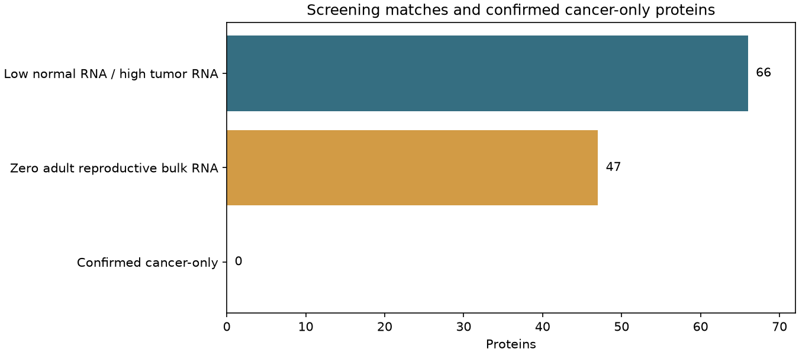

# Cancer-only expression: individual normal-tissue audit

**No protein in this screen qualifies as Cancer-Only.** The existing numerical screen has 66 matches. Forty-seven have zero adult reproductive bulk RNA and receive individual reviews below; the other 19 have measurable reproductive bulk RNA. All 47 have some recorded developmental RNA, and reproductive-cell coverage is incomplete. These small developmental values are observations, not proof of translated fetal protein.

**Keep CTA, Other and Unsafe.** Use cancer expression and reproductive/developmental expression as separate table fields. The numerical screen mixes normal sensory receptors, inducible immune proteins, uncertain assays and poorly characterized copies. It does not define a coherent fourth category.

Reviewed calls: **36 Other:Review**, **8 Other:Expression**, **3 Unsafe**.

[Filterable individual reviews](table.html) · [All 47 reviews](protein-reviews.csv) · [All 66 numerical matches](all-66-screen-matches.csv.gz) · [Top five normal contexts per source](normal-top-contexts.csv.gz) · [Exact olfactory assay results](olfactory-assays.csv) · [Current HPA RNA](current-hpa-rna.csv.gz) · [Provenance](manifest.json)

## How the set was selected

The starting set requires the existing normal-low profile and at least two distinct tumors at >=10 native TPM, or reviewed tumor protein. The saved tumor count stops after two supporting observations: it is a **lower bound**, not prevalence. Zero adult reproductive bulk RNA defines the 47-protein audit, rather than calling a value below 5 nTPM absent. Placenta is included in the pinned reproductive bulk definition. Missing cell assays are never filled with zero.

## Assay review

Every protein has a retained exact-symbol [literature-search query and result count](literature-search-ledger.csv), capped at 100 retrieved records per query. Search hits identify leads; accepted findings below require review of the human tissue, assay and exact gene. Full abstracts are not redistributed in the query metadata.

[Verbeurgt 2014](https://doi.org/10.1371/journal.pone.0096333) supplies measured RNA-copy estimates in 26 human olfactory-mucosa donors. Expression counts below use the authors' >=5 copies per 20 ng RNA rule. Raw Cq <35 is recorded separately. OR52E6/OR52E8 and OR5D18/OR5D16 cross-react. OR5D18 has zero donors above the copy threshold in this study despite seven Cq values below 35; its gut-cell evidence is independent. [Durante 2020](https://doi.org/10.1038/s41593-020-0587-9) supplies observed olfactory-neuron counts, not a complete negative receptor panel. Neither experiment proves protein production.

HPA responses were retrieved separately from pinned v23 selection data. Uncertain or shared IHC supplies a review question; unavailable IHC/MS supplies no negative result. An ectopic-expression experiment, recombinant protein, animal ortholog or family-wide annotation cannot establish exact human normal protein. New reviewed normal findings enter the same knowledge gate used for every protein.

| Source | Role |
|---|---|
| [Verbeurgt 2014](https://doi.org/10.1371/journal.pone.0096333) | Donor-level olfactory qPCR, calibrated copy estimates and cross-reactivity controls. |
| [Durante 2020](https://doi.org/10.1038/s41593-020-0587-9) | Positive adult olfactory-neuron counts and cell-enrichment tables. |
| [Mbouamboua 2026](https://doi.org/10.1038/s41467-026-71595-6) | Exact gene labels and positive fetal nasal-cell counts; six matches in this set. |
| [Human Protein Atlas](https://www.proteinatlas.org/) | Forty-seven saved XML responses: current RNA, normal-tissue IHC validation and MS evidence labels. Cancer staining and pig RNA are excluded from normal-human observations. |
| [UniProt](https://www.uniprot.org/) | Five saved gene-specific responses for SCYGR2/8, KRTAP21-1 and USP17L8/13: protein-existence annotations and primary-reference leads. |
| [Song 2026 adult olfactory atlas](https://doi.org/10.1038/s41467-026-75722-1) | Bibliographic discovery retained; processed gene-level tables were not retrieved. It contributes no positive or negative gene-level measurement here. |

## Individual decisions

### CLDN25

**Other:Review** · [Ensembl](https://www.ensembl.org/Homo_sapiens/Gene/Summary?g=ENSG00000228607) · [HPA](https://www.proteinatlas.org/ENSG00000228607/tissue)

Pinned normal maxima: 0.3 nTPM; 0.65 TPM. Adult reproductive bulk: 0 nTPM. Developmental maximum: 0.1297 TPM. Cancer maximum: 642.7 TPM.

- Durante reports enriched adult human olfactory-cell RNA, supplying the existing hold. Claudin-family function does not establish the localization or indispensability of this exact protein.
- HPA's MS field is unavailable; it supplies no protein-negative measurement.
- No exact-symbol assay occurs in the qPCR table; this supplies no negative measurement. Ambiguous legacy names are not reassigned.
- Current HPA has positive normal staining with uncertain reagent reliability; it cannot establish exact protein production or absence.
- The 2024 variant study (with a 2026 correction) examines a patient and transfected HEK293/canine MDCKII/mouse endothelial models. It adds a barrier-function question, without establishing adult human neural protein or cytotoxic-injury causality.
- Reported enriched RNA in a defined adult human olfactory population.
- Positive normal-tissue HPA staining remains unresolved under uncertain antibody validation.

Supporting tumor observations: NEC_LUNG_LARGECELL / S02269: 643 TPM; MENINGIOMA / I186: 17 TPM. Full source hashes and sample identities are in [the observation table](supporting-tumor-observations.csv).

[HPA normal-tissue RNA, IHC and protein-evidence record](https://www.proteinatlas.org/ENSG00000228607/tissue) · [CLDN25 variant and barrier-cell models (2024)](https://doi.org/10.1093/hmg/ddae038) · [Correction to the CLDN25 variant study (2026)](https://doi.org/10.1093/hmg/ddaf192) · [Single cell analysis of olfactory neurogenesis and differentiation in adult humans](https://pmc.ncbi.nlm.nih.gov/articles/PMC7065961/)

### IFNA4

**Unsafe** · [Ensembl](https://www.ensembl.org/Homo_sapiens/Gene/Summary?g=ENSG00000236637) · [HPA](https://www.proteinatlas.org/ENSG00000236637/tissue)

Pinned normal maxima: 0.3 nTPM; 0.518 TPM. Adult reproductive bulk: 0 nTPM. Developmental maximum: 0.02136 TPM. Cancer maximum: 81.11 TPM.

- Activated normal immune-cell protein supplies the existing Unsafe finding. Highly homologous interferons and a shared HPA reagent require assay-specific attribution.
- HPA's MS field is unavailable; it supplies no protein-negative measurement.
- No exact-symbol assay occurs in the qPCR table; this supplies no negative measurement. Ambiguous legacy names are not reassigned.
- Current HPA has positive normal staining with uncertain reagent reliability; it cannot establish exact protein production or absence.
- Reported secreted normal immune-cell protein, increased after activation.
- Positive normal-tissue HPA staining remains unresolved under uncertain antibody validation.

Supporting tumor observations: NEC_MERKEL / MO_MCC_046.1_T_RNA: 81.1 TPM; NEC_MERKEL / MO_MCC_046.1_T_RNA.1: 81.1 TPM. Full source hashes and sample identities are in [the observation table](supporting-tumor-observations.csv).

[HPA normal-tissue RNA, IHC and protein-evidence record](https://www.proteinatlas.org/ENSG00000236637/tissue) · [Proteomic and Single-Cell Transcriptomic Dissection of Human Plasmacytoid Dendritic Cell Response to Influenza Virus](https://www.frontiersin.org/journals/immunology/articles/10.3389/fimmu.2022.814627/full)

### IFNW1

**Unsafe** · [Ensembl](https://www.ensembl.org/Homo_sapiens/Gene/Summary?g=ENSG00000177047) · [HPA](https://www.proteinatlas.org/ENSG00000177047/tissue)

Pinned normal maxima: 1.5 nTPM; 0.781 TPM. Adult reproductive bulk: 0 nTPM. Developmental maximum: 0.1449 TPM. Cancer maximum: 24.08 TPM.

- Activated normal immune-cell protein supplies the existing Unsafe finding. Resting bulk RNA misses induced production. Secretion does not identify every producing cell.
- The current HPA response contains no tissue-IHC antibody assay for this protein.
- HPA's MS field is unavailable; it supplies no protein-negative measurement.
- No exact-symbol assay occurs in the qPCR table; this supplies no negative measurement. Ambiguous legacy names are not reassigned.
- Reported secreted normal immune-cell protein, increased after activation.

Supporting tumor observations: BL / BLGSP-71-19-00111-01A: 24.1 TPM; BL / BLGSP-71-27-00420-01A: 11.4 TPM. Full source hashes and sample identities are in [the observation table](supporting-tumor-observations.csv).

[HPA normal-tissue RNA, IHC and protein-evidence record](https://www.proteinatlas.org/ENSG00000177047/tissue) · [Proteomic and Single-Cell Transcriptomic Dissection of Human Plasmacytoid Dendritic Cell Response to Influenza Virus](https://www.frontiersin.org/journals/immunology/articles/10.3389/fimmu.2022.814627/full)

### KRTAP21-1

**Other:Expression** · [Ensembl](https://www.ensembl.org/Homo_sapiens/Gene/Summary?g=ENSG00000187005) · [HPA](https://www.proteinatlas.org/ENSG00000187005/tissue)

Pinned normal maxima: 0.3 nTPM; 0.491 TPM. Adult reproductive bulk: 0 nTPM. Developmental maximum: 0.05235 TPM. Cancer maximum: 17.2 TPM.

- Hair-family membership identifies the compartment to examine but is not exact-protein proof. HPA lists MS protein-existence evidence without tissue or peptide attribution in its XML, whereas the retrieved UniProt entry remains homology-based. Zhang 2014 reports gene-specific qPCR in LoVo cancer cells; the paper's HCEC experiments are not a KRTAP21-1 normal-cell result.
- The current HPA response contains no tissue-IHC antibody assay for this protein.
- No exact-symbol assay occurs in the qPCR table; this supplies no negative measurement. Ambiguous legacy names are not reassigned.

Supporting tumor observations: HL / SRS3811196: 17.2 TPM; NEC_LUNG_LARGECELL / S02271: 13.8 TPM. Full source hashes and sample identities are in [the observation table](supporting-tumor-observations.csv).

[HPA normal-tissue RNA, IHC and protein-evidence record](https://www.proteinatlas.org/ENSG00000187005/tissue) · [Zhang 2014: parvovirus B19 and colorectal cancer cells](https://doi.org/10.3892/ol.2014.2151) · [Litman and Stein 2023: KRTAP evolution and skin transcriptomics](https://doi.org/10.1186/s12862-023-02107-z)

### MRGPRX4

**Unsafe** · [Ensembl](https://www.ensembl.org/Homo_sapiens/Gene/Summary?g=ENSG00000179817) · [HPA](https://www.proteinatlas.org/ENSG00000179817/tissue)

Pinned normal maxima: 0.3 nTPM; 0 TPM. Adult reproductive bulk: 0 nTPM. Developmental maximum: 0.03862 TPM. Cancer maximum: 187 TPM.

- Human dorsal-root-ganglion neuronal RNA and protein supply the existing Unsafe finding. The rare sensory-neuron compartment is absent from the ordinary bulk comparison.
- The current HPA response contains no tissue-IHC antibody assay for this protein.
- HPA's MS field is unavailable; it supplies no protein-negative measurement.
- No exact-symbol assay occurs in the qPCR table; this supplies no negative measurement. Ambiguous legacy names are not reassigned.
- Human normal DRG neurons show localized RNA and protein; approximately 6–8% of neurons are positive.

Supporting tumor observations: SKCM / TCGA-D3-A3C7-06: 187 TPM; SKCM / TCGA-QB-AA9O-06: 108 TPM. Full source hashes and sample identities are in [the observation table](supporting-tumor-observations.csv).

[HPA normal-tissue RNA, IHC and protein-evidence record](https://www.proteinatlas.org/ENSG00000179817/tissue) · [MRGPRX4 is a bile acid receptor for human cholestatic itch](https://elifesciences.org/articles/48431)

### OC90

**Other:Review** · [Ensembl](https://www.ensembl.org/Homo_sapiens/Gene/Summary?g=ENSG00000253117) · [HPA](https://www.proteinatlas.org/ENSG00000253117/tissue)

Pinned normal maxima: 0.8 nTPM; 0.227 TPM. Adult reproductive bulk: 0 nTPM. Developmental maximum: 0.3192 TPM. Cancer maximum: 142.8 TPM.

- Inner-ear otoconial biology is strongly established in mice. The principal source cloned human PLA2L/OC90 but obtained native protein from mouse tissue; retain the human localization hold.
- The current HPA response contains no tissue-IHC antibody assay for this protein.
- HPA's MS field is unavailable; it supplies no protein-negative measurement.
- No exact-symbol assay occurs in the qPCR table; this supplies no negative measurement. Ambiguous legacy names are not reassigned.
- Major protein of the otoconia, a calcium carbonate structure in the saccule and utricle of the ear. Together with OTOL1, acts as a scaffold for otoconia biomineralization: sequesters calcium and forms interconnecting fibrils between otoconia that are incorporated into the calcium crystal structure. Together with OTOL1, modulates calcite crystal morphology and growth kinetics. It is unlikely that this protein has phospholipase A2 activity 

Supporting tumor observations: MBL / THR20_0493_S01: 143 TPM; NEC_LUNG_LARGECELL / S02269: 11.3 TPM. Full source hashes and sample identities are in [the observation table](supporting-tumor-observations.csv).

[HPA normal-tissue RNA, IHC and protein-evidence record](https://www.proteinatlas.org/ENSG00000253117/tissue) · [Otoconin-90 cloning and mammalian otoconial matrix protein (1998)](https://pmc.ncbi.nlm.nih.gov/articles/PMC28045/) · [Otoconin-90 — UniProtKB/Swiss-Prot 2026_03](https://www.uniprot.org/uniprotkb/Q02509/entry)

### OR10A5

**Other:Review** · [Ensembl](https://www.ensembl.org/Homo_sapiens/Gene/Summary?g=ENSG00000166363) · [HPA](https://www.proteinatlas.org/ENSG00000166363/tissue)

Pinned normal maxima: 1.9 nTPM; 0.3 TPM. Adult reproductive bulk: 0 nTPM. Developmental maximum: 0.2802 TPM. Cancer maximum: 120.5 TPM.

- Exact-copy olfactory expression is the principal normal-tissue question. Odorant responses in transfected cells establish receptor activity, not endogenous normal or tumor protein.
- The current HPA response contains no tissue-IHC antibody assay for this protein.
- HPA's MS field is unavailable; it supplies no protein-negative measurement.
- Verbeurgt Table S3 reports 26/26 donors at >=5 estimated copies per 20 ng RNA; the raw Cq <35 count is recorded separately.
- Durante Table 7 reports RNA in 1 adult human olfactory sensory neurons.
- Reported RNA in normal human olfactory sensory neurons.
- Normal human olfactory-mucosa assay labeled OR10A5: 26/26 donors at >=5 estimated RNA copies/20 ng.

Supporting tumor observations: NEC_MERKEL / MO_MCC_046.2_T_RNA: 121 TPM; NEC_MERKEL / MO_MCC_061_T_RNA: 116 TPM. Full source hashes and sample identities are in [the observation table](supporting-tumor-observations.csv).

[HPA normal-tissue RNA, IHC and protein-evidence record](https://www.proteinatlas.org/ENSG00000166363/tissue) · [Verbeurgt 2014: normal human olfactory-mucosa qPCR](https://doi.org/10.1371/journal.pone.0096333) · [Durante 2020: adult human olfactory single-cell atlas](https://doi.org/10.1038/s41593-020-0587-9) · [Single cell analysis of olfactory neurogenesis and differentiation in adult humans](https://pmc.ncbi.nlm.nih.gov/articles/PMC7065961/)

### OR11H1

**Other:Review** · [Ensembl](https://www.ensembl.org/Homo_sapiens/Gene/Summary?g=ENSG00000130538) · [HPA](https://www.proteinatlas.org/ENSG00000130538/tissue)

Pinned normal maxima: 0 nTPM; 0 TPM. Adult reproductive bulk: 0 nTPM. Developmental maximum: 0.003374 TPM. Cancer maximum: 43.63 TPM.

- Zhao 2013 reports RNA in healthy-control PBMC and neurologically normal postmortem brain, with qPCR confirmation. This is normal non-olfactory RNA evidence; OR4M1 functional experiments do not establish OR11H1 protein or function.
- The current HPA response contains no tissue-IHC antibody assay for this protein.
- HPA's MS field is unavailable; it supplies no protein-negative measurement.
- No exact-symbol assay occurs in the qPCR table; this supplies no negative measurement. Ambiguous legacy names are not reassigned.
- Zhao 2013 reports RNA in healthy-control PBMC and neurologically normal postmortem brain, with qPCR confirmation. This is normal non-olfactory RNA evidence; OR4M1 functional experiments do not establish OR11H1 protein or function.

Supporting tumor observations: HL / SRS3811196: 26.6 TPM; NEC_MERKEL / MO_MCC_130.1_T_RNA: 43.6 TPM. Full source hashes and sample identities are in [the observation table](supporting-tumor-observations.csv).

[HPA normal-tissue RNA, IHC and protein-evidence record](https://www.proteinatlas.org/ENSG00000130538/tissue) · [Zhao 2013: PBMC and normal brain olfactory-receptor RNA](https://pmc.ncbi.nlm.nih.gov/articles/PMC3968322/)

### OR11H12

**Other:Review** · [Ensembl](https://www.ensembl.org/Homo_sapiens/Gene/Summary?g=ENSG00000257115) · [HPA](https://www.proteinatlas.org/ENSG00000257115/tissue)

Pinned normal maxima: 0 nTPM; 0 TPM. Adult reproductive bulk: 0 nTPM. Developmental maximum: 0.03796 TPM. Cancer maximum: 56.55 TPM.

- Exact-copy olfactory expression is the principal normal-tissue question. Odorant responses in transfected cells establish receptor activity, not endogenous normal or tumor protein.
- HPA's MS field is unavailable; it supplies no protein-negative measurement.
- No exact-symbol assay occurs in the qPCR table; this supplies no negative measurement. Ambiguous legacy names are not reassigned.
- Current HPA has positive normal staining with uncertain reagent reliability; it cannot establish exact protein production or absence.
- Positive normal-tissue HPA staining remains unresolved under uncertain antibody validation.

Supporting tumor observations: NEC_MERKEL / MO_MCC_113_T_RNA: 56.5 TPM; NEC_MERKEL / MO_MCC_042_T_RNA: 17.3 TPM. Full source hashes and sample identities are in [the observation table](supporting-tumor-observations.csv).

[HPA normal-tissue RNA, IHC and protein-evidence record](https://www.proteinatlas.org/ENSG00000257115/tissue)

### OR11H2

**Other:Review** · [Ensembl](https://www.ensembl.org/Homo_sapiens/Gene/Summary?g=ENSG00000258453) · [HPA](https://www.proteinatlas.org/ENSG00000258453/tissue)

Pinned normal maxima: 0.1 nTPM; 0 TPM. Adult reproductive bulk: 0 nTPM. Developmental maximum: 0.03749 TPM. Cancer maximum: 24.68 TPM.

- Exact-copy olfactory expression is the principal normal-tissue question. Odorant responses in transfected cells establish receptor activity, not endogenous normal or tumor protein.
- HPA's MS field is unavailable; it supplies no protein-negative measurement.
- No exact-symbol assay occurs in the qPCR table; this supplies no negative measurement. Ambiguous legacy names are not reassigned.
- Current HPA has positive normal staining with uncertain reagent reliability; it cannot establish exact protein production or absence.
- Positive normal-tissue HPA staining remains unresolved under uncertain antibody validation.

Supporting tumor observations: NEC_MERKEL / MO_MCC_042_T_RNA: 24.7 TPM; NEC_MERKEL / MO_MCC_058.1_T_RNA: 11.8 TPM. Full source hashes and sample identities are in [the observation table](supporting-tumor-observations.csv).

[HPA normal-tissue RNA, IHC and protein-evidence record](https://www.proteinatlas.org/ENSG00000258453/tissue)

### OR11H6

**Other:Review** · [Ensembl](https://www.ensembl.org/Homo_sapiens/Gene/Summary?g=ENSG00000176219) · [HPA](https://www.proteinatlas.org/ENSG00000176219/tissue)

Pinned normal maxima: 0.1 nTPM; 0.653 TPM. Adult reproductive bulk: 0 nTPM. Developmental maximum: 0.1343 TPM. Cancer maximum: 35.54 TPM.

- Exact-copy olfactory expression is the principal normal-tissue question. Odorant responses in transfected cells establish receptor activity, not endogenous normal or tumor protein.
- The current HPA response contains no tissue-IHC antibody assay for this protein.
- HPA's MS field is unavailable; it supplies no protein-negative measurement.
- Verbeurgt Table S3 reports 22/26 donors at >=5 estimated copies per 20 ng RNA; the raw Cq <35 count is recorded separately.
- Durante Table 7 reports RNA in 1 adult human olfactory sensory neurons.
- Reported RNA in normal human olfactory sensory neurons.
- Normal human olfactory-mucosa assay labeled OR11H6: 22/26 donors at >=5 estimated RNA copies/20 ng.

Supporting tumor observations: HL / SRS3811196: 35.5 TPM; NEC_MERKEL / MO_MCC_061_T_RNA: 11.7 TPM. Full source hashes and sample identities are in [the observation table](supporting-tumor-observations.csv).

[HPA normal-tissue RNA, IHC and protein-evidence record](https://www.proteinatlas.org/ENSG00000176219/tissue) · [Verbeurgt 2014: normal human olfactory-mucosa qPCR](https://doi.org/10.1371/journal.pone.0096333) · [Durante 2020: adult human olfactory single-cell atlas](https://doi.org/10.1038/s41593-020-0587-9) · [Single cell analysis of olfactory neurogenesis and differentiation in adult humans](https://pmc.ncbi.nlm.nih.gov/articles/PMC7065961/)

### OR12D2

**Other:Review** · [Ensembl](https://www.ensembl.org/Homo_sapiens/Gene/Summary?g=ENSG00000280236) · [HPA](https://www.proteinatlas.org/ENSG00000280236/tissue)

Pinned normal maxima: 1.1 nTPM; 0.0414 TPM. Adult reproductive bulk: 0 nTPM. Developmental maximum: 0.0682 TPM. Cancer maximum: 16.17 TPM.

- Exact-copy olfactory expression is the principal normal-tissue question. Odorant responses in transfected cells establish receptor activity, not endogenous normal or tumor protein.
- The current HPA response contains no tissue-IHC antibody assay for this protein.
- HPA's MS field is unavailable; it supplies no protein-negative measurement.
- Verbeurgt Table S3 reports 21/26 donors at >=5 estimated copies per 20 ng RNA; the raw Cq <35 count is recorded separately.
- Normal human olfactory-mucosa assay labeled OR12D2: 21/26 donors at >=5 estimated RNA copies/20 ng.

Supporting tumor observations: CHOL / TCGA-W5-AA38-01: 11 TPM; GBC / GSM4146160: 16.2 TPM. Full source hashes and sample identities are in [the observation table](supporting-tumor-observations.csv).

[HPA normal-tissue RNA, IHC and protein-evidence record](https://www.proteinatlas.org/ENSG00000280236/tissue) · [Verbeurgt 2014: normal human olfactory-mucosa qPCR](https://doi.org/10.1371/journal.pone.0096333)

### OR13H1

**Other:Review** · [Ensembl](https://www.ensembl.org/Homo_sapiens/Gene/Summary?g=ENSG00000171054) · [HPA](https://www.proteinatlas.org/ENSG00000171054/tissue)

Pinned normal maxima: 0.4 nTPM; 0 TPM. Adult reproductive bulk: 0 nTPM. Developmental maximum: 0.06142 TPM. Cancer maximum: 72.35 TPM.

- Exact-copy olfactory expression is the principal normal-tissue question. Odorant responses in transfected cells establish receptor activity, not endogenous normal or tumor protein.
- The current HPA response contains no tissue-IHC antibody assay for this protein.
- HPA's MS field is unavailable; it supplies no protein-negative measurement.
- Verbeurgt Table S3 reports 2/26 donors at >=5 estimated copies per 20 ng RNA; the raw Cq <35 count is recorded separately.
- Normal human olfactory-mucosa assay labeled OR13H1: 2/26 donors at >=5 estimated RNA copies/20 ng.

Supporting tumor observations: NEC_MERKEL / MO_MCC_010_T_RNA: 72.3 TPM; NEC_MERKEL / MO_MCC_036_T_RNA: 65.9 TPM. Full source hashes and sample identities are in [the observation table](supporting-tumor-observations.csv).

[HPA normal-tissue RNA, IHC and protein-evidence record](https://www.proteinatlas.org/ENSG00000171054/tissue) · [Verbeurgt 2014: normal human olfactory-mucosa qPCR](https://doi.org/10.1371/journal.pone.0096333)

### OR1D5

**Other:Expression** · [Ensembl](https://www.ensembl.org/Homo_sapiens/Gene/Summary?g=ENSG00000262628) · [HPA](https://www.proteinatlas.org/ENSG00000262628/tissue)

Pinned normal maxima: 0.6 nTPM; 0.7 TPM. Adult reproductive bulk: 0 nTPM. Developmental maximum: 0.03838 TPM. Cancer maximum: 55.5 TPM.

- The Parkinson nasal-marker paper validates OR1D5 RNA in treated RPMI-2650 carcinoma cells. Its patient/control nasal-fluid validation concerns other genes; it does not establish normal OR1D5 production.
- The current HPA response contains no tissue-IHC antibody assay for this protein.
- HPA's MS field is unavailable; it supplies no protein-negative measurement.
- No exact-symbol assay occurs in the qPCR table; this supplies no negative measurement. Ambiguous legacy names are not reassigned.

Supporting tumor observations: NEC_MERKEL / MO_MCC_113_T_RNA: 55.5 TPM; T_ALL / TARGET-10-PATSIY-09A: 30.6 TPM. Full source hashes and sample identities are in [the observation table](supporting-tumor-observations.csv).

[HPA normal-tissue RNA, IHC and protein-evidence record](https://www.proteinatlas.org/ENSG00000262628/tissue) · [Nasal epithelial Parkinson markers: carcinoma model and clinical validation (2020)](https://pmc.ncbi.nlm.nih.gov/articles/PMC7408990/)

### OR1L1

**Other:Review** · [Ensembl](https://www.ensembl.org/Homo_sapiens/Gene/Summary?g=ENSG00000173679) · [HPA](https://www.proteinatlas.org/ENSG00000173679/tissue)

Pinned normal maxima: 1 nTPM; 0.708 TPM. Adult reproductive bulk: 0 nTPM. Developmental maximum: 0.3341 TPM. Cancer maximum: 33.82 TPM.

- Exact-copy olfactory expression is the principal normal-tissue question. Odorant responses in transfected cells establish receptor activity, not endogenous normal or tumor protein.
- The current HPA response contains no tissue-IHC antibody assay for this protein.
- HPA's MS field is unavailable; it supplies no protein-negative measurement.
- Verbeurgt Table S3 reports 26/26 donors at >=5 estimated copies per 20 ng RNA; the raw Cq <35 count is recorded separately.
- Normal human olfactory-mucosa assay labeled OR1L1: 26/26 donors at >=5 estimated RNA copies/20 ng.

Supporting tumor observations: HL / SRS3811196: 33.8 TPM; NEC_MERKEL / MO_MCC_113.2_T_RNA: 17.3 TPM. Full source hashes and sample identities are in [the observation table](supporting-tumor-observations.csv).

[HPA normal-tissue RNA, IHC and protein-evidence record](https://www.proteinatlas.org/ENSG00000173679/tissue) · [Verbeurgt 2014: normal human olfactory-mucosa qPCR](https://doi.org/10.1371/journal.pone.0096333)

### OR1L4

**Other:Review** · [Ensembl](https://www.ensembl.org/Homo_sapiens/Gene/Summary?g=ENSG00000136939) · [HPA](https://www.proteinatlas.org/ENSG00000136939/tissue)

Pinned normal maxima: 1.4 nTPM; 0.71 TPM. Adult reproductive bulk: 0 nTPM. Developmental maximum: 0.01303 TPM. Cancer maximum: 125.2 TPM.

- Exact-copy olfactory expression is the principal normal-tissue question. Odorant responses in transfected cells establish receptor activity, not endogenous normal or tumor protein.
- The current HPA response contains no tissue-IHC antibody assay for this protein.
- HPA's MS field is unavailable; it supplies no protein-negative measurement.
- Verbeurgt Table S3 reports 26/26 donors at >=5 estimated copies per 20 ng RNA; the raw Cq <35 count is recorded separately.
- Normal human olfactory-mucosa assay labeled OR1L4: 26/26 donors at >=5 estimated RNA copies/20 ng.

Supporting tumor observations: HL / SRS3811196: 38 TPM; HL / SRS3811192: 11.4 TPM. Full source hashes and sample identities are in [the observation table](supporting-tumor-observations.csv).

[HPA normal-tissue RNA, IHC and protein-evidence record](https://www.proteinatlas.org/ENSG00000136939/tissue) · [Verbeurgt 2014: normal human olfactory-mucosa qPCR](https://doi.org/10.1371/journal.pone.0096333)

### OR1P1

**Other:Review** · [Ensembl](https://www.ensembl.org/Homo_sapiens/Gene/Summary?g=ENSG00000262085) · [HPA](https://www.proteinatlas.org/ENSG00000262085/tissue)

Pinned normal maxima: 0.2 nTPM; 0.503 TPM. Adult reproductive bulk: 0 nTPM. Developmental maximum: 0.04744 TPM. Cancer maximum: 21.88 TPM.

- Exact-copy olfactory expression is the principal normal-tissue question. Odorant responses in transfected cells establish receptor activity, not endogenous normal or tumor protein.
- The current HPA response contains no tissue-IHC antibody assay for this protein.
- HPA's MS field is unavailable; it supplies no protein-negative measurement.
- No exact-symbol assay occurs in the qPCR table; this supplies no negative measurement. Ambiguous legacy names are not reassigned.

Supporting tumor observations: T_ALL / TARGET-10-PARLJA-09A: 21.9 TPM; T_ALL / TARGET-10-PATSIY-09A: 21.5 TPM. Full source hashes and sample identities are in [the observation table](supporting-tumor-observations.csv).

[HPA normal-tissue RNA, IHC and protein-evidence record](https://www.proteinatlas.org/ENSG00000262085/tissue)

### OR2B2

**Other:Expression** · [Ensembl](https://www.ensembl.org/Homo_sapiens/Gene/Summary?g=ENSG00000168131) · [HPA](https://www.proteinatlas.org/ENSG00000168131/tissue)

Pinned normal maxima: 0.5 nTPM; 0.339 TPM. Adult reproductive bulk: 0 nTPM. Developmental maximum: 1.84 TPM. Cancer maximum: 246.3 TPM.

- The linked-receptor testicular-expression paper found in the search studies pigs. It cannot establish reproductive expression of human OR2B2. No exact-symbol assay occurs in the human olfactory qPCR table.
- The current HPA response contains no tissue-IHC antibody assay for this protein.
- HPA's MS field is unavailable; it supplies no protein-negative measurement.
- No exact-symbol assay occurs in the qPCR table; this supplies no negative measurement. Ambiguous legacy names are not reassigned.

Supporting tumor observations: NEC_MERKEL / MO_MCC_009_T_RNA: 246 TPM; NEC_MERKEL / MO_MCC_042_T_RNA: 239 TPM. Full source hashes and sample identities are in [the observation table](supporting-tumor-observations.csv).

[HPA normal-tissue RNA, IHC and protein-evidence record](https://www.proteinatlas.org/ENSG00000168131/tissue) · [MHC-linked receptors and pig testis (2025; species mismatch)](https://pubmed.ncbi.nlm.nih.gov/39915713/)

### OR2M2

**Other:Review** · [Ensembl](https://www.ensembl.org/Homo_sapiens/Gene/Summary?g=ENSG00000198601) · [HPA](https://www.proteinatlas.org/ENSG00000198601/tissue)

Pinned normal maxima: 1.7 nTPM; 0 TPM. Adult reproductive bulk: 0 nTPM. Developmental maximum: 0.1268 TPM. Cancer maximum: 22.52 TPM.

- Exact-copy olfactory expression is the principal normal-tissue question. Odorant responses in transfected cells establish receptor activity, not endogenous normal or tumor protein.
- The current HPA response contains no tissue-IHC antibody assay for this protein.
- HPA's MS field is unavailable; it supplies no protein-negative measurement.
- The 2026 fetal nasal atlas reports 2 cells expressing this exact gene label at 7-12 post-conceptional weeks. These counts are not TPM, protein or copy-specific peptide evidence.
- Verbeurgt Table S3 reports 26/26 donors at >=5 estimated copies per 20 ng RNA; the raw Cq <35 count is recorded separately.
- Durante Table 7 reports RNA in 3 adult human olfactory sensory neurons.
- Reported RNA in normal human olfactory sensory neurons.
- Normal human olfactory-mucosa assay labeled OR2M2: 26/26 donors at >=5 estimated RNA copies/20 ng.

Supporting tumor observations: HL / SRS3811196: 22.5 TPM; SARC_PEC / JNGR120: 11.5 TPM. Full source hashes and sample identities are in [the observation table](supporting-tumor-observations.csv).

[HPA normal-tissue RNA, IHC and protein-evidence record](https://www.proteinatlas.org/ENSG00000198601/tissue) · [Mbouamboua 2026: fetal human nasal atlas](https://doi.org/10.1038/s41467-026-71595-6) · [Verbeurgt 2014: normal human olfactory-mucosa qPCR](https://doi.org/10.1371/journal.pone.0096333) · [Durante 2020: adult human olfactory single-cell atlas](https://doi.org/10.1038/s41593-020-0587-9) · [Single cell analysis of olfactory neurogenesis and differentiation in adult humans](https://pmc.ncbi.nlm.nih.gov/articles/PMC7065961/)

### OR2M5

**Other:Review** · [Ensembl](https://www.ensembl.org/Homo_sapiens/Gene/Summary?g=ENSG00000162727) · [HPA](https://www.proteinatlas.org/ENSG00000162727/tissue)

Pinned normal maxima: 1.9 nTPM; 0.328 TPM. Adult reproductive bulk: 0 nTPM. Developmental maximum: 0.01047 TPM. Cancer maximum: 40.95 TPM.

- Exact-copy olfactory expression is the principal normal-tissue question. Odorant responses in transfected cells establish receptor activity, not endogenous normal or tumor protein.
- The current HPA response contains no tissue-IHC antibody assay for this protein.
- HPA's MS field is unavailable; it supplies no protein-negative measurement.
- Verbeurgt Table S3 reports 3/26 donors at >=5 estimated copies per 20 ng RNA; the raw Cq <35 count is recorded separately.
- Normal human olfactory-mucosa assay labeled OR2M5: 3/26 donors at >=5 estimated RNA copies/20 ng.

Supporting tumor observations: SARC_PEC / JNGR114: 40.9 TPM; SARC_PEC / JNGR95: 11.3 TPM. Full source hashes and sample identities are in [the observation table](supporting-tumor-observations.csv).

[HPA normal-tissue RNA, IHC and protein-evidence record](https://www.proteinatlas.org/ENSG00000162727/tissue) · [Verbeurgt 2014: normal human olfactory-mucosa qPCR](https://doi.org/10.1371/journal.pone.0096333)

### OR2S2

**Other:Review** · [Ensembl](https://www.ensembl.org/Homo_sapiens/Gene/Summary?g=ENSG00000278889) · [HPA](https://www.proteinatlas.org/ENSG00000278889/tissue)

Pinned normal maxima: 0.4 nTPM; 0.0289 TPM. Adult reproductive bulk: 0 nTPM. Developmental maximum: 0.0296 TPM. Cancer maximum: 14.71 TPM.

- Exact-copy olfactory expression is the principal normal-tissue question. Odorant responses in transfected cells establish receptor activity, not endogenous normal or tumor protein.
- The current HPA response contains no tissue-IHC antibody assay for this protein.
- HPA's MS field is unavailable; it supplies no protein-negative measurement.
- Verbeurgt Table S3 reports 23/26 donors at >=5 estimated copies per 20 ng RNA; the raw Cq <35 count is recorded separately.
- Normal human olfactory-mucosa assay labeled OR2S2: 23/26 donors at >=5 estimated RNA copies/20 ng.

Supporting tumor observations: SARC_CHON / L5364: 14.7 TPM; SARC_CHON / L4543: 13.8 TPM. Full source hashes and sample identities are in [the observation table](supporting-tumor-observations.csv).

[HPA normal-tissue RNA, IHC and protein-evidence record](https://www.proteinatlas.org/ENSG00000278889/tissue) · [Verbeurgt 2014: normal human olfactory-mucosa qPCR](https://doi.org/10.1371/journal.pone.0096333)

### OR2T5

**Other:Expression** · [Ensembl](https://www.ensembl.org/Homo_sapiens/Gene/Summary?g=ENSG00000203661) · [HPA](https://www.proteinatlas.org/ENSG00000203661/tissue)

Pinned normal maxima: 0.1 nTPM; 0.534 TPM. Adult reproductive bulk: 0 nTPM. Developmental maximum: 0.08594 TPM. Cancer maximum: 17.82 TPM.

- Exact-copy olfactory expression is the principal normal-tissue question. Odorant responses in transfected cells establish receptor activity, not endogenous normal or tumor protein.
- The current HPA response contains no tissue-IHC antibody assay for this protein.
- HPA's MS field is unavailable; it supplies no protein-negative measurement.
- No exact-symbol assay occurs in the qPCR table; this supplies no negative measurement. Ambiguous legacy names are not reassigned.

Supporting tumor observations: MCL / COHP_50477: 17.8 TPM; MCL / COHP_50508: 14.2 TPM. Full source hashes and sample identities are in [the observation table](supporting-tumor-observations.csv).

[HPA normal-tissue RNA, IHC and protein-evidence record](https://www.proteinatlas.org/ENSG00000203661/tissue)

### OR4D10

**Other:Review** · [Ensembl](https://www.ensembl.org/Homo_sapiens/Gene/Summary?g=ENSG00000254466) · [HPA](https://www.proteinatlas.org/ENSG00000254466/tissue)

Pinned normal maxima: 0 nTPM; 0 TPM. Adult reproductive bulk: 0 nTPM. Developmental maximum: 0.03373 TPM. Cancer maximum: 193.8 TPM.

- Exact-copy olfactory expression is the principal normal-tissue question. Odorant responses in transfected cells establish receptor activity, not endogenous normal or tumor protein.
- The current HPA response contains no tissue-IHC antibody assay for this protein.
- HPA's MS field is unavailable; it supplies no protein-negative measurement.
- The 2026 fetal nasal atlas reports 1 cells expressing this exact gene label at 7-12 post-conceptional weeks. These counts are not TPM, protein or copy-specific peptide evidence.
- Verbeurgt Table S3 reports 17/26 donors at >=5 estimated copies per 20 ng RNA; the raw Cq <35 count is recorded separately.
- Durante Table 7 reports RNA in 2 adult human olfactory sensory neurons.
- Reported RNA in normal human olfactory sensory neurons.
- Normal human olfactory-mucosa assay labeled OR4D10: 17/26 donors at >=5 estimated RNA copies/20 ng.

Supporting tumor observations: BRCA / TCGA-AR-A1AV-01: 29.4 TPM; SARC_LPS_UNSPEC / TCGA-DX-A23Z-01: 194 TPM. Full source hashes and sample identities are in [the observation table](supporting-tumor-observations.csv).

[HPA normal-tissue RNA, IHC and protein-evidence record](https://www.proteinatlas.org/ENSG00000254466/tissue) · [Mbouamboua 2026: fetal human nasal atlas](https://doi.org/10.1038/s41467-026-71595-6) · [Verbeurgt 2014: normal human olfactory-mucosa qPCR](https://doi.org/10.1371/journal.pone.0096333) · [Durante 2020: adult human olfactory single-cell atlas](https://doi.org/10.1038/s41593-020-0587-9) · [Single cell analysis of olfactory neurogenesis and differentiation in adult humans](https://pmc.ncbi.nlm.nih.gov/articles/PMC7065961/)

### OR4F21

**Other:Review** · [Ensembl](https://www.ensembl.org/Homo_sapiens/Gene/Summary?g=ENSG00000176269) · [HPA](https://www.proteinatlas.org/ENSG00000176269/tissue)

Pinned normal maxima: 1.1 nTPM; 0.3 TPM. Adult reproductive bulk: 0 nTPM. Developmental maximum: 0.1625 TPM. Cancer maximum: 25.19 TPM.

- Exact-copy olfactory expression is the principal normal-tissue question. Odorant responses in transfected cells establish receptor activity, not endogenous normal or tumor protein.
- HPA's MS field is unavailable; it supplies no protein-negative measurement.
- No exact-symbol assay occurs in the qPCR table; this supplies no negative measurement. Ambiguous legacy names are not reassigned.
- Current HPA has positive normal staining with uncertain reagent reliability; it cannot establish exact protein production or absence.
- Positive normal-tissue HPA staining remains unresolved under uncertain antibody validation.

Supporting tumor observations: HL / SRS3811196: 14 TPM; NEC_MERKEL / MO_MCC_064_T_RNA: 12.5 TPM. Full source hashes and sample identities are in [the observation table](supporting-tumor-observations.csv).

[HPA normal-tissue RNA, IHC and protein-evidence record](https://www.proteinatlas.org/ENSG00000176269/tissue)

### OR51B2

**Other:Review** · [Ensembl](https://www.ensembl.org/Homo_sapiens/Gene/Summary?g=ENSG00000279012) · [HPA](https://www.proteinatlas.org/ENSG00000279012/tissue)

Pinned normal maxima: 1.3 nTPM; 0.7 TPM. Adult reproductive bulk: 0 nTPM. Developmental maximum: 0.1003 TPM. Cancer maximum: 26.48 TPM.

- Exact-copy olfactory expression is the principal normal-tissue question. Odorant responses in transfected cells establish receptor activity, not endogenous normal or tumor protein.
- The current HPA response contains no tissue-IHC antibody assay for this protein.
- HPA's MS field is unavailable; it supplies no protein-negative measurement.
- Verbeurgt Table S3 reports 26/26 donors at >=5 estimated copies per 20 ng RNA; the raw Cq <35 count is recorded separately.
- Normal human olfactory-mucosa assay labeled OR51B2: 26/26 donors at >=5 estimated RNA copies/20 ng.

Supporting tumor observations: HL / SRS3811196: 26.5 TPM; HL / SRS3811192: 14.3 TPM. Full source hashes and sample identities are in [the observation table](supporting-tumor-observations.csv).

[HPA normal-tissue RNA, IHC and protein-evidence record](https://www.proteinatlas.org/ENSG00000279012/tissue) · [Verbeurgt 2014: normal human olfactory-mucosa qPCR](https://doi.org/10.1371/journal.pone.0096333)

### OR51B6

**Other:Review** · [Ensembl](https://www.ensembl.org/Homo_sapiens/Gene/Summary?g=ENSG00000176239) · [HPA](https://www.proteinatlas.org/ENSG00000176239/tissue)

Pinned normal maxima: 0.8 nTPM; 0.627 TPM. Adult reproductive bulk: 0 nTPM. Developmental maximum: 0.5168 TPM. Cancer maximum: 27.72 TPM.

- The human leukocyte study includes OR51B6 in an OR56B4/OR52A4/OR51B6 antibody mixture. The positive mixed stain leaves exact-receptor attribution unresolved and supplies a review hold rather than an exact-protein exclusion.
- The current HPA response contains no tissue-IHC antibody assay for this protein.
- HPA's MS field is unavailable; it supplies no protein-negative measurement.
- No exact-symbol assay occurs in the qPCR table; this supplies no negative measurement. Ambiguous legacy names are not reassigned.
- The human leukocyte study includes OR51B6 in an OR56B4/OR52A4/OR51B6 antibody mixture. The positive mixed stain leaves exact-receptor attribution unresolved and supplies a review hold rather than an exact-protein exclusion.

Supporting tumor observations: HL / SRS3811192: 27.7 TPM; HL / SRS3811196: 14.2 TPM. Full source hashes and sample identities are in [the observation table](supporting-tumor-observations.csv).

[HPA normal-tissue RNA, IHC and protein-evidence record](https://www.proteinatlas.org/ENSG00000176239/tissue) · [Class I odorant and taste receptors in circulating human leukocytes (2015)](https://pubmed.ncbi.nlm.nih.gov/25624459/)

### OR52E5

**Other:Review** · [Ensembl](https://www.ensembl.org/Homo_sapiens/Gene/Summary?g=ENSG00000277932) · [HPA](https://www.proteinatlas.org/ENSG00000277932/tissue)

Pinned normal maxima: 0.3 nTPM; 0.127 TPM. Adult reproductive bulk: 0 nTPM. Developmental maximum: 0.4159 TPM. Cancer maximum: 11.95 TPM.

- Exact-copy olfactory expression is the principal normal-tissue question. Odorant responses in transfected cells establish receptor activity, not endogenous normal or tumor protein.
- The current HPA response contains no tissue-IHC antibody assay for this protein.
- HPA's MS field is unavailable; it supplies no protein-negative measurement.
- The 2026 fetal nasal atlas reports 3 cells expressing this exact gene label at 7-12 post-conceptional weeks. These counts are not TPM, protein or copy-specific peptide evidence.
- No exact-symbol assay occurs in the qPCR table; this supplies no negative measurement. Ambiguous legacy names are not reassigned.
- Durante Table 7 reports RNA in 2 adult human olfactory sensory neurons.
- Reported RNA in normal human olfactory sensory neurons.

Supporting tumor observations: NEC_MERKEL / MO_MCC_046.1_T_RNA: 12 TPM; NEC_MERKEL / MO_MCC_046.1_T_RNA.1: 12 TPM. Full source hashes and sample identities are in [the observation table](supporting-tumor-observations.csv).

[HPA normal-tissue RNA, IHC and protein-evidence record](https://www.proteinatlas.org/ENSG00000277932/tissue) · [Mbouamboua 2026: fetal human nasal atlas](https://doi.org/10.1038/s41467-026-71595-6) · [Durante 2020: adult human olfactory single-cell atlas](https://doi.org/10.1038/s41593-020-0587-9) · [Single cell analysis of olfactory neurogenesis and differentiation in adult humans](https://pmc.ncbi.nlm.nih.gov/articles/PMC7065961/)

### OR52E6

**Other:Review** · [Ensembl](https://www.ensembl.org/Homo_sapiens/Gene/Summary?g=ENSG00000205409) · [HPA](https://www.proteinatlas.org/ENSG00000205409/tissue)

Pinned normal maxima: 0.3 nTPM; 0 TPM. Adult reproductive bulk: 0 nTPM. Developmental maximum: 0.9156 TPM. Cancer maximum: 19.93 TPM.

- Exact-copy olfactory expression is the principal normal-tissue question. Odorant responses in transfected cells establish receptor activity, not endogenous normal or tumor protein.
- The current HPA response contains no tissue-IHC antibody assay for this protein.
- HPA's MS field is unavailable; it supplies no protein-negative measurement.
- Verbeurgt Table S3 reports 16/26 donors at >=5 estimated copies per 20 ng RNA; the raw Cq <35 count is recorded separately.
- The authors cannot discriminate OR52E6 from OR52E8 with this assay. This is shared-assay evidence.
- Normal human olfactory-mucosa assay labeled OR52E6: 16/26 donors at >=5 estimated RNA copies/20 ng.

Supporting tumor observations: NEC_MERKEL / MO_MCC_054.2_T_RNA: 19.9 TPM; NEC_MERKEL / NU_MCC_012_T_RNA: 11.4 TPM. Full source hashes and sample identities are in [the observation table](supporting-tumor-observations.csv).

[HPA normal-tissue RNA, IHC and protein-evidence record](https://www.proteinatlas.org/ENSG00000205409/tissue) · [Verbeurgt 2014: normal human olfactory-mucosa qPCR](https://doi.org/10.1371/journal.pone.0096333)

### OR52E8

**Other:Review** · [Ensembl](https://www.ensembl.org/Homo_sapiens/Gene/Summary?g=ENSG00000183269) · [HPA](https://www.proteinatlas.org/ENSG00000183269/tissue)

Pinned normal maxima: 0.3 nTPM; 0.0492 TPM. Adult reproductive bulk: 0 nTPM. Developmental maximum: 0.1598 TPM. Cancer maximum: 21.69 TPM.

- Exact-copy olfactory expression is the principal normal-tissue question. Odorant responses in transfected cells establish receptor activity, not endogenous normal or tumor protein.
- The current HPA response contains no tissue-IHC antibody assay for this protein.
- HPA's MS field is unavailable; it supplies no protein-negative measurement.
- The 2026 fetal nasal atlas reports 1 cells expressing this exact gene label at 7-12 post-conceptional weeks. These counts are not TPM, protein or copy-specific peptide evidence.
- Verbeurgt Table S3 reports 17/26 donors at >=5 estimated copies per 20 ng RNA; the raw Cq <35 count is recorded separately.
- The authors cannot discriminate OR52E8 from OR52E6 with this assay. This is shared-assay evidence.
- Normal human olfactory-mucosa assay labeled OR52E8: 17/26 donors at >=5 estimated RNA copies/20 ng.

Supporting tumor observations: NEC_MERKEL / MO_MCC_054.2_T_RNA: 21.7 TPM; NEC_MERKEL / MO_MCC_063_T_RNA: 12.2 TPM. Full source hashes and sample identities are in [the observation table](supporting-tumor-observations.csv).

[HPA normal-tissue RNA, IHC and protein-evidence record](https://www.proteinatlas.org/ENSG00000183269/tissue) · [Mbouamboua 2026: fetal human nasal atlas](https://doi.org/10.1038/s41467-026-71595-6) · [Verbeurgt 2014: normal human olfactory-mucosa qPCR](https://doi.org/10.1371/journal.pone.0096333)

### OR56A5

**Other:Review** · [Ensembl](https://www.ensembl.org/Homo_sapiens/Gene/Summary?g=ENSG00000188691) · [HPA](https://www.proteinatlas.org/ENSG00000188691/tissue)

Pinned normal maxima: 0.3 nTPM; 0.602 TPM. Adult reproductive bulk: 0 nTPM. Developmental maximum: 0.07528 TPM. Cancer maximum: 134 TPM.

- Exact-copy olfactory expression is the principal normal-tissue question. Odorant responses in transfected cells establish receptor activity, not endogenous normal or tumor protein.
- The current HPA response contains no tissue-IHC antibody assay for this protein.
- HPA's MS field is unavailable; it supplies no protein-negative measurement.
- Verbeurgt Table S3 reports 15/26 donors at >=5 estimated copies per 20 ng RNA; the raw Cq <35 count is recorded separately.
- Normal human olfactory-mucosa assay labeled OR56A5: 15/26 donors at >=5 estimated RNA copies/20 ng.

Supporting tumor observations: HL / SRS3811196: 53.6 TPM; NEC_MERKEL / MO_MCC_063_T_RNA: 134 TPM. Full source hashes and sample identities are in [the observation table](supporting-tumor-observations.csv).

[HPA normal-tissue RNA, IHC and protein-evidence record](https://www.proteinatlas.org/ENSG00000188691/tissue) · [Verbeurgt 2014: normal human olfactory-mucosa qPCR](https://doi.org/10.1371/journal.pone.0096333)

### OR5C1

**Other:Review** · [Ensembl](https://www.ensembl.org/Homo_sapiens/Gene/Summary?g=ENSG00000148215) · [HPA](https://www.proteinatlas.org/ENSG00000148215/tissue)

Pinned normal maxima: 1.9 nTPM; 0.449 TPM. Adult reproductive bulk: 0 nTPM. Developmental maximum: 0.009806 TPM. Cancer maximum: 50.64 TPM.

- Exact-copy olfactory expression is the principal normal-tissue question. Odorant responses in transfected cells establish receptor activity, not endogenous normal or tumor protein.
- The current HPA response contains no tissue-IHC antibody assay for this protein.
- HPA's MS field is unavailable; it supplies no protein-negative measurement.
- Verbeurgt Table S3 reports 26/26 donors at >=5 estimated copies per 20 ng RNA; the raw Cq <35 count is recorded separately.
- Normal human olfactory-mucosa assay labeled OR5C1: 26/26 donors at >=5 estimated RNA copies/20 ng.

Supporting tumor observations: NEC_MERKEL / MO_MCC_113.2_T_RNA: 50.6 TPM; NEC_MERKEL / MO_MCC_113_T_RNA: 43.6 TPM. Full source hashes and sample identities are in [the observation table](supporting-tumor-observations.csv).

[HPA normal-tissue RNA, IHC and protein-evidence record](https://www.proteinatlas.org/ENSG00000148215/tissue) · [Verbeurgt 2014: normal human olfactory-mucosa qPCR](https://doi.org/10.1371/journal.pone.0096333)

### OR5D18

**Other:Review** · [Ensembl](https://www.ensembl.org/Homo_sapiens/Gene/Summary?g=ENSG00000186119) · [HPA](https://www.proteinatlas.org/ENSG00000186119/tissue)

Pinned normal maxima: 0 nTPM; 0 TPM. Adult reproductive bulk: 0 nTPM. Developmental maximum: 0.1123 TPM. Cancer maximum: 40.97 TPM.

- Exact-copy olfactory expression is the principal normal-tissue question. Odorant responses in transfected cells establish receptor activity, not endogenous normal or tumor protein.
- The current HPA response contains no tissue-IHC antibody assay for this protein.
- HPA's MS field is unavailable; it supplies no protein-negative measurement.
- Verbeurgt Table S3 reports 0/26 donors at >=5 estimated copies per 20 ng RNA; the raw Cq <35 count is recorded separately.
- The authors cannot discriminate OR5D18 from OR5D16 with this assay. This is shared-assay evidence.
- Braun 2007 reports OR73/OR5D18 in laser-microdissected normal human gut enterochromaffin cells; cultured-cell functional experiments are separate.
- OR73/OR5D18 RNA is reported in laser-microdissected human mucosal enterochromaffin cells.

Supporting tumor observations: HL / SRS3811196: 27.9 TPM; NET_MIDGUT / SRS2197566: 41 TPM. Full source hashes and sample identities are in [the observation table](supporting-tumor-observations.csv).

[HPA normal-tissue RNA, IHC and protein-evidence record](https://www.proteinatlas.org/ENSG00000186119/tissue) · [Braun 2007: human gut enterochromaffin-cell receptors](https://doi.org/10.1053/j.gastro.2007.02.036) · [Verbeurgt 2014: normal human olfactory-mucosa qPCR](https://doi.org/10.1371/journal.pone.0096333)

### OR6S1

**Other:Review** · [Ensembl](https://www.ensembl.org/Homo_sapiens/Gene/Summary?g=ENSG00000181803) · [HPA](https://www.proteinatlas.org/ENSG00000181803/tissue)

Pinned normal maxima: 0 nTPM; 0.1 TPM. Adult reproductive bulk: 0 nTPM. Developmental maximum: 0.411 TPM. Cancer maximum: 51.55 TPM.

- Exact-copy olfactory expression is the principal normal-tissue question. Odorant responses in transfected cells establish receptor activity, not endogenous normal or tumor protein.
- The current HPA response contains no tissue-IHC antibody assay for this protein.
- HPA's MS field is unavailable; it supplies no protein-negative measurement.
- Verbeurgt Table S3 reports 8/26 donors at >=5 estimated copies per 20 ng RNA; the raw Cq <35 count is recorded separately.
- Normal human olfactory-mucosa assay labeled OR6S1: 8/26 donors at >=5 estimated RNA copies/20 ng.

Supporting tumor observations: HL / SRS3811196: 15.3 TPM; MCL / COHP_50518: 51.6 TPM. Full source hashes and sample identities are in [the observation table](supporting-tumor-observations.csv).

[HPA normal-tissue RNA, IHC and protein-evidence record](https://www.proteinatlas.org/ENSG00000181803/tissue) · [Verbeurgt 2014: normal human olfactory-mucosa qPCR](https://doi.org/10.1371/journal.pone.0096333)

### OR6V1

**Other:Review** · [Ensembl](https://www.ensembl.org/Homo_sapiens/Gene/Summary?g=ENSG00000225781) · [HPA](https://www.proteinatlas.org/ENSG00000225781/tissue)

Pinned normal maxima: 0.1 nTPM; 0.286 TPM. Adult reproductive bulk: 0 nTPM. Developmental maximum: 0.04206 TPM. Cancer maximum: 63.79 TPM.

- Exact-copy olfactory expression is the principal normal-tissue question. Odorant responses in transfected cells establish receptor activity, not endogenous normal or tumor protein.
- The current HPA response contains no tissue-IHC antibody assay for this protein.
- HPA's MS field is unavailable; it supplies no protein-negative measurement.
- Verbeurgt Table S3 reports 26/26 donors at >=5 estimated copies per 20 ng RNA; the raw Cq <35 count is recorded separately.
- Multiple assays are retained individually. The gene-level donor count is their union, with each donor counted once.
- Normal human olfactory-mucosa assay labeled OR6V1: 26/26 donors at >=5 estimated RNA copies/20 ng.

Supporting tumor observations: NEC_MERKEL / MO_MCC_061_T_RNA: 63.8 TPM; NEC_MERKEL / MO_MCC_058.1_T_RNA: 40.2 TPM. Full source hashes and sample identities are in [the observation table](supporting-tumor-observations.csv).

[HPA normal-tissue RNA, IHC and protein-evidence record](https://www.proteinatlas.org/ENSG00000225781/tissue) · [Verbeurgt 2014: normal human olfactory-mucosa qPCR](https://doi.org/10.1371/journal.pone.0096333)

### OR7G3

**Other:Expression** · [Ensembl](https://www.ensembl.org/Homo_sapiens/Gene/Summary?g=ENSG00000170920) · [HPA](https://www.proteinatlas.org/ENSG00000170920/tissue)

Pinned normal maxima: 0 nTPM; 0 TPM. Adult reproductive bulk: 0 nTPM. Developmental maximum: 0.007801 TPM. Cancer maximum: 29.21 TPM.

- A schizophrenia leukocyte RNA-seq study is an exact-symbol literature lead. A normal-control gene-specific result was not extracted, so this study supplies no normal-positive or normal-negative credit here.
- The current HPA response contains no tissue-IHC antibody assay for this protein.
- HPA's MS field is unavailable; it supplies no protein-negative measurement.
- No exact-symbol assay occurs in the qPCR table; this supplies no negative measurement. Ambiguous legacy names are not reassigned.

Supporting tumor observations: HL / SRS3811196: 29.2 TPM; OV / TCGA-30-1866-01: 16.9 TPM. Full source hashes and sample identities are in [the observation table](supporting-tumor-observations.csv).

[HPA normal-tissue RNA, IHC and protein-evidence record](https://www.proteinatlas.org/ENSG00000170920/tissue) · [Schizophrenia leukocyte RNA-seq (2020; discovery lead)](https://pubmed.ncbi.nlm.nih.gov/32038049/)

### OR8S1

**Other:Expression** · [Ensembl](https://www.ensembl.org/Homo_sapiens/Gene/Summary?g=ENSG00000284723) · [HPA](https://www.proteinatlas.org/ENSG00000284723/tissue)

Pinned normal maxima: 0.8 nTPM; 0.469 TPM. Adult reproductive bulk: 0 nTPM. Developmental maximum: 0.1385 TPM. Cancer maximum: 14.16 TPM.

- Exact-copy olfactory expression is the principal normal-tissue question. Odorant responses in transfected cells establish receptor activity, not endogenous normal or tumor protein.
- The current HPA response contains no tissue-IHC antibody assay for this protein.
- HPA's MS field is unavailable; it supplies no protein-negative measurement.
- The 2026 fetal nasal atlas reports 1 cells expressing this exact gene label at 7-12 post-conceptional weeks. These counts are not TPM, protein or copy-specific peptide evidence.
- Verbeurgt Table S3 reports 0/26 donors at >=5 estimated copies per 20 ng RNA; the raw Cq <35 count is recorded separately.

Supporting tumor observations: BLCA / TCGA-ZF-AA51-01: 14.2 TPM; BLCA / TCGA-KQ-A41Q-01: 12 TPM. Full source hashes and sample identities are in [the observation table](supporting-tumor-observations.csv).

[HPA normal-tissue RNA, IHC and protein-evidence record](https://www.proteinatlas.org/ENSG00000284723/tissue) · [Mbouamboua 2026: fetal human nasal atlas](https://doi.org/10.1038/s41467-026-71595-6) · [Verbeurgt 2014: normal human olfactory-mucosa qPCR](https://doi.org/10.1371/journal.pone.0096333)

### OR9A1P

**Other:Review** · [Ensembl](https://www.ensembl.org/Homo_sapiens/Gene/Summary?g=ENSG00000237621) · [HPA](https://www.proteinatlas.org/ENSG00000237621/tissue)

Pinned normal maxima: 1.1 nTPM; 0.703 TPM. Adult reproductive bulk: 0 nTPM. Developmental maximum: 0.02013 TPM. Cancer maximum: 36.23 TPM.

- Exact-copy olfactory expression is the principal normal-tissue question. Odorant responses in transfected cells establish receptor activity, not endogenous normal or tumor protein.
- The current HPA response contains no tissue-IHC antibody assay for this protein.
- HPA's MS field is unavailable; it supplies no protein-negative measurement.
- No exact-symbol assay occurs in the qPCR table; this supplies no negative measurement. Ambiguous legacy names are not reassigned.

Supporting tumor observations: MENINGIOMA / TB70: 36.2 TPM; MENINGIOMA / TB30: 17.9 TPM. Full source hashes and sample identities are in [the observation table](supporting-tumor-observations.csv).

[HPA normal-tissue RNA, IHC and protein-evidence record](https://www.proteinatlas.org/ENSG00000237621/tissue)

### OR9G1

**Other:Review** · [Ensembl](https://www.ensembl.org/Homo_sapiens/Gene/Summary?g=ENSG00000174914) · [HPA](https://www.proteinatlas.org/ENSG00000174914/tissue)

Pinned normal maxima: 1.5 nTPM; 0 TPM. Adult reproductive bulk: 0 nTPM. Developmental maximum: 0.008469 TPM. Cancer maximum: 109.4 TPM.

- Exact-copy olfactory expression is the principal normal-tissue question. Odorant responses in transfected cells establish receptor activity, not endogenous normal or tumor protein.
- The current HPA response contains no tissue-IHC antibody assay for this protein.
- HPA's MS field is unavailable; it supplies no protein-negative measurement.
- The 2026 fetal nasal atlas reports 1 cells expressing this exact gene label at 7-12 post-conceptional weeks. These counts are not TPM, protein or copy-specific peptide evidence.
- No exact-symbol assay occurs in the qPCR table; this supplies no negative measurement. Ambiguous legacy names are not reassigned.
- Durante Table 7 reports RNA in 5 adult human olfactory sensory neurons.
- Reported RNA in normal human olfactory sensory neurons.

Supporting tumor observations: SKCM / TCGA-Z2-AA3S-06: 109 TPM; SKCM / TCGA-ER-A3EV-06: 17.1 TPM. Full source hashes and sample identities are in [the observation table](supporting-tumor-observations.csv).

[HPA normal-tissue RNA, IHC and protein-evidence record](https://www.proteinatlas.org/ENSG00000174914/tissue) · [Mbouamboua 2026: fetal human nasal atlas](https://doi.org/10.1038/s41467-026-71595-6) · [Durante 2020: adult human olfactory single-cell atlas](https://doi.org/10.1038/s41593-020-0587-9) · [Single cell analysis of olfactory neurogenesis and differentiation in adult humans](https://pmc.ncbi.nlm.nih.gov/articles/PMC7065961/)

### OTOR

**Other:Review** · [Ensembl](https://www.ensembl.org/Homo_sapiens/Gene/Summary?g=ENSG00000125879) · [HPA](https://www.proteinatlas.org/ENSG00000125879/tissue)

Pinned normal maxima: 0.1 nTPM; 0.426 TPM. Adult reproductive bulk: 0 nTPM. Developmental maximum: 0.02184 TPM. Cancer maximum: 5021 TPM.

- Human fetal cochlear cloning and mixed human/avian Northern evidence identify an inner-ear question; they do not establish adult human protein. Retain the stage-specific normal hold.
- HPA's MS field is unavailable; it supplies no protein-negative measurement.
- No exact-symbol assay occurs in the qPCR table; this supplies no negative measurement. Ambiguous legacy names are not reassigned.
- Current HPA has positive normal staining with uncertain reagent reliability; it cannot establish exact protein production or absence.
- Human fetal cochlear cloning and human/avian Northern evidence require stage-specific adult human localization.
- Positive normal-tissue HPA staining remains unresolved under uncertain antibody validation.

Supporting tumor observations: SARC_RMS_ERMS / TH40_2212_S01: 5.02e+03 TPM; SARC_RMS_ERMS / THR24_2169_S01: 49.3 TPM. Full source hashes and sample identities are in [the observation table](supporting-tumor-observations.csv).

[HPA normal-tissue RNA, IHC and protein-evidence record](https://www.proteinatlas.org/ENSG00000125879/tissue) · [A novel conserved cochlear gene, OTOR: identification, expression analysis, and chromosomal mapping.](https://pubmed.ncbi.nlm.nih.gov/10873378/)

### SCYGR2

**Other:Expression** · [Ensembl](https://www.ensembl.org/Homo_sapiens/Gene/Summary?g=ENSG00000284643) · [HPA](https://www.proteinatlas.org/ENSG00000284643/tissue)

Pinned normal maxima: 0.8 nTPM; 0 TPM. Adult reproductive bulk: 0 nTPM. Developmental maximum: 0.007395 TPM. Cancer maximum: 42.99 TPM.

- HPA assigns a hair-follicle-development RNA cluster and imports protein-existence evidence. This does not identify a tissue-specific endogenous peptide for the selected proteoform; exact normal protein localization remains unverified.
- The current HPA response contains no tissue-IHC antibody assay for this protein.
- HPA's MS field is unavailable; it supplies no protein-negative measurement.
- No exact-symbol assay occurs in the qPCR table; this supplies no negative measurement. Ambiguous legacy names are not reassigned.

Supporting tumor observations: NEC_MERKEL / NU_MCC_045_T_RNA: 43 TPM; NEC_MERKEL / MO_MCC_130.1_T_RNA: 42.7 TPM. Full source hashes and sample identities are in [the observation table](supporting-tumor-observations.csv).

[HPA normal-tissue RNA, IHC and protein-evidence record](https://www.proteinatlas.org/ENSG00000284643/tissue)

### SCYGR8

**Other:Expression** · [Ensembl](https://www.ensembl.org/Homo_sapiens/Gene/Summary?g=ENSG00000284635) · [HPA](https://www.proteinatlas.org/ENSG00000284635/tissue)

Pinned normal maxima: 0.2 nTPM; 0 TPM. Adult reproductive bulk: 0 nTPM. Developmental maximum: 0.005652 TPM. Cancer maximum: 110.1 TPM.

- The former KRTAP28-8 name and predicted structural role identify a skin/hair question. Homology and recombinant products do not establish endogenous human hair expression; inspect the exact selected sequence.
- The current HPA response contains no tissue-IHC antibody assay for this protein.
- HPA's MS field is unavailable; it supplies no protein-negative measurement.
- No exact-symbol assay occurs in the qPCR table; this supplies no negative measurement. Ambiguous legacy names are not reassigned.

Supporting tumor observations: NEC_MERKEL / NU_MCC_045_T_RNA: 110 TPM; NEC_MERKEL / MO_MCC_054.2_T_RNA: 24.3 TPM. Full source hashes and sample identities are in [the observation table](supporting-tumor-observations.csv).

[HPA normal-tissue RNA, IHC and protein-evidence record](https://www.proteinatlas.org/ENSG00000284635/tissue)

### TAAR6

**Other:Review** · [Ensembl](https://www.ensembl.org/Homo_sapiens/Gene/Summary?g=ENSG00000146383) · [HPA](https://www.proteinatlas.org/ENSG00000146383/tissue)

Pinned normal maxima: 0.2 nTPM; 0.303 TPM. Adult reproductive bulk: 0 nTPM. Developmental maximum: 0.5432 TPM. Cancer maximum: 71.26 TPM.

- Human normal-brain RT-PCR supplies the existing hold. Separate exact human TAAR6 from rodent receptor studies and schizophrenia association.
- The current HPA response contains no tissue-IHC antibody assay for this protein.
- HPA's MS field is unavailable; it supplies no protein-negative measurement.
- No exact-symbol assay occurs in the qPCR table; this supplies no negative measurement. Ambiguous legacy names are not reassigned.
- Human normal-brain RT-PCR requires compartment and protein assessment; association with schizophrenia is not itself a toxicity finding.

Supporting tumor observations: HL / SRS3811196: 17.5 TPM; NEC_MERKEL / MO_MCC_113_T_RNA: 71.3 TPM. Full source hashes and sample identities are in [the observation table](supporting-tumor-observations.csv).

[HPA normal-tissue RNA, IHC and protein-evidence record](https://www.proteinatlas.org/ENSG00000146383/tissue) · [Polymorphisms in the trace amine receptor 4 (TRAR4) gene on chromosome 6q23.2 are associated with susceptibility to schizophrenia.](https://pubmed.ncbi.nlm.nih.gov/15329799/)

### TAAR8

**Other:Review** · [Ensembl](https://www.ensembl.org/Homo_sapiens/Gene/Summary?g=ENSG00000146385) · [HPA](https://www.proteinatlas.org/ENSG00000146385/tissue)

Pinned normal maxima: 0 nTPM; 0 TPM. Adult reproductive bulk: 0 nTPM. Developmental maximum: 0.238 TPM. Cancer maximum: 37.37 TPM.

- Human and rodent expression experiments must be separated. Recombinant human TAAR8 surface expression in COS-7 cells verifies a construct, not normal human tissue production.
- The current HPA response contains no tissue-IHC antibody assay for this protein.
- HPA's MS field is unavailable; it supplies no protein-negative measurement.
- No exact-symbol assay occurs in the qPCR table; this supplies no negative measurement. Ambiguous legacy names are not reassigned.
- Mixed human/rodent receptor-family study supports a normal-expression concern; no cross-species or paralog substitution is accepted.

Supporting tumor observations: HL / SRS3811196: 20.2 TPM; NEC_MERKEL / NU_MCC_017_T_RNA: 37.4 TPM. Full source hashes and sample identities are in [the observation table](supporting-tumor-observations.csv).

[HPA normal-tissue RNA, IHC and protein-evidence record](https://www.proteinatlas.org/ENSG00000146385/tissue) · [Human TAAR8 and murine Taar8b signaling and expression (2014)](https://pmc.ncbi.nlm.nih.gov/articles/PMC4264187/) · [Trace amines: identification of a family of mammalian G protein-coupled receptors.](https://pubmed.ncbi.nlm.nih.gov/11459929/)

### TAS2R42

**Other:Review** · [Ensembl](https://www.ensembl.org/Homo_sapiens/Gene/Summary?g=ENSG00000186136) · [HPA](https://www.proteinatlas.org/ENSG00000186136/tissue)

Pinned normal maxima: 0.3 nTPM; 0.962 TPM. Adult reproductive bulk: 0 nTPM. Developmental maximum: 0.04812 TPM. Cancer maximum: 106.4 TPM.

- Gene-specific adult human skin RNA supplies a normal-expression hold. The skin paper does not establish TAS2R42-specific protein, and other TAS2R staining cannot be borrowed.
- HPA's MS field is unavailable; it supplies no protein-negative measurement.
- No exact-symbol assay occurs in the qPCR table; this supplies no negative measurement. Ambiguous legacy names are not reassigned.
- Current HPA has positive normal staining with uncertain reagent reliability; it cannot establish exact protein production or absence.
- Positive normal-tissue HPA staining remains unresolved under uncertain antibody validation.
- Gene-specific TAS2R42 RNA is reported in normal adult human skin biopsies and donor skin RNA data.

Supporting tumor observations: NEC_MERKEL / MO_MCC_061_T_RNA: 33.2 TPM; NEC_MERKEL / NU_MCC_044.3_T_RNA: 29.4 TPM. Full source hashes and sample identities are in [the observation table](supporting-tumor-observations.csv).

[HPA normal-tissue RNA, IHC and protein-evidence record](https://www.proteinatlas.org/ENSG00000186136/tissue) · [Personalized expression of bitter receptors in human skin (2018)](https://pubmed.ncbi.nlm.nih.gov/30332676/)

### TGM6

**Other:Review** · [Ensembl](https://www.ensembl.org/Homo_sapiens/Gene/Summary?g=ENSG00000166948) · [HPA](https://www.proteinatlas.org/ENSG00000166948/tissue)

Pinned normal maxima: 0.5 nTPM; 0.19 TPM. Adult reproductive bulk: 0 nTPM. Developmental maximum: 0.05328 TPM. Cancer maximum: 15.54 TPM.

- The neural/ataxia annotation and uncertain HPA neuronal staining require direct adult human localization; neither genetic disease nor rodent antibody experiments alone establish human protein.
- HPA's MS field is unavailable; it supplies no protein-negative measurement.
- No exact-symbol assay occurs in the qPCR table; this supplies no negative measurement. Ambiguous legacy names are not reassigned.
- Current HPA has positive normal staining with uncertain reagent reliability; it cannot establish exact protein production or absence.
- Catalyzes the cross-linking of proteins and the conjugation of polyamines to proteins Spinocerebellar ataxia 35: A form of spinocerebellar ataxia, a clinically and genetically heterogeneous group of cerebellar disorders. Patients show progressive incoordination of gait and often poor coordination of hands, speech and eye movements, due to degeneration of the cerebellum with variable involvement of the brainstem and spinal cord. SCA35 patients commonly show upper limb involvement and torticollis. There is no cognitive impairment.
- Positive normal-tissue HPA staining remains unresolved under uncertain antibody validation.

Supporting tumor observations: BL / BLGSP-71-06-00166-01B: 11.8 TPM; BL / BLGSP-71-06-00080-01A: 11.1 TPM. Full source hashes and sample identities are in [the observation table](supporting-tumor-observations.csv).

[HPA normal-tissue RNA, IHC and protein-evidence record](https://www.proteinatlas.org/ENSG00000166948/tissue) · [Protein-glutamine gamma-glutamyltransferase 6 — UniProtKB/Swiss-Prot 2026_03](https://www.uniprot.org/uniprotkb/O95932/entry)

### USP17L13

**Other:Review** · [Ensembl](https://www.ensembl.org/Homo_sapiens/Gene/Summary?g=ENSG00000232399) · [HPA](https://www.proteinatlas.org/ENSG00000232399/tissue)

Pinned normal maxima: 0.3 nTPM; 0 TPM. Adult reproductive bulk: 0 nTPM. Developmental maximum: 0.00769 TPM. Cancer maximum: 20.71 TPM.

- The current HPA antibody is uncertain and shared. A 2026 influenza study uses A549 cancer cells, CRISPR activation and overexpression; cytokine induction there cannot establish normal lung-cell production.
- HPA's MS field is unavailable; it supplies no protein-negative measurement.
- No exact-symbol assay occurs in the qPCR table; this supplies no negative measurement. Ambiguous legacy names are not reassigned.
- Current HPA has positive normal staining with uncertain reagent reliability; it cannot establish exact protein production or absence.
- Positive normal-tissue HPA staining remains unresolved under uncertain antibody validation.

Supporting tumor observations: NEC_MERKEL / MO_MCC_036_T_RNA: 20.7 TPM; NEC_MERKEL / NU_MCC_006_T_RNA: 14.9 TPM. Full source hashes and sample identities are in [the observation table](supporting-tumor-observations.csv).

[HPA normal-tissue RNA, IHC and protein-evidence record](https://www.proteinatlas.org/ENSG00000232399/tissue) · [USP17L13 and influenza replication in A549 cells (2026)](https://pmc.ncbi.nlm.nih.gov/articles/PMC13211412/)

### USP17L8

**Other:Review** · [Ensembl](https://www.ensembl.org/Homo_sapiens/Gene/Summary?g=ENSG00000237038) · [HPA](https://www.proteinatlas.org/ENSG00000237038/tissue)

Pinned normal maxima: 0.2 nTPM; 0 TPM. Adult reproductive bulk: 0 nTPM. Developmental maximum: 0.008196 TPM. Cancer maximum: 18.98 TPM.

- The HPA reagent is shared with related copies and gives uncertain normal staining. USP17L2/DUB3 functional literature cannot be transferred to USP17L8; retain an exact-copy normal-expression hold.
- HPA's MS field is unavailable; it supplies no protein-negative measurement.
- No exact-symbol assay occurs in the qPCR table; this supplies no negative measurement. Ambiguous legacy names are not reassigned.
- Current HPA has positive normal staining with uncertain reagent reliability; it cannot establish exact protein production or absence.
- Positive normal-tissue HPA staining remains unresolved under uncertain antibody validation.

Supporting tumor observations: NEC_MERKEL / MO_MCC_027_T_RNA: 19 TPM; NEC_MERKEL / MO_MCC_034_T_RNA: 18.6 TPM. Full source hashes and sample identities are in [the observation table](supporting-tumor-observations.csv).

[HPA normal-tissue RNA, IHC and protein-evidence record](https://www.proteinatlas.org/ENSG00000237038/tissue)
