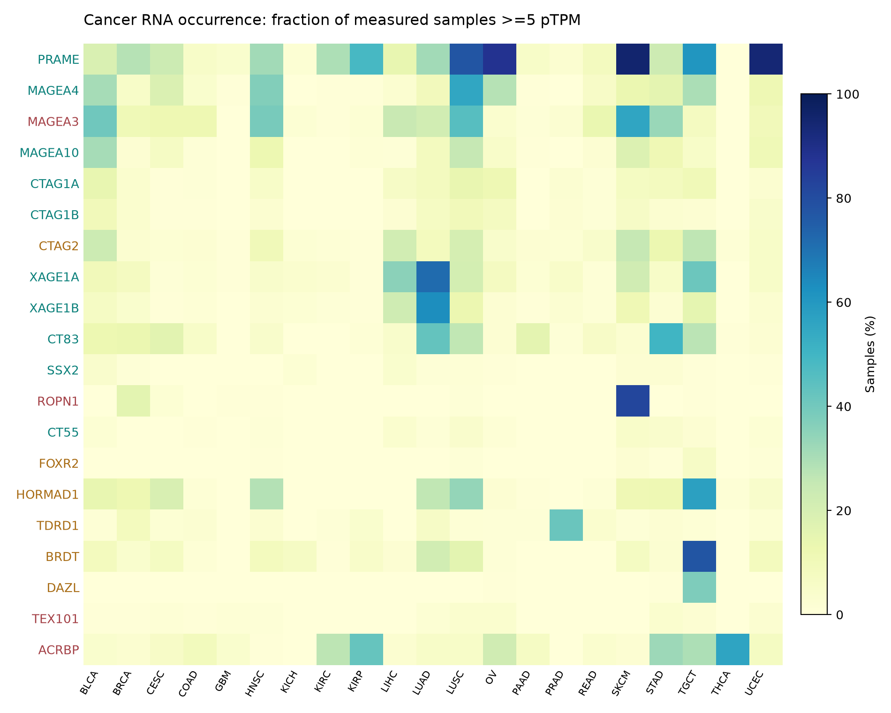

# The new CTA set: cancer occurrence, biology and therapeutic evidence

**399 retained CTA candidates, 561 Neither nominations and 1,580 excluded nominations.** This report covers all 2,540 mapped candidates under policy `2026-10-24.1`. The underlying gene/protein decisions are unchanged from the [merged high-normal-RNA review](../cta-neither-review-20261024/index.md).

**New literature conflicts matter:** 37 retained genes have normal-tissue or isoform findings to review. **ABCC11 and MAGEC2 need urgent neural protein-evidence adjudication before target use.** A retained label is a research-screen pass, not a clinical safety determination. These findings are visible beside each frozen decision, with a citation and follow-up action.

[Search every gene](explore.html) · [Compact summary table](quick-table.csv) · [Download all tables](cta-evidence-tables.zip) · [Overview PDF](pdf/cta-overview.pdf) · [Reconsideration table](reconsideration.csv) · [Retained literature conflicts](retained-literature-conflicts.csv)

## Full reports and tables

| Report | Scope | PDF | Table |
|---|---|---|---|
| Overview | Counts, rules, cancer heatmap, near-cutoff genes, normal-expression concerns, clinical outcomes and limitations | [Read overview](pdf/cta-overview.pdf) | [Clinical targets](clinical-targets.csv) |
| Retained | Every one of the 399 candidates, with normal RNA, cancer occurrence, biology and source links | [Retained catalog](pdf/cta-retained-catalog.pdf) | [399 genes](retained.csv) |
| Neither | All 561 unresolved/below-threshold nominations and their reasons | [Neither catalog](pdf/cta-neither-catalog.pdf) | [561 genes](neither.csv) |
| Excluded | All 1,580 Unsafe nominations, including RNA-only exclusions and positive normal protein | [Excluded catalog](pdf/cta-excluded-catalog.pdf) | [1,580 genes](excluded.csv) |

Every catalog gene has a PDF bookmark. The explorer links directly to its PDF page. The full tables retain unabridged annotations; PDF entries use excerpts. [All genes, ordinary CSV](all-genes.csv) · [Compressed CSV](all-genes.csv.gz) · [PDF gene index](pdf-gene-index.csv).

## Important decisions

| Genes | Result | Interpretation |
|---|---|---|
| MAGEA4, PRAME, CTAG1A/B, XAGE1A/B, CT83 | Retained | Current research rules pass; evidence remains product, assay and context dependent |
| CT55/CXorf48 | Retained | Human leukemia-cell recognition supports admission beyond low bulk RNA; no interventional efficacy claim |
| MAGEA3 | Unsafe / High RNA | Colon undifferentiated-cell RNA 53.1 nTPM; historical engineered-TCR hazards also require receptor-specific interpretation |
| ROPN1 | Unsafe / High RNA | Salivary serous-cell RNA 32.9 nTPM, close to the new ceiling; not demonstrated clinical toxicity |
| CTAG2 | Neither / Variable | Heart donor RNA 13.5, 0, 0 and 7.1 nTPM; negative IHC specimens are unpaired |
| FOXR2 | Neither / Antibody | Strong cancer biology; primary-antibody conflict unresolved |
| HORMAD1, TDRD1, BRDT, DAZL | Neither / Cellular | Immune/cell RNA findings require adjudication; not evidence of demonstrated therapeutic toxicity |
| ACRBP, TEX101, GAGE12F, PAGE2B, TRIP13 | Unsafe / High RNA | Expanded normal RNA crosses 30 TPM or nTPM |

[All 15 watched genes and follow-up questions](reconsideration.csv) · [All 30 trial-linked targets](clinical-targets.csv) · [55 genes near a numerical boundary](boundaries.csv). Boundary flags do not imply that changing one threshold would make a gene eligible.

## Retained genes deserving extra scrutiny

The highest retained non-permitted nTPM observations include **TEX14 29.7** (breast macrophages), **MORC1 28.5** (PBMC platelets), **KIAA1210 27.7**, **KLF17 27.4** and **YBX2 27.0**. Tissue, cell type, source and native TPM/nTPM are retained separately in the tables. Cell-cluster nTPM cannot be directly compared with bulk-tissue nTPM.

The literature review adds a separate concern. ABCC11 has a primary human axonal protein report ([Rius et al., 2006](https://pubmed.ncbi.nlm.nih.gov/16359813/)); MAGEC2/HCA587 has historical cerebellar Purkinje-cell staining with a polyclonal reagent ([2003 study](https://pubmed.ncbi.nlm.nih.gov/12920247/)). Both need formal normal-protein review. Other flags include isoform-specific normal expression (PATE2, TPTE2, EQTN), historical RNA findings, and shared-locus attribution. **These are actionable conflicts, not automatic new classifications.** [All 37 flags, citations and actions](retained-literature-conflicts.csv).

## Occurrence in cancers



The heatmap shows HPA v25.1-1 TCGA fractions with **RNA >=5 native pTPM**. Gray means missing exact-ID coverage. It is not prevalence in all cancer patients, a cell-surface protein measurement, or evidence of peptide presentation. The named panel is displayed whether retained or excluded.

- [Complete cancer RNA table](cancer-rna.csv.gz): 77,145 gene/cohort rows, separate TCGA and validation cohorts, counts and denominators at 0.1/1/2/5 pTPM, mean and maximum.
- [Complete cancer IHC table](cancer-ihc.csv.gz): 33,419 gene/cancer rows, High/Medium/Low/Not-detected patient counts and denominators.
- RNA summary entries rank cohorts with >=20 measured samples; IHC summaries rank Medium/High fractions in groups with >=5 scored patients. All smaller groups remain in the full tables.
- RNA and IHC cohorts are unpaired. The aggregate cancer IHC source does not identify antibodies or reliability. Counts are patients, not the fraction of cells stained. Homologous targets need assay-specific attribution.

## What the literature coverage means

**2,505 genes have an exact Ensembl cross-reference to reviewed UniProt; 1,873 have a function annotation.** Every gene receives an annotation or an explicit gap. Full biological functions, tissue annotations, disease roles, localization, cautions and PubMed evidence identifiers are supplied in [biology.csv.gz](biology.csv.gz). Shared entries and “by similarity” qualifiers are preserved.

**19 mapped genes have targeted primary-source reviews in this report**, including clinical outcomes, normal-protein conflicts and key biological studies. The 30 curated clinical intake links remain separate. This is **not a systematic efficacy/safety review of all 2,540 genes**; “no individual outcome review” never means no publications, no efficacy, or no risk.

The clinical summaries distinguish the current FDA TECELRA label, PRAME IMA203 outcomes, NY-ESO-1/LAGE-1A shared recognition, negative MAGE-A3 vaccination results, and the separate MAGE-A3/titin and MAGE-A3/A12 neurotoxicity mechanisms. Registrations, human tumor recognition and experimental cancer mechanisms are not promoted to clinical success. [Reviewed literature facts and citations](literature-reviews.csv).

## Rules, scope and gaps

The overview PDF gives the complete category/IHC grid and continuous selectivity rule. Admission requires reproductive RNA >=5 nTPM, reliable reproductive protein, or cited reproductive plus tumor/recognition support. The new independent rule excludes **any observed >30 TPM or nTPM** outside explicitly permitted Reproductive/Disposable contexts, even with negative IHC. Lower category/IHC ceilings, positive-IHC vetoes and normal-cell review rules still apply. Corneal CP10K is separate.

The full canonical scope has 399 CTA, 17,699 Unsafe and 1,999 Neither genes. Complete exact proteins number 723 CTA, 126,384 Unsafe and 2,878 Neither. Shared protein priority is Unsafe > Neither > CTA. [Pinned protein assets](../cta-neither-review-20261024/protein-assets.json). Gene RNA cannot identify the expressed isoform; disjoint full proteins can still share k-mers.

BAGE and GAGE2B are recorded in intake but lack resolved matched reference/expression rows, so are not falsely assigned a negative result or added to the 2,540-gene denominator. SPAG9 is mapped and excluded. Earlier Unsafe assignments were not all re-audited against every expanded normal source: blank maxima are coverage gaps, not zeros. HPA/DICE overlap is not independent replication. Human thresholds are not transferred to mouse or dog.

## Uniform API, provenance and reproduction

```python
from oncoref import protein_annotations, human_protein_atlas as hpa, reference_data

protein_annotations.gene_annotations(["ENSG00000147381"])
protein_annotations.reviewed_human()  # native entries, evidence codes and citations
hpa.cancer_rna_prevalence(gene_ids=["ENSG00000147381"])
hpa.cancer_ihc_prevalence(gene_ids=["ENSG00000147381"])
reference_data.provenance("uniprot_reviewed_human")
```

```bash
oncoref data fetch uniprot_reviewed_human
python scripts/build_cta_atlas.py
python scripts/render_cta_atlas.py
python scripts/publish_cta_atlas_files.py
```

UniProt 2026_03 is archived and checksum-pinned alongside HPA/DICE/corneal sources in the shared cache: `~/.cache/oncoref/sources/<source>/<version>/<filename>`. `CANCERDATA_DATA_DIR` overrides the root. Attribution: UniProt Consortium, [CC BY 4.0](https://rest.uniprot.org/help/license). [Source archive](https://github.com/pirl-unc/oncoref/releases/tag/cta-literature-20261024) · [Input provenance](provenance.json) · [Artifact hashes](artifacts.json) · [Review record](review.md).
