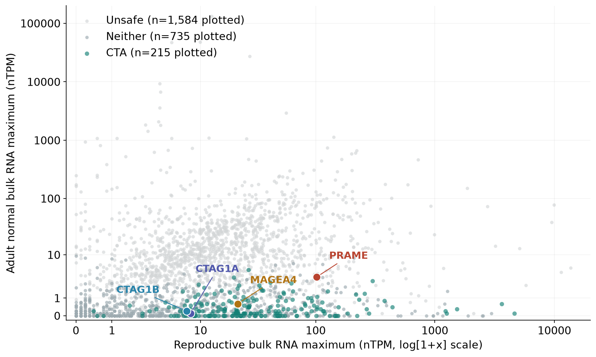
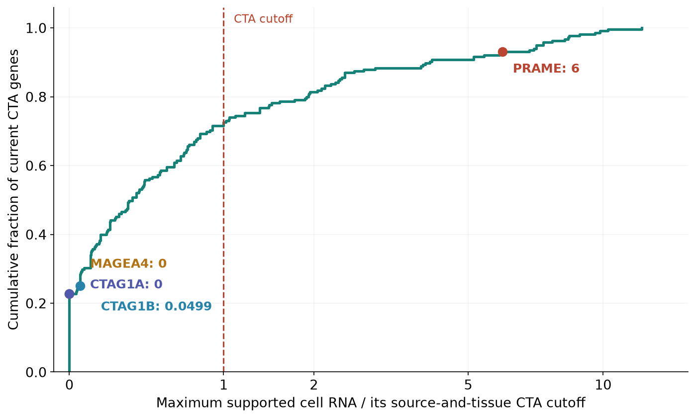
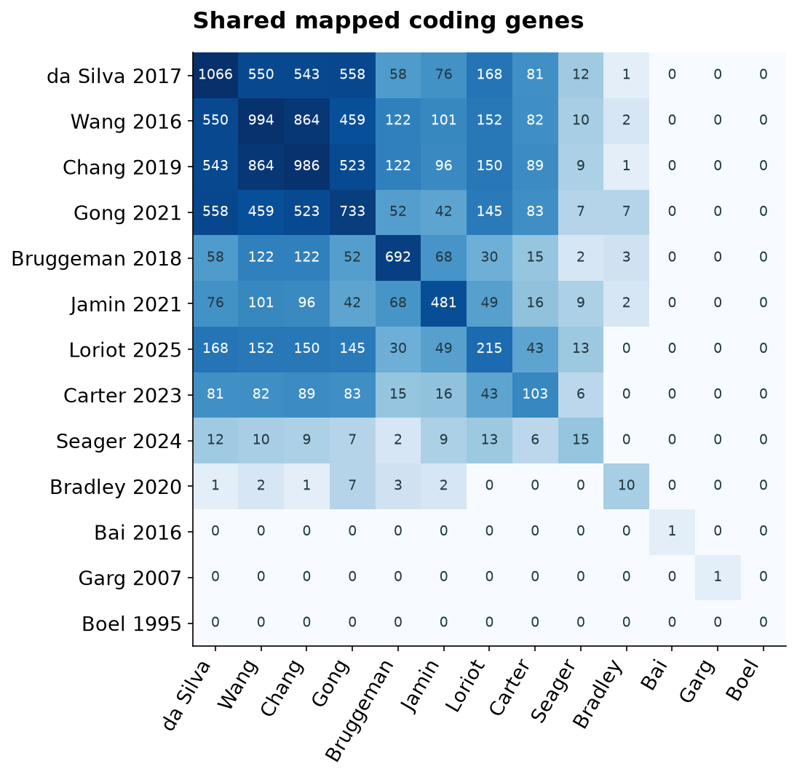

# Tissue-specific cell-RNA thresholds and CTA selection

The current research selection contains **215 genes**. This audit implements
two independently specified normal-cell RNA cutoffs and exports concrete
**illustrative exclusion lists**. It does not activate a new classification
policy or regenerate a forbidden-protein FASTA. The numerical choices below
are calibration hypotheses, not validated limits.

[Eight-slide presentation](cta-selection.pptx) ·
[Gene-level assessments](gene-assessments.csv) ·
[All context evidence](context-assessments.csv.gz) ·
[Input and output hashes](run-manifest.json)

The [current expression rules](../cta-policy-20261025/index.md) and
[clinical qualification route](../cta-research-20261026/index.md) remain the
definitions governing the current 215-gene result. Their admission floor,
bulk ceilings, reproductive selectivity, independent high-RNA cap, protein
exclusions, donor/antibody holds and evidence requirements remain in force.

## Two decisions, with an uncertainty layer

| Supported adult-cell RNA | CTA decision | Self-reference evidence |
|---|---|---|
| Below the lower cutoff | Pass this RNA gate only | Does not establish protein absence or complete coverage |
| At or above the lower cutoff, below the upper cutoff | Exclude from CTA selection | Retain in an uncertain self-evidence layer |
| At or above the upper cutoff | Exclude from CTA selection | Add to RNA-supported reference review |
| Reliable positive normal IHC | Exclude independently of RNA | Protein-supported exclusion evidence |
| Missing source, unresolved anatomy or inadequate measurement support | Unassessed | Preserve the gap explicitly |

The two cutoffs answer different questions. The middle zone must not disappear
from conservative near-self review simply because it is absent from a stronger
evidence layer. RNA-supported reference review is not a claim of protein
translation or peptide presentation. This audit therefore supplies gene/evidence
lists, while the sequence-reference contract in #640 and the provenance and
coverage work in #641 remain separate.

## Illustrative numerical matrix

These values apply when matching negative IHC is missing or unusable. Equality
crosses the relevant boundary. No reproductive maximum rescues a normal signal.

| Source and anatomical tier | Native unit | CTA cutoff | Reference-review cutoff |
|---|---|---:|---:|
| HPA tissue clusters, vital | nTPM | 2 | 5 |
| HPA tissue clusters, protected | nTPM | 5 | 10 |
| HPA tissue clusters, manageable | nTPM | 10 | 20 |
| HPA immune, vital | nTPM | 2 | 5 |
| Monaco immune, vital | TPM | 2 | 5 |
| Original DICE, vital | TPM | 2 | 5 |
| Adult cornea, vital | CP10K | 1 | 2 |

The existing 5-native-unit immune trigger and 1-CP10K corneal trigger anchor
parts of this exploratory matrix. The new lower/upper boundaries, anatomical
scaling and IHC multipliers have **not** been fitted or validated against an
independent safety or protein-expression endpoint. Identical numbers in two
assays do not make their units or sensitivity equivalent. Bulk RNA ceilings
have not been transplanted into a claimed calibrated single-cell policy.

Negative IHC multiplies both cutoffs by 1 for missing/uncertain evidence,
1.25 for Approved, 1.5 for Supported and 2 for Enhanced, **only** when the adult
tissue and cell labels match exactly, staining is Not detected, a reliable
positive profile control exists, and there is no unresolved antibody concern.
There are no fuzzy anatomical matches. An organ-level negative result cannot
clear a fibroblast, rare cell population or activated immune state that it did
not measure. The positive control is a profile-level check, not a matched-donor
experiment or cell-specific sensitivity calibration. HPA itself describes
context-dependent assay reliability and possible false staining results.
[HPA assay limitations](https://www.proteinatlas.org/about/disclaimer).

Support requirements are retained: HPA clusters need at least 20 reads; DICE
needs at least three reported values crossing each cutoff; corneal means need
at least five positive cells and 20 counts in at least two distinct sample
groups. These are reported values/groups, not inferred independent donors.
The builder uses the third highest DICE value and second highest supported
corneal group value to evaluate both thresholds without changing recurrence.
HPA's DICE summary does not count as a second study. Missing or insufficiently
supported statistics remain missing, with the original observed maximum and
record counts retained separately.

## Consequences of this scenario

Across the 2,540 current nominees, the illustrative matrix flags **1,402** genes
for CTA exclusion. Of those, **1,116** reach the stronger RNA/protein evidence
layer and **286** remain in the middle zone. These counts overlap existing
exclusions and are not additions to the released forbidden reference.
Three nominees have no source records in the analyzed extracts.

Among the current 215 selected genes, **154** remain below the added exclusion
gate, **33** fall in the middle zone, and **28** reach the stronger layer.
This is an exclusion-only overlay: it does not rescue existing holds or infer
adequate coverage from the absence of a new flag.

- [Proposed CTA exclusions](proposed-cta-exclusions.csv)
- [Every exclusion finding with tissue, cell, source, cutoffs and IHC tier](exclusion-findings.csv.gz)
- [Stronger reference-review layer](proposed-reference-review.csv)
- [Middle-zone genes and genes without source records](uncertain-reference-review.csv)
- [The 61 current selected genes affected](selected-gene-changes.csv)
- [Independent lower/upper cutoff sensitivity](threshold-sensitivity.csv)
- [Comparison without any negative-IHC relaxation](without-ihc-relaxation.csv)

The uncertain-reference file covers those two named categories only; full
within-gene coverage and unsupported observations remain in the context file.
It is not a complete conservative self-reference definition.

Scaling the lower cutoffs to 0.5×, 1× and 1.5× retains 123, 154 and 168 of the
215 genes. Independently scaling the upper cutoffs to 1×, 2× and 3× changes the
stronger review layer to 1,116, 859 and 707 genes without changing those CTA
counts. With no IHC relaxation at all, 1,403 genes cross the lower boundary and
1,118 enter stronger review. Exact IHC matching, rather than its quality label
alone, is the major constraint: only 2,849 of 314,586 screened adult-cell
contexts match a tissue/cell IHC record. Only 2,678 qualify for negative-IHC
relaxation.

### PRAME, MAGE-A4 and NY-ESO-1

PRAME remains in the **current** clinically qualified research selection, with
its normal-expression caveats. It would fail this illustrative absolute
cell-RNA gate:

| PRAME context | nTPM | CTA cutoff | Reference-review cutoff |
|---|---:|---:|---:|
| Heart muscle fibroblasts | 12.0 | 2 | 5 |
| Colon undifferentiated cells | 20.3 | 5 | 10 |
| Vascular fibroblasts | 2.8 | 2 | 5 |

None of these contexts has an exact matched negative IHC result. The earlier
cluster rule compared normal RNA with the reproductive-cell maximum, which
could suppress these review flags. This audit removes that relative rescue.
MAGEA4 and CTAG1A/CTAG1B remain below the added supported cell-RNA cutoffs. That
does not establish absence in every normal cell or clear every targeting
product. [Named-gene context records](highlight-contexts.csv.gz).



Both axes above use HPA bulk consensus nTPM. Missing measurements are omitted
and plotted sample counts are stated in the legend. The cell-RNA display below
uses each assay's own cutoff before forming a dimensionless maximum; it is
not pooled expression or a validated risk score.



## Nomination sources and filtering funnel

Thirteen registered papers yield **2,538 distinct mapped coding genes** from
the twelve with eligible mapped identities. The original Boël BAGE identity
remains unmapped to a canonical locus; it contributes zero to that union.
Trial nominations add KIF20A and CLDN6, yielding **2,540**. Nested tables are
unioned within papers before computing counts and overlaps.

[Per-paper counts](nomination-sources.csv) ·
[Pairwise overlaps](source-overlaps.csv) ·
[Membership](nomination-membership.csv.gz) ·
[Additional trial nominations](additional-trial-nominations.csv)



The current disjoint funnel is **2,540 nominees**, **955 after 1,585 accepted
normal exclusions**, then **215 after 740 unresolved or ineligible results**.
The 215 comprise 204 expression passes, nine supported admissions and two
clinical qualifications. [Every final reason and count](current-decision-breakdown.csv).
These are assigned reasons, not counts of independent overlapping filters.

The historical 740, 589, 436, 399, 213 and 215 are successive policy versions.
They include the admission floor, evidence reviews, an independent high-RNA
cap, cell/antibody review, and finally clinical qualification. They are not a
single nested funnel: for example, the 589-to-436 transition removed 154 genes
and readmitted CT55. The original 758-gene pilot preceded the 740-gene version.

[Filtering-source coverage](filter-source-coverage.csv) is measured against
the current 2,540 nominees in the pinned extracts: 2,534 have adult bulk RNA,
1,095 have tissue-cluster and each sorted immune source, 2,537 have original
DICE distributions, and 1,071 have corneal records. These are extract coverage
counts, not the full databases' coverage. All current 215 have some supported
cell measurements, but none is thereby proven comprehensively assessed.

## Oncofetal expansion and brachyury

CLDN6 is explicitly oncofetal in the current trial evidence. There is no broad
oncofetal gene-list intake or calibrated developmental RNA admission yet.
The reproductive taxonomy permits developmental contexts, but the current
bulk ≥5 nTPM admission measurement does not contain fetal or embryonic tissues.

An explicitly named source for future intake is Su et al.'s **200-gene
oncofetal liver expression signature**, Table S1. It supplies expression-program
nominees; it is not an already screened list of restricted antigens. It has not
been imported here, so its mapped overlap and net added candidate count remain
uncomputed. [Su et al. 2024](https://www.thno.org/v14p4948.htm).

Gastrulation, organogenesis and Cao/DESCARTES fetal atlases can supply positive
developmental evidence once stage, cell lineage, coverage and native-unit
calibration are implemented. TBXT/brachyury is currently outside the 2,540
nominees and remains Neither in canonical results. Its adult nucleus-pulposus
evidence needs review even if fetal expression is high. See the
[developmental source assessment](../../developmental-targets.md) and the
[adult disc study](https://pubmed.ncbi.nlm.nih.gov/28473691/).

## Reproduction and status

```bash
python scripts/cta_cell_policy_report.py --output /path/to/empty-audit
python scripts/cta_selection_figures.py --audit /path/to/empty-audit --output /path/to/figures
```

The generic implementation has no default numeric policy. Tests cover both
boundaries, anatomy, IHC mismatch and uncertainty, native units, recurrence,
and missing measurements. The lower and upper thresholds still need calibration
against held-out tissue/cell evidence before adoption. Clinical qualification
alone must not silently erase new cell-RNA counterevidence.
