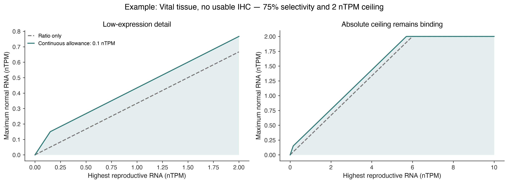
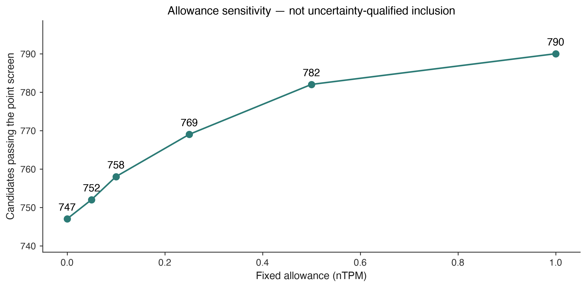

# Continuous CTA expression screen

Updated **22 October 2026**. **758 candidates pass the point-estimate screen** (12 gained, 0 lost versus the published 746). **No candidate has an uncertainty-qualified inclusion yet:** the pinned input bundle contains tissue summaries, not a fitted donor model.

## Start here

- **[Find a gene](explore.html)** — search, filter, and open its reasons.
- **[What changed](#what-changed)** · **[Named CTAs](#named-ctas)** · **[Filtering rules](#filtering-rules)**.
- **[Uncertainty results](#uncertainty-results)** explains why a point-screen pass can still be Review.
- **[Downloads](#downloads-and-reproduction)** includes every gene, every measured tissue and checksums.
- [Publication sources and full intake](../cta-curation-20261021-r2/index.md#publication-sources) · [Existing disjoint gene/protein sets](../normal-sequence-sets-20261021/index.md).

## What changed

We replaced the percentage cliff with a continuous expression margin, and required reproductive RNA to be strictly higher than each screened normal tissue. The new allowance is **0.1 nTPM**, fixed across genes. It is a provisional project parameter, **not an assay detection limit, measurement error or a confidence interval**. No gene-specific rescue is used.

The published absolute ceilings, local IHC requirements, positive-IHC veto, reproductive admission, coverage checks, family reviews and external holds are preserved. The previously discussed tighter 730-gene absolute grid is not silently substituted. Historical gene/protein exports remain tied to their original policy; this pilot does not create new k-mer exclusion sets from Review candidates.

### Newly passing the point screen

| Gene | Highest reproductive RNA (nTPM) | Uncertainty result |
| --- | --- | --- |
| CDKL4 | 2 | Review |
| CGB2 | 1.5 | Review |
| FNDC7 | 1.1 | Review |
| NLRP8 | 0.2 | Review |
| OR1E1 | 0.2 | Review |
| OR2A4 | 0.3 | Review |
| SYT10 | 2.1 | Review |
| TGM7 | 0.8 | Review |
| USP50 | 1.5 | Review |
| ZFP42 | 2 | Review |
| ZIM3 | 0.3 | Review |
| ZNF730 | 4.9 | Review |

These candidates need evidence review; passing revised parameters does not establish tumor antigenicity or clinical safety. [Full changes](changes.csv).

## Filtering rules

For each Vital, Protected or Manageable tissue:

```text
R = highest reproductive tissue RNA
N = this normal tissue's RNA
C = its existing category/IHC absolute ceiling
s = its existing category/IHC selectivity minimum

N <= C
N <= ((1 - s) / s) * R + allowance
R > N
```

All three must hold. The first two boundaries are inclusive; equality of reproductive and normal expression fails the third. Disposable tissue is ignored for these comparisons and never contributes to R. Reproductive admission remains RNA >0 or positive reproductive IHC; the RNA comparison needs a positive reproductive RNA reference. Missing measurements are not zero. Any positive normal IHC, including Low, still excludes.

| Tissue | Absolute ceilings, nTPM | Selectivity minima |
| --- | --- | --- |
| Vital | 2 / 4 / 6 / 12 | 75 / 70 / 65 / 60% |
| Protected | 6 / 8 / 12 / 24 | 70 / 65 / 60 / 55% |
| Manageable | 10 / 20 / 30 / 60 | 65 / 60 / 55 / 50% |

Order: missing/uncertain IHC → Approved negative → Supported negative → Enhanced negative. Relaxation still requires complete routine negative IHC in the same tissue, using its weakest confidence. These are research parameters, not validated safety limits.



The example shows a 75% minimum, equivalent to N ≤ R/3 before the allowance. The shaded region also enforces the absolute ceiling and R > N; the equality boundary R = N is excluded. At low expression the allowance matters more, without a jump at 1 nTPM. At high expression the original ratio or absolute ceiling dominates.

### Allowance sensitivity

| Allowance (nTPM) | Pass point screen | Gained | Lost |
| --- | --- | --- | --- |
| 0.0 | 747 | 1 | 0 |
| 0.05 | 752 | 6 | 0 |
| 0.1 | 758 | 12 | 0 |
| 0.25 | 769 | 23 | 0 |
| 0.5 | 782 | 36 | 0 |
| 1.0 | 790 | 44 | 0 |



Zero allowance passes 747 candidates: the old 746 plus **OR2A4**, whose exact 0.3 / (0.3 + 0.1) = 75% boundary previously failed because of floating-point rounding. Inclusive boundaries now accommodate one representable numerical step; this is separate from the biological allowance. Thus 1 of this run's 12 new passes is a numerical correction and 11 come from the 0.1 allowance. The starting allowance was selected as a small, inspectable pilot tolerance, not fitted to clinical targets. This table is sensitivity analysis, not validation. Independent donor data and controls are needed to calibrate it.

## Named CTAs

| Gene | Continuous point screen | Uncertainty result |
| --- | --- | --- |
| CT83 | Pass | Review |
| CTAG1A | Pass | Review |
| CTAG1B | Pass | Review |
| CTAG2 | Pass | Review |
| CTCFL | Pass | Review |
| GAGE1 | Pass | Review |
| MAGEA12 | Does not pass | Excluded |
| MAGEA3 | Pass | Review |
| PRAME | Pass | Review |
| SAGE1 | Pass | Review |
| SPAG9 | Does not pass | Excluded |
| SSX4 | Pass | Review |
| SSX5 | Pass | Review |
| XAGE1A | Pass | Review |
| XAGE1B | Pass | Review |

All 16 previously retained loci in the clinical-evidence panel still pass the point screen. A trial registration is evidence of a nominated treatment target, not proof of safety. [All 30 clinical-panel loci, references and limitations](clinical-results.csv).

**CTAG2:** pinned reproductive maximum 10.1 and heart 5.1 nTPM still pass the point rules. Existing donor evidence reports two positive HPA heart samples and two zeros; that heterogeneity is a reason to fit a donor model, not assign a narrow interval around 5.1. Its mean-rule pass is not uncertainty-qualified inclusion. [Detailed donor/clinical review](../ctag2-heart-evidence.md).

**BAGE and GAGE2B** remain source nominations without an assessed canonical RNA row. This change supplies neither missing mappings nor donor measurements. **SPAG9** remains assessed with its original counterevidence. [Identity audit](../cta-curation-20261021-r2/index.md#bage-and-gage2b-what-is-missing).

## Uncertainty results

| Uncertainty result | Genes |
| --- | --- |
| Included | 0 |
| Excluded | 851 |
| Review | 1689 |

This second result is deliberately separate from the point screen. Excluded currently reflects explicit protein, family or safety exclusions. Review covers unavailable donor uncertainty and other evidence gaps. RNA point failures alone do not become statistically confident failures without an uncertainty model.

The implementation evaluates **joint posterior draws** for all 36 screened normal tissues and 11 reproductive reference tissues in the independent HPA panel:

1. Recompute the reproductive maximum in each draw, keeping tissue correlations and reference-selection uncertainty.
2. Test all three expression rules across all normal tissues in that draw. The passing fraction is the joint mean-rule probability; marginal probabilities are never multiplied.
3. Separately check posterior draws of each tissue's **95th donor percentile** against its absolute ceiling. This prevents a precise mean from concealing donor variability. Tail concerns yield Review rather than a clinical-toxicity claim.
4. **Included:** at least 95% joint support including the donor-tail check, with the other gates satisfied. **Excluded:** at least 95% support for failing the mean rules, or a hard protein/curation/safety exclusion. **Review:** everything else, including missing or degenerate uncertainty inputs.

The 95% decision probability and donor percentile are explicit provisional modeling choices. The result is conditional on the model and measured panel, not the probability that treatment is safe. At least 1,000 independent posterior draws and passed model checks are required. IHC labels are not converted into invented antibody sensitivities or numeric probabilities.

### What remains unavailable

**No donor model was fitted in this run.** All posterior probability fields are blank, not zero. The imported HPA v23 consensus uses aggregated expression and the maximum across its underlying sources; these are not biological replicates from which a sampling interval can be recovered. [HPA v23 download definitions](https://v23.proteinatlas.org/about/download).

HPA also describes sample-level transcript TPM and estimated counts, which could support a future fit. Their normalization, gene aggregation, donor identities and coverage must be reconciled with the pinned gene-level nTPM scale first. Counts/TPM from another release or GTEx cannot simply be treated as HPA v23 nTPM. [HPA sample data](https://v24.proteinatlas.org/humanproteome/tissue/data) · [Expression units](../../cta-expression-units.md).

A count-aware model can estimate and shrink unstable low-count effects; the published apeglm method provides relevant statistical precedent. It does not validate this project's tolerances or turn tissue summaries into confidence intervals. [Zhu et al., 2019](https://pubmed.ncbi.nlm.nih.gov/30395178/). A future fit also needs cohort heterogeneity, donor variation, zero-count uncertainty, mapping ambiguity and held-out calibration. Repeating consensus values or bootstrapping only observed zeros is explicitly rejected as sufficient uncertainty evidence.

## Downloads and reproduction

- [Gene results](gene-results.csv) · [Changes](changes.csv) · [Clinical evidence/results](clinical-results.csv).
- [All tissue margins and IHC context](tissue-evidence.csv.gz) · [Allowance sensitivity](sensitivity.csv).
- [Uncertainty counts](uncertainty-summary.csv) · [Policy and independent tissue panels](screening-policy.json).
- [Run manifest and hashes](run-manifest.json) · [Boundary SVG](continuous-boundary.svg) · [Sensitivity SVG](allowance-sensitivity.svg).

```bash
python scripts/cta_continuous_report.py --output /tmp/cta-continuous-audit
```

The input archive, output tables and implementation are hashed. The public Python API is documented in [continuous CTA screening](../../cta-continuous-screen.md). Frozen reproductive/normal sequence backgrounds remain unchanged until a reviewed policy explicitly regenerates them.
