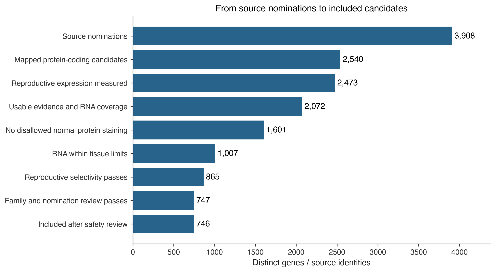

# CTA curation and filtering

**3,908 source identities → 2,540 protein-coding candidates → 746 included.** Updated 21 October 2026, with a minimum outside-tissue RNA ceiling of **2 nTPM**.

## Start here

- **[Find a gene and read its evidence](explore.html#genes)** — search names, aliases or IDs; filter by result and expression group.
- **[Clinical targets](#clinical-targets)** — readable results for antigens with clinical evidence.
- **[Publication sources](#publication-sources)** — what each source contributes to the current set.
- **[Filtering rules](#filtering-rules)** — the RNA, protein-staining and selectivity rules.
- **[Gene and protein sets](../normal-sequence-sets-20261021/index.md)** — disjoint lists and FASTA files for k-mer comparisons.
- **[Downloads](#downloads)** — tables, figures and reproducibility records.

## What changed

**98 newly included; 0 no longer included**, compared with the previous [648-gene report](../cta-curation-20261021/index.md).

**XAGE1A and XAGE1B are both included.** XAGE1B's liver 1.5 and lung 1.2 nTPM measurements now pass the 2 nTPM baseline through the general rule. Shared protein sequences are resolved separately in the gene/protein sets.

All absolute RNA ceilings were doubled. Reproductive admission remains RNA >0 or positive IHC. Selectivity percentages and the exclusion for any positive normal-tissue IHC remain unchanged. The [complete change list](changes.csv) records every affected gene.

## Filtering funnel

| Step | Genes |
| --- | --- |
| Source nominations | 3908 |
| Mapped protein-coding candidates | 2540 |
| Reproductive expression measured | 2473 |
| Usable evidence and RNA coverage | 2072 |
| No disallowed normal protein staining | 1601 |
| RNA within tissue limits | 1007 |
| Reproductive selectivity passes | 865 |
| Family and nomination review passes | 747 |
| Included after safety review | 746 |

Each row applies an additional rule to the preceding row. Individual genes can fail several rules; the downloadable findings preserve all of them.

## Compare the screens

| Screen | Included |
| --- | --- |
| Fixed thresholds | 708 |
| IHC-adaptive thresholds | 746 |
| Zero measured outside RNA | 216 |

**Fixed** uses the baseline ceilings (Vital 2, Protected 6, Manageable 10 nTPM) and baseline selectivity percentages for every tissue. **IHC-adaptive** is the current result: complete local negative IHC can relax both thresholds. **Zero measured outside RNA** adds a stricter requirement of zero measured RNA in all screened normal tissues. All three keep the same positive-IHC veto, reproductive admission, evidence-coverage requirements and curation reviews. Zero measured RNA does not establish protein absence or coverage of unmeasured tissues.

[Compare individual genes](threshold-comparison.csv) · [Every tissue's RNA, reference and IHC support](tissue-evidence.csv.gz).

## Publication sources

| Publication / list | Source rows | Mapped coding candidates | Included |
| --- | --- | --- | --- |
| Gong et al., Nature Communications (2021) | 71 | 69 | 27 |
| Gong et al., Nature Communications (2021) | 74 | 1 | 0 |
| Bradley et al., Nature Communications (2020) | 10 | 10 | 3 |
| Wang 2016 | 1019 | 994 | 489 |
| Bruggeman 2018 | 756 | 692 | 54 |
| da Silva 2017 · testis-biased | 1103 | 1066 | 593 |
| da Silva 2017 · CT | 745 | 726 | 445 |
| Jamin 2021 | 607 | 480 | 60 |
| Jamin 2021 · core | 125 | 125 | 45 |
| Chang 2019 · TGCT | 1036 | 986 | 510 |
| Carter 2023 | 103 | 103 | 89 |
| Seager 2024 · panel | 17 | 15 | 11 |
| Loriot 2025 · strict | 146 | 117 | 97 |
| Loriot 2025 · preferential | 134 | 98 | 53 |
| Gong 2021 · reproductive coding | 744 | 728 | 497 |
| Gong 2021 · reproductive noncoding | 1067 | 5 | 0 |
| da Silva 2017 · tumor proteomics | 136 | 135 | 79 |
| Bai 2016 | 1 | 1 | 0 |
| Boël et al., Immunity (1995) | 1 | 0 | 0 |
| Garg et al., Clinical Cancer Research (2007) | 1 | 1 | 0 |

Sources overlap, so these rows must not be added together. Counts refer to distinct mapped coding candidates within each source; published source rows can include historical noncoding or unmapped entries. The clinical evidence audit adds targeted primary evidence and nominated comparator genes independently of these publication lists.

[Download exact citations, source tables and current counts](publication-results.csv).

## Clinical targets

| Gene | Clinical evidence | Result |
| --- | --- | --- |
| AKAP4 | Trial registration | Included |
| BIRC5 | Trial registration | Normal protein detected |
| CLDN6 | Trial registration | Selectivity below limit |
| CT83 | Trial registration | Included |
| CTAG1A | Trial registration | Included |
| CTAG1B | Trial registration | Included |
| CTAG2 | Shared target in a clinical study | Included |
| DEPDC1 | Trial registration | Normal protein detected |
| IGF2BP3 | Published clinical study | Normal protein detected |
| KIF20A | Trial registration | Normal protein detected |
| KIF20B | Trial registration | Normal protein detected |
| LY6K | Trial registration | RNA above limit |
| MAGEA1 | Trial registration | Included |
| MAGEA10 | Trial registration | Included |
| MAGEA12 | Published safety findings | Safety hold |
| MAGEA3 | Trial registration | Included |
| MAGEA4 | Approved therapy | Included |
| MAGEC1 | Trial registration | Included |
| MAGEC2 | Trial registration | Included |
| NUF2 | Published clinical study | RNA above limit |
| PRAME | Trial registration | Included |
| PTTG1 | Trial registration | Normal protein detected |
| ROPN1 | Antigen family named in a trial | Included |
| ROPN1B | Antigen family named in a trial | RNA above limit |
| SPA17 | Trial registration | Normal protein detected |
| SPAG9 | Institutional treatment report | Normal protein detected |
| SPANXB1 | Trial registration | Included |
| SSX2 | Trial registration | Included |
| TTK | Trial registration | Normal protein detected |
| XAGE1B | Trial registration | Included |

**Clinical evidence describes the source, not a safety grade.** A trial registration names an intended treatment target; it does not establish that treatment occurred or worked. A published clinical study reports patient experience. An institutional report is a primary treatment account without necessarily being a peer-reviewed trial paper. An approved therapy has a product- and indication-specific approval. Shared targets and antigen-family labels do not resolve every gene or isoform.

**Result describes this screen.** Included means the current rules pass. Normal protein detected means IHC staining was observed outside Reproductive/Disposable. RNA above limit and Selectivity below limit identify numerical failures requiring review. Safety hold records external evidence that prevents automatic inclusion. Needs review covers evidence or curation gaps. None of these labels alone predicts clinical outcomes.

### Important exclusions

- **MAGEA12:** an explicit hold based on published normal-brain expression and the anti-MAGE trial's neurological injuries, despite an HPA screen pass. Unique causal attribution is not established. [Primary report](https://pubmed.ncbi.nlm.nih.gov/23377668/)
- **SPAG9 / SP17:** measured normal-tissue protein staining remains an exclusion. Trial use does not erase that evidence.
- **LY6K:** remaining RNA failures include midbrain 2.4, hypothalamus/retina 2.3 and basal ganglia 2.2 nTPM against the 2 nTPM baseline.
- **CLDN6:** the adult reproductive reference is weak and fetal tissue coverage is missing. Its selectivity failure is a reference-coverage concern, not demonstrated clinical toxicity.
- **MAGEA3:** included, with a separate receptor-specific titin cross-reactivity review. That clinical event does not establish cardiac MAGEA3 expression. [Primary report](https://pmc.ncbi.nlm.nih.gov/articles/PMC3743463/)

[Download the clinical results with sources and evidence limits](clinical-results.csv). The 30 reviewed loci include related oncofetal targets and safety comparators; this is not a claim of 30 independently approved therapies or exhaustive worldwide trial coverage.

## Filtering rules

**Maximum RNA, in HPA v23 nTPM:**

| Tissue group | No usable IHC | Approved negative | Supported negative | Enhanced negative |
| --- | --- | --- | --- | --- |
| Vital | 2.0 | 4.0 | 6.0 | 12.0 |
| Protected | 6.0 | 8.0 | 12.0 | 24.0 |
| Manageable | 10.0 | 20.0 | 30.0 | 60.0 |

IHC means antibody staining in normal tissue. A negative result means “Not detected”; Approved, Supported and Enhanced are HPA reliability labels. A higher ceiling requires negative results across every routine cell type measured in that same tissue, using the weakest reliability. Missing or uncertain IHC uses the baseline column. **Any positive IHC, including Low, excludes in Vital, Protected and Manageable tissues.**

Selectivity = highest reproductive RNA / (highest reproductive RNA + that tissue's RNA). Minimum percentages, in the same column order: **Vital 75/70/65/60%; Protected 70/65/60/55%; Manageable 65/60/55/50%.** Both RNA and selectivity must pass for every screened tissue. Disposable tissue contributes neither positive reproductive admission nor an exclusion.

These are project research-screening parameters. [Full tissue definitions and citations](../../normal-tissue-scopes.md) · [Exact policy](screening-policy.json).

## BAGE and GAGE2B: what is missing?

These are real, published genes. The problem is reference mapping and gene-specific expression coverage.

| Gene | What the current Ensembl check found | Consequence |
|---|---|---|
| BAGE | No current symbol lookup or symbol cross-reference in Ensembl 116. HGNC has no Ensembl ID in its retrieved record. | Keep its NCBI/HGNC identity in intake; HPA v23 does not supply a usable BAGE-specific RNA/IHC record. |
| GAGE2B | Historical ENSG00000231850 ended at GRCh37/release 75. A current symbol cross-reference points to **GAGE2A, ENSG00000189064**, whose record links several GAGE2 genes. | A shared cross-reference is not a unique GAGE2B locus or gene-specific expression measurement. Keep GAGE2B unresolved rather than substitute GAGE2A measurements. |

[Official Ensembl checks and responses](ensembl-identity-checks.json) · [GAGE2B ID history](https://rest.ensembl.org/archive/id/ENSG00000231850?content-type=application/json) · [Current cross-reference](https://rest.ensembl.org/xrefs/symbol/homo_sapiens/GAGE2B?content-type=application/json) · [GAGE2A record](https://rest.ensembl.org/lookup/id/ENSG00000189064?content-type=application/json).

## Reproductive, Normal and Other

| Group | Other subgroup | Genes |
| --- | --- | --- |
| Normal |  | 18063 |
| Other | Disposable | 29 |
| Other | Silent | 372 |
| Reproductive |  | 1023 |
| Unassessed |  | 610 |

These groups cover all 20,097 canonical coding genes, including genes without a CTA publication. Other contains Disposable and Silent under the approved below-threshold definition. Missing routine evidence remains Unassessed. [Expression-group definitions](../normal-expression-categories-20261021-r2/index.md).

For sequence work, [the disjoint gene and protein sets](../normal-sequence-sets-20261021/index.md) account for exact shared proteins and retain unresolved translations. Distinct proteins can still share k-mers; sequence-level subtraction is still required.

## Downloads

| Purpose | Download |
|---|---|
| Read results for every mapped candidate | [Readable gene results](gene-results.csv.gz) |
| Inspect clinical evidence and limitations | [Clinical results](clinical-results.csv) |
| See gains and losses | [Changes](changes.csv) |
| Compare fixed, adaptive and zero-outside-RNA screens | [Per-gene comparison](threshold-comparison.csv) |
| Check the original tissue measurements and IHC confidence | [Tissue evidence](tissue-evidence.csv.gz) |
| See each publication's contribution | [Publication results and citations](publication-results.csv) |
| Reuse gene / protein / sequence sets | [Disjoint sets and FASTA files](../normal-sequence-sets-20261021/index.md) |
| Export the funnel figure | [PNG](filtering-funnel.png) / [SVG](filtering-funnel.svg) / [Counts](funnel.csv) |
| Inspect source nominations, including unresolved IDs | [Complete intake](intake-decisions.csv.gz) |
| Reproduce detailed decisions | [Candidate data](candidate-decisions.csv.gz) / [Clinical audit](clinical-target-audit.csv) / [Checksums](run-manifest.json) |

## Sources and earlier reports

The intake combines the 20 publication lists or targeted source records above with reviewed primary clinical evidence. [Earlier source-import audit](../cta-recalibration-20261021/index.md) · [Clinical registry snapshot and source evidence](../cta-curation-20261021/index.md#downloads-and-reproducibility) · [Earlier threshold comparison](../cta-recalibration-20261021/index.md) · [Human/dog/mouse tissue mappings](../normal-tissue-registry-20261021-r2/index.md). Earlier numerical reports remain dated archives.
