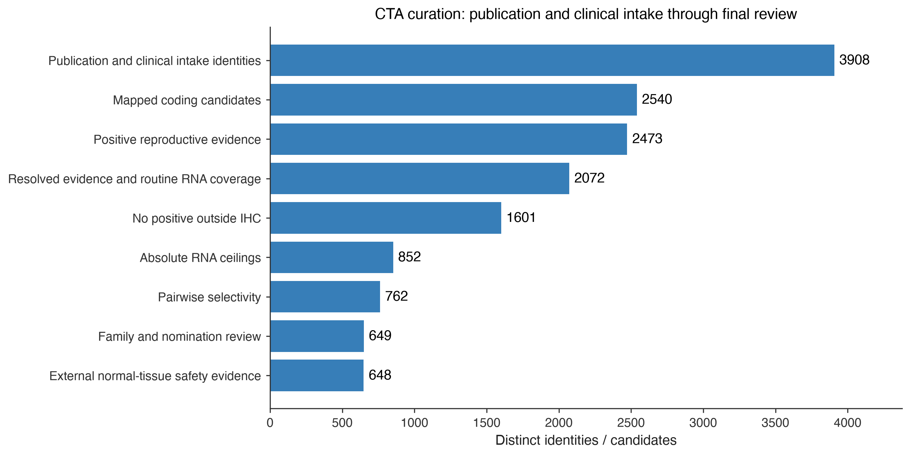

# CTA curation, clinical coverage and expression categories — 21 October 2026

**3,908 intake identities → 2,540 mapped coding candidates → 648 retained after external safety review.** The source union contains the 13 imported publication sources plus the explicitly reviewed clinical-target evidence. No clinical benchmark target is silently omitted.

## General rules

1. Preserve every source nomination and clinical target upstream, including unresolved official identities. Trial or therapeutic use supplies nomination evidence; it does not override normal-tissue counterevidence.
2. Require reproductive RNA >0 or positive reproductive IHC, complete routine RNA, the approved per-tissue RNA ceilings and selectivity minima, and no positive IHC outside Reproductive/Disposable. [Exact grid](../../normal-tissue-scopes.md).
3. Keep family/nomination reviews explicit. An external normal-tissue injury signal supported by target-expression evidence places a clinical-prioritization hold. Receptor-specific cross-reactivity is recorded separately from gene-wide normal expression.
4. Distinguish **normal protein counterevidence**, **RNA-threshold review**, **selectivity/reference review**, **coverage gaps**, and **external safety holds**. A failed research threshold is not proof of clinical harm. Every clinical target stays visible for review even when it fails automatic retention.

The prior [recalibration comparison](../cta-recalibration-20261021/index.md) retains 649 under its HPA and nomination rules. This report adds KIF20A and CLDN6 from clinical evidence and applies the external safety review. It leaves the approved numerical grid unchanged. Frozen public core/extended panels remain separate.

## Current funnel

| stage | remaining |
| --- | --- |
| Publication and clinical intake identities | 3908 |
| Mapped coding candidates | 2540 |
| Positive reproductive evidence | 2473 |
| Resolved evidence and routine RNA coverage | 2072 |
| No positive outside IHC | 1601 |
| Absolute RNA ceilings | 852 |
| Pairwise selectivity | 762 |
| Family and nomination review | 649 |
| External normal-tissue safety evidence | 648 |

## Clinical target coverage

| Symbol | evidence_kind | clinical_disposition |
| --- | --- | --- |
| AKAP4 | registered_intervention | retained |
| BIRC5 | registered_intervention | normal_protein_counterevidence |
| CLDN6 | registered_intervention | selectivity_reference_review |
| CT83 | registered_intervention | retained |
| CTAG1A | registered_intervention | retained |
| CTAG1B | registered_intervention | retained |
| CTAG2 | shared_epitope_clinical | retained |
| DEPDC1 | registered_intervention | normal_protein_counterevidence |
| IGF2BP3 | primary_clinical_report | normal_protein_counterevidence |
| KIF20A | registered_intervention | normal_protein_counterevidence |
| KIF20B | registered_intervention | normal_protein_counterevidence |
| LY6K | registered_intervention | rna_threshold_review |
| MAGEA1 | registered_intervention | retained |
| MAGEA10 | registered_intervention | retained |
| MAGEA12 | clinical_safety_context | external_safety_hold |
| MAGEA3 | registered_intervention | retained |
| MAGEA4 | approved_therapy | retained |
| MAGEC1 | registered_intervention | retained |
| MAGEC2 | registered_intervention | retained |
| NUF2 | primary_clinical_report | rna_threshold_review |
| PRAME | registered_intervention | retained |
| PTTG1 | registered_intervention | normal_protein_counterevidence |
| ROPN1 | family_label_clinical | retained |
| ROPN1B | family_label_clinical | rna_threshold_review |
| SPA17 | registered_intervention | normal_protein_counterevidence |
| SPAG9 | institutional_clinical_report | normal_protein_counterevidence |
| SPANXB1 | registered_intervention | retained |
| SSX2 | registered_intervention | retained |
| TTK | registered_intervention | normal_protein_counterevidence |
| XAGE1B | registered_intervention | rna_threshold_review |

The audit covers **30 reviewed loci**, including related oncofetal/TAA comparators and one cross-recognition safety context; these are not 30 independent approved therapies. Historical antigen labels and shared paralogs remain explicit. The broad registry search returned 611 records after targeted record supplementation; search hits include unrelated/background mentions and are not automatically treated as target interventions. This is a dated, reproducible coverage audit, not a guarantee that every trial worldwide has been indexed.

Examples of primary anchors: [MAGE-A4/Tecelra approval](https://www.cancer.gov/about-cancer/treatment/drugs/afamitresgene-autoleucel), [PRAME/IMA203](https://www.nature.com/articles/s41591-025-03650-6), [KK-LC-1](https://clinicaltrials.gov/study/NCT05035407), [AKAP4/SP17/ropporin/Span-xb trial](https://clinicaltrials.gov/study/NCT02224599), [CLDN6 phase 1](https://www.nature.com/articles/s41591-023-02612-0). Every row has its own source and resolution limits in the downloadable audit.

### Why some clinically studied targets are not automatically retained

- **SPAG9:** substantial CNS RNA and positive normal neuronal IHC, including High staining in cerebral-cortex neurons. Its [institutional DC-vaccine trial report](https://cancerinstitutewia.in/wp-content/uploads/2024/08/Annual-Report-2022-2023-Final-Draft-for-Print-proofread_organized-for-website.pdf) establishes clinical use, not safety for every targeting modality.
- **SP17/SPA17:** positive bronchial ciliated-cell and other normal IHC, plus CNS RNA. These are measured normal-tissue signals under the current gate.
- **XAGE1B and LY6K:** RNA-only threshold failures require review; they are not labelled clinically unsafe. XAGE1B has liver 1.5/lung 1.2 nTPM without usable local IHC relaxation. Its historical antigen/isoform label also requires sequence-level paralog review.
- **CLDN6:** oncofetal clinical evidence is included even though the gene was missing from the classic CTA intake. The adult HPA panel does not measure its fetal reference. A low adult reproductive maximum can make pairwise selectivity fail; this is specifically a developmental-reference review, not a demonstrated clinical-toxicity claim.
- **MAGE-A12:** normal-brain RNA and cross-recognition in a trial with severe neurological injury support an explicit precautionary hold, even though its HPA screen passes. The primary report cannot uniquely attribute injury to this paralog. [Morgan et al.](https://pubmed.ncbi.nlm.nih.gov/23377668/)
- **MAGE-A3:** the titin cross-reactivity tragedy requires receptor-specific assessment. It does not by itself establish cardiac MAGE-A3 expression or a gene-wide exclusion. [Linette et al.](https://pmc.ncbi.nlm.nih.gov/articles/PMC3743463/)

### BAGE, GAGE2B and SPAG9

All three are present in intake. SPAG9 is mapped and screened. HGNC identifies **BAGE (HGNC:942; NCBI:574; RefSeq NM_001187)** and **GAGE2B (HGNC:31957; NCBI:645037; RefSeq NM_001098411)** as not on the reference assembly and supplies no Ensembl gene ID in the retrieved records. Neither has a row under its current/legacy target label or the historical GAGE2B Ensembl alias in the pinned HPA v23 RNA/IHC tables. They remain unassessed; no paralog is substituted and no absent measurement becomes zero. [HGNC BAGE](https://www.genenames.org/data/gene-symbol-report/#!/hgnc_id/HGNC:942), [HGNC GAGE2B](https://www.genenames.org/data/gene-symbol-report/#!/hgnc_id/HGNC:31957).

## Reproductive, Normal and Other

| category | other_subgroup | genes |
| --- | --- | --- |
| Normal |  | 18236 |
| Other | Disposable | 24 |
| Other | Silent | 354 |
| Reproductive |  | 884 |
| Unassessed |  | 599 |

These expression groups span all 20,097 canonical coding genes, including non-CTAs. **Other = Disposable ∪ Silent**, under the approved absolute category/IHC limits and with no reproductive-positive requirement or ratio. Silent means below-threshold expression; missing routine RNA remains Unassessed. Missing IHC uses baseline limits and stays explicitly unassessed for protein absence.

For future subsequence analysis, a reproductive screening label must not erase a real normal-expression observation or a shared normal paralog. The [genome-wide export](../normal-expression-categories-20261021/index.md) therefore includes a separate conservative normal-reference flag that can overlap the disjoint screening categories. Exact sequence, transcript and protein occurrences still need to be compared.

## Downloads and reproducibility

- [Complete updated intake](intake-decisions.csv.gz) · [All candidate decisions](candidate-decisions.csv.gz)
- [Clinical target decisions and exact exclusions](clinical-target-audit.csv) · [Primary clinical evidence](clinical-target-evidence.csv)
- [External safety reviews](external-safety-reviews.csv) · [Funnel](funnel.csv)
- [Registry search results](registry-search-results.csv) · [Scientific registry snapshot](trial-registry-snapshot.json.gz) · [Search query](query.json)
- [BAGE HGNC snapshot](BAGE-hgnc.json) · [GAGE2B HGNC snapshot](GAGE2B-hgnc.json) · [Checksums](run-manifest.json)
- [Source publications and their per-source counts](../cta-recalibration-20261021/index.md) · [Full tissue/species mappings](../normal-tissue-recalibration-20261021/index.md)

Reproduce with `python scripts/cta_clinical_curation_report.py --out <empty-directory> --categories <normal-expression-report-directory> --clinical-inputs <this-report-directory>`. The data and numerical policies are research screening evidence, not validated clinical safety limits.
