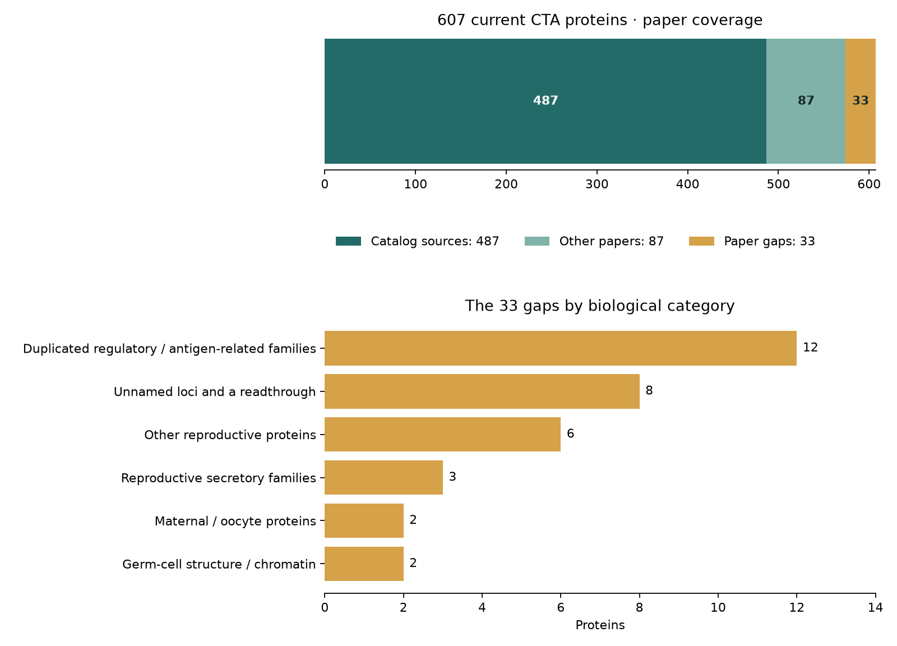

# Current CTA papers, representative review and API verification

This review uses the released **607 CTA proteins in OncoRef 1.35.0**. It records new evidence and recommendations; it does not change released classifications.

## Which papers cover the current CTAs?

**487** have membership in the 15 nomination-source collection. **87** more have qualifying papers in the broader review. **33** lack a verified qualifying exact-human paper. Thus **574/607** have paper coverage; **120** are outside the nomination collection.

The 574 comprise **569** proteins whose member loci all have coverage and **5** with coverage for only some member loci. A paper can describe normal function, disease association or counterevidence. Paper coverage is not a declaration that the paper nominated a CTA or demonstrated tumor protein.



The old frozen report said 569/602 with 33 gaps. Remapping its memberships gives 573/607 with 34 gaps. The newly reviewed human CALHM3 paper closes one gap; newly admitted ENSG00000274944 adds one relative to the old list. The gap count is again 33, with different membership.

The current reading set has **78 core** and **73 supplementary** sources. The core covers every presently covered CTA locus and no core source can be removed without losing coverage. Supplementary sources retain normal findings, methods, mechanisms and independent measurements. This objective differs from the older 83-core/67-supplementary set, which also covered proteins outside CTA.

[Every current CTA and its papers](current-paper-coverage.csv) · [All 120 outside nomination papers](outside-nomination-papers.csv) · [Sources, links and roles](source-roles-current.csv)

| Shared protein | Member loci without qualifying paper coverage |
|---|---|
| CDY2A/B | [CDY2A · ENSG00000182415](https://www.ensembl.org/Homo_sapiens/Gene/Summary?g=ENSG00000182415) |
| ETDA/B | [ETDA · ENSG00000238210](https://www.ensembl.org/Homo_sapiens/Gene/Summary?g=ENSG00000238210) |
| HNRNPCL3/4 | [HNRNPCL3 · ENSG00000277058](https://www.ensembl.org/Homo_sapiens/Gene/Summary?g=ENSG00000277058) |
| PRAMEF25/6 | [PRAMEF26 · ENSG00000280267](https://www.ensembl.org/Homo_sapiens/Gene/Summary?g=ENSG00000280267) |
| TP53TG3/B/C/D/E/F | [TP53TG3E · ENSG00000275034](https://www.ensembl.org/Homo_sapiens/Gene/Summary?g=ENSG00000275034), [TP53TG3F · ENSG00000278848](https://www.ensembl.org/Homo_sapiens/Gene/Summary?g=ENSG00000278848) |

## A missed human normal-tissue paper

**CALHM3:** Moyer et al. measured RNA in laser-captured human circumvallate taste buds (Figure 10D). The prior mouse-only assessment was incomplete. I recommend a normal-evidence review hold; the released classification is still CTA. The human result is RNA, while cell-subtype localization in this paper is macaque data. [Moyer et al., 2009](https://doi.org/10.1371/journal.pone.0007682).

## Judgment of each remaining paper gap

These are discovery CTAs under the existing rule allowing a qualifying coding reference. Missing papers alone do not make them Unsafe. Tumor maxima below are single-sample RNA observations, not prevalence or protein abundance.

| Protein | Biological category | Maximum tumor RNA (TPM) | Judgment | Related paper |
|---|---|---:|---|---|
| [ATF7-NPFF](https://www.ensembl.org/Homo_sapiens/Gene/Summary?g=ENSG00000267281) | Unnamed loci and a readthrough | 79.6 | Keep as a discovery CTA. The coding reference passes; tumor RNA does not establish the readthrough junction or the exact protein. Junction and protein identity are the priority. | — |
| [CIMIP3](https://www.ensembl.org/Homo_sapiens/Gene/Summary?g=ENSG00000287363) | Germ-cell structure and chromatin | 1.2 | Keep as a discovery CTA with low tumor-expression priority. Mouse sperm structure supports its biological category; the recorded human tumor maximum is only about 1.2 TPM. | [Liu Q et al. (2026)](https://doi.org/10.1038/s41467-026-69714-4) |
| [CTAGE15](https://www.ensembl.org/Homo_sapiens/Gene/Summary?g=ENSG00000271079) | Other poorly characterized reproductive proteins | 31.1 | Keep as a discovery CTA. Its cTAGE-family name is not antigen evidence. Verify this copy rather than borrowing other CTAGE results. | — |
| [CTXND2](https://www.ensembl.org/Homo_sapiens/Gene/Summary?g=ENSG00000283324) | Other poorly characterized reproductive proteins | 16.2 | Keep as a discovery CTA. Placental association and the coding reference are the support; function and protein localization are uncharacterized. | — |
| [DEFB113](https://www.ensembl.org/Homo_sapiens/Gene/Summary?g=ENSG00000214642) | Reproductive secretory families | 2.27 | Keep as a reproductive-secretory discovery candidate, with low tumor-expression priority (about 2.3 TPM maximum). Human tumor secretion has not been established. | [Patil AA et al. (2005)](https://doi.org/10.1152/physiolgenomics.00104.2005); [Ebersole JL et al. (2022)](https://doi.org/10.3389/froh.2022.817249) |
| [ENSG00000237378](https://www.ensembl.org/Homo_sapiens/Gene/Summary?g=ENSG00000237378) | Unnamed loci and a readthrough | 8.16 | Keep as an embryo-associated discovery CTA. Establish a sequence-linked identity and endogenous protein detection before stronger claims. | — |
| [ENSG00000241690](https://www.ensembl.org/Homo_sapiens/Gene/Summary?g=ENSG00000241690) | Unnamed loci and a readthrough | 5.7 | Keep as a testis-associated discovery CTA. Coding annotation and expression support inclusion; the broad scoring table supplies no independent functional validation. | — |
| [ENSG00000258417](https://www.ensembl.org/Homo_sapiens/Gene/Summary?g=ENSG00000258417) | Unnamed loci and a readthrough | 6.76 | Keep as an embryo-associated discovery CTA. Resolve transcript and sequence identity before importing named-gene literature. | — |
| [ENSG00000273155](https://www.ensembl.org/Homo_sapiens/Gene/Summary?g=ENSG00000273155) | Unnamed loci and a readthrough | 50.9 | Prioritize identity review. A shared mitochondrial ribosomal-protein annotation makes it essential to distinguish this locus from MRPL30-associated records before transferring normal or tumor protein evidence. | — |
| [ENSG00000274944](https://www.ensembl.org/Homo_sapiens/Gene/Summary?g=ENSG00000274944) | Unnamed loci and a readthrough | 13.5 | Keep as a lower-confidence discovery CTA. The 110-aa canonical protein passes, with TSL 2 and no MANE designation. No exact-locus study was verified; database links to MYCBP are not evidence for this protein. | — |
| [ENSG00000284934](https://www.ensembl.org/Homo_sapiens/Gene/Summary?g=ENSG00000284934) | Unnamed loci and a readthrough | 77.1 | Keep as an embryo-associated discovery CTA. Tumor RNA is substantial in at least one sample; exact-locus translation remains experimentally unverified. | — |
| [ENSG00000289809](https://www.ensembl.org/Homo_sapiens/Gene/Summary?g=ENSG00000289809) | Unnamed loci and a readthrough | 0.0679 | Lowest tumor-expression priority in this set: the recorded maximum is about 0.068 TPM. It passes the presence rule, but that is very weak evidence of a useful tumor target. | — |
| [GOLGA8T](https://www.ensembl.org/Homo_sapiens/Gene/Summary?g=ENSG00000261247) | Other poorly characterized reproductive proteins | 13.7 | Keep as a discovery CTA, prioritizing copy-specific mapping in this duplicated family. Family homology does not establish this copy's protein production. | — |
| [H2AL1Q](https://www.ensembl.org/Homo_sapiens/Gene/Summary?g=ENSG00000249467) | Germ-cell structure and chromatin | 4.02 | Keep as a germ-cell histone discovery candidate. The retrieved proteomics is mouse evidence; human copy-specific protein detection is missing. | [El Kennani S et al. (2018)](https://doi.org/10.1186/s13072-017-0172-y); [Seal RL et al. (2022)](https://doi.org/10.1186/s13072-022-00467-2) |
| [LCN9](https://www.ensembl.org/Homo_sapiens/Gene/Summary?g=ENSG00000148386) | Reproductive secretory families | 85.5 | Keep as an epididymal-secretory discovery candidate. Mouse reproductive studies support the category; human tumor secretion is unverified. | [Suzuki K et al. (2004)](https://doi.org/10.1016/j.gene.2004.06.027); [Sakurai N et al. (2024)](https://doi.org/10.1111/andr.13350); [Gong QQ et al. (2021)](https://doi.org/10.1371/journal.pone.0254802) |
| [MSANTD5](https://www.ensembl.org/Homo_sapiens/Gene/Summary?g=ENSG00000285891) | Duplicated regulatory and antigen-related families | 3.43 | Keep as an early-embryo discovery CTA, with low tumor-expression priority (about 3.4 TPM maximum). Its high developmental RNA does not establish protein function. | — |
| [OOSP4B](https://www.ensembl.org/Homo_sapiens/Gene/Summary?g=ENSG00000255393) | Maternal / oocyte-associated proteins | 30.6 | Keep as a maternal/oocyte discovery CTA. Its category comes from measured RNA; OOSP1 or OOSP4A experiments do not validate OOSP4B. | — |
| [PABPN1L](https://www.ensembl.org/Homo_sapiens/Gene/Summary?g=ENSG00000205022) | Maternal / oocyte-associated proteins | 58.5 | One of the more biologically coherent discovery candidates: mouse experiments establish a maternal-to-zygotic transition role and human RNA supports the developmental association. Human protein and tumor evidence remain the next steps. | [PABPN1L mediates cytoplasmic mRNA decay as a placeholder during the maternal-to-zygotic transition](https://pmc.ncbi.nlm.nih.gov/articles/PMC7403729/) |
| [PRAMEF18](https://www.ensembl.org/Homo_sapiens/Gene/Summary?g=ENSG00000279804) | Duplicated regulatory and antigen-related families | 3.58 | I recommend a normal-evidence review hold. A treated human vascular-cell study reports a combined PRAMEF18/PRAMEF19 feature; the responsible copy is unresolved. The current released label remains CTA. | [Chinnappan M et al. (2019)](https://doi.org/10.1038/s41598-019-46981-4) |
| [PTTG1IP2](https://www.ensembl.org/Homo_sapiens/Gene/Summary?g=ENSG00000251154) | Other poorly characterized reproductive proteins | 3.23 | Keep as a lower-priority discovery CTA: little characterization and about 3.2 TPM maximum tumor RNA. PTTG1IP/PBF experiments do not establish this paralog's function. | — |
| [SPADH](https://www.ensembl.org/Homo_sapiens/Gene/Summary?g=ENSG00000286135) | Reproductive secretory families | 11.7 | Keep as a reproductive discovery candidate. Human secretion and spermadhesin function need exact-sequence evidence; livestock spermadhesin studies do not establish them. | — |
| [SSU72L1](https://www.ensembl.org/Homo_sapiens/Gene/Summary?g=ENSG00000284438) | Duplicated regulatory and antigen-related families | 388 | Keep as an early-embryo discovery CTA. Tumor and developmental RNA make it worth studying; copy-specific mapping and protein detection are the key gaps. | — |
| [SSU72L2](https://www.ensembl.org/Homo_sapiens/Gene/Summary?g=ENSG00000284306) | Duplicated regulatory and antigen-related families | 991 | Keep as an early-embryo discovery CTA. It has the highest recorded tumor maximum in this gap set, but neither enzyme function nor endogenous protein follows from that RNA value. | — |
| [SSU72L3](https://www.ensembl.org/Homo_sapiens/Gene/Summary?g=ENSG00000284546) | Duplicated regulatory and antigen-related families | 363 | Keep as an early-embryo discovery CTA. Its RNA pattern is promising; resolve this copy independently of SSU72 and the other SSU72L loci. | — |
| [SSU72L4](https://www.ensembl.org/Homo_sapiens/Gene/Summary?g=ENSG00000283873) | Duplicated regulatory and antigen-related families | 344 | Keep as an early-embryo discovery CTA. Substantial tumor RNA warrants follow-up; family-wide phosphatase literature is not exact-copy protein evidence. | — |
| [SSU72L5](https://www.ensembl.org/Homo_sapiens/Gene/Summary?g=ENSG00000284018) | Duplicated regulatory and antigen-related families | 414 | Keep as an early-embryo discovery CTA. Substantial tumor RNA warrants follow-up; endogenous protein production and exact-copy attribution remain unverified. | — |
| [TAF11L11](https://www.ensembl.org/Homo_sapiens/Gene/Summary?g=ENSG00000283740) | Duplicated regulatory and antigen-related families | 35.5 | I recommend a normal-evidence review hold. The macrosatellite study reports family RNA in brain and testis without resolving this copy. The current released label remains CTA. | [Tremblay DC et al. (2010)](https://doi.org/10.1186/1471-2164-11-632) |
| [TAF11L13](https://www.ensembl.org/Homo_sapiens/Gene/Summary?g=ENSG00000283776) | Duplicated regulatory and antigen-related families | 23.5 | I recommend a normal-evidence review hold. Family-level brain RNA cannot be assigned to, or dismissed for, this copy. The current released label remains CTA. | [Tremblay DC et al. (2010)](https://doi.org/10.1186/1471-2164-11-632) |
| [TAF11L14](https://www.ensembl.org/Homo_sapiens/Gene/Summary?g=ENSG00000250782) | Duplicated regulatory and antigen-related families | 38.7 | I recommend a normal-evidence review hold. The same unresolved neural/reproductive macrosatellite signal applies; a separate copy-specific assay is needed. The current released label remains CTA. | [Tremblay DC et al. (2010)](https://doi.org/10.1186/1471-2164-11-632) |
| [TEDDM1](https://www.ensembl.org/Homo_sapiens/Gene/Summary?g=ENSG00000203730) | Other poorly characterized reproductive proteins | 15.2 | Keep as an epididymal discovery candidate. Reproductive RNA is strong; the retrieved discovery experiment is mouse evidence, not human tumor protein evidence. | [Yamazaki K et al. (2006)](https://doi.org/10.1095/biolreprod.105.048058) |
| [TMEM269](https://www.ensembl.org/Homo_sapiens/Gene/Summary?g=ENSG00000274386) | Other poorly characterized reproductive proteins | 22.9 | Keep as a reproductive/early-embryo discovery CTA. Membrane annotation alone does not establish tumor-surface localization or accessibility. | — |
| [TRIM75](https://www.ensembl.org/Homo_sapiens/Gene/Summary?g=ENSG00000250374) | Duplicated regulatory and antigen-related families | 10.3 | Keep as an embryo-associated discovery CTA. Mouse maternal function and a recombinant domain support a biological lead, but not endogenous human production. | [Hou W et al. (2024)](https://doi.org/10.1007/s11033-024-09349-0); [Lou X et al. (2022)](https://doi.org/10.1016/j.csbj.2022.08.069) |
| [UBTFL1](https://www.ensembl.org/Homo_sapiens/Gene/Summary?g=ENSG00000255009) | Duplicated regulatory and antigen-related families | 27 | Keep as an early-embryo discovery CTA. Mouse Hmgpi results support the family context; distinguish this human homolog from UBTFL2/3. | [Yamada M et al. (2010)](https://doi.org/10.1093/hmg/ddp512) |

[Full gap evidence and judgments](paper-gap-judgments.json)

## What the 563 loci actually mean

**None is currently CTA.** They comprise 381 Other and 182 Unsafe loci. The Unsafe label comes from normal-expression evidence independently of representative selection. '563 await review' combines source limitations with already reviewed findings.

The pinned reference has **no qualifying primary alternative for 543** loci; **20** have at least one. The original reasons were 557 designated translations failing the contract, four reviewed evidence holds, and two loci with no primary translation. This audit triages every locus and examines the 20 alternative cases. It does not claim 563 separate literature reviews.

| Review category | Loci |
|---|---:|
| No qualifying primary alternative | 525 |
| Selenoprotein outside AA20 contract | 25 |
| Qualified alternative available | 7 |
| Reviewed evidence hold | 4 |
| No primary reference translation | 2 |

**25 are selenoproteins.** Their U residues encode selenocysteine; they are not unknown X residues. The current AA20 output contract rejects them. Known or proposed non-AUG starts also require a better distinction from missing biological starts. [Non-AUG initiation study](https://doi.org/10.1093/nar/gkr007).

**GDPD4:** the 520-aa MANE translation exactly matches UniProt Q6W3E5-2 after applying its two annotated variant features. The 623-aa sequence is isoform 1. The annotation-only hold should be resolved in the next classification rebuild. [UniProt isoforms](https://www.uniprot.org/uniprotkb/Q6W3E5/entry).

**OR6C3:** ENST00000641364.1 passes qualification and encodes exactly the same 311-aa sequence as MANE ENST00000641740.2, whose GTF lacks a complete stop feature. An explicit reviewed sequence preference can resolve selection without changing the amino-acid sequence.

[Reviewed GDPD4 and OR6C3 resolution records](transcript-review-resolutions.json) pass the selector's validation and select both proteins in an isolated check. They are ready for the next classification rebuild; the released assets retain their existing labels.

| Protein | Current class | Reviewed decision | Source |
|---|---|---|---|
| FNDC5 | Unsafe | Retain the Unsafe exclusion. Examine the complete 260-aa upstream-start alternative against the 2024 study; the shorter 153-aa transcript is not an adequate automatic substitute for the designated precursor. | [source](https://pmc.ncbi.nlm.nih.gov/articles/PMC11555857/) |
| WDR26 | Unsafe | Retain the Unsafe exclusion. Non-AUG initiation is documented or proposed for this gene; a missing GTF start-codon feature is not evidence that the protein is fictitious. Do not replace the extended protein merely to meet the start-feature check. | [source](https://doi.org/10.1093/nar/gkr007) |
| PKD1L2 | Unsafe | Retain review: the 240/306-aa alternatives do not resolve the 2459-aa LoF-designated product. Passing sequence syntax alone cannot establish that a fragment is representative. | [source](https://www.ensembl.org/Homo_sapiens/Gene/Summary?g=ENSG00000166473) |
| GPX4 | Unsafe | U denotes selenocysteine, not an unknown residue. Preserve the full sequence and exclusion; do not substitute a shorter U-free transcript solely to pass AA20. | [source](https://www.ensembl.org/Homo_sapiens/Gene/Summary?g=ENSG00000167468) |
| GDPD4 | Other:Translation | Resolve the annotation-only hold: MANE 520 aa exactly matches UniProt isoform Q6W3E5-2. Retain 623-aa isoform 1 separately. A canonical-isoform difference does not challenge translation. | [source](https://www.uniprot.org/uniprotkb/Q6W3E5/entry) |
| SELENOF | Unsafe | U denotes selenocysteine, not an unknown residue. Preserve the full sequence and exclusion; do not substitute a shorter U-free transcript solely to pass AA20. | [source](https://www.ensembl.org/Homo_sapiens/Gene/Summary?g=ENSG00000183291) |
| TXNRD2 | Unsafe | U denotes selenocysteine, not an unknown residue. Preserve the full sequence and exclusion; do not substitute a shorter U-free transcript solely to pass AA20. | [source](https://www.ensembl.org/Homo_sapiens/Gene/Summary?g=ENSG00000184470) |
| TEAD1 | Unsafe | Retain the Unsafe exclusion. Non-AUG initiation is documented or proposed for this gene; a missing GTF start-codon feature is not evidence that the protein is fictitious. Do not replace the extended protein merely to meet the start-feature check. | [source](https://doi.org/10.1093/nar/gkr007) |
| MRTFA | Unsafe | Retain the Unsafe exclusion and review the start-codon contract. RefSeq describes non-AUG initiation; shorter qualifying alternatives do not invalidate the longer representative. | [source](https://www.ncbi.nlm.nih.gov/nuccore/NM_001282662.3) |
| DIO3 | Unsafe | U denotes selenocysteine, not an unknown residue. Preserve the full sequence and exclusion; do not substitute a shorter U-free transcript solely to pass AA20. | [source](https://www.ensembl.org/Homo_sapiens/Gene/Summary?g=ENSG00000197406) |
| MSRB1 | Unsafe | U denotes selenocysteine, not an unknown residue. Preserve the full sequence and exclusion; do not substitute a shorter U-free transcript solely to pass AA20. | [source](https://www.ensembl.org/Homo_sapiens/Gene/Summary?g=ENSG00000198736) |
| SELENOT | Unsafe | U denotes selenocysteine, not an unknown residue. Preserve the full sequence and exclusion; do not substitute a shorter U-free transcript solely to pass AA20. | [source](https://www.ensembl.org/Homo_sapiens/Gene/Summary?g=ENSG00000198843) |
| FRG2 | Other:Translation | Retain the reviewed coding hold. The experimental challenge concerns protein production; choosing another annotated transcript does not answer it. | [source](https://pmc.ncbi.nlm.nih.gov/articles/PMC12242771/) |
| OR6C3 | Other:Translation | Approve an explicit same-sequence preference in the next rebuild: ENST00000641364.1 passes and encodes the identical 311-aa protein as the incomplete-stop MANE record. No amino-acid change is required. | [source](https://www.ensembl.org/Homo_sapiens/Gene/Summary?g=ENSG00000205329) |
| DIO2 | Unsafe | U denotes selenocysteine, not an unknown residue. Preserve the full sequence and exclusion; do not substitute a shorter U-free transcript solely to pass AA20. | [source](https://www.ensembl.org/Homo_sapiens/Gene/Summary?g=ENSG00000211448) |
| DIO1 | Unsafe | U denotes selenocysteine, not an unknown residue. Preserve the full sequence and exclusion; do not substitute a shorter U-free transcript solely to pass AA20. | [source](https://www.ensembl.org/Homo_sapiens/Gene/Summary?g=ENSG00000211452) |
| KCTD11 | Unsafe | Retain the Unsafe exclusion. Non-AUG initiation is documented or proposed for this gene; a missing GTF start-codon feature is not evidence that the protein is fictitious. Do not replace the extended protein merely to meet the start-feature check. | [source](https://doi.org/10.1093/nar/gkr007) |
| FRG2B | Other:Translation | Retain the reviewed coding hold. The experimental challenge concerns protein production; choosing another annotated transcript does not answer it. | [source](https://pmc.ncbi.nlm.nih.gov/articles/PMC12242771/) |
| GPX1 | Unsafe | U denotes selenocysteine, not an unknown residue. Preserve the full sequence and exclusion; do not substitute a shorter U-free transcript solely to pass AA20. | [source](https://www.ensembl.org/Homo_sapiens/Gene/Summary?g=ENSG00000233276) |
| SLCO1B3-SLCO1B7 | Other:Translation | Retain the 748-aa hold. The studied 687-aa alternative has human hepatocyte ER protein evidence, so selecting it also requires normal-evidence adjudication. | [source](https://pubmed.ncbi.nlm.nih.gov/29248594/) |

[All 563 decisions, failed checks and qualifying alternatives](representative-review.csv)

## Why 602 became 607

**602 + 8 admissions − 4 translation holds + 1 split identity = 607.**

New proteins: BOLL, IZUMO2, ARL13A, CATSPER4, GAGE1, C16orf90, ENSG00000274944 and the shared TP53TG3/B/C/D/E/F protein. Four moved to Other:Translation: GDPD4, SLCO1B3–SLCO1B7, FRG2 and FRG2B. CDY1 and CDY1B now have different selected sequences and count separately. The eight admissions contain 13 loci; protein counts and locus counts differ. The GDPD4 correction above is a new finding, not part of the published 607 calculation.

## Does the API identify the transcript and matching sequence?

**Yes. All 655 selected transcript versions across the 607 CTAs matched their sequence records exactly: zero mismatches and no X or other non-AA20 residues.** Checks covered exact gene, versioned transcript, versioned protein accession, sequence hash, source peptide bytes and sequence role. This verifies reference provenance; it does not infer tumor-specific isoform production.

The new `cta_representatives.records('BOLL', annotation_release=115)` accessor returns the chosen versioned transcript and protein accession, length, sequence hash and reference without downloading the bundle. It accepts exact symbols or Ensembl gene IDs and rejects a requested release mismatch. The legacy `Canonical_Transcript_ID` field is not the current selection contract. LLCFC1, mentioned in issue #683, is now Unsafe from normal bulk evidence and is therefore absent from this CTA-only accessor.

`transcript_selection.records()` exposes `selected_transcripts` and `selected_sequence_sha256` for all reference genes, including non-CTA genes. `cta_selection.profiles()` exposes `representative_transcripts` and `representative_sequence_sha256s`. `sequence_bundle.load(...).records()` supplies the actual amino-acid sequence, transcript occurrences and policy role. Candidate transcripts under review are separate from approved transcripts.

```python
from oncoref import cta_literature, cta_selection, transcript_selection, sequence_bundle

coverage = cta_literature.current_coverage()
gaps = coverage[coverage.paper_coverage == 'no_paper']
choices = transcript_selection.records()
choice = choices[choices.gene_id == 'ENSG00000152430'].iloc[0]  # BOLL
bundle = sequence_bundle.load('/path/to/verified/bundle')
chosen = [r for r in bundle.records()
          if r['sequence_sha256'] == choice.selected_sequence_sha256
          and any(o['gene_id'] == choice.gene_id
                  and o['transcript_id'] in choice.selected_transcripts
                  for o in r['occurrences'])]
```

[Verified transcript IDs, protein IDs and sequences](verified-cta-transcripts.csv) · [Machine-readable summary](summary.json)

Reproduce: `.venv/bin/python scripts/reconcile_cta_reviews.py --sequence-bundle /path/to/verified/bundle`. The historical literature API remains `cta_literature.cta_coverage()` (602 proteins); use `current_coverage()` for the current catalog.
