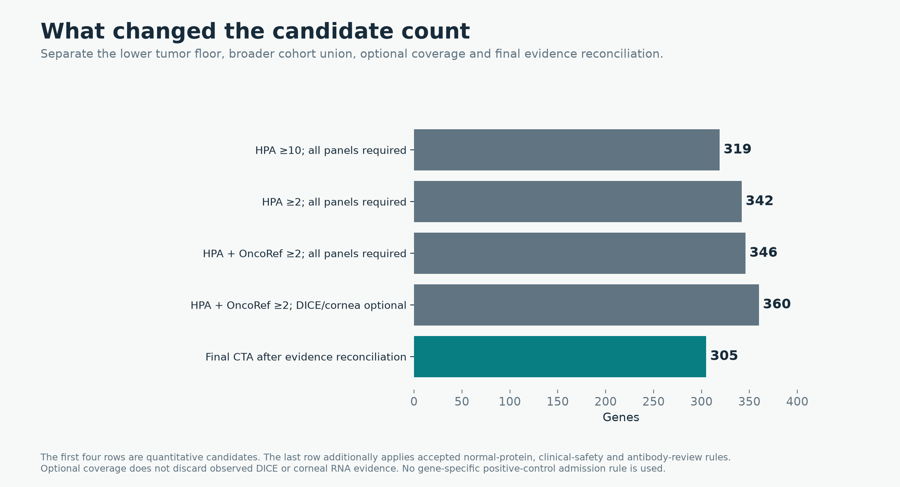
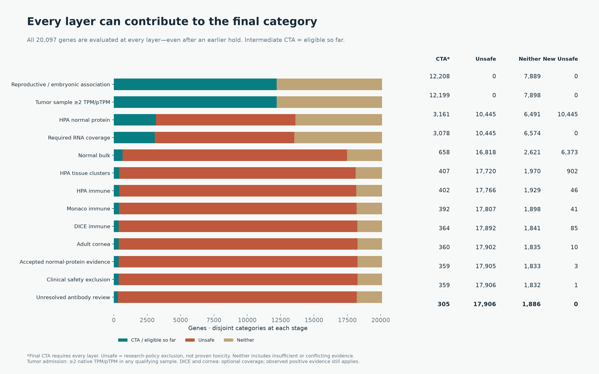
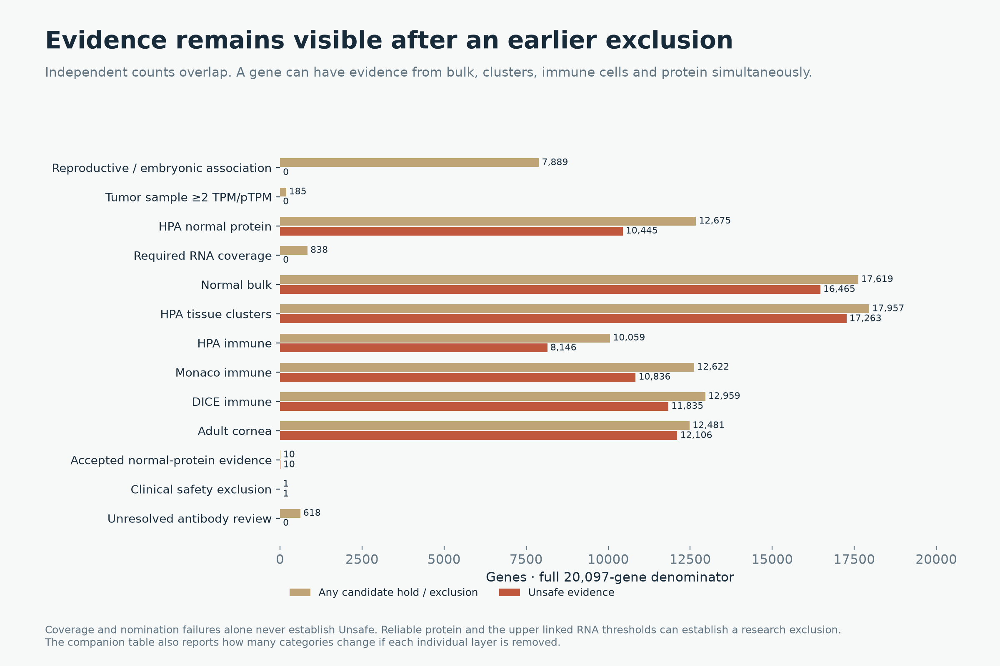
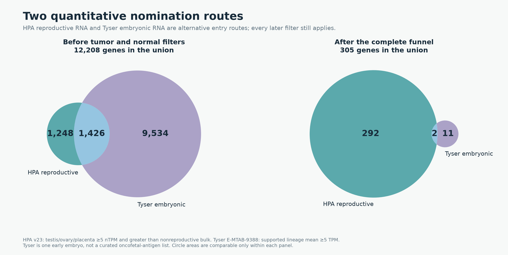

# Expanded tumor evidence and a three-way CTA funnel

The new research classification is **305 CTA / 17,906 Unsafe /
1,886 Neither**, across all 20,097 reference genes. There are
**360 quantitative candidates** before accepted protein/safety
exclusions and unresolved antibody holds. These are newly computed categories,
not the old labels carried inside the previous 319 candidates. Released package
expression labels and forbidden sequence references are not overwritten.

## What changed

| Scenario | Genes |
| --- | --- |
| HPA ≥10; all panels required | 319 |
| HPA ≥2; all panels required | 342 |
| HPA + OncoRef ≥2; all panels required | 346 |
| HPA + OncoRef ≥2; DICE/cornea optional | 360 |
| Final CTA after evidence reconciliation | 305 |



[Editable SVG](figures/policy-effects.svg), [scenario counts](policy-effects.csv).

Tumor admission now requires **at least one sample ≥2 in its source-native
TPM or HPA pTPM**. The shared normal-tissue/IHC grid is unchanged. The different
RNA scales remain labeled; they are not pooled, averaged or treated as calibrated
equivalents. DICE and cornea are optional for coverage: absent measurements do
not hold a gene, but supported measured expression still contributes exclusions.

## Cancer cohorts actually used

All **132 of the 143 published OncoRef matrices** marked
compatible with an absolute TPM threshold were processed, including adult and
pediatric cancers. The screen uses raw linear TPM from individual samples passing
the existing QC and absolute-TPM suitability checks, not clean-TPM, cohort medians
or representative samples. These are 17,763 sample occurrences,
or **14,452 identities after deduplicating shared source views**,
across 34 source namespaces. This is not a unique-patient count;
the same patient can occur in independent studies or multiple biopsies.

The existing HPA 25.1 cancer reference adds its 21 TCGA and 10 validation cohorts
(8,384 source samples). HPA overlaps OncoRef, so those counts are not added to
claim a unique total. The eleven omitted matrices use microarray/CPM proxies,
single-cell pseudobulk scales or a known invalid legacy scale. Registry entries
without published sample matrices are not silently treated as acquired cohorts.

[Exact cohort inventory and exclusions](tumor-union/cohort-availability.csv),
[per-source sample identities](tumor-union/sample-identity.csv.gz),
[per-gene observed maxima and winning samples](tumor-union/tumor-maxima.csv.gz),
[source-matrix and QC hashes](tumor-union/manifest.json).

Of the previous **112 tumor failures, 103 now pass**: 42 through lowering the
HPA floor alone, then another 61 through the wider cohort union. All 48 formerly
measured-below-10 genes now qualify; 55 of the 64 formerly unmeasured in HPA
now qualify. 9 remain below 2 in available, unambiguously matched source matrices. This still does
not establish that they are never expressed by any tumor.
[All previous 112 decisions](previous-112-tumor-failures.csv),
[remaining failures](remaining-tumor-failures.csv).

## The categories and every layer's contribution

- **Unsafe:** accepted nonpermitted normal protein, reliable nonconflicted HPA
  normal staining, an existing applicable clinical safety exclusion, or supported
  normal RNA at or above **twice** its applicable candidate ceiling.
- **Neither:** no Unsafe evidence, but at least one admission failure, mandatory
  coverage gap, uncertain/conflicted protein finding, unresolved antibody hold,
  or normal RNA above the candidate ceiling and below the upper boundary.
- **CTA:** quantitative reproductive/embryonic association and tumor admission,
  complete mandatory panels, normal RNA at or below each applicable candidate
  ceiling, and no protein/safety exclusion or unresolved antibody hold.

Unsafe is a **research policy exclusion**, not proof of protein presentation or
clinical toxicity. The upper RNA boundary previously appeared as a reference-review
annotation; this three-way proposal explicitly uses it for the Unsafe category.
It still does not automatically create or publish a forbidden-protein FASTA.

Every layer evaluates **all genes**, including genes held earlier. A later strong
RNA/protein finding can therefore change Neither to Unsafe. Final labels are
unchanged when layer order is reversed. Intermediate CTA counts mean *eligible
so far*, not final clearance. Uncertain HPA staining blocks CTA but does not alone
establish Unsafe. Antibody-concern flags prevent negative-IHC relaxation and remain
an explicit final review hold unless independent stronger evidence establishes Unsafe.

| Layer | Removed from eligibility here | New Unsafe | CTA eligible so far | Unsafe | Neither |
| --- | --- | --- | --- | --- | --- |
| Reproductive / embryonic association | 7889 | 0 | 12208 | 0 | 7889 |
| Tumor sample ≥2 TPM/pTPM | 9 | 0 | 12199 | 0 | 7898 |
| HPA normal protein | 9038 | 10445 | 3161 | 10445 | 6491 |
| Required RNA coverage | 83 | 0 | 3078 | 10445 | 6574 |
| Normal bulk | 2420 | 6373 | 658 | 16818 | 2621 |
| HPA tissue clusters | 251 | 902 | 407 | 17720 | 1970 |
| HPA immune | 5 | 46 | 402 | 17766 | 1929 |
| Monaco immune | 10 | 41 | 392 | 17807 | 1898 |
| DICE immune | 28 | 85 | 364 | 17892 | 1841 |
| Adult cornea | 4 | 10 | 360 | 17902 | 1835 |
| Accepted normal-protein evidence | 1 | 3 | 359 | 17905 | 1833 |
| Clinical safety exclusion | 0 | 1 | 359 | 17906 | 1832 |
| Unresolved antibody review | 54 | 0 | 305 | 17906 | 1886 |



[Editable SVG](figures/three-way-funnel.svg), [funnel counts](three-way-funnel.csv).



[Editable SVG](figures/independent-evidence.svg),
[overlapping evidence and leave-one-layer-out effects](independent-layer-effects.csv).
Independent source counts overlap and must not be added together.

## Normal thresholds and coverage

| Candidate ceiling | Missing/unusable IHC | Approved negative | Supported negative | Enhanced negative |
|---|---:|---:|---:|---:|
| Vital | 2 | 4 | 8 | 16 |
| Protected | 4 | 8 | 16 | 32 |
| Manageable | 8 | 16 | 32 | 64 |

Equality passes the candidate ceiling. Unsafe RNA evidence begins at **2×**
each entry. Bulk, supported HPA clusters and sorted immune assays use the linked
native TPM/nTPM values. Corneal CP10K uses the nominal table value divided by 100;
that rescaling is not an empirical conversion to HPA-equivalent abundance.
Immune populations default to Protected. Explicit reproductive/developmental
immune contexts are neutral. HPA clusters require ≥20 reads; DICE uses the third
highest reported value; cornea requires ≥5 positive cells and ≥20 counts in at
least two sample groups. Matching negative IHC retains the existing profile
control, exact context and antibody-conflict requirements.

Mandatory coverage remains 50 bulk tissues, 426 observed HPA clusters, 19 HPA
immune summaries and 30 Monaco summaries, plus the required numeric fields.
In the expanded funnel, **84** otherwise eligible genes lack mandatory coverage;
all lack complete bulk coverage, and some also lack the other required panels.
The old 122 coverage failures included **91 cornea-only gaps**, which are no
longer mandatory holds. This does not rescue all 91 through the remaining filters.
The final CTA set contains **10 genes with optional-panel gaps**, explicitly flagged.

[Mandatory gaps across the reference universe](mandatory-coverage-gaps.csv.gz),
[CTA genes with optional gaps](cta-optional-coverage-gaps.csv),
[normal measurements closest to or above each ceiling](normal/normal-peak-evidence.csv.gz).

## Bulk gaps: names and historical IDs were checked

None of the **31 previously flagged bulk gaps** can be filled through a registered
alias present in the pinned source. Each has 41 of 50 tissue entries, missing
amygdala, basal ganglia, cerebellum, hippocampal formation, hypothalamus, midbrain,
pituitary gland, spinal cord and vagina. They are absent source rows, not zero RNA.

| Example | Source identity result |
|---|---|
| POLR2A — ENSG00000181222 | Same stable ID and symbol; only 41 source tissues |
| EEF1AKMT4 — ENSG00000284753 | Same stable ID and symbol; only 41 source tissues |
| NOTCH2NLB — ENSG00000286019 | Same stable ID and symbol; only 41 source tissues |
| CIMIP3 — ENSG00000287363 | Source name GUCA1ANB, but already the same stable ID; renaming cannot restore missing rows |
| ACTL10 — ENSG00000288649 | Registered previous ID ENSG00000182584 is absent from this source |
| POLR2J3 — ENSG00000285437 | Another same-name ID, ENSG00000168255, coexists with 50 tissues; distinct values and no registered identity mapping mean it cannot be borrowed |

POLR2J3's two source IDs have maxima of 73.2 and 3.8 nTPM respectively, illustrating
why matching a symbol is not sufficient to merge measurements. A separate fully
absent canonical ID, **PAXX ENSG00000310560**, was recovered using the registered
historical ID ENSG00000148362: all 50 source rows are retained with their original
ID. This does not rescue any of the earlier 31 partial-coverage cases. This audit
does not claim that other GTEx/HPA releases lack the missing observations.

[The previous 31 cases](previous-31-bulk-gaps.csv),
[partial bulk-coverage identity audit](normal/bulk-missing-identity-audit.csv),
[registered-alias observations actually recovered](normal/bulk-alias-filled-observations.csv).

## Named genes and complete downloads

| Gene | New category | Reason |
| --- | --- | --- |
| PAGE1 | CTA | All required gates pass |
| SMC1B | CTA | All required gates pass |
| CTAG2 | Unsafe | Normal bulk; HPA tissue clusters |
| MAGEA4 | CTA | All required gates pass |
| TBXT | Neither | Unresolved antibody review |
| FTMT | Unsafe | Accepted normal-protein evidence |
| CTAG1B | CTA | All required gates pass |
| PRAME | Unsafe | Normal bulk; HPA tissue clusters; Accepted normal-protein evidence |
| CT83 | CTA | All required gates pass |
| XAGE1A | CTA | All required gates pass |
| XAGE1B | CTA | All required gates pass |
| SSX2 | CTA | All required gates pass |
| CTAG1A | CTA | All required gates pass |

Of 360 quantitative candidates, FTMT moves to Unsafe through accepted normal
protein and 54 move to Neither through unresolved antibody review. TBXT/brachyury
is in that latter group: it qualifies quantitatively, but its protein-evidence
uncertainty is not erased. PRAME and CTAG2 remain excluded under the unchanged
normal-expression policy. There are no named-gene admission exceptions.

[Final CTA list](cta-genes.csv), [all gene classifications and every reason](gene-classifications.csv.gz),
[Unsafe genes](unsafe-genes.csv.gz), [Neither genes](neither-genes.csv.gz),
[360 quantitative candidates](quantitative-candidates.csv),
[55 quantitative candidates requiring exclusion or review](quantitative-candidate-review-exclusions.csv),
[named-gene evidence](named-gene-decisions.csv).



[Editable SVG](figures/quantitative-source-overlap.svg), [source counts](source-route-overlaps.csv).

## Reproduction and checks

```bash
python scripts/cta_tumor_union.py docs/audits/cta-expanded-funnel-20261027/tumor-union
python scripts/cta_expanded_normal.py docs/audits/cta-expanded-funnel-20261027/normal
MPLCONFIGDIR=/tmp/oncoref-matplotlib-geometric python scripts/cta_expanded_funnel.py docs/audits/cta-expanded-funnel-20261027
```

The all-gene normal assessment reproduces the previous evaluated normal decisions
and the 319-gene baseline; the vectorized bulk match reproduces 115,440 prior
contexts. Final categories are tested for order independence and all stage totals
sum to 20,097. Input/source/output hashes are recorded in the [manifest](manifest.json)
and the two component manifests. Every figure has PNG and editable SVG versions.
