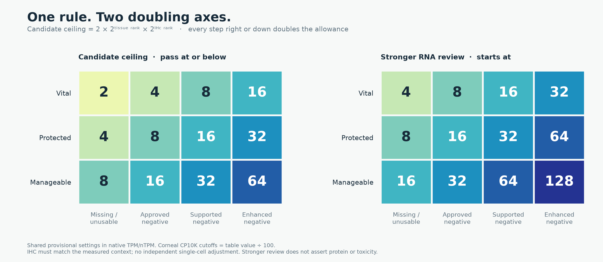
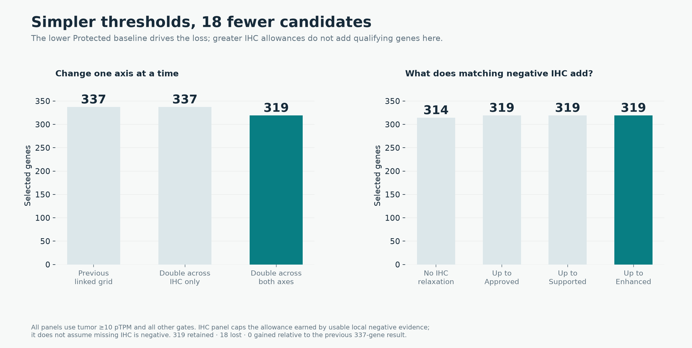
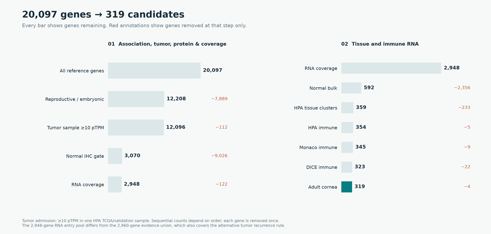
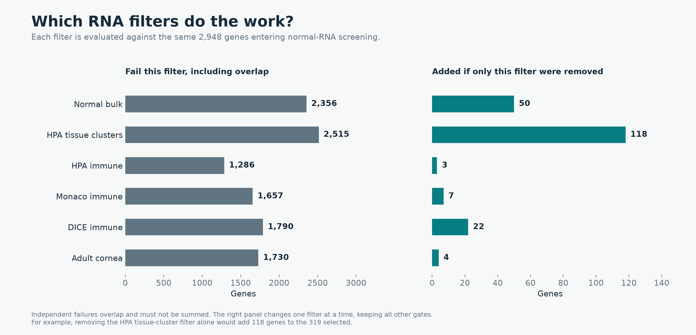
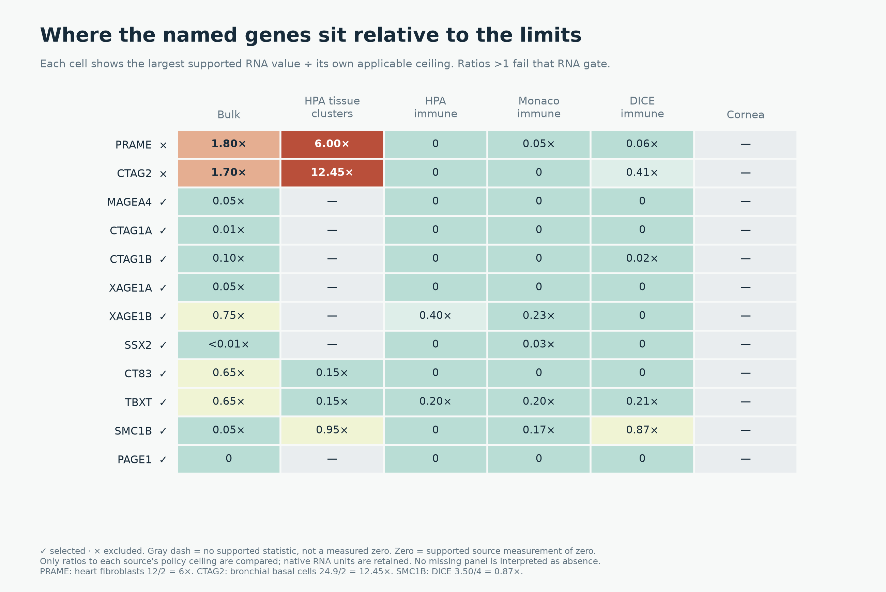

# Doubling across tissue tiers and IHC confidence

The subsequent [expanded-cohort three-way funnel](../cta-expanded-funnel-20261027/index.md)
uses tumor ≥2 TPM/pTPM, optional DICE/corneal coverage and explicit final categories.
The 319-gene comparison below remains the reproducible earlier policy snapshot.

The shared two-axis grid retains **319 genes** with at least one HPA tumor
sample ≥10 pTPM, compared with **337** under the previous linked ladder.
There are **18 losses, no gains, and 319 retained genes**. All measurements,
association requirements, HPA protein holds, coverage requirements and source
support rules are unchanged. This is a research selection comparison; released
expression classes and sequence references are unchanged.

**319 is the quantitative funnel endpoint, not a completed new CTA/Unsafe/Neither
classification.** The older 136/9/174 labels are annotations within those 319,
not further funnel stages. External normal-protein reviews and primary-antibody
holds have not been integrated as new final-label rules. FTMT, for example,
passes this numerical screen but retains an accepted published normal-neuronal
protein exclusion. See [source overlaps, tumor/coverage gaps and label semantics](source-review/index.md).

## The new table

| Candidate ceiling | Missing/unusable IHC | Approved negative | Supported negative | Enhanced negative |
|---|---:|---:|---:|---:|
| Vital | 2 | 4 | 8 | 16 |
| Protected | 4 | 8 | 16 | 32 |
| Manageable | 8 | 16 | 32 | 64 |

The formula is **2 × 2^tissue_rank × 2^IHC_rank**, where the tissue ranks are
0/1/2 and the IHC ranks are 0/1/2/3. Equality passes candidate admission.
Stronger RNA reference review begins at **2× each table entry**. Both decisions
use the same tissue, IHC evidence and native-unit scaling.

Bulk, HPA clusters and sorted immune assays use one shared ladder function.
Immune cells default to Protected, so their missing-IHC candidate ceiling is
now **4 TPM/nTPM**, and stronger review begins at **8**. Reproductive/developmental
immune contexts remain neutral. Corneal native CP10K cutoffs remain the nominal
per-million table value divided by 100: the Vital baseline stays 0.02 CP10K.
Source units are retained; the shared numerical policy is not a claim of
calibrated assay equivalence or clinical safety.



[Editable SVG](figures/threshold-grid.svg).

## What each threshold choice does

| Shared ladder | Previous tumor recurrence rule | One tumor sample ≥10 pTPM | One tumor sample ≥30 pTPM |
|---|---:|---:|---:|
| Previous linked ladder | 244 | 337 | 197 |
| Double across IHC only; retain tissue baselines 2/6/10 | 244 | 337 | 197 |
| **Double both axes; tissue baselines 2/4/8** | **226** | **319** | **182** |

Doubling across IHC alone does not rescue any fully eligible gene in this
dataset: other contexts or filters still exclude them. Doubling down the tissue
axis tightens the Protected baseline from 6 to 4 and Manageable from 10 to 8.
All 18 observed membership losses are specifically attributable to Protected
observations between 4 and 6 without usable matching negative IHC.

Within the new grid, disabling all IHC relaxation retains **314** genes.
Allowing at most the Approved column retains **319**; permitting Supported
and then Enhanced still retains **319**. These are caps on the allowance
earned by actual matching negative evidence, not assumptions that every gene
has negative IHC. The reliable reproductive-positive profile requirement and
antibody-conflict checks remain in effect.
The five retained through this allowance are TNP1, BOLL, GOLGA6A, GOLGA6C and
HORMAD2; their other source findings and historical annotations remain visible.



[Editable SVG](figures/policy-choices.svg),
[scenario counts](scenario-counts.csv), [IHC choice counts](ihc-choice-counts.csv).

## Genes filtered at every stage

This cascade uses **tumor ≥10 pTPM in any one sample**, with no prevalence
minimum. Each removed gene is counted once, at its first failure in this order.

| Stage | Removed here | Remaining |
|---|---:|---:|
| Reference universe | — | 20,097 |
| Reproductive or embryonic association | 7,889 | 12,208 |
| Tumor sample ≥10 pTPM | 112 | 12,096 |
| No detected nonpermitted IHC, including Uncertain staining | 9,026 | 3,070 |
| Complete specified RNA panels | 122 | 2,948 |
| Normal bulk RNA | 2,356 | 592 |
| HPA tissue-cluster RNA | 233 | 359 |
| HPA immune RNA | 5 | 354 |
| Monaco immune RNA | 9 | 345 |
| DICE immune RNA | 22 | 323 |
| Adult corneal RNA | 4 | **319** |

The broad association stage is only positive nomination evidence: many genes
expressed in an embryonic lineage also have extensive adult expression and
fail later gates. The IHC exclusion includes uncertain staining holds and
must not be interpreted as 9,026 independently verified toxic targets.



[Editable SVG](figures/filter-cascade.svg), [all three cascades](filter-cascade.csv).

## Overlapping failures and the consequence of removing one filter

Sequential losses depend on order. The following counts instead test each RNA
filter against the same **2,948 genes** entering normal-RNA screening.

| RNA filter | Fail independently, including overlap | Added if this filter alone is removed |
|---|---:|---:|
| Bulk | 2,356 | 50 |
| HPA tissue clusters | 2,515 | 118 |
| HPA immune | 1,286 | 3 |
| Monaco immune | 1,657 | 7 |
| DICE immune | 1,790 | 22 |
| Adult cornea | 1,730 | 4 |

The failure column must not be summed: one gene may fail several filters.
Removing the HPA tissue-cluster filter alone, for example, would increase the
result from 319 to 437; most other genes failing that filter also fail another.



[Editable SVG](figures/filter-overlap.svg), [underlying counts](filter-independent-effects.csv).

## Membership changes and named controls

**SMC1B, PAGE1, MAGEA4, CTAG1A/B, XAGE1A/B, SSX2, CT83 and TBXT remain selected.**
SMC1B's largest DICE third-highest statistic is 3.4997 TPM, which passes the
new 4 TPM ceiling. PRAME and CTAG2 remain excluded: PRAME heart fibroblasts
are 12 nTPM against 2; CTAG2 bronchial basal cells are 24.9 against 2, and both
also have independent bulk failures.

The 18 losses, grouped by their first failing filter under the new grid, are:

| First failure | Genes lost from the previous 337 |
|---|---|
| Bulk (1) | SOHLH2 |
| HPA tissue clusters (4) | ODF4, C5orf52, TDRD15, RDM1 |
| HPA immune (1) | FANCD2OS |
| Monaco immune (4) | FAM186B, SEPTIN14, SPDYE4, SPATA21 |
| DICE (8) | FNDC8, PSMA8, NLRP4, GDF9, LDHAL6B, ENTHD1, EZHIP, CIMIP2A |

Some have more than one newly failing observation; the source values and old
and new ceilings are in [membership-change-reasons.csv](membership-change-reasons.csv).



[Editable SVG](figures/named-gene-margins.svg), [named measurements and margins](named-normal-rna-margins.csv).

The 319 retain **136 historical CTA, 9 Unsafe and 174 Neither** labels. These
annotations and their caveats are preserved; this audit does not overwrite them.
[Selected genes](selected-genes.csv), [all 20,097 gene results](gene-comparison.csv.gz),
[membership changes](membership-changes.csv).

## Reproduction and verification

The preceding linked audit contains evidence for the full **2,960-gene union**
eligible under either tumor rule, not merely its selected 337. The new script
verifies hashes of those source tables, re-applies the prior ladder to reproduce
all three previous memberships exactly, then applies each new shared ladder
to every observation. It preserves incomplete coverage and unsupported signals.
No raw download is needed because only numerical thresholds change.
The independent rerun reproduced the evidence decisions and counts; all final
input/output hashes were verified. All 123 targeted tests passed. The five
figures are supplied as PNG and editable SVG exports and were visually checked.

```bash
python scripts/cta_geometric_threshold_report.py --output /path/to/empty-directory
python scripts/plot_cta_geometric.py /path/to/empty-directory
```

Shared policy code is in `oncoref/cell_rna_policy.py`; the table is generated
by `threshold_ladder("two_axis_doubling")`.
[Source and output hashes](run-manifest.json),
[figure hashes](figures/manifest.json),
[all bulk decisions](bulk-contexts.csv.gz), [all cell decisions](cell-contexts.csv.gz).
