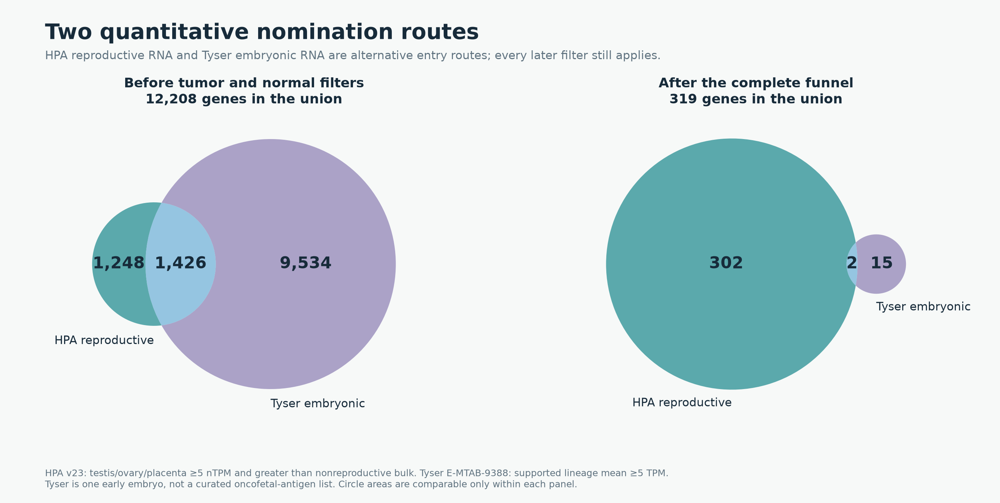
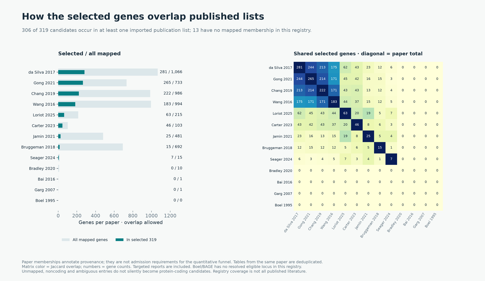
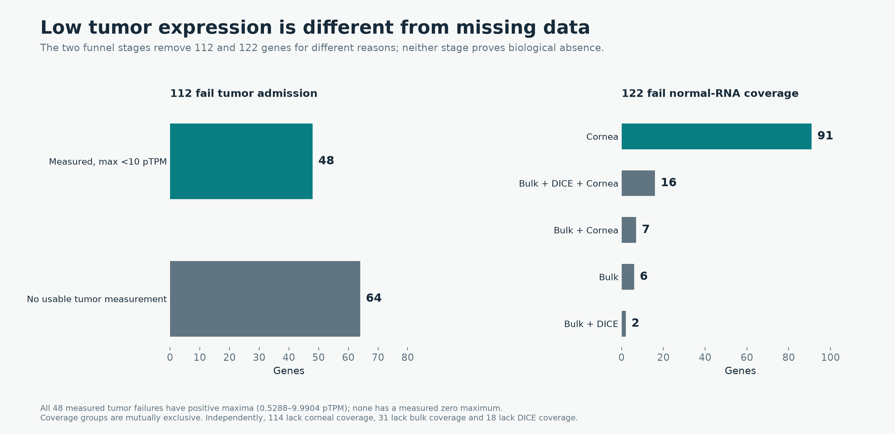

# Sources, evidence gaps and the meaning of the 319-gene endpoint

The endpoint is **319 quantitative CTA/oncofetal candidates**. It is not 136,
and this audit has not produced a new mutually exclusive CTA/Unsafe/Neither
partition. Those three labels still come from the earlier expression policy.

## Actual nomination-source overlaps

The current funnel starts with all 20,097 reference genes and applies two
quantitative association routes. It does not require membership in a literature
CTA list. HPA v23 supplies reproductive RNA in testis, ovary or placenta; Tyser
E-MTAB-9388 supplies supported embryonic-lineage RNA. The latter comes from one
early human embryo, not a curated oncofetal-antigen catalogue or comprehensive
fetal atlas.

| Quantitative association | Before downstream filters | Among selected 319 |
|---|---:|---:|
| HPA reproductive only | 1,248 | 302 |
| Tyser embryonic only | 9,534 | 15 |
| Both routes | 1,426 | 2 |
| Union | **12,208** | **319** |

Thus HPA contributes 2,674 qualifying genes before filtering, Tyser 10,960,
with 1,426 shared. The 7,889 rejected at this stage satisfy neither route.
After filtering, 304 satisfy the reproductive route and 17 the developmental
route, with two shared: RBM46 and TSGA10IP. TBXT/brachyury is among the 15
developmental-only selections.



[Editable SVG](quantitative-source-overlap.svg), [overlap counts](quantitative-source-overlaps.csv),
[per-gene route and publication membership counts](source-route-membership.csv.gz).

The large initial embryonic set is expected under a positive-expression gate:
many genes active during development are also expressed in normal adult cells.
They are nominations, not established tumor-restricted targets; the downstream
protein and normal-RNA filters remove most of them.

## Published-list provenance

**306 of the 319** have mapped membership in at least one imported publication
list; **13 do not**. This is coverage of our registry, not a claim that those
13 have never been published. Literature membership does not rescue or exclude
a gene in the current quantitative funnel.

| Publication | All mapped eligible genes in imported lists | In selected 319 |
|---|---:|---:|
| da Silva 2017 | 1,066 | 281 |
| Gong 2021 | 733 | 265 |
| Chang 2019 | 986 | 222 |
| Wang 2016 | 994 | 183 |
| Loriot 2025 | 215 | 63 |
| Carter 2023 | 103 | 46 |
| Jamin 2021 | 481 | 25 |
| Bruggeman 2018 | 692 | 15 |
| Seager 2024 | 15 | 7 |
| Bradley 2020 | 10 | 0 |
| Bai 2016, targeted EGFL6 report | 1 | 0 |
| Garg 2007, targeted SPAG9 report | 1 | 0 |
| Boel 1995, BAGE nomination unresolved to an eligible locus | 0 | 0 |

The counts overlap and must not be summed. Multiple tables within one paper
are deduplicated. A targeted report is not treated as a complete genome-wide
candidate list; unresolved identifiers do not become inferred coding loci.



[Editable SVG](publication-source-overlap.svg), [source counts and scopes](publication-source-counts.csv),
[pairwise overlaps before and after selection](publication-source-overlaps.csv),
[exact selected-gene source entries](selected-publication-membership.csv.gz),
[13 without mapped publication membership](selected-without-mapped-publication.csv).

## The 112 tumor-admission failures do not mean never expressed in tumors

| Reason | Genes | Interpretation |
|---|---:|---|
| Measured maximum below 10 pTPM | 48 | All have positive maxima, ranging from 0.5288 to 9.9904 pTPM |
| No usable mapped tumor measurement | 64 | Missing evidence under the pinned HPA gene/cohort mapping |
| Measured maximum exactly zero | **0** | None of these failures establishes an all-zero measured tumor profile |

Examples of measured maxima are TCP11X1 0.5288, NT5C1B-RDH14 0.6934,
CTAGE1 5.2085 and FSCB 9.9686 pTPM. These are values in the imported HPA
TCGA/validation cohorts, not a search of every tumor dataset in OncoRef or
every tumor state. A missing summary is not a zero, and even an all-zero panel
could not establish biological absence in every cancer.

[All 112, with reason and source](tumor-admission-failures.csv),
[48 measured below threshold](tumor-measured-below-10.csv),
[64 without usable mapped measurements](tumor-unmeasured.csv).

## What the 122 normal-RNA coverage exclusions mean

These genes already satisfy association, tumor admission and the curated-HPA
protein gate. Coverage then requires 50 bulk tissue entries, 426 observed HPA
clusters (399 screened plus 27 neutral), 19 HPA immune summaries, 30 Monaco
summaries, 15 DICE populations and 84 corneal cell/sample groups, with the
required numerical fields present.

All 122 have the specified HPA cluster, HPA immune and Monaco panels. Their
failures occur in these mutually exclusive combinations:

| Missing panels | Genes |
|---|---:|
| Cornea only | 91 |
| Bulk only | 6 |
| Bulk + cornea | 7 |
| Bulk + DICE | 2 |
| Bulk + DICE + cornea | 16 |
| Total | **122** |

Independently, **114 lack corneal coverage, 31 lack complete bulk coverage,
and 18 lack DICE coverage**; these overlap. The 31 bulk failures have 41 of
50 entries, missing amygdala, basal ganglia, cerebellum, hippocampal formation,
hypothalamus, midbrain, pituitary gland, spinal cord and vagina. DICE has no
usable complete 15-population summary for the affected genes. Corneal rows
must have a resolvable gene identity; an absent or ambiguous source feature
cannot be interpreted as measured absence.

These are evidence-gap holds, not evidence that the gene is expressed in a
dangerous tissue. Conversely, passing coverage means complete specified panels,
not complete coverage of every human tissue, age, cell state or donor.



[Editable SVG](tumor-and-coverage-gaps.svg),
[all 122 genes and missing panels](normal-rna-coverage-failures.csv),
[coverage combinations](coverage-failure-combinations.csv).

## CTA, Unsafe and Neither: what is actually implemented

The new quantitative decision is binary: **319 pass; 19,778 do not pass**.
The nonpassing group includes lack of association, inadequate tumor evidence,
missing coverage and normal-expression exclusions. It must not all be labeled
Unsafe. Stronger RNA thresholds currently annotate reference-review evidence;
they do not automatically classify a gene Unsafe or construct a forbidden FASTA.

Within the 319, the historical labels break down as follows:

| Historical annotation | Genes |
|---|---:|
| CTA / Pass | 136 |
| Neither / Conflict | 97 |
| Neither / Antibody | 45 |
| Neither / Selectivity | 23 |
| Neither / Low | 8 |
| Neither / Uncurated | 1 |
| Unsafe / High RNA | 8 |
| Unsafe / Normal protein | 1 |
| Total | **319** |

The eight prior High-RNA exclusions are TNP1, OBP2A, SMCP, XAGE3, HMGB4,
TMEM95, LELP1 and BOD1L2. Some prior RNA rules or reproductive-context treatment
differ from this proposal, but their old findings have not been erased.
OBP2A and BOD1L2 also retain antibody-concern flags.

**FTMT is the accepted normal-protein case, not merely an old RNA cutoff.**
The curated literature review cites human substantia-nigra neuronal protein in
two donors without neurological disorders, with specificity controls. The
quantitative funnel uses curated HPA IHC and RNA panels; it does not apply the
separate accepted-literature-protein flag as a veto. Passing that narrower
screen therefore does not clear FTMT's existing Unsafe classification.
[Primary study](https://www.jstage.jst.go.jp/article/ahc/50/1/50_16034/_pdf),
[existing literature review](../../cta-literature-20261025/index.md).

No new three-way classification counts are claimed here. A final classification
must reconcile accepted normal-protein exclusions and unresolved antibody/identity
evidence with the new numerical rules consistently. In the existing scheme,
Unsafe denotes exclusion/reference evidence rather than proven clinical toxicity;
Neither includes unresolved or ineligible genes; CTA denotes research eligibility.

[Historical label breakdown](selected-historical-labels.csv),
[nine historical Unsafe selections with preserved flags](selected-historical-unsafe.csv).

## Reproduction

```bash
python scripts/cta_geometric_sources_report.py docs/audits/cta-geometric-thresholds-20261027
```

[Input and output hashes](manifest.json). All figures have PNG and editable SVG
versions. The original [funnel, thresholds and filter-effect figures](../index.md)
remain available; this report explains their sources and uncertainties without
changing the 319-gene quantitative membership.
