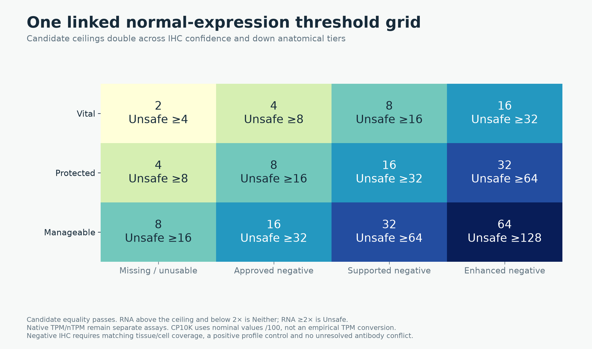
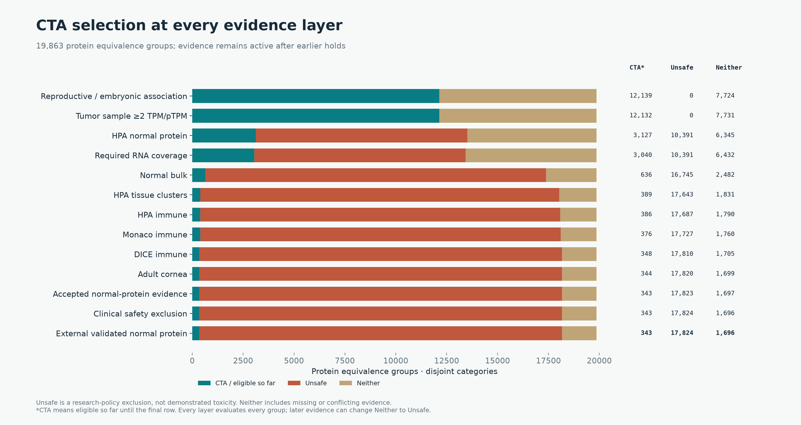
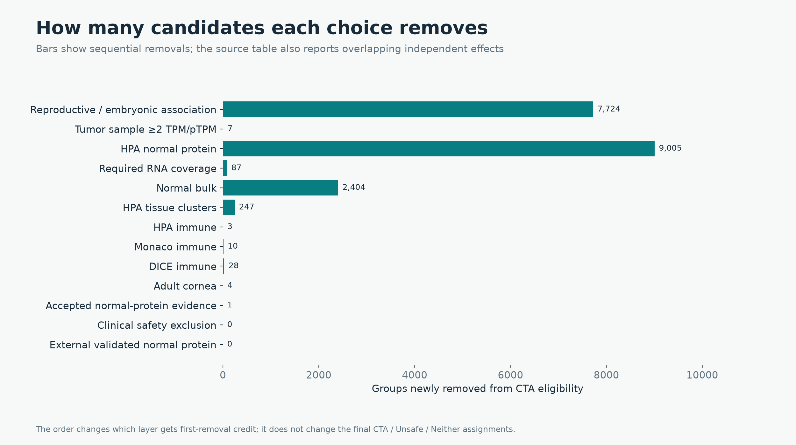
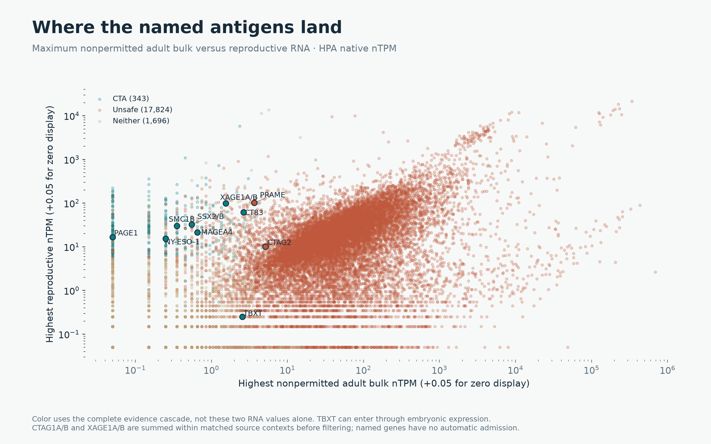
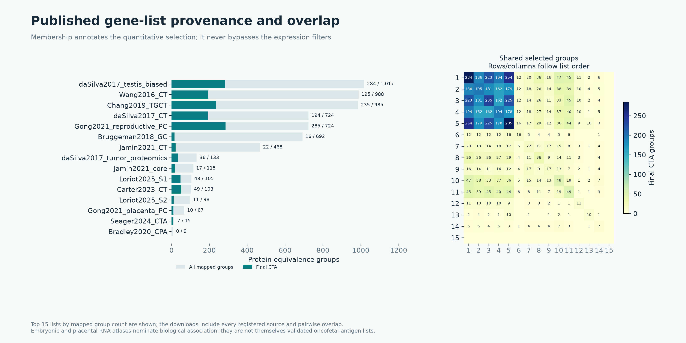

# Harmonized CTA and oncofetal research selection

The complete protein-group funnel selects **291 CTA**, with
**17,824 Unsafe** and **1,748 Neither** among
19,863 protein equivalence groups. These represent 20,097
reference gene loci; 306 reference loci belong to selected groups.
Before grouping, the same evidence policy assigns **305 CTA /
17,906 Unsafe / 1,886 Neither** at the gene-locus level.
The two denominators are intentionally reported separately.

## Uniform rules

1. Reproductive HPA RNA ≥5 nTPM and greater than nonpermitted adult bulk, or a
   supported Tyser embryonic lineage mean ≥5 TPM (≥20 cells, ≥5 positive cells,
   ≥10% at TPM≥1). No gene-specific literature admission route.
2. At least one qualifying tumor sample ≥2 native TPM/pTPM. The complete compatible
   OncoRef matrix union is used; same-sample group sums precede maxima.
3. Require bulk/HPA-cluster/HPA-immune/Monaco coverage. DICE and cornea are optional
   for coverage; observed expression still contributes.
4. Apply the linked 2×2 normal-RNA/IHC grid. Above the candidate ceiling is a hold;
   ≥2× the ceiling supplies Unsafe evidence. Preserve exact anatomy and assay units.
5. Retain credible normal-protein and clinical-safety exclusions, uncertain antibody
   holds, and externally reviewed findings. The current external collection supplies
   0 fully context-validated observations and no automatic negative overrides.

CTA means the research selection rules pass, Unsafe means a research-policy
exclusion, and Neither means an admission, coverage or unresolved-evidence hold.
Every layer evaluates every entity; later Unsafe evidence can supersede an earlier
Neither. Released annotations and forbidden sequence references are not overwritten.

## Complete cascade

| layer | new_candidate_removals | new_Unsafe | CTA_eligible_so_far | Unsafe | Neither |
| --- | --- | --- | --- | --- | --- |
| Reproductive / embryonic association | 7724 | 0 | 12139 | 0 | 7724 |
| Tumor sample ≥2 TPM/pTPM | 7 | 0 | 12132 | 0 | 7731 |
| HPA normal protein | 9005 | 10391 | 3127 | 10391 | 6345 |
| Required RNA coverage | 87 | 0 | 3040 | 10391 | 6432 |
| Normal bulk | 2404 | 6354 | 636 | 16745 | 2482 |
| HPA tissue clusters | 247 | 898 | 389 | 17643 | 1831 |
| HPA immune | 3 | 44 | 386 | 17687 | 1790 |
| Monaco immune | 10 | 40 | 376 | 17727 | 1760 |
| DICE immune | 28 | 83 | 348 | 17810 | 1705 |
| Adult cornea | 4 | 10 | 344 | 17820 | 1699 |
| Accepted normal-protein evidence | 1 | 3 | 343 | 17823 | 1697 |
| Clinical safety exclusion | 0 | 1 | 343 | 17824 | 1696 |
| External validated normal protein | 0 | 0 | 343 | 17824 | 1696 |
| Unresolved antibody review | 52 | 0 | 291 | 17824 | 1748 |

[Sequential counts](filtering-funnel.csv), [independent overlapping effects](independent-layer-effects.csv),
[gene-locus counts](gene-filtering-funnel.csv).

## Named antigens and known CTA tracking

| protein_group_label | category | exclusion_reasons |
| --- | --- | --- |
| PAGE1 | CTA | All required gates pass |
| SMC1B | CTA | All required gates pass |
| CTAG2 | Unsafe | Normal bulk; HPA tissue clusters |
| MAGEA4 | CTA | All required gates pass |
| TBXT | Neither | Unresolved antibody review |
| PRAME | Unsafe | Normal bulk; HPA tissue clusters; Accepted normal-protein evidence |
| CT83 | CTA | All required gates pass |
| NY-ESO-1 | CTA | All required gates pass |
| SSX2/B | CTA | All required gates pass |
| XAGE1A/B | CTA | All required gates pass |

The 213 historically labeled CTAs now map to
**150 CTA /
31 Unsafe /
32 Neither**.
The [historical CTA table](historical-cta-decisions.csv) and
[all imported CTA/list memberships](known-cta-decisions.csv.gz) retain every gene's
source lists, original label, locus decision, group decision and all exclusion reasons.
Imported lists include broad nomination lists; membership is not a claim that every
entry is an established CTA. Other MAGEs receive ordinary evaluation, not control status.

[Source category counts](source-category-counts.csv), [source overlap matrix](source-overlaps.csv).
HPA reproductive and Tyser embryonic measurements are biological nomination routes;
Tyser is one early embryo, not a comprehensive fetal atlas or validated oncofetal target list.
Adult normal-reference coverage does not establish absence in pediatric tissues.

## Identity, aggregation and evidence limits

- Every gene result carries its canonical ENSG, registered historical/alternate IDs,
  synonyms and identity-catalog hash. Ambiguous names and contradictory IDs are
  quarantined rather than assigned to the first match.
- Protein equivalence groups describe identical chosen reference proteins. Their
  IDs hash member identity; they are not sequence hashes or all-isoform equivalence.
  Complete member identity bundles and the pinned group-registry hash are retained.
- CTAG1A/B and XAGE1A/B are summed only within matched samples or tissue contexts.
  Bulk HPA and GTEx components are summed separately before taking a source maximum.
  Aliases of one locus are never added as extra expression.
- DICE lacks donor pairing across genes. Ranked-sum bounds retain this uncertainty;
  a possible upper exceedance causes review, not invented Unsafe evidence. Missing
  optional DICE coverage alone does not hold a group.
- Embryonic lineage means and corneal context means are additive. Detection-cell
  union bounds remain explicit where raw cell unions are unavailable. Embryonic
  admission and strong corneal evidence use the conservative supported bound.
- New external findings retain categorical staining and numeric scores, assay,
  specimen state, reagent lineage, missing donor counts and exact-context limitations.
  CT83's positive tumor-adjacent gastric evidence is flagged; adult disc findings
  remain attached to TBXT. Neither is silently recoded as healthy normal absence.

## Downloads and reproduction

[Selected CTA groups](cta-protein-groups.csv.gz), [Unsafe](unsafe-protein-groups.csv.gz),
[Neither](neither-protein-groups.csv.gz), [all group decisions](protein-group-classifications.csv.gz),
[all locus decisions](gene-classifications.csv.gz), [locus/group crosswalk](gene-to-protein-group-decisions.csv.gz),
[changes caused by aggregation](aggregation-category-changes.csv), [named controls](named-antigen-decisions.csv).

[Validation record](validation.json) records the checks against this report's manifest.

Run the expanded tumor and normal builders, then the expanded funnel, followed by
`scripts/cta_protein_group_normal.py` and `scripts/cta_harmonized_report.py` with this
audit directory. External evidence is rebuilt by `scripts/collect_external_ihc.py`
and `scripts/curate_external_ihc.py`. Source receipts, input hashes and output hashes
are in the [manifest](manifest.json) and component manifests. Every figure also has
an editable SVG alongside its PNG.
