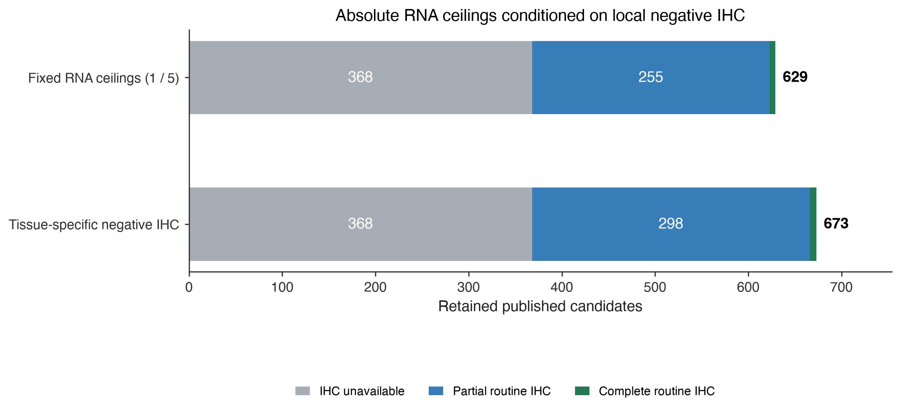
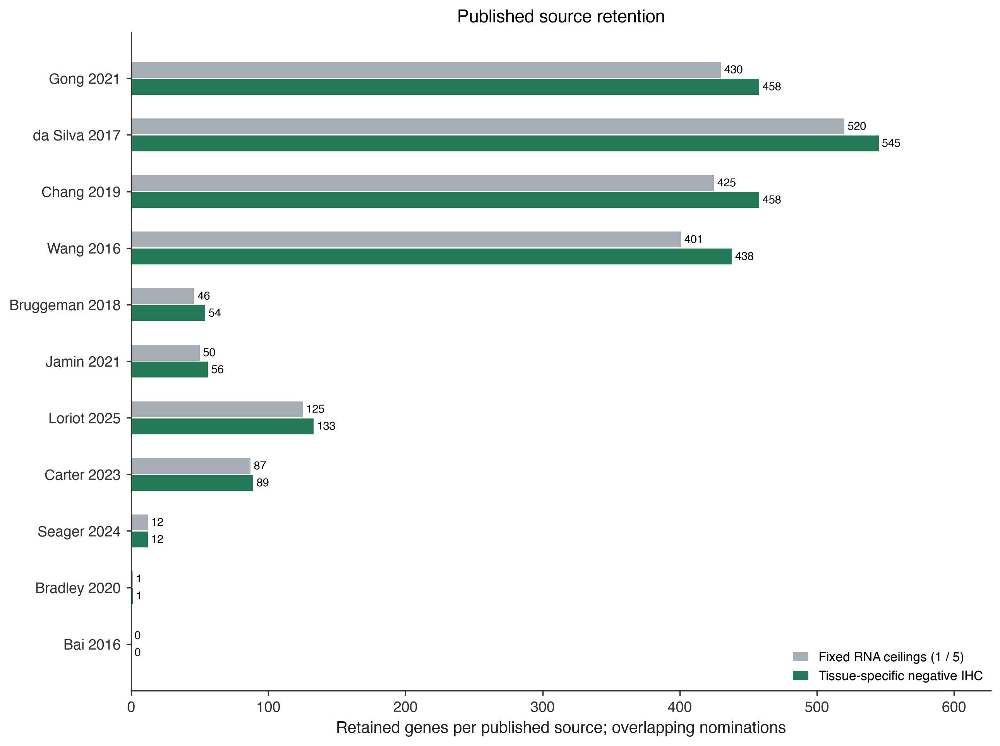
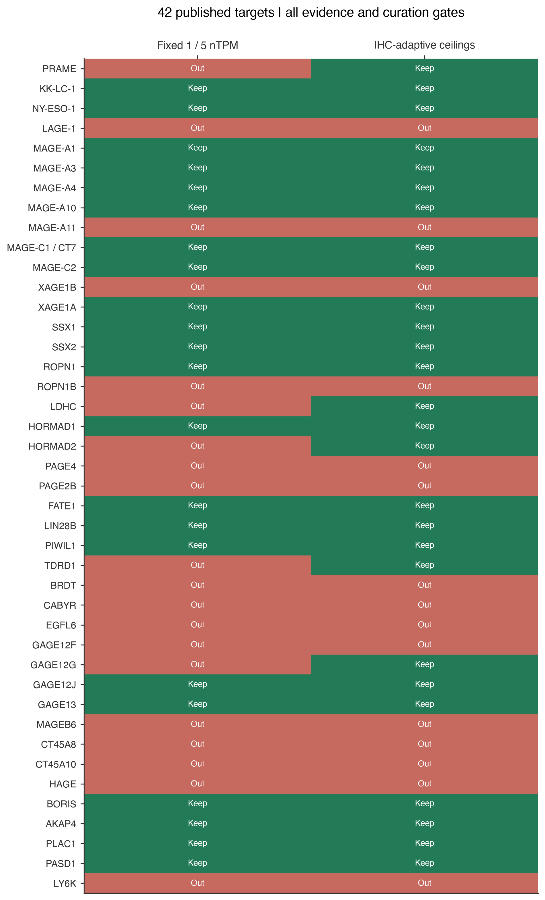

# CTA screen: IHC-adaptive absolute RNA ceilings

**Human HPA v23 · policy `oncoref.cta-ihc-adaptive-screen.2026-10-20.1` · 2026-10-20**

[PDF report](cta-ihc-adaptive-report.pdf) · [Tissue definitions](../../normal-tissue-scopes.md) · [Fixed-screen report](../cta-permitted-tissues-20261019/index.md)

## Approved starting thresholds

| Local negative IHC reliability | Vital maximum nTPM | Protected maximum nTPM |
|---|---|---|
| Missing | 1 | 5 |
| Uncertain | 1 | 5 |
| Approved | 2 | 5 |
| Supported | 3 | 7.5 |
| Enhanced | 5 | 10 |

The same 2,537 published candidates and permitted tissue union are evaluated in both screens. The fixed screen uses vital <=1 nTPM and protected <=5 nTPM. The adaptive screen increases those ceilings only when all routine IHC tissue/cell contexts for the same anatomical tissue have valid Not detected results. The routine inventory is frozen from contexts measured for at least half of the source's measured genes. The weakest reliability among all IHC observations in that tissue determines the ceiling. Extra positive or invalid observations prevent relaxation. Missing contexts, unknown reliability, Uncertain reliability and reviewed-unreliable IHC cannot increase a ceiling. A narrow brain region cannot clear a broader RNA region. Negative evidence in another organ cannot supply support. These are tissue-specific observation rules, not claims of complete biological sampling.

Any positive IHC outside the permitted set, including Low, remains an independent exclusion. Complete routine bulk RNA (50 contexts), positive evidence in the permitted set (RNA >=1 nTPM or positive IHC), resolved positive anatomy and usable observations remain required. Existing family exclusions and manual nomination decisions remain separate gates. Complete routine IHC means 80 tissue/cell contexts; missing and partial coverage remain explicit. RNA is pinned human HPA v23 consensus nTPM with inclusive ceilings, no rounding to pass a cutoff, and no subtraction or averaging across organs.

The 1/5, 2/5, 3/7.5 and 5/10 nTPM values are user-approved starting project parameters, not clinically validated safety limits. Enhanced is an HPA validation label, not a guaranteed detection limit for a negative stain. Routine negative IHC does not establish absence of protein or peptide-HLA presentation. Anatomical definitions apply across human, dog and mouse; these numerical rules apply only to human HPA v23. The existing core/extended CTA API panels retain their separately documented selection rules.

## Results

| Scenario | Retained | No IHC | Partial IHC | Complete IHC |
|---|---|---|---|---|
| Fixed RNA ceilings (1 / 5) | 629 | 368 | 255 | 6 |
| Tissue-specific negative IHC | 673 | 368 | 298 | 7 |

The adaptive policy retains **673** candidates, including **44** recovered from the fixed screen. **368** retained candidates have no usable IHC and receive no IHC-based relaxation. Coverage is a separate result; routine completeness does not establish biological absence.



[Vector figure](policy-comparison.svg)

## Published source retention



[Vector figure](source-retention.svg)

## CTAG2: HPA and GTEx are different datasets

HPA is both a study and a portal that displays other studies. HPA consensus selects the maximum tissue estimate from HPA and GTEx; it is not evidence that both datasets agree. The pinned v23 CTAG2 heart value used here is 5.1 nTPM. The previously reviewed v23 HPA donors were 13.5, 7.1, 0 and 0 nTPM. The current HPA page, checked 2026-10-20, reports its own cohort at 5.0, versus HPA-normalized GTEx at 0.4 (atrial appendage) and 0.9 (left ventricle). These are different datasets and release-specific estimates. Current page values do not replace the pinned input. CTAG2 heart IHC is Not detected with Enhanced reliability, so the new ceiling is 5; pinned 5.1 still fails. PRAME adrenal RNA is 3.6 in the pinned consensus and its IHC is Not detected, Enhanced. The current adrenal page separates HPA 0.5 from GTEx 3.6.

See the [earlier CTAG2 donor, isoform and clinical review](../ctag2-heart-evidence.md). Bulk RNA and IHC donors differ. Neither the low GTEx central estimate nor negative IHC resolves the expressing cell type or proves absence of peptide presentation.

## Known and published targets



[Vector figure](published-targets.svg)

| Target | Fixed | Adaptive | Evidence / reason |
|---|---|---|---|
| PRAME (PRAME) | Out | Keep | Recovered: adrenal gland: 3.6 <= 5 nTPM; negative_enhanced; kidney: 1.8 <= 5 nTPM; negative_enhanced |
| KK-LC-1 (CT83) | Keep | Keep | Retained; IHC unavailable |
| NY-ESO-1 (CTAG1B) | Keep | Keep | Retained; IHC partial |
| LAGE-1 (CTAG2) | Out | Out | heart muscle: 5.1 nTPM (vital, limit 5); Existing review: LAGE-1 / NY-ESO family target with source-database CTA evidence; excluded from the strict default because HPA RNA has a low-level heart signal. |
| MAGE-A1 (MAGEA1) | Keep | Keep | Retained; IHC partial |
| MAGE-A3 (MAGEA3) | Keep | Keep | Retained; IHC unavailable |
| MAGE-A4 (MAGEA4) | Keep | Keep | Retained; IHC partial |
| MAGE-A10 (MAGEA10) | Keep | Keep | Retained; IHC partial |
| MAGE-A11 (MAGEA11) | Out | Out | Existing review: MAGE-A family target with trace non-reproductive HPA RNA; keep clinical discoverability but do not silently promote into the default strict CTA set. |
| MAGE-C1 / CT7 (MAGEC1) | Keep | Keep | Retained; IHC partial |
| MAGE-C2 (MAGEC2) | Keep | Keep | Retained; IHC partial |
| XAGE1B (XAGE1B) | Out | Out | liver: 1.5 nTPM (vital, limit 1); lung: 1.2 nTPM (vital, limit 1) |
| XAGE1A (XAGE1A) | Keep | Keep | Retained; IHC unavailable |
| SSX1 (SSX1) | Keep | Keep | Retained; IHC partial |
| SSX2 (SSX2) | Keep | Keep | Retained; IHC partial |
| ROPN1 (ROPN1) | Keep | Keep | Retained; IHC partial |
| ROPN1B (ROPN1B) | Out | Out | basal ganglia: 2.9 nTPM (vital, limit 1); pituitary gland: 2.9 nTPM (vital, limit 1); +2 more |
| LDHC (LDHC) | Out | Keep | Recovered: liver: 1.4 <= 5 nTPM; negative_enhanced; pancreas: 1.3 <= 5 nTPM; negative_enhanced |
| HORMAD1 (HORMAD1) | Keep | Keep | Retained; IHC partial |
| HORMAD2 (HORMAD2) | Out | Keep | Recovered: liver: 2.8 <= 5 nTPM; negative_enhanced |
| PAGE4 (PAGE4) | Out | Out | smooth muscle: 23.3 nTPM (vital, limit 5); adrenal gland: 5.5 nTPM (vital, limit 5); +2 more |
| PAGE2B (PAGE2B) | Out | Out | bone marrow: 4 nTPM (vital, limit 3) |
| FATE1 (FATE1) | Keep | Keep | Retained; IHC partial |
| LIN28B (LIN28B) | Keep | Keep | Retained; IHC partial |
| PIWIL1 (PIWIL1) | Keep | Keep | Retained; IHC partial |
| TDRD1 (TDRD1) | Out | Keep | Recovered: kidney: 1.6 <= 5 nTPM; negative_enhanced |
| BRDT (BRDT) | Out | Out | bone marrow: 2.6 nTPM (vital, limit 2) |
| CABYR (CABYR) | Out | Out | choroid plexus: 12.7 nTPM (vital, limit 1); pituitary gland: 8 nTPM (vital, limit 1); +8 more |
| EGFL6 (EGFL6) | Out | Out | lung: 24.8 nTPM (vital, limit 5); adipose tissue: 19.5 nTPM (protected, limit 10); +2 more |
| GAGE12F (GAGE12F) | Out | Out | stomach: 8.3 nTPM (protected, limit 7.5) |
| GAGE12G (GAGE12G) | Out | Keep | Recovered: stomach: 5.9 <= 7.5 nTPM; negative_supported |
| GAGE12J (GAGE12J) | Keep | Keep | Retained; IHC partial |
| GAGE13 (GAGE13) | Keep | Keep | Retained; IHC partial |
| MAGEB6 (MAGEB6) | Out | Out | kidney / proximal tubules (microvilli): Medium (Enhanced); reviewed unreliable ihc |
| CT45A8 (CT45A8) | Out | Out | heart muscle / cardiomyocytes: Low (Supported); reviewed unreliable ihc |
| CT45A10 (CT45A10) | Out | Out | hippocampal formation: 1.4 nTPM (vital, limit 1); amygdala: 1.2 nTPM (vital, limit 1); +1 more |
| HAGE (DDX43) | Out | Out | lung / macrophages: Medium (Enhanced) |
| BORIS (CTCFL) | Keep | Keep | Retained; IHC partial |
| AKAP4 (AKAP4) | Keep | Keep | Retained; IHC partial |
| PLAC1 (PLAC1) | Keep | Keep | Retained; IHC partial |
| PASD1 (PASD1) | Keep | Keep | Retained; IHC partial |
| LY6K (LY6K) | Out | Out | esophagus: 12.1 nTPM (protected, limit 10); skeletal muscle: 5.2 nTPM (vital, limit 5); +6 more |

The selected list contains both clinical and research targets. Manual exclusions remain independent: MAGE-A11 can pass expression gates while retaining its earlier nomination holdback. CTAG2 also retains its prior review decision. The complete CSV preserves every failing tissue and every rescued RNA context.

## Audit and reproduction

- [All candidate decisions](candidate-decisions.csv)
- [Every RNA measurement, chosen ceiling and local IHC support](rna-threshold-audit.csv.gz)
- [Recovered candidates](recovered-candidates.csv)
- [All 42 selected targets](notable-targets.csv)
- [Overall counts](scope-summary.csv) and [publication counts](source-counts.csv)
- [Exact policy](screening-policy.json) and [checksums / routine contexts](run-manifest.json)
- [Pinned original observations](../cta-permitted-tissues-20261019/normal-observations.csv.gz)

```sh
python scripts/cta_adaptive_report.py --out outputs/cta-adaptive-current
```

The rebuild verifies input hashes, reproduces every fixed expression and final decision (629 retained), and requires the fixed set to be a subset of the adaptive set. Only the absolute RNA ceilings change; input measurements and other gates are held constant.

## References

- [HPA v23 consensus RNA input](https://v23.proteinatlas.org/download/rna_tissue_consensus.tsv.zip)
- [HPA v23 normal IHC input](https://v23.proteinatlas.org/download/normal_tissue.tsv.zip)
- [HPA normalization and maximum-source consensus](https://www.proteinatlas.org/humanproteome/brain/method/transcriptomics)
- [CTAG2 current HPA and GTEx heart data](https://www.proteinatlas.org/ENSG00000126890-CTAG2/tissue/heart%2Bmuscle)
- [PRAME current adrenal data](https://www.proteinatlas.org/ENSG00000185686-PRAME/tissue/adrenal%2Bgland)
- [IMA203 phase 1 primary report](https://doi.org/10.1038/s41591-025-03650-6)
