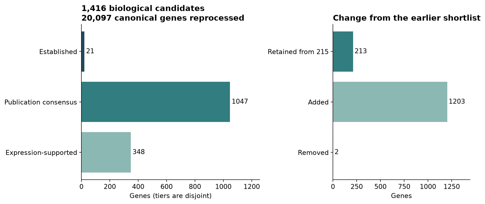
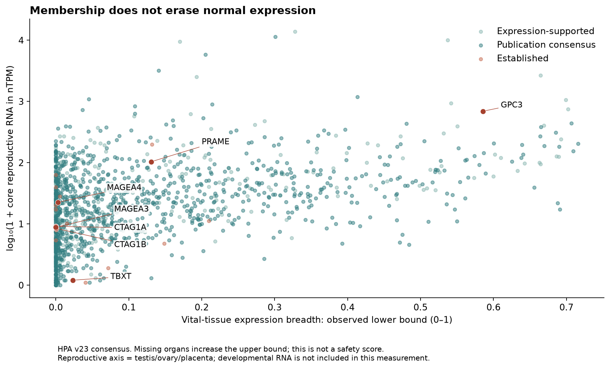
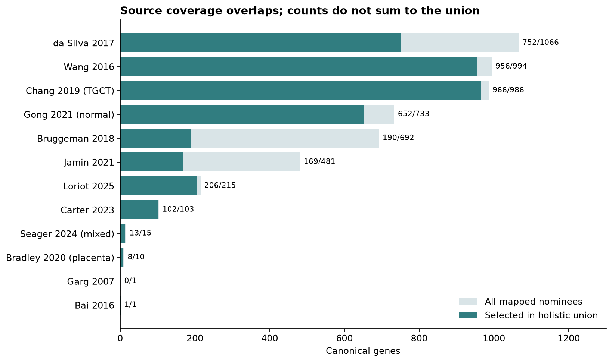

# Holistic CTA and oncofetal membership

**1,416 biological candidate genes**, after reprocessing all **20,097 canonical
human genes**. PRAME, MAGE-A4 and NY-ESO-1 (CTAG1A/B) pass the established-evidence
route, independently of normal-expression concerns. Policy:
`oncoref.cta-membership.2026-10-26.1`.

[Complete selected list](cta-genes.csv) · [Every gene](gene-results.csv.gz) ·
[Changes from 215](changes.csv) · [Control results](control-results.csv) ·
[Reviewed primary evidence](reviewed-membership-evidence.csv).

This set answers whether a gene has a reproductive/developmental association
and cancer evidence worth retaining. It is a broader biological catalogue than
the earlier expression/clinical shortlist. It does not certify normal-tissue
absence, peptide presentation, a targeting product, or clinical safety.

## The rules on one slide

**Resolve the human gene identity; admit through any of three routes; keep
normal-expression risk and evidence gaps alongside membership.**

| Admission route | Common rule | Selected tier |
|---|---|---:|
| Established biological evidence | Reviewed primary evidence links the resolved gene/shared antigen to reproductive or developmental biology **and** cancer. Clinical response is supportive, not mandatory. Normal expression does not revoke biological identity. | 21 |
| Publication consensus | At least **2 distinct publications** nominate the gene as cancer-germline or cancer-placental. Multiple tables of one DOI count once. Normal-only enrichment papers and mixed antigen panels do not count. | 1,047 |
| Expression-supported candidate | Reproductive RNA **≥1 nTPM** and **≥4×** the maximum comparator-tissue RNA, plus published or measured tumor expression. Core scope is testis/ovary/placenta; other reproductive organs additionally require a cancer/reproductive publication. | 348 |

Tiers use this precedence and sum to 1,416; qualifying routes can overlap.
Expression-supported candidates need complete measurements across the named HPA
bulk panel. A measured zero can be used; missing values cannot. Core enrichment
compares three tissues against the other 47; extended reproductive enrichment
compares the eight additional reproductive tissues against 39 nonreproductive
tissues. The named panel is not exhaustive normal-cell coverage.

Measured tumor support means **≥1 pTPM in ≥3 samples and ≥5% of one cancer/cohort**,
or **≥2 Medium/High IHC cases in one tumor group**. Counts are not pooled across
cancers or TCGA/validation cohorts. Published tumor support comes only from the
explicit cancer/reproductive source roles. Native pTPM and nTPM are never compared
numerically. IHC expression support is not independent validation of every antibody.

The old reproductive admission floor was 5 nTPM or alternative protein/reviewed
evidence. The new expression-candidate floor is 1 nTPM. Established membership
and publication consensus no longer depend on a modern atlas reproducing every
rare reproductive cell state or tumor context in the literature. Adult RNA ceilings,
IHC quality, donor variability and cell-RNA thresholds remain risk annotations
instead of deleting established biological members.

## What changed from 215

**213 retained + 1,203 added = 1,416.** Two previous entries, **SPATA31A1** and
**SPATA31D3**, are unselected: the imported evidence supplies normal testis bias
but neither a qualifying cancer/reproductive publication nor current tumor support.
This is insufficient evidence, not proof they cannot be expressed in cancer.
Of the new set, **105 genes were outside the prior 2,540-gene nomination universe**.



The classes are nonexclusive: **1,324 cancer-germline**, **71 cancer-placental**,
**74 other cancer-reproductive**, and **5 reviewed oncofetal** genes. The umbrella
is explicitly broader than strict cancer-testis antigens; a lineage annotation
does not automatically make every member a validated immunologic antigen.

## Positive controls and interpretation

| Group | Controls retained |
|---|---|
| User-required | PRAME, MAGEA4, CTAG1A, CTAG1B |
| Additional established CTA controls | MAGEA1, MAGEA3, MAGEA6, MAGEA10, MAGEC1, MAGEC2, CTAG2/LAGE-1, SSX2, CT83/KK-LC-1, SYCP1 |
| Cancer-placental controls | VGLL1, PLAC1 |
| Oncofetal/developmental controls | AFP, GPC3, SALL4, CLDN6, TBXT/brachyury |

The controls have reference-bound primary citations and explicit review depth.
They pass through the same evidence route available to any gene; their symbols
are not exceptions in the classifier. Regression tests keep their membership
stable when normal-expression flags change. Their evidence can still be corrected
if a source or gene mapping is wrong. The 21 reviewed controls are not an
exhaustive list of every established CTA.

The seven comparison genes **ACTB, GAPDH, PPIA, ALB, PTPRC, EGFR and ERBB2** are
unselected. This small, deliberately chosen benchmark is not independent
validation or an estimate of specificity.

NY-ESO-1 evidence is shared across CTAG1A/B: two gene rows do not establish two
independently validated antigens. MAGE-A3 remains a member despite the serious
neurological toxicity reported with an A3/A9/A12-reactive receptor. TBXT remains
oncofetal despite adult nucleus pulposus evidence. These distinctions are retained
in the [review records](reviewed-membership-evidence.csv), alongside PRAME adrenal
findings and the earlier antibody/donor/cell-RNA concerns.

## Risk is a separate axis

**726 selected genes retain the earlier expression-forbidden flag.** Neither that
reference nor any FASTA or near-self subtraction asset was regenerated. Membership
cannot be used as a list of proteins that may be removed from a normal reference.

Every row retains the prior expression category, flags, findings and sources.
The earlier illustrative cell-RNA/IHC audit is joined where assessed; unassessed
genes and missing source records remain explicit. Those illustrative cutoffs are
not newly validated clinical thresholds.

[Normal breadth for all 20,097 genes](normal-breadth.csv.gz) uses the existing
fixed anatomical panel, separate Vital/Protected/Manageable categories, and
`RNA / (RNA + category ceiling)` contributions. Brain regions share one organ
weight. Missing anatomical weight contributes to an upper bound rather than
disappearing. This is a fixed-baseline descriptive score, not the per-gene
IHC-relaxed score or a new exclusion gate. The [earlier breadth report](../normal-breadth-20261026/index.md)
retains IHC scenarios and donor uncertainty. Only CTAG2 currently has imported
individual-donor evidence; all other genes are labelled unassessed for donors.



## Sources, overlaps and scope

[Source counts](source-counts.csv), [pairwise overlaps](source-overlaps.csv), and
[gene-level source memberships](nomination-membership.csv.gz) cover the mapped
canonical coding portion of the imported sources. Raw noncoding and unmapped
entries remain in the original publication registry. BAGE and GAGE2B remain
[unresolved identities](../cta-research-20261026/unmapped-identity-reviews.csv);
the Boel BAGE source has no mapped canonical gene and is absent from the plotted
source counts. Distinct papers can reuse GTEx/TCGA or other samples;
two publications do not imply two independent biological replications.



Gong normal-reproductive lists and the da Silva testis-biased-only list supply
nomination provenance, not tumor evidence. The Seager mixed panel does not
uniformly establish CTA identity. Chang nominations are explicitly TGCT-based.
**55 selected genes have only TGCT support in the current positive tumor-RNA
summary**; this does not rule out additional tumor evidence elsewhere.

Filtering/evidence inputs are HPA v23 normal consensus RNA, HPA v25.1 tumor RNA
and IHC summaries, the existing normal protein/literature findings, and the
[prior cell-RNA/IHC audit](../cta-cell-thresholds-20261026/index.md). Their source
versions and content hashes are in the [manifest](run-manifest.json). The
[tumor RNA](tumor-rna-evidence.csv.gz) and [tumor IHC](tumor-ihc-evidence.csv.gz)
exports retain patient/sample denominators and cohort identities.

The oncofetal controls are supported by gene-specific studies, including primary
papers explicitly describing [GPC3 as oncofetal](https://www.nature.com/articles/3800436),
[SALL4 as oncofetal](https://pubmed.ncbi.nlm.nih.gov/23758232/) and
[CLDN6 fetal expression](https://pubmed.ncbi.nlm.nih.gov/41073135/).
**Gastrulation, organogenesis and DESCARTES atlas measurements are not yet
imported.** Fetal expression is therefore not included in the ≥1 nTPM reproductive
measurement. Developmental admission currently uses reviewed primary evidence;
the five oncofetal controls are not an exhaustive oncofetal discovery set.
See the [developmental-source assessment](../../developmental-targets.md).

Comprehensive individual primary-paper review remains unfinished (#638).
Publication-level intake and control-abstract review must not be represented as
full-text assessment of every selected gene. Near-self reference resolution and
verified sequence coverage remain separate work (#640/#641).

## Sensitivity and reproducibility

[All 17 sensitivity scenarios](threshold-sensitivity.csv) retain every positive
control and exclude the seven comparators. Varying the reproductive floor to
0.1/2/5 nTPM gives 1,475/1,391/1,357 genes; changing enrichment to 2×/8× gives
1,737/1,316. Requiring 1/3 publications gives 2,439/1,160. Tumor RNA floors,
prevalence, sample counts and IHC-case counts are also varied independently.
These are transparent research settings, not fitted clinical cutoffs. Positive
controls pass by reviewed evidence, so their recall cannot validate numerical
thresholds for unreviewed genes.

```python
from oncoref import cta_membership

genes = cta_membership.gene_ids()  # 1,416
decisions = cta_membership.results()  # 20,097; inspect evidence tier and flags
oncofetal = cta_membership.gene_ids(category="Oncofetal")
```

Rebuild into an empty directory with
`python scripts/build_cta_membership.py --output /tmp/cta-membership-rebuild`.
The builder verifies cached source contents, exports the decision facts and
hashes inputs and outputs. `--publish` additionally updates the packaged table.
Generate figures with `python scripts/plot_cta_membership.py <audit-directory>`.
The earlier 215/213-gene APIs remain available for historical comparison.
