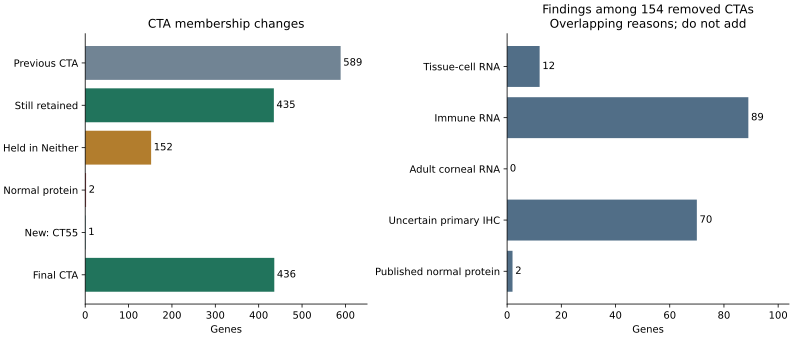

# CTA curation with normal-cell evidence

**436 CTA candidates remain. All 21 previously retained clinical/requested benchmark genes survive.**
Compared with the 589-gene baseline, 435 remain, CT55 joins, 152 move to Neither for review, and IL13/PAPPA move to Unsafe because nonmalignant cells produce their proteins.

[Explore genes and reasons](explore.html) · [CTA table](cta-genes.csv.gz) · [All changes](changed-genes.csv) · [Important CTA audit](important-ctas.csv) · [All 20,097 genes](gene-results.csv.gz)



## Results at a glance

| Scope | CTA | Unsafe | Neither |
|---|---:|---:|---:|
| 2,540 mapped CTA nominations | 436 | 1,455 | 649 |
| 20,097 canonical human genes | 436 | 17,409 | 2,252 |

CTA means research eligibility, not proven clinical safety. Unsafe means excluded by the research screen and included in the forbidden background, not necessarily observed clinical toxicity. Neither supplies neither targets nor forbidden proteins. No missing observation is converted to zero.

The added sources were assessed for **2,705 genes**: every previous CTA and Neither gene, plus already-excluded clinical benchmark genes. Other Unsafe assignments are inherited from the pinned baseline; they were not newly cleared by these datasets. Coverage is recorded per gene and source in [added evidence](added-evidence.csv.gz).

## Important CTAs: what changed, and what did not?

| Gene or group | Result | Explanation |
|---|---|---|
| XAGE1A/B; CTAG1A/B; PRAME; MAGEA4 | CTA, unchanged | All pass the added evidence rules. |
| MAGEA1/A3/A10, MAGEC1/C2, CT83, SSX2/4/5, AKAP4, ROPN1, SPANXB1, SAGE1, CTCFL, GAGE1 | CTA, unchanged | Together with the group above, all 21 previous benchmark targets survive. |
| CT55 / CXorf48 | **New CTA** | Reproductive bulk RNA 3.7 nTPM; cited reproductive expression and recognition of human CML cells satisfy admission. The normal gates still apply. [Study](https://pmc.ncbi.nlm.nih.gov/articles/PMC5709753/) |
| FOXR2 | Neither / Antibody | Strong cancer/testis biology supports admission, but primary HPA profiles are **Uncertain** and include normal staining. This is an antibody-review hold, not “missing IHC” or proven toxicity. [Study](https://pmc.ncbi.nlm.nih.gov/articles/PMC9437574/), [HPA primary data](https://v23.proteinatlas.org/ENSG00000189299-FOXR2/tissue/primary%2Bdata) |
| CTAG2 / LAGE-1 | Neither / Variable, unchanged | Previously reviewed vital-tissue donor RNA remains decisive. Added tumor or reproductive evidence cannot override this hold. |
| ACRBP / OY-TES-1 | **New Neither / Cellular** | HPA platelet cluster: 5,316.5 nTPM, 559 reads, versus 1,326.2 reproductive-cell maximum; original DICE also shows recurrent immune RNA. No inference of clinical toxicity or platelet HLA presentation is made. |
| HORMAD1 | **New Neither / Cellular** | Original DICE monocytes: 90/91 reported values ≥5 TPM; maximum 19.73. Normal-cell RNA needs resolution despite CTA biology. |
| TDRD1 | **New Neither / Cellular** | Activated CD4 DICE: 3/88 values ≥5 TPM; maximum 6.43. Monaco plasmacytoid DC: 6.4 TPM. Borderline relative to the new review trigger; recorded explicitly. |
| BRDT | **New Neither / Cellular** | Monaco effector-memory CD8 T cells: 6 TPM; basophils: 5 TPM. This aggregate-only warning is weaker than repeated DICE evidence. |
| TEX101 | **New Neither / Cellular** | Basophil RNA: HPA 55.7 nTPM; Monaco 74.9 TPM. Different units remain separate. |
| DAZL; TRIP13; GAGE12F; PAGE2B | **New Neither / Cellular** | Immune RNA warnings. PAGE2B is borderline: 3/91 DICE naive-B values ≥5 TPM. GAGE12F needs paralog/multimapping review. Exact values are in the audit table. |
| CTAGE1 | **New Neither / Antibody** | Conflicting or uncurated primary normal staining, with no reliable profile resolving it. |
| IL13; PAPPA | **CTA → Unsafe / Normal** | Published nonmalignant protein production overrides reproductive enrichment. Activated T cells for IL13; primary coronary vascular cells, including inflammatory stimulation, for PAPPA. |
| ABCB5; IL5 | **Neither → Unsafe / Normal** | Human limbal stem-cell ABCB5 and activated human Th2 IL5 protein evidence. |
| MAGEA12 | Unsafe / Safety, unchanged | Existing independent safety hold remains. |
| BAGE; GAGE2B | Identity/measurement gap, unchanged | Present in source intake, absent from this canonical measured gene universe. No paralog substitutes for them. SPAG9 is mapped and remains excluded by normal IHC. |

All **154 removed former CTAs** are listed in [removed-ctas.csv](removed-ctas.csv). Across these genes, 89 have immune RNA flags, 70 have primary-antibody flags, 12 have tissue-cell RNA flags and 2 have published normal-protein evidence. These overlap. The adult corneal RNA rule causes no additional loss among the former 589; its information remains available for the whole reviewed set.

An apparently relevant ACRBP normal-tissue IHC paper ([PMID 35463688](https://pubmed.ncbi.nlm.nih.gov/35463688/)) is **retracted**. It is excluded from decision evidence. ACRBP's hold above comes from the downloaded RNA data, not that publication.

## The rule system

1. **Keep established normal exclusions.** Original bulk category/IHC ceilings, positive curated normal IHC, safety holds, selectivity rules and the CTAG2 Variable hold remain in force.
2. **Require affirmative reproductive evidence.** A previous candidate can pass admission with reproductive bulk RNA ≥5 nTPM, reliable positive reproductive protein, or cited reproductive plus tumor/recognition evidence. Reliable reproductive protein can satisfy admission below 5 nTPM. Tumor expression alone does not override the floor or any normal exclusion.
3. **Exclude established normal protein production.** Cited production by nonmalignant cells outside permitted compartments yields Unsafe / Normal. Protein production during activation counts; a resting bulk-tissue zero cannot negate it.
4. **Hold unresolved cell RNA or antibody conflicts in Neither.** The following source-specific rules identify review needs; they are provisional evidence-review parameters, not validated toxicity limits.

| Added source | Trigger | Consequence |
|---|---|---|
| HPA tissue/cell clusters | Normal category is Vital/Protected/Manageable; ≥5 nTPM and ≥20 reads; at least as high as reproductive-cell maximum within this same source. Substantial unmapped context or absent reproductive-cell coverage also requires review. | Neither / Cellular |
| Original DICE | ≥5 TPM in at least 3 reported expression values in any immune cell/state distribution | Neither / Cellular |
| HPA sorted immune cells; Monaco | ≥5 in that source's native nTPM or TPM units; HPA's DICE aggregate is descriptive only | Neither / Cellular |
| Adult corneal atlas | Mean per-cell CP10K ≥1, ≥5 positive cells and ≥20 counts within a cell type/sample group, supported in at least 2 groups | Neither / Cellular |
| Primary HPA antibodies | Positive normal staining with uncertain/missing curated profile, or positive normal staining absent from curated IHC | Neither / Antibody |

A poor antibody within a reliable curated profile does not automatically invalidate the whole profile. Reviewed cross-reactive assays cannot provide admission or exclusion evidence. Raw positive staining cannot overturn an existing curated negative profile to rescue a gene. Positive curated normal IHC retains the original veto.

These review triggers are intentionally distinct from the existing bulk ceilings. TPM, nTPM, CP10K and staining scores are **not pooled or numerically converted into each other**. Threshold sensitivity matters, particularly BRDT, TDRD1 and PAGE2B. Resolving those holds calls for reliable local protein/peptide evidence or source-specific technical adjudication, not an undocumented gene exception.

## What was downloaded, and what is used?

All **44 new source artifacts** use the existing datacache-backed downloader, atomic staging, versioned cache, archive/content checksums and catalog API. [Full source inventory](sources.csv).

| Source | Available | Used in this screen |
|---|---|---|
| HPA v23 | Gene summary; primary antibody XML; tissue-specific cell-cluster RNA and metadata; immune summaries, samples, Monaco and Schmiedel | Cluster RNA, curated/primary IHC and sorted-cell summaries |
| DICE DB1 | All 15 original immune expression matrices, including activated CD4/CD8 | Per-gene distributions; HPA's DICE summary is not counted as independent replication |
| Collin human corneal atlas / GSE155683 | Adult and developmental counts, additional count matrices, and author cell annotations from HCA | Adult normal cornea/conjunctiva only; developmental, diseased and culture contexts are not pooled into adult-normal exclusions |

Human eye compartments are explicit: cornea, limbus and conjunctiva map to Vital through eye. Immune cells sampled in reproductive organs map to hematopoietic lineage, not reproductive permission. The added 613 source/version/cell mappings are human-specific; mouse/dog anatomy remains available, but these human assays and numerical thresholds are not transferred across species.

The atlas contains **21,343 adult cells**, retaining the author's cell labels. CP10K is calculated per cell using the complete gene library, then averaged including zeros within each cell type/sample group. Corneal barcode suffixes identify sample groups, not verified donor IDs. DICE numeric columns preserve per-gene distributions but are not stable paired donor identities across genes. Primary HPA IHC retains antibody IDs, validation, profile reliability and patient metadata; aggregate staining is not invented as a score for each patient.

### Why curated literature still matters

ABCB5 illustrates the limit of a negative atlas screen: this dataset's sparse ABCB5 RNA **does not trigger** the corneal rule, yet published human limbal protein evidence excludes it. The corneal atlas therefore does not replace targeted protein studies. [Ksander et al.](https://pmc.ncbi.nlm.nih.gov/articles/PMC4246512/)

IL5 likewise falls below the DICE review trigger but is a protein made by activated human Th2 cells. IL13 has both immune RNA and published protein evidence. PAPPA's normal-cell counterevidence is context-dependent vascular production, not a claim of constitutive expression throughout every healthy vessel. [IL5 study](https://pmc.ncbi.nlm.nih.gov/articles/PMC3445433/), [IL13 study](https://pubmed.ncbi.nlm.nih.gov/8605923/), [PAPPA study](https://pubmed.ncbi.nlm.nih.gov/17936662/)

The source studies provide measurements and biology; they do **not** validate our numerical review thresholds. See [DICE](https://pubmed.ncbi.nlm.nih.gov/30449622/), [corneal atlas](https://pmc.ncbi.nlm.nih.gov/articles/PMC8343164/), [GEO accession](https://www.ncbi.nlm.nih.gov/geo/query/acc.cgi?acc=GSE155683), and [HPA v23 methods/downloads](https://v23.proteinatlas.org/about/download).

## Downstream access

```python
from oncoref import catalog, normal_cell_data, target_sets

catalog.ensure("dice_cd4_stim")
normal_cell_data.sources()
normal_cell_data.observations("dice_cd4_stim", genes=["IL13", "CT55"])
normal_cell_data.observations("hpa_single_cell_tissue", genes=["IL13"])
normal_cell_data.table("hpa_antibody_xml", genes=["FOXR2"])
normal_cell_data.cornea_summary(genes=["ABCB5"])
normal_cell_data.publication_evidence()
target_sets.results()                  # current decisions and all reasons
target_sets.gene_ids("CTA")
target_sets.gene_ids("Unsafe")         # only this category is forbidden
```

Native tables preserve original IDs; [corneal gene mapping](corneal-gene-mapping.csv.gz) records exact/alias, ambiguous and missing mappings without paralog substitution. See the [API and cache guide](../../normal-cell-evidence.md).

Exact full-protein sets: **807 CTA, 125,585 Unsafe, 3,593 Neither**. Shared complete sequences use Unsafe > Neither > CTA; the same sequence never appears in two sets. Gene evidence does not establish isoform-specific expression.

The protein downloads and checksums are listed in [protein-assets.json](protein-assets.json). Only `unsafe.fasta.gz` plus `additional-forbidden.fasta.gz` form the forbidden union; Neither stays separate. [Exclusion recipe](exclusion-basis.json).

The [important-protein audit](important-proteins.csv) separately checks sequence eligibility. A retained gene does not guarantee every encoded sequence is a target: MAGEA3's shared complete sequence still includes an unresolved alternate-contig gene and remains Neither. XAGE1A/B and CTAG1A/B retain their shared CTA protein sequences.

## Audit files and reproducibility

[Candidate funnel](cta-candidates.csv.gz) · [Cell RNA](cell-rna.csv.gz) · [DICE distributions](dice-distributions.csv.gz) · [Immune summaries](immune-rna.csv.gz) · [Corneal RNA](corneal-rna.csv.gz) · [Primary antibodies](primary-antibodies.csv.gz) · [Publication facts](publication-evidence.csv) · [Run manifest](run-manifest.json)

Policy: `oncoref.target-sets.2026-10-23.2`. Baseline: the [frozen 589-gene report](../target-sets-20261023/index.md). The original curation intake and nomination counts remain unchanged; this report adds normal-cell evidence rather than inventing new source nominations.

```bash
python scripts/build_normal_cell_mappings.py
python scripts/normal_cell_cta_report.py --previous-sequences /path/to/pinned/sequence-assets --assets /path/to/regenerated/protein-assets
python scripts/render_normal_cell_report.py --assets /path/to/regenerated/protein-assets
```

The run manifest pins source files, publication facts, mappings, implementation and outputs. Raw studies remain in the shared cache rather than the repository or wheel. Source-level dropout, mapping ambiguity, antigen presentation, isoform specificity and unmeasured physiological states remain limitations; the 21-gene benchmark is not an exhaustive census of every clinical target.
