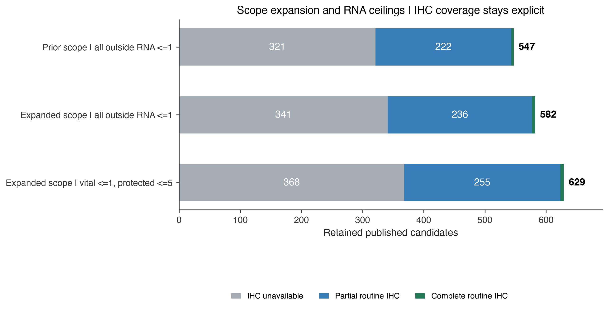
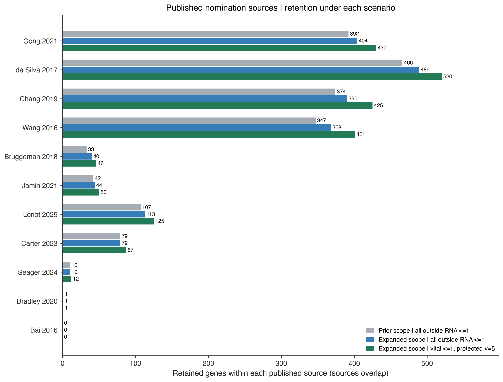
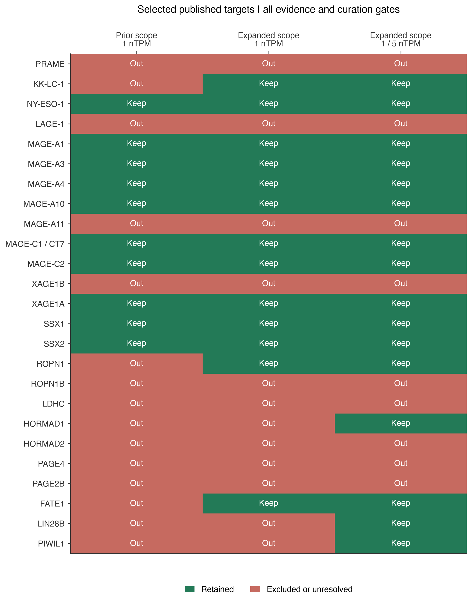

# CTA screen: expanded permitted tissues and protected organs

**Human HPA v23 · policy `oncoref.cta-permitted-screen.2026-10-19.1`**

[Complete PDF report](cta-permitted-tissue-report.pdf) · [Tissue definitions](../../normal-tissue-scopes.md) · [Original source-intake report](../cta-tissue-scopes-20261019/index.md)

## Current rule

Permitted: all reproductive organs, mammary, placenta/extraembryonic and explicit embryonic/fetal contexts; cutaneous melanocytes and hair follicles; plus whole skin, salivary glands and thymus. Whole-skin permission includes its mapped cellular compartments. Generic unsited cell types, eye, retina and inner ear do not become skin. This is an explicit project screening allowance.

| Tissue tier | RNA rule | IHC rule |
|---|---|---|
| Permitted | No upper ceiling | Positive staining allowed |
| Vital | Every measured value ≤1 nTPM | Any positive staining excludes, including Low |
| Protected normal | Every measured value ≤5 nTPM | Any positive staining excludes, including Low |
| Unresolved anatomy | Positive evidence prevents retention | Positive evidence prevents retention |

**Vital roots:** heart, lung, bronchus, brain, spinal cord, liver, kidney, bone marrow, blood, adrenal gland, pituitary gland, pancreas, small intestine, skeletal muscle, smooth muscle, peripheral nerve, endothelium. Brain includes all mapped brain regions; spinal cord is explicit. Organ subcompartments inherit their organ's tier.

**Protected roots:** adipose tissue, retina, eye, inner ear, thyroid gland, parathyroid gland, lymph node, spleen, tonsil, appendix, esophagus, stomach, colon, rectum, gallbladder, urinary bladder, ureter, cartilage, oral mucosa, nasopharynx, tongue. Retina includes retinal pigment epithelium. Head, foot and generic soft tissue remain unresolved because these broad labels can span tiers. No unlisted tissue silently receives the 5 nTPM allowance.

## Results and IHC coverage

| Scenario | Retained | No usable IHC | Partial routine IHC | Complete routine IHC |
|---|---:|---:|---:|---:|
| Prior scope &#124; all outside RNA <=1 | 547 | 321 | 222 | 4 |
| Expanded scope &#124; all outside RNA <=1 | 582 | 341 | 236 | 5 |
| Expanded scope &#124; vital <=1, protected <=5 | 629 | 368 | 255 | 6 |

The selected policy retains **629** candidates. **368** have no valid IHC observations in forbidden contexts; these are not IHC-negative findings. Requiring all routine IHC contexts would retain **6**. Adequate evidence of absence remains unestablished.

The prior-scope comparison is reproductive + disposable with a uniform 1 nTPM ceiling and the same positive-in-scope requirement. Expansion adds thymus, whole skin and salivary gland. The final step changes only the protected-tissue RNA ceiling from 1 to 5. The historical adaptive panel and zero-positive strict screen remain separately documented in the original report.



[Vector figure](policy-comparison.svg)

## Published source retention

All 11 registered published sources enter the same 2,537-gene protein-coding universe. Source nominations overlap; counts cannot be summed. Original DOI/table/row mappings and targeted source selections remain in the [source-intake audit](../cta-tissue-scopes-20261019/index.md#published-nomination-intake).



[Vector figure](source-retention.svg)

## Known and published targets

This selected list mixes clinically studied and research targets; inclusion does not imply equal clinical maturity. PRAME and KK-LC-1 have clinical TCR studies, whereas the cited ROPN1 work is preclinical. Every published candidate, not just these examples, has a decision in the download below.



[Vector figure](published-targets.svg)

| Target | Result | Evidence / reason |
|---|---|---|
| PRAME (`PRAME`) | Excluded / unresolved | adrenal gland: 3.6 nTPM (vital, limit 1); kidney: 1.8 nTPM (vital, limit 1) |
| KK-LC-1 (`CT83`) | Included | Included; IHC unavailable |
| NY-ESO-1 (`CTAG1B`) | Included | Included; IHC partial |
| LAGE-1 (`CTAG2`) | Excluded / unresolved | heart muscle: 5.1 nTPM (vital, limit 1); kidney: 3.4 nTPM (vital, limit 1); +2 more; existing nomination or manual review |
| MAGE-A1 (`MAGEA1`) | Included | Included; IHC partial |
| MAGE-A3 (`MAGEA3`) | Included | Included; IHC unavailable |
| MAGE-A4 (`MAGEA4`) | Included | Included; IHC partial |
| MAGE-A10 (`MAGEA10`) | Included | Included; IHC partial |
| MAGE-A11 (`MAGEA11`) | Excluded / unresolved | existing nomination or manual review |
| MAGE-C1 / CT7 (`MAGEC1`) | Included | Included; IHC partial |
| MAGE-C2 (`MAGEC2`) | Included | Included; IHC partial |
| XAGE1B (`XAGE1B`) | Excluded / unresolved | liver: 1.5 nTPM (vital, limit 1); lung: 1.2 nTPM (vital, limit 1) |
| XAGE1A (`XAGE1A`) | Included | Included; IHC unavailable |
| SSX1 (`SSX1`) | Included | Included; IHC partial |
| SSX2 (`SSX2`) | Included | Included; IHC partial |
| ROPN1 (`ROPN1`) | Included | Included; IHC partial |
| ROPN1B (`ROPN1B`) | Excluded / unresolved | basal ganglia: 2.9 nTPM (vital, limit 1); heart muscle: 2.9 nTPM (vital, limit 1); +5 more |
| LDHC (`LDHC`) | Excluded / unresolved | liver: 1.4 nTPM (vital, limit 1); pancreas: 1.3 nTPM (vital, limit 1) |
| HORMAD1 (`HORMAD1`) | Included | Included; IHC partial |
| HORMAD2 (`HORMAD2`) | Excluded / unresolved | liver: 2.8 nTPM (vital, limit 1) |
| PAGE4 (`PAGE4`) | Excluded / unresolved | smooth muscle: 23.3 nTPM (vital, limit 1); adrenal gland: 5.5 nTPM (vital, limit 1); +5 more |
| PAGE2B (`PAGE2B`) | Excluded / unresolved | bone marrow: 4 nTPM (vital, limit 1) |
| FATE1 (`FATE1`) | Included | Included; IHC partial |
| LIN28B (`LIN28B`) | Included | Included; IHC partial |
| PIWIL1 (`PIWIL1`) | Included | Included; IHC partial |
| TDRD1 (`TDRD1`) | Excluded / unresolved | kidney: 1.6 nTPM (vital, limit 1) |
| BRDT (`BRDT`) | Excluded / unresolved | bone marrow: 2.6 nTPM (vital, limit 1) |
| CABYR (`CABYR`) | Excluded / unresolved | choroid plexus: 12.7 nTPM (vital, limit 1); pituitary gland: 8 nTPM (vital, limit 1); +13 more |
| EGFL6 (`EGFL6`) | Excluded / unresolved | lung: 24.8 nTPM (vital, limit 1); adipose tissue: 19.5 nTPM (protected, limit 5); +3 more |
| GAGE12F (`GAGE12F`) | Excluded / unresolved | stomach: 8.3 nTPM (protected, limit 5) |
| GAGE12G (`GAGE12G`) | Excluded / unresolved | stomach: 5.9 nTPM (protected, limit 5) |
| GAGE12J (`GAGE12J`) | Included | Included; IHC partial |
| GAGE13 (`GAGE13`) | Included | Included; IHC partial |
| MAGEB6 (`MAGEB6`) | Excluded / unresolved | kidney / proximal tubules (microvilli): Medium (Enhanced); reviewed unreliable ihc |
| CT45A8 (`CT45A8`) | Excluded / unresolved | heart muscle / cardiomyocytes: Low (Supported); reviewed unreliable ihc |
| CT45A10 (`CT45A10`) | Excluded / unresolved | hippocampal formation: 1.4 nTPM (vital, limit 1); amygdala: 1.2 nTPM (vital, limit 1); +1 more |
| HAGE (`DDX43`) | Excluded / unresolved | duodenum: 1.2 nTPM (vital, limit 1); pancreas: 1.2 nTPM (vital, limit 1); lung / macrophages: Medium (Enhanced) |
| BORIS (`CTCFL`) | Included | Included; IHC partial |
| AKAP4 (`AKAP4`) | Included | Included; IHC partial |
| PLAC1 (`PLAC1`) | Included | Included; IHC partial |
| PASD1 (`PASD1`) | Included | Included; IHC partial |
| LY6K (`LY6K`) | Excluded / unresolved | esophagus: 12.1 nTPM (protected, limit 5); adipose tissue: 5.2 nTPM (protected, limit 5); +11 more |

MAGE-A11's existing manual holdback remains separate from the expression gates. Reviewed-unreliable IHC remains an evidence-quality exclusion, with raw staining preserved. Tissue maxima are gene-level source observations; closely related paralogs and shared assays retain the original source limitations.

## Methods and limits

All 2,537 protein-coding candidates from the 11 registered publication sources are screened. Each valid RNA measurement is compared with its tissue-specific ceiling using raw HPA v23 nTPM: vital <=1; protected <=5. There is no averaging across tissues or subtraction of a noise floor. Any Low, Medium, High, Ascending or Descending IHC observation outside the permitted set blocks retention. At least one permitted RNA observation >=1 nTPM or positive permitted IHC is required. All 50 routine bulk RNA contexts must be measured. Unmapped or tier-unresolved positive anatomy, unusable measurements and previously reviewed unreliable IHC prevent retention. Family exclusions and existing nomination/manual reviews also apply. Missing IHC is explicitly RNA-only observed compatibility; partial IHC remains partial. Neither establishes protein absence. Complete routine IHC means all 80 specified tissue/cell contexts. Routine contexts are those represented for at least half the genes in their source; the manifest lists them.

The tier assignment is a conservative project policy, not a clinically validated list of expendable organs. The clinical references motivate review of organ injury; they do not establish the 1/5 nTPM thresholds. The numerical analysis is human HPA v23 bulk RNA and normal IHC only. Anatomy transfers to dog and mouse; these human RNA thresholds and tolerability assumptions do not. Single-cell RNA, tumor expression and peptide-HLA presentation are not evaluated here. Developmental tissues absent from HPA remain unassessed.

## Downloads and reproduction

- [All candidate decisions](candidate-decisions.csv)
- [Selected published targets and full exclusion reasons](notable-targets.csv)
- [Source counts](source-counts.csv) and [overall counts](scope-summary.csv)
- [Original observations with current mappings and tiers](normal-observations.csv.gz)
- [Exact measured tissue/cell mappings](tissue-contexts.csv)
- [Complete taxonomy and policy](tissue-policy.json)
- [Input, code and output checksums; exact routine contexts](run-manifest.json)

```sh
python scripts/cta_permitted_report.py --out outputs/cta-permitted-current
```

The rebuild verifies archived input hashes, reproduces the previous 547-gene sensitivity, and checks that scope expansion and RNA-ceiling relaxation cannot lose candidates. It uses the committed source audit and does not require live downloads.

## References

- [HPA v23 bulk RNA](https://v23.proteinatlas.org/download/rna_tissue_consensus.tsv.zip)
- [HPA v23 normal IHC](https://v23.proteinatlas.org/download/normal_tissue.tsv.zip)
- [NCI organ inflammation](https://www.cancer.gov/about-cancer/treatment/side-effects/organ-inflammation)
- [NIDDK adrenal insufficiency](https://www.niddk.nih.gov/health-information/endocrine-diseases/adrenal-insufficiency-addisons-disease/definition-facts)
- [PRAME clinical TCR study](https://doi.org/10.1038/s41591-025-03650-6)
- [KK-LC-1 clinical trial](https://www.cancer.gov/research/participate/clinical-trials-search/v?id=NCI-2022-07699)
- [ROPN1 preclinical TCR study](https://doi.org/10.1158/2159-8290.CD-24-0168)
