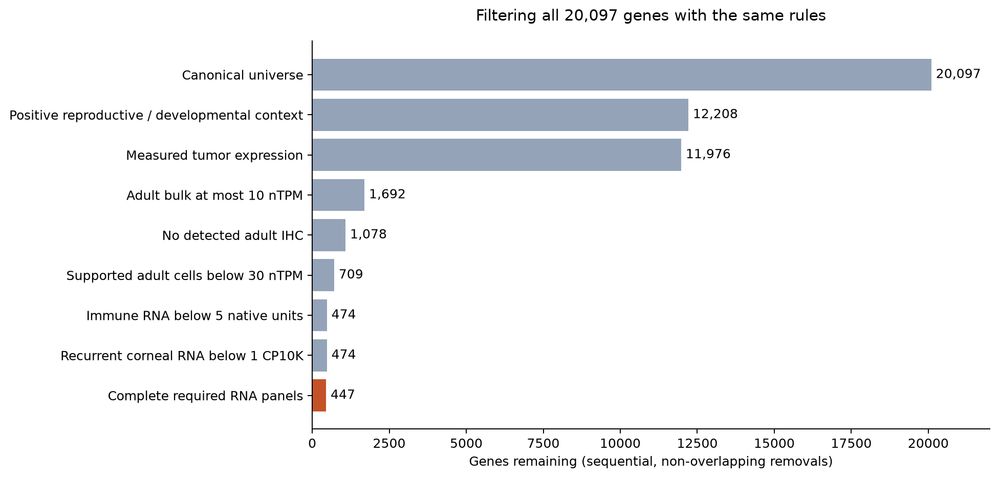
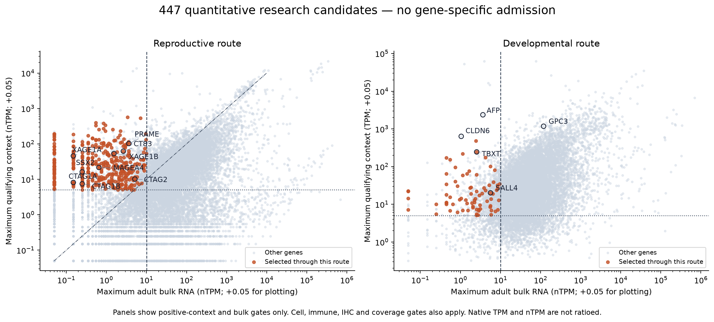

# Uniform quantitative CTA and developmental candidates

**447 research candidates**, after applying one rule set to the fixed **20,097-gene
canonical reference universe**. All ten requested identities pass: PRAME, MAGEA4,
CTAG1A/B, XAGE1A/B, CTAG2/LAGE-1, SSX2, CT83 and TBXT/brachyury. There are **no
publication-count, reviewed-gene, clinical-control or family admission overrides**.
Policy: `oncoref.cta-quantitative.2026-10-26.1`.

[Five-slide overview](slides/quantitative-cta.pptx) · [Selected genes](selected-genes.csv) · [Every gene and failure reason](gene-results.csv.gz) ·
[Named genes](named-gene-results.csv) · [Threshold sensitivity](threshold-sensitivity.csv) ·
[Expression-risk counts](expression-status-counts.csv).

This proposal replaces the **1,416-gene literature-inclusive catalogue as the answer
to the requested quantitative shortlist**. That historical view remains available;
its reviewed and publication admission routes do not enter this calculation.
These thresholds were explored against the requested benchmarks and size range.
They are not independently validated clinical safety limits.
Closely related CTA loci can share reads, antibody reactivity and peptide sequence.
Separate gene IDs do not establish locus-specific protein or peptide evidence.

## The rule set on one slide

**Require a positive biological context, measured tumor expression, low adult
expression, and the specified RNA coverage. Apply every gate to every gene.**

| Gate | Uniform rule |
|---|---|
| Reproductive **or** developmental context | **Reproductive:** maximum testis/ovary/placenta RNA **≥5 nTPM**, and greater than the maximum nonreproductive adult bulk RNA. **Developmental:** a supported embryonic lineage has mean **≥5 TPM**. |
| Tumor expression | **≥1 pTPM in ≥5% and ≥3 samples** of at least one measured cancer/cohort. No pooling across cohorts and no literature substitute. |
| Low adult bulk and cell RNA | All nonreproductive bulk tissues **≤10 nTPM**; supported nonreproductive HPA cell clusters **<30 nTPM**. A large reproductive measurement cannot cancel either limit. |
| Sensitive adult compartments | HPA immune **<5 nTPM**, Monaco immune **<5 TPM**, recurrent DICE **<5 TPM**, and recurrent adult corneal RNA **<1 CP10K**. Each assay is evaluated separately. |
| Protein findings and coverage | Any detected adult IHC staining (**Low/Medium/High**, including uncertain staining) holds the gene out. Require the complete specified RNA panels. Missing IHC is an explicit gap, not evidence of protein absence. |

Support definitions are fixed, not gene-specific: developmental lineages require
**≥20 cells**, **≥5 cells at ≥1 TPM**, and **≥10% of cells at ≥1 TPM**; HPA cell
clusters require **≥20 reads**. DICE uses the third-highest reported value within
one source distribution. Corneal means must recur in **two distinct annotated
sample groups of the same cell type**, each with ≥5 positive cells and ≥20 counts.
These cells/groups are **not independent donors**.

Bulk completeness means all 50 HPA tissues, with 39 nonreproductive tissues in
the adult maximum. The existing reproductive scope exempts breast, cervix,
endometrium, epididymis, fallopian tube, ovary, placenta, prostate, seminal vesicle,
testis and vagina from that maximum. Thymus remains adult somatic. Immune cells
sampled in reproductive organs do not inherit reproductive permission.
The RNA panels additionally require all 426 screened HPA clusters, 19 HPA immune
summaries, 30 Monaco summaries, all 15 DICE distributions, and 84 corneal
cell-type/sample-group summaries. These are complete **named source panels**, not
complete coverage of every normal tissue, cell state or person.

## Counts and funnel

The 447 consist of **371 reproductive-only**, **54 developmental-only**, and
**22 qualifying through both routes**. Thus importing quantitative developmental
expression adds **54 candidates** beyond the reproductive route under these gates.
These are developmental-expression candidates; this first atlas is embryonic,
not a comprehensive later-fetal atlas or a catalogue of proven immunologic antigens.



| Stage | Genes remaining |
|---|---:|
| Reference universe | 20,097 |
| Qualifying reproductive/developmental context | 12,208 |
| Measured tumor expression | 11,976 |
| Adult bulk limit | 1,692 |
| No detected adult IHC | 1,078 |
| Adult-cell limit | 709 |
| Immune limit | 474 |
| Corneal limit | 474 |
| Complete specified RNA panels | **447** |

These are sequential counts: an earlier failure can hide a later one in this
funnel. The full gene table preserves every gate separately. In particular,
zero *additional* corneal removals does not mean the corneal source is unused.
Twenty-seven otherwise passing genes are held for RNA coverage gaps.

## Why LAGE-1 and brachyury pass

| Gene | Reproductive maximum, nTPM | Supported embryonic lineage mean, TPM | Adult bulk maximum, nTPM | Supported adult-cell maximum, nTPM |
|---|---:|---:|---:|---:|
| PRAME | 102.2 | No qualifying lineage | 3.6 | 20.3 |
| MAGEA4 | 21.5 | No qualifying lineage | 0.6 | No supported signal |
| CTAG1A / CTAG1B | 8.1 / 7.4 | No qualifying lineage | 0.1 / 0.2 | No supported signal |
| XAGE1A / XAGE1B | 45.7 / 53.1 | No qualifying lineage | 0.1 / 1.5 | No supported signal |
| SSX2 | 16.2 | No qualifying lineage | 0.2 | No supported signal |
| CT83 | 62.2 | No qualifying lineage | 2.6 | 0.6 |
| CTAG2 / LAGE-1 | **10.1** | No qualifying lineage | **5.1** | **24.9** |
| TBXT / brachyury | 0.2 | **245.09** | **2.5** | **1.2** |

“No supported signal” means observed source rows lack a cluster meeting the
20-read guard; it does not mean missing coverage or proven zero expression.

LAGE-1 passes measured reproductive dominance, tumor expression and the same
adult ceilings as every other gene. Its 24.9 nTPM bronchial signal is retained;
negative IHC is **not** used to waive it. Existing donor-variation findings remain
attached. Brachyury passes the quantitative developmental route: axial mesoderm
has **22/23 cells at ≥1 TPM**, with mean **245.09 TPM**, and measured tumor support
is present in the imported TCGA LUAD/TGCT data. This is not a claim that the tumor
panel measures chordoma.

The developmental source is the [Tyser human gastrulation study](https://doi.org/10.1038/s41586-021-04158-y),
using [EBI Single Cell Expression Atlas gene TPM](https://www.ebi.ac.uk/gxa/sc/experiments/E-MTAB-9388/downloads):
**1,195 cells from one Carnegie-stage-7 embryo**, approximately 16–19 days after
fertilization. All 25,330 source gene rows were processed; **17,623** match the
fixed reference universe. The other **2,474** reference genes are absent from this
filtered atlas and are not assigned zero developmental expression. Eleven
lineages were summarized identically, and no TBXT-specific source selection or
cutoff is used. Source annotation is Ensembl 106; exact stable IDs are matched
to the current reference without symbol or paralog substitution. Filtered TPM
is used as supplied, without renormalizing to the retained genes.



## Other inclusions and exclusions

Other included genes include **CTCFL, SSX1, SSX3, PLAC1, PAGE1/2, SPANXB1, SPANXC,
SPANXD and SALL4**. Other MAGE genes enter only through the same measurements:
**MAGEA6, MAGEA8, MAGEA9B, MAGEA10, MAGEB1, MAGEC1 and MAGEC2**. They are not
positive controls and are not presumed safe. RNA/protein thresholds do not model
receptor cross-reactivity or sequence similarity.

| Example not selected | Quantitative reason; multiple failures can apply |
|---|---|
| MAGEA3 | Supported adult-cell RNA **53.1 nTPM**, above 30. |
| MAGEA12 | Reproductive RNA **2.7 nTPM**, below 5; no qualifying measured developmental lineage. This does not establish absence in brain. |
| AFP | Supported adult-cell RNA **393 nTPM**. |
| CLDN6 | Supported adult-cell RNA **64.8 nTPM**. |
| GPC3 | Adult bulk **119.1 nTPM** and supported adult cells **2,122.9 nTPM**. |
| WT1 / BIRC5 | Adult bulk **31.8 / 39.9 nTPM**, high adult-cell expression, and detected adult IHC. |
| EGFR / ERBB2 | High adult bulk/cell expression and detected adult IHC. |
| VGLL1 | Adult bulk **21.9 nTPM** and adult cells **79.7 nTPM**. |
| GAGE1 / SSX4 / CT47A1 / TERT | Reproductive maxima **1.8 / 3.1 / 0.5 / 0.4 nTPM**, with no qualifying developmental measurement. |
| CT45A1 | Detected adult IHC; no literature or family rescue. |

## The unavoidable tradeoff

A common adult-cell limit below LAGE-1's **24.9 nTPM** cannot retain LAGE-1.
Below PRAME's **20.3 nTPM**, PRAME also fails. Accepting those measured levels
necessarily accepts comparable levels in unfamiliar genes. The chosen 30 nTPM
limit leaves margin instead of fitting a cutoff immediately above 24.9.

| Adult-cell exclusion threshold; other rules fixed | Selected | Requested identities retained |
|---|---:|---:|
| ≥10 nTPM | 345 | 8/10; loses PRAME and LAGE-1 |
| ≥20 nTPM | 404 | 8/10; loses PRAME and LAGE-1 |
| ≥25 nTPM | 427 | 10/10 |
| **≥30 nTPM** | **447** | **10/10** |
| ≥50 nTPM | 485 | 10/10 |

There is no negative-IHC relaxation. **271 selected genes lack measured adult
IHC; another five have only uncertain-grade measured IHC.** A stricter rule that
requires matched negative IHC before allowing LAGE-1's elevated bronchial RNA
would currently exclude it: the equivalent cell-type IHC is missing. The common
RNA thresholds and conservative handling of uncertain *positive* staining are
what this proposal implements. It does not claim to satisfy a separate mandate
for lower RNA ceilings in every IHC-missing cell context.

The earlier expression policy remains unchanged. Among these candidates:

| Retained expression-policy category | Genes |
|---|---:|
| Strict CTA | 127 |
| Unsafe | **110** |
| Neither | **210** |

“Unsafe” is the existing expression-policy label, not a claim of observed clinical
injury. PRAME remains Unsafe; MAGEA4, CTAG2 and TBXT remain Neither. These annotations
are not allowed to silently disappear when a broader candidate definition is used.
Anatomically weighted continuous breadth, missing-coverage bounds and imported
donor uncertainty remain in the exported table. There is no new validated breadth
cutoff, and one embryo or many cells do not provide population-level uncertainty.

## Reproduction and source coverage

The selection API is `oncoref.cta_quantitative.results()` or
`oncoref.cta_quantitative.gene_ids()`. The released `target_sets`, forbidden-protein
background and historical CTA APIs are unchanged. Quantitative facts are an
explicit input projection; literature and clinical annotations are merged only
**after** classification.

- [Developmental source URLs, versions and checksums](developmental-source.json)
- [Native developmental measurements by lineage](developmental-lineages.csv.gz)
- [Adult-cell summaries for every reference gene](adult-cell-summary.csv)
- [DICE per-source recurrence summaries](dice-summaries.csv.gz)
- [All quantitative classification inputs](quantitative-facts.csv.gz)
- [Full source and output manifest](run-manifest.json)
- [Validation](validation.json)

Download the three files named in `developmental-source.json` into a source
folder. Use repository-local Python with SciPy available for the Matrix Market
reader; no shared-environment changes are needed:

```bash
python scripts/prepare_cta_quantitative.py --sources /path/to/sources --out /tmp/cta-prepared
python scripts/build_cta_quantitative.py --prepared /tmp/cta-prepared --out /tmp/cta-report
python scripts/plot_cta_quantitative.py /tmp/cta-report
```

HPA v23 supplies normal bulk RNA, IHC, tissue clusters and immune summaries;
HPA's pinned cancer RNA source supplies cohort-specific tumor pTPM. Original DICE
supplies recurrence, without double-counting the HPA DICE summary as replication.
Adult corneal CP10K remains separate from TPM/nTPM. DICE PAR-X/PAR-Y records sharing
a stable gene ID are retained separately in the source export; the conservative
maximum of their within-record third-highest values is used, never pooled donor
counts. None of the selected genes has that ambiguity. Additional fetal stages,
embryos and adult tissues remain needed for broader coverage and validation.
