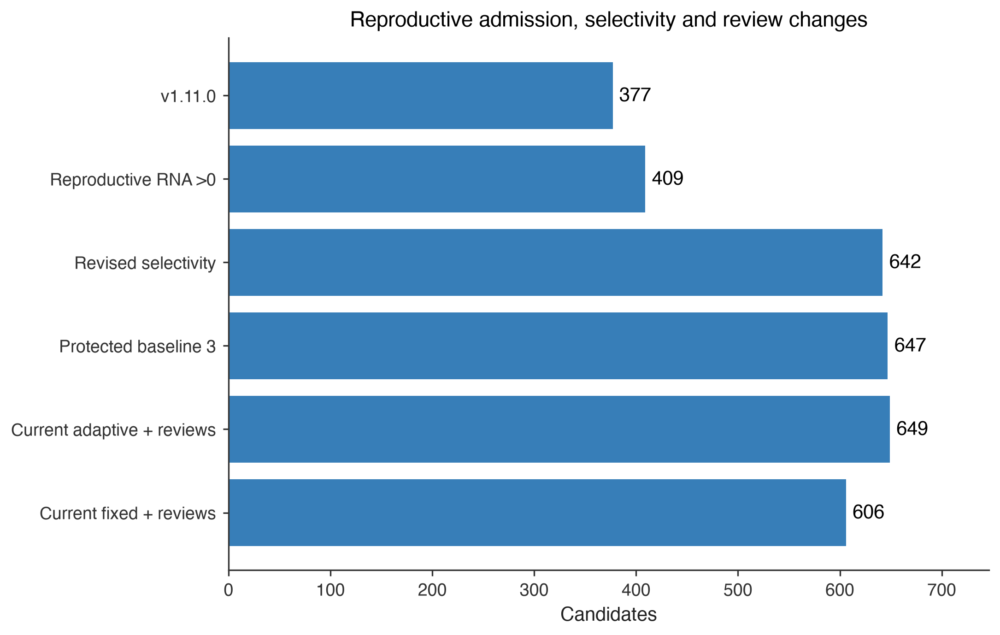
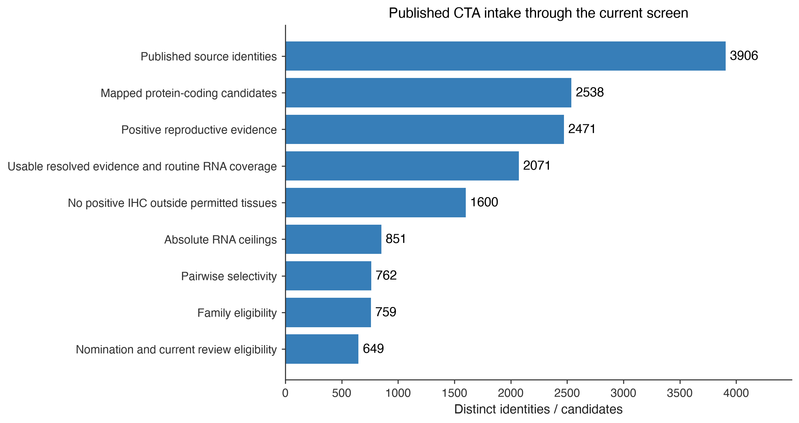

# CTA recalibration and complete intake — 21 October 2026

Policy `oncoref.cta-ihc-adaptive-screen.2026-10-21.1`. 13 publication sources, 3,906 distinct intake identities and 2,538 mapped protein-coding candidates. Human HPA v23 measurements remain pinned.

## Current rules

- Reproductive admission requires **valid RNA >0 nTPM OR positive reproductive IHC**. A measured zero does not qualify; unavailable observations remain missing.
- Disposable expression is exempt from exclusion and cannot supply the reproductive reference or admission evidence.
- `Selectivity = Rmax / (Rmax + tissue RNA)`, with Rmax the highest valid raw reproductive nTPM for the same gene/source/version/species.
- Each Manageable, Protected and Vital tissue must pass **both** its absolute ceiling and selectivity minimum. Any positive IHC, including Low, still excludes.
- The same complete routine local negative IHC selects both thresholds, using the weakest reliability. Missing, uncertain, incomplete or unusable IHC receives baseline limits. Zero/missing reproductive RNA leaves selectivity unresolved.

### Maximum nTPM / minimum selectivity

| IHC | Vital | Protected | Manageable |
| --- | --- | --- | --- |
| Missing | 1 nTPM / 75% | 3 nTPM / 70% | 5 nTPM / 65% |
| Uncertain | 1 nTPM / 75% | 3 nTPM / 70% | 5 nTPM / 65% |
| Approved | 2 nTPM / 70% | 4 nTPM / 65% | 10 nTPM / 60% |
| Supported | 3 nTPM / 65% | 6 nTPM / 60% | 15 nTPM / 55% |
| Enhanced | 6 nTPM / 60% | 12 nTPM / 55% | 30 nTPM / 50% |

The user approved this target-informed research recalibration. The previous 99% minimum required a 99-fold reproductive/tissue ratio and could exclude 0.1 nTPM observations despite a 1 nTPM absolute ceiling. The new percentages were selected for the pairwise metric while retaining absolute and IHC gates; they are not validated safety limits. Protected's baseline changes generally from 2 to 3 nTPM, which admits CT83's salivary 2.6 nTPM. There are no gene-specific numerical exemptions. Named-target recovery is a calibration check, not independent validation.

## Policy comparison

| scenario | candidates | evidence_pass | retained | without_ihc | partial_ihc | complete_routine_ihc |
| --- | --- | --- | --- | --- | --- | --- |
| previous_released | 2537 | 430 | 377 | 176 | 197 | 4 |
| admission_only | 2538 | 490 | 409 | 208 | 197 | 4 |
| selectivity_revised | 2538 | 757 | 642 | 369 | 269 | 4 |
| grid_revised | 2538 | 762 | 647 | 374 | 269 | 4 |
| current_adaptive | 2538 | 762 | 649 | 375 | 270 | 4 |
| current_fixed | 2538 | 719 | 606 | 375 | 228 | 3 |

The first row is the archived v1.11.0 cohort. Subsequent rows include the new SPAG9 candidate. `admission_only` changes reproductive admission; `selectivity_revised` then changes the percentage grid; `grid_revised` also changes Protected's baseline; `current_adaptive` additionally applies explicit holdback reviews. `current_fixed` uses baseline RNA/selectivity values without IHC relaxation.

## Current funnel

| stage | remaining |
| --- | --- |
| Published source identities | 3906 |
| Mapped protein-coding candidates | 2538 |
| Positive reproductive evidence | 2471 |
| Usable resolved evidence and routine RNA coverage | 2071 |
| No positive IHC outside permitted tissues | 1600 |
| Absolute RNA ceilings | 851 |
| Pairwise selectivity | 762 |
| Family eligibility | 759 |
| Nomination and current review eligibility | 649 |

This sequential ordering attributes each removal to its first failing stage. Failure reasons overlap; every reason remains in the candidate decisions. An intake identity lacking a canonical mapping is visible upstream and is unassessed, never assigned zero RNA.

## Requested targets and review provenance

| Symbol | retained | failure_reasons | screen_review_applied |
| --- | --- | --- | --- |
| CT83 | True |  | False |
| CTAG2 | True |  | True |
| CTCFL | True |  | False |
| GAGE1 | True |  | False |
| MAGEA10 | True |  | False |
| MAGEA11 | True |  | True |
| MAGEA12 | True |  | False |
| MAGEA6 | True |  | False |
| SAGE1 | True |  | False |
| SPAG9 | False | reproductive_selectivity_below_threshold;rna_above_tissue_ceiling;positive_ihc_outside_permitted | False |
| SSX4 | True |  | False |
| SSX5 | True |  | False |

CTAG2's old categorical RNA holdback is explicitly superseded **for this screen**, conditional on all current expression and coverage gates. Its pinned heart 5.1 nTPM and Enhanced Not detected cardiomyocyte staining remain visible. The [heart evidence review](../ctag2-heart-evidence.md) retains unresolved cell origin, antigen-presentation questions and confounded clinical cardiac-event reports. MAGEA11 receives the same review of its historical trace-RNA holdback. Neither adjudication bypasses positive IHC or a numerical failure. The frozen core/extended panels retain their original reviews.

### BAGE, GAGE2B and SPAG9 intake

| Symbol | intake_identity | screened | screen_status |
| --- | --- | --- | --- |
| SPAG9 | ENSG00000008294 | True | excluded |
| BAGE | NCBIGene:574 | False | unassessed_no_canonical_mapping |
| GAGE2B | NCBIGene:645037 | False | unassessed_no_canonical_mapping |

BAGE and GAGE2B have official human NCBI identities, confirmed in a checksum-pinned snapshot, but lack a usable mapping in the pinned Ensembl 115 canonical space. Their memberships, citations and identity reviews are preserved in the funnel. No paralog is substituted, and their HPA normal-tissue expression is unassessed here. Jamin's GAGE2B nomination uses shared microarray probes; it does not establish locus-specific expression. SPAG9 enters the coding screen from its primary ovarian-cancer study and receives the same HPA gates as every other gene.

New primary sources: [Boël et al. 1995, BAGE](https://pubmed.ncbi.nlm.nih.gov/7895173/) and [Garg et al. 2007, SPAG9](https://pubmed.ncbi.nlm.nih.gov/17332284/). Identity authorities: [NCBI BAGE](https://www.ncbi.nlm.nih.gov/gene/574), [NCBI GAGE2B](https://www.ncbi.nlm.nih.gov/gene/645037). Source assays and limitations are preserved separately from identity resolution.

## Coverage

Complete routine RNA is required. IHC-unavailable and partial-IHC candidates remain explicitly distinguished from routine-complete observations; none proves exhaustive protein or peptide-HLA absence. The routine panel contains 50 RNA and 80 IHC tissue/cell contexts. Missing developmental and anatomical compartments remain unassessed. Human assay limits do not transfer to dog or mouse. See [category definitions and mappings](../../normal-tissue-scopes.md).

## Downloads

- [All source identities and their stage/status](intake-decisions.csv)
- [BAGE/GAGE2B/SPAG9 intake audit](intake-target-audit.csv)
- [Per-publication funnel counts](source-counts.csv)
- [Exact source memberships and assay resolution](source-membership.csv.gz)
- [Publication registry](publication-sources.csv)
- [Candidate decisions, all scenarios](candidate-decisions.csv)
- [Current comparison](candidate-comparison.csv)
- [Membership changes](membership-changes.csv)
- [Named target decisions](notable-targets.csv)
- [Every RNA value, reproductive reference, selectivity and IHC support](rna-selectivity-audit.csv.gz)
- [Added SPAG9 observations](new-source-observations.csv.gz)
- [Policy and taxonomy](tissue-taxonomy.json)
- [Checksums and reproducibility](run-manifest.json)

Reproduce with `python scripts/cta_recalibration_report.py --out <empty-directory>` at this implementation revision. Existing candidate measurements are reused from the verified archive; the added SPAG9 observations come from the same checksum-pinned HPA v23 inputs.
