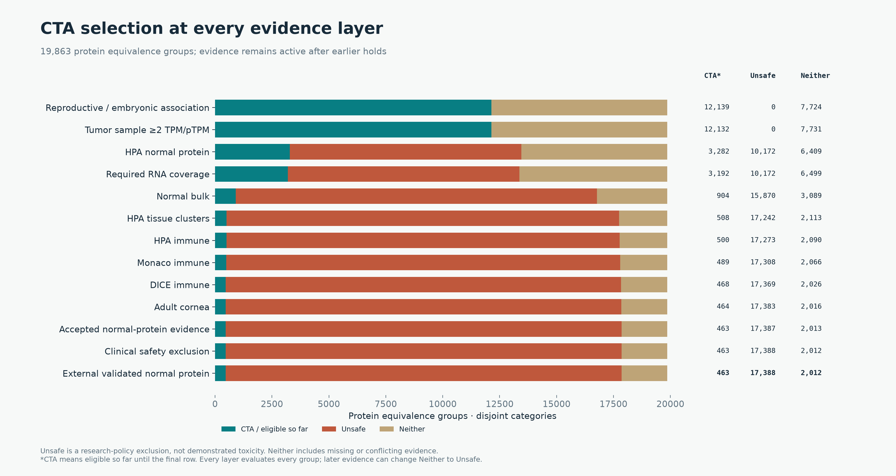
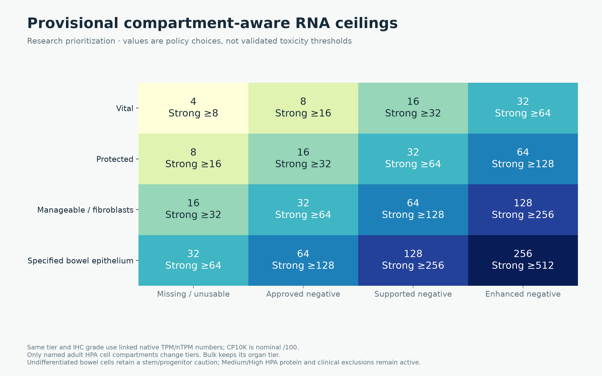
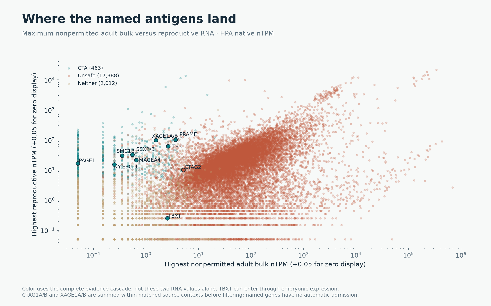
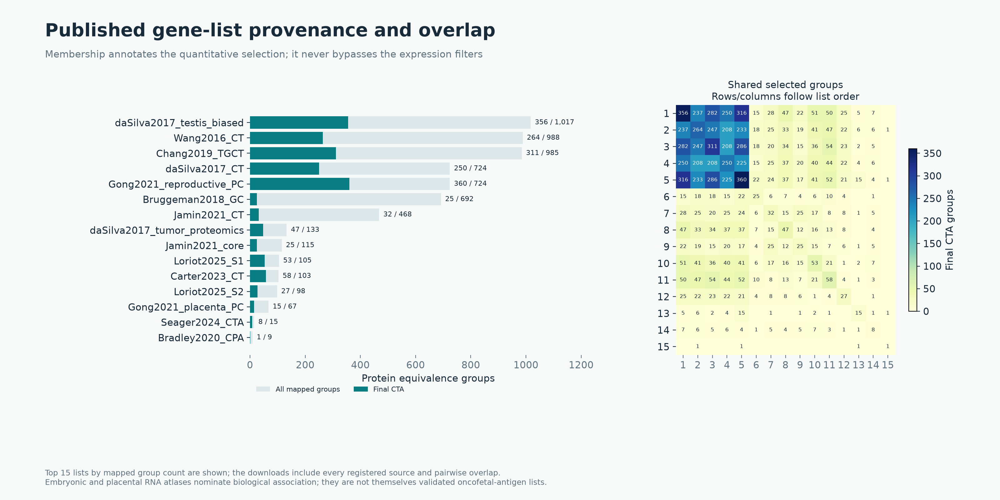

# OncoRef 1.21.0 CTA/oncofetal research selection

**463 selected groups (481 loci), 17,388 Unsafe and 2,012 Neither** across the complete 19,863-group reference. There are **120 new admissions** and **0 lost selections** relative to the previous 343-group funnel.

This is a deliberately more permissive research prioritization policy, not a clinically validated safety model. PRAME informed the parameter choice and is therefore a calibration example, not independent validation. No gene name or clinical product bypasses the rules.

Use the [shared human, dog and mouse API](../../cta-selection.md). The [literature and implementation review](literature-review.md) records the corrected assumptions and code. [Slides](slides/cta-selection-1.21.0.pptx) and the [PDF report](cta-selection-1.21.0.pdf) use these same data.

CTA passes every gate. Unsafe indicates stronger evidence under this screening policy, not demonstrated toxicity. Neither includes intermediate RNA, missing required coverage and unresolved evidence. Every layer evaluates every group, even after an earlier hold.

The release review corrected **2,902 grouped IHC levels** and **11 intermediate decisions**, with **0 final category changes** relative to the prior 463-group proposal. [Decision changes](review-decision-changes.csv) and [IHC corrections](review-ihc-level-changes.csv.gz) retain the audit.

## Uniform rules

Reproductive/embryonic association, tumor ≥2 TPM/pTPM in one sample, required RNA coverage, Medium/High HPA protein findings, validated external protein findings and clinical-safety exclusions retain their existing rules. DICE and corneal coverage remain optional; measured findings still count.

Missing/unusable-IHC RNA ceilings are **Vital 4, Protected 8, Manageable 16, specified renewing large-bowel epithelium 32**. Each negative-IHC confidence step doubles its row. The stronger RNA boundary is twice the candidate ceiling. Assays retain native units and support guards; CP10K uses the existing nominal /100 policy, not a TPM conversion.

Mapped adult HPA **fibroblasts** use Manageable. Colon/rectum distal enterocytes, intestinal goblet cells, Paneth cells and undifferentiated cells use the renewing-mucosa row. Other cells keep their anatomical tier. Undifferentiated cells retain a stem/progenitor caution: their admission is an explicit tolerance assumption, not evidence that the regenerative compartment is disposable. Cardiomyocytes, endothelial cells and airway basal cells receive no such relaxation. Bulk retains its organ tier.

Explicitly **Low** normal HPA staining or an Accepted literature finding with extracted **Low** intensity remains an observed protein flag when RNA passes. Medium/High HPA staining retains its hold/exclusion, and Accepted literature positives without an extracted intensity retain their exclusion. Low staining never supplies negative-IHC credit. Review access (abstract/full text) is recorded separately and never erases a known positive. Every imported finding is audited in [the protein-review table](imported-protein-review-decisions.csv), alongside [HPA protein-level decisions](hpa-protein-level-summary.csv.gz).

Author-described low expression and HPA Low retain different reporting scales. This policy tolerates both categories without claiming equal intensity, a known stained fraction or a calibrated H-score. Group aggregation retains the strongest observed level and its own confidence; negative-IHC credit requires complete member coverage and a positive profile control for every member.

## Contribution of each policy change

These are cumulative changes in the displayed order; admissions are not independent effects.

| cumulative_policy | CTA | Unsafe | Neither | additional_CTA |
| --- | --- | --- | --- | --- |
| Previous policy | 343 | 17824 | 1696 | 0 |
| Double linked RNA grid | 445 | 17445 | 1973 | 102 |
| Also classify fibroblasts as Manageable | 446 | 17433 | 1984 | 1 |
| Also allow specified large-bowel epithelium | 448 | 17426 | 1989 | 2 |
| Also flag Low HPA protein | 462 | 17389 | 2012 | 14 |
| Also flag explicitly Low imported protein | 463 | 17388 | 2012 | 1 |

## Named targets

| protein_group_label | category | exclusion_reasons |
| --- | --- | --- |
| PAGE1 | CTA |  |
| SMC1B | CTA |  |
| CTAG2 | Unsafe | HPA tissue clusters |
| MAGEA4 | CTA |  |
| TBXT | CTA |  |
| PRAME | CTA |  |
| CT83 | CTA |  |
| NY-ESO-1 | CTA |  |
| SSX2/B | CTA |  |
| XAGE1A/B | CTA |  |

[All new admissions](newly-selected-groups.csv), [every changed classification](classification-changes.csv), [known CTA/source-list decisions](known-cta-decisions.csv.gz), [problematic target checks](problematic-target-checks.csv), [all group decisions](protein-group-classifications.csv.gz), and [all loci with identity and group decisions](gene-to-protein-group-decisions.csv.gz).

[Named-target normal evidence](named-normal-evidence.csv) shows the largest measured fraction of each assay's own tissue/IHC ceiling. This ratio compares policy margins and does not equate native assay units or predict toxicity.

## Filtering funnel

| layer | new_candidate_removals | new_Unsafe | CTA_eligible_so_far | Unsafe | Neither |
| --- | --- | --- | --- | --- | --- |
| Reproductive / embryonic association | 7724 | 0 | 12139 | 0 | 7724 |
| Tumor sample ≥2 TPM/pTPM | 7 | 0 | 12132 | 0 | 7731 |
| HPA normal protein | 8850 | 10172 | 3282 | 10172 | 6409 |
| Required RNA coverage | 90 | 0 | 3192 | 10172 | 6499 |
| Normal bulk | 2288 | 5698 | 904 | 15870 | 3089 |
| HPA tissue clusters | 396 | 1372 | 508 | 17242 | 2113 |
| HPA immune | 8 | 31 | 500 | 17273 | 2090 |
| Monaco immune | 11 | 35 | 489 | 17308 | 2066 |
| DICE immune | 21 | 61 | 468 | 17369 | 2026 |
| Adult cornea | 4 | 14 | 464 | 17383 | 2016 |
| Accepted normal-protein evidence | 1 | 4 | 463 | 17387 | 2013 |
| Clinical safety exclusion | 0 | 1 | 463 | 17388 | 2012 |
| External validated normal protein | 0 | 0 | 463 | 17388 | 2012 |

## Evidence and limitations

PRAME's 12-nTPM cardiac fibroblast measurement and 20.3-nTPM colon undifferentiated-cell measurement are retained; the new ceilings are 16 and 32. Its adrenal bulk 3.6 nTPM is below the new Vital ceiling 4. Its adrenal protein finding is explicitly **Low** in the primary abstract and remains a positive protein flag; it is not discarded because of limited source access. IMA203 clinical evidence remains separate and does not participate in admission. See the [target evidence assessment](../cta-target-evidence-20261027/index.md) and [primary adrenal-protein report](https://pubmed.ncbi.nlm.nih.gov/33890816/).

Controlled fibroblast depletion has been tolerated in mouse studies; that motivates separating stroma from cardiomyocytes but does not validate these human cutoffs. [Primary study](https://elifesciences.org/articles/69854). Direct epithelial targeting can produce severe colitis, including a dose-limiting signal in a small CEA-directed TCR trial; allowing greater mucosal expression is a research risk preference. [Primary trial](https://pmc.ncbi.nlm.nih.gov/articles/PMC3048186/).

No numerical cutoff here predicts peptide presentation or injury severity. The permissive mucosal assumption and incomplete older protein reviews require particular scrutiny. These outputs do not overwrite the [prior 343-group policy](../cta-harmonized-20261027/index.md), released classifications or forbidden sequence references.

## Reproduction

Run `python scripts/cta_compartment_report.py`, then `python scripts/build_cta_selection_release.py`. [Changed cell compartments](changed-compartment-contexts.csv.gz), [bulk contexts](bulk-contexts.csv.gz), [immune/corneal contexts](immune-cornea-contexts.csv.gz), [per-layer effects](independent-layer-effects.csv), [counts](summary.json), and [provenance](manifest.json) retain the decisions. Multi-locus values are summed before assessment; unpaired DICE and corneal detection uncertainty remain explicit. Figures also have SVG versions. The earlier 463-group audit preserves its original implementation bytes under `source-code/` and remains reproducible from commit `d79f4d4`.
