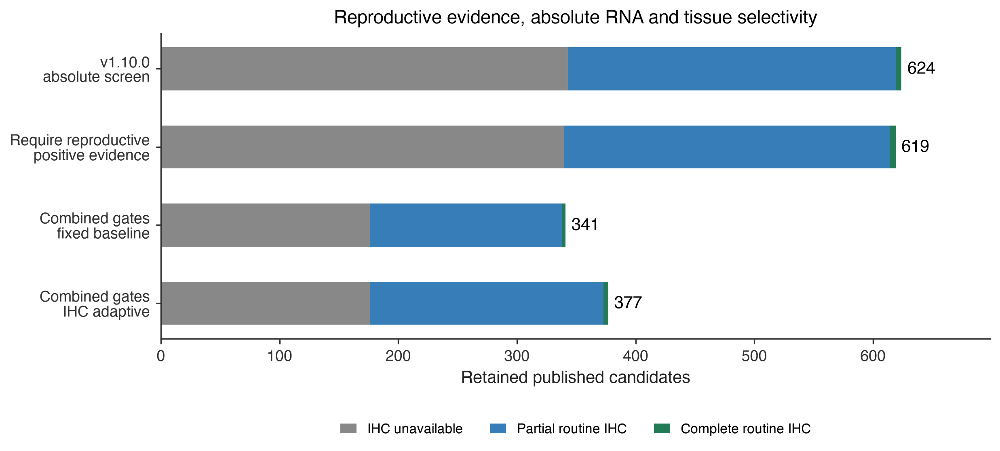

# CTA reproductive evidence and tissue selectivity — 20 October 2026

Policy `oncoref.cta-ihc-adaptive-screen.2026-10-20.5`. Same 2,537 published candidates and pinned human HPA v23 measurements as the v1.10.0 comparison.

## Policy

- **Reproductive:** positive evidence required: RNA ≥1 nTPM or positive IHC.
- **Disposable:** expression is exempt from exclusion; it cannot supply reproductive evidence or inflate the selectivity reference.
- **Manageable, Protected, Vital:** every measured tissue must pass both gates below. Any positive IHC, including Low, independently excludes.

`Selectivity = Rmax / (Rmax + tissue RNA)`, where Rmax is the highest valid raw RNA in a mapped Reproductive tissue for that gene. No tissue sums, deflation or rounding before gating. This is pairwise expression selectivity, not the percentage of total-body RNA or protein. Zero or missing reproductive RNA cannot establish selectivity, even with positive reproductive IHC. Missing routine RNA and unusable data continue to block retention.

## Maximum nTPM / minimum selectivity

| IHC confidence | Vital | Protected | Manageable |
| --- | --- | --- | --- |
| Missing | 1 nTPM / 99% | 2 nTPM / 97% | 5 nTPM / 95% |
| Uncertain | 1 nTPM / 99% | 2 nTPM / 97% | 5 nTPM / 95% |
| Approved | 2 nTPM / 98% | 4 nTPM / 95% | 10 nTPM / 90% |
| Supported | 3 nTPM / 97% | 6 nTPM / 90% | 15 nTPM / 80% |
| Enhanced | 6 nTPM / 95% | 12 nTPM / 80% | 30 nTPM / 60% |

Both limits are inclusive. The same local IHC evidence selects both thresholds: complete routine Not detected staining in the RNA organ, using the weakest reliability. Other organs and narrower regions cannot supply this evidence. Missing, uncertain, incomplete or unusable IHC uses baseline thresholds. These are user-approved research parameters, not validated therapeutic safety limits.

## Results

| scenario | candidates | evidence_pass | retained | without_ihc | partial_ihc | complete_routine_ihc |
| --- | --- | --- | --- | --- | --- | --- |
| previous_adaptive | 2537 | 712 | 624 | 343 | 276 | 5 |
| reproductive_required | 2537 | 706 | 619 | 340 | 274 | 5 |
| current_fixed | 2537 | 392 | 341 | 176 | 162 | 3 |
| current_adaptive | 2537 | 430 | 377 | 176 | 197 | 4 |

The reproductive-required scenario isolates the admission-rule change. The combined adaptive scenario then adds selectivity; the fixed scenario uses both baseline gates without IHC relaxation. Current retained sets are nested as checked in the manifest.

### Newly excluded against v1.10.0

- **reproductive_evidence:** IL17F, KRT82, LCE3C, TCHHL1, TGM7.
- **selectivity:** ACP4, ACR, ACTL8, ADAM18, ADAM20, ADAM32, ADAMTS6, AKNAD1, ALLC, ANKAR, ANKRD60, ANKRD62, ARL13A, ARMH2, BOLL, BPY2, BTBD18, C12orf42, C16orf96, C19orf67, C1orf94, C3orf20, C5orf52, CAGE1, CAPN11, CATSPER1, CATSPERE, CCDC116, CCDC166, CCDC168, CCDC196, CCDC27, CCDC73, CDKL4, CFAP97D1, CGB2, CIB4, CILP2, CIMIP2A, CLDN34, CNBD1, CSAG2, CSAG3, CSNK1A1L, CST9, CSTL1, CT45A7, CT55, CTAGE9, CTCFL, CXorf58, CXorf66, DAZ3, DBF4, DCAF4L1, DEFB134, DHH, DMRT1, DNAH8, DPPA2, DPPA3, DPPA5, DUSP21, EBLN1, EFCAB3, EFCAB8, EFCAB9, ENSG00000283599, ENTHD1, EQTN, ERICH6B, ERVV-2, EVX2, EXD1, EZHIP, FAM170A, FAM47C, FAM78B, FAM9A, FANCD2OS, FBXO24, FBXO39, FBXO43, FNDC7, FOXN4, FOXR1, FSHR, GAB4, GAGE1, GAGE10, GAGE12G, GARIN1B, GARIN2, GCM1, GFY, GK3, GOLGA6A, GOLGA6D, GOLGA6L1, GOLGA6L7, GSC2, H2AB1, HEATR9, HHIPL2, HIGD2B, HMHB1, HORMAD2, HSFY2, IL5, INSL4, IQCF6, IZUMO1, KCNU1, KLF17, LGALS13, LGALS16, LIPJ, LRRC36, LRRD1, LRRIQ4, LYZL4, MAGEA10, MAGEA12, MAGEA6, MAGEA9B, MAGEB10, MEIOB, MEIOSIN, MORC1, MS4A6E, MSH4, NAA11, NANOS2, NKX2-4, NLRP11, NLRP4, NLRP7, NPAP1, NT5C1B, NUP210L, NUTM2F, OBP2B, ODF3, OOEP, OPRM1, OR1C1, OR4N2, OTUD6A, OVOL3, PAGE5, PAPPA, PCDHA9, PFN3, PKDREJ, POTED, POTEF, POTEI, POTEM, POU4F2, PP2D1, PRDM9, PRR23A, PRSS38, PRSS41, PRSS55, PSG7, PSMA8, PXT1, RAD21L1, RAD51AP2, RBM44, RFPL4B, RGPD3, RGPD4, RIMBP3, RNF148, SAGE1, SCGB1D1, SEL1L2, SLC25A2, SLC25A52, SLC35G6, SLC36A3, SLC9C1, SPACA5, SPANXN3, SPATA21, SPATS1, SPDYE1, SPDYE3, SPDYE4, SPMAP2L, SPMIP11, SPMIP2, SPMIP7, SPPL2C, SSX4, SSX4B, SSX5, SSX7, STARD6, STKLD1, SYT10, TAS2R1, TDRD1, TDRD12, TDRD15, TEKT5, TEX14, TEX15, TEX36, THEG, TMPRSS7, TP53TG3B, TPTE2, TRIM60, TRIM71, TRIML2, TSGA10IP, TTC21A, TTLL13, TULP2, UMODL1, USP26, USP29, USP50, UTF1, VCX, VCX3B, VRTN, WBP2NL, WDR64, XKR3, ZAR1, ZC2HC1B, ZC3H11B, ZDHHC19, ZFP42, ZNF479, ZNF541, ZNF722, ZSWIM2.

## Coverage and interpretation

The panel contains 50 routine RNA contexts and 80 routine IHC tissue/cell pairs. This is not exhaustive anatomy: cartilage, whole eye and inner ear lack routine RNA measurements here. Missing IHC is explicit and earns no relaxation. Adult HPA data does not certify maternal/fetal profiles. Human numerical limits do not transfer to dog or mouse. Family and nomination/manual-review gates, including CTAG2’s holdback, are unchanged. The frozen public CTA panel and its older global deflated fraction remain separate.

[Definitions and source mappings](../../normal-tissue-scopes.md), [literature and limitations](../../normal-tissue-manageability.md), [v1.10.0 baseline](../cta-tissue-priorities-20261020/index.md). HPA also uses expression enrichment against other tissues in its [specificity definitions](https://v23.proteinatlas.org/humanproteome/tissue/tissue%2Bspecific); our reproductive reference and numerical grid are project definitions.

## Downloads

- [All candidate decisions and exclusion causes](candidate-comparison.csv)
- [Newly excluded candidates](membership-changes.csv)
- [Named targets and changed candidates](notable-targets.csv)
- [All current scenarios](candidate-decisions.csv)
- [Every RNA value, reproductive reference, selectivity and supporting IHC](rna-selectivity-audit.csv.gz)
- [Native tissue mappings](tissue-contexts.csv)
- [Policy, anatomy and bibliography](tissue-taxonomy.json)
- [Checksums and provenance](run-manifest.json)

Reproduce with `python scripts/cta_selectivity_report.py --out <empty-directory>` at this report’s implementation revision.
