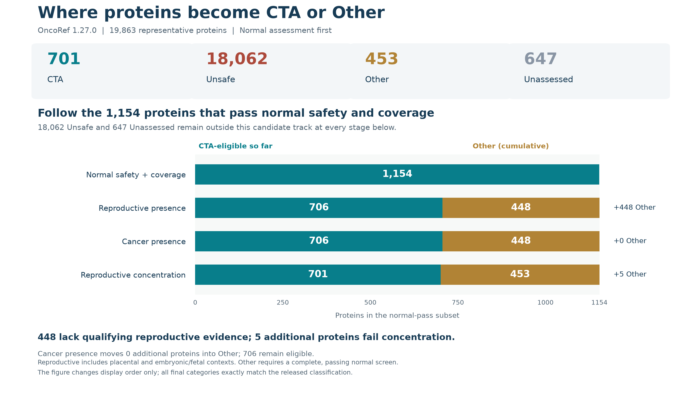

# Simpler CTA decisions: safety, cancer and reproductive identity

**OncoRef 1.27.0.** The main decision is CTA, Unsafe, Other or Unassessed.
Other reports the unmet identity requirement. Normal abundance, cancer support,
adult tissue disposition and evidence confidence are independent attributes.

[Rules and API](../../cta-selection.md) · [Full source report](../cta-source-walkthrough-20261028/index.md) · [Evidence profiles for every protein](protein-evidence-profiles.csv.gz) · [Every classification transition](classification-transitions.csv)

| Category | Proteins |
| --- | --- |
| Unsafe | 18062 |
| CTA | 701 |
| Unassessed | 647 |
| Other | 453 |

All 701 prior CTAs and all 18,062 Unsafe proteins keep their top-level categories.
The only top-level change is OR10A4: Other → Unassessed after newly reviewed adult
human nasal RNA evidence. This does not assert protein production or clinical injury.

## Five questions

1. **Normal exclusion evidence?** Assign Unsafe. Every normal layer is evaluated.
2. **Normal evidence complete and resolved?** Otherwise assign Unassessed.
3. **Qualifying reproductive presence?** Otherwise assign Other:Nonreproductive.
4. **Measured cancer expression?** Otherwise assign Other:Reproductive.
5. **Reproductive concentration passes?** Otherwise assign Other:Diffuse. All pass → CTA.

Reproductive includes adult reproductive organs, placenta, embryo and fetus.
Only normal/clinical exclusion evidence establishes Unsafe. Missing identity
evidence can establish Other after a resolved normal-screen pass.

| Other reason | Proteins |
| --- | --- |
| Nonreproductive | 448 |
| Diffuse | 5 |



This view displays normal safety and coverage first. The final categories exactly
match the classifier; only the display order changes. [Stage counts](../cta-source-walkthrough-20261028/figures/category-funnel.csv).

## Why Low, Weak, Tumor-supported and Normal were confusing

The former labels answered different questions: Low described raw adult RNA;
Weak mixed subthreshold reproductive RNA with unsupported raw observations;
Normal described supported normal expression below safety ceilings;
Tumor-supported combined cancer replication with a low measured normal profile.
Their precedence made mutually compatible observations look like competing outcomes.

They are replaced by the primary Other reasons above and quantitative/boolean
columns in `cta_selection.profiles()`. A protein can simultaneously have high
tumor RNA, low recorded adult RNA and incomplete rare-cell evidence. A support
flag never erases a normal exclusion or supplies reproductive identity.

| Independent attribute | Other proteins |
| --- | --- |
| Replicated tumor RNA (two identified tumors >=10 TPM) | 70 |
| Adult RNA below the descriptive floor | 258 |
| Adult Disposable-only observed pattern | 3 |

Attribute counts overlap and must not be added as categories. The descriptive
2 native TPM/nTPM floor (separate 0.02 CP10K floor) describes abundance, not safety.
Normal safety still uses the existing tissue × usable-IHC ceiling and independent
protein/clinical evidence. Raw observations and source support remain inspectable.

## Disposable means an allowed adult compartment

Disposable is an adult tissue disposition: the policy permits targeting that
mapped compartment, subject to its stated limitations. It is independent of
embryonic, fetal or placental expression. The adult Disposable-only protein
attribute requires positive Disposable observations and low/no detected expression
elsewhere in the measured adult panel. It never requires developmental measurements.

Current Other proteins with this adult pattern: **TCHHL1, LCE3B, LCE3C**.
LCE3B and LCE3C now receive the attribute despite missing developmental measurements.
Their developmental coverage stays explicitly unknown. Whole skin remains
Manageable; mapped follicles and cutaneous melanocytes have conditional Disposable
allowances. Bulk skin cannot be silently assigned to a particular skin compartment.

## Should the four high-tumor proteins be CTAs?

None currently meets the reproductive-presence requirement. DBX1, OR2B2 and
KRTAP20-2 remain Other:Nonreproductive, with strong cancer evidence exposed as an
attribute. They are potential cancer-target leads; low bulk atlas values alone
do not establish restriction across relevant rare normal cells. OR10A4 requires
normal nasal review before direct targeting or shared-sequence allowance.

| Protein | Cancer TPM | Adult atlas nTPM | Atlas tissue / cells | Separate adult TPM | TPM tissue / cells | Reproductive bulk nTPM | Developmental lineage mean TPM | Decision |
| --- | --- | --- | --- | --- | --- | --- | --- | --- |
| DBX1 | 297.5 | 0.8 | thymus / t-cells | 0.7547 | blood / TFH | 0.1 | 1.255 | Other:Nonreproductive |
| OR2B2 | 246.3 | 0.5 | pons / bulk | 0.3392 | blood / CD8_STIM | 0 | 1.84 | Other:Nonreproductive |
| KRTAP20-2 | 147.6 | 1.4 | skin / bulk | 0 | blood / plasmacytoid DC | 0.1 | 0.6291 | Other:Nonreproductive |
| OR10A4 | 138 | 1.9 | basal ganglia / bulk | 0.8 | blood / Progenitor cell | 0.1 | 0.2743 | Unassessed |

These adult values are **source-supported atlas summaries**, not the largest
possible donor observation. DICE uses a supported third-highest value; sparse
HPA clusters require at least 20 reads. TPM, nTPM and qPCR copy estimates remain
different measurement scales. The developmental column is the highest recorded
lineage mean, including lineages that lack admission support; none passes the
current ≥5 TPM presence floor. No convincing reproductive IHC route is established
for these four. [Per-source adult evidence](example-normal-evidence.csv).

### OR10A4 has additional normal human nasal evidence

[Verbeurgt et al., *Profiling of Olfactory Receptor Gene Expression in Whole Human Olfactory Mucosa* (2014)](https://doi.org/10.1371/journal.pone.0096333)
reports OR10A4 in all 26 adult donors: mean estimated **167.6 RNA copies per 20 ng
total RNA**, range **33.1–548.9**, with Cq 27.21–31.61. The original Tables S1/S3 are
pinned as `olfactory_verbeurgt_cq` and `olfactory_verbeurgt_copies`, version
`2014-05-06`, through the shared `reference_data` / `catalog` cache API.
OR2B2 was not found under the retrieved exact/legacy labels; that is unassessed,
not zero expression or permission to substitute a paralog.

[*Novel Nasal Epithelial Cell Markers of Parkinson’s Disease…* (2020)](https://pmc.ncbi.nlm.nih.gov/articles/PMC7408990/)
independently reports OR10A4 RNA in nasal-fluid samples, including 12 healthy
controls. Both are RNA evidence in a mixed sampling compartment. Neither supplies
normal protein abundance, a TPM conversion or demonstrated T-cell injury.

## API migration

```python
from oncoref import cta_selection

decisions = cta_selection.results()
profiles = cta_selection.profiles()
targets = decisions[decisions.category.eq("CTA")]
tumor_leads = profiles[
    profiles.category.eq("Other") & profiles.replicated_tumor_rna
]
adult_disposable = profiles[profiles.adult_disposable_only.fillna(False)]
```

The top-level API and identity fields remain stable. Other subtypes are now
Nonreproductive, Reproductive and Diffuse. Replace filters for Low, Weak, Normal,
Disposable or Tumor-supported with the relevant independent profile fields.
Human evidence never transfers to dog or mouse; their profile measurements remain
missing. Existing historical sequence bundles retain their own policy/reference
identity and require deliberate consumer migration.
