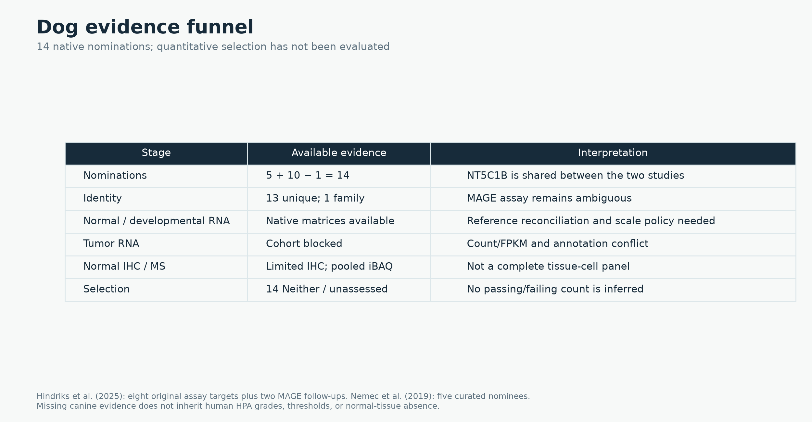

# Dog CTA sources and evidence funnel

Dogs use the same source categories, identity contracts and audit schema as humans. **Quantitative selection is not yet evaluated.** The current output is **14 Neither / unassessed nominations**, not a genome-wide statement that dogs have zero CTAs or zero unsafe genes.

## Candidate studies and overlap

| Study | Nominations | Mapped loci / alternatives | Not in the other study |
| --- | --- | --- | --- |
| Hindriks et al. (2025) | 10 | 9 | 9 |
| Nemec et al. (2019) | 5 | 5 | 4 |

[Nemec et al. (2019)](https://doi.org/10.1111/vco.12475) contributes five curated nominees: AKR1E2, IGF2BP3, NT5C1B, SPECC1 and TPX2. [Hindriks et al. (2025)](https://doi.org/10.1016/j.vetimm.2025.110946) contributes eight assay targets and two MAGE follow-ups: CAGE1, CTCFL, DDX53, MAGE, MAGEA13P, MAGEB10, NT5C1B, PAGE3-like, PRAME and SSX6. **NT5C1B is the one shared nomination: 5 + 10 − 1 = 14.** The MAGE family assay overlaps its gene follow-ups; it is not an additional resolved gene. Thirteen nomination identities are unique; one is an ambiguous family assay.

The snapshot retains 209 observations, with 10 nominations described as conflicting and four as limited. These source-evidence statuses do not replace a quantitative CTA/Unsafe decision. Nemec is abstract-level curation; its grouped normal-tissue statement cannot allocate each tissue to an individual gene. Hindriks retains numeric PCR percentages and reported categorical signs separately because some disagree.

## Normal, developmental, tumor and protein resources

| Source | Integration status | Native unit | Roles | Limitations |
| --- | --- | --- | --- | --- |
| [bgee-srp009687](https://www.ncbi.nlm.nih.gov/sra/?term=SRP009687) | native_matrix | TPM | normal_bulk_rna, reproductive_expression | Native source feature space. Exact quantification assembly/annotation remains unresolved; available canine GTFs and symbol/orthology matches do not establish equivalence. Original sample metadata and corrections are preserved. No isoform allocation or target admission. |
| [bgee-srp181218](https://www.ncbi.nlm.nih.gov/sra/?term=SRP181218) | native_matrix | TPM | normal_bulk_rna, reproductive_expression | Native source feature space. Exact quantification assembly/annotation remains unresolved; available canine GTFs and symbol/orthology matches do not establish equivalence. Original sample metadata and corrections are preserved. No isoform allocation or target admission. |
| [barkbase](https://pubmed.ncbi.nlm.nih.gov/31181663/) | native_matrix | TMM-CPM | normal_bulk_rna, reproductive_expression, developmental_expression | Native source feature space. Exact quantification assembly/annotation remains unresolved; available canine GTFs and symbol/orthology matches do not establish equivalence. Original sample metadata and corrections are preserved. No isoform allocation or target admission. |
| [pfizer-dog-protein](https://doi.org/10.1038/s41597-026-07512-9) | native_matrix | iBAQ | normal_protein | Deposited IBAQ column, weighted across TMT channels by the source. Bulk tissue pools; no individual-donor or MHC-presentation inference. Representative/group IDs remain distinct from resolved complete protein sequences. Exact searched FASTA is pinned; assembly/annotation reconciliation remains unresolved. |
| [doga](https://doi.org/10.1038/s41467-024-52798-1) | metadata_only | unresolved | normal_bulk_rna, reproductive_expression, developmental_expression | Complete quantitative gene/promoter matrix is not integrated. STRT2/5-prime ERCC-normalized measurements are not transcript TPM. |
| [pfizer-dog-rna](https://doi.org/10.1038/s41597-026-07512-9) | metadata_only | unresolved | normal_bulk_rna | Full canine RNA matrices and sample/feature reconciliation are not integrated. The publication specifies Ensembl v110/Salmon; exact quantification asset bytes remain unverified. |
| [gse304066-osteosarcoma](https://www.ncbi.nlm.nih.gov/geo/query/acc.cgi?acc=GSE304066) | blocked_provenance | unresolved | tumor_expression | Raw-count filename conflicts with FPKM metadata; exact source GTF is unresolved. Existing pseudo-TPM scenarios are sensitivity analyses and are not an admitted normalized cohort. |
| [hindriks2025](https://research-portal.uu.nl/ws/portalfiles/portal/264124617/1-s2.0-S0165242725000662-main.pdf) | native_observations | native PCR, categorical protein and reported study summaries | nomination, normal_bulk_rna, normal_protein, reproductive_expression, tumor_expression | 14 nominees across two studies; family assays, ambiguous identities and conflicting counterevidence remain explicit; no quantitative CTA policy |
| [nemec2019](https://www.ebi.ac.uk/europepmc/webservices/rest/search?query=EXT_ID:30854786%20AND%20SRC:MED&resultType=core&format=json) | native_observations | native PCR, categorical protein and reported study summaries | nomination, normal_bulk_rna, tumor_expression | 14 nominees across two studies; family assays, ambiguous identities and conflicting counterevidence remain explicit; no quantitative CTA policy |

BarkBase's local matrix has **37,149 features × 150 TMM-CPM columns**. Bgee/BarkBase reuse 46 libraries, which must not count as independent dogs. Pfizer protein has **9,929 reported groups × 38 tissue pools**, including **64,047 missing matrix cells**. These are native features/protein groups, not reconciled CTA candidate counts. A pooled protein signal does not establish detection in each donor or identify a cell type.

## Funnel status

| Stage | Status | Evidence / gap |
| --- | --- | --- |
| Curated native nominations | available | 14 nominations; not a genome-wide screen |
| Reference and assay identity | partial | Dog: 13 unique gene nominations, 1 ambiguous MAGE family assay; unique mapping is not measured protein equivalence |
| Normal and reproductive/developmental RNA | not_evaluated | Dog native matrices retain TPM/TMM-CPM and unresolved quantification-reference equivalence; no selection counts |
| Tumor RNA | not_evaluated | Dog GSE304066 has count/FPKM and source-reference conflicts; study PCR is not a TPM cohort |
| Normal IHC and mass spectrometry | not_evaluated | Dog study IHC is limited; Pfizer iBAQ is pooled bulk protein, not cell IHC or DLA presentation |
| Quantitative expression and protein selection | not_evaluated | Native reference/units, required panels and selection policy unresolved |

No human RNA cutoff, HPA antibody grade or clinical finding transfers by orthology. The eventual dog filter can use the same logical gates, with native source adapters, explicit developmental stages, canine tissue panels and unit-aware thresholds. Until those inputs are reconciled, per-stage pass/fail numbers are **unknown**, not zero.

## Tracked work

- [OncoRef #574](https://github.com/pirl-unc/oncoref/issues/574): Bgee/BarkBase, complete DoGA and Pfizer RNA, reference reconciliation, tumor cohorts and source/sample lineage.
- [OncoRef #585](https://github.com/pirl-unc/oncoref/issues/585): consume the shared Pfizer canine bulk-MS artifact; richer protein/group assignments and missingness.
- [orfdata #7](https://github.com/openvax/orfdata/issues/7), [#23](https://github.com/openvax/orfdata/issues/23), [#24](https://github.com/openvax/orfdata/issues/24): generic atlas extraction and compact versioned source data.
- [Hitlist #666](https://github.com/pirl-unc/hitlist/issues/666), [#668](https://github.com/pirl-unc/hitlist/issues/668): peptide/DLA-facing coverage and consumer integration. Bulk MS is not evidence of normal DLA presentation.

No dedicated OncoRef issue for systematic expansion of canine IHC was found in searches of issue titles and canine/IHC issue text. The missing work is a source/reagent/tissue-cell inventory with measured staining, validation evidence, cross-reactivity and explicit negative/missing states; it should not inherit HPA grades.

[Shared API](api.md) · [All native source memberships](dog-memberships.csv.gz) · [Human walkthrough](index.md).
