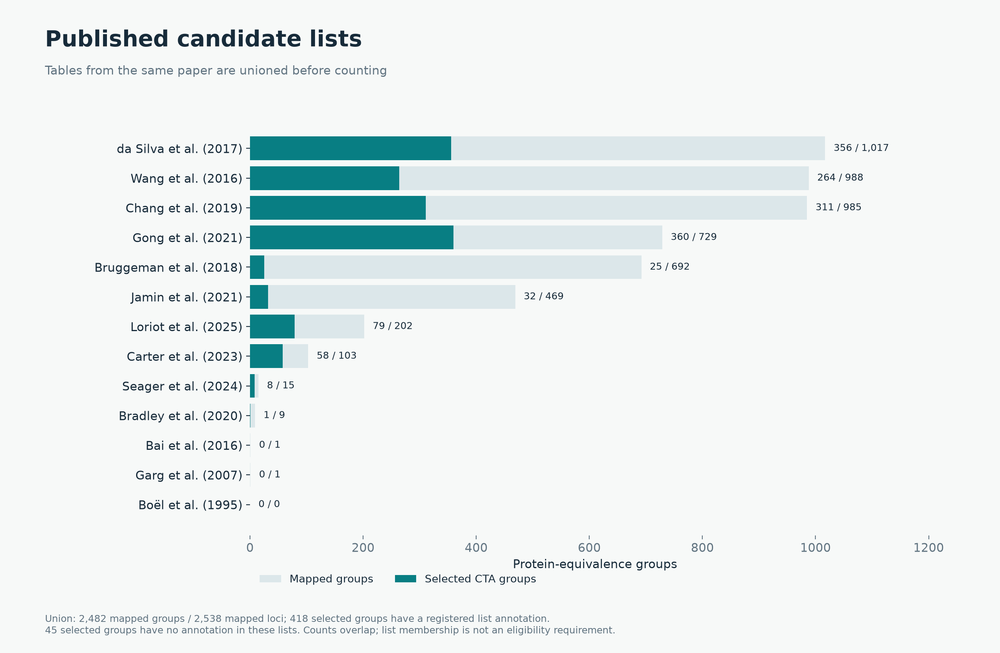
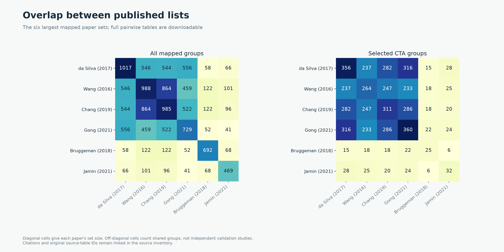
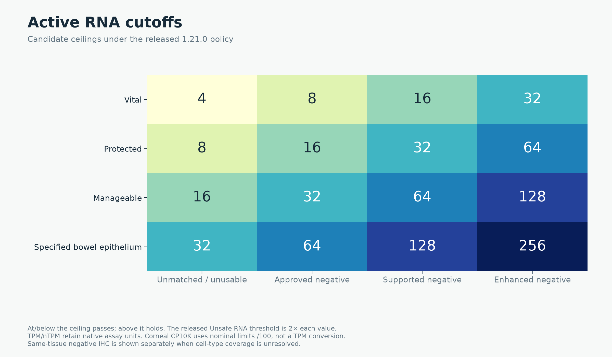
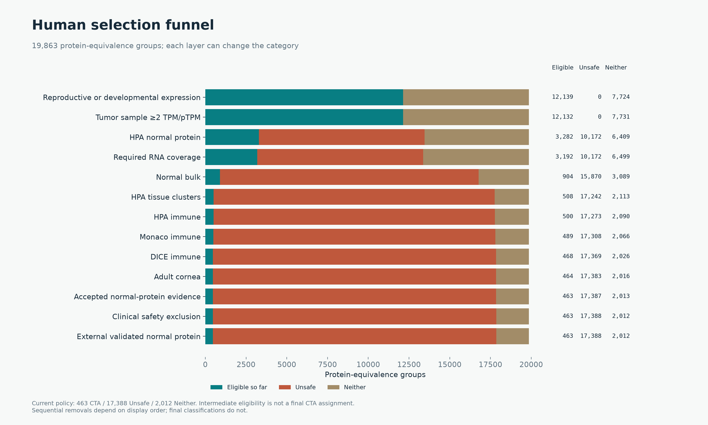
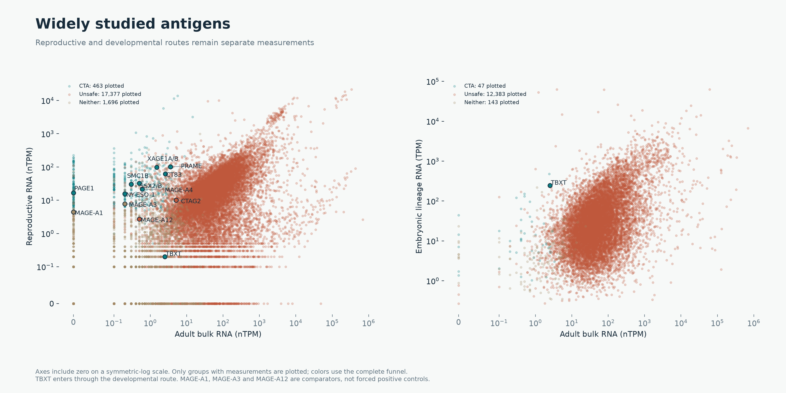

# Human and dog CTA evidence walkthrough

This walkthrough explains the **released 1.21.0 decisions** with more specific reasons and consistent labels. It does not change the thresholds or claim a completed canine quantitative selection. [Dog funnel](dog.md) · [Policy questions and developmental sources](policy-review.md) · [Shared API](api.md).

[Download the 17-slide evidence walkthrough](slides/cta-evidence-walkthrough.pptx).

## Published candidate sources

Counts below are OncoRef mappings, not the papers' original row counts. Tables from one paper are unioned; distinct papers can share genes. Protein-equivalence groups and gene loci remain separate denominators. The union is **2,482 groups / 2,538 loci**. Of the 463 selected groups, **418** have a registered paper annotation and **45** do not. A paper annotation does not bypass any quantitative gate. Boël's unresolved BAGE record has no mapped eligible group in this registry.

| Paper | Gene loci | Mapped groups | CTA | Unsafe | Neither | Unique to this paper |
| --- | --- | --- | --- | --- | --- | --- |
| [da Silva et al. (2017)](https://doi.org/10.18632/oncotarget.21715) | 1066 | 1017 | 356 | 276 | 385 | 279 |
| [Wang et al. (2016)](https://doi.org/10.1038/ncomms10499) | 994 | 988 | 264 | 521 | 203 | 27 |
| [Chang et al. (2019)](https://doi.org/10.1002/cam4.2223) | 986 | 985 | 311 | 519 | 155 | 21 |
| [Gong et al. (2021)](https://doi.org/10.1038/s41467-021-22695-y) | 733 | 729 | 360 | 201 | 168 | 89 |
| [Bruggeman et al. (2018)](https://doi.org/10.1038/s41388-018-0357-2) | 692 | 692 | 25 | 622 | 45 | 518 |
| [Jamin et al. (2021)](https://doi.org/10.1002/1878-0261.12900) | 481 | 469 | 32 | 412 | 25 | 318 |
| [Loriot et al. (2025)](https://doi.org/10.1371/journal.pgen.1011734) | 215 | 202 | 79 | 67 | 56 | 8 |
| [Carter et al. (2023)](https://doi.org/10.1136/jitc-2023-007935) | 103 | 103 | 58 | 20 | 25 | 3 |
| [Seager et al. (2024)](https://doi.org/10.1186/s12967-024-04918-0) | 15 | 15 | 8 | 3 | 4 | 2 |
| [Bradley et al. (2020)](https://doi.org/10.1038/s41467-020-19141-w) | 10 | 9 | 1 | 8 | 0 | 0 |
| [Bai et al. (2016)](https://doi.org/10.1158/0008-5472.CAN-16-0225) | 1 | 1 | 0 | 1 | 0 | 1 |
| [Garg et al. (2007)](https://doi.org/10.1158/1078-0432.CCR-06-2340) | 1 | 1 | 0 | 1 | 0 | 1 |
| [Boël et al. (1995)](https://doi.org/10.1016/s1074-7613(95)80053-0) | 0 | 0 | 0 | 0 | 0 | 0 |

[All source memberships](human-memberships.csv.gz) · [All pairwise overlaps](human-overlaps.csv.gz). Unique means present in only that paper within this registry, not uniquely discovered or independently validated.

## Why 12,139 groups enter

The starting universe is **19,863 protein-equivalence groups / 20,097 loci**. The first gate uses measured RNA across this universe, not the 2,482-group literature union. It accepts reproductive maximum ≥5 nTPM and >adult bulk maximum **or** a supported Tyser embryonic lineage mean ≥5 TPM.

| Route | Entrants | Final CTA |
| --- | --- | --- |
| Reproductive only | 1231 | 425 |
| Developmental only | 9481 | 29 |
| Both | 1427 | 9 |

The developmental criterion tests expression, not restriction. Consequently it admits many broadly expressed genes before normal-tissue filtering. Tyser measures one Carnegie-stage-7 embryo; later fetal atlases are not integrated. Reproductive and developmental routes share a permissive-context role but retain distinct stage, tissue and units. TBXT has reproductive 0.2 nTPM, adult bulk maximum 2.5 nTPM, and supported embryonic lineage mean 245.088 TPM: it enters through the developmental route.

## Normal and tumor evidence

| Role | Source | Unit | Scope / limitations |
| --- | --- | --- | --- |
| normal_bulk_rna | [HPA v23 / GTEx consensus](https://v23.proteinatlas.org/about/download) | nTPM | Bulk source summaries; not exhaustive pediatric, pregnancy or rare-cell coverage |
| reproductive_expression | [HPA v23 / GTEx consensus](https://v23.proteinatlas.org/about/download) | nTPM | Bulk source summaries; not exhaustive pediatric, pregnancy or rare-cell coverage |
| developmental_expression | [Tyser human gastrulation atlas](https://doi.org/10.1038/s41586-021-04158-y) | TPM | One embryo; cell support does not establish independent-donor replication |
| tumor_expression | [OncoRef source-mapped tumor union](https://github.com/pirl-unc/oncoref/tree/v1.21.0/docs/audits/cta-expanded-funnel-20261027/tumor-union) | TPM | 132 compatible cohorts; source namespaces deduplicate views, not patients across studies |
| tumor_expression | [HPA cancer sample measurements](https://v23.proteinatlas.org/about/download) | pTPM | Protein-coding RNA denominator; no numerical protein or peptide abundance |
| normal_cell_rna | [HPA tissue/cell clusters](https://v23.proteinatlas.org/about/download) | nTPM | At least 20 reads; missing cell types and disease states remain uncovered |
| immune_rna | [HPA immune summaries](https://v23.proteinatlas.org/about/download) | nTPM | Sorted populations retain native units; no matched negative-IHC relaxation |
| immune_rna | [Monaco immune summaries](https://v23.proteinatlas.org/about/download) | TPM | Sorted populations retain native units; no matched negative-IHC relaxation |
| immune_rna | [DICE immune distributions](https://dice-database.org/) | TPM | 15 distributions; third-highest value; unpaired locus distributions retain bounds; optional coverage |
| normal_cell_rna | [Collin adult corneal atlas](https://www.ncbi.nlm.nih.gov/geo/query/acc.cgi?acc=GSE155683) | CP10K | Two supported sample groups; optional coverage; CP10K is not length-normalized TPM |
| normal_protein | [HPA normal-tissue IHC](https://v23.proteinatlas.org/about/assays%2Bannotation) | HPA categorical level and reliability | Reliability describes evidence support, not a calibrated false-negative probability |
| normal_protein | [Curated external staining observations](https://github.com/pirl-unc/oncoref/tree/v1.21.0/docs/audits/external-ihc-20261027) | native categorical findings | Reagent, tissue, cell type and validation scope remain explicit; no inherited HPA grade |
| normal_protein | [Reviewed normal protein and clinical exclusions](https://github.com/pirl-unc/oncoref/blob/v1.21.0/oncoref/data/cta-policy-findings.csv) | categorical reviewed findings | Qualitative reported Low is distinct from HPA Low and numerical intensity; clinical evidence is product-specific |
| clinical_safety | [Reviewed normal protein and clinical exclusions](https://github.com/pirl-unc/oncoref/blob/v1.21.0/oncoref/data/cta-policy-findings.csv) | categorical reviewed findings | Qualitative reported Low is distinct from HPA Low and numerical intensity; clinical evidence is product-specific |

The OncoRef tumor union uses **132 compatible cohort views of 143 registered**, with **17,763 sample occurrences**, **14,452 namespace-deduplicated sample IDs**, and **34 source namespaces**. These are not 14,452 proven independent patients. HPA cancer can overlap the underlying cohorts. [Per-cohort availability and provenance](../cta-expanded-funnel-20261027/tumor-union/cohort-availability.csv).

## Active criteria and funnel

| Stage | Criterion |
| --- | --- |
| Reproductive or developmental expression | Reproductive ≥5 nTPM and > adult bulk maximum OR Tyser embryonic lineage mean ≥5 TPM; ≥20 cells, ≥5 positive and ≥10% positive at ≥1 TPM. |
| Tumor sample ≥2 TPM/pTPM | At least one measured compatible tumor sample ≥2 in native TPM or HPA pTPM; do not add maxima from different samples. |
| HPA normal protein | Medium/High or other non-Low positives exclude; accepted reliability supplies Unsafe evidence; uncertain positives retain a hold. Low remains flagged. |
| Required RNA coverage | Required bulk and tissue-cell/immune panels; missing members are not zeros. DICE and cornea are optional coverage. |
| Normal bulk | Native nTPM at or below tissue/IHC ceiling passes; >ceiling holds; ≥2× supplies Unsafe evidence. |
| HPA tissue clusters | Require ≥20 reads; apply exact cell/tissue/IHC ceiling. Same-tissue negative IHC alone does not establish cell-type coverage. |
| HPA immune | Protected-tier native nTPM limits without matched negative-IHC credit; reproductive/placental location remains neutral. |
| Monaco immune | Protected-tier native TPM limits without matched negative-IHC credit. |
| DICE immune | Third-highest reported TPM value; native protected-tier limits. Unpaired group distributions retain bounds. Missing coverage alone does not exclude. |
| Adult cornea | Recurrent native CP10K: ≥5 positive cells and ≥20 counts in ≥2 sample groups. Nominal RNA limits /100; not a TPM conversion. Missing coverage alone does not exclude. |
| Accepted normal-protein evidence | Accepted positive protein findings exclude unless extracted Low intensity retains a flag; unquantified does not mean negative. |
| Clinical safety exclusion | Retain reviewed product-specific clinical injury counterevidence and causal-attribution limits; no admission shortcut from clinical use. |
| External validated normal protein | Use categorical/quantitative staining only within verified reagent, tissue and cell scope; no inherited HPA reliability label. |

“Unsafe threshold” is the released second RNA boundary, **2× the candidate ceiling**. It is not an IHC intensity category. Above the candidate ceiling but below that boundary creates a hold; another source can independently make the final decision Unsafe. These are the active policy cutoffs, not clinically measured toxicity limits.

| Stage | New removals | Eligible so far | Unsafe | Neither |
| --- | --- | --- | --- | --- |
| Reproductive or developmental expression | 7724 | 12139 | 0 | 7724 |
| Tumor sample ≥2 TPM/pTPM | 7 | 12132 | 0 | 7731 |
| HPA normal protein | 8850 | 3282 | 10172 | 6409 |
| Required RNA coverage | 90 | 3192 | 10172 | 6499 |
| Normal bulk | 2288 | 904 | 15870 | 3089 |
| HPA tissue clusters | 396 | 508 | 17242 | 2113 |
| HPA immune | 8 | 500 | 17273 | 2090 |
| Monaco immune | 11 | 489 | 17308 | 2066 |
| DICE immune | 21 | 468 | 17369 | 2026 |
| Adult cornea | 4 | 464 | 17383 | 2016 |
| Accepted normal-protein evidence | 1 | 463 | 17387 | 2013 |
| Clinical safety exclusion | 0 | 463 | 17388 | 2012 |
| External validated normal protein | 0 | 463 | 17388 | 2012 |

## Widely studied antigens

MAGE-A1, MAGE-A3 and MAGE-A12 are comparison genes, not forced positive controls. Detailed explanations retain the source, tissue, cell type, value, units, threshold and evidence uncertainty.

| Antigen / group | Decision | Reason |
| --- | --- | --- |
| PAGE1 | CTA | Passes the released rules; retained observations remain in the detailed evidence |
| SMC1B | CTA | Passes the released rules; retained observations remain in the detailed evidence |
| CTAG2 | Unsafe | bronchus / basal respiratory cells: 24.9 nTPM; candidate ceiling 4; Unsafe threshold 8. Same-tissue negative IHC; cell-type coverage unresolved: respiratory epithelial cells (Enhanced). 58 reads. |
| MAGEA4 | CTA | Passes the released rules; retained observations remain in the detailed evidence |
| TBXT | CTA | Passes the released rules; retained observations remain in the detailed evidence |
| PRAME | CTA | Passes the released rules; retained observations remain in the detailed evidence |
| MAGEA1 | Neither | Reproductive maximum 4.4 nTPM; requires ≥5 and > adult bulk maximum 0 nTPM. Supported embryonic lineage: no qualifying supported measurement; requires mean ≥5 TPM with cell-support guards. |
| CT83 | CTA | Passes the released rules; retained observations remain in the detailed evidence |
| MAGEA12 | Unsafe | Reproductive maximum 2.7 nTPM; requires ≥5 and > adult bulk maximum 0.5 nTPM. Supported embryonic lineage: no qualifying supported measurement; requires mean ≥5 TPM with cell-support guards.  /  Gene-resolved MAGE-A12 RNA was detected in normal brain. A cross-reactive anti-MAGE-A3/A9/A12 TCR was associated with severe neurological toxicity including deaths. Hold clinical prioritization despite HPA screening compatibility. Neuronal IHC used a pan-MAGE antibody and the TCR recognized multiple antigens; unique causal attribution to MAGE-A12 is not proven. This is a precautionary evidence-based hold. |
| MAGEA3 | Neither | colon / undifferentiated cells: 53.1 nTPM; candidate ceiling 32; Unsafe threshold 64. No usable matched negative IHC. 251 reads. |
| NY-ESO-1 | CTA | Passes the released rules; retained observations remain in the detailed evidence |
| SSX2/B | CTA | Passes the released rules; retained observations remain in the detailed evidence |
| XAGE1A/B | CTA | Passes the released rules; retained observations remain in the detailed evidence |

[All detailed human decisions](human-explanations.csv.gz) · [Comparison table](widely-studied-antigens.csv). Each RNA layer links a representative supported context and the complete source export; it does not claim that this is the only normal expression.

## Folding bowel into Manageable

Moving specified bowel epithelium from its current base ceiling 32 to the existing Manageable base 16, preserving all other released rules, gives **462 CTA / 17,391 Unsafe / 2,010 Neither**. PRAME moves to Neither; MAGE-A3, HOXA13 and FAM72B move from Neither to Unsafe. This is a comparison, not a replacement release. [Every changed decision](bowel-manageable16-comparison.csv).

PRAME has Enhanced “Not detected” HPA colon glandular, endothelial and peripheral nerve/ganglion staining. Its 20.3 nTPM signal is in undifferentiated colon cells. The current match requires cell-type coverage, so this is **same-tissue negative IHC with unresolved cell-type coverage**, not absent IHC. Assigning Enhanced credit to the undifferentiated cells requires evidence that the stained compartment covers them. [HPA PRAME tissue evidence](https://v23.proteinatlas.org/ENSG00000185686-PRAME/tissue/colon).
