# CTA and oncofetal selection

**602 CTA proteins (646 loci), 18,255 Unsafe, and 1,006 Other (27 of them Held)**, with evidence status recorded independently, across all 19,863 candidate proteins (identical selected reference sequences counted together; every record enters classification). Translation support and reference quality are CTA admission gates; 0 records are outside the classification path. Policy: `oncoref.cta-selection.2026-11-05.1`. This is the current policy; the [1.21.0 release](../cta-release-1.21.0/index.md) remains a frozen comparison.

[PDF slides](cta-selection-1.31.0.pdf) · [Editable slides](slides/cta-evidence-walkthrough-1.31.0-validated-final.pptx) · [TCR-T serious-event review and PDF](../cta-tcr-trials-20261029/index.md) · [Unassigned proteins and diffuseness](../cta-unassigned-20261029/index.md) · [Papers and database versions](references.md) · [Dog evidence](dog.md) · [Shared API](api.md) · [Policy and IHC matching](policy-review.md) · [All decisions](../cta-selection-20261028/protein-group-classifications.csv.gz) · [Changed decisions](../cta-selection-20261028/classification-changes.csv.gz)

[Simplified decisions and four target reviews](../cta-simplification-20261031/index.md).
[1.26 literature audit and decisions](../cta-other-literature-20261030/index.md).
[1.25 changes: Reproductive RNA/IHC/cell routes and categorical Other assignments](../cta-neither-20261030/update-1.25.0.md).

## Categories

**Safety, cancer expression and Reproductive
evidence are separate requirements. Only safety evidence can establish Unsafe.**
Cancer needs one qualifying measured sample, without a tumor-versus-normal ratio.
The reproductive-versus-normal maximum veto has been removed. Whole-profile
HPA diffuseness above 10% blocks a completely measured adult/placental identity
route. Thymus is excluded from this score; its hazard tier remains Protected. Disposable tissues count. Supported
embryonic evidence remains independent and its concentration is unassessed.
[Rule, changed proteins and sensitivity](../cta-unassigned-20261029/diffuseness-impact.md). [Definitions and logic](../../cta-evidence-axes.md).

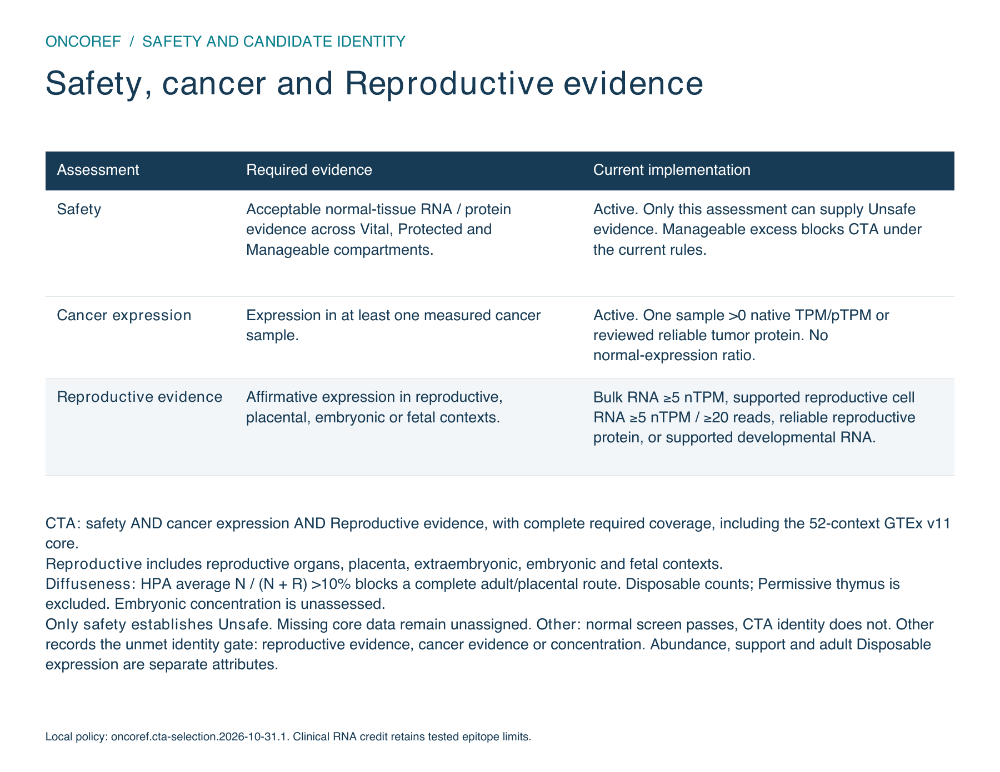

- **CTA:** qualifying association after the concentration check, one measured cancer sample, required coverage, qualified selected translations, sequence-overlap rules and acceptable normal expression all pass.
- **Unsafe:** above the single RNA ceiling in Vital/Protected, Manageable-tier RNA above 128, accepted non-Low protein in those compartments, accepted reviewed normal-cell evidence, or retained clinical exclusion evidence. Unresolved findings require review without independently establishing Unsafe. This is a research-policy exclusion, not demonstrated toxicity.
- **Other:** every protein that is neither CTA nor Unsafe. Its subtype names the first unmet identity gate (Nonreproductive, Reproductive, Diffuse); **Held** means every target gate passes but a marginal or unresolved normal signal blocks CTA. `assessment_status` independently records missing coverage, normal-evidence holds or translation review.
- **Every record classified:** missing optional panels alone do not block CTA admission; observed evidence still applies, and no human protein has a null category.

The separate **2× Strong boundary is removed**. Every layer evaluates every protein; Other includes assessed noncandidates and held/incomplete cases. Required coverage is combined bulk (HPA consensus, HPA brain and [GTEx v11](https://gtexportal.org/home/downloads/adult-gtex)) for every protein member. Cell-cluster, immune, DICE and corneal panels contribute measured evidence; their missing coverage alone does not block CTA admission.

## Other categories

Every protein has one categorical assignment: CTA, Unsafe or a named Other category. Safety exclusions remain Unsafe; incomplete or unresolved normal evidence gives Other with `assessment_status` recording why. The API exposes `classification` (for example `Other:Nonreproductive`) as well as `category` and `subtype`.

| Category | Meaning | Proteins |
| --- | --- | --- |
| Other:Nonreproductive | No qualifying reproductive, placental or embryonic/fetal evidence establishes CTA identity. Evidence completeness and normal holds are recorded independently; this is not proof of absence. | 570 |
| Other:Reproductive | Reproductive presence is supported but cancer presence is unestablished. Inspect assessment status for independent normal-evidence gaps or holds. | 0 |
| Other:Diffuse | Reproductive presence and cancer presence pass, but the reproductive concentration gate fails. Inspect assessment status independently. | 4 |
| Other:Held | Target gates pass, but an unresolved or marginal normal-tissue signal blocks CTA without establishing Unsafe. | 27 |
| Other:Nested | A reference-CDS microprotein (under 50 residues) nested inside a same-strand protein-coding gene and not an established ncORF: its RNA signal belongs to the host, so it cannot be a CTA. | 28 |
| Other:Translation | The selected primary-locus reference translation needs qualification; this is not normal-tissue exclusion evidence. | 362 |
| Other:Contained | Every CTA gate passes, but at least 95% of its 9-mers also occur in Unsafe proteins, so almost no peptide survives the Unsafe sequence blacklist. | 15 |

Other reasons follow the unmet identity requirements: reproductive presence, cancer presence, then concentration. Abundance, replicated tumor support and adult Disposable expression are independent attributes in `cta_selection.profiles()`. Disposable designates permitted adult tissue; developmental expression and missing developmental measurements never change that adult designation. Native RNA units remain separate. [Simple rules and four-protein review](../cta-simplification-20261031/index.md).

[Full categorical table and individual changes](../cta-neither-20261030/update-1.25.0.md). The current admission fixes use the full mapped Reproductive bulk panel plus supported reproductive-lineage cells. Generic/immune cells can provide indirect sample-site evidence only with a complete same-source outside panel, every outside cluster <5 nTPM, and no curated normal-induction conflict. This does not identify the producing cell; macrophages may carry passenger RNA. All safety and concentration gates remain independent.

## Rare vital-tissue cell expression

Pooled panels average away rare normal cells, so a protein can read near zero in
every bulk, cluster and immune measurement while a small population of an essential
tissue expresses it. The reviewed example is **MAGEA12**, whose neurotoxicity in a
MAGE-A3 TCR trial followed rare positive neurons: HPA bulk, GTEx medians and HPA
single-nucleus clusters read near zero, but 293 of 19,760 midbrain dopaminergic neurons
(1.5%) express it in the CELLxGENE summaries.

Every gene is screened (`scripts/build_cta_rare_cell_screen.py`) against CELLxGENE
normal-sample summaries in brain, spinal cord, heart and selected lung populations.
The [central tissue-hazard ontology](../tissue-hazards-1.29.0/index.md) assigns each
resolved population. A cell type needs at least 3,000 cells and 10 expressing cells.
Immune lineages, fibroblasts/stroma and developmental labels remain outside this
panel; that is a coverage limit, not an allowance. At least 1% expression in a Vital
population supplies Unsafe evidence; Protected expression at the same screening
line creates a candidate review hold. 15,874 proteins have a Vital flag,
and for **121 this is the only Unsafe evidence**. The profile field
`rare_cell_hold` records Protected findings independently.

This is an automated screen, and it measures detection frequency among cells, not
abundance: expressing cells typically carry about one UMI, and ambient RNA, doublets and
close-paralog multimapping can create detections. The service cannot restrict samples to
adult donors, so developmental cell types are removed by name. Every protein has a status
for this filter (`rare_cell_*` columns in `cta_selection.profiles()`, with
`cta_selection.rare_cell_screen()` returning the supporting cell types); genes absent from
the service are `rare_cell_screened = False` and are never flagged.

| Protein | Vital-tissue cell type | Expressing / cells | % of cells |
| --- | --- | --- | --- |
| LINC03051 | brain: L6 intratelencephalic projecting glutamatergic neuron of the primary motor cortex | 3,951 of 4,206 cells | 93.94 |
| ENSG00000285708 | brain: L4/5 intratelencephalic projecting glutamatergic neuron | 2,219 of 7,153 cells | 31.02 |
| GRXCR2 | heart: cardiac muscle myoblast | 4,906 of 18,307 cells | 26.8 |
| REDIC1 | brain: L4/5 intratelencephalic projecting glutamatergic neuron | 902 of 7,153 cells | 12.61 |
| ENSG00000285547 | brain: L4/5 intratelencephalic projecting glutamatergic neuron | 783 of 7,153 cells | 10.95 |
| ENSG00000285542 | brain: L4/5 intratelencephalic projecting glutamatergic neuron | 783 of 7,153 cells | 10.95 |
| PABPC3 | lung: respiratory basal cell | 1,293 of 12,349 cells | 10.47 |
| MDFIC2 | heart: mesothelial cell of epicardium | 431 of 4,332 cells | 9.95 |
| ENSG00000285723 | lung: club cell | 2,739 of 34,510 cells | 7.94 |
| OOEP | brain: leptomeningeal cell | 1,027 of 13,072 cells | 7.86 |
| MORC1 | spinal cord: mononuclear phagocyte | 282 of 3,679 cells | 7.67 |
| PKD1L3 | heart: mesothelial cell | 2,299 of 32,755 cells | 7.02 |
| ENSG00000282218 | heart: mural cell | 9,356 of 136,031 cells | 6.88 |
| ENSG00000267618 | brain: stellate neuron | 1,894 of 31,613 cells | 5.99 |
| OLIG3 | brain: neural stem cell | 5,952 of 109,469 cells | 5.44 |

## What the assessment statuses mean

| API status | Meaning | Human proteins |
|---|---|---:|
| `screened` | A CTA, Unsafe or named Other category has been assigned by this policy. It does not mean safe, clinically validated or complete coverage of every source. | 19,863 |
| `incomplete_evidence` | Required normal coverage or evidence resolution is missing. Additional missing cancer/developmental measurements are reported separately and do not themselves prevent Other. | 105 |
| `translation_review` | Selected primary-locus translation requires qualification. Normal findings remain independently visible. | 363 |
| `normal_evidence_hold` | Required coverage is present, but a normal-screen hold remains, including Manageable ceiling failures. | 118 |
| `unassessed` | No species-specific quantitative policy has been applied; used for native dog nominations. | 0 |

An available exclusion can establish Unsafe despite another missing assay. A CTA supported by adult/placental Reproductive evidence need not have embryonic measurements. Other does not require tumor or embryonic coverage when the required normal screen is complete and resolved.

Among the 105 incomplete assessments, gaps overlap:

| Evidence gap | Proteins |
| --- | --- |
| normal panel missing | 85 |
| tumor measurement missing | 28 |
| tumor group profile incomplete | 1 |
| embryonic measurement missing | 57 |
| unresolved evidence | 20 |

[Exact data sources, missing tissue/cell contexts, member identities and cohort coverage](coverage.md) · [Per-protein gap flags](unassigned-evidence-gaps.csv). The previous 71 tumor gaps combined 41 missing measurements and 30 measured groups with incomplete low-expression-profile coverage. The table above reflects the subsequent identity repair. The comparator table below reflects the new developmental and normal-bulk sources; MAGE family members are not admission controls.

## Sources of candidate annotations

These published lists annotate the selection; they do not provide a gene-specific admission bypass. The union is **2,514 mapped proteins / 2,570 loci**. **480** selected proteins have a listed-paper annotation; **122** do not. Source contribution counts overlap. **Mapped proteins means curated nominations linked to the current reference, not newly discovered genes or selected CTAs.** The CTA column reports the subset passing the current funnel.

| citation | mapped_entities | CTA | Unsafe | Other | Unassigned | source_url |
| --- | --- | --- | --- | --- | --- | --- |
| [da Silva et al. (2017)](https://doi.org/10.18632/oncotarget.21715) | 1017 | 411 | 466 | 140 | 0 | [Source](https://doi.org/10.18632/oncotarget.21715) |
| [Wang et al. (2016)](https://doi.org/10.1038/ncomms10499) | 988 | 269 | 683 | 36 | 0 | [Source](https://doi.org/10.1038/ncomms10499) |
| [Chang et al. (2019)](https://doi.org/10.1002/cam4.2223) | 985 | 281 | 676 | 28 | 0 | [Source](https://doi.org/10.1002/cam4.2223) |
| [Gong et al. (2021)](https://doi.org/10.1038/s41467-021-22695-y) | 729 | 346 | 343 | 40 | 0 | [Source](https://doi.org/10.1038/s41467-021-22695-y) |
| [Bruggeman et al. (2018)](https://doi.org/10.1038/s41388-018-0357-2) | 692 | 12 | 679 | 1 | 0 | [Source](https://doi.org/10.1038/s41388-018-0357-2) |
| [Jamin et al. (2021)](https://doi.org/10.1002/1878-0261.12900) | 469 | 33 | 429 | 7 | 0 | [Source](https://doi.org/10.1002/1878-0261.12900) |
| [Loriot et al. (2025)](https://doi.org/10.1371/journal.pgen.1011734) | 202 | 83 | 113 | 6 | 0 | [Source](https://doi.org/10.1371/journal.pgen.1011734) |
| [Carter et al. (2023)](https://doi.org/10.1136/jitc-2023-007935) | 103 | 53 | 47 | 3 | 0 | [Source](https://doi.org/10.1136/jitc-2023-007935) |
| [Hirbo et al. (2015)](https://doi.org/10.1371/journal.pone.0144155) | 78 | 8 | 67 | 3 | 0 | [Source](https://doi.org/10.1371/journal.pone.0144155) |
| [Seager et al. (2024)](https://doi.org/10.1186/s12967-024-04918-0) | 15 | 10 | 3 | 2 | 0 | [Source](https://doi.org/10.1186/s12967-024-04918-0) |
| [Sasaroli et al. (2011)](https://doi.org/10.4161/cbt.12.3.16260) | 13 | 0 | 13 | 0 | 0 | [Source](https://doi.org/10.4161/cbt.12.3.16260) |
| [Garg et al. (2007)](https://doi.org/10.1158/1078-0432.CCR-06-2340) | 5 | 3 | 2 | 0 | 0 | [Source](https://doi.org/10.1158/1078-0432.CCR-06-2340) |

### Broader nominations and a compact primary-source list

[Sasaroli et al. (2011)](https://pmc.ncbi.nlm.nih.gov/articles/PMC3230481/) contributes its 13 detailed tumor-vascular candidates, all mapped. [Hirbo et al. (2015)](https://doi.org/10.1371/journal.pone.0144155) contributes 86 placenta-enriched nominations: 82 mapped identities and four unresolved names. Its 30 fast-evolving genes are a nested subset, not 30 additional genes. Noncoding mapped rows remain in the intake audit but do not enter protein-group counts. These are vascular and placental nomination scopes, not proof of CTA restriction.

EGFL6 now occurs in Sasaroli, Hirbo and Bai. The main source table and plots omit fully redundant single-digit sets: Bai, Boël and Bradley. Their memberships and citations remain in the downloadable provenance. Garg stays because it uniquely contributes SPAG9 in the current registry. A source is retired from the main view only if the retained sources cover its entire mapped set; the union is unchanged by this presentation choice.

| citation | mapped_entities | covered_by | source_url |
| --- | --- | --- | --- |
| [Bradley et al. (2020)](https://doi.org/10.1038/s41467-020-19141-w) | 9 | ('10.1002/1878-0261.12900', '10.1002/cam4.2223', '10.1038/ncomms10499', '10.1038/s41388-018-0357-2', '10.1038/s41467-021-22695-y', '10.1371/journal.pone.0144155', '10.18632/oncotarget.21715', '10.4161/cbt.12.3.16260') | [Source](https://doi.org/10.1038/s41467-020-19141-w) |
| [Boël et al. (1995)](https://doi.org/10.1016/s1074-7613(95)80053-0) | 2 | ('10.1002/1878-0261.12900', '10.1002/cam4.2223', '10.1038/ncomms10499', '10.1038/s41388-018-0357-2', '10.1038/s41467-021-22695-y', '10.1136/jitc-2023-007935', '10.1186/s12967-024-04918-0', '10.1371/journal.pgen.1011734', '10.18632/oncotarget.21715') | [Source](https://doi.org/10.1016/s1074-7613(95)80053-0) |
| [Bai et al. (2016)](https://doi.org/10.1158/0008-5472.CAN-16-0225) | 1 | ('10.1371/journal.pone.0144155', '10.4161/cbt.12.3.16260') | [Source](https://doi.org/10.1158/0008-5472.CAN-16-0225) |

Bai's 538 EGFL6-correlated genes are not a CTA list. Garg recognizes SPA17, SYCP1, NY-ESO-1 and SSX4 alongside SPAG9; Boël recognizes MAGE-A1/A3 alongside the unresolved BAGE label. BAGE's textual overlap with Seager remains outside mapped overlap counts. [Original targeted sets and overlaps](targeted-paper-overlaps.csv) · [Evidence roles](publication-context.csv) · [Every paper's extraction scope](paper-source-scope.csv) · [New source rows, aliases and unresolved names](publication-intake/mapped-source-rows.csv).

The larger papers already contribute their registered gene sets, including Wang's 1,019 CT-pattern genes, Bruggeman's 756 germ-cell genes, da Silva's 1,103 testis-biased and nested 745 CT genes, Chang's 1,036 TGCT genes, Carter's 103 final CT genes, and Loriot's 146 strict plus 134 preferential annotations. Input rows, gene loci and collapsed protein groups differ; these numbers must not be summed. Gong contributes reproductive/placental expression nominations rather than a claimed CTA list. This audit adds the declared vascular and placental sets; it does not claim a fresh exhaustive full-text review of every large source.

EGFL6 is excluded by lung bulk RNA (24.8 nTPM), lung smooth-muscle RNA (363.3 nTPM) and corneal evidence. SPAG9 has accepted bronchial protein staining and broad RNA counterevidence, including spinal cord (66.3 nTPM) and brain oligodendrocytes (287.1 nTPM). These are current quantitative-policy exclusions, irrespective of the original paper's terminology.

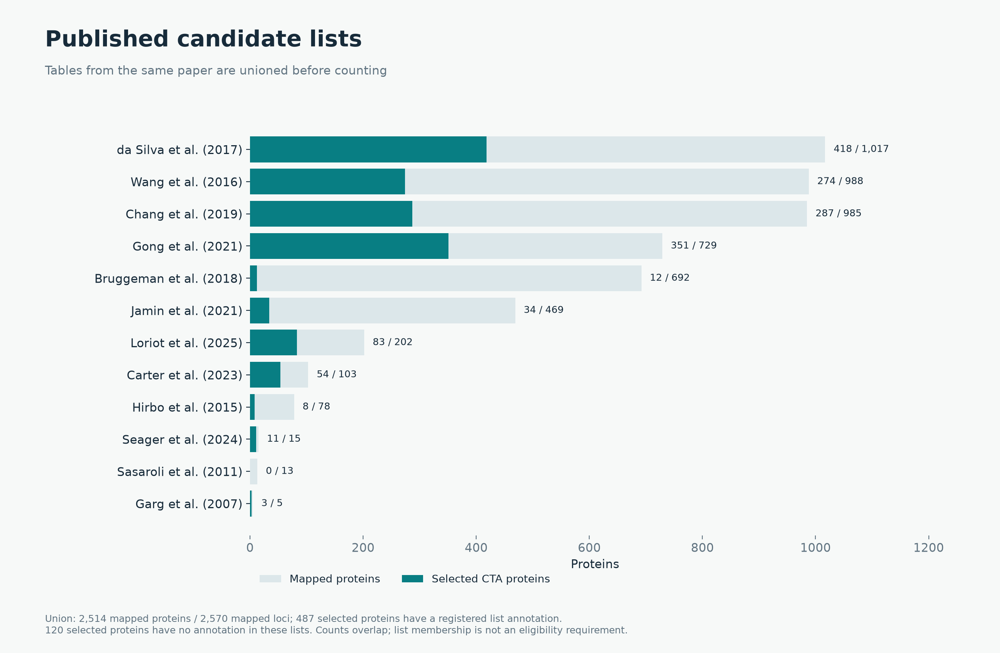
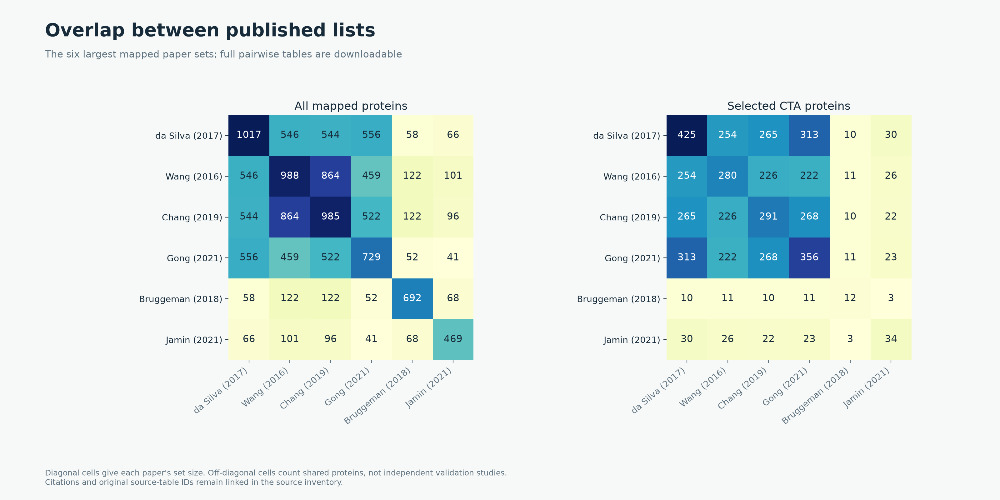

[All pairwise overlaps](human-overlaps.csv.gz) · [Memberships and gene IDs](human-memberships.csv.gz)

## Reproductive evidence and its branches

**Reproductive** includes adult reproductive, placental, extraembryonic, embryonic and fetal tissues. Branch labels describe the measured anatomical/stage evidence; “embryonic-only evidence” does not imply absence from unmeasured branches. [Branch definitions and measurements](../cta-unassigned-20261029/index.md#reproductive-is-the-umbrella). The association set uses whole-reference RNA and reliable reproductive IHC. Reproductive association requires HPA ≥5 nTPM **or mapped positive reproductive IHC with Approved, Supported or Enhanced reliability for every member, without an antibody conflict** or reviewed human reproductive protein covering the selected sequence members. Protein evidence does not bypass cancer, normal-safety or concentration checks. The developmental route requires a supported source-specific stage/lineage mean ≥5 TPM in Tyser or Petropoulos, ≥20 cells, ≥5 positive cells and ≥10% positive at ≥1 TPM. These establish presence in a qualifying context. This presence check does not compare with normal expression; normal safety and profile diffuseness answer separate questions. Later fetal and child/adult developmental atlases are not yet integrated.

| route | entrants | CTA |
| --- | --- | --- |
| Adult/placental evidence only | 4686 | 400 |
| Embryonic-only evidence | 459 | 92 |
| Both measured routes | 12546 | 110 |

[Tyser et al. (2021)](https://doi.org/10.1038/s41586-021-04158-y), [HPA v23 downloads](https://v23.proteinatlas.org/about/download).

## Measurement sources and filtering rules

| name | evidence_category | native_unit | status | source_url |
| --- | --- | --- | --- | --- |
| [Reviewed human gene knowledge: normal cells and reproductive protein](https://pirl-unc.github.io/oncoref/audits/cta-other-literature-20261030/) | normal_protein | source-native qualitative and quantitative observations | used_in_selection | [Source](https://pirl-unc.github.io/oncoref/audits/cta-other-literature-20261030/) |
| [Reviewed human gene knowledge: normal cells and reproductive protein](https://pirl-unc.github.io/oncoref/audits/cta-other-literature-20261030/) | normal_cell_rna | source-native qualitative and quantitative observations | used_in_selection | [Source](https://pirl-unc.github.io/oncoref/audits/cta-other-literature-20261030/) |
| [Reviewed human gene knowledge: normal cells and reproductive protein](https://pirl-unc.github.io/oncoref/audits/cta-other-literature-20261030/) | reproductive_expression | source-native qualitative and quantitative observations | used_in_selection | [Source](https://pirl-unc.github.io/oncoref/audits/cta-other-literature-20261030/) |
| [Durante et al. 2020 adult human olfactory atlas supplementary tables](https://pmc.ncbi.nlm.nih.gov/articles/PMC7065961/) | normal_cell_rna | positive neurons; cluster detection fraction | used_in_selection | [Source](https://pmc.ncbi.nlm.nih.gov/articles/PMC7065961/) |
| [Verbeurgt et al. 2014 whole human olfactory mucosa](https://doi.org/10.1371/journal.pone.0096333) | normal_cell_rna | native qPCR Cq; assay IDs and donor identity | used_in_selection | [Source](https://doi.org/10.1371/journal.pone.0096333) |
| [Verbeurgt et al. 2014 whole human olfactory mucosa](https://doi.org/10.1371/journal.pone.0096333) | normal_cell_rna | estimated RNA copies per 20 ng total RNA | used_in_selection | [Source](https://doi.org/10.1371/journal.pone.0096333) |
| [Published human normal immune induction contexts](https://pmc.ncbi.nlm.nih.gov/articles/PMC6457222/) | reproductive_expression | qualitative reported RNA induction | used_in_selection | [Source](https://pmc.ncbi.nlm.nih.gov/articles/PMC6457222/) |
| [Published human normal immune induction contexts](https://pmc.ncbi.nlm.nih.gov/articles/PMC6457222/) | normal_cell_rna | qualitative reported RNA induction | used_in_selection | [Source](https://pmc.ncbi.nlm.nih.gov/articles/PMC6457222/) |
| [HPA v23 / GTEx consensus](https://v23.proteinatlas.org/about/download) | normal_bulk_rna | nTPM | used_in_selection | [Source](https://v23.proteinatlas.org/about/download) |
| [HPA v23 / GTEx consensus](https://v23.proteinatlas.org/about/download) | reproductive_expression | nTPM | used_in_selection | [Source](https://v23.proteinatlas.org/about/download) |
| [Tyser human gastrulation atlas](https://doi.org/10.1038/s41586-021-04158-y) | developmental_expression | TPM | used_in_selection | [Source](https://doi.org/10.1038/s41586-021-04158-y) |
| [Petropoulos preimplantation atlas](https://www.ebi.ac.uk/gxa/sc/experiments/E-MTAB-3929/Results) | developmental_expression | TPM | used_in_selection | [Source](https://www.ebi.ac.uk/gxa/sc/experiments/E-MTAB-3929/Results) |
| [HPA v23 human brain, 193 subregions](https://v23.proteinatlas.org/about/download) | normal_bulk_rna | nTPM | used_in_selection | [Source](https://v23.proteinatlas.org/download/rna_brain_hpa.tsv.zip) |
| [Direct GTEx v11 tissue medians](https://gtexportal.org/home/downloads/adult-gtex) | normal_bulk_rna | TPM | used_in_selection | [Source](https://gtexportal.org/home/downloads/adult-gtex) |
| [OncoRef source-mapped tumor union](https://github.com/pirl-unc/oncoref/tree/v1.21.0/docs/audits/cta-expanded-funnel-20261027/tumor-union) | tumor_expression | TPM | used_in_selection | [Source](https://github.com/pirl-unc/oncoref/tree/v1.21.0/docs/audits/cta-expanded-funnel-20261027/tumor-union) |
| [HPA v23 cancer sample measurements](https://v23.proteinatlas.org/about/download) | tumor_expression | pTPM | used_in_selection | [Source](https://v23.proteinatlas.org/about/download) |
| [HPA v23 tissue/cell clusters](https://v23.proteinatlas.org/about/download) | normal_cell_rna | nTPM | used_in_selection | [Source](https://v23.proteinatlas.org/about/download) |
| [HPA v23 tissue/cell clusters](https://v23.proteinatlas.org/about/download) | reproductive_expression | nTPM | used_in_selection | [Source](https://v23.proteinatlas.org/about/download) |
| [HPA v23 immune summaries](https://v23.proteinatlas.org/about/download) | immune_rna | nTPM | used_in_selection | [Source](https://v23.proteinatlas.org/about/download) |
| [Monaco immune summaries via HPA v23](https://v23.proteinatlas.org/about/download) | immune_rna | TPM | used_in_selection | [Source](https://v23.proteinatlas.org/about/download) |
| [DICE immune distributions](https://dice-database.org/) | immune_rna | TPM | used_in_selection | [Source](https://dice-database.org/) |
| [Collin adult corneal atlas](https://www.ncbi.nlm.nih.gov/geo/query/acc.cgi?acc=GSE155683) | normal_cell_rna | CP10K | used_in_selection | [Source](https://www.ncbi.nlm.nih.gov/geo/query/acc.cgi?acc=GSE155683) |
| [HPA v23 normal-tissue IHC](https://v23.proteinatlas.org/about/assays%2Bannotation) | normal_protein | HPA categorical level and reliability | used_in_selection | [Source](https://v23.proteinatlas.org/about/assays%2Bannotation) |
| [HPA v23 normal-tissue IHC](https://v23.proteinatlas.org/about/assays%2Bannotation) | reproductive_expression | HPA categorical level and reliability | used_in_selection | [Source](https://v23.proteinatlas.org/about/assays%2Bannotation) |
| [Curated external staining observations](https://github.com/pirl-unc/oncoref/tree/v1.21.0/docs/audits/external-ihc-20261027) | normal_protein | native categorical findings | used_in_selection | [Source](https://github.com/pirl-unc/oncoref/tree/v1.21.0/docs/audits/external-ihc-20261027) |
| [Reviewed normal protein and clinical exclusions](https://github.com/pirl-unc/oncoref/blob/v1.21.0/oncoref/data/cta-policy-findings.csv) | normal_protein | categorical reviewed findings | used_in_selection | [Source](https://github.com/pirl-unc/oncoref/blob/v1.21.0/oncoref/data/cta-policy-findings.csv) |
| [Reviewed normal protein and clinical exclusions](https://github.com/pirl-unc/oncoref/blob/v1.21.0/oncoref/data/cta-policy-findings.csv) | clinical_safety | categorical reviewed findings | used_in_selection | [Source](https://github.com/pirl-unc/oncoref/blob/v1.21.0/oncoref/data/cta-policy-findings.csv) |
| [Letetresgene Autoleucel in Advanced/Metastatic Myxoid/Round Cell Liposarcoma](https://doi.org/10.1200/JCO-24-01466) | clinical_safety | reviewed clinical attribution | used_in_selection | [Source](https://doi.org/10.1200/JCO-24-01466) |
| [Autologous T cell therapy for PRAME+ advanced solid tumors in HLA-A*02+ patients: a phase 1 trial](https://doi.org/10.1038/s41591-025-03650-6) | clinical_safety | reviewed clinical attribution | used_in_selection | [Source](https://doi.org/10.1038/s41591-025-03650-6) |
| [Autologous T cell therapy for MAGE-A4+ solid cancers in HLA-A*02+ patients: a phase 1 trial](https://doi.org/10.1038/s41591-022-02128-z) | clinical_safety | reviewed clinical attribution | used_in_selection | [Source](https://doi.org/10.1038/s41591-022-02128-z) |
| [SPEARHEAD-1: a single-arm phase 2 trial of afamitresgene autoleucel in advanced synovial sarcoma and myxoid/round cell liposarcoma](https://doi.org/10.1016/S0140-6736(24)00319-2) | clinical_safety | reviewed clinical attribution | used_in_selection | [Source](https://doi.org/10.1016/S0140-6736(24)00319-2) |
| [Identification of a Titin-Derived HLA-A1-Presented Peptide as a Cross-Reactive Target for Engineered MAGE A3-Directed T Cells](https://doi.org/10.1126/scitranslmed.3006034) | clinical_safety | reviewed clinical attribution | used_in_selection | [Source](https://doi.org/10.1126/scitranslmed.3006034) |
| [Guillain-Barre syndrome observed with adoptive transfer of lymphocytes genetically engineered with an NY-ESO-1 reactive T-cell receptor](https://doi.org/10.1186/s40425-019-0759-x) | clinical_safety | reviewed clinical attribution | used_in_selection | [Source](https://doi.org/10.1186/s40425-019-0759-x) |
| [NCT03709706 protocol: NY-ESO-1/LAGE-1A shared peptide and c259 receptor](https://cdn.clinicaltrials.gov/large-docs/06/NCT03709706/Prot_000.pdf) | clinical_safety | reviewed clinical attribution | used_in_selection | [Source](https://cdn.clinicaltrials.gov/large-docs/06/NCT03709706/Prot_000.pdf) |
| [NCT03132922 protocol: MAGE-A4 c1032 target peptide](https://cdn.clinicaltrials.gov/large-docs/22/NCT03132922/Prot_000.pdf) | clinical_safety | reviewed clinical attribution | used_in_selection | [Source](https://cdn.clinicaltrials.gov/large-docs/22/NCT03132922/Prot_000.pdf) |
| [First-in-human dose escalation trial to evaluate the clinical safety and efficacy of an anti-MAGEA1 autologous TCR-transgenic T cell therapy in relapsed and refractory solid tumors](https://doi.org/10.1136/jitc-2023-008668) | clinical_safety | reviewed clinical attribution | used_in_selection | [Source](https://doi.org/10.1136/jitc-2023-008668) |
| [Phase I clinical trial evaluating the safety and efficacy of ADP-A2M10 SPEAR T cells in patients with MAGE-A10+ advanced non-small cell lung cancer](https://doi.org/10.1136/jitc-2021-003581) | clinical_safety | reviewed clinical attribution | used_in_selection | [Source](https://doi.org/10.1136/jitc-2021-003581) |
| [NY-ESO-1-specific redirected T cells with endogenous TCR knockdown mediate tumor response and cytokine release syndrome](https://doi.org/10.1136/jitc-2021-003811) | clinical_safety | reviewed clinical attribution | used_in_selection | [Source](https://doi.org/10.1136/jitc-2021-003811) |
| [Cancer regression and neurological toxicity following anti-MAGE-A3 TCR gene therapy](https://pubmed.ncbi.nlm.nih.gov/23377668/) | clinical_safety | reviewed clinical attribution | used_in_selection | [Source](https://pubmed.ncbi.nlm.nih.gov/23377668/) |
| [Re-examination of MAGE-A3 as a T-cell Therapeutic Target](https://pmc.ncbi.nlm.nih.gov/articles/PMC7946352/) | clinical_safety | reviewed clinical attribution | used_in_selection | [Source](https://pmc.ncbi.nlm.nih.gov/articles/PMC7946352/) |
| [Gong et al., Nature Communications (2021)](https://doi.org/10.1038/s41467-021-22695-y) | nomination | gene-list membership | annotation | [Source](https://doi.org/10.1038/s41467-021-22695-y) |
| [Gong et al., Nature Communications (2021)](https://doi.org/10.1038/s41467-021-22695-y) | nomination | gene-list membership | annotation | [Source](https://doi.org/10.1038/s41467-021-22695-y) |
| [Bradley et al., Nature Communications (2020)](https://doi.org/10.1038/s41467-020-19141-w) | nomination | gene-list membership | annotation | [Source](https://doi.org/10.1038/s41467-020-19141-w) |
| [Wang 2016](https://doi.org/10.1038/ncomms10499) | nomination | gene-list membership | annotation | [Source](https://doi.org/10.1038/ncomms10499) |
| [Bruggeman 2018](https://doi.org/10.1038/s41388-018-0357-2) | nomination | gene-list membership | annotation | [Source](https://doi.org/10.1038/s41388-018-0357-2) |
| [da Silva 2017 · testis-biased](https://doi.org/10.18632/oncotarget.21715) | nomination | gene-list membership | annotation | [Source](https://doi.org/10.18632/oncotarget.21715) |
| [da Silva 2017 · CT](https://doi.org/10.18632/oncotarget.21715) | nomination | gene-list membership | annotation | [Source](https://doi.org/10.18632/oncotarget.21715) |
| [Jamin 2021](https://doi.org/10.1002/1878-0261.12900) | nomination | gene-list membership | annotation | [Source](https://doi.org/10.1002/1878-0261.12900) |
| [Jamin 2021 · core](https://doi.org/10.1002/1878-0261.12900) | nomination | gene-list membership | annotation | [Source](https://doi.org/10.1002/1878-0261.12900) |
| [Chang 2019 · TGCT](https://doi.org/10.1002/cam4.2223) | nomination | gene-list membership | annotation | [Source](https://doi.org/10.1002/cam4.2223) |
| [Carter 2023](https://doi.org/10.1136/jitc-2023-007935) | nomination | gene-list membership | annotation | [Source](https://doi.org/10.1136/jitc-2023-007935) |
| [Seager 2024 · panel](https://doi.org/10.1186/s12967-024-04918-0) | nomination | gene-list membership | annotation | [Source](https://doi.org/10.1186/s12967-024-04918-0) |
| [Loriot 2025 · strict](https://doi.org/10.1371/journal.pgen.1011734) | nomination | gene-list membership | annotation | [Source](https://doi.org/10.1371/journal.pgen.1011734) |
| [Loriot 2025 · preferential](https://doi.org/10.1371/journal.pgen.1011734) | nomination | gene-list membership | annotation | [Source](https://doi.org/10.1371/journal.pgen.1011734) |
| [Gong 2021 · reproductive coding](https://doi.org/10.1038/s41467-021-22695-y) | nomination | gene-list membership | annotation | [Source](https://doi.org/10.1038/s41467-021-22695-y) |
| [Gong 2021 · reproductive noncoding](https://doi.org/10.1038/s41467-021-22695-y) | nomination | gene-list membership | annotation | [Source](https://doi.org/10.1038/s41467-021-22695-y) |
| [da Silva 2017 · tumor proteomics](https://doi.org/10.18632/oncotarget.21715) | nomination | gene-list membership | annotation | [Source](https://doi.org/10.18632/oncotarget.21715) |
| [Bai 2016](https://doi.org/10.1158/0008-5472.CAN-16-0225) | nomination | gene-list membership | annotation | [Source](https://doi.org/10.1158/0008-5472.CAN-16-0225) |
| [Boël et al., Immunity (1995)](https://doi.org/10.1016/s1074-7613(95)80053-0) | nomination | gene-list membership | annotation | [Source](https://doi.org/10.1016/s1074-7613(95)80053-0) |
| [Garg et al., Clinical Cancer Research (2007)](https://doi.org/10.1158/1078-0432.CCR-06-2340) | nomination | gene-list membership | annotation | [Source](https://doi.org/10.1158/1078-0432.CCR-06-2340) |
| [Sasaroli et al. (2011)](https://doi.org/10.4161/cbt.12.3.16260) | nomination | gene-list membership | annotation | [Source](https://doi.org/10.4161/cbt.12.3.16260) |
| [Hirbo et al. (2015)](https://doi.org/10.1371/journal.pone.0144155) | nomination | gene-list membership | annotation | [Source](https://doi.org/10.1371/journal.pone.0144155) |

| stage | rule |
| --- | --- |
| Reproductive or developmental expression | Full Reproductive bulk ≥5 nTPM OR supported reproductive-cell RNA ≥5 nTPM (≥20 reads; indirect sites additionally need complete outside-cluster coverage and every outside value <5, with no curated normal-induction conflict) OR reliable mapped positive reproductive IHC for every member without an antibody conflict OR reviewed human reproductive protein covering every selected member OR supported developmental stage/lineage mean ≥5 TPM; ≥20 cells, ≥5 positive and ≥10% positive at ≥1 TPM. Presence evidence never overrides normal exclusions. |
| Cancer expression | At least one measured compatible tumor sample >0 in native TPM or HPA pTPM OR reviewed reliable tumor protein. This establishes presence, not therapeutic abundance; do not add maxima from different samples. |
| HPA normal protein | Reliable non-Low positives in Vital/Protected supply Unsafe evidence; Manageable positives block CTA only; uncertain evidence remains unresolved. Low is flagged. |
| Required RNA coverage | Combined normal bulk (HPA consensus, HPA brain, GTEx v11) is the required RNA coverage panel: every nonreproductive tissue concept measured for every protein member. Missing coverage in the separate GTEx 52-context core, HPA tissue-cell, immune, DICE and cornea panels does not itself block admission; observed normal evidence from these panels still applies. |
| Reproductive concentration | HPA v23 average normal/(normal+Reproductive maximum) above 10% blocks the adult/placental route when its reference is positive and the comparison is complete. Use 38 contexts/29 anatomy units, including Disposable and excluding thymus; thymus remains Protected for hazard assessment. Supported embryonic evidence remains independent; its contrast is unassessed. This is not safety evidence. |
| Translation qualification | Qualifying reference coding annotation or supported ncORF evidence is required for CTA admission, followed by a complete primary-locus annotated coding translation with no LoF/NMD annotation, incomplete tags, internal stops or non-AA20 residues; the selected common longest sequence must qualify for every member. All candidate records still undergo normal-evidence assessment. Translation failure requires review, never Unsafe. |
| Normal bulk | One inclusive tissue/IHC ceiling: above it in Vital/Protected supplies Unsafe evidence; above it in Manageable blocks CTA, and above 128 (the top Manageable ceiling) supplies Unsafe evidence. No second RNA boundary. |
| HPA tissue clusters | RNA requires ≥20 reads and uses the single ceiling. IHC credit requires an exact or declared compartment match; unrelated cells in the same tissue cannot inherit it. |
| HPA immune | Central cell-specific tiers with native nTPM limits and no matched negative-IHC credit; reproductive/placental location remains neutral. |
| Monaco immune | Central cell-specific tiers with native TPM limits and no matched negative-IHC credit. |
| DICE immune | Third-highest reported TPM value; central cell-specific tiers. Unpaired group distributions retain bounds. Missing coverage alone does not exclude. |
| Adult cornea | Recurrent native CP10K: ≥5 positive cells and ≥20 counts in ≥2 sample groups. Nominal RNA limits /100; not a TPM conversion. Missing coverage alone does not exclude. |
| Accepted normal-protein evidence | Accepted positive protein findings exclude unless extracted Low intensity retains a flag; unquantified does not mean negative. |
| Reviewed normal-cell knowledge | Reviewed adult human normal protein, or localized RNA with orthogonal normal-cell function, in Vital/Protected supplies Unsafe evidence. Sparse RNA, uncertain species/stage or unresolved identity produces a review hold. Activation and rare-cell frequency do not exempt normal cells. Every finding retains its source and limitations. |
| Clinical safety exclusion | Retain reviewed product-specific clinical injury counterevidence and causal-attribution limits; no admission shortcut from clinical use. |
| Rare vital-tissue cell expression | At least 1% detection in a centrally assigned Vital population in the existing brain/spinal-cord/heart/lung CELLxGENE panel supplies Unsafe evidence. At least 3,000 cells and 10 expressing cells are required. Excluded or unmeasured populations are coverage limits, not allowances. Detection frequency is distinct from abundance. |
| Rare Protected-cell expression review | At least 1% detection in a centrally assigned Protected population in the existing CELLxGENE panel blocks CTA admission without itself establishing Unsafe. The same cell-support criteria apply. Source age restrictions and detection artifacts remain limitations. |
| External validated normal protein | Use categorical/quantitative staining only within verified reagent, tissue and cell scope; no inherited HPA reliability label. |
| Unsafe sequence containment | A would-be CTA with at least 95% of its 9-mers also present in Unsafe proteins becomes Other:Contained: Unsafe sequence is blacklisted, so almost no peptide survives. Computed over all protein-coding transcripts of Ensembl 115. This is a sequence rule, not expression evidence. |
| CTA and Other assignments | CTA requires all applicable admission gates, required coverage and resolved normal evidence. Unsafe exclusion takes precedence. Other includes assessed noncandidates, held/incomplete evidence, nested microproteins and sequence-contained candidates. Subtype and assessment_status answer different questions; an identity failure cannot erase a normal-evidence hold. Sequence roles require that independent status. |

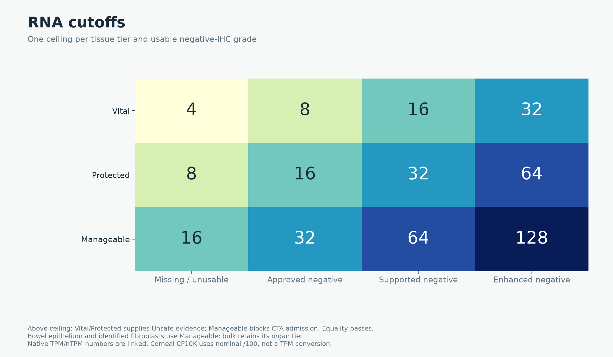

The negative-IHC columns require a usable profile control, complete group-member coverage and a supported tissue/cell match. Same-tissue IHC for an unrelated cell cannot increase a ceiling. Values retain their native units; pTPM denotes protein-coding **RNA** TPM. Tumor eligibility uses >0 in at least one compatible OncoRef TPM or HPA pTPM sample, without summing maxima from different samples.

## Filtering funnel

| layer | new_candidate_removals | new_Unsafe | CTA_eligible_so_far | Unsafe | Other | Unassigned |
| --- | --- | --- | --- | --- | --- | --- |
| Reproductive / embryonic association | 2175 | 0 | 17688 | 0 | 0 | 2175 |
| Cancer expression | 8 | 0 | 17680 | 0 | 0 | 2183 |
| HPA normal protein | 12044 | 10161 | 5636 | 10161 | 0 | 4066 |
| Required RNA coverage | 102 | 0 | 5534 | 10161 | 0 | 4168 |
| Reproductive concentration | 1007 | 0 | 4527 | 10161 | 0 | 5175 |
| Translation qualification | 118 | 0 | 4409 | 10161 | 0 | 5293 |
| Normal bulk | 3434 | 7478 | 975 | 17639 | 0 | 1249 |
| HPA tissue clusters | 232 | 365 | 743 | 18004 | 0 | 1116 |
| HPA immune | 12 | 27 | 731 | 18031 | 0 | 1101 |
| Monaco immune | 11 | 21 | 720 | 18052 | 0 | 1091 |
| DICE immune | 15 | 44 | 705 | 18096 | 0 | 1062 |
| Adult cornea | 2 | 5 | 703 | 18101 | 0 | 1059 |
| Accepted normal-protein evidence | 3 | 2 | 700 | 18103 | 0 | 1060 |
| Reviewed normal-cell knowledge | 3 | 31 | 697 | 18134 | 0 | 1032 |
| Clinical safety exclusion | 0 | 0 | 697 | 18134 | 0 | 1032 |
| Rare vital-tissue cell expression | 74 | 121 | 623 | 18255 | 0 | 985 |
| Rare Protected-cell expression review | 6 | 0 | 617 | 18255 | 0 | 991 |
| External validated normal protein | 0 | 0 | 617 | 18255 | 0 | 991 |
| Unsafe sequence containment | 15 | 0 | 602 | 18255 | 0 | 1006 |
| CTA and Other assignments | 0 | 0 | 602 | 18255 | 1006 | 0 |

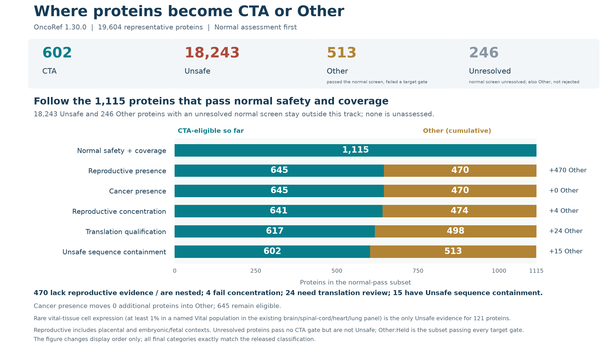

The normal screen is evaluated first in this view. Other accumulates as identity
requirements fail. [Counts at each stage](figures/category-funnel.csv).

The detailed layer view below retains the historical display order; its temporary
holds are resolved into final categories only after all safety layers are evaluated.

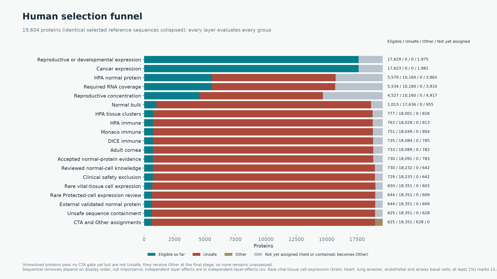

[Independent layer effects](../cta-selection-20261028/independent-layer-effects.csv) distinguish overlapping evidence from order-dependent first removals. All counts use proteins (identical selected reference sequences collapsed); gene-locus counts are explicitly labelled.

## Selected CTA expression

These plots compare adult/placental nTPM against the highest measured embryonic lineage mean TPM. **560 of 602 selected proteins (93%) have both coordinates; 42 (7%) lack an embryonic coordinate.** The plotted embryonic coordinate is the maximum across separate stage/lineage means from Tyser (gastrulation) and Petropoulos (days 3–7). It is not an average across studies. Petropoulos restores measured rows for PRAME, MAGE-A4, CT83, CTAG1A/B and XAGE1A/B. Missing rows remain unavailable; neither atlas establishes expression throughout later fetal development.

The follow-up checked the study authors' **57,490-column raw-count matrix**, separately from the atlas's 25,330-row filtered matrix. The atlas download labelled “Raw counts” is also filtered and retains the same gene rows. Direct author observations are:

| source_symbol | gene_column_present | cells | total_reported_reads | positive_cells |
| --- | --- | --- | --- | --- |
| PRAME | True | 1195 | 0 | 0 |
| MAGEA4 | True | 1195 | 14 | 1 |
| CTAG1A | True | 1195 | 0 | 0 |
| CTAG1B | True | 1195 | 0 | 0 |
| XAGE1A | False | 1195 | — | — |
| XAGE1B | True | 1195 | 0 | 0 |
| CT83 | True | 1195 | 0 | 0 |
| TBXT | True | 1195 | 3.115e+04 | 226 |

PRAME, CT83, CTAG1A/B and XAGE1B have zero reported reads across these 1,195 cells; MAGE-A4 has 14 reads in one cell. TBXT has 31,149 reported reads in 226 cells. XAGE1A has no separate column, so complete XAGE1A/B group coverage is not established in this raw-count source; the separate Petropoulos TPM matrix does measure both loci. These are observed nondetections or sparse signals in one early embryo, **not absence throughout fetal development**. The exact per-gene reason for exclusion from the atlas remains unavailable; the authors' counts support low detection but come from a separate quantification. They are not converted to TPM or inserted into the selection funnel. [Author data](https://github.com/ScialdoneLab/human-gastrula-shiny), [count evidence and gene IDs](embryonic-comparator-coverage.csv), [source hashes](embryonic-coverage-receipt.json).

Each figure now shows the 560 measured groups above and the 42 missing-embryonic groups in a separate categorical band below. All selected proteins are represented; the band has no embryonic-expression value. Gray points mean the healthy-expression color is unavailable. Overview labels highlight the widely studied antigens, including their gene-group names. Three companion panels label every selected protein ≥5 on both axes, with the same axes and one third of the names per panel. The latter is a descriptive expression criterion; developmental admission also requires cell support.

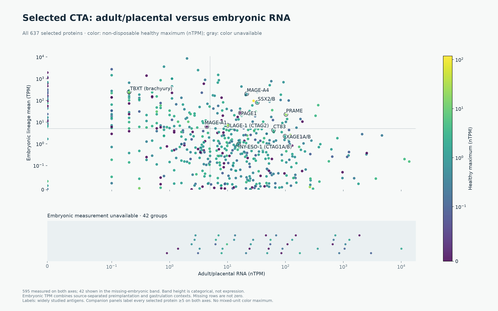
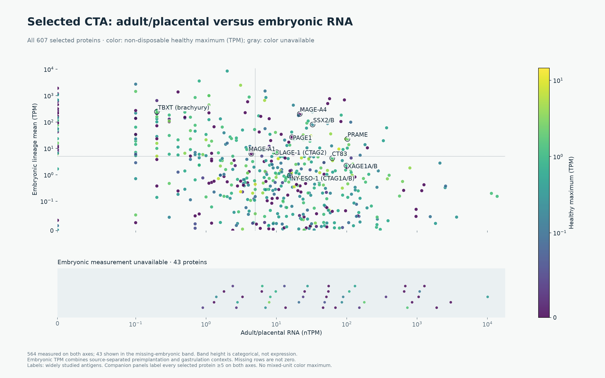
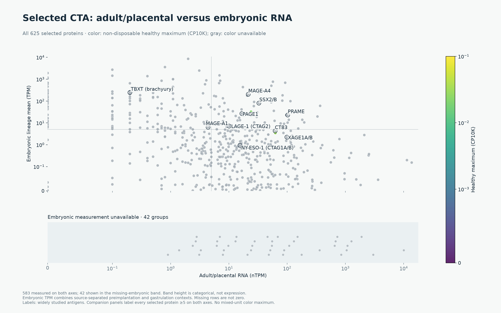

Color uses the maximum supported value across non-disposable healthy compartments within each unit: HPA bulk/brain/cell/immune nTPM, direct GTEx/Monaco/DICE TPM, or corneal CP10K. No maximum mixes units. Reproductive/developmental locations are excluded from the color scale. Missing embryonic measurements are not plotted at zero. [Every selected protein's plot data](selected-expression-scatter.csv.gz).

### Groups high in both expression compartments

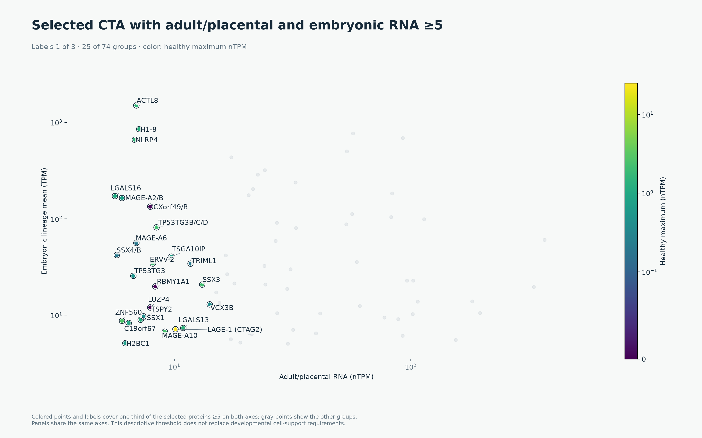
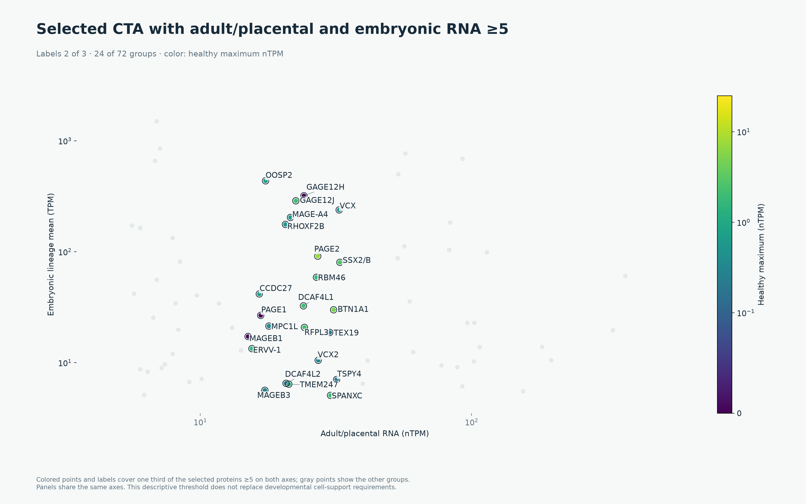
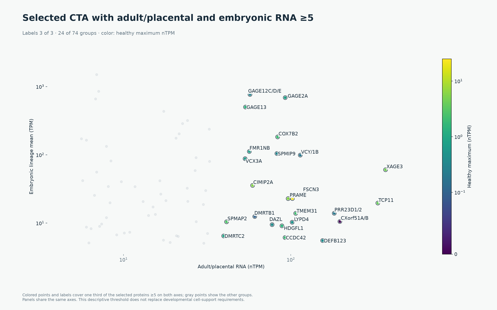

## Widely studied antigens

| protein_group_label | category | assessment_status | reproductive_ntpm | developmental_all_lineage_max_tpm | adult_bulk_max_ntpm | exclusion_reasons |
| --- | --- | --- | --- | --- | --- | --- |
| PAGE1 | CTA | screened | 16.7 | 26.69 | 0 |  |
| SMC1B | Unsafe | screened | 30.2 | 1.417 | 0.7 | Absolute tissue/IHC RNA limits, qualifying normal protein and clinical safety evidence; required coverage is separate from absence of a detected exclusion.  /  2.12% of brain: cerebellar granule cell cells express it (1,242 of 58,474 cells); at least 1% of a vital-tissue cell type. Detection frequency, not abundance; developmental cell types are excluded by name, not donor age. |
| CTAG2 | CTA | screened | 10.1 | 7.151 | 5.1 |  |
| MAGEA4 | CTA | screened | 21.5 | 203.6 | 0.6 |  |
| TBXT | CTA | screened | 0.2 | 245.1 | 2.5 |  |
| PRAME | CTA | screened | 102.2 | 22.89 | 3.6 |  |
| MAGEA1 | CTA | screened | 4.4 | 6.315 | 0 |  |
| CT83 | CTA | screened | 62.2 | 4.286 | 2.6 |  |
| MAGEA12 | Unsafe | screened | 2.7 | 102.1 | 0.5 | Absolute tissue/IHC RNA limits, qualifying normal protein and clinical safety evidence; required coverage is separate from absence of a detected exclusion.  /  1.48% of brain: midbrain dopaminergic neuron cells express it (293 of 19,760 cells); at least 1% of a vital-tissue cell type. Detection frequency, not abundance; developmental cell types are excluded by name, not donor age. |
| MAGEA3 | Unsafe | screened | 7.8 | 71.75 | 0.2 | Absolute tissue/IHC RNA limits, qualifying normal protein and clinical safety evidence; required coverage is separate from absence of a detected exclusion.  /  colon: undifferentiated cells; 53.1 nTPM (ceiling 4) |
| NY-ESO-1 | CTA | screened | 15.5 | 0.9473 | 0.5 |  |
| SSX2/B | CTA | screened | 32.7 | 80.25 | 2.8 |  |
| XAGE1A/B | CTA | screened | 98.8 | 2.237 | 1.5 |  |

Each comparison has its own full-width figure. The embryonic comparison retains missing-measurement antigens in a separate band.

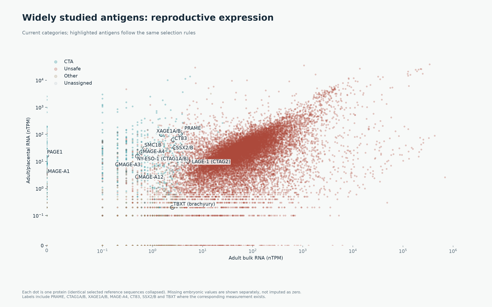
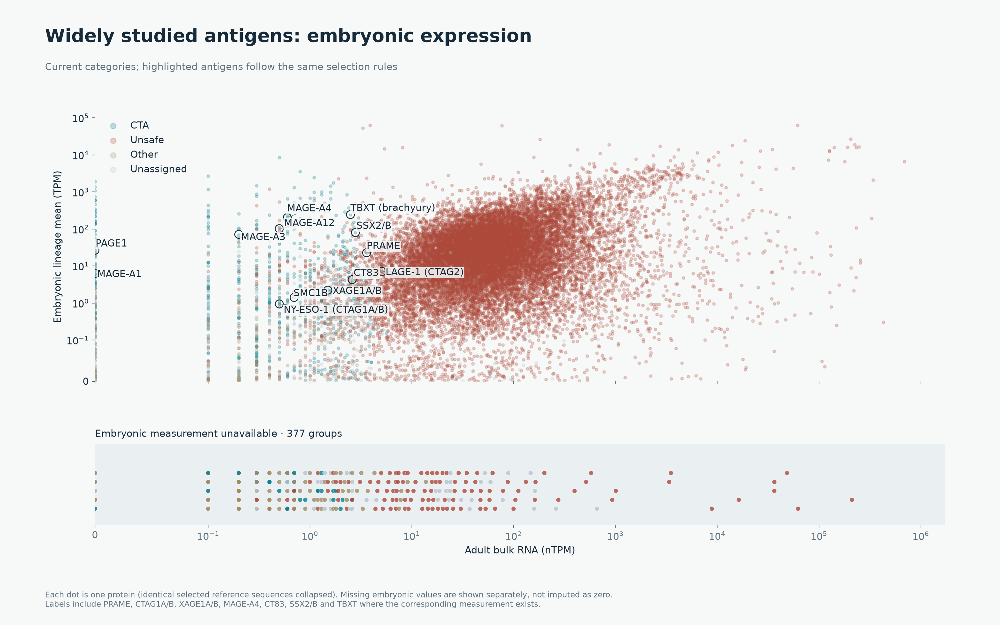

[Detailed tissue/cell/value explanations](human-explanations.csv.gz), [all comparator contexts](../cta-selection-20261028/widely-studied-contexts.csv.gz), and [every previously annotated CTA and its current category](../cta-selection-20261028/known-cta-decisions.csv.gz). Previous CTA labels are comparison annotations only. Historical-cohort counts, where available: {'CTA': 146, 'Unsafe': 62, 'Other': 5}.

## Serious adverse events from CTA-directed TCR-T

**Treatment toxicity and antigen-specific injury are different findings.** SAE seriousness (for example hospitalization or death) is distinct from CTCAE severity. This targeted review includes important severe events and ungraded serious cases; it is not an exhaustive SAE database or a pooled incidence estimate.

| Protein origins (current screen) | Receptor / product | Important events | RNA credit |
|---|---|---|---|
| CTAG1A: CTA; CTAG1B: CTA; CTAG2: CTA | [Letetresgene autoleucel / NY-ESO-1 c259](https://doi.org/10.1200/JCO-24-01466) | Fatal cardiac arrest, day 161. Guillain-Barre / inflammatory demyelinating neuropathy. | One step, capped |
| PRAME: CTA | [IMA203](https://doi.org/10.1038/s41591-025-03650-6) | Grade 4 transaminitis during a grade 3 CRS episode. | One step, capped |
| MAGEA4: CTA | [Afamitresgene autoleucel / c1032](https://doi.org/10.1038/s41591-022-02128-z) | Fatal aplastic anemia, day 55. Fatal ischemic cerebrovascular accident, day 17. | One step, capped |
| MAGEA3: Unsafe | [MAGE-A3 affinity-enhanced a3a receptor](https://doi.org/10.1126/scitranslmed.3006034) | Fatal cardiac injury with titin cross-recognition. | None |
| MAGEA1: CTA | [IMA202](https://doi.org/10.1136/jitc-2023-008668) | Fatal dyspnea. | One step, capped |
| MAGEA10: CTA | [ADP-A2M10 / MAGE-A10 c796](https://doi.org/10.1136/jitc-2021-003581) | Grade 4 CRS. Fatal marrow aplasia, sepsis and respiratory distress after repeat infusion. | One step, capped |
| CTAG1A: CTA; CTAG1B: CTA; CTAG2: CTA | [TBI-1301](https://doi.org/10.1136/jitc-2021-003811) | Steroid-responsive lung injury with TCR-T infiltration. | None |
| MAGEA3: Unsafe; MAGEA9: CTA; MAGEA12: Unsafe; MAGEA9B: CTA | [NCI HLA-A*02-restricted MAGE-A3/A9/A12-reactive TCR](https://pubmed.ncbi.nlm.nih.gov/23377668/) | Fatal neurological injury after MAGE-A3/A9/A12-reactive TCR; causal peptide unresolved. | None |

The MAGE-A3 **a3a** cardiac cases implicated **titin (TTN)**, an unintended target; the separate NCI MAGE-A3/A9 receptor neurological cases initially implicated **MAGE-A12**, while the [2021 re-examination](https://pmc.ncbi.nlm.nih.gov/articles/PMC7946352/) supports **EPS8L2** as a competing, unproven cause. Product-specific injury remains established; unique peptide causality does not. MAGEA12 retains an independent rare-cell exclusion. TBI-1301's grade 3 lung injury retains an unresolved-specificity hold for that product. c259's late cardiac death and Guillain-Barre cases remain caveats without an established peptide-specific mechanism.

[Full attribution, epitope/HLA mappings, cohort denominators and limitations](../cta-tcr-trials-20261029/index.md). A favorable reviewed product supplies one capped RNA step, never protein or clinical-injury clearance. The exact tested peptide matters: NY-ESO-1 and **CTAG2/LAGE-1A** share SLLMWITQC; this does not clear LAGE-1B or other CTAG2 peptides.

## Evidence limits

Adult normal panels do not establish pediatric safety. Tyser contains one gastrulating embryo; Petropoulos adds preimplantation embryos. Later fetal and pediatric coverage remains incomplete. RNA expression does not measure peptide-HLA presentation; HPA negative staining has finite sensitivity. PRAME informed earlier parameter choices and is not independent validation. All gene IDs, equivalence-group members, source versions and native units remain in the exports.
