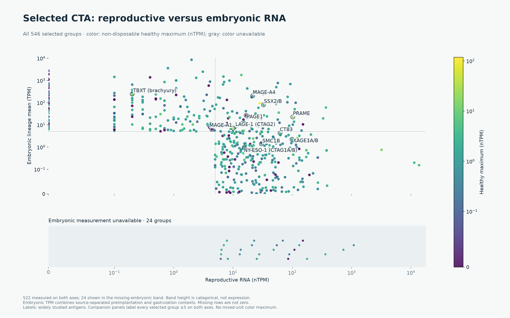
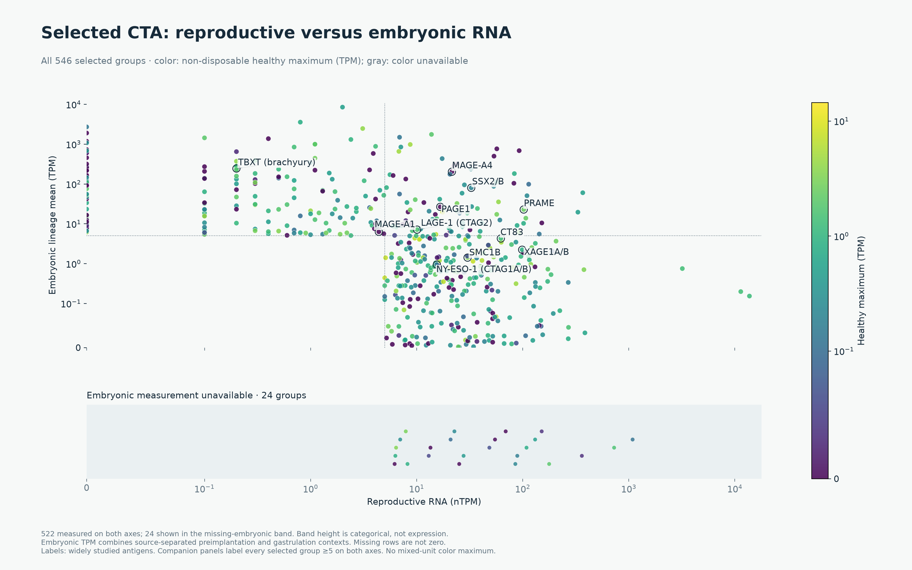
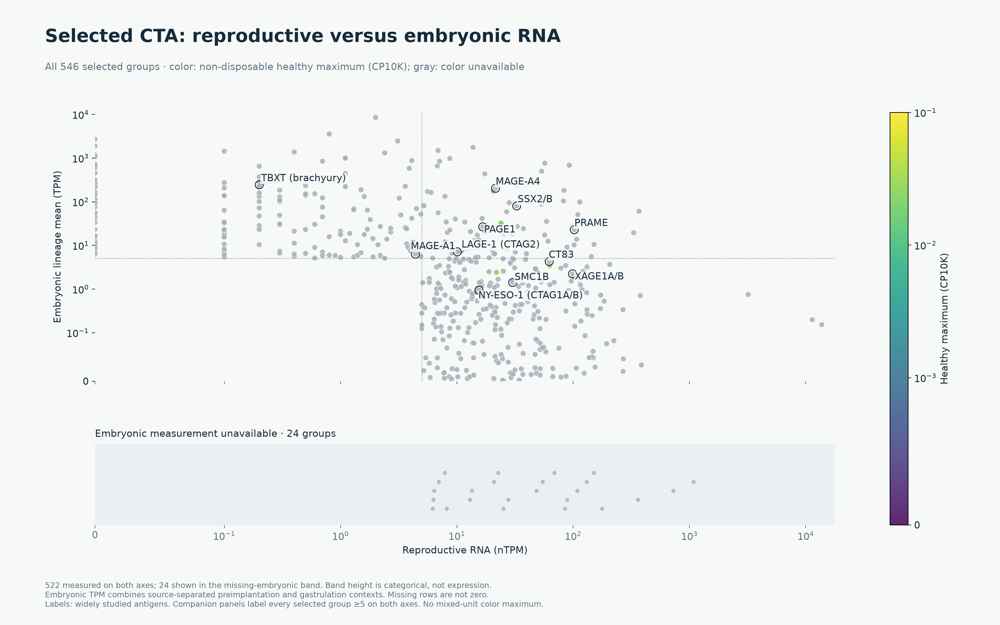
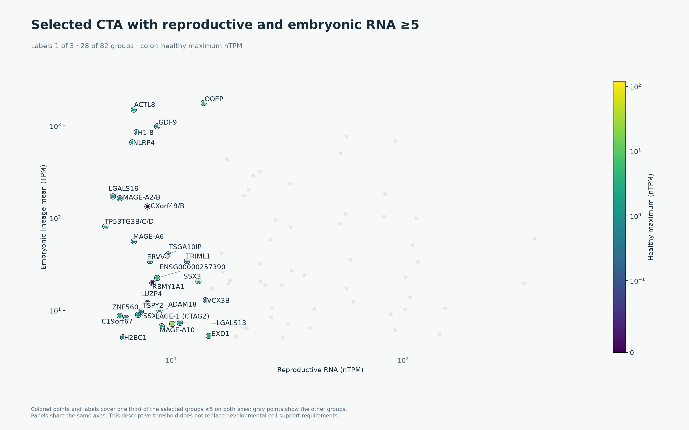
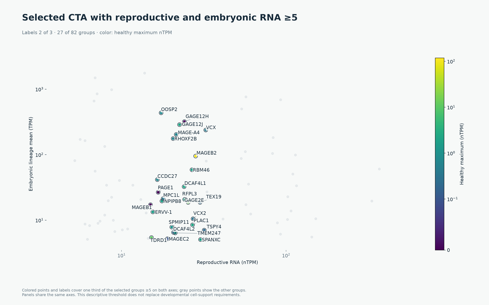
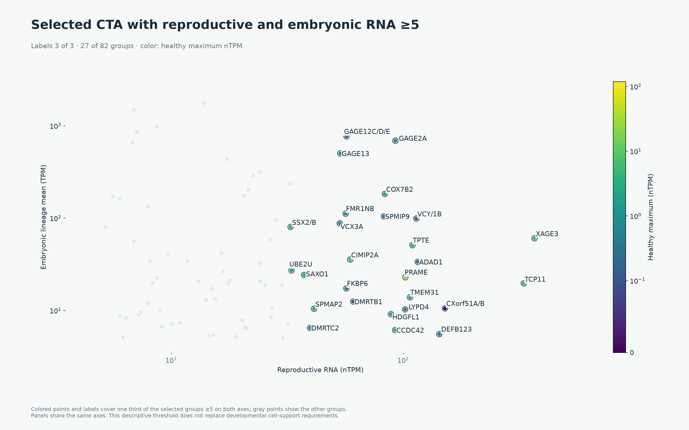
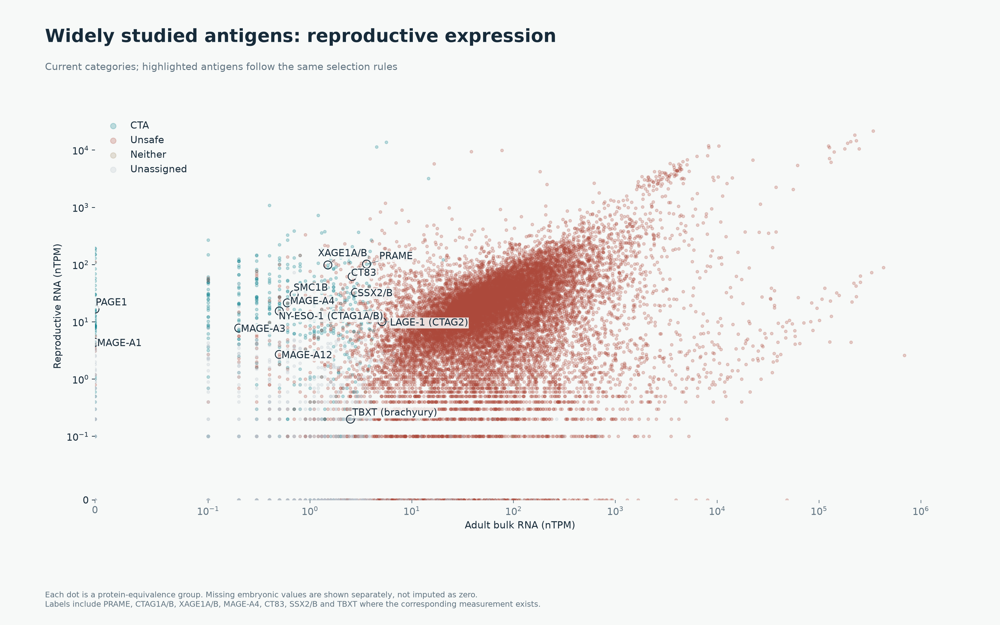
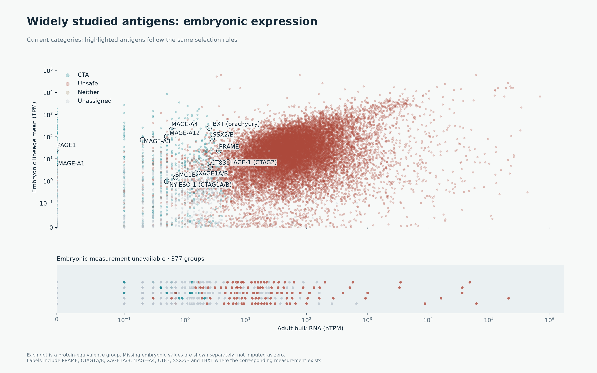

# CTA and oncofetal selection

**546 CTA groups (582 loci), 18,031 Unsafe, 20 Neither and 1,266 unassigned**, across 19,863 protein-equivalence groups. Policy: `oncoref.cta-selection.2026-10-29`. This is the current policy; the [1.21.0 release](../cta-release-1.21.0/index.md) remains a frozen comparison.

[Slides](slides/cta-evidence-walkthrough-expanded.pptx) · [Dog evidence](dog.md) · [Shared API](api.md) · [Policy and IHC matching](policy-review.md) · [All decisions](../cta-selection-20261028/protein-group-classifications.csv.gz) · [Changed decisions](../cta-selection-20261028/classification-changes.csv.gz)

## Categories

**Safety, cancer expression, adult restriction and reproductive/developmental
association are separate requirements. Only safety evidence can establish Unsafe.**
Cancer needs one qualifying measured sample, without a tumor-versus-normal ratio.
Restriction compares a qualifying association signal against supported adult
normal expression in its own native units. [Definitions and logic](../../cta-evidence-axes.md).

- **CTA:** association, adult restriction, one qualifying cancer sample, required coverage and acceptable normal expression all pass.
- **Unsafe:** above the single RNA ceiling in Vital/Protected, accepted non-Low protein in those compartments, or retained clinical exclusion evidence. This is a research-policy exclusion, not demonstrated toxicity.
- **Neither:** an affirmative low-expression profile or diffuse-Manageable profile, with complete required RNA coverage and no unresolved evidence. Failed candidate gates alone do not establish Neither.
- **Unassigned:** missing/uncertain evidence or an observed profile that fits none of those definitions. In the API, category is null and assessment_status explains why.

The separate **2× Strong boundary is removed**. Every layer evaluates every group; Neither is assigned only after its complete-profile check. DICE and corneal coverage remain optional, but observed counterevidence contributes.

## Neither profiles

The shared appreciable-expression floor is **2** in native TPM/nTPM, matching the tumor gate. Corneal CP10K uses the existing nominal /100 policy. This is an operational threshold, not a source-validated detection limit.

| Profile | Required evidence | Groups |
|---|---|---:|
| Low expression | All measured normal, reproductive, embryonic and tumor RNA below 2; required normal panels and mapped tumor/developmental measurements present; no detected protein | 9 |
| Diffuse Manageable | Fails both reproductive/developmental association routes; RNA ≥2 in at least two distinct Manageable tissue concepts; required normal coverage; no above-cutoff or accepted non-Low Vital/Protected protein evidence | 11 |

Colon and rectum count as one tissue for breadth. A high reproductive measurement cannot conceal broad normal expression. Missing optional measurements are disclosed, not set to zero. 9 groups meet the complete low-expression profile. Unassigned statuses: {'outside_category_definitions': 649, 'incomplete_evidence': 617}.

## What the assessment statuses mean

| API status | Meaning | Human groups |
|---|---|---:|
| `screened` | A CTA, Unsafe or Neither category has been assigned by this policy. It does not mean safe, clinically validated or complete coverage of every source. | 18,597 |
| `incomplete_evidence` | No category was assigned, and required normal coverage, mapped tumor/developmental measurements or evidence resolution is missing. | 617 |
| `outside_category_definitions` | No category was assigned; the tracked coverage/resolution checks pass but the observed profile meets none of the three definitions. | 649 |
| `unassessed` | No species-specific quantitative policy has been applied; used for native dog nominations. | 0 |

An available exclusion can establish Unsafe despite another missing assay. A reproductive-route CTA need not have embryonic measurements. The low-expression Neither profile needs both tumor and embryonic coverage; the diffuse-Manageable profile has different requirements.

Among the 617 incomplete assessments, gaps overlap:

| Evidence gap | Groups |
| --- | --- |
| normal panel missing | 371 |
| tumor measurement missing | 34 |
| tumor group profile incomplete | 17 |
| embryonic measurement missing | 296 |
| unresolved evidence | 28 |

[Exact data sources, missing tissue/cell contexts, member identities and cohort coverage](coverage.md) · [Per-group gap flags](unassigned-evidence-gaps.csv). The previous 71 tumor gaps combined 41 missing measurements and 30 measured groups with incomplete low-expression-profile coverage. The table above reflects the subsequent identity repair. The comparator table below reflects the new developmental and normal-bulk sources; MAGE family members are not admission controls.

## Sources of candidate annotations

These published lists annotate the selection; they do not provide a gene-specific admission bypass. The union is **2,514 mapped groups / 2,570 loci**. **438** selected groups have a listed-paper annotation; **108** do not. Source contribution counts overlap. **Mapped groups means curated nominations linked to the current reference, not newly discovered genes or selected CTAs.** The CTA column reports the subset passing the current funnel.

| citation | mapped_entities | CTA | Unsafe | Neither | Unassigned | source_url |
| --- | --- | --- | --- | --- | --- | --- |
| da Silva et al. (2017) | 1017 | 376 | 401 | 1 | 239 | https://doi.org/10.18632/oncotarget.21715 |
| Wang et al. (2016) | 988 | 264 | 640 | 1 | 83 | https://doi.org/10.1038/ncomms10499 |
| Chang et al. (2019) | 985 | 285 | 639 | 0 | 61 | https://doi.org/10.1002/cam4.2223 |
| Gong et al. (2021) | 729 | 337 | 306 | 0 | 86 | https://doi.org/10.1038/s41467-021-22695-y |
| Bruggeman et al. (2018) | 692 | 23 | 663 | 0 | 6 | https://doi.org/10.1038/s41388-018-0357-2 |
| Jamin et al. (2021) | 469 | 34 | 427 | 0 | 8 | https://doi.org/10.1002/1878-0261.12900 |
| Loriot et al. (2025) | 202 | 81 | 101 | 0 | 20 | https://doi.org/10.1371/journal.pgen.1011734 |
| Carter et al. (2023) | 103 | 57 | 37 | 0 | 9 | https://doi.org/10.1136/jitc-2023-007935 |
| Hirbo et al. (2015) | 78 | 12 | 64 | 0 | 2 | https://doi.org/10.1371/journal.pone.0144155 |
| Seager et al. (2024) | 15 | 11 | 2 | 0 | 2 | https://doi.org/10.1186/s12967-024-04918-0 |
| Sasaroli et al. (2011) | 13 | 0 | 13 | 0 | 0 | https://doi.org/10.4161/cbt.12.3.16260 |
| Garg et al. (2007) | 5 | 3 | 2 | 0 | 0 | https://doi.org/10.1158/1078-0432.CCR-06-2340 |

### Broader nominations and a compact primary-source list

[Sasaroli et al. (2011)](https://pmc.ncbi.nlm.nih.gov/articles/PMC3230481/) contributes its 13 detailed tumor-vascular candidates, all mapped. [Hirbo et al. (2015)](https://doi.org/10.1371/journal.pone.0144155) contributes 86 placenta-enriched nominations: 82 mapped identities and four unresolved names. Its 30 fast-evolving genes are a nested subset, not 30 additional genes. Noncoding mapped rows remain in the intake audit but do not enter protein-group counts. These are vascular and placental nomination scopes, not proof of CTA restriction.

EGFL6 now occurs in Sasaroli, Hirbo and Bai. The main source table and plots omit fully redundant single-digit sets: Bai, Boël and Bradley. Their memberships and citations remain in the downloadable provenance. Garg stays because it uniquely contributes SPAG9 in the current registry. A source is retired from the main view only if the retained sources cover its entire mapped set; the union is unchanged by this presentation choice.

| citation | mapped_entities | covered_by |
| --- | --- | --- |
| Bradley et al. (2020) | 9 | ('10.1002/1878-0261.12900', '10.1002/cam4.2223', '10.1038/ncomms10499', '10.1038/s41388-018-0357-2', '10.1038/s41467-021-22695-y', '10.1371/journal.pone.0144155', '10.18632/oncotarget.21715', '10.4161/cbt.12.3.16260') |
| Boël et al. (1995) | 2 | ('10.1002/1878-0261.12900', '10.1002/cam4.2223', '10.1038/ncomms10499', '10.1038/s41388-018-0357-2', '10.1038/s41467-021-22695-y', '10.1136/jitc-2023-007935', '10.1186/s12967-024-04918-0', '10.1371/journal.pgen.1011734', '10.18632/oncotarget.21715') |
| Bai et al. (2016) | 1 | ('10.1371/journal.pone.0144155', '10.4161/cbt.12.3.16260') |

Bai's 538 EGFL6-correlated genes are not a CTA list. Garg recognizes SPA17, SYCP1, NY-ESO-1 and SSX4 alongside SPAG9; Boël recognizes MAGE-A1/A3 alongside the unresolved BAGE label. BAGE's textual overlap with Seager remains outside mapped overlap counts. [Original targeted sets and overlaps](targeted-paper-overlaps.csv) · [Evidence roles](publication-context.csv) · [Every paper's extraction scope](paper-source-scope.csv) · [New source rows, aliases and unresolved names](publication-intake/mapped-source-rows.csv).

The larger papers already contribute their registered gene sets, including Wang's 1,019 CT-pattern genes, Bruggeman's 756 germ-cell genes, da Silva's 1,103 testis-biased and nested 745 CT genes, Chang's 1,036 TGCT genes, Carter's 103 final CT genes, and Loriot's 146 strict plus 134 preferential annotations. Input rows, gene loci and collapsed protein groups differ; these numbers must not be summed. Gong contributes reproductive/placental expression nominations rather than a claimed CTA list. This audit adds the declared vascular and placental sets; it does not claim a fresh exhaustive full-text review of every large source.

EGFL6 is excluded by lung bulk RNA (24.8 nTPM), lung smooth-muscle RNA (363.3 nTPM) and corneal evidence. SPAG9 has accepted bronchial protein staining and broad RNA counterevidence, including spinal cord (66.3 nTPM) and brain oligodendrocytes (287.1 nTPM). These are current quantitative-policy exclusions, irrespective of the original paper's terminology.

[All pairwise overlaps](human-overlaps.csv.gz) · [Memberships and gene IDs](human-memberships.csv.gz)

## Why roughly 12,000 groups have reproductive or developmental association

The starting association set comes from whole-reference **RNA measurements**, not a 12,000-gene literature list. Reproductive association requires HPA ≥5 nTPM and greater than adult nonreproductive bulk maximum. The developmental route requires a supported source-specific stage/lineage mean ≥5 TPM in Tyser or Petropoulos, ≥20 cells, ≥5 positive cells and ≥10% positive at ≥1 TPM. It establishes embryonic presence, not embryonic restriction. Later fetal and child/adult developmental atlases are not yet integrated.

| route | entrants | CTA |
| --- | --- | --- |
| Reproductive only | 2322 | 298 |
| Developmental only | 2095 | 170 |
| Both | 10910 | 78 |

[Tyser et al. (2021)](https://doi.org/10.1038/s41586-021-04158-y), [HPA v23 downloads](https://v23.proteinatlas.org/about/download).

## Measurement sources and filtering rules

| name | evidence_category | native_unit | status | source_url |
| --- | --- | --- | --- | --- |
| HPA v23 / GTEx consensus | normal_bulk_rna | nTPM | used_in_selection | https://v23.proteinatlas.org/about/download |
| HPA v23 / GTEx consensus | reproductive_expression | nTPM | used_in_selection | https://v23.proteinatlas.org/about/download |
| Tyser human gastrulation atlas | developmental_expression | TPM | used_in_selection | https://doi.org/10.1038/s41586-021-04158-y |
| Petropoulos preimplantation atlas | developmental_expression | TPM | used_in_selection | https://www.ebi.ac.uk/gxa/sc/experiments/E-MTAB-3929/Results |
| HPA v23 human brain, 193 subregions | normal_bulk_rna | nTPM | used_in_selection | https://v23.proteinatlas.org/download/rna_brain_hpa.tsv.zip |
| Direct GTEx v11 tissue medians | normal_bulk_rna | TPM | used_in_selection | https://gtexportal.org/home/downloads/adult-gtex |
| OncoRef source-mapped tumor union | tumor_expression | TPM | used_in_selection | https://github.com/pirl-unc/oncoref/tree/v1.21.0/docs/audits/cta-expanded-funnel-20261027/tumor-union |
| HPA cancer sample measurements | tumor_expression | pTPM | used_in_selection | https://v23.proteinatlas.org/about/download |
| HPA tissue/cell clusters | normal_cell_rna | nTPM | used_in_selection | https://v23.proteinatlas.org/about/download |
| HPA immune summaries | immune_rna | nTPM | used_in_selection | https://v23.proteinatlas.org/about/download |
| Monaco immune summaries | immune_rna | TPM | used_in_selection | https://v23.proteinatlas.org/about/download |
| DICE immune distributions | immune_rna | TPM | used_in_selection | https://dice-database.org/ |
| Collin adult corneal atlas | normal_cell_rna | CP10K | used_in_selection | https://www.ncbi.nlm.nih.gov/geo/query/acc.cgi?acc=GSE155683 |
| HPA normal-tissue IHC | normal_protein | HPA categorical level and reliability | used_in_selection | https://v23.proteinatlas.org/about/assays%2Bannotation |
| Curated external staining observations | normal_protein | native categorical findings | used_in_selection | https://github.com/pirl-unc/oncoref/tree/v1.21.0/docs/audits/external-ihc-20261027 |
| Reviewed normal protein and clinical exclusions | normal_protein | categorical reviewed findings | used_in_selection | https://github.com/pirl-unc/oncoref/blob/v1.21.0/oncoref/data/cta-policy-findings.csv |
| Reviewed normal protein and clinical exclusions | clinical_safety | categorical reviewed findings | used_in_selection | https://github.com/pirl-unc/oncoref/blob/v1.21.0/oncoref/data/cta-policy-findings.csv |
| Gong et al., Nature Communications (2021) | nomination | gene-list membership | annotation | https://doi.org/10.1038/s41467-021-22695-y |
| Gong et al., Nature Communications (2021) | nomination | gene-list membership | annotation | https://doi.org/10.1038/s41467-021-22695-y |
| Bradley et al., Nature Communications (2020) | nomination | gene-list membership | annotation | https://doi.org/10.1038/s41467-020-19141-w |
| Wang 2016 | nomination | gene-list membership | annotation | https://doi.org/10.1038/ncomms10499 |
| Bruggeman 2018 | nomination | gene-list membership | annotation | https://doi.org/10.1038/s41388-018-0357-2 |
| da Silva 2017 · testis-biased | nomination | gene-list membership | annotation | https://doi.org/10.18632/oncotarget.21715 |
| da Silva 2017 · CT | nomination | gene-list membership | annotation | https://doi.org/10.18632/oncotarget.21715 |
| Jamin 2021 | nomination | gene-list membership | annotation | https://doi.org/10.1002/1878-0261.12900 |
| Jamin 2021 · core | nomination | gene-list membership | annotation | https://doi.org/10.1002/1878-0261.12900 |
| Chang 2019 · TGCT | nomination | gene-list membership | annotation | https://doi.org/10.1002/cam4.2223 |
| Carter 2023 | nomination | gene-list membership | annotation | https://doi.org/10.1136/jitc-2023-007935 |
| Seager 2024 · panel | nomination | gene-list membership | annotation | https://doi.org/10.1186/s12967-024-04918-0 |
| Loriot 2025 · strict | nomination | gene-list membership | annotation | https://doi.org/10.1371/journal.pgen.1011734 |
| Loriot 2025 · preferential | nomination | gene-list membership | annotation | https://doi.org/10.1371/journal.pgen.1011734 |
| Gong 2021 · reproductive coding | nomination | gene-list membership | annotation | https://doi.org/10.1038/s41467-021-22695-y |
| Gong 2021 · reproductive noncoding | nomination | gene-list membership | annotation | https://doi.org/10.1038/s41467-021-22695-y |
| da Silva 2017 · tumor proteomics | nomination | gene-list membership | annotation | https://doi.org/10.18632/oncotarget.21715 |
| Bai 2016 | nomination | gene-list membership | annotation | https://doi.org/10.1158/0008-5472.CAN-16-0225 |
| Boël et al., Immunity (1995) | nomination | gene-list membership | annotation | https://doi.org/10.1016/s1074-7613(95)80053-0 |
| Garg et al., Clinical Cancer Research (2007) | nomination | gene-list membership | annotation | https://doi.org/10.1158/1078-0432.CCR-06-2340 |
| Sasaroli et al. (2011) | nomination | gene-list membership | annotation | https://doi.org/10.4161/cbt.12.3.16260 |
| Hirbo et al. (2015) | nomination | gene-list membership | annotation | https://doi.org/10.1371/journal.pone.0144155 |

| stage | rule |
| --- | --- |
| Reproductive or developmental expression | Reproductive ≥5 nTPM OR supported developmental stage/lineage mean ≥5 TPM; ≥20 cells, ≥5 positive and ≥10% positive at ≥1 TPM. This tests association; adult restriction is separate. |
| Tumor sample ≥2 TPM/pTPM | At least one measured compatible tumor sample ≥2 in native TPM or HPA pTPM; do not add maxima from different samples. |
| Adult restriction | A qualifying reproductive signal must exceed supported adult normal nTPM, OR a qualifying developmental signal must exceed supported adult normal TPM. Compare within native units across Vital/Protected/Manageable; Reproductive/Disposable are excluded. CP10K remains safety-only. Missing comparators do not pass; no tumor-versus-normal gate. |
| HPA normal protein | Reliable non-Low positives in Vital/Protected supply Unsafe evidence; Manageable positives block CTA only; uncertain evidence remains unresolved. Low is flagged. |
| Required RNA coverage | Required nonreproductive bulk anatomy across HPA consensus, HPA brain or direct GTEx, plus distinct tissue-cell/immune panels; every group member measured. DICE and cornea are optional coverage. |
| Normal bulk | One inclusive tissue/IHC ceiling: above it in Vital/Protected supplies Unsafe evidence; above it in Manageable blocks CTA. No second RNA boundary. |
| HPA tissue clusters | RNA requires ≥20 reads and uses the single ceiling. IHC credit requires an exact or declared compartment match; unrelated cells in the same tissue cannot inherit it. |
| HPA immune | Protected-tier native nTPM limits without matched negative-IHC credit; reproductive/placental location remains neutral. |
| Monaco immune | Protected-tier native TPM limits without matched negative-IHC credit. |
| DICE immune | Third-highest reported TPM value; native protected-tier limits. Unpaired group distributions retain bounds. Missing coverage alone does not exclude. |
| Adult cornea | Recurrent native CP10K: ≥5 positive cells and ≥20 counts in ≥2 sample groups. Nominal RNA limits /100; not a TPM conversion. Missing coverage alone does not exclude. |
| Accepted normal-protein evidence | Accepted positive protein findings exclude unless extracted Low intensity retains a flag; unquantified does not mean negative. |
| Clinical safety exclusion | Retain reviewed product-specific clinical injury counterevidence and causal-attribution limits; no admission shortcut from clinical use. |
| External validated normal protein | Use categorical/quantitative staining only within verified reagent, tissue and cell scope; no inherited HPA reliability label. |
| Neither expression profiles | Neither requires complete required RNA coverage and either all measured RNA below the shared 2-unit floor with no detected protein, or failed reproductive/developmental association with appreciable RNA in >=2 Manageable tissue concepts and no Vital/Protected exclusion. Missing/unresolved evidence and other profiles are unassigned. |

The negative-IHC columns require a usable profile control, complete group-member coverage and a supported tissue/cell match. Same-tissue IHC for an unrelated cell cannot increase a ceiling. Values retain their native units; pTPM denotes protein-coding **RNA** TPM. Tumor eligibility uses ≥2 in at least one compatible OncoRef TPM or HPA pTPM sample, without summing maxima from different samples.

## Filtering funnel

| layer | new_candidate_removals | new_Unsafe | CTA_eligible_so_far | Unsafe | Neither | Unassigned |
| --- | --- | --- | --- | --- | --- | --- |
| Reproductive / embryonic association | 4536 | 0 | 15327 | 0 | 0 | 4536 |
| Tumor sample ≥2 TPM/pTPM | 13 | 0 | 15314 | 0 | 0 | 4549 |
| Adult restriction | 10212 | 0 | 5102 | 0 | 0 | 14761 |
| HPA normal protein | 3041 | 10094 | 2061 | 10094 | 0 | 7708 |
| Required RNA coverage | 71 | 0 | 1990 | 10094 | 0 | 7779 |
| Normal bulk | 1284 | 7406 | 706 | 17500 | 0 | 1657 |
| HPA tissue clusters | 130 | 414 | 576 | 17914 | 0 | 1373 |
| HPA immune | 7 | 30 | 569 | 17944 | 0 | 1350 |
| Monaco immune | 3 | 17 | 566 | 17961 | 0 | 1336 |
| DICE immune | 15 | 55 | 551 | 18016 | 0 | 1296 |
| Adult cornea | 3 | 12 | 548 | 18028 | 0 | 1287 |
| Accepted normal-protein evidence | 1 | 2 | 547 | 18030 | 0 | 1286 |
| Clinical safety exclusion | 1 | 1 | 546 | 18031 | 0 | 1286 |
| External validated normal protein | 0 | 0 | 546 | 18031 | 0 | 1286 |
| Neither expression profiles | 0 | 0 | 546 | 18031 | 20 | 1266 |

[Independent layer effects](../cta-selection-20261028/independent-layer-effects.csv) distinguish overlapping evidence from order-dependent first removals. All counts use protein-equivalence groups; gene-locus counts are explicitly labelled.

## Selected CTA expression

These plots compare reproductive nTPM against the highest measured embryonic lineage mean TPM. **522 of 546 selected groups (96%) have both coordinates; 24 (4%) lack an embryonic coordinate.** The plotted embryonic coordinate is the maximum across separate stage/lineage means from Tyser (gastrulation) and Petropoulos (days 3–7). It is not an average across studies. Petropoulos restores measured rows for PRAME, MAGE-A4, CT83, CTAG1A/B and XAGE1A/B. Missing rows remain unavailable; neither atlas establishes expression throughout later fetal development.

The follow-up checked the study authors' **57,490-column raw-count matrix**, separately from the atlas's 25,330-row filtered matrix. The atlas download labelled “Raw counts” is also filtered and retains the same gene rows. Direct author observations are:

| source_symbol | gene_column_present | cells | total_reported_reads | positive_cells |
| --- | --- | --- | --- | --- |
| PRAME | True | 1195 | 0 | 0 |
| MAGEA4 | True | 1195 | 14 | 1 |
| CTAG1A | True | 1195 | 0 | 0 |
| CTAG1B | True | 1195 | 0 | 0 |
| XAGE1A | False | 1195 | — | — |
| XAGE1B | True | 1195 | 0 | 0 |
| CT83 | True | 1195 | 0 | 0 |
| TBXT | True | 1195 | 3.115e+04 | 226 |

PRAME, CT83, CTAG1A/B and XAGE1B have zero reported reads across these 1,195 cells; MAGE-A4 has 14 reads in one cell. TBXT has 31,149 reported reads in 226 cells. XAGE1A has no separate column, so complete XAGE1A/B group coverage is not established in this raw-count source; the separate Petropoulos TPM matrix does measure both loci. These are observed nondetections or sparse signals in one early embryo, **not absence throughout fetal development**. The exact per-gene reason for exclusion from the atlas remains unavailable; the authors' counts support low detection but come from a separate quantification. They are not converted to TPM or inserted into the selection funnel. [Author data](https://github.com/ScialdoneLab/human-gastrula-shiny), [count evidence and gene IDs](embryonic-comparator-coverage.csv), [source hashes](embryonic-coverage-receipt.json).

Each figure now shows the 522 measured groups above and the 24 missing-embryonic groups in a separate categorical band below. All selected groups are represented; the band has no embryonic-expression value. Gray points mean the healthy-expression color is unavailable. Overview labels highlight the widely studied antigens, including their gene-group names. Three companion panels label every selected group ≥5 on both axes, with the same axes and one third of the names per panel. The latter is a descriptive expression criterion; developmental admission also requires cell support.

Color uses the maximum supported value across non-disposable healthy compartments within each unit: HPA bulk/brain/cell/immune nTPM, direct GTEx/Monaco/DICE TPM, or corneal CP10K. No maximum mixes units. Reproductive/developmental locations are excluded from the color scale. Missing embryonic measurements are not plotted at zero. [Every selected group's plot data](selected-expression-scatter.csv.gz).

### Groups high in both expression compartments

## Widely studied antigens

| protein_group_label | category | assessment_status | reproductive_ntpm | developmental_all_lineage_max_tpm | adult_bulk_max_ntpm | exclusion_reasons |
| --- | --- | --- | --- | --- | --- | --- |
| PAGE1 | CTA | screened | 16.7 | 26.69 | 0 |  |
| SMC1B | CTA | screened | 30.2 | 1.417 | 0.7 |  |
| CTAG2 | CTA | screened | 10.1 | 7.151 | 5.1 |  |
| MAGEA4 | CTA | screened | 21.5 | 203.6 | 0.6 |  |
| TBXT | CTA | screened | 0.2 | 245.1 | 2.5 |  |
| PRAME | CTA | screened | 102.2 | 22.89 | 3.6 |  |
| MAGEA1 | CTA | screened | 4.4 | 6.315 | 0 |  |
| CT83 | CTA | screened | 62.2 | 4.286 | 2.6 |  |
| MAGEA12 | Unsafe | screened | 2.7 | 102.1 | 0.5 | Absolute tissue/IHC RNA limits, qualifying normal protein and clinical safety evidence; required coverage is separate from absence of a detected exclusion.  /  Retain reviewed product-specific clinical injury counterevidence and causal-attribution limits; no admission shortcut from clinical use. |
| MAGEA3 | Unassigned | outside_category_definitions | 7.8 | 71.75 | 0.2 | Absolute tissue/IHC RNA limits, qualifying normal protein and clinical safety evidence; required coverage is separate from absence of a detected exclusion.  /  colon: undifferentiated cells; 53.1 nTPM (ceiling 16) |
| NY-ESO-1 | CTA | screened | 15.5 | 0.9473 | 0.5 |  |
| SSX2/B | CTA | screened | 32.7 | 80.25 | 2.8 |  |
| XAGE1A/B | CTA | screened | 98.8 | 2.237 | 1.5 |  |

Each comparison has its own full-width figure. The embryonic comparison retains missing-measurement antigens in a separate band.

[Detailed tissue/cell/value explanations](human-explanations.csv.gz), [all comparator contexts](../cta-selection-20261028/widely-studied-contexts.csv.gz), and [every previously annotated CTA and its current category](../cta-selection-20261028/known-cta-decisions.csv.gz). Previous CTA labels are comparison annotations only. Historical-cohort counts, where available: {'CTA': 151, 'Unsafe': 48, 'Unassigned': 14}.

## Evidence limits

Adult normal panels do not establish pediatric safety. Tyser contains one gastrulating embryo; Petropoulos adds preimplantation embryos. Later fetal and pediatric coverage remains incomplete. RNA expression does not measure peptide-HLA presentation; HPA negative staining has finite sensitivity. PRAME informed earlier parameter choices and is not independent validation. All gene IDs, equivalence-group members, source versions and native units remain in the exports.
