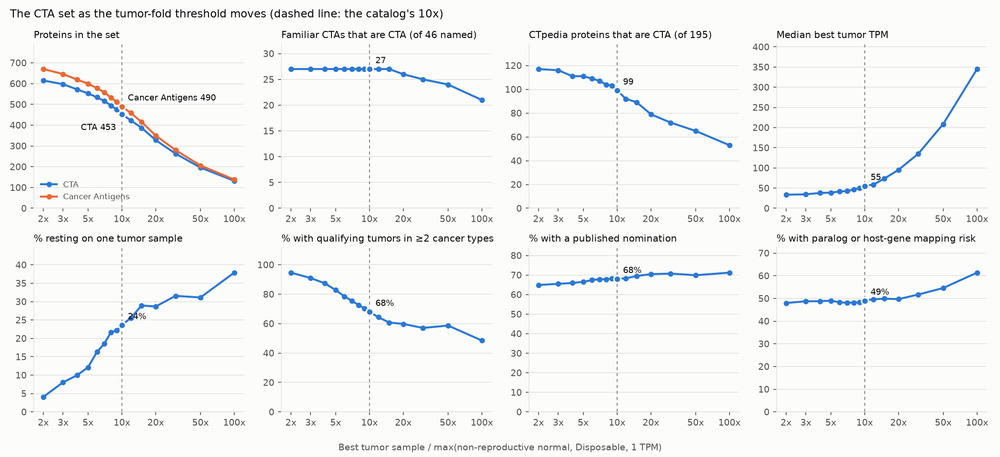

# Tenfold rule review: thresholds, near misses and tumor-sample background

> Historical 1.38.0 audit. Counts and proposed QC below describe that release. See the [current catalog](../target-selection-20261110/rebuild/index.md) for active rules and memberships.

Generated by `scripts/build_cta_threshold_review.py` from the 1.38.0 catalog (policy `oncoref.target-selection.2026-11-15.1`). Nothing here changes a decision: the threshold sweep reclassifies a copy of the catalog with its own `classify()`, and the background check is a proposal.

## How the CTA set moves with the fold threshold

Only the fold changes; every other gate, the normal reference and the 10 TPM minimum (`max(N, Disposable, 1)`) stay fixed. Values: [threshold-sweep.csv](threshold-sweep.csv).

| Fold | CTA | Cancer Antigens | Familiar CTA | CTpedia CTA | Median best tumor TPM | % one sample | % flagged library only | % ≥2 cancer types | % nominated | % mapping risk |
|---:|---:|---:|---:|---:|---:|---:|---:|---:|---:|---:|
| 2 | 615 | 670 | 27 | 117 | 33.6 | 4.1 | 1.5 | 94.6 | 64.9 | 48.0 |
| 3 | 597 | 646 | 27 | 116 | 34.6 | 8.0 | 2.8 | 91.0 | 65.5 | 48.7 |
| 4 | 572 | 619 | 27 | 111 | 37.9 | 10.0 | 3.0 | 87.4 | 65.9 | 48.8 |
| 5 | 553 | 600 | 27 | 111 | 38.8 | 12.1 | 3.6 | 82.8 | 66.5 | 49.0 |
| 6 | 534 | 578 | 27 | 109 | 41.5 | 16.3 | 4.3 | 78.5 | 67.4 | 48.3 |
| 7 | 516 | 558 | 27 | 107 | 42.6 | 18.6 | 4.7 | 75.4 | 67.8 | 48.1 |
| 8 | 494 | 532 | 27 | 104 | 46.3 | 21.7 | 5.5 | 72.7 | 67.8 | 48.2 |
| 9 | 475 | 513 | 27 | 103 | 50.0 | 22.1 | 5.1 | 70.3 | 68.2 | 48.2 |
| 10 | 453 | 490 | 27 | 99 | 55.4 | 23.6 | 5.3 | 68.0 | 68.0 | 49.0 |
| 12 | 423 | 459 | 27 | 92 | 58.7 | 25.5 | 4.7 | 64.3 | 68.3 | 49.6 |
| 15 | 387 | 415 | 27 | 89 | 73.7 | 28.9 | 4.9 | 60.7 | 69.5 | 49.9 |
| 20 | 328 | 350 | 26 | 79 | 95.1 | 28.7 | 2.4 | 59.8 | 70.4 | 49.7 |
| 30 | 263 | 280 | 25 | 72 | 135.1 | 31.6 | 1.1 | 57.0 | 70.7 | 51.7 |
| 50 | 196 | 206 | 24 | 65 | 208.7 | 31.1 | 0.5 | 58.7 | 69.9 | 54.6 |
| 100 | 132 | 138 | 21 | 53 | 345.0 | 37.9 | 0.0 | 48.5 | 71.2 | 61.4 |

- From 10x down to 5x the set grows from 453 to 553 CTAs and CTpedia proteins from 99 to 111; familiar CTAs: 27 at 10x, 27 at 5x, 27 at 2x. The additions are lower-expressed (median best tumor 55 TPM at 10x, 39 at 5x) and more of them rest on one sample.
- From 10x up, familiar CTAs hold at 27 through 15x and fall to 26 at 20x and 24 at 50x, while the set shrinks to 328 at 20x.
- At 10x, 24% of CTAs rest on one tumor sample and 5% rest only on the flagged high-background library below.
- Lowering the fold adds proteins with less tumor support; raising it past 15x removes familiar CTAs (the lowest, AKAP4, is at 16x). 10x sits 1.6-fold below the first familiar loss.

## Near misses: Reproductive Antigens at 8-10x

41 Reproductive Antigens have a best tumor sample at 8-10x; at 8x they would be CTAs. Each is placed in one group by what sets its normal ceiling (the highest non-reproductive normal value, or 1 TPM):

- **below 10 TPM** (15): normal is under 1 TPM, so the bar is 10 TPM and the best tumor sample is under it. These fail on tumor level, not specificity. USP26, TENT5D, AMELY, SCP2D1, POTEB/2, ARSH, FAM24A, GOLGA8F, SPATA31F1, CDY2A/B, DEFB127, ENSG00000285566, PRR30, ENSG00000237378, CATSPER4.
- **one immune dataset** (10): the ceiling comes from one sorted-immune-cell dataset (DICE or Monaco) and the other does not show it. This is the group whose placement rests most on one source. PABPC3, C3orf22, SPMAP1, SIGLECL1, CIMAP1A, ZNF878, FREY1, CXorf58, ZAR1L, IZUMO2.
- **normal in two datasets** (9): at least two independent datasets put a normal value at half the ceiling or more. The ceiling is real. TEX38, GSC2, GOLGA8T, RFPL3, LITAFD, TMEM269, C10orf62, RSPH6A, WFDC8.
- **one brain dataset** (5): the ceiling comes from HPA brain regions only. Low brain expression is where a conservative ceiling matters most. TEX50, CCDC70, PRDM14, RBMXL3, OR8B3.
- **one other dataset** (2): the ceiling comes from one tissue dataset. CABS1, RTP2.

In the one-immune-dataset group, the best tumor is a blood cancer for 7 of 10: a leukemia or lymphoma compared with the normal immune cells it comes from. Without that dataset, 10 of 10 would reach 10x. Their tumor support is narrow: a median of 4 samples at 5x or more, in a median of 2 cancer type(s). Those with 10 or more samples at 5x (PABPC3, ZNF878) all carry paralog or host-gene mapping risk, so their tumor values are as uncertain as the normal ones.

7 near misses have their best sample in the flagged high-background library below. Full table: [near-miss.csv](near-miss.csv).

| Protein | Group | Fold | Best tumor TPM | Cancer | Samples ≥5x | Cancer types ≥5x | Normal ceiling TPM | Ceiling context | Datasets ≥ half ceiling | Fold without that dataset | Mapping risk |
|---|---|---:|---:|---|---:|---:|---:|---|---|---:|---:|
| TEX50 | one brain dataset | 9.96 | 12.9 | BL | 1 | 1 | 1.3 | HPA brain: nucleus tractus solitarii | HPA brain | 12.9 | False |
| TEX38 | normal in two datasets | 9.94 | 32.3 | NEC_MERKEL | 6 | 2 | 3.25 | DICE immune: TREG_MEM | DICE immune + Monaco immune | 13.5 | False |
| USP26 | below 10 TPM | 9.92 | 9.9 | NEC_MERKEL | 3 | 3 | 0.2 | HPA brain: transversal temporal gyrus, anterior |  |  | False |
| PABPC3 | one immune dataset | 9.91 | 69.7 | BL | 45 | 7 | 7.03 | DICE immune: CD4_STIM | DICE immune | 69.7 | True |
| TENT5D | below 10 TPM | 9.88 | 9.9 | HL | 1 | 1 | 0.1 | HPA tissue: thyroid gland |  |  | False |
| CCDC70 | one brain dataset | 9.87 | 14.8 | CLL | 3 | 3 | 1.5 | HPA brain: hippocampus, CA1 | HPA brain | 14.8 | False |
| C3orf22 | one immune dataset | 9.82 | 11.8 | MBL | 6 | 4 | 1.21 | DICE immune: MONOCYTES | DICE immune | 11.8 | False |
| SPMAP1 | one immune dataset | 9.82 | 21.7 | B_ALL | 1 | 1 | 2.21 | DICE immune: CD4_STIM | DICE immune | 21.7 | False |
| AMELY | below 10 TPM | 9.58 | 9.6 | SARC_OS | 2 | 2 | 0.43 | GTEx: Thyroid |  |  | True |
| SCP2D1 | below 10 TPM | 9.54 | 9.5 | HL | 3 | 3 | 0.1 | HPA brain: anterior insular cortex, ventral |  |  | False |
| POTEB/2 | below 10 TPM | 9.49 | 9.5 | PRAD | 4 | 1 | 0.0 | DICE immune: b_cell_naive |  |  | True |
| CABS1 | one other dataset | 9.46 | 28.4 | PRAD | 1 | 1 | 3.0 | GTEx: salivary gland | GTEx | 25.8 | False |
| SIGLECL1 | one immune dataset | 9.46 | 16.1 | OV | 2 | 2 | 1.7 | Monaco immune: myeloid DC | Monaco immune | 16.1 | False |
| CIMAP1A | one immune dataset | 9.45 | 15.0 | T_ALL | 4 | 3 | 1.58 | DICE immune: MONOCYTES | DICE immune | 15.0 | False |
| GSC2 | normal in two datasets | 9.34 | 22.4 | NEC_MERKEL | 2 | 1 | 2.4 | HPA brain: pontine raphe nucleus | GTEx + HPA brain | 16.0 | False |
| ARSH | below 10 TPM | 9.32 | 9.3 | SARC_LPS_UNSPEC | 4 | 3 | 0.42 | GTEx: Esophagus_Mucosa |  |  | False |
| PRDM14 | one brain dataset | 9.26 | 15.7 | B_ALL | 9 | 5 | 1.7 | HPA brain: vermis | HPA brain | 15.7 | False |
| GOLGA8T | normal in two datasets | 9.16 | 13.7 | LAML | 8 | 3 | 1.5 | GTEx: thyroid gland | GTEx + HPA brain + HPA tissue | 10.6 | True |
| ZNF878 | one immune dataset | 9.16 | 39.4 | B_ALL | 18 | 5 | 4.3 | DICE immune: NK | DICE immune | 24.6 | True |
| RFPL3 | normal in two datasets | 9.13 | 29.2 | CLL | 7 | 1 | 3.2 | GTEx: retina | GTEx + HPA brain + Monaco immune | 14.6 | True |
| RTP2 | one other dataset | 9.11 | 9.7 | HL | 4 | 3 | 1.06 | GTEx: Muscle_Skeletal | GTEx | 9.7 | True |
| FREY1 | one immune dataset | 9.05 | 34.9 | B_ALL | 4 | 2 | 3.86 | DICE immune: TREG_MEM | DICE immune | 34.9 | False |
| RBMXL3 | one brain dataset | 8.97 | 11.7 | NEC_MERKEL | 12 | 2 | 1.3 | HPA brain: arcuate nucleus | HPA brain | 11.7 | False |
| FAM24A | below 10 TPM | 8.88 | 8.9 | HL | 1 | 1 | 0.52 | DICE immune: TREG_NAIVE |  |  | False |
| GOLGA8F | below 10 TPM | 8.73 | 8.7 | NEC_MERKEL | 3 | 1 | 0.06 | DICE immune: B_CELL_NAIVE |  |  | True |
| SPATA31F1 | below 10 TPM | 8.67 | 8.7 | SARC_MYXFIB | 1 | 1 | 0.9 | HPA brain: area postrema |  |  | True |
| CDY2A/B | below 10 TPM | 8.64 | 8.6 | HL | 1 | 1 | 0.0 | DICE immune: b_cell_naive |  |  | True |
| LITAFD | normal in two datasets | 8.64 | 34.6 | T_ALL | 6 | 3 | 4.0 | HPA brain: retrosplenial cortex | DICE immune + HPA brain | 13.9 | False |
| DEFB127 | below 10 TPM | 8.53 | 8.5 | B_ALL | 2 | 2 | 0.1 | HPA tissue: kidney |  |  | False |
| CXorf58 | one immune dataset | 8.47 | 22.9 | T_ALL | 3 | 2 | 2.7 | Monaco immune: T-reg | Monaco immune | 22.9 | False |
| ZAR1L | one immune dataset | 8.45 | 12.1 | T_ALL | 4 | 3 | 1.43 | DICE immune: B_CELL_NAIVE | DICE immune | 12.1 | False |
| TMEM269 | normal in two datasets | 8.42 | 22.9 | T_ALL | 2 | 1 | 2.72 | DICE immune: CD4_NAIVE | DICE immune + GTEx + HPA brain + Monaco immune | 9.5 | True |
| C10orf62 | normal in two datasets | 8.36 | 25.1 | SARC_CHOR | 4 | 3 | 3.0 | HPA brain: parieto-temporal junction (white matter) | GTEx + HPA brain | 16.5 | True |
| RSPH6A | normal in two datasets | 8.28 | 37.9 | THCA | 4 | 2 | 4.58 | GTEx: Thyroid | GTEx + HPA tissue | 8.6 | False |
| ENSG00000285566 | below 10 TPM | 8.23 | 8.2 | NET_LUNG | 3 | 3 | 0.2 | HPA brain: nucleus ambiguus |  |  | True |
| PRR30 | below 10 TPM | 8.19 | 8.2 | HL | 2 | 2 | 0.3 | HPA brain: retrosplenial cortex |  |  | False |
| ENSG00000237378 | below 10 TPM | 8.16 | 8.2 | HL | 2 | 2 | 0.7 | HPA brain: Kolliker-Fuse nucleus |  |  | True |
| OR8B3 | one brain dataset | 8.14 | 9.0 | NET_LUNG | 1 | 1 | 1.1 | HPA brain: preoptic area | HPA brain | 9.0 | True |
| CATSPER4 | below 10 TPM | 8.09 | 8.1 | T_ALL | 2 | 2 | 0.57 | DICE immune: TFH |  |  | False |
| WFDC8 | normal in two datasets | 8.07 | 15.2 | THCA | 1 | 1 | 1.88 | DICE immune: B_CELL_NAIVE | DICE immune + HPA brain | 10.8 | False |
| IZUMO2 | one immune dataset | 8.01 | 39.4 | NET_RECTAL | 5 | 1 | 4.92 | DICE immune: TFH | DICE immune | 39.4 | True |

## Tumor-sample background (proposed check, not applied)

A library contaminated with genomic DNA, or with broad unspliced background, gives low TPM to genes no tumor expresses. Olfactory receptors are a large panel of such genes. The proposed check: drop a tumor library from the cancer comparison when more than 20% of its olfactory receptor genes are at 5 TPM or more, evaluated only when at least 100 receptors are measured. Dropping a sample can only remove evidence.

- Across 14,447 evaluable tumor libraries the share is 0 at the median, 2.0% at the 99th percentile and 7.1% at the 99.9th; the next-highest library after the flagged one is at 12%.
- Flagged: `GSE120328_LAMPRECHT_2018:SRS3811196` (HL), at 40%, with 40,435 genes detected; the other 2 libraries in its cohort detect 19,687-26,152. 93% of its receptors at 5 TPM are at that level in no other library of its cohort.
- 5 libraries cannot be evaluated (fewer than 100 receptors in the matrix).
- Lower cutoffs reach into the Merkel cell carcinoma cohort. Its 40 libraries above 5% share their receptors: a median of 0% of the receptors at 5 TPM in one of them are absent from every other Merkel library. That reads as expression common to the tumor type, not library background, so the share alone should not drop them:

| Drop libraries above | Libraries dropped | Cohorts | Cancer Antigens lost | of which CTA | Proteins |
|---|---:|---|---:|---:|---|
| 20% | 1 | HL 1 | 27 | 24 | BPIFA3, CST8, DEFB115, DEFB130A/B, EXOC1L, GOLGA6L24, GOLGA6L25, GOLGA6L26, IQCF1, IQCF5, KIF4B, NANOS2, OR2F1, OR4M1, OR8B2, POM121L2, PRAMEF19, PRR23B, SLC35G4, SPANXN2, SPATA31A1, TEX51, TNP2, TRIM60, TSGA13, TSSK2, VN1R4 |
| 10% | 6 | NEC_MERKEL 5, HL 1 | 32 | 29 | BPIFA3, CST8, DEFB115, DEFB130A/B, EXOC1L, FAM170B, GOLGA6L24, GOLGA6L25, GOLGA6L26, IQCF1, IQCF5, IQCF6, KIF4B, KRTAP5-7, MAGEB18, NANOS2, OR2F1, OR4M1, OR8B2, POM121L2, PRAMEF19, PRR23B, SLC35G4, SPANXN2, SPATA31A1, TEX44, TEX51, TNP2, TRIM60, TSGA13, TSSK2, VN1R4 |
| 5% | 42 | NEC_MERKEL 40, BL 1, HL 1 | 39 | 33 | BPIFA3, CST8, DEFB115, DEFB130A/B, DNAJB8, EXOC1L, FAM170B, GOLGA6L24, GOLGA6L25, GOLGA6L26, IQCF1, IQCF5, IQCF6, KIF4B, KRTAP5-7, MAGEB18, NANOS2, OR2F1, OR4M1, OR8B2, POM121L2, PRAMEF19, PRR23B, RNASE9, SCYGR3, SCYGR7, SLC35G4, SPANXN2, SPATA31A1, TEX44, TEX51, TMEM225, TNP2, TPD52L3, TRIM60, TSGA13, TSSK2, VHLL, VN1R4 |
| 2% | 137 | NEC_MERKEL 74, BL 26, SARC_PEC 16, MCL 9, T_ALL 4, B_ALL 3, HL 2, LAML 2, NET_LUNG 1 | 65 | 55 | ACTL7A, BPIFA3, C19orf67, CCDC27, CCDC87, CIMIP4, CLDN34, CST8, DDI1, DEFB115, DEFB130A/B, DNAJB8, ETDA/B, EXOC1L, FAM170B, FAM47C, GK2, GOLGA6L24, GOLGA6L25, GOLGA6L26, HMGB4, IQCF1, IQCF2, IQCF5, IQCF6, KIF4B, KRTAP5-7, MAGEB18, NANOS2, OR14A16, OR2F1, OR4M1, OR51M1, OR52D1, OR6F1, OR8B2, PKDREJ, POM121L2, PRAMEF19, PRR23B, PRSS37, RNASE9, SCYGR2, SCYGR3, SCYGR7, SEBOX, SLC35G4, SMIM42, SPANXN2, SPATA31A1, SPATA31A6, STPG3, TEX44, TEX51, TMEM225, TNP2, TPD52L3, TRIM60, TSGA13, TSSK2, USP17L4, USP17L7, VHLL, VN1R4, ZCCHC13 |

Per-library values: [sample-background.csv.gz](sample-background.csv.gz).
