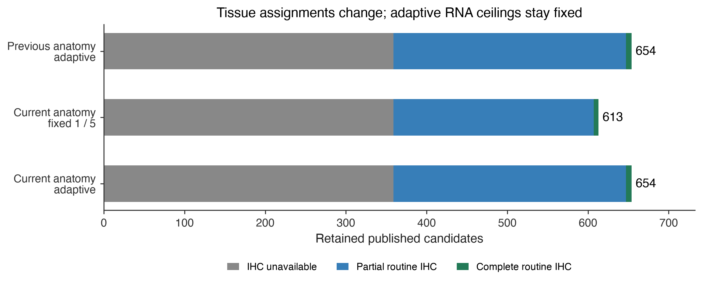

# CTA tissue contexts and removable organs — 20 October 2026

Policy `oncoref.cta-ihc-adaptive-screen.2026-10-20.3`. All 2,537 published candidates are reevaluated from the same pinned human HPA v23 observations.

## Tissue changes

- Appendix and gallbladder join the conditional **Disposable** category.
- Native observations expose **Reproductive, Disposable, Protected, Vital** separately.
- Skin and salivary allowances gain explicit extent/control review annotations.
- Earlier organ allowances remain project choices, pending the manageability-policy review.
- [Patient-context gene filters](../../normal-tissue-gene-filters.md) require separate sex/stage-aware negative coverage; this adult HPA report cannot certify those filters.

The adaptive vital/protected ceilings remain **1/5, 2/5, 3/7.5 and 5/10 nTPM** for missing/uncertain, Approved, Supported and Enhanced negative IHC. The proposed 1/2/3/6 and 2/4/6/12 ladder is not adopted in this comparison.

## Results

| scenario | candidates | evidence_pass | retained | without_ihc | partial_ihc | complete_routine_ihc |
| --- | --- | --- | --- | --- | --- | --- |
| previous_adaptive | 2537 | 752 | 654 | 359 | 288 | 7 |
| current_fixed | 2537 | 711 | 613 | 359 | 248 | 6 |
| current_adaptive | 2537 | 752 | 654 | 359 | 288 | 7 |

**Gained:** None.

**Lost:** None.

**317 retained candidates have positive observations requiring tissue review.** This is a research-screen result, not completed therapeutic acceptance. Review flags record RNA >0 nTPM or positive IHC in contexts with review conditions; they do not independently change expression-pass or final-retention decisions.

## Evidence and interpretation

The full [tissue definitions and citations](../../normal-tissue-scopes.md) explain conditional organ allowances and their limits. Native tissue/cell labels and citations remain in [tissue-contexts.csv](tissue-contexts.csv). An organ allowance does not allow expression in the same immune-cell population elsewhere. Unsited immune cells remain unresolved. Mouse has no mapped tonsil; canine and mouse anatomical assignments do not transfer human thresholds or clinical tolerability.

Any positive IHC outside acceptable tissues, including Low, still excludes. RNA relaxation requires valid negative staining across every routine cell context of the same anatomical tissue. Missing/partial IHC is explicit. Complete routine coverage means 50 RNA contexts and 80 IHC tissue/cell pairs, not exhaustive anatomy. Whole eye and inner ear have no routine RNA measurements in this input; assigning their tier does not establish absence of expression in those organs. Existing family and manual curation gates remain separate. CTAG2's historical manual holdback is retained. Negative observations do not prove antigen absence.

## Downloads and reproduction

- [All candidate comparisons and reasons](candidate-comparison.csv)
- [Gained/lost candidates](membership-changes.csv)
- [Named targets, including the preceding sensitivity-analysis genes](notable-targets.csv)
- [Current fixed and adaptive decisions](candidate-decisions.csv)
- [Every RNA value, ceiling and supporting IHC](rna-threshold-audit.csv.gz)
- [Taxonomy, review conditions and bibliography](tissue-taxonomy.json)
- [Run manifest and checksums](run-manifest.json)

Run `python scripts/cta_tissue_tier_report.py --out <new-empty-directory>` at this report's implementation revision. The preceding [tissue-tier report](../cta-tissue-tiers-20261020/index.md) remains an immutable baseline.
