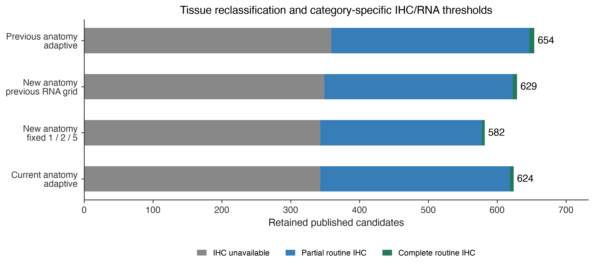

# CTA tissue priorities and IHC-dependent thresholds — 20 October 2026

Policy `oncoref.cta-ihc-adaptive-screen.2026-10-20.4`. All 2,537 published candidates are reevaluated from the same pinned human HPA v23 observations.

## Tissue categories

- **Reproductive:** existing reproductive/developmental unions.
- **Disposable:** cutaneous melanocytes, follicles, tonsil, appendix and gallbladder.
- **Manageable risk:** whole skin, spleen, thymus, thyroid and adipose.
- **High consequence:** includes salivary glands, cartilage, esophagus, other protected gastrointestinal tissues and lymph nodes.
- **Vital / critical function:** existing highest-protection organs.

Manageable risk is screened: it is not a permitted normal-expression exception. Specific permitted skin compartments take precedence over the whole-skin category. A bulk skin measurement cannot establish compartment restriction.

## Maximum RNA by tissue category and IHC evidence (nTPM)

| IHC evidence | Vital | High consequence | Manageable risk |
| --- | ---: | ---: | ---: |
| Missing | 1.0 | 2.0 | 5.0 |
| Uncertain | 1.0 | 2.0 | 5.0 |
| Approved | 2.0 | 4.0 | 10.0 |
| Supported | 3.0 | 6.0 | 15.0 |
| Enhanced | 6.0 | 12.0 | 30.0 |

Approved/Supported/Enhanced relaxation requires valid **Not detected** staining in every routine IHC context of the same organ; the weakest reliability wins. Missing, incomplete, uncertain or unusable IHC earns no relaxation. Any positive IHC, including Low, in Manageable risk, High consequence or Vital excludes. Reliability labels are not calibrated probabilities of true protein absence. These are project parameters, not clinical safety limits or GTEx-to-HPA conversions.

## Results and attribution

| scenario | candidates | evidence_pass | retained | without_ihc | partial_ihc | complete_routine_ihc |
| --- | --- | --- | --- | --- | --- | --- |
| previous_adaptive | 2537 | 752 | 654 | 359 | 288 | 7 |
| reclassified_previous_limits | 2537 | 716 | 629 | 349 | 274 | 6 |
| current_fixed | 2537 | 669 | 582 | 343 | 235 | 4 |
| current_adaptive | 2537 | 712 | 624 | 343 | 276 | 5 |

The **reclassified_previous_limits** scenario changes tissue assignments while retaining the archived RNA grid (new Manageable risk receives the previous Protected grid). Comparing it with **current_adaptive** isolates the RNA-grid change. The fixed screen uses baseline ceilings without IHC-based relaxation.

**Gained against the previous release:** TEX15.

**Lost against the previous release:** BPIFA2, BPIFC, CDRT15, CSN2, CSN3, CT83, DPPA4, FAM9C, FSIP2, KLK15, KRT25, KRT26, KRT28, KRT33A, KRT33B, KRT35, KRT72, KRTAP10-2, KRTAP13-1, KRTAP9-2, NOX5, NPFFR2, OTOA, PRR27, PSMB11, RNASE13, RNASE8, RPL10L, SLC24A5, TBATA, UBE2U.

**287 retained candidates have positive observations triggering tissue review.** Flags record RNA >0 nTPM or positive IHC in flagged contexts; they do not establish completed therapeutic acceptance or independently veto retention.

## Evidence and interpretation

[Tissue definitions](../../normal-tissue-scopes.md) and the [literature review](../../normal-tissue-manageability.md) explain why published Caution/Hazard categories support relative priorities, while exact memberships and thresholds remain project definitions. [Native contexts](tissue-contexts.csv) retain source labels, mappings and citations.

An organ allowance does not allow the same immune-cell population elsewhere. Unknown anatomy remains unresolved. Human numeric thresholds and tolerability do not transfer to dog or mouse. Routine coverage is 50 RNA contexts and 80 IHC tissue/cell pairs, not exhaustive anatomy. Whole eye, inner ear and cartilage lack routine RNA measurements here; classification does not establish their negativity. The [patient-context filters](../../normal-tissue-gene-filters.md) require separate maternal/fetal and sex-specific coverage absent from this adult HPA report. Existing family and manual-curation gates, including CTAG2's holdback, are retained.

## Downloads and reproduction

- [All candidate comparisons and exact exclusion reasons](candidate-comparison.csv)
- [Gained/lost candidates](membership-changes.csv)
- [Named published targets](notable-targets.csv)
- [All three current-anatomy scenarios](candidate-decisions.csv)
- [Every RNA ceiling and supporting IHC](rna-threshold-audit.csv.gz)
- [Taxonomy, review conditions and bibliography](tissue-taxonomy.json)
- [Run manifest and checksums](run-manifest.json)

Run `python scripts/cta_tissue_tier_report.py --out <new-empty-directory>` at this report's implementation revision. The [previous tissue-context report](../cta-tissue-contexts-20261020/index.md) is the immutable baseline.
