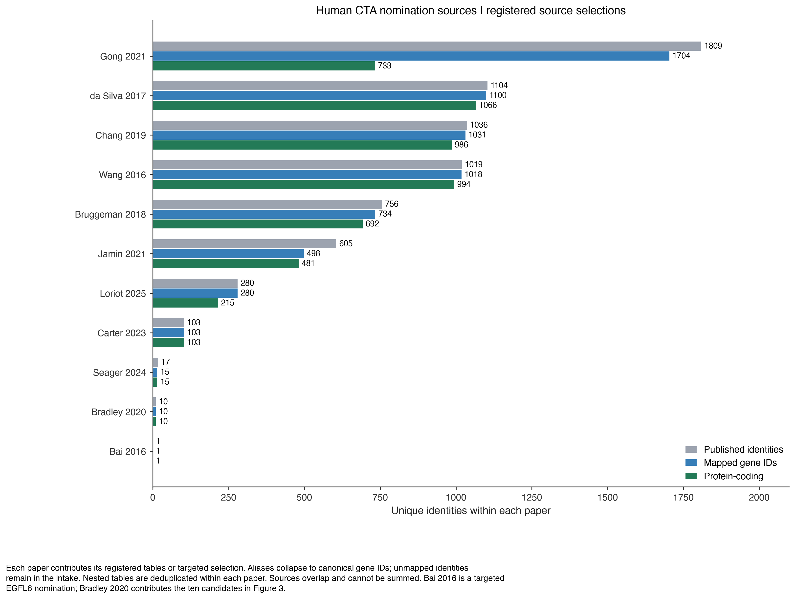
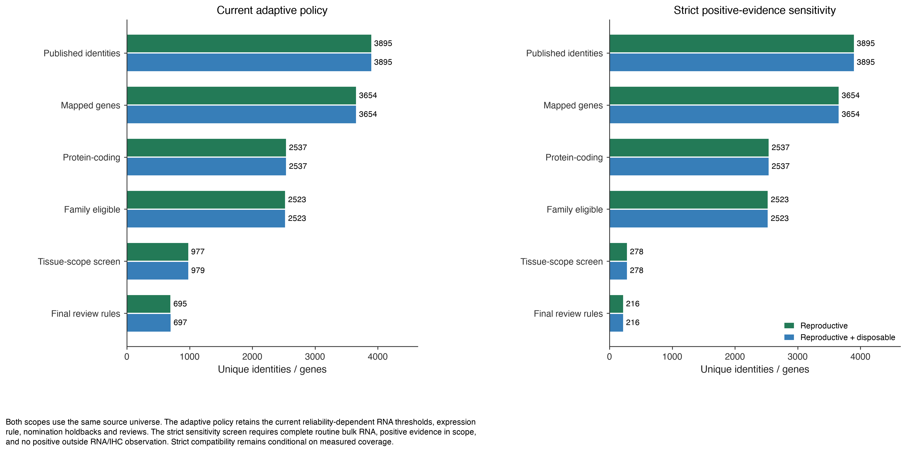
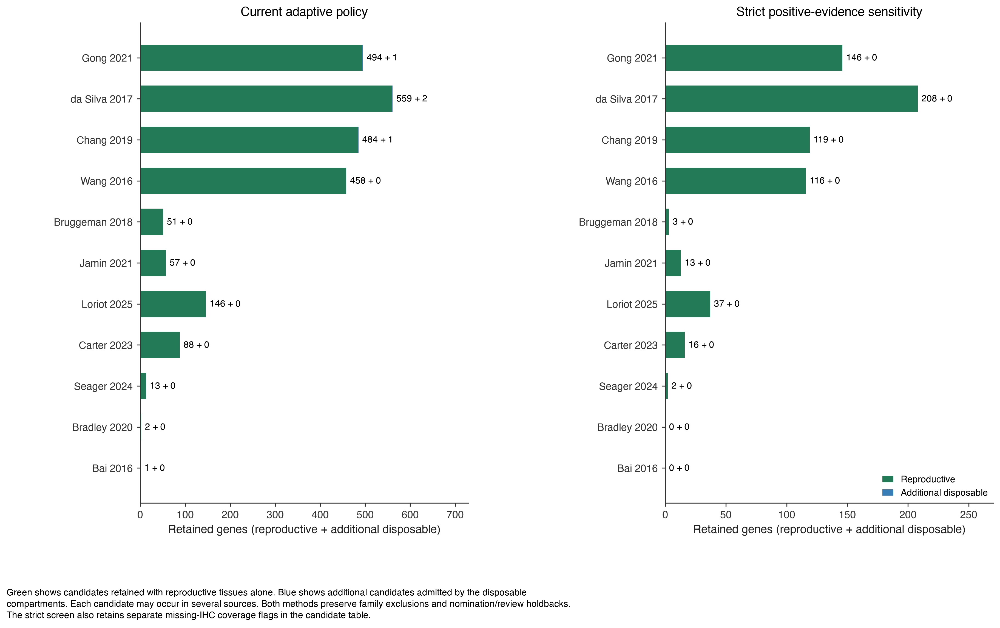
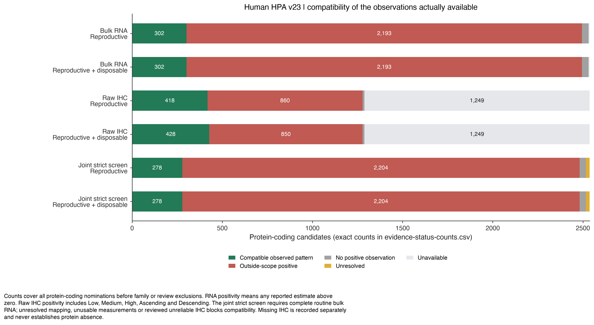

# CTA sources: reproductive and reproductive + disposable

**Human HPA v23 · taxonomy policy 2026-10-19.1**

[Download the complete report (PDF)](cta-tissue-scope-report.pdf) · [Exact scope definitions](../../normal-tissue-scopes.md)

This human analysis starts with 11 registered published nomination sources: 3,895 distinct source identities and 2,537 mapped protein-coding candidates. It evaluates reproductive tissues and their union with cutaneous melanocytes and hair-follicle compartments using the same candidate universe.

The adaptive reproductive baseline reproduces all 695 genes in the published extended panel. Adding disposable compartments retains 697 genes (2 additional). The strict sensitivity screen retains 216 and 216, respectively (0 additional). The adaptive additions are C1orf167, TCHHL1.

| Filtering method | Reproductive | Reproductive + disposable | Added by disposable |
|---|---:|---:|---:|
| Current adaptive policy | 695 | 697 | 2 |
| Strict positive-evidence sensitivity | 216 | 216 | 0 |

Strict means no outside positive observation under the stated assay rules. Adequate evidence of absence is not established. Of the 216 reproductive strict-screen candidates, 134 lack usable IHC observations; 81 have partial routine IHC coverage. A routine context is represented for at least half of the genes in that source; its exact tissue/cell list is recorded in the manifest. These coverage distinctions remain explicit in every candidate record.

## What changes when disposable tissues are included?

Reproductive includes male and female reproductive anatomy (including mammary), placenta and other extraembryonic compartments, and explicitly embryonic/fetal contexts. The combined scope additionally admits cutaneous melanocytes and hair-follicle compartments. Whole skin, unsited melanocytes, ocular pigment and retinal pigment epithelium do not qualify. HPA bulk RNA has no separate disposable-compartment measurement, so its allowed tissue set is identical for the two scopes. Only resolved IHC tissue/cell pairs can add the disposable allowance in this report.

**Adaptive additions:** C1orf167, TCHHL1.

[Gene-level gains and supporting contexts](disposable-gains.csv)

## Published nomination intake

Each paper contributes its registered tables or targeted selection. Aliases collapse to canonical gene IDs; unmapped identities remain in the intake. Nested tables are deduplicated within each paper. Sources overlap and cannot be summed. Bai 2016 is a targeted EGFL6 nomination; Bradley 2020 contributes the ten candidates in Figure 3.

[Vector PDF](source-intake.pdf)



## Source intake through tissue filtering

Both scopes use the same source universe. The adaptive policy retains the current reliability-dependent RNA thresholds, expression rule, nomination holdbacks and reviews. The strict sensitivity screen requires complete routine bulk RNA, positive evidence in scope, and no positive outside RNA/IHC observation. Strict compatibility remains conditional on measured coverage.

[Vector PDF](filtering-stages.pdf)



## Retained candidates by source

Green shows candidates retained with reproductive tissues alone. Blue shows additional candidates admitted by the disposable compartments. Each candidate may occur in several sources. Both methods preserve family exclusions and nomination/review holdbacks. The strict screen also retains separate missing-IHC coverage flags in the candidate table.

[Vector PDF](source-retention.pdf)



## Observed compatibility and missing evidence

Counts cover all protein-coding nominations before family or review exclusions. RNA positivity means any reported estimate above zero. Raw IHC positivity includes Low, Medium, High, Ascending and Descending. The joint strict screen requires complete routine bulk RNA; unresolved mapping, unusable measurements or reviewed unreliable IHC blocks compatibility. Missing IHC is recorded separately and never establishes protein absence.

[Vector PDF](evidence-coverage.pdf)



## Methods

### Adaptive filtering

The adaptive analysis reproduces the existing extended CTA policy. RNA uses the sum of max(nTPM - 1, 0) inside scope divided by that sum across all measured tissues, rounded to four decimals. Thresholds are 0.80 (Enhanced IHC), 0.90 (Supported), 0.95 (Approved), and 0.97 (Uncertain or missing). Low/Medium/High IHC detections must all map inside scope. Existing cross-reactive-antibody exclusions, expression/rescue rules, family exclusions, normal-only nomination holdbacks and extended-scope manual reviews remain in force. The disposable comparison changes only the tissue allowance; it does not replace the public CTA panel.

### Strict sensitivity

The strict sensitivity screen uses every positive bulk RNA estimate (>0 nTPM) and raw IHC Low/Medium/High/Ascending/Descending. Any mapped outside positive blocks compatibility. Missing routine bulk RNA, unresolved positive mapping, unusable measurements, or reviewed unreliable IHC prevents a compatible result. A positive in-scope observation is required. Missing IHC remains explicitly RNA-only evidence; partial IHC remains partial. Family and nomination/review exclusions also apply. This screen does not use the adaptive RNA fraction or low-expression rescue, so the two methods need not form nested gene sets.

### Source intake

Source rows preserve DOI, URL, file/sheet/row location, original identifier, mapping method and assay resolution. Nested tables are deduplicated within a paper; papers overlap. The intake uses every registered published set, without selecting papers based on the final retained panel. Targeted source selections remain labeled. Unmapped and noncoding nominations are retained in the intake audit and do not enter the protein-coding screen. Historical-only nominations remain in a separate export.

### Species and coverage

The numerical filtering comparison is human-only and uses pinned HPA v23 bulk RNA and normal-tissue IHC. The taxonomy also supports dog and mouse anatomy. Canine native expression and publication evidence requires its own assay-specific analysis; human thresholds and coverage do not transfer. No native mouse expression/CTA atlas is bundled. Developmental contexts absent from HPA are unassessed here. HPA single-cell RNA is not included in these RNA/IHC policy comparisons; unsited cell types cannot supply full anatomical coverage.

## Audit files

| File | Contents |
|---|---|
| [Candidate decisions](candidate-decisions.csv) | Both scopes and policies; RNA/IHC status, outside-tissue counterevidence, coverage, review actions, disposable contexts |
| [Source counts](source-counts.csv) | Deduplicated intake and filtering counts for every paper |
| [Scope summary](scope-summary.csv) | Exact overall counts and missing-IHC counts |
| [Evidence status counts](evidence-status-counts.csv) | Exact segment counts behind the coverage figure |
| [Source membership](source-membership.csv.gz) | Original identities, DOI, source table/sheet/rows, mapping method and assay resolution |
| [Normal observations](normal-observations.csv.gz) | All candidate bulk RNA/IHC rows with original labels, anatomical mappings and citations |
| [Publication registry](publication-sources.csv) | Registered source selections, URLs and original artifact hashes |
| [Historical-only candidates](historical-only-candidates.csv) | Archived nominations outside the published-source intake |
| [Tissue taxonomy](tissue-taxonomy.json) | Definitions, unions, species applicability and bibliography |
| [Run manifest](run-manifest.json) | Source, code and output hashes; versions; exact routine coverage contexts |

`adaptive_retained` is the existing adaptive policy evaluated under the named scope; only the reproductive baseline is the public extended panel. `strict_retained` is a sensitivity-screen result. Neither field claims adequate negative coverage or clinical safety. `outside_rna_max_ntpm` is zero only when RNA was measured without an outside positive; unavailable RNA remains blank.

## Reproduce

```sh
python scripts/cta_scope_report.py --out outputs/cta-tissue-scopes-current
```

Requires the report dependencies and pinned HPA v23 bulk RNA and IHC files. The report checks source hashes, equality of the reproductive adaptive baseline with the public extended panel, and monotonicity when the tissue union expands. Historical audits remain archived under their original dates.

## Citations

Measurements: [HPA v23 bulk RNA](https://v23.proteinatlas.org/download/rna_tissue_consensus.tsv.zip) and [normal-tissue IHC](https://v23.proteinatlas.org/download/normal_tissue.tsv.zip). Anatomical and disposable-tissue rationales are cited in the [scope definitions](../../normal-tissue-scopes.md). Source nominations:

- [Bai 2016](https://doi.org/10.1158/0008-5472.CAN-16-0225) — the exact imported selection is recorded in the publication registry.
- [Bradley 2020](https://doi.org/10.1038/s41467-020-19141-w) — the exact imported selection is recorded in the publication registry.
- [Bruggeman 2018](https://doi.org/10.1038/s41388-018-0357-2) — the exact imported selection is recorded in the publication registry.
- [Carter 2023](https://doi.org/10.1136/jitc-2023-007935) — the exact imported selection is recorded in the publication registry.
- [Chang 2019](https://doi.org/10.1002/cam4.2223) — the exact imported selection is recorded in the publication registry.
- [Gong 2021](https://doi.org/10.1038/s41467-021-22695-y) — the exact imported selection is recorded in the publication registry.
- [Jamin 2021](https://doi.org/10.1002/1878-0261.12900) — the exact imported selection is recorded in the publication registry.
- [Loriot 2025](https://doi.org/10.1371/journal.pgen.1011734) — the exact imported selection is recorded in the publication registry.
- [Seager 2024](https://doi.org/10.1186/s12967-024-04918-0) — the exact imported selection is recorded in the publication registry.
- [Wang 2016](https://doi.org/10.1038/ncomms10499) — the exact imported selection is recorded in the publication registry.
- [da Silva 2017](https://doi.org/10.18632/oncotarget.21715) — the exact imported selection is recorded in the publication registry.
