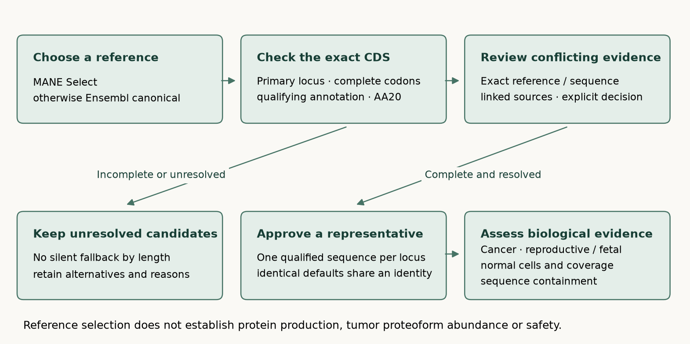

# Reference proteins: selection and unresolved evidence

OncoRef chooses **MANE Select first, Ensembl canonical second**, then requires a
complete primary-locus coding sequence and resolution of conflicting coding evidence.
The current catalog contains **607 CTA, 18,259 Unsafe
and 1,027 Other proteins**. Policy: `oncoref.transcript-selection.2026-11-08.1`.

[Search every gene and transcript choice](table.html) · [All decisions](gene-decisions.csv.gz) ·
[Changed defaults](gene-default-changes.csv.gz) · [Review queue](review-queue.csv.gz) ·
[Classification changes by gene](gene-classification-changes.csv.gz) ·
[Surface-coordinate review](surface-coordinate-review.csv)



## What each decision establishes

**Reference selection** chooses a representative sequence. MANE Select is a joint
NCBI/Ensembl representative with matching RefSeq and Ensembl sequences. Ensembl
canonical provides the fallback when no primary-locus MANE Select translation is
available. MANE Plus Clinical identifies additional clinically useful transcripts;
it does not replace Select in this ordering. [NCBI methodology](https://www.ncbi.nlm.nih.gov/refseq/MANE/),
[MANE paper](https://doi.org/10.1038/s41586-022-04558-8),
[Ensembl canonical method](https://www.ensembl.org/info/genome/genebuild/canonical.html).

**Sequence qualification** checks the exact annotated CDS: primary chromosome,
qualifying coding biotype, complete start and stop codons, no incomplete or LoF/NMD
annotation, methionine start and uninterrupted AA20 sequence. The full source
inventory retains failed records and alternative translations.

**Production evidence** asks whether the protein is made, and where. Coding annotation
continues to satisfy the existing reference translation rule. Experimental proof is
not newly required for every CTA. Gene RNA, shared peptides and a reference designation
do not establish production of a particular tumor proteoform. Normal-tissue findings
and cancer/reproductive evidence remain separate classification inputs.

## A common method for incomplete or additional information

| Situation | Decision | Information needed to change it |
| --- | --- | --- |
| Complete primary MANE Select, no unresolved conflict | Approve that sequence. Retain all alternatives. | New evidence is assessed against the exact locus and sequence. |
| No primary MANE Select; complete Ensembl canonical | Approve canonical and record the missing MANE designation. | A later MANE release or reviewed sequence-specific evidence. |
| Designated transcript is incomplete, LoF/NMD, interrupted or alternate-only | Keep the candidate; approve no default. Do not choose a shorter or patch sequence silently. | Corrected source annotation or a reviewed qualified alternative in the pinned reference. |
| Complete alternatives but no designated representative, or conflicting designated proteins | Keep the alternatives under review. | A curated designation or explicit review selecting one qualified sequence. |
| Weak, missing or unassessed transcript support | Display the raw support value and flags alongside the designation. | Exact-version transcript evidence; missing and unassessed are different states. |
| Published protein evidence disagrees with the representative | Attach a source-linked hold to the gene or exact sequence. | A review of sequence identity, construct versus endogenous detection, assay specificity and biological context. |
| Additional RNA or shared-peptide evidence | Attach support; retain the current selection and any unresolved holds. | Isoform-resolving evidence is needed to choose an alternative sequence. |
| Strong evidence favors a different complete reference protein | Permit an explicit reviewed preference for its exact sequence hash. | Record rationale, source, reference version and scope; address each prior hold explicitly. |
| A proposed protein is absent from the reference inventory | Keep the external finding; no automatic sequence admission. | Add a versioned sequence/occurrence record and apply the same qualification and evidence review. |

TSL describes full-transcript alignment support: 1 is strongest and 5 lacks a single
supporting transcript. `NA` means unassessed; an absent value means not supplied.
Previous-version assignments remain visible. TSL is not a measure of protein abundance.
MANE does not guarantee the best numeric TSL: the CIMIP3 change illustrates this.
[GENCODE tags and TSL definitions](https://www.gencodegenes.org/pages/data_format.html).
APPRIS and CCDS can add supporting annotation; the pinned Ensembl GTF supplies CCDS
and TSL, but no APPRIS assignments. Unfetched annotations are not counted as support.

Every reviewed finding stores a source URL, review date, reference identity, scope,
limitations and disposition: **support**, **hold**, **resolved**, or **prefer**.
A positive paper does not automatically erase a hold. Sequence preferences must
identify one exact reference protein and cannot bypass completeness checks.

## Findings applied in this release

| Protein | Reason for review | Current classification | Sources |
| --- | --- | --- | --- |
| GDPD4 | MANE selects 520 aa; the pinned UniProt Q6W3E5 sequence is 623 aa. Resolve exact proteoform support and feature mapping before automatic target admission. | Other:Translation | [UniProt Q6W3E5: GDPD4](https://www.uniprot.org/uniprotkb/Q6W3E5/entry) |
| SLCO1B3-SLCO1B7 | The Ensembl canonical sequence is 748 aa, while the UniProt F5H094 and studied LST-3TM12 protein are 687 aa. The study cannot establish the selected 748-aa product. | Other:Translation | [LST-3TM12 is a member of the OATP1B family and a functional transporter](https://pubmed.ncbi.nlm.nih.gov/29248594/) |
| FRG2 | The reviewed study challenges protein production with tagged endogenous-ORF experiments, Ribo-seq/proteomic analyses and evidence of RNA function. Coding annotation alone does not resolve this counterevidence. | Other:Translation | [FRG2/FRG2B experimental study, PMID 40637237](https://pmc.ncbi.nlm.nih.gov/articles/PMC12242771/) |
| FRG2B | The reviewed study challenges protein production with tagged endogenous-ORF experiments, Ribo-seq/proteomic analyses and evidence of RNA function. Coding annotation alone does not resolve this counterevidence. | Other:Translation | [FRG2/FRG2B experimental study, PMID 40637237](https://pmc.ncbi.nlm.nih.gov/articles/PMC12242771/) |

GDPD4 needs reconciliation of the MANE 520-aa and UniProt 623-aa proteins. The
SLCO1B3–SLCO1B7 readthrough needs evidence connecting the selected 748-aa sequence
to the studied 687-aa protein; the native liver ER finding and transfected-cell
surface localization have different scopes. FRG2/FRG2B require resolution of the
experimental coding challenge in the tested systems. These translation findings
do not establish normal-tissue Unsafe status.

## Changes from the previous catalog

The previous release contained 19,863 protein identities; this release contains
19,893. Identical approved defaults define shared protein identities.
CDY1 and CDY1B now have different representatives and separate expression rows;
RBMY1F and RBMY1J still share the same sequence. PSG11 now has one selected protein
instead of two equal-length alternatives. RNA sums are recomputed within each
measured sample after membership changes.

8,665 classified loci change approved default or
move into/out of representative review. At the gene level, 13
enter CTA and 4 leave it. These counts distinguish changed
membership from changed admission decisions.

New CTA loci: BOLL, IZUMO2, ARL13A, TP53TG3/B/C/D/E/F, CATSPER4, GAGE1, C16orf90, ENSG00000274944.

These newly admitted loci previously failed the longest-sequence rule. The new
representatives pass the annotation, normal-evidence, coverage and CTA association
gates. ARL13A and C16orf90 have TSL 5 assigned to an earlier transcript version;
that support limitation remains recorded. ENSG00000274944 uses a 110-aa canonical
protein with TSL 2. These changes do not add experimental protein-production evidence.
[Full new-CTA review](new-cta-review.csv).

| Protein / locus | Previous translation failure | New length (aa) | Raw TSL |
| --- | --- | --- | --- |
| BOLL · [ENSG00000152430](https://www.ensembl.org/Homo_sapiens/Gene/Summary?g=ENSG00000152430) | incomplete_start | [283] | 1 (assigned to previous version 8) |
| IZUMO2 · [ENSG00000161652](https://www.ensembl.org/Homo_sapiens/Gene/Summary?g=ENSG00000161652) | ambiguous_or_interrupted_sequence; incomplete_annotation_tag; incomplete_start; noncanonical_start_residue | [221] | 1 (assigned to previous version 7) |
| ARL13A · [ENSG00000174225](https://www.ensembl.org/Homo_sapiens/Gene/Summary?g=ENSG00000174225) | nonqualifying_transcript_biotype | [256] | 5 (assigned to previous version 6) |
| TP53TG3/B/C/D/E/F · [ENSG00000183632](https://www.ensembl.org/Homo_sapiens/Gene/Summary?g=ENSG00000183632) | incomplete_annotation_tag; incomplete_start; noncanonical_start_residue; nonqualifying_transcript_biotype | [124] | 1 (assigned to previous version 4) |
| CATSPER4 · [ENSG00000188782](https://www.ensembl.org/Homo_sapiens/Gene/Summary?g=ENSG00000188782) | incomplete_annotation_tag; incomplete_stop | [472] | 1 (assigned to previous version 6) |
| TP53TG3/B/C/D/E/F · [ENSG00000205456](https://www.ensembl.org/Homo_sapiens/Gene/Summary?g=ENSG00000205456) | nonqualifying_transcript_biotype | [124] | 1 (assigned to previous version 4) |
| TP53TG3/B/C/D/E/F · [ENSG00000205457](https://www.ensembl.org/Homo_sapiens/Gene/Summary?g=ENSG00000205457) | nonqualifying_transcript_biotype | [124] | 1 (assigned to previous version 2) |
| GAGE1 · [ENSG00000205777](https://www.ensembl.org/Homo_sapiens/Gene/Summary?g=ENSG00000205777) | nonqualifying_transcript_biotype | [117] | 1 (assigned to previous version 10) |
| C16orf90 · [ENSG00000215131](https://www.ensembl.org/Homo_sapiens/Gene/Summary?g=ENSG00000215131) | ambiguous_or_interrupted_sequence; incomplete_annotation_tag; incomplete_start; noncanonical_start_residue | [182] | 5 (assigned to previous version 7) |
| TP53TG3/B/C/D/E/F · [ENSG00000261509](https://www.ensembl.org/Homo_sapiens/Gene/Summary?g=ENSG00000261509) | nonqualifying_transcript_biotype | [124] | 1 (assigned to previous version 6) |
| ENSG00000274944 · [ENSG00000274944](https://www.ensembl.org/Homo_sapiens/Gene/Summary?g=ENSG00000274944) | nonqualifying_transcript_biotype | [110] | 2 |
| TP53TG3/B/C/D/E/F · [ENSG00000275034](https://www.ensembl.org/Homo_sapiens/Gene/Summary?g=ENSG00000275034) | missing_primary_translation | [124] | 1 (assigned to previous version 1) |
| TP53TG3/B/C/D/E/F · [ENSG00000278848](https://www.ensembl.org/Homo_sapiens/Gene/Summary?g=ENSG00000278848) | missing_primary_translation | [124] | 1 (assigned to previous version 1) |

Former CTA loci now outside CTA: GDPD4, FRG2, FRG2B, SLCO1B3-SLCO1B7.

The original 602-protein literature and membrane reports remain historical snapshots.
The coordinate review rechecks their 37 membrane proteins against current approved
sequences: 35 match UniProt exactly. Coordinates are
withheld for unapproved or mismatched sequences. RNA cancer frequency in those
reports remains gene-level evidence.

Protein expression summaries are rebuilt for 142 cancer cohorts against the new
membership registry. NUTM's stored input has negative or infinite values in a field
declared as linear TPM. Its historical protein summaries are marked unavailable
and rejected by the reader; no clipping or transformed-scale summation is used.
Its source repair is tracked in [#604](https://github.com/pirl-unc/oncoref/issues/604)
and [#665](https://github.com/pirl-unc/oncoref/issues/665).

## Reproduce and inspect

The source inventory has 245,535 Ensembl 115
peptide records. Selection is versioned separately from sequence completeness and
CTA admission. Rebuild qualification, selection, protein membership and expression
before generating the classifications and sequence bundle. The migration driver
pins historical inputs at `ab30edd5565714433beb7245f8916bd7dbbdde96` and reuses the original measured
samples; it does not rerun read quantification.

Previous sequence bundle: `oncoref:sequence-bundle:v1:sha256:607c4ede9af40e33657ce84b58eff11087e66be7942a9a156a81480e8d06335a`.
Current sequence bundle: `oncoref:sequence-bundle:v1:sha256:c8c060edab62e089fd4651065a857a8eaecb7c68816b016b3ac4c9fd06fa9525`.

```python
from oncoref import transcript_selection, translation_qualification, cta_selection
choices = transcript_selection.records()
findings = transcript_selection.evidence()
alternatives = translation_qualification.records()
profiles = cta_selection.profiles()
```

`representative_sequence_sha256s` contains approved defaults only.
`representative_candidate_sha256s` retains designated sequences under review.
`translation_qualified` describes sequence quality; `representative_selection_approved`
also requires resolved selection evidence. The sequence bundle retains every source
occurrence, ambiguous sequence and coordinate-bearing valid segment. Unsafe evidence
still takes precedence across occurrences.
