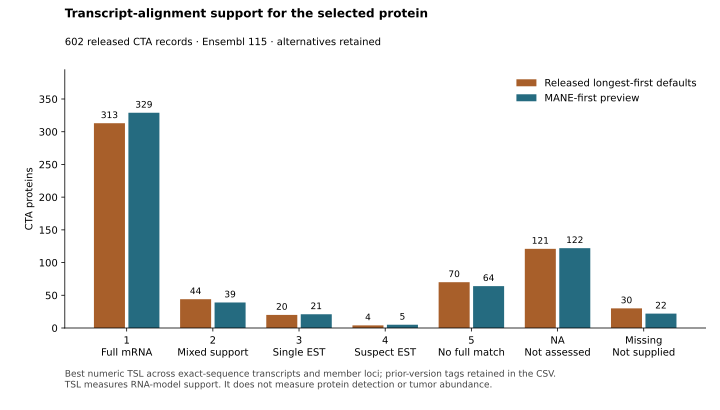

# Audit of CTA transcript defaults

**The released selector favors length, not transcript support.** It picks the
longest translated sequence at each primary locus and then checks CDS
completeness. MANE Select and Ensembl canonical tags are available in the pinned
reference but do not influence that choice.

The audit compares all **602 CTA records, 646 loci and 1,452 translated
transcripts** with the representatives designated in **Ensembl 115**. It includes
every alternate translation at these loci, including incomplete records. This
is a migration preview; the released classification and sequence bundle still
use their existing selection policy.

[Complete comparison and all 53 affected proteins](comparison.md) ·
[All 602 proteins](protein-defaults.csv) · [All 646 loci](locus-defaults.csv) ·
[All translated transcripts](transcript-inventory.csv) ·
[Machine-readable audit](audit.json.gz) · [Source and output hashes](manifest.json)

## What needs correction

| Finding | CTA records | Consequence |
|---|---:|---|
| A designated, qualifying MANE protein differs from the current choice at one or more member loci | 52 | Compare and replace the length-only default after resolving source conflicts. This affects 53 loci. |
| Two distinct sequences are selected because they tie for length | 1: PSG11 | Retain the MANE sequence as the default; keep the other sequence as an alternative. |
| Selected sequences have only `gencode_basic`, without MANE, canonical, CCDS or `gencode_primary` tags | 21 | The completeness check has been presented as stronger support than it provides. All 21 have a different MANE representative. |
| Best available alignment support for the selected sequence is TSL 4 or 5 | 74 | Review full-transcript support: 4 have TSL 4 and 70 have TSL 5. |
| Support level is not supplied | 30 | Record the missing field; inspect other evidence. |
| Support level is explicitly NA | 121 | The alignment-based assessment was not performed. This is not negative translation evidence. |
| One or more member loci lack MANE | 12 | Use the designated Ensembl representative for comparison and retain the evidence limitations. |

These rows overlap. A longer alternative can be a real protein; it should not
become the default solely because it is longer. `gencode_basic` describes a
representative transcript subset, and `gencode_primary` also includes selected
alternative splicing events. Neither label identifies the dominant protein in a
tumor. [GENCODE tag definitions](https://www.gencodegenes.org/pages/tags.html)

Examples show why the sequence choice matters:

| Protein | Released default | MANE representative | Interpretation |
|---|---:|---:|---|
| [GALP](https://www.ensembl.org/Homo_sapiens/Gene/Summary?g=ENSG00000197487) | 141 aa | 116 aa | The 141-aa model has only `gencode_basic` and no supplied TSL. The 116-aa model has MANE, canonical and CCDS support; its TSL 1 is assigned to the previous transcript version. Alarin remains a separate alternative. |
| ADIG | 197 aa | 80 aa | Length alone more than doubles the representative protein. |
| CTAG2 | 210 aa | 180 aa | The familiar CTA name does not specify the selected sequence. |
| TGM4 | 729 aa | 684 aa | The longer default lacks the MANE/canonical/CCDS/primary tags. |
| SPAM1 | 511 aa | 509 aa | MANE matches the pinned UniProt canonical sequence. The previous mature-chain comparison remains separately recorded. |
| PSG11 | Two different 335-aa sequences | One 335-aa sequence | Equal length does not establish protein identity or equal support. |
| CDY1/B | A shared 554-aa sequence | CDY1: 554 aa; CDY1B: 540 aa | The designated defaults differ. Rebuild membership and expression summaries instead of silently retaining a shared default. Both loci still encode both alternatives. |

Every affected protein and versioned transcript is linked in the
[complete comparison](comparison.md). The 21 basic-only defaults are C9orf57,
CDX4, FRG2B, GALP, GDPD4, GLT6D1, HHLA1, LRRIQ4, LYZL1, LYZL2, MAGEB16,
MGAT4D, OR10J1, PSG3, PSG7, SLC25A52, SPANXN4, SSX3, TCP11, TGM4 and TTLL13.

## Proposed default rule

1. Use exact, versioned transcript/protein records from the pinned reference.
   Keep the existing primary-locus and complete-CDS requirements: qualifying
   biotype, intact start/stop, no incomplete tags, and a valid AA20 sequence.
2. Prefer **MANE Select**. If it is absent at the primary locus, use
   **Ensembl canonical**. If the designated record fails qualification, flag
   the locus for review. Do not silently substitute a longer alternative or a
   genomic patch.
3. If equally designated records encode different proteins, require review.
   Multiple transcripts with identical protein bytes can share one protein
   default; retain all transcript accessions.
4. Show CCDS, transcript support, source, and exact UniProt agreement alongside
   the choice. Preserve MANE Plus Clinical and other alternative proteins with
   their own identities and evidence. A longer sequence does not outrank a
   better-supported representative.
5. Record sequence-specific experimental findings and source disagreements.
   A default designation does not resolve contrary translation evidence or
   establish tumor-specific production.

MANE combines RefSeq and Ensembl curation and chooses one representative using
biological evidence. MANE Plus Clinical adds transcripts needed for clinical
variant reporting; it is not a higher default rank. The preview uses the MANE
tags in Ensembl 115, rather than mixing transcript versions from a newer release.
[NCBI MANE](https://www.ncbi.nlm.nih.gov/refseq/MANE/),
[Morales et al., Nature 2022](https://doi.org/10.1038/s41586-022-04558-8)

Ensembl canonical selection combines conservation, expression, coding length
and agreement with other resources. It is more informative than selecting the
longest protein alone.
[Ensembl canonical methodology](https://static.ensembl.org/info/genome/genebuild/canonical.html)

## Support that the existing check misses



TSL describes support for the RNA model from mRNA/EST alignments. Levels 4 and 5
identify suspect EST support and the absence of a single full-model supporting
transcript, respectively. Missing and NA have different meanings. The report
retains annotations such as “assigned to previous version” verbatim; the numeric
summary alone does not establish support for a changed transcript version.
[GENCODE data format](https://www.gencodegenes.org/pages/data_format.html)

MANE-first is not a universal improvement in TSL: CIMIP3 changes from TSL 2 to
TSL 3, and 64 proposed defaults still have best available TSL 5. Representative
choice and transcript-alignment support answer different questions. These cases
remain visible for evidence review rather than receiving a blanket “strong” label.

The qualification table currently omits TSL, CCDS accessions and transcript
annotation source even though the GTF supplies them. This audit extracts those
fields from the same checksum-verified GTF and verifies gene identities and
transcript versions before joining. APPRIS annotations are absent from this Ensembl GTF;
they are not inferred. Incorporating APPRIS requires a separately pinned,
version-matched source.
[GENCODE explanation of Ensembl/GTF differences](https://www.gencodegenes.org/pages/faq)

The 12 records with at least one locus lacking MANE are CT47A1/10/11/12/2/3/4/5/6/7/8/9,
HMGB1P1, FAM90A27P, AK4P3, ENSG00000241690, EPPIN-WFDC6, H2AL1Q,
SLCO1B3–SLCO1B7, ENSG00000258417, ATF7–NPFF, ENSG00000273155 and ENSG00000289809.
Absence of MANE alone does not establish a defective protein.

## Conflicts that a MANE-first rule does not settle

**GDPD4:** the proposed MANE protein is 520 aa; the pinned
[UniProt Q6W3E5](https://www.uniprot.org/uniprotkb/Q6W3E5/entry) reference is
623 aa and matches the current default. Its extracellular coordinates must be
mapped to the actual selected sequence before reuse. This is a source
disagreement requiring sequence-specific review.

**SLCO1B3–SLCO1B7:** the designated Ensembl protein remains 748 aa, while the
[UniProt F5H094](https://www.uniprot.org/uniprotkb/F5H094/entry) reference is
687 aa. The published native hepatocyte localization concerns the shorter
LST-3TM12 protein. Switching to Ensembl canonical does not resolve that
attribution. [Malagnino et al.](https://pubmed.ncbi.nlm.nih.gov/29248594/)

**FRG2/FRG2B:** coding annotations remain present, including MANE, alongside
experimental evidence challenging protein production in the tested systems.
Changing the representative does not dispose of that finding.
[Experimental study](https://pmc.ncbi.nlm.nih.gov/articles/PMC12242771/)

**GALP/alarin and readthroughs:** evidence for one product must stay attached to
that product. Parent-gene studies, gene-level RNA measurements and antibody
signals shared between variants do not establish the chosen complete protein.
See the [individual evidence reviews](../cta-literature-20261107/report.html#concerns).

Among the 37 existing membrane-reference comparisons, MANE-first fixes SPAM1's
exact sequence match, creates the GDPD4 mismatch, and leaves the SLCO readthrough
mismatch unresolved: 35 of 37 still match. The remaining CTA proteins were not
included in that 37-protein UniProt comparison.

## Applying the correction

The next classification build must use the same representative-selection rule
for the protein registry, translation gate, sequence bundle and reports. Its
migration is tracked in [issue #681](https://github.com/pirl-unc/oncoref/issues/681)
and must:

- resolve the GDPD4 and readthrough conflicts and adjudicate existing translation
  counterevidence;
- rebuild identical-default membership, including the CDY1/CDY1B split, and
  recompute affected expression summaries from measured member loci;
- recompute sequence containment and every sequence role, retaining
  **exclude > review > allow** across occurrences;
- regenerate localization/domain mappings against exact sequence hashes;
- publish old/new transcript accessions, sequence hashes, selection reasons,
  classification changes and a new policy/bundle identity together.

All 646 CTA loci have a qualifying designated representative in this preview.
That does not predict the final CTA count after the other evidence and shared
identities are reassessed. SERPINA2 and MROH5 remain qualification failures in
the preview's regression checks. Alternative protein sequences remain in the
source inventory, including those rejected as defaults.

## Reproduction

Run the audit offline from the shipped tables and pinned support extract:

```sh
.venv/bin/python scripts/audit_cta_transcripts.py
```

To re-extract support fields, supply the exact Ensembl 115 GTF:

```sh
.venv/bin/python scripts/audit_cta_transcripts.py --import-gtf /path/to/Homo_sapiens.GRCh38.115.chr_patch_hapl_scaff.gtf.gz
```

The importer rejects a GTF with a different checksum. The manifest records the
classification inputs, qualification table, literature registry, script, support
extract and generated outputs. Tests cover representative priority, missing
support, failed designated transcripts, alternate loci, identical versus
conflicting proteins, GALP, PSG11, CDY1/CDY1B and RBMY1F/RBMY1J.
