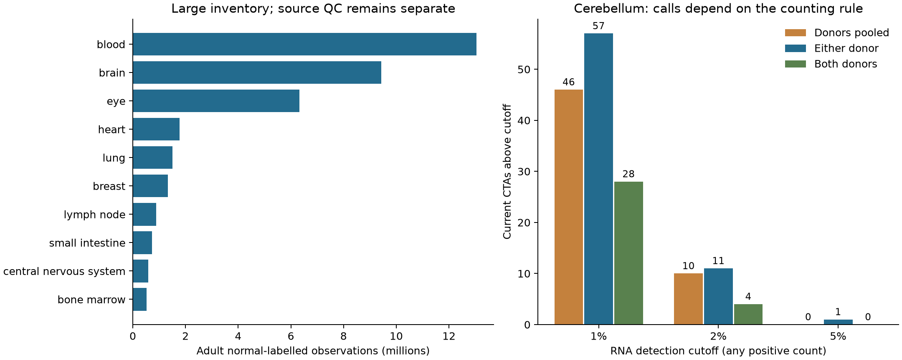

# Normal-cell atlas reassessment

Audit: 10 November 2026. **The normal-tissue inventory contains 59,076,311 primary cells/nuclei from 215 collections and 452 datasets. These are observations retained by metadata filters, not cells independently certified as healthy or free of technical noise.**

The expression build selects **1,804 proteins**: every current non-Unsafe record, every protein excluded only by the old rare-cell rule, and the familiar-CTA comparison panel. This includes PLAC1 and all 638 current CTAs. 1,826 exact Ensembl gene IDs are available; 36 requested IDs are absent from this Census release. Other Unsafe proteins retain their independent exclusions; they are not newly reassessed by this expression extraction.

Expression blocks completed when this page was rendered: **0/19**. The inventory and Sepp sensitivity analysis are complete. The broad expression build and source-level QC are separate work. **No catalog classifications have changed in this audit.**

## Inventory

| Age scope | Observations |
|---|---:|
| Adult | 41,630,983 |
| Childhood | 2,678,950 |
| Prenatal | 11,405,539 |
| Age unresolved | 3,360,839 |

Adult brain alone contributes 9,432,853 observations. [Tissues](tissue-inventory.csv), [all source collections and papers](source-registry.csv), [dataset versions](dataset-versions.csv), [age mapping](age-mapping.csv).

The build pins CELLxGENE Census **2025-11-08**, the stable release returned by the service on the audit date. It retains primary observations with the exact disease label `normal` and `tissue_type=tissue`; this excludes labelled organoids and cell cultures. Compound or uncertain disease labels are not silently accepted. Adult status comes from donor-stage metadata, never a cell-type name. Childhood, prenatal and ambiguous stages stay separate. A normal label does not exclude unrecorded illness, treatment, tissue pathology or postmortem effects; these require source review.

For this audit, adult means a stated age or age range entirely **18 years or older**. HsapDv's broad adult, prime-adult and young-adult terms start at **15**, so those labels remain unresolved until the original donor ages are recovered. They are not admitted to the confirmed-adult count. [Ontology definitions](adult-age-ontology.json), [HsapDv ontology](https://www.ebi.ac.uk/ols4/ontologies/hsapdv).

`is_primary_data` removes duplicates identified by Census curation. Dataset partitions and repeated libraries are not independent biological replicates. Donors are scoped to their collection; unknown or pooled donor identities cannot count as independent donors. Cross-collection donor overlap still needs review. Census and HPA summaries of the same study count as one source, and the current Sepp H5AD is a version comparison, not an independent replication of Sepp in Census.

Sources: [Census releases](https://chanzuckerberg.github.io/cellxgene-census/cellxgene_census_docsite_data_release_info.html), [Census schema](https://github.com/chanzuckerberg/cellxgene-census/blob/main/docs/cellxgene_census_schema.md), [incremental raw-count API](https://chanzuckerberg.github.io/cellxgene-census/notebooks/api_demo/census_compute_over_X.html).

## What changes at 5% per donor?

Among current CTAs measured in the two adult Sepp granule-cell donors:

| Detection cutoff | Donors pooled | At least one donor | Both donors |
|---|---:|---:|---:|
| 1% | 46 | 57 | 28 |
| 2% | 10 | 11 | 4 |
| 5% | 0 | 1 | 0 |

These are sensitivity counts, not revised classifications. They require at least ten positive nuclei in the relevant comparison; the smaller donor has 2,731 granule nuclei and therefore does not independently satisfy the old 3,000-cell support rule. Missing members are not negative. The 5% single-donor hit is ENSG00000279983. [Threshold table](cerebellum-threshold-sensitivity.csv), [protein and donor results](cerebellum-donor-support.csv.gz).

PLAC1 has 514/16,833 positive adult granule nuclei; 506 contain one count, eight contain two. Its detection rates are 3.25% and 2.01% in the two donors. In library SN233 from the 42-year-old donor, detection is 2.08% in the lowest-depth quarter and 5.65% in the highest-depth quarter. This association does not prove contamination: genuine weak RNA also becomes easier to detect at greater depth. It does show why a raw percentage is not a portable safety threshold. [Count support](../plac1-brain-20261110/count-qc/count-support.csv) · [Depth comparison](../plac1-brain-20261110/count-qc/depth-sensitivity.csv.gz).

The denominator is the sampled named cell population, not the entire organ. Five percent of a specialized population is not five percent organ loss. The fraction of nuclei with captured RNA also does not identify the fraction with recognizable protein or peptide–HLA.



## Independent adult-cerebellum replication

The three disjoint cerebellar dissections from [Siletti et al.](https://doi.org/10.1126/science.add7046) contain **151,947 unique nuclei**, including **88,302 granule nuclei** from three adults aged 29, 42 and 50. Cell IDs were checked across files; all retained observations are primary and labelled normal. The audit evaluates **all 19,893 catalog protein records**, using exact gene IDs and reporting unavailable members separately. The PLAC1 totals were independently reproduced with AnnData slicing.

| Protein | Sepp: 16,833 granule nuclei | Siletti: 88,302 granule nuclei | Siletti positive nuclei | Siletti nuclei with ≥2 counts |
|---|---:|---:|---:|---:|
| CBY3 | 3.333% | 0.921% | 813 | 74 |
| PLAC1 | 3.054% | 0.416% | 367 | 22 |
| DMRT1 | 2.620% | 0.200% | 177 | 2 |
| CAGE1 | 2.002% | 0.376% | 332 | 19 |
| TMEM269 | 1.533% | 1.042% | 920 | 74 |
| NUTM1 | 1.277% | 0.428% | 378 | 45 |
| SYCP1 | 1.230% | 0.166% | 147 | 0 |
| MAGEB10 | 0.137% | 0.011% | 10 | 0 |
| PRAME | 0.000% | 0.010% | 9 | 0 |

Among the original 46 CTA hits, **41 have an available member feature**, **40 have positive counts**, and **1 reaches 1%** in the independent pooled granule population: TMEM269. Five records have no measured member. These results corroborate sparse RNA assignments, not the original detection frequencies or protein production. Shared technical artifacts can recur across studies.

Across all 638 current CTAs, the independent atlas provides complete member features for 573, partial coverage for 21 and no member feature for 44. Three CTAs reach 1% pooled detection: MANSC4 (1.80%), TMEM269 (1.04%) and ENSG00000258691 (1.02%). None reaches 5% pooled detection, and none reaches 1% if a positive nucleus must contain at least two counts. These alternate cutoffs remain descriptive comparisons.

PLAC1 is detected in each independent donor: 99/16,112 (0.61%), 173/40,112 (0.43%) and 95/32,078 (0.30%). MAGEA4, CT83 and XAGE1A/B have available features but zero granule counts in these files. That is a measured-matrix result, not proof of biological absence: the original reference excludes some overlapping genes/transcripts, and upstream processing remains relevant. [Siletti reference and counting workflow](https://github.com/linnarsson-lab/adult-human-brain).

[All original 46 comparisons](original-46-independent-study.csv) · [All current CTAs by donor](independent-study-all-ctas.csv.gz) · [All catalog proteins by donor](siletti-granule-protein-detection.csv.gz) · [Gene counts](siletti-granule-gene-detection.csv.gz) · [Population QC](siletti-population-qc.csv) · [Source versions and hashes](siletti-manifest.json).

## Evidence required before a rare-cell finding changes a category

| Check | Required interpretation |
|---|---|
| Source identity | Pin study, dataset revision, reference annotation and count layer. Do not combine inconsistent source versions. |
| Adult normal tissue | Verify donor age, health, tissue origin and treatment; retain other ages and states separately. |
| Cell QC | Record source cell-calling, damaged-cell and doublet filters; inspect depth, detected genes and appropriate mitochondrial/nuclear metrics within each library and cell type. A universal QC cutoff can remove real rare populations. |
| Count support | Report positive cells, total molecules, one-count and multi-count support per donor. Keep UMI protocols, full-length read counts and fractional corrected values distinct. |
| Background | Compare uncorrected and corrected counts where available; use empty droplets or validated negative controls. A larger percentage alone does not establish expression above background. |
| Alignment and identity | Inspect unique mapping, strandedness, exonic versus intronic support, overlapping genes and paralogs for decisive sparse findings. A gene-count matrix cannot provide these checks. |
| Replication | Look for a localized signal across donors and independent studies. One strong, verified donor is not cancelled by many negative donors. One weak library is not enough for an automatic exclusion. |
| Missingness | Preserve genes missing or censored by upstream filtering. Census presence=False does not distinguish unmeasured genes from genes with no positive counts; verify the original feature list before claiming a measured negative. |
| Protein evidence | Keep IHC, selective MS, spatial RNA and receptor-relevant protein/peptide evidence linked to the exact gene and compartment. RNA replication is not protein confirmation. |

Use **5% as a reported sensitivity cutoff**, alongside 1% and 2%, until calibration against source-specific background and orthogonal evidence supports an operational rule. Do not turn “below 5%” into a safety allowance. Nor should “above 1%” automatically establish Unsafe when the evidence consists of unresolved single-molecule signals.

The intended decision flow stays within the existing categories: credible normal evidence is assessed under its tissue tier; unresolved evidence that could change admission belongs in **Other:Review**; a demonstrated artifact can be dismissed with its evidence; and a passing normal-expression screen permits the existing cancer/reproductive admission rules. This audit supplies the data and QC record before any catalog rebuild adopts that change.

Methods supporting these checks: [SoupX](https://doi.org/10.1093/gigascience/giaa151), [sequencing depth and detection](https://doi.org/10.1038/s41467-020-14482-y), [biological replication in single-cell analysis](https://doi.org/10.1038/s41467-021-25960-2). None of these papers establishes a 1%, 2% or 5% antigen-toxicity threshold.

## Cerebellum count provenance

The authors' [workflow](https://gitlab.com/kaessmannlab/mammalian-cerebellum/-/blob/main/README.org) explicitly counts UMIs with Cell Ranger against mature-mRNA and pre-mRNA references. One count therefore represents a deduplicated molecule assignment, not necessarily one sequencing read. Their [available preprocessing script](https://gitlab.com/kaessmannlab/mammalian-cerebellum/-/blob/main/scripts/R/001_batch_preprocessing.R) selects nuclei by intronic fraction, uses Scrublet, and removes genes detected in fewer than 25 cells within a library. Its merged matrices can therefore contain censored zeros. The current H5AD does not retain the full per-library gene filtering mask or separate exonic/intronic layers. The exact export and background-correction provenance still needs reconciliation with the paper's final workflow.

Those issues warrant checking; they do not establish that the CTA signals are alignment errors. Some reproductive-gene expression in brain is real—the Sepp study independently examined examples such as ZP2—but that does not validate the specific sparse hits in this audit. [Sepp et al.](https://doi.org/10.1038/s41586-023-06884-x).

## Reproduction

Use an isolated environment with `cellxgene-census`, `pyarrow`, `h5py`, `scipy`, `pandas` and `matplotlib`. The shared Python environment was not modified. Large matrices, observation metadata and count blocks are cached under `tmp/normal-atlas`; compact reports are retained here.

```sh
python scripts/inventory_normal_census.py --release 2025-11-08 --output tmp/normal-atlas/census-2025-11-08
python scripts/audit_normal_census.py --inventory tmp/normal-atlas/census-2025-11-08 --output tmp/normal-atlas/counts-2025-11-08
python scripts/render_normal_census_audit.py --inventory tmp/normal-atlas/census-2025-11-08 --counts tmp/normal-atlas/counts-2025-11-08 --output docs/audits/normal-cell-atlas-20261110
```
