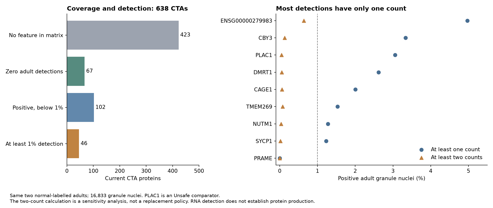

# Other CTAs in the PLAC1 cerebellum dataset

**46 of the 638 current CTAs reach 1% RNA detection in the same adult granule nuclei used for the PLAC1 audit.** 28 reach 1% in both adult donors. These are newly calculated observations; the existing catalog categories have not changed.

The data are from [Sepp et al.](https://doi.org/10.1038/s41586-023-06884-x), using the [same version and normal-adult filters as the PLAC1 audit](../index.md). There are 14,102 granule nuclei from donor #105 (42 years) and 2,731 from #138 (52 years), totaling 16,833.

## Coverage comes first

| Result among current CTAs | Proteins |
|---|---:|
| No member feature in the supplied matrix | 423 |
| Feature present; zero adult granule detections | 67 |
| Positive; below 1% adult granule detection | 102 |
| At least 1% adult granule detection | 46 |
| Total | 638 |

Of the 215 proteins with at least one available gene feature, 213 have complete member coverage and two have partial coverage: SSX2/B and TP53TG3/B/C/D/E/F. Their missing members remain unmeasured. All 67 zero-detection proteins have complete member coverage in this file.

**MAGE-A4, NY-ESO-1, XAGE-1 and CT83 have no member feature in the supplied matrix.** They cannot be called brain-negative from this file. PRAME is present and has zero counts in the adult granule subset. These are different results.

The later [normal-cell atlas audit](../../normal-cell-atlas-20261110/index.md) found that the authors' workflow also filters genes within each library. Consequently, feature presence in the merged matrix does not guarantee an uncensored measurement in every donor. Zero counts here do not establish absence of adult brain RNA.

## Named comparisons

| Protein | Current category | RNA detections / 16,833 nuclei | Detection % | Nuclei with ≥2 counts | Feature coverage |
|---|---|---:|---:|---:|---|
| [PLAC1](https://www.ensembl.org/Homo_sapiens/Gene/Summary?g=ENSG00000170965) | Unsafe | 514 | 3.054% | 8 | complete |
| [CBY3](https://www.ensembl.org/Homo_sapiens/Gene/Summary?g=ENSG00000204659) | CTA | 561 | 3.333% | 22 | complete |
| [DMRT1](https://www.ensembl.org/Homo_sapiens/Gene/Summary?g=ENSG00000137090) | CTA | 441 | 2.620% | 9 | complete |
| [CAGE1](https://www.ensembl.org/Homo_sapiens/Gene/Summary?g=ENSG00000164304) | CTA | 337 | 2.002% | 10 | complete |
| [TMEM269](https://www.ensembl.org/Homo_sapiens/Gene/Summary?g=ENSG00000274386) | CTA | 258 | 1.533% | 13 | complete |
| [NUTM1](https://www.ensembl.org/Homo_sapiens/Gene/Summary?g=ENSG00000184507) | CTA | 215 | 1.277% | 6 | complete |
| [SYCP1](https://www.ensembl.org/Homo_sapiens/Gene/Summary?g=ENSG00000198765) | CTA | 207 | 1.230% | 3 | complete |
| [SSX2/B](https://www.ensembl.org/Homo_sapiens/Gene/Summary?g=ENSG00000241476) | CTA | 84 | 0.499% | 0 | partial |
| [MAGEB10](https://www.ensembl.org/Homo_sapiens/Gene/Summary?g=ENSG00000177689) | CTA | 23 | 0.137% | 0 | complete |
| [PRAME](https://www.ensembl.org/Homo_sapiens/Gene/Summary?g=ENSG00000185686) | CTA | 0 | 0.000% | 0 | complete |
| [SPAG9](https://www.ensembl.org/Homo_sapiens/Gene/Summary?g=ENSG00000008294) | Unsafe | 11,740 | 69.744% | 6,871 | complete |
| [TSGA10](https://www.ensembl.org/Homo_sapiens/Gene/Summary?g=ENSG00000135951) | Unsafe | 6,447 | 38.300% | 2,193 | complete |

For a protein represented by several genes, the displayed value is the member gene with the highest detection rate. Frequencies are never added across paralogs. Gene-level rows and the selected member are retained in the downloads. These are RNA observations attached to protein records, not measurements of protein abundance.

[All 46 CTA hits](cta-hits.md) · [113 familiar targets](familiar-targets.md) · [Every current CTA](adult-granule-current-ctas.csv) · [All 966 selected proteins](adult-granule-all-proteins.csv).

## The one-count result matters

Across the 46 CTA hits, **97.0% of positive protein–nucleus observations contain exactly one count**. None reaches 1% detection if a positive nucleus must contain at least two counts. PLAC1 also drops from 3.05% to 0.048% under that calculation. A two-count threshold is a sensitivity analysis, not an adopted rule and not a validated safety boundary.

Some familiar targets already classified Unsafe have much stronger signals: SPAG9 is detected in 69.74% of granule nuclei, including 6,871 nuclei with at least two counts; TSGA10 is detected in 38.30%, including 2,193 with at least two counts. The assay therefore distinguishes widespread, multi-count expression from the sparse signals seen for PLAC1 and the current CTA hits.

Within adult oligodendrocytes (5,309 nuclei), another five current CTAs reach the same local detection criterion: ASZ1, STARD6, RIPPLY3, CPHXL and TP53TG3/B/C/D/E/F. That makes **51 current CTAs** with a local hit in either supported adult cell population. [Additional cell-type results](additional-adult-cell-hits.csv). Smaller populations are reported but lack the 3,000-cell support required for this comparison. Fetal and childhood granule results are separate in the full download.

## Why these are still CTA in the current catalog

The catalog uses the older WMG aggregate across datasets and ages. The packaged cerebellar-granule values include CAGE1 at 0.8346%, DMRT1 at 0.9851%, CBY3 at 0.8294% and NUTM1 at 0.5968%—below its 1% line. This audit uses the current downloadable matrix and adult donors, where those values are 2.002%, 2.620%, 3.333% and 1.277%. Both the source representation and the selected population differ; this comparison does not isolate which change caused the discrepancy.

The local calculation uses ≥1% detection, ≥10 positive nuclei and ≥3,000 total nuclei. The complete existing rare-cell policy additionally uses a population-share filter against all sampled brain cells. This single-study comparison does not reconstruct that global denominator or automatically rerun the classification.

**The result exposes a consistency problem for the normal-expression screen.** PLAC1 is not unique in crossing the local detection line. All such observations need the same age, source-version, mapping and background review. PLAC1 additionally has independent cerebellar PCR and adult-brain atlas support, described in the [parent audit](../index.md). The [expanded audit](../../normal-cell-atlas-20261110/index.md) now checks all 46 against the independent Siletti granule-cell matrix: 41 have available features, 40 have positive counts, and only TMEM269 reaches 1% pooled detection. Repeated sparse RNA assignments do not establish protein expression or exclude shared technical artifacts.

Sparse counts alone do not decide whether neural cells produce a recognizable antigen. The immediate follow-up is to reconcile source versions and apply a uniform adult-tissue analysis across the catalog. This audit does not silently change the threshold or relabel the proteins.

## Name of the cancer–reproductive union

The current definition calls it **Target candidates**:

**Target candidates = Cancer Antigens ∪ Reproductive Antigens.**

| Membership | Current draft proteins |
|---|---:|
| CTA: cancer and reproductive/developmental | 638 |
| Cancer Antigen only | 260 |
| Reproductive Antigen only | 22 |
| Target candidates: union | 920 |

Cancer Antigens contain 898 proteins; Reproductive Antigens contain 660. Their shared 638 CTAs are counted once in the union. Membership means the protein passed the catalog's shared checks and at least one expression route. It does not assert clinical safety. [Existing formal definition](../../target-selection-20261109/definition.json).

## Data and reproduction

- [Protein results across all analysed populations](protein-detection.csv.gz)
- [Gene-level counts across all analysed populations](gene-detection.csv.gz)
- [The 46 hits with both donor-specific results](current-cta-granule-hits.csv)
- [Category counts and coverage](category-summary.csv)
- [Source hashes, mapping rules and population sizes](manifest.json)

Run `scripts/audit_cta_cerebellum.py --h5ad tmp/plac1-brain/sepp-human.h5ad --output docs/audits/plac1-brain-20261110/cta-comparison`, then `scripts/render_cta_cerebellum.py`. The input matrix is pinned in the parent audit. The analysis requires h5py, scipy, numpy, pandas and matplotlib; no shared-environment packages were changed. Extracted adult counts for PLAC1, CAGE1, NUTM1, PRAME, CBY3 and ENSG00000279983 were independently checked with AnnData slicing.
