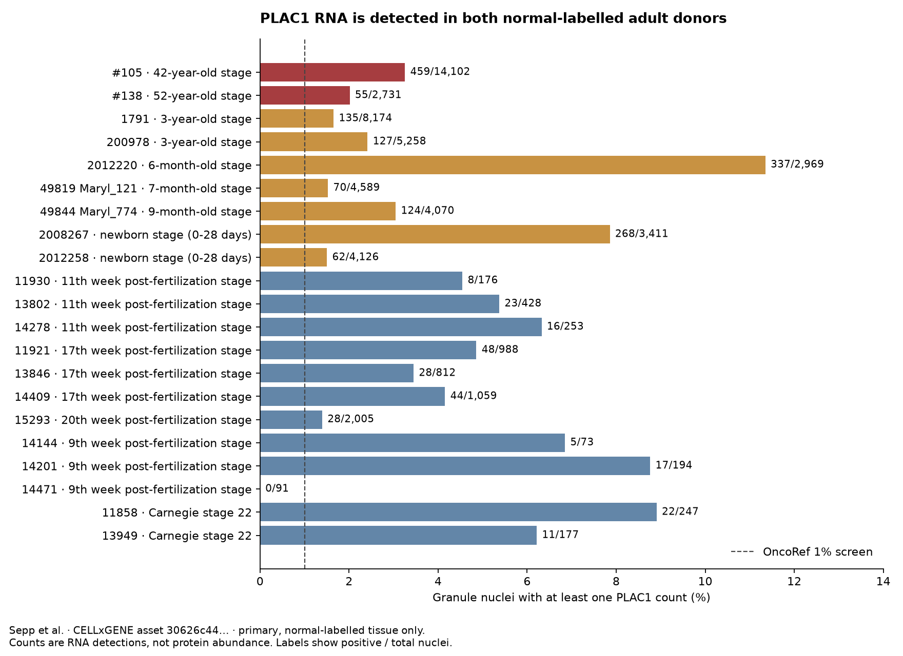

# PLAC1 in normal human brain

**The evidence supports low-level PLAC1 RNA in adult human brain. It is not confined to fetal tissue, and it is not supported only by the original CELLxGENE aggregate. Human brain protein expression and receptor recognition remain unconfirmed.**

Audit date: 10 November 2026. Gene: [PLAC1 / ENSG00000170965](https://www.ensembl.org/Homo_sapiens/Gene/Summary?g=ENSG00000170965). [HPA](https://www.proteinatlas.org/ENSG00000170965-PLAC1).

**Follow-up:** [The same analysis across current CTAs](cta-comparison/index.md) finds 46 current CTAs at or above 1% adult granule detection, predominantly with single counts. It documents the source-version and population differences behind the discrepancy with the existing catalog, along with missing-feature coverage. PLAC1's sparse RNA result must be assessed consistently with these findings.

**Expanded audit:** [The normal-cell atlas reassessment](../normal-cell-atlas-20261110/index.md) inventories 59.1 million normal-labelled primary-tissue observations and compares 1%, 2% and 5% detection cutoffs per donor. It also documents an additional limitation: the authors' preprocessing filters genes within each library, so zeros in the merged matrix can be censored. The expanded audit does not adopt a new safety threshold.

PLAC1 remains **Unsafe under the existing OncoRef rare Vital-cell RNA rule**. This audit supplies evidence and source resolution; it does not change the classification or claim demonstrated neurotoxicity. The earlier suggestion that the brain finding might be entirely developmental is no longer supported.

## Evidence at a glance

| Evidence | Result | What it establishes |
|---|---|---|
| Wang, Baddoo and Yin, 2014; normal human tissue qRT-PCR | Cerebellum was positive in a 20-tissue panel | Independent targeted RNA evidence; exact donor ages and biological replication were not reported |
| Sepp et al.; direct analysis of current human cerebellum raw-count matrix | 514/16,833 granule nuclei positive in two normal-labelled adult donors | The single-nucleus signal persists in adults |
| Siletti et al.; direct independent raw-count analysis | 367/88,302 granule nuclei positive across three adults; 22 have at least two counts | Sparse RNA assignments recur, at 0.42% pooled detection rather than Sepp's 3.05% |
| Siletti et al.; HPA processing of a separate adult human brain atlas | Cerebellar upper-rhombic-lip cluster: 398 counts, 1.0 nCPM; cerebellar inhibitory cluster: 157 counts, 1.1 nCPM | RNA signal in an independent adult-brain study; these are cluster summaries |
| HPA/GTEx bulk RNA | Very low regional expression; rounded GTEx cerebellar summaries are 0.0 nTPM | No evidence of high bulk cerebellar expression |
| HPA v23 brain IHC | Not detected in cerebellar granular layer, molecular layer or Purkinje cells; Enhanced gene-level reliability | No positive protein confirmation in these HPA annotations |
| Tchabo et al., 2009; endpoint RT-PCR | Brain, cerebellum and fetal brain were negative; placenta positive | A conflicting RNA result that must remain in the evidence record |

Primary sources: [Wang et al.](https://doi.org/10.1186/1743-422X-11-107), [Sepp et al.](https://doi.org/10.1038/s41586-023-06884-x), [Siletti et al.](https://doi.org/10.1126/science.add7046), [HPA adult-brain data and methods](https://www.proteinatlas.org/humanproteome/single+cell/single+nuclei+brain/method), [HPA cerebellum](https://www.proteinatlas.org/ENSG00000170965-PLAC1/tissue/cerebellum), [Tchabo et al.](https://pmc.ncbi.nlm.nih.gov/articles/PMC2935768/).

## Adult donor analysis

I downloaded the 180,956-nucleus human cerebellum dataset from Sepp et al. and extracted the PLAC1 column from the matrix declared as raw counts. The main analysis retains primary observations with disease label `normal` (`PATO:0000461`). Ages come from donor metadata, not cell-type names.

| Donor | Age and sex | Positive granule nuclei | Fraction | Positive nuclei with at least two counts |
|---|---|---:|---:|---:|
| #105 | 42 years, female | 459 / 14,102 | 3.25% | 8 |
| #138 | 52 years, male | 55 / 2,731 | 2.01% | 0 |
| Combined | Two normal-labelled adults | 514 / 16,833 | 3.05% | 8 |

Of the 514 positive adult granule nuclei, **506 have one PLAC1 count and eight have two**. No positive adult granule nucleus has more than two. These values satisfy the existing pooled detection-frequency screen; they do not measure protein abundance. Donor #138 alone is below the rule's 3,000-cell support requirement.

The dataset also contains a 46-year-old donor labelled acute myocardial infarction: 245/6,214 granule nuclei are positive (3.94%). This donor is excluded from the main normal-labelled analysis. Fetal and childhood observations are retained separately in the downloads. They are not used to establish adult expression.



[Donor table](granule-by-donor.csv) · [Age table](granule-by-age.csv) · [All cell types by age](all-cells-by-age-type.csv) · [Per-nucleus counts and metadata](sepp-plac1-cells.csv.gz) · [Analysis summary](sepp-summary.json).

These are **our calculations from the published dataset**, not PLAC1-specific claims made in the Sepp paper. Counts for both adult controls were independently reproduced with AnnData matrix slicing.

## What the original rare-cell screen pooled

The public WMG query reproduces the existing 1,108/58,474 result. Dataset-specific queries locate all 1,108 positives in the Sepp study:

| Dataset | Positive / total cerebellar granule cells in WMG |
|---|---:|
| Sepp et al., human cerebellum across development | 1,108 / 55,770 |
| He et al., Human Neural Organoid Atlas | 0 / 2,515 |
| Seeker et al., white matter | 0 / 189 |
| Combined | 1,108 / 58,474 |

The organoid dataset contributes to the denominator, not the positive signal. A `normal` disease label does not ensure adult primary tissue. Cell-name filtering alone therefore cannot separate normal adult tissue from developmental tissue or organoids.

**The WMG summary and current H5AD are different data representations.** WMG snapshot `1762972271` returns 1,108/55,770 for Sepp normal granule cells. The downloadable asset revised on 11 June 2026 returns 1,887/55,933 across all normal-labelled ages. The reason for this difference has not been resolved. Both results and their identifiers are retained; the adult donor figures above come exclusively from the current H5AD, not a subdivision of the old 1,108 positives.

[Dataset breakdown](wmg-granule-by-dataset.csv) · [Exact WMG response](wmg-query.json) · [Dataset metadata](bab7432a-5cfe-45ea-928c-422d03c45cdd-metadata.json) · [Sepp collection](https://cellxgene.cziscience.com/collections/72d37bc9-76cc-442d-9131-da0e273862db).

## Independent adult-brain RNA

The Siletti atlas is a separate study of three postmortem adult donors. HPA aggregates its observations by brain region and cluster. The downloaded PLAC1 table includes:

| Region | Cluster | PLAC1 count total | Reported nCPM |
|---|---|---:|---:|
| Cerebellum | Upper rhombic lip | 398 | 1.0 |
| Cerebellum | Cerebellar inhibitory | 157 | 1.1 |
| Cerebellum | Oligodendrocyte | 91 | 0.8 |
| Hippocampus | Hippocampal dentate gyrus | 3,091 | 3.4 |

The first cluster is not an exact synonym for cerebellar granule cells. These aggregated rows do not provide PLAC1-positive cell counts or donor-specific replication. We do not convert their units or apply the TPM exclusion thresholds to them. The current download labels the unit **nCPM**, although HPA's methods page still describes nTPM.

Very high normalized values in tiny clusters are not convincing abundance evidence: the maximum, 16.0 nCPM in spinal-cord fibroblasts, rests on only three counts. All rows retain their count support in the [cluster download](rna_single_nuclei_brain_cluster-plac1.csv). [Whole-brain cluster-type summaries](rna_single_nuclei_cluster_type-plac1.csv) are also retained.

## Targeted PCR, bulk RNA and protein

[Wang et al. (2014)](https://doi.org/10.1186/1743-422X-11-107) tested commercially sourced normal human tissue RNA and reported cerebellar PLAC1 expression. The normal cerebellum was not an EBV infection experiment. Figure 3 uses one primer set; the paper's two-primer confirmation concerns other experiments. The reported fold change uses low-expressing tissues as its baseline, not an absolute TPM scale. The study does not establish normal cerebellar protein localization.

[Tchabo et al. (2009)](https://pmc.ncbi.nlm.nih.gov/articles/PMC2935768/) found no cerebellar signal with endpoint RT-PCR. Assay sensitivity, donor sampling and transcript coverage are possible explanations for the disagreement; this audit does not identify which explains it.

HPA's cerebellum page reports very low bulk RNA, with some individual HPA brain samples above zero, and negative cerebellar IHC. The pinned v23 IHC table also has negative annotations for caudate, cerebral cortex and hippocampus. Enhanced is the HPA reliability designation for the gene's overall annotation, not a measured detection limit for rare neurons. [Pinned brain IHC rows](hpa-v23-brain-ihc.csv) · [Current HPA regional RNA values](hpa-brain-bulk.csv).

No confirmed normal-human-brain PLAC1 protein measurement or PLAC1–HLA ligand identification was established in this audit. Literature retrieval and HPA checks are not an exhaustive reanalysis of brain mass-spectrometry or immunopeptidomics repositories.

## Interpretation for OncoRef

The evidence is stronger than an age-unresolved automated flag: it includes two adult donors, a separate adult-brain atlas and targeted cerebellum PCR. **PLAC1 should not be described as absent from normal human brain.**

The remaining question is whether this sparse RNA produces recognizable antigen in adult neural cells. One-count detections can include ambient RNA or alignment errors. The count matrices cannot resolve those mechanisms, and the available IHC is negative. A brain RNA observation is not proof of accessible surface PLAC1 for a CAR or antibody, nor of a naturally presented peptide–HLA target for a TCR.

The [expanded audit](../normal-cell-atlas-20261110/index.md) completes the independent donor-resolved analysis: PLAC1 is detected in 99/16,112, 173/40,112 and 95/32,078 granule nuclei in three additional adult donors. The remaining checks are gene-specific alignment, background correction and orthogonal adult-brain RNA/protein localization. The general rare-cell screen should preserve donor age, tissue versus organoid status, raw-count support and source version before generating exclusions. These are pipeline follow-ups, not classification changes made by this audit.

## Reproduction

The [manifest](manifest.json) records source URLs, revisions, sizes and SHA-256 digests. The 840 MB H5AD remains in the local analysis cache; the compact PLAC1 extract and exact WMG responses are in this audit.

```sh
python scripts/audit_plac1_brain.py \
  --h5ad tmp/plac1-brain/sepp-human.h5ad \
  --output docs/audits/plac1-brain-20261110
```

The script requires h5py, numpy, pandas and matplotlib. The input is the [pinned public H5AD asset](https://datasets.cellxgene.cziscience.com/30626c44-7a90-40ed-8f54-116bfaebc857.h5ad). The independent HPA tables are [regional clusters](https://www.proteinatlas.org/download/tsv/rna_single_nuclei_brain_cluster.tsv.zip) and [cluster types](https://www.proteinatlas.org/download/tsv/rna_single_nuclei_cluster_type.tsv.zip); select `Gene == ENSG00000170965` and retain the source column names and units.
