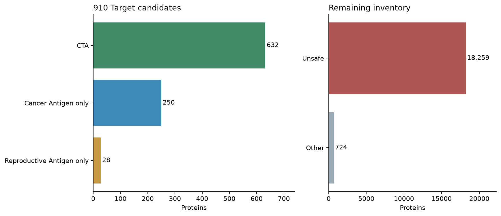

# Rebuilt antigen catalog

**632 CTA, 250 Cancer Antigen only, 28 Reproductive Antigen only, 724 Other and 18,259 Unsafe.**

[Filterable protein table](report.html) · [All category changes](category-changes.csv) · [Exact comparison scope](comparison.json)



Cancer Antigens include 882 proteins; Reproductive Antigens include 660. Their intersection is CTA and their union contains 910 Target candidates.

Other contains 669 review, 40 sequence, 15 expression. A curated published target nomination is retained for 466 CTAs and 47 Cancer Antigens only. Broader paper coverage also includes biology, normal-expression findings and other evidence.

## Category changes

| Released category | Rebuilt category | Proteins |
|---|---|---:|
| CTA | CTA | 574 |
| CTA | Other | 7 |
| CTA | Reproductive Antigen only | 26 |
| Other | CTA | 58 |
| Other | Cancer Antigen only | 250 |
| Other | Other | 717 |
| Other | Reproductive Antigen only | 2 |
| Unsafe | Unsafe | 18259 |

New CTAs: AMELY, H2BW2, KRT37, UCP1, ANKRD60, SRMS, OR1E2, GALR3, OCM2, TTLL8, CIB3, POTED, OR2B2, PROKR1, HOXD12, DEFB125, OR52D1, MAGEB17, DGAT2L6, MROH2A, SPATA31A6, AADACL3, HUS1B, OR14A16, OR51C1, KRTAP4-1, GLYATL3, KRTAP5-10, MAS1L, ARSH, KRTAP19-8, KRTAP20-4, TRIM64C, ZNF705D, DEFB115, TRIM51G, ZNF816-ZNF321P, SUPT20HL1, RAB6D, PRR23C, KRTAP5-7, ENSG00000249773, KRTAP5-9, ENSG00000255432, ENSG00000255835, KDM4F, ENSG00000258691, ENSG00000267140, SPATA31A3, SPATA31A7, SPATA31A5, ENSG00000279983, RPS4Y2, FAM240B, OOSP1, OOSP3, ENSG00000285566, POTEB/2.

Former CTAs now requiring review: CALHM3, TAF11L12, TRIM75, TAF11L14, PRAMEF18, TAF11L11, TAF11L13.

## Reproductive Antigens only

21 have potentially qualifying tumor measurements but unresolved patient independence; none reaches the single-sample threshold. The remaining 7 do not meet either cancer RNA rule.

| Protein | Tumor maximum TPM | Normal comparison TPM | Cancer assessment |
|---|---:|---:|---|
| DEFB106A/B | 1.51 | 0.1 | Patient identity unresolved |
| SLC25A52 | 5.58 | 2.97 | Patient identity unresolved |
| TKTL2 | 20.2 | 6.76 | Patient identity unresolved |
| ZSWIM2 | 2.74 | 1.52 | Patient identity unresolved |
| GARIN3 | 6.5 | 2.07 | Patient identity unresolved |
| CDY1 | 1.6 | 0 | Below cancer rule |
| CDY1B | 0.3 | 0.1 | Below cancer rule |
| ARL13A | 32.8 | 7.3 | Patient identity unresolved |
| MAGEB5 | 2.09 | 0.0392 | Patient identity unresolved |
| FAM47B | 2.25 | 0 | Patient identity unresolved |
| VN1R2 | 12.3 | 7.79 | Patient identity unresolved |
| OR8G1 | 2.69 | 2.5 | Below cancer rule |
| MINDY4B | 5.53 | 2.8 | Patient identity unresolved |
| DEFB113 | 2.27 | 0 | Patient identity unresolved |
| ZNF705B | 3.78 | 0 | Patient identity unresolved |
| OR5H1 | 1.4 | 2.3 | Below cancer rule |
| FAM237A | 7.8 | 2.26 | Patient identity unresolved |
| H2AL1Q | 4.02 | 2.6 | Patient identity unresolved |
| P3R3URF | 16.5 | 3.4 | Patient identity unresolved |
| PTTG1IP2 | 3.23 | 0.3 | Patient identity unresolved |
| DPEP2NB | 6.86 | 3.1 | Patient identity unresolved |
| ENSG00000274944 | 13.5 | 2.8 | Patient identity unresolved |
| PRAMEF13 | 4.53 | 0 | Patient identity unresolved |
| CCDC201 | 5.38 | 1.1 | Patient identity unresolved |
| HSFX3 | 4.88 | 1.8 | Patient identity unresolved |
| MSANTD5 | 3.43 | 2.2 | Below cancer rule |
| CIMIP3 | 1.2 | 0.2 | Below cancer rule |
| ENSG00000289809 | 0.0679 | 4.5 | Below cancer rule |

## Evidence and reproduction

The comparison uses source-native TPM and maxima of supported tissue/cell summaries. It does not correct cross-study batch effects. NUTM's stored three-sample matrix fails the nonnegative-TPM check and is listed in the [coverage ledger](tumor-source-coverage.csv).

[Full protein decisions](protein-decisions.csv.gz) · [All member genes](gene-decisions.csv.gz) · [Normal comparison values](normal-comparison.csv.gz) · [Tumor witnesses](tumor-witnesses.csv.gz) · [Paper claims](paper-attestations.json.gz) · [Input hashes](inputs.json).

With the pinned source files in the paths listed in `inputs.json`, run:

```sh
python scripts/rebuild_target_catalog.py
python scripts/render_target_catalog.py
python scripts/build_target_selection_report.py
```

The builder verifies the pinned tumor matrices, re-resolves source identities and assesses all proteins. Temporary tumor matrices stay outside the published report. The new catalog is available through `target_selection.results()`; the `cta_selection` API and existing sequence downloads retain the 1.36.0 snapshot.
