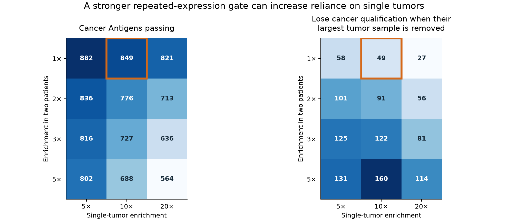
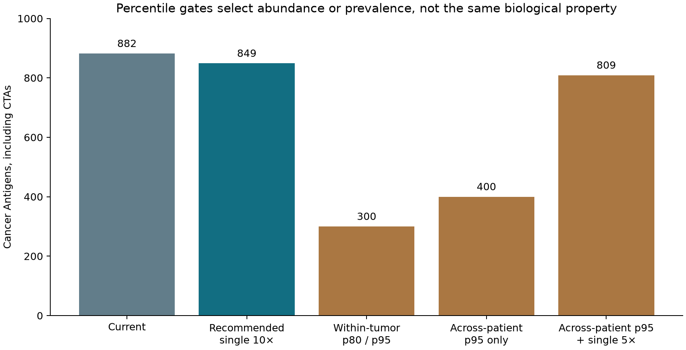

# A simpler expression rule: threshold comparison

**Recommended for the next policy draft: retain detection at 1 native TPM/nTPM; require two independent tumors above the normal maximum, or one tumor at least tenfold above it; add separate Disposable caps of 32 TPM and 32 nTPM in their respective panels. Keep percentiles as abundance and prevalence annotations.**

With the existing normal, translation, identity and sequence screen unchanged, this gives **849 Cancer Antigens: 617 CTAs and 232 Cancer Antigens only**. Another **43** are Reproductive Antigens only. The union is **892 Target candidates**, with **742 Other and 18,259 Unsafe**. This recommendation is a counterfactual; the rebuilt catalog still uses the current fivefold single-tumor rule.

## One decision flow

1. **Apply shared eligibility.** Retain the established normal-tissue exclusions, required coverage, protein identity, translation and sequence rules for both antigen sets. Unsafe takes precedence. Missing required evidence goes to Other:Review.
2. **Establish association.** Use 1 native TPM/nTPM with the existing read/cell support rules, or qualifying protein evidence. Reproductive includes adult reproductive, placental, extraembryonic, embryonic and fetal contexts.
3. **Establish cancer enrichment.** Let N be the maximum supported nonreproductive, non-Disposable normal value and E = T / max(N, 1). Require two independently identified patients with T ≥ 1 and T > N, **or one qualified tumor with E ≥ 10**. Preserve the exact qualifying sample and route. A single tumor remains sufficient for a rare strong signal.
4. **Bound Disposable expression.** Require max(cancer, reproductive/developmental) to exceed every measured nonreproductive normal/Disposable value, and Disposable expression ≤32 TPM and ≤32 nTPM, assessed separately on each source scale. The 32-TPM cap continues the 4/8/16/32 ordering of nominal tier ceilings as a screening convention; it is not a measured tolerance limit. These are two nominal source-scale caps, not a conversion between TPM and nTPM; existing IHC adjustments remain unchanged.
5. **Assign membership.** Cancer plus Reproductive = CTA; one qualifying branch gives its respective Antigen-only category; neither gives Other. Curated paper nominations remain a separate linked evidence annotation.

The recommendation changes only the proposed single-tumor threshold and adds explicit maximum/cap requirements. The maximum and separate 32-unit caps remove no current candidates in the measured panels. **15 current CTAs become Reproductive Antigens only; 18 Cancer Antigens only become Other:Review.** All 18 have multiple above-normal samples, but insufficiently resolved patient IDs. Their review reason is **patient identity unresolved**; resolving independent patients could restore membership through the repeated route. [All 33 changes](recommended-category-changes.csv) include proposed evidence status, values, tumor witnesses, transcripts and retained paper IDs. Losing cancer qualification does not establish normal expression or Unsafe status.

## What was compared

The sweep tested **86 cancer-expression rules × six Disposable-cap settings = 516 scenarios** over **14,440 physical tumor samples** and **957 proteins passing the existing shared screen**. It varies detection floors (1, 2, 5, 10), repeated enrichment (1×, 2×, 3×, 5×), single-tumor enrichment (5×, 10×, 20×), within-tumor p80/p90/p95 ranks, across-patient p80/p90/p95 values, and Disposable caps (none, 4, 8, 16, 32, 128, applied independently to TPM and nTPM observations). Normal-exclusion thresholds are held fixed; this sweep does not optimize them against the proteins they already admitted.

| Cancer rule | Cancer Antigens total | CTA | Cancer Antigen only | Reproductive Antigen only | Current targets moving to Other |
|---|---:|---:|---:|---:|---:|
| Current: two patients above normal, or one at 5× | 882 | 632 | 250 | 28 | 0 |
| Recommended: two patients above normal, or one at 10× | 849 | 617 | 232 | 43 | 18 |
| Two patients above normal, or one at 20× | 821 | 608 | 213 | 52 | 37 |
| Two patients at 2×, or one at 5× | 836 | 605 | 231 | 55 | 19 |
| Within-tumor p80 repeated / p95 single, plus current enrichment | 300 | 247 | 53 | 413 | 197 |
| Across-patient p95 alone, in any eligible cancer cohort | 400 | 354 | 46 | 306 | 204 |
| Across-patient p95, or one tumor at 5× | 809 | 584 | 225 | 76 | 25 |

All rows also require the target maximum to exceed the measured nonreproductive maximum. These selected counts are identical with a 32-TPM Disposable cap. The [full filterable grid](report.html), [CSV grid](threshold-grid.csv) and [protein-by-rule decisions](cancer-rule-decisions.csv.gz) contain every scenario.

## Why this recommendation

**Keep the repeated route permissive about abundance.** Raising its enrichment from >1× to ≥2× while leaving the single-tumor rule at 5× reduces Cancer Antigens from 882 to 836. But it increases the number dependent on HL/Merkel from **40 to 86**, and the number lost after removing each protein's largest tumor sample from **58 to 101**. It discards repeated modest signals and leaves more proteins dependent on a high isolated value.

**Tighten the single-tumor route instead.** Moving from 5× to 10× gives 849 Cancer Antigens, retains **425 of the 430 current published cancer/CTA nominations**, and reduces the corresponding dependencies to **31 on HL/Merkel** and **49 on the largest sample**. A 20× rule gives 821 Cancer Antigens, retains 423 nominations, and reduces those dependencies to 13 and 27. Tenfold is a simple intermediate convention, not an empirically proven optimum. Published catalog nominations describe prior claims and are not validation labels used to fit the rule.

Each largest-sample analysis removes one maximum separately for each protein, then reevaluates both routes. Repeated samples from the same known patient count once; another measurement from that patient can remain. The HL/Merkel analysis removes both cohorts. Dependence is not proof that a measurement is false. The [source audit](../scrutiny/index.md) still requires quantification and mapping review.

## The two different meanings of p95

**Within one tumor:** p95 means the protein ranks among the highest 5% of measured catalog proteins in that sample. The ranking denominator includes Unsafe and Other proteins, not just the candidate set. At the median sample, p80, p90 and p95 correspond to about **30, 62 and 117 TPM**, respectively. The p95 cutoff ranges from **2.89 to 410.55 TPM** across sources and samples. Rank is relative to the rest of the transcriptome; it is not a fixed abundance.

The tested p80/p95 gate requires p80 in the repeated route and p95 in the single-tumor route **in addition to** the existing enrichment rules. It leaves 300 Cancer Antigens and only 168 of the 430 current published nominations. For example, ESX1 peaks at 114.60 TPM but lies just below p95 in that sample; it loses cancer qualification under this rule. SSU72L2 remains, while TEDDM1 and TMEM269 lose cancer qualification. These are abundance filters, not evidence that excluded proteins are absent from tumors.

**Across patients within a cancer type:** p95 is the upper-tail expression value for that protein in that cohort. This tests prevalence. We use the observed lower order statistic, never interpolate a positive value between a zero and one extreme tumor. At least 20 measured, independently identified patients are required for each protein/cohort; repeated measurements from a patient contribute one maximum.

Only **42 of 96 cohort labels** have at least 20 documented patients. **3,747 samples lack resolved patient IDs** and cannot establish replication or patient percentiles. They remain eligible for the single-sample route. Unassessed cohorts are not negative cohorts. Percentiles are computed within cancer types, not across a mixture dominated by large common-cancer cohorts.

Across-patient p95 alone gives 400 Cancer Antigens. It removes SSU72L2's cancer membership despite a 990.91-TPM tumor maximum: its high RMS source lacks resolved patient IDs, and the highest p95 in eligible cohorts is 0.50 TPM. Adding the current rare-sample route yields 809 Cancer Antigens, **802 of which already qualify through that single-sample route**. The percentile requirement then adds complexity while doing little to control single-sample dependence.

Use both percentile axes in the tables: **within-tumor abundance rank** and **within-cancer prevalence/percentiles**. Keep them out of the basic membership rule. The HPA likewise separates detection from enrichment in its [methods](https://v23.proteinatlas.org/about/assays%2Bannotation); its tissue-specificity definitions do not validate a therapeutic antigen threshold.

## Coverage and category boundaries

The Disposable TPM panel contains **appendix, gallbladder and tonsil**. It lacks isolated hair-follicle and melanocyte TPM. The HPA v23 consensus bulk nTPM panel independently peaks at 23.4 nTPM for LCE3C and 4.9 nTPM for NLRP4, both in tonsil. Adding these separate nTPM caps does not change any scenario count. [Every Disposable bulk nTPM observation](disposable-bulk-ntpm.csv) is retained. The separate [HPA melanocyte and anatomy audit](../expression-maxima/index.md) retains nTPM, reads and missing loci. A stricter number does not replace these missing compartments. Olfactory, bone and dental compartments still need explicit curation and expression coverage.

The normal comparison uses supported means and donor medians, not maxima across individual healthy donors. Same-unit source comparability remains under review. Within-tumor ranks also have variable denominators: 14,329–19,819 measured protein records per sample, from an inventory of 19,893. These limitations are reasons to complete source and coverage review before release, not to tune thresholds until questionable families disappear.

Cap failure removes target eligibility through Other:Expression. Required coverage/identity failures remain Other:Review. Cancer-only qualification lost under a tested rule means no qualifying cancer evidence under that rule; it does not establish absence of expression. Reproductive membership is retained when its own evidence still qualifies.

[All scenarios](threshold-grid.csv) · [All 957 eligible protein records](protein-threshold-evidence.csv.gz) · [Recommended inventory](recommended-eligible-inventory.csv.gz) · [Recommended changes](recommended-category-changes.csv) · [Patient coverage](patient-coverage.csv) · [Sample-specific rank thresholds](sample-rank-cutoffs.csv.gz) · [Summary](summary.json) · [Provenance](manifest.json).

Reproduce in order: `scripts/build_target_sample_ranks.py`, `scripts/audit_target_thresholds.py`, `scripts/render_target_thresholds.py`. The source matrices and candidate matrix hashes must match the pinned rebuild.
