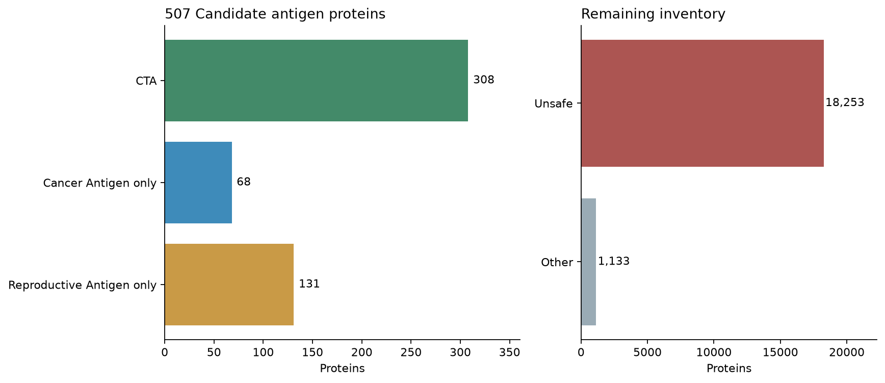

# Rebuilt antigen catalog

Policy `oncoref.target-selection.2026-11-16.1`. **437 CTA, 34 Cancer Antigen only, 197 Reproductive Antigen only, 972 Other and 18,253 Unsafe.** These are outputs of screening rules, not validated tumor antigens.

[Filterable protein table](report.html) · [Every change from the 2026-11-09 draft](changes-from-draft.csv) · [Changes from release 1.36.0](category-changes.csv) · [Exact comparison scope](comparison.json)

## Curation funnel


| Filter | Result | Proteins removed | Remaining |
|---|---|---:|---:|
| Bulk, cluster, immune, protein or reviewed normal exclusion | Unsafe | 18,128 | 1,765 |
| Established rare-cell RNA or published normal expression only | Unsafe | 125 | 1,640 |
| Coverage, identity, translation or unresolved patient identity | Other:Review | 660 | 980 |
| Nested or Unsafe-contained sequence | Other:Sequence | 62 | 918 |
| No qualifying expression, target maximum or Disposable cap | Other:Expression | 167 | 751 |
| Home tissue no panel resolves, without reproductive evidence | Other:Tissue | 83 | 668 |

The 668 remaining Candidate antigen proteins are 437 CTA, 34 Cancer Antigen only and 197 Reproductive Antigen only. [Funnel table](funnel.csv) · [Curation summary with figures](summary.md).



## The filters

| Filter | Rule | Failure |
|---|---|---|
| Normal expression | Existing bulk, cluster, immune, cornea, protein and reviewed-knowledge rules, unchanged | Unsafe for accepted exclusions; otherwise Other:Review |
| Rare normal-cell RNA | >= 1% of a donor's cells and >= 10 cells carry >= 2 molecules. The signal in >= 2 independent studies of the same organ, which agree on a cell type or include >= 3 donors. Donors of one study share its libraries and reference; one donor in each of two studies, in different cell types, agrees on nothing but the organ. | Established: Unsafe. Dismissed: no effect |
| Published normal expression | Gene-specific report in normal adult Vital or Protected tissue, by a fixed rubric | Unsafe |
| Coverage, identity and translation | Unchanged | Other:Review |
| Sequence | Fewer than 95% of 9-mers inside Unsafe proteins, recomputed for the new Unsafe set | Other:Sequence |
| Expression bounds | Target maximum above every measured nonreproductive and Disposable value; Disposable at most 32 TPM and 32 nTPM | Other:Expression |
| Cancer evidence | One tumor sample ≥10 × max(N, Disposable, 1), N the highest non-reproductive normal value | No Cancer Antigen membership |
| Reproductive evidence | ≥1 native TPM/nTPM with read and cell support, or reliable protein | No Reproductive Antigen membership |

## Rare normal-cell RNA

A count matrix cannot show where a read aligned, and one mis-assigned read per cell from a paralog, pseudogene or overlapping gene looks like sparse expression. Cells with one molecule never change a category. A mis-assigned read from a paralog, pseudogene or overlapping gene produces exactly this pattern. Every signal ends in one of two outcomes; nothing waits for review.

- **Established, Unsafe:** A replicated signal at a locus without mapping risk, or any signal with bulk confirmation. Unsafe.
- **Dismissed, no effect:** A signal that is neither: counts at a flagged locus, or from one study, that no other assay confirms. Recorded with its reason; no category effect.
- **Mapping risk:** Shared transcript sequence with another locus, or an exon inside another same-strand gene. Counts for a flagged gene cannot be attributed to it.
- **Bulk confirmation:** Bulk RNA >= 1 native TPM in the same organ in both the HPA and GTEx sample sets, a different assay with its own read assignment.
- **Literature:** Where a reviewed publication reports the gene in the same organ by a gene-specific assay, 1% detection in one donor is established, single molecules included: two assay types then agree. Published protein in a Vital or Protected tissue excludes through the knowledge layer without any counts.

80 draft non-Unsafe proteins become Unsafe, among them ADAM7, RBM46, C5orf47, SPINT4, MROH2A, CCDC172, SMIM23, MMP20, SPACA3, OR51D1, DGAT2L6, C5orf52, OOSP3, ERICH6. 56 candidates carry a dismissed signal, among them PSG8, HHLA1, NKX2-6, DCST1, ARMH2, FKBP6, SATL1, CIMIP3, GSX2, ENSG00000284779.

**35 proteins that were Unsafe only through the pooled 1% detection flag are candidates again**: ADAD1, ADAM18, C12orf50, CHCT1, CSAG1, CXorf58, CYP26C1, DPPA2, EFCAB3, EXD1, GFY, NKX2-6, NLRP8, OR2F1, OR5V1, OR8D4, PABPC3, POTEF, PPP1R2B, PRDM7, PSG8, RAD21L1, RGPD3, RSPH6A, SATL1, SMIM9, SPAG11A, SPAG11B, SPATA3, TPTE, TRIM60, TUBB8, VRTN, ZC3H11B, ZNF492. Each was taken through the literature review below and none has a gene-specific report of expression in vital normal tissue. That is a search result, not proof of absence. [Donor-level evidence](../../normal-cell-atlas-20261110/rare-cell/index.md).

## Literature review

912 proteins were reviewed: every protein that would be a Target candidate while its rare-cell signal is dismissed, or after release from the pooled 1% detection flag, and every Target candidate of the 2026-11-10 catalog. 21 are Unsafe on published evidence: ADAM30 (brain, R2); AMBN (small intestine, R2); ASCL4 (skin, R2); BECN2 (brain, R2); BTNL2 (small intestine, R2); CCN6 (cartilage, R2); DEFB106A/B (lung, R2); GALR3 (adrenal gland, R2); GDF9 (bone marrow, R2); ITIH6 (kidney, R2); MAGEA12 (brain, R1); MRGPRX1 (dorsal root ganglion, R2); MYH13 (skeletal muscle, R2); OBP2A (lung, R2); OTOG (inner ear, R3); SCGB1C1 (nasal mucosa, R2); SCGB1D1 (eye, R1); SLC25A2 (liver, R2); SRY (brain, R2); SULT6B1 (kidney, R2); TCHHL1 (skin, R2). [Every protein, rubric, sources and quotes](literature.md).

## Changes from the 2026-11-09 draft

| Draft | Now | Proteins |
|---|---|---:|
| CTA | Other:Sequence | 11 |
| CTA | Reproductive Antigen only | 165 |
| CTA | Unsafe | 54 |
| Cancer Antigen only | Other:Expression | 129 |
| Cancer Antigen only | Other:Sequence | 4 |
| Cancer Antigen only | Other:Tissue | 83 |
| Cancer Antigen only | Unsafe | 11 |
| Other:Review | CTA | 4 |
| Other:Review | Other:Expression | 22 |
| Other:Review | Reproductive Antigen only | 1 |
| Other:Review | Unsafe | 15 |
| Other:Sequence | Reproductive Antigen only | 1 |
| Reproductive Antigen only | Other:Sequence | 1 |
| Unsafe | CTA | 25 |
| Unsafe | Cancer Antigen only | 1 |
| Unsafe | Other:Expression | 1 |
| Unsafe | Other:Review | 43 |
| Unsafe | Other:Sequence | 7 |
| Unsafe | Reproductive Antigen only | 9 |

The tenfold single-tumor rule accounts for the moves to Reproductive Antigen only and for Cancer Antigens only whose remaining route depends on unresolved patient identity. The target-maximum and Disposable-cap checks remove no candidate.

Cancer Antigens include 471 proteins; Reproductive Antigens include 634. Their intersection is CTA and their union contains 668 Candidate antigen proteins.

Other contains 660 review, 62 sequence, 167 expression, 83 tissue. A curated published target nomination is retained for 302 CTAs and 6 Cancer Antigens only. Broader paper coverage also includes biology, normal-expression findings and other evidence.

## Changes from release 1.36.0

| Released category | Rebuilt category | Proteins |
|---|---|---:|
| CTA | CTA | 376 |
| CTA | Other | 13 |
| CTA | Reproductive Antigen only | 169 |
| CTA | Unsafe | 49 |
| Other | CTA | 36 |
| Other | Cancer Antigen only | 33 |
| Other | Other | 908 |
| Other | Reproductive Antigen only | 19 |
| Other | Unsafe | 31 |
| Unsafe | CTA | 25 |
| Unsafe | Cancer Antigen only | 1 |
| Unsafe | Other | 51 |
| Unsafe | Reproductive Antigen only | 9 |
| Unsafe | Unsafe | 18173 |

New CTAs: MAGEC2, FKBP6, ANKRD60, PSG8, SRMS, PRDM7, VRTN, OCM2, TTLL8, CHCT1, CIB3, RGPD3, DPPA2, ADAD1, SPAG11B, C12orf50, OR2B2, ADAM18, PROKR1, HOXD12, EFCAB3, TRIM60, SPAG11A, DEFB125, NKX2-6, OR8D4, OR52D1, MAGEB17, SATL1, SPATA31A6, AADACL3, HUS1B, POTEF, OR14A16, OR51C1, KRTAP4-1, CSAG1, GLYATL3, TXNDC8, MAS1L, KRTAP20-4, TRIM64C, ZNF705D, ZC3H11B, TRIM51G, SUPT20HL1, ZNF492, PPP1R2B, PRR23C, KRTAP5-7, RAD21L1, KRTAP5-9, ARMH2, TUBB8, GFY, ENSG00000267140, TPTE, SPATA31A3, SPATA31A7, RPS4Y2, FAM240B.

Former CTAs now requiring review: CALHM3, ENSG00000241690, EPPIN-WFDC6, TAF11L12, TRIM75, TAF11L14, ENSG00000258417, ATF7-NPFF, ENSG00000273155, ENSG00000274944, PRAMEF18, TAF11L11, TAF11L13.

## Reproductive Antigens only

No tumor sample reaches 10 × the protein's non-reproductive normal maximum.

| Protein | Tumor maximum TPM | Normal comparison TPM | Cancer assessment |
|---|---:|---:|---|
| BPY2/B/C | 7.1 | 0.3 | Below cancer rule |
| CDY2A/B | 1.16 | 0 | Below cancer rule |
| DEFB104A/B | 5.94 | 1.9 | Below cancer rule |
| DEFB107A/B | 2.4 | 0 | Below cancer rule |
| DEFB130A/B | 2.85 | 2.6 | Below cancer rule |
| GSC2 | 22.4 | 2.4 | Below cancer rule |
| FNDC8 | 10.5 | 4.51 | Below cancer rule |
| DEFB127 | 8.53 | 0.1 | Below cancer rule |
| AMELY | 9.58 | 0.43 | Below cancer rule |
| H2BW2 | 13.8 | 2.89 | Below cancer rule |
| PRSS54 | 6.1 | 1.2 | Below cancer rule |
| RSPH6A | 37.9 | 4.58 | Below cancer rule |
| ZNRF4 | 3.14 | 0.4 | Below cancer rule |
| SPAM1 | 3.06 | 0.4 | Below cancer rule |
| KRT37 | 23.5 | 5.9 | Below cancer rule |
| TTLL2 | 8.11 | 6.55 | Below cancer rule |
| TBX22 | 51.1 | 14.5 | Below cancer rule |
| PRM2 | 22.1 | 4.4 | Below cancer rule |
| CCDC70 | 14.8 | 1.5 | Below cancer rule |
| ATXN3L | 5.96 | 0.5 | Below cancer rule |
| CST8 | 4.25 | 0.1 | Below cancer rule |
| CSTL1 | 9.25 | 2.01 | Below cancer rule |
| C20orf173 | 10.2 | 2.6 | Below cancer rule |
| OR1E2 | 10.8 | 2 | Below cancer rule |
| RFPL3 | 29.2 | 3.2 | Below cancer rule |
| BMP15 | 3.33 | 0.1 | Below cancer rule |
| BPIFA3 | 2.88 | 0 | Below cancer rule |
| SCP2D1 | 7.07 | 0.1 | Below cancer rule |
| USP26 | 9.92 | 0.2 | Below cancer rule |
| SLC25A52 | 5.58 | 2.97 | Below cancer rule |
| ZIM3 | 3.58 | 1.07 | Below cancer rule |
| CABS1 | 28.4 | 3 | Below cancer rule |
| CPXCR1 | 3.33 | 0 | Below cancer rule |
| TKTL2 | 20.2 | 6.76 | Below cancer rule |
| PABPC3 | 69.7 | 7.03 | Below cancer rule |
| GOLGA8F | 8.73 | 0.0558 | Below cancer rule |
| CYLC2 | 4.41 | 1 | Below cancer rule |
| POM121L2 | 5.13 | 0.3 | Below cancer rule |
| WFDC8 | 15.2 | 1.88 | Below cancer rule |
| IZUMO2 | 39.4 | 4.92 | Below cancer rule |
| ZSWIM2 | 2.74 | 1.52 | Below cancer rule |
| PDHA2 | 2.49 | 0.19 | Below cancer rule |
| DCST1 | 12.8 | 3.6 | Below cancer rule |
| FAM170A | 2.88 | 0.672 | Below cancer rule |
| SSMEM1 | 7.4 | 0.527 | Below cancer rule |
| CXorf58 | 22.9 | 2.7 | Below cancer rule |
| SPATA19 | 7.76 | 0.5 | Below cancer rule |
| C16orf78 | 2.86 | 0.3 | Below cancer rule |
| POTED | 2.81 | 1.4 | Below cancer rule |
| SUN5 | 2.68 | 0.192 | Below cancer rule |
| WFDC13 | 19.9 | 3 | Below cancer rule |
| GOT1L1 | 7.06 | 0.9 | Below cancer rule |
| OR10G3 | 8.69 | 2.28 | Below cancer rule |
| GARIN3 | 2.06 | 2.07 | Below cancer rule |
| PGK2 | 5 | 0.343 | Below cancer rule |
| C8orf74 | 3.46 | 0.2 | Below cancer rule |
| CDY1 | 0.48 | 0 | Below cancer rule |
| CDY1B | 0.3 | 0.1 | Below cancer rule |
| NLRP13 | 6.04 | 0 | Below cancer rule |
| SPATA3 | 2.32 | 3 | Below cancer rule |
| TENT5D | 2.99 | 0.1 | Below cancer rule |
| ARL13A | 32.8 | 7.3 | Below cancer rule |
| RBMXL3 | 12.9 | 1.3 | Below cancer rule |
| OR4M1 | 2.22 | 0.0628 | Below cancer rule |
| CETN1 | 6 | 0 | Below cancer rule |
| DEFB114 | 7.64 | 0 | Below cancer rule |
| MAGEB10 | 7.39 | 1.9 | Below cancer rule |
| CIMAP1A | 15 | 1.58 | Below cancer rule |
| TNP2 | 9.04 | 0.468 | Below cancer rule |
| H1-8 | 7.68 | 1 | Below cancer rule |
| EXD1 | 4.69 | 2 | Below cancer rule |
| SIGLECL1 | 16.1 | 1.7 | Below cancer rule |
| NLRP8 | 3.76 | 0.4 | Below cancer rule |
| GOLGA8J | 9.3 | 5.52 | Below cancer rule |
| OR1R1P | 7.37 | 2.1 | Below cancer rule |
| WFDC9 | 4.39 | 0.1 | Below cancer rule |
| C3orf22 | 11.8 | 1.21 | Below cancer rule |
| SPEM1 | 6.79 | 0.587 | Below cancer rule |
| ZNF716 | 10.3 | 1.4 | Below cancer rule |
| CYLC1 | 1.27 | 0 | Below cancer rule |
| GOLGA8G | 6.24 | 0.299 | Below cancer rule |
| DEFB108B | 10.4 | 1.44 | Below cancer rule |
| PRR23B | 2.65 | 0 | Below cancer rule |
| SPPL2C | 17.7 | 3.05 | Below cancer rule |
| DEFB128 | 4.76 | 0.1 | Below cancer rule |
| TEX38 | 32.3 | 3.25 | Below cancer rule |
| PRR30 | 8.17 | 0.3 | Below cancer rule |
| DEFB132 | 73.3 | 24.7 | Below cancer rule |
| TMEM262 | 47.4 | 7.4 | Below cancer rule |
| MAGEB5 | 2.09 | 0.0392 | Below cancer rule |
| NANOS2 | 9.92 | 1.3 | Below cancer rule |
| KRTAP24-1 | 38 | 6 | Below cancer rule |
| CATSPER4 | 8.09 | 0.568 | Below cancer rule |
| TMCO2 | 29 | 3.76 | Below cancer rule |
| FAM47B | 2.25 | 0 | Below cancer rule |
| ZAR1L | 12.1 | 1.43 | Below cancer rule |
| SPATA31D4 | 1.17 | 0 | Below cancer rule |
| TBC1D28 | 4.07 | 0.9 | Below cancer rule |
| VN1R2 | 12.3 | 7.79 | Below cancer rule |
| TOMM20L | 46.6 | 6.59 | Below cancer rule |
| SPMIP10 | 14.1 | 2.09 | Below cancer rule |
| ZNF705A | 19.6 | 3.5 | Below cancer rule |
| OR8G1 | 2.69 | 2.5 | Below cancer rule |
| RTP2 | 6.71 | 1.06 | Below cancer rule |
| MAGEB3 | 7.55 | 0.2 | Below cancer rule |
| TEDDM1 | 15.2 | 3 | Below cancer rule |
| FAM24A | 4.13 | 0.515 | Below cancer rule |
| SMIM9 | 4.58 | 0.912 | Below cancer rule |
| C10orf62 | 25.1 | 3 | Below cancer rule |
| DEFB110 | 5.4 | 0.2 | Below cancer rule |
| GLT6D1 | 7.41 | 0.8 | Below cancer rule |
| SPANXN5 | 7.93 | 0 | Below cancer rule |
| PRAMEF17 | 5.69 | 0.2 | Below cancer rule |
| PRAMEF19 | 9.62 | 0.8 | Below cancer rule |
| DEFB121 | 2.15 | 0.1 | Below cancer rule |
| KRTAP5-10 | 24.3 | 4.6 | Below cancer rule |
| OR2H1 | 3.45 | 0.259 | Below cancer rule |
| SPATA31A1 | 6.83 | 0 | Below cancer rule |
| SPATA31F1 | 8.67 | 0.9 | Below cancer rule |
| ARSH | 9.32 | 0.424 | Below cancer rule |
| SMIM21 | 3.98 | 0.5 | Below cancer rule |
| KRTAP19-8 | 18.5 | 3.02 | Below cancer rule |
| TSSK2 | 9.39 | 0.6 | Below cancer rule |
| PRR23A | 8.96 | 2 | Below cancer rule |
| TSSK1B | 6.49 | 0.4 | Below cancer rule |
| OR2F1 | 1.22 | 0.168 | Below cancer rule |
| TSGA13 | 5.95 | 1.13 | Below cancer rule |
| WEE2 | 10.7 | 1.45 | Below cancer rule |
| MINDY4B | 4.04 | 2.8 | Below cancer rule |
| EFCAB9 | 8.56 | 3.3 | Below cancer rule |
| TRIM77 | 7.57 | 0.4 | Below cancer rule |
| NOTO | 4.26 | 1.7 | Below cancer rule |
| ZC3H11C | 19.5 | 2.6 | Below cancer rule |
| DEFB113 | 2.27 | 0 | Below cancer rule |
| IQCF5 | 7.79 | 0.4 | Below cancer rule |
| C12orf71 | 44.2 | 9.85 | Below cancer rule |
| CDRT15L2 | 12 | 2.8 | Below cancer rule |
| GOLGA6B | 7.23 | 2.1 | Below cancer rule |
| ZNF705B | 3.78 | 0 | Below cancer rule |
| DEFB115 | 4.46 | 0.1 | Below cancer rule |
| POM121L12 | 7.05 | 0 | Below cancer rule |
| ZNF735 | 5.29 | 0.215 | Below cancer rule |
| GPX5 | 7.92 | 0.21 | Below cancer rule |
| KIF4B | 6.33 | 0.7 | Below cancer rule |
| GOLGA6L25 | 1.37 | 0.2 | Below cancer rule |
| TEX46 | 16 | 3.87 | Below cancer rule |
| BOD1L2 | 6.57 | 0.171 | Below cancer rule |
| OR5H1 | 1.4 | 2.3 | Below cancer rule |
| TEX50 | 12.9 | 1.3 | Below cancer rule |
| RAB6D | 54.5 | 8.4 | Below cancer rule |
| FREY1 | 34.9 | 3.86 | Below cancer rule |
| FAM237A | 7.8 | 2.26 | Below cancer rule |
| ENSG00000237378 | 6.52 | 0.7 | Below cancer rule |
| TEX51 | 3.36 | 0.3 | Below cancer rule |
| GOLGA6L24 | 2.27 | 0.2 | Below cancer rule |
| TSPY9 | 5.93 | 0.2 | Below cancer rule |
| PRR20G | 7.77 | 0 | Below cancer rule |
| PRAMEF11 | 7.24 | 0 | Below cancer rule |
| OR14A2 | 6.35 | 0.5 | Below cancer rule |
| OR5V1 | 9.48 | 1.3 | Below cancer rule |
| RBMY1D | 4.21 | 0.1 | Below cancer rule |
| H2AL1Q | 4.02 | 2.6 | Below cancer rule |
| P3R3URF | 16.5 | 3.4 | Below cancer rule |
| EXOC1L | 7.87 | 1 | Below cancer rule |
| PTTG1IP2 | 3.23 | 0.3 | Below cancer rule |
| KDM4F | 5.49 | 0 | Below cancer rule |
| ZNF878 | 39.4 | 4.3 | Below cancer rule |
| TLE7 | 1.34 | 0.189 | Below cancer rule |
| GOLGA8T | 13.7 | 1.5 | Below cancer rule |
| DPEP2NB | 6.86 | 3.1 | Below cancer rule |
| IGBP1C | 7.1 | 0.377 | Below cancer rule |
| TEX13A | 3.77 | 0.1 | Below cancer rule |
| SPANXN2 | 1.81 | 0 | Below cancer rule |
| TMEM269 | 22.9 | 2.72 | Below cancer rule |
| SPMAP1 | 21.7 | 2.21 | Below cancer rule |
| LYZL6 | 11.9 | 2.41 | Below cancer rule |
| SPATA31A5 | 3.29 | 0.1 | Below cancer rule |
| GOLGA6L6 | 5.37 | 0.2 | Below cancer rule |
| CT47C1 | 2.17 | 0.2 | Below cancer rule |
| GOLGA6L22 | 5.33 | 0.794 | Below cancer rule |
| POTEB3 | 13.1 | 2.6 | Below cancer rule |
| PRAMEF13 | 4.53 | 0 | Below cancer rule |
| CCDC201 | 5.38 | 1.1 | Below cancer rule |
| SPEM3 | 5.22 | 0.39 | Below cancer rule |
| HSFX4 | 19.2 | 3.6 | Below cancer rule |
| LITAFD | 34.6 | 4 | Below cancer rule |
| HSFX3 | 4.88 | 1.8 | Below cancer rule |
| CPHXL | 8.1 | 2.1 | Below cancer rule |
| PMIS2 | 7.73 | 2.9 | Below cancer rule |
| OR8B3 | 8.95 | 1.1 | Below cancer rule |
| OR8B2 | 7.87 | 1.2 | Below cancer rule |
| OOSP1 | 6.33 | 1.4 | Below cancer rule |
| ENSG00000285566 | 8.23 | 0.2 | Below cancer rule |
| MSANTD5 | 3.43 | 2.2 | Below cancer rule |
| CIMIP3 | 1.2 | 0.2 | Below cancer rule |
| ENSG00000289809 | 0.0679 | 4.5 | Below cancer rule |
| POTEB/2 | 9.49 | 0 | Below cancer rule |

## Evidence and reproduction

The comparison uses source-native TPM and maxima of supported tissue/cell summaries. It does not correct cross-study batch effects. NUTM's stored three-sample matrix fails the nonnegative-TPM check and is listed in the [coverage ledger](tumor-source-coverage.csv).

[Full protein decisions](protein-decisions.csv.gz) · [All member genes](gene-decisions.csv.gz) · [Normal comparison values](normal-comparison.csv.gz) · [Tumor witnesses](tumor-witnesses.csv.gz) · [Paper claims](paper-attestations.json.gz) · [Input hashes](inputs.json).

The [pinned HPA download receipt](downloaded-hpa-sources.json) supplies exact URLs, paths and SHA-256 hashes for the newly retrieved native-TPM tables. With the pinned source files in the paths listed in `inputs.json`, run:

```sh
python scripts/build_rare_cell_evidence.py --counts tmp/normal-atlas/wholebody-2025-11-08
python scripts/rebuild_target_catalog.py
python scripts/render_target_catalog.py
python scripts/build_target_selection_report.py
```

The builder verifies the pinned tumor matrices, re-resolves source identities and assesses all proteins. Temporary tumor matrices stay outside the published report. The new catalog is available through `target_selection.results()`; the `cta_selection` API and existing sequence downloads retain the 1.36.0 snapshot.
