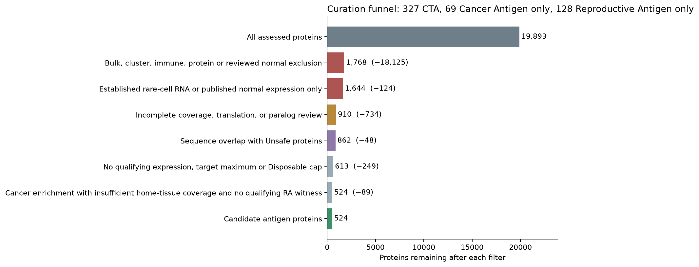

# Rebuilt antigen catalog

Policy `oncoref.target-selection.2026-11-18.1`. **303 CTA, 106 Cancer Antigen only, 100 Reproductive Antigen only, 1131 Other and 18,253 Unsafe.** These are outputs of screening rules, not validated tumor antigens.

[Filterable protein table](report.html) · [Changes from 1.39.0](changes-from-1.39.csv) · [Transition counts](changes-from-1.39-summary.csv) · [Changes from release 1.36.0](category-changes.csv) · [Exact comparison scope](comparison.json)

## End-to-end architecture and CTA tiers


## Curation funnel



| Filter | Result | Proteins removed | Remaining |
|---|---|---:|---:|
| Bulk, cluster, immune, protein or reviewed normal exclusion | Unsafe | 18,128 | 1,765 |
| Established rare-cell RNA or published normal expression only | Unsafe | 125 | 1,640 |
| Coverage, identity, translation or unresolved evidence | Other:Review | 731 | 909 |
| Nested, Unsafe-contained or read-through sequence | Other:Sequence | 48 | 861 |
| No qualifying expression, target maximum or Disposable cap | Other:Expression | 254 | 607 |
| Home tissue no panel resolves, without reproductive evidence | Other:Unscreened tissue | 98 | 509 |

The 509 remaining Candidate antigen proteins are 303 CTA, 106 Cancer Antigen only and 100 Reproductive Antigen only. [Funnel table](funnel.csv) · [Curation summary with figures](summary.md).


## The filters

| Filter | Rule | Failure |
|---|---|---|
| Normal expression | Existing bulk, cluster, immune, cornea, protein and reviewed-knowledge rules, unchanged | Unsafe for accepted exclusions; otherwise Other:Review |
| Rare normal-cell RNA | >= 1% of a donor's cells and >= 10 cells carry >= 2 molecules. The signal in >= 2 independent studies of the same organ, which agree on a cell type or include >= 3 donors. Donors of one study share its libraries and reference; one donor in each of two studies, in different cell types, agrees on nothing but the organ. | Established: Unsafe. Unresolved: Other:Review. Dismissed: no effect |
| Published normal expression | Gene-specific report in normal adult Vital or Protected tissue, by a fixed rubric | Unsafe |
| Coverage, identity and translation | Unchanged | Other:Review |
| Sequence | Fewer than 95% of 9-mers inside Unsafe proteins; no unsupported nested protein or read-through locus | Other:Sequence |
| Expression bounds | Target maximum above every measured nonreproductive and Disposable value; Disposable at most 32 TPM and 32 nTPM | Other:Expression |
| Cancer evidence | One tumor sample ≥10 × max(N, Disposable, 1), N the highest non-reproductive normal value | No Cancer Antigen membership |
| Reproductive evidence | One reproductive sample or supported embryo-lineage mean ≥10 × max(N, Disposable, 1), on the same scale and reference as CA | No Reproductive Antigen membership |

## Rare normal-cell RNA

A count matrix cannot show where a read aligned, and one mis-assigned read per cell from a paralog, pseudogene or overlapping gene looks like sparse expression. Single-molecule detection alone does not establish expression. Ambient RNA and read assignment are possible confounders, not demonstrated explanations. Strong unresolved signals are held for review; mapping flags do not prove artifact.

- **Established, Unsafe:** A replicated signal at a locus without mapping risk, or any signal with bulk confirmation. Unsafe.
- **Unresolved, Other:Review:** A replicated signal with unresolved locus attribution, or a frequent single-study signal without independent confirmation. Other:Review pending adjudication.
- **Dismissed, no effect:** A weak or inconsistent signal below replication and frequency requirements. Recorded with its reason; no category effect.
- **Mapping risk:** Shared transcript sequence with another locus, or an exon inside another same-strand gene. Attribution needs read-level review; a flag does not prove artifact.
- **Bulk confirmation:** Bulk RNA >= 1 native TPM in the same organ in both the HPA and GTEx sample sets, a different assay with its own read assignment.
- **Literature:** Where a reviewed publication reports the gene in the same organ by a gene-specific assay, 1% detection in one donor is established, single molecules included: two assay types then agree. Published protein in a Vital or Protected tissue excludes through the knowledge layer without any counts.

80 draft non-Unsafe proteins become Unsafe, among them ADAM7, RBM46, C5orf47, SPINT4, MROH2A, CCDC172, SMIM23, MMP20, SPACA3, OR51D1, DGAT2L6, C5orf52, OOSP3, ERICH6. 4 candidates carry a dismissed signal, among them LRRIQ4, C12orf50, PRAME, EXD1.

**17 proteins that were Unsafe only through the pooled 1% detection flag are candidates again**: ADAD1, ADAM18, C12orf50, CHCT1, CSAG1, DPPA2, EXD1, GFY, NLRP8, PABPC3, PPP1R2B, SPAG11A, SPAG11B, SPATA3, TPTE, TRIM60, VRTN. Each was taken through the literature review below and none has a gene-specific report of expression in vital normal tissue. That is a search result, not proof of absence. [Donor-level evidence](../../normal-cell-atlas-20261110/rare-cell/index.md).

## Literature review

912 proteins were reviewed: every protein that would be a Target candidate while its rare-cell signal is dismissed, or after release from the pooled 1% detection flag, and every Target candidate of the 2026-11-10 catalog. 19 are Unsafe on published evidence: ADAM30 (brain, R2); AMBN (small intestine, R2); ASCL4 (skin, R2); BECN2 (brain, R2); BTNL2 (small intestine, R2); CCN6 (cartilage, R2); DEFB106A/B (lung, R2); GALR3 (adrenal gland, R2); GDF9 (bone marrow, R2); ITIH6 (kidney, R2); MRGPRX1 (dorsal root ganglion, R2); MYH13 (skeletal muscle, R2); OBP2A (lung, R2); OTOG (inner ear, R3); SCGB1C1 (nasal mucosa, R2); SLC25A2 (liver, R2); SRY (brain, R2); SULT6B1 (kidney, R2); TCHHL1 (skin, R2). [Every protein, rubric, sources and quotes](literature.md).

## Changes from the 2026-11-09 draft

| Draft | Now | Proteins |
|---|---|---:|
| CTA | Cancer Antigen only | 77 |
| CTA | Other:Expression | 73 |
| CTA | Other:Review | 37 |
| CTA | Other:Sequence | 7 |
| CTA | Other:Unscreened tissue | 14 |
| CTA | Reproductive Antigen only | 87 |
| CTA | Unsafe | 54 |
| Cancer Antigen only | Other:Expression | 129 |
| Cancer Antigen only | Other:Review | 7 |
| Cancer Antigen only | Other:Sequence | 2 |
| Cancer Antigen only | Other:Unscreened tissue | 83 |
| Cancer Antigen only | Unsafe | 11 |
| Other:Review | CTA | 2 |
| Other:Review | Other:Expression | 20 |
| Other:Review | Reproductive Antigen only | 1 |
| Other:Review | Unsafe | 15 |
| Other:Sequence | Other:Expression | 1 |
| Other:Sequence | Other:Review | 1 |
| Reproductive Antigen only | Other:Expression | 12 |
| Reproductive Antigen only | Other:Review | 1 |
| Reproductive Antigen only | Other:Sequence | 1 |
| Unsafe | CTA | 12 |
| Unsafe | Cancer Antigen only | 1 |
| Unsafe | Other:Expression | 4 |
| Unsafe | Other:Review | 64 |
| Unsafe | Other:Unscreened tissue | 1 |
| Unsafe | Reproductive Antigen only | 4 |

The tenfold single-tumor rule accounts for the moves to Reproductive Antigen only and for Cancer Antigens only whose reproductive compartment does not reach the shared threshold. Known patient identity is a replication descriptor, not a single-sample admission gate.

Cancer Antigens include 409 proteins; Reproductive Antigens include 403. Their intersection is CTA and their union contains 509 Candidate antigen proteins.

Other contains 731 review, 48 sequence, 254 expression, 98 unscreened tissue. A curated published target nomination is retained for 227 CTAs and 51 Cancer Antigens only. Broader paper coverage also includes biology, normal-expression findings and other evidence.

## Changes from release 1.36.0

| Released category | Rebuilt category | Proteins |
|---|---|---:|
| CTA | CTA | 288 |
| CTA | Cancer Antigen only | 57 |
| CTA | Other | 119 |
| CTA | Reproductive Antigen only | 94 |
| CTA | Unsafe | 49 |
| Other | CTA | 3 |
| Other | Cancer Antigen only | 48 |
| Other | Other | 943 |
| Other | Reproductive Antigen only | 2 |
| Other | Unsafe | 31 |
| Unsafe | CTA | 12 |
| Unsafe | Cancer Antigen only | 1 |
| Unsafe | Other | 69 |
| Unsafe | Reproductive Antigen only | 4 |
| Unsafe | Unsafe | 18173 |

New CTAs: MAGEC2, VRTN, CHCT1, DPPA2, ADAD1, SPAG11B, C12orf50, ADAM18, TRIM60, SPAG11A, CSAG1, TXNDC8, KRTAP20-4, PPP1R2B, TPTE.

Former CTAs now requiring review: BPY2/B/C, CDY2A/B, DEFB130A/B, GSC2, DAZL, EVX1, TTLL2, RGSL1, TBX22, ATXN3L, CSTL1, CTAG2, CDX4, HHLA1, USP26, GOLGA8F, POM121L2, WFDC8, IZUMO2, DCST1, CAGE1, WFDC13, OR10G3, OR6F1, ZNF280A, TAS2R1, C8orf74, CDY1, CDY1B, TENT5D, ARL13A, HIGD2B, TSGA10IP, CCDC197, RBMXL3, OR4N2, OR4M1, MAGEB10, GOLGA8J, OR1R1P, CALHM3, RIPPLY3, POTEC, OR56A3, OR51M1, PRR23B, SPPL2C, DEFB132, KRTAP21-2, TMEM262, PPP3R2, MAGEB5, NANOS2, KRTAP24-1, DCAF8L2, SPATA31D4, PFN3, TOMM20L, RGPD4, STPG3, OR8G1, RTP2, OR2H1, OR11A1, OR2J3, FBXO47, VCX3B, SMIM21, PRR23A, ZNF99, MINDY4B, EFCAB9, TRIM77, C12orf71, CDRT15L2, GOLGA6B, GAGE10, ZNF705G, PSG3, GOLGA6L25, OR5H1, AK4P3, FAM237A, OR7E24, GOLGA6L24, ENSG00000241690, PSG11, RBMY1D, EPPIN-WFDC6, TAF11L12, H2AL1Q, TRIM75, TAF11L14, EXOC1L, OOSP4B, ENSG00000258417, GOLGA8T, DPEP2NB, ATF7-NPFF, ENSG00000273155, TMEM269, ENSG00000274944, LYZL6, GSTT4, GOLGA6L22, POTEB3, PRAMEF18, CCDC201, HSFX4, LITAFD, HSFX3, TAF11L11, CPHXL, PMIS2, TAF11L13, OR8B3, OR8B2, CIMIP3, ENSG00000289809.

## Reproductive Antigens only

No tumor sample reaches 10 × the protein's non-reproductive normal maximum.

| Protein | Tumor maximum TPM | Normal comparison TPM | Cancer assessment |
|---|---:|---:|---|
| DEFB104A/B | 5.94 | 5.61 | Below cancer rule |
| DEFB107A/B | 2.4 | 0 | Below cancer rule |
| FNDC8 | 11.4 | 4.51 | Below cancer rule |
| DEFB127 | 8.53 | 0.425 | Below cancer rule |
| PRSS54 | 6.41 | 1.2 | Below cancer rule |
| SPAM1 | 3.06 | 0.622 | Below cancer rule |
| CST8 | 4.25 | 0.141 | Below cancer rule |
| C20orf173 | 10.2 | 2.6 | Below cancer rule |
| RFPL3 | 29.2 | 3.2 | Below cancer rule |
| BMP15 | 3.33 | 0.254 | Below cancer rule |
| SCP2D1 | 7.07 | 0.322 | Below cancer rule |
| C4orf17 | 16.4 | 2.87 | Below cancer rule |
| SLC25A52 | 5.58 | 2.97 | Below cancer rule |
| ZIM3 | 3.58 | 1.07 | Below cancer rule |
| CABS1 | 28.4 | 3 | Below cancer rule |
| CPXCR1 | 3.33 | 0.237 | Below cancer rule |
| TKTL2 | 20.2 | 6.76 | Below cancer rule |
| PABPC3 | 69.7 | 7.03 | Below cancer rule |
| ZSWIM2 | 2.74 | 1.52 | Below cancer rule |
| PDHA2 | 9.43 | 0.19 | Below cancer rule |
| FAM170A | 3.45 | 0.672 | Below cancer rule |
| SSMEM1 | 7.4 | 0.57 | Below cancer rule |
| C16orf78 | 5.59 | 0.606 | Below cancer rule |
| SUN5 | 4.94 | 0.298 | Below cancer rule |
| GOLGA6C | 21.9 | 2.34 | Below cancer rule |
| GOT1L1 | 7.06 | 0.9 | Below cancer rule |
| GARIN3 | 3.07 | 2.07 | Below cancer rule |
| NLRP13 | 6.04 | 0.0547 | Below cancer rule |
| SPATA3 | 24.1 | 3 | Below cancer rule |
| GOLGA6L2 | 16.1 | 1.65 | Below cancer rule |
| DEFB114 | 7.64 | 0 | Below cancer rule |
| CIMAP1A | 15 | 1.58 | Below cancer rule |
| TNP2 | 9.04 | 0.468 | Below cancer rule |
| H1-8 | 7.68 | 1 | Below cancer rule |
| EXD1 | 4.69 | 2 | Below cancer rule |
| SIGLECL1 | 16.1 | 1.7 | Below cancer rule |
| NLRP8 | 3.76 | 0.4 | Below cancer rule |
| WFDC9 | 4.39 | 0.133 | Below cancer rule |
| C3orf22 | 11.8 | 1.21 | Below cancer rule |
| SPEM1 | 9.16 | 0.587 | Below cancer rule |
| ADIG | 33.8 | 7.56 | Below cancer rule |
| ZNF716 | 10.3 | 1.4 | Below cancer rule |
| CCDC87 | 23.3 | 2.53 | Below cancer rule |
| CYLC1 | 2.57 | 0.0377 | Below cancer rule |
| GOLGA8G | 6.24 | 0.299 | Below cancer rule |
| DEFB108B | 10.4 | 1.44 | Below cancer rule |
| DEFB128 | 4.76 | 0.1 | Below cancer rule |
| CATSPER4 | 8.09 | 0.568 | Below cancer rule |
| TMCO2 | 29 | 3.76 | Below cancer rule |
| FAM47B | 2.25 | 0.0404 | Below cancer rule |
| ZAR1L | 12.1 | 1.43 | Below cancer rule |
| TBC1D28 | 4.07 | 0.9 | Below cancer rule |
| SPMIP10 | 14.1 | 5.13 | Below cancer rule |
| ZNF705A | 19.6 | 3.5 | Below cancer rule |
| MAGEB3 | 7.55 | 0.2 | Below cancer rule |
| TEDDM1 | 15.2 | 3 | Below cancer rule |
| FAM24A | 4.13 | 0.515 | Below cancer rule |
| C10orf62 | 27.4 | 3 | Below cancer rule |
| DEFB110 | 5.4 | 0.42 | Below cancer rule |
| GLT6D1 | 7.41 | 0.8 | Below cancer rule |
| SPANXN5 | 7.93 | 0.177 | Below cancer rule |
| PRAMEF17 | 5.69 | 0.2 | Below cancer rule |
| PRAMEF19 | 9.62 | 0.8 | Below cancer rule |
| DEFB121 | 2.15 | 0.1 | Below cancer rule |
| SPATA31A1 | 6.83 | 0.023 | Below cancer rule |
| SPATA31F1 | 8.67 | 0.9 | Below cancer rule |
| RNASE13 | 26.6 | 3.48 | Below cancer rule |
| TSSK1B | 6.49 | 0.433 | Below cancer rule |
| TSGA13 | 5.95 | 1.13 | Below cancer rule |
| WEE2 | 10.7 | 1.83 | Below cancer rule |
| NOTO | 4.26 | 1.7 | Below cancer rule |
| DEFB113 | 2.27 | 0 | Below cancer rule |
| PSG7 | 55.4 | 6.79 | Below cancer rule |
| POM121L12 | 7.05 | 0 | Below cancer rule |
| ZNF735 | 5.29 | 0.252 | Below cancer rule |
| GPX5 | 7.92 | 0.297 | Below cancer rule |
| KIF4B | 6.33 | 0.7 | Below cancer rule |
| TEX46 | 16 | 3.87 | Below cancer rule |
| TEX50 | 12.9 | 1.3 | Below cancer rule |
| FREY1 | 34.9 | 3.86 | Below cancer rule |
| ENSG00000237378 | 6.52 | 1.26 | Below cancer rule |
| TEX51 | 3.36 | 1.45 | Below cancer rule |
| TSPY9 | 5.93 | 1.2 | Below cancer rule |
| PRR20G | 7.77 | 0.0969 | Below cancer rule |
| PRAMEF11 | 7.24 | 0.00859 | Below cancer rule |
| OR14A2 | 6.35 | 0.5 | Below cancer rule |
| P3R3URF | 16.5 | 3.4 | Below cancer rule |
| PTTG1IP2 | 3.23 | 0.3 | Below cancer rule |
| ZNF878 | 39.4 | 4.3 | Below cancer rule |
| TLE7 | 1.34 | 0.189 | Below cancer rule |
| IGBP1C | 7.1 | 0.377 | Below cancer rule |
| TEX13A | 3.77 | 0.1 | Below cancer rule |
| SPANXN2 | 1.81 | 0.138 | Below cancer rule |
| SPMAP1 | 21.7 | 2.21 | Below cancer rule |
| GOLGA6L6 | 5.37 | 0.2 | Below cancer rule |
| CT47C1 | 2.17 | 0.2 | Below cancer rule |
| PRAMEF13 | 4.53 | 0.0514 | Below cancer rule |
| SPEM3 | 5.22 | 0.39 | Below cancer rule |
| ENSG00000285566 | 8.23 | 0.388 | Below cancer rule |
| MSANTD5 | 3.43 | 2.2 | Below cancer rule |

## Evidence and reproduction

The comparison uses source-native TPM, individual HPA tissue samples and supported tissue/cell summaries. It is not a maximum over every healthy donor. It does not correct cross-study batch effects. NUTM's stored three-sample matrix fails the nonnegative-TPM check and is listed in the [coverage ledger](tumor-source-coverage.csv).

[Full protein decisions](protein-decisions.csv.gz) · [All member genes](gene-decisions.csv.gz) · [Normal library QC](normal-library-qc.csv) · [Normal comparison values](normal-comparison.csv.gz) · [Tumor witnesses](tumor-witnesses.csv.gz) · [Reproductive observations](reproductive-comparison.csv.gz) · [Reproductive witnesses](reproductive-witnesses.csv.gz) · [Paper claims](paper-attestations.json.gz) · [Input hashes](inputs.json).

The [pinned HPA download receipt](downloaded-hpa-sources.json) supplies exact URLs, paths and SHA-256 hashes for the newly retrieved native-TPM tables. With the pinned source files in the paths listed in `inputs.json`, run:

```sh
python scripts/build_rare_cell_evidence.py --regrade-pinned
python scripts/rebuild_target_catalog.py
python scripts/render_target_catalog.py
python scripts/build_target_selection_report.py
```

The builder verifies the pinned tumor matrices, re-resolves source identities and assesses all proteins. Temporary tumor matrices stay outside the published report. The new catalog is available through `target_selection.results()`; the `cta_selection` API and existing sequence downloads retain the 1.36.0 snapshot.
