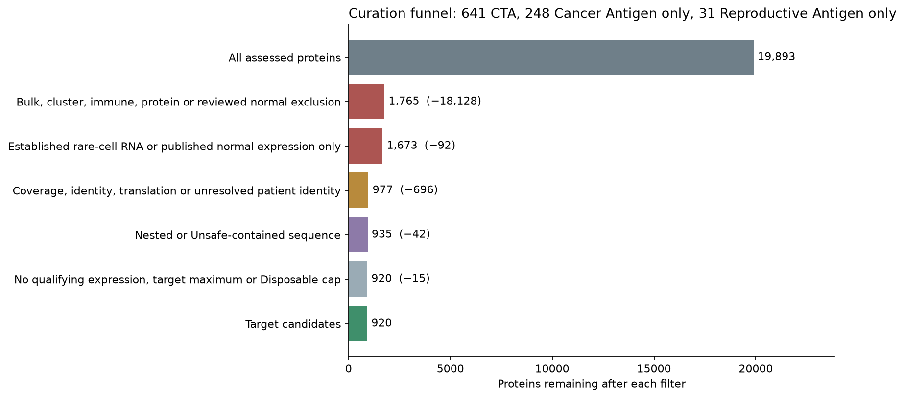
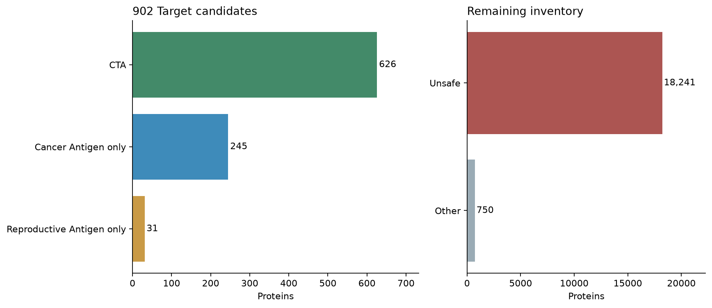

# Rebuilt antigen catalog

Policy `oncoref.target-selection.2026-11-10.1`. **641 CTA, 248 Cancer Antigen only, 31 Reproductive Antigen only, 753 Other and 18,220 Unsafe.** These are outputs of screening rules, not validated tumor antigens.

[Filterable protein table](report.html) · [Every change from the 2026-11-09 draft](changes-from-draft.csv) · [Changes from release 1.36.0](category-changes.csv) · [Exact comparison scope](comparison.json)

## Curation funnel



| Filter | Result | Proteins removed | Remaining |
|---|---|---:|---:|
| Bulk, cluster, immune, protein or reviewed normal exclusion | Unsafe | 18,128 | 1,765 |
| Established rare-cell RNA or published normal expression only | Unsafe | 92 | 1,673 |
| Coverage, identity, translation or unresolved patient identity | Other:Review | 696 | 977 |
| Nested or Unsafe-contained sequence | Other:Sequence | 42 | 935 |
| No qualifying expression, target maximum or Disposable cap | Other:Expression | 15 | 920 |

The 920 remaining Target candidates are 641 CTA, 248 Cancer Antigen only and 31 Reproductive Antigen only. [Funnel table](funnel.csv) · [Curation summary with figures](summary.md).



## The filters

| Filter | Rule | Failure |
|---|---|---|
| Normal expression | Existing bulk, cluster, immune, cornea, protein and reviewed-knowledge rules, unchanged | Unsafe for accepted exclusions; otherwise Other:Review |
| Rare normal-cell RNA | >= 1% of a donor's cells and >= 10 cells carry >= 2 molecules. The signal in >= 2 independent studies of the same organ. Donors of one study share its libraries and reference. | Established: Unsafe. Dismissed: no effect |
| Published normal expression | Gene-specific report in normal adult Vital or Protected tissue, by a fixed rubric | Unsafe |
| Coverage, identity and translation | Unchanged | Other:Review |
| Sequence | Fewer than 95% of 9-mers inside Unsafe proteins, recomputed for the new Unsafe set | Other:Sequence |
| Expression bounds | Target maximum above every measured nonreproductive and Disposable value; Disposable at most 32 TPM and 32 nTPM | Other:Expression |
| Cancer evidence | Two independent patients each ≥1 TPM and above the normal maximum N, or one tumor ≥10 × max(N, 1) | No Cancer Antigen membership |
| Reproductive evidence | ≥1 native TPM/nTPM with read and cell support, or reliable protein | No Reproductive Antigen membership |

## Rare normal-cell RNA

A count matrix cannot show where a read aligned, and one mis-assigned read per cell from a paralog, pseudogene or overlapping gene looks like sparse expression. Cells with one molecule never change a category. A mis-assigned read from a paralog, pseudogene or overlapping gene produces exactly this pattern. Every signal ends in one of two outcomes; nothing waits for review.

- **Established, Unsafe:** A replicated signal at a locus without mapping risk, or any signal with bulk confirmation. Unsafe.
- **Dismissed, no effect:** A signal that is neither: counts at a flagged locus, or from one study, that no other assay confirms. Recorded with its reason; no category effect.
- **Mapping risk:** Shared transcript sequence with another locus, or an exon inside another same-strand gene. Counts for a flagged gene cannot be attributed to it.
- **Bulk confirmation:** Bulk RNA >= 1 native TPM in the same organ in both the HPA and GTEx sample sets, a different assay with its own read assignment.
- **Literature:** Where a reviewed publication reports the gene in the same organ by a gene-specific assay, 1% detection in one donor is established, single molecules included: two assay types then agree. Published protein in a Vital or Protected tissue excludes through the knowledge layer without any counts.

49 draft non-Unsafe proteins become Unsafe, among them ADAM7, SMIM23, OR51D1, OOSP3, ERICH6, TOPAZ1, DUXB, BTNL2, SPATA45, BOLL, DGAT2L6, COX7B2, LRRIQ4, C5orf47. 40 candidates carry a dismissed signal, among them ENSG00000266202, HHLA1, NKX2-6, PSG8, ARMH2, ENSG00000279983, FKBP6, SATL1, CPHXL, OR5V1.

**41 proteins that were Unsafe only through the pooled 1% detection flag are candidates again**: ADAD1, ADAM18, C12orf50, C7orf33, CDCP2, CHCT1, CSAG1, CXorf58, CYP26C1, DPPA2, EFCAB3, ENSG00000266202, ENSG00000267618, GFY, NKX2-6, NLRP8, OR2F1, OR5V1, OR8D4, PABPC3, POTEF, PPP1R2B, PRDM7, PRR5-ARHGAP8, PSG8, RAD21L1, RGPD3, RSPH6A, SATL1, SMIM9, SPAG11A, SPAG11B, SPATA3, TDRD15, TPTE, TRIM60, TUBB8, URGCP-MRPS24, VRTN, ZC3H11B, ZNF492. Each was taken through the literature review below and none has a gene-specific report of expression in vital normal tissue. That is a search result, not proof of absence. [Donor-level evidence](../../normal-cell-atlas-20261110/rare-cell/index.md).

## Literature review

75 proteins were reviewed: every protein that would be a Target candidate while its rare-cell signal is dismissed, or after release from the pooled 1% detection flag. 8 are Unsafe on published evidence: AMBN (small intestine, R2); BTNL2 (small intestine, R2); GDF9 (bone marrow, R2); ITIH6 (kidney, R2); MAGEA12 (brain, R1); MYH13 (skeletal muscle, R2); OTOG (inner ear, R3); SLC25A2 (liver, R2). [Every protein, rubric, sources and quotes](literature.md).

## Changes from the 2026-11-09 draft

| Draft | Now | Proteins |
|---|---|---:|
| CTA | Reproductive Antigen only | 8 |
| CTA | Unsafe | 31 |
| Cancer Antigen only | Other:Review | 10 |
| Cancer Antigen only | Unsafe | 5 |
| Other:Review | CTA | 4 |
| Other:Review | Unsafe | 13 |
| Other:Sequence | CTA | 1 |
| Unsafe | CTA | 37 |
| Unsafe | Cancer Antigen only | 3 |
| Unsafe | Other:Review | 44 |
| Unsafe | Other:Sequence | 3 |
| Unsafe | Reproductive Antigen only | 1 |

The tenfold single-tumor rule accounts for the moves to Reproductive Antigen only and for Cancer Antigens only whose remaining route depends on unresolved patient identity. The target-maximum and Disposable-cap checks remove no candidate.

Cancer Antigens include 889 proteins; Reproductive Antigens include 672. Their intersection is CTA and their union contains 920 Target candidates.

Other contains 696 review, 42 sequence, 15 expression. A curated published target nomination is retained for 415 CTAs and 24 Cancer Antigens only. Broader paper coverage also includes biology, normal-expression findings and other evidence.

## Changes from release 1.36.0

| Released category | Rebuilt category | Proteins |
|---|---|---:|
| CTA | CTA | 547 |
| CTA | Other | 7 |
| CTA | Reproductive Antigen only | 26 |
| CTA | Unsafe | 27 |
| Other | CTA | 57 |
| Other | Cancer Antigen only | 245 |
| Other | Other | 699 |
| Other | Reproductive Antigen only | 4 |
| Other | Unsafe | 22 |
| Unsafe | CTA | 37 |
| Unsafe | Cancer Antigen only | 3 |
| Unsafe | Other | 47 |
| Unsafe | Reproductive Antigen only | 1 |
| Unsafe | Unsafe | 18171 |

New CTAs: FKBP6, AMELY, H2BW2, PRSS54, RSPH6A, KRT37, ANKRD60, PSG8, SRMS, PRDM7, OR1E2, GALR3, VRTN, OCM2, TTLL8, CHCT1, CIB3, PABPC3, RGPD3, DPPA2, ADAD1, SPAG11B, CXorf58, C12orf50, POTED, OR2B2, ADAM18, PROKR1, HOXD12, C7orf33, EFCAB3, TRIM60, SPAG11A, DEFB125, NLRP8, NKX2-6, OR8D4, OR52D1, MAGEB17, SATL1, SPATA31A6, AADACL3, HUS1B, POTEF, OR14A16, OR51C1, KRTAP4-1, CSAG1, SMIM9, GLYATL3, TXNDC8, KRTAP5-10, MAS1L, ARSH, KRTAP19-8, KRTAP20-4, OR2F1, ZC3H11C, TRIM64C, ZNF705D, DEFB115, ZC3H11B, TDRD15, TRIM51G, ZNF816-ZNF321P, SUPT20HL1, ZNF492, PPP1R2B, RAB6D, PRR23C, OR5V1, KRTAP5-7, RAD21L1, PRR5-ARHGAP8, KRTAP5-9, ENSG00000255432, ENSG00000255835, ENSG00000258691, ARMH2, TUBB8, GFY, ENSG00000267140, ENSG00000267618, URGCP-MRPS24, TPTE, SPATA31A3, SPATA31A7, SPATA31A5, ENSG00000279983, RPS4Y2, FAM240B, OOSP1, ENSG00000285566, POTEB/2.

Former CTAs now requiring review: CALHM3, TAF11L12, TRIM75, TAF11L14, PRAMEF18, TAF11L11, TAF11L13.

## Reproductive Antigens only

22 have potentially qualifying tumor measurements but unresolved patient independence; none reaches the single-sample threshold. The remaining 9 do not meet either cancer RNA rule.

| Protein | Tumor maximum TPM | Normal comparison TPM | Cancer assessment |
|---|---:|---:|---|
| CDY2A/B | 8.64 | 0 | Patient identity unresolved |
| SLC25A52 | 5.58 | 2.97 | Patient identity unresolved |
| ZSWIM2 | 2.74 | 1.52 | Patient identity unresolved |
| GARIN3 | 6.5 | 2.07 | Patient identity unresolved |
| CDY1 | 1.6 | 0 | Below cancer rule |
| CDY1B | 0.3 | 0.1 | Below cancer rule |
| SPATA3 | 24.1 | 3 | Below cancer rule |
| TMEM262 | 47.4 | 7.4 | Patient identity unresolved |
| MAGEB5 | 2.09 | 0.0392 | Patient identity unresolved |
| KRTAP24-1 | 38 | 6 | Patient identity unresolved |
| FAM47B | 2.25 | 0 | Patient identity unresolved |
| VN1R2 | 12.3 | 7.79 | Patient identity unresolved |
| OR8G1 | 2.69 | 2.5 | Below cancer rule |
| DEFB113 | 2.27 | 0 | Patient identity unresolved |
| ZNF705B | 3.78 | 0 | Patient identity unresolved |
| OR5H1 | 1.4 | 2.3 | Below cancer rule |
| FAM237A | 7.8 | 2.26 | Patient identity unresolved |
| ENSG00000237378 | 8.16 | 0.7 | Patient identity unresolved |
| ENSG00000241690 | 5.7 | 0.5 | Below cancer rule |
| H2AL1Q | 4.02 | 2.6 | Patient identity unresolved |
| ENSG00000249773 | 38.4 | 4.2 | Patient identity unresolved |
| P3R3URF | 16.5 | 3.4 | Patient identity unresolved |
| PTTG1IP2 | 3.23 | 0.3 | Patient identity unresolved |
| KDM4F | 5.49 | 0 | Patient identity unresolved |
| ENSG00000258417 | 6.76 | 1.2 | Patient identity unresolved |
| ENSG00000274944 | 13.5 | 2.8 | Patient identity unresolved |
| CCDC201 | 5.38 | 1.1 | Patient identity unresolved |
| HSFX3 | 4.88 | 1.8 | Patient identity unresolved |
| MSANTD5 | 3.43 | 2.2 | Below cancer rule |
| CIMIP3 | 1.2 | 0.2 | Below cancer rule |
| ENSG00000289809 | 0.0679 | 4.5 | Below cancer rule |

## Evidence and reproduction

The comparison uses source-native TPM and maxima of supported tissue/cell summaries. It does not correct cross-study batch effects. NUTM's stored three-sample matrix fails the nonnegative-TPM check and is listed in the [coverage ledger](tumor-source-coverage.csv).

[Full protein decisions](protein-decisions.csv.gz) · [All member genes](gene-decisions.csv.gz) · [Normal comparison values](normal-comparison.csv.gz) · [Tumor witnesses](tumor-witnesses.csv.gz) · [Paper claims](paper-attestations.json.gz) · [Input hashes](inputs.json).

The [pinned HPA download receipt](downloaded-hpa-sources.json) supplies exact URLs, paths and SHA-256 hashes for the newly retrieved native-TPM tables. With the pinned source files in the paths listed in `inputs.json`, run:

```sh
python scripts/build_rare_cell_evidence.py --counts tmp/normal-atlas/counts-2025-11-08
python scripts/rebuild_target_catalog.py
python scripts/render_target_catalog.py
python scripts/build_target_selection_report.py
```

The builder verifies the pinned tumor matrices, re-resolves source identities and assesses all proteins. Temporary tumor matrices stay outside the published report. The new catalog is available through `target_selection.results()`; the `cta_selection` API and existing sequence downloads retain the 1.36.0 snapshot.
