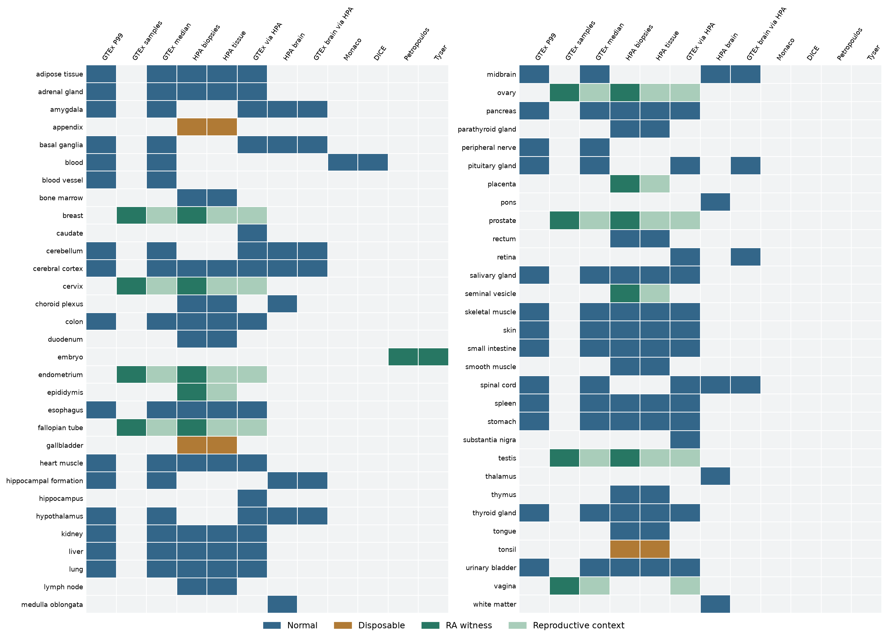
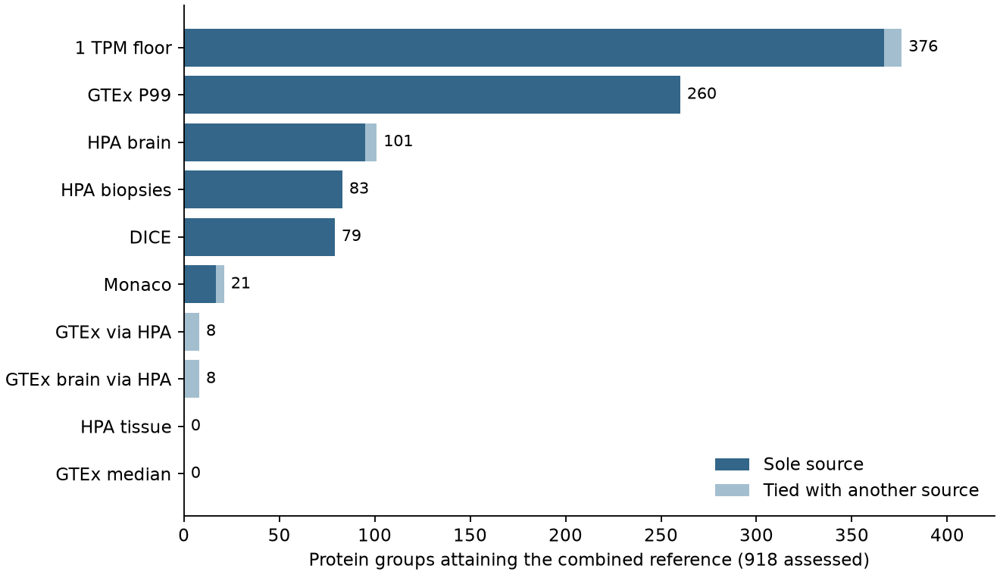
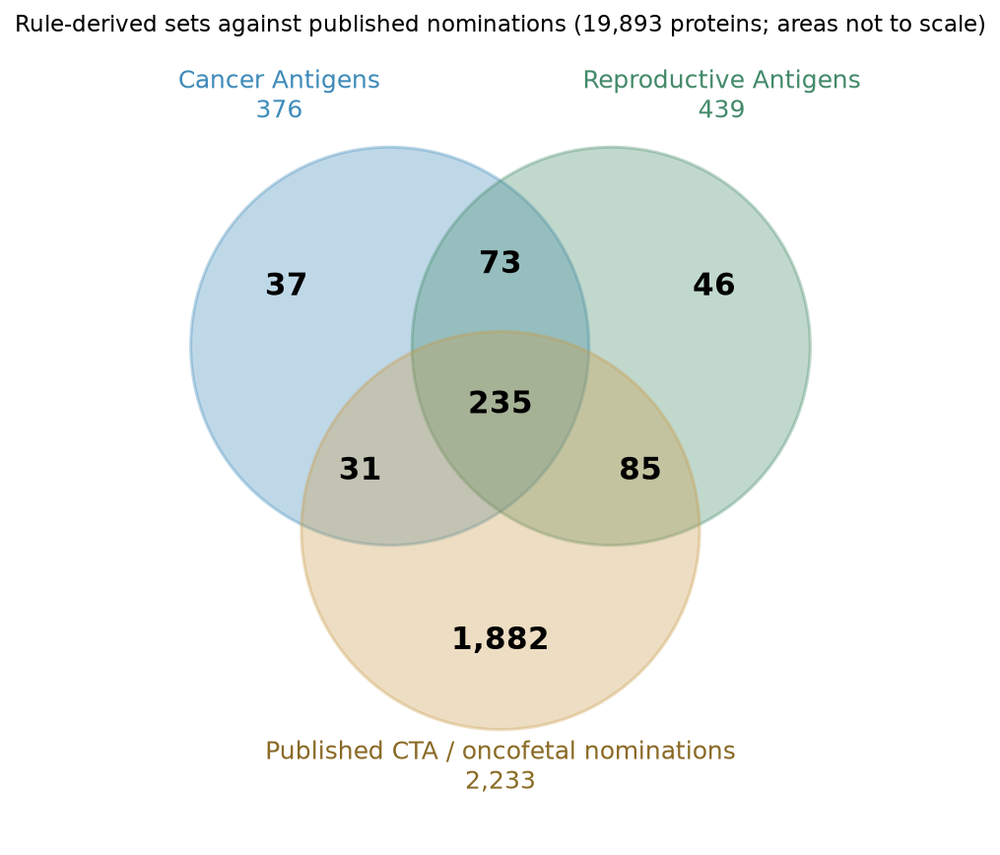

# Normal RNA sources and antigen membership

Every native-TPM reference is evaluated within its anatomical context. The highest normal value from any source sets N. Disposable tissue supplies a separate D. Both antigen routes use **H₀ = max(N, D, 1 TPM)**. The source panels overlap; measurements are never added across studies.

A colored cell indicates measured coverage for at least one assessed group. Reproductive context denotes a tissue summary; qualifying RA evidence requires an individual reproductive sample or supported embryo-lineage mean. Gray denotes no qualifying coverage in that source and role. The inventory lists every source-native site and cell type used in these comparison records.

[Download source, tissue, native context, cell type and role](source-tissues.csv)

| Source | Measurement and use |
|---|---|
| GTEx P99 | GTEx v11. Linear 99th percentile within each anatomical site across donors. |
| GTEx samples | GTEx v11. Individual reproductive samples can witness RA. |
| GTEx median | GTEx v11. Published site-level donor medians, with exact member-locus mapping. |
| HPA biopsies | HPA v23. Within-biopsy transcript TPM summed by locus. Each healthy biopsy can set a maximum and each reproductive biopsy can witness RA. Donor IDs are unavailable. |
| HPA tissue | HPA v23 tissue means in TPM. |
| GTEx via HPA | GTEx tissue summaries distributed in HPA v23. These overlap the GTEx resource. |
| HPA brain | HPA brain subregion means in TPM, mapped to anatomical regions. |
| GTEx brain via HPA | GTEx brain region summaries distributed by HPA v23. |
| Monaco | Mean TPM in sorted blood immune populations. The immune screen also evaluates these measurements. |
| DICE | Supported blood immune-cell TPM, using the third-highest observation and the conservative bound for unpaired protein-group members. The immune screen also uses DICE. |
| Petropoulos | Preimplantation embryo-lineage means in TPM; stage, cell and independent embryo support apply. |
| Tyser | Carnegie stage 7 embryo-lineage means in TPM; cell and embryo support apply. |
| HPA consensus | Normal tissue consensus nTPM defines anatomical coverage and contributes to the shared expression screen. |
| HPA cell clusters | Tissue cell-type cluster nTPM contributes to shared normal-expression and reproductive-context evidence. |
| HPA immune | Blood immune-cell nTPM evaluated against the tissue-tier limits. |
| HPA brain nTPM | Brain subregion nTPM contributes to the independent normal-expression screen. |
| Collin cornea | Adult cornea/conjunctiva cell populations evaluated in counts per 10,000. |
| Census donors | CELLxGENE Census donor-resolved single-cell and single-nucleus counts. The rare-cell gate uses within-donor frequency and study replication. |

## Tissues by source

Tissue names follow each panel's anatomical mapping. The downloadable inventory preserves finer site, subregion and cell-type labels.

| Source | Tissues represented |
|---|---|
| GTEx P99 | adipose tissue, adrenal gland, amygdala, basal ganglia, blood, blood vessel, cerebellum, cerebral cortex, colon, esophagus, heart muscle, hippocampal formation, hypothalamus, kidney, liver, lung, midbrain, pancreas, peripheral nerve, pituitary gland, salivary gland, skeletal muscle, skin, small intestine, spinal cord, spleen, stomach, thyroid gland, urinary bladder |
| GTEx samples | breast, cervix, endometrium, fallopian tube, ovary, prostate, testis, vagina |
| GTEx median | adipose tissue, adrenal gland, amygdala, basal ganglia, blood, blood vessel, breast, cerebellum, cerebral cortex, cervix, colon, endometrium, esophagus, fallopian tube, heart muscle, hippocampal formation, hypothalamus, kidney, liver, lung, midbrain, ovary, pancreas, peripheral nerve, pituitary gland, prostate, salivary gland, skeletal muscle, skin, small intestine, spinal cord, spleen, stomach, testis, thyroid gland, urinary bladder, vagina |
| HPA biopsies | adipose tissue, adrenal gland, appendix, bone marrow, breast, cerebral cortex, cervix, choroid plexus, colon, duodenum, endometrium, epididymis, esophagus, fallopian tube, gallbladder, heart muscle, kidney, liver, lung, lymph node, ovary, pancreas, parathyroid gland, placenta, prostate, rectum, salivary gland, seminal vesicle, skeletal muscle, skin, small intestine, smooth muscle, spleen, stomach, testis, thymus, thyroid gland, tongue, tonsil, urinary bladder |
| HPA tissue | adipose tissue, adrenal gland, appendix, bone marrow, breast, cerebral cortex, cervix, choroid plexus, colon, duodenum, endometrium, epididymis, esophagus, fallopian tube, gallbladder, heart muscle, kidney, liver, lung, lymph node, ovary, pancreas, parathyroid gland, placenta, prostate, rectum, salivary gland, seminal vesicle, skeletal muscle, skin, small intestine, smooth muscle, spleen, stomach, testis, thymus, thyroid gland, tongue, tonsil, urinary bladder |
| GTEx via HPA | adipose tissue, adrenal gland, amygdala, basal ganglia, breast, caudate, cerebellum, cerebral cortex, cervix, colon, endometrium, esophagus, fallopian tube, heart muscle, hippocampus, hypothalamus, kidney, liver, lung, ovary, pancreas, pituitary gland, prostate, retina, salivary gland, skeletal muscle, skin, small intestine, spinal cord, spleen, stomach, substantia nigra, testis, thyroid gland, urinary bladder, vagina |
| HPA brain | amygdala, basal ganglia, cerebellum, cerebral cortex, choroid plexus, hippocampal formation, hypothalamus, medulla oblongata, midbrain, pons, spinal cord, thalamus, white matter |
| GTEx brain via HPA | amygdala, basal ganglia, cerebellum, cerebral cortex, hippocampal formation, hypothalamus, midbrain, pituitary gland, retina, spinal cord |
| Monaco | blood |
| DICE | blood |
| Petropoulos | embryo |
| Tyser | embryo |
| HPA consensus | adipose tissue, adrenal gland, amygdala, appendix, basal ganglia, bone marrow, breast, cerebellum, cerebral cortex, cervix, choroid plexus, colon, duodenum, endometrium, epididymis, esophagus, fallopian tube, gallbladder, heart muscle, hippocampal formation, hypothalamus, kidney, liver, lung, lymph node, midbrain, ovary, pancreas, parathyroid gland, pituitary gland, placenta, prostate, rectum, retina, salivary gland, seminal vesicle, skeletal muscle, skin, small intestine, smooth muscle, spinal cord, spleen, stomach, testis, thymus, thyroid gland, tongue, tonsil, urinary bladder, vagina |
| HPA cell clusters | adipose tissue, bone marrow, brain, breast, bronchus, colon, endometrium, esophagus, eye, fallopian tube, heart muscle, kidney, liver, lung, lymph node, ovary, pancreas, pbmc, placenta, prostate, rectum, salivary gland, skeletal muscle, skin, small intestine, spleen, stomach, testis, thymus, tongue, vascular |
| HPA immune | blood |
| HPA brain nTPM | amygdala, basal ganglia, cerebellum, cerebral cortex, choroid plexus, hippocampal formation, hypothalamus, medulla oblongata, midbrain, pons, spinal cord, thalamus, white matter |
| Collin cornea | cornea/conjunctiva |
| Census donors | adipose tissue, adrenal gland, blood, brain, colon, esophagus, eye, heart, kidney, liver, lung, lymph node, pancreas, small intestine, spinal cord, stomach, tongue, ureter, urinary bladder |

## Independent normal RNA screens

The tissue-tier, immune, corneal and rare-cell screens can prevent shared eligibility before enrichment is evaluated. Some native TPM sources also inform these screens. Cluster nTPM, CP10K, donor UMIs and protein staining retain their own evidence rules. A bulk percentile cannot override an exclusion.

## From measurements to memberships

For GTEx v11 normal sites, sum the measured loci encoding each identical protein within a library. Give each donor one value per site (median of replicate libraries), then take the linearly interpolated 99th percentile of the measured donors. Interpolation produces a tissue statistic without a sample or donor ID. HPA biopsies contribute their highest individual TPM per tissue. Missing required tissue coverage blocks qualification.

| Route after shared eligibility | Definition | Protein groups |
|---|---|---:|
| CA | At least one QC-passing tumor reaches 10 × H₀ | 376 |
| RA | At least one reproductive sample or supported embryo-lineage observation reaches 10 × H₀ | 439 |
| CTA | Both CA and RA | 308 |
| CA ∪ RA | Either route | 507 |

[Set overlap and eligibility funnel](../summary.md) · [Exact comparison contract](../comparison.json) · [Census study inventory](../../../normal-cell-atlas-20261110/index.md)
