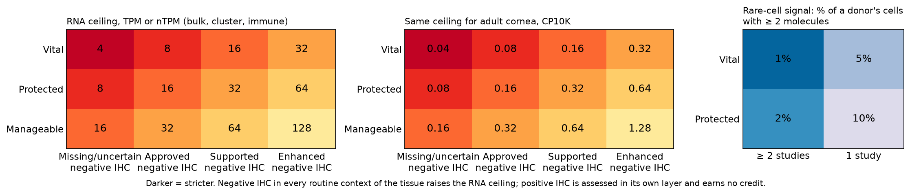
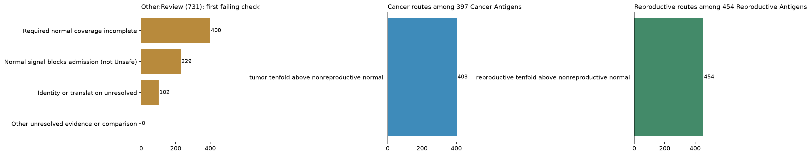

# Curation summary

Policy `oncoref.target-selection.2026-11-17.1`, 19,893 human protein records. **290 CTA, 106 Cancer Antigen only, 113 Reproductive Antigen only.** These are outputs of screening rules, not validated tumor antigens. Every figure is drawn from the [rebuilt catalog](index.md); thresholds are read from the policy constants.

## Catalog evidence, biological sets and host selection

Milk-program labels are inferred from expression, not provider-confirmed lactation. Negative signature evidence does not establish universal resting-state absence.

## Host choices and screening outcomes

Reproductive protection is opt-in for every anatomy preset. Not protected, protect, accept loss and absent retain distinct meanings. Unresolved protected-tissue coverage fails the host screen, while biological CA/RA/CTA membership remains unchanged. [Rules and limitations](../../../host-selection.md).

| Host profile | Protected compartments | CTA | CA only | RA only | CA ∪ RA |
|---|---|---|---|---|---|
| all | none | 290 | 106 | 113 | 509 |
| female-patient | none | 290 | 106 | 113 | 509 |
| female-patient (protect ovary) | ovary | 252 | 100 | 101 | 453 |
| female-patient (lactating) | lactating_breast | 286 | 104 | 110 | 500 |
| female-patient (pregnant) | embryo, placenta, lactating_breast | 0 | 0 | 0 | 0 |
| male-patient | none | 290 | 106 | 113 | 509 |
| male-patient (protect testis) | testis | 62 | 45 | 24 | 131 |
| male-patient (protect adult tissues) | testis, epididymis, prostate, seminal vesicle, resting_breast | 49 | 37 | 14 | 100 |

[Profile table CSV](summary/cta-profiles.csv)

## Antigen membership

CTA is the intersection. Reproductive-only proteins have no qualifying cancer evidence; the union name does not certify tumor targeting. Unsafe is the accepted-exclusion background; Unsafe|Other also subtracts unresolved and nonqualifying proteins.

## Rule-derived sets and published nominations

Of 290 CTA, 215 are published nominations and 75 are not. 1,891 published nominations are in neither set: 1,761 of all 2,233 nominations are Unsafe, 65 Other:Review and 7 Other:Sequence. A published nomination is an annotation; it never overrides an exclusion.

## Funnel by filtering idea

A protein leaves at the first idea that removes it, so later steps show only what each idea adds. The order is chosen so that every step removes something; the layers overlap heavily, as the next section shows.

| Filtering idea | Removed here | Remaining |
|---|---|---|
| All assessed proteins | 0 | 19,893 |
| Bulk tissue RNA above the tissue ceiling | 17,522 | 2,371 |
| Cell-type cluster RNA (HPA single cell) | 424 | 1,947 |
| Sorted immune-cell RNA | 96 | 1,851 |
| Rare-cell RNA established by donor | 107 | 1,744 |
| Normal-tissue protein (IHC) | 50 | 1,694 |
| Curated or published normal expression | 49 | 1,645 |
| Adult cornea RNA | 5 | 1,640 |
| Coverage, identity, translation or unresolved evidence | 731 | 909 |
| Nested, Unsafe-contained or read-through sequence | 48 | 861 |
| No qualifying expression or bounds fail | 254 | 607 |
| Home tissue no panel resolves | 98 | 509 |

| Filtering idea | Removed here | Remaining |
|---|---|---|
| Published CTA / oncofetal nominations | 0 | 2,233 |
| Bulk tissue RNA above the tissue ceiling | 1,464 | 769 |
| Cell-type cluster RNA (HPA single cell) | 174 | 595 |
| Sorted immune-cell RNA | 25 | 570 |
| Rare-cell RNA established by donor | 68 | 502 |
| Normal-tissue protein (IHC) | 19 | 483 |
| Curated or published normal expression | 10 | 473 |
| Adult cornea RNA | 1 | 472 |
| Coverage, identity, translation or unresolved evidence | 65 | 407 |
| Nested, Unsafe-contained or read-through sequence | 7 | 400 |
| No qualifying expression or bounds fail | 42 | 358 |
| Home tissue no panel resolves | 16 | 342 |

Steps that remove no published nomination are omitted from the second funnel. [All proteins](summary/funnel-all.csv) · [Published](summary/funnel-published.csv)

## Normal-expression layers

| Layer | Unsafe proteins flagged | Only reason |
|---|---|---|
| Normal bulk | 17,522 | 560 |
| HPA tissue clusters | 17,053 | 268 |
| Adult cornea | 12,095 | 5 |
| DICE immune | 11,632 | 45 |
| Monaco immune | 11,264 | 19 |
| HPA normal protein | 10,157 | 47 |
| HPA immune | 7,973 | 14 |
| Established rare normal-cell RNA | 129 | 106 |
| Reviewed normal-cell knowledge | 32 | 31 |
| Published normal-tissue expression | 19 | 18 |
| Accepted normal-protein evidence | 8 | 2 |

## Thresholds

Ceilings are tier base × 2 per negative-IHC reliability step (Vital 4, Protected 8, Manageable 16 without IHC credit). Exceeding a Vital or Protected ceiling is Unsafe; Manageable is Unsafe only above 128. These are screening conventions, not measured injury thresholds.

The second table counts recorded bulk-RNA peak observations, not proteins: one protein can contribute a peak per source.

## Expression distributions and where the thresholds fall

One value per protein on each source's own scale; scales are never pooled. Counts use a compressed axis so the small candidate group stays visible.

## Shared enrichment rule

Both CA and RA independently require 10× max(N, Disposable, 1). The cancer panel below shows the tumor side.

## Rare-cell RNA

[Donor-level evidence](../../normal-cell-atlas-20261110/rare-cell/index.md)

## Inside the later stages

- Required normal coverage incomplete: 400
- Identity or translation unresolved: 102
- Normal signal blocks admission (not Unsafe): 229
- Other unresolved evidence or comparison: 0

A protein can use several routes, so route counts exceed set sizes.
