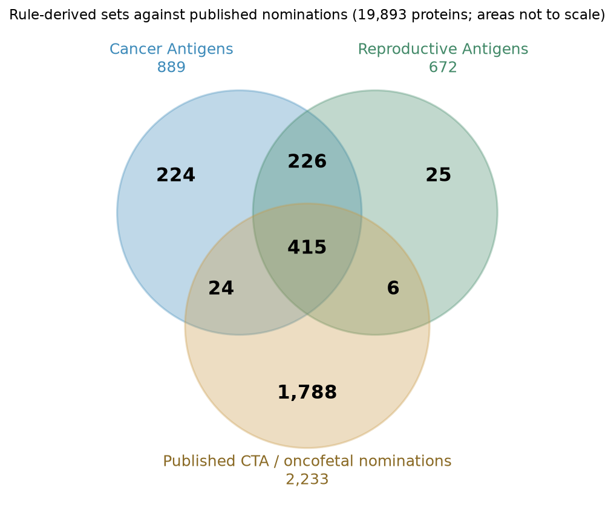
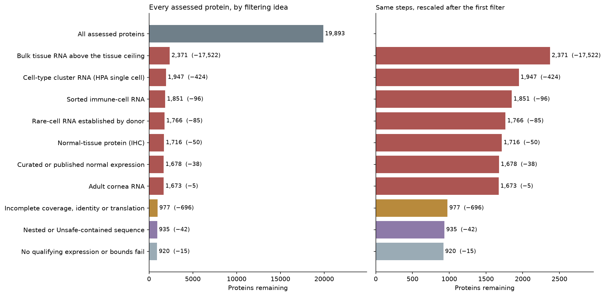
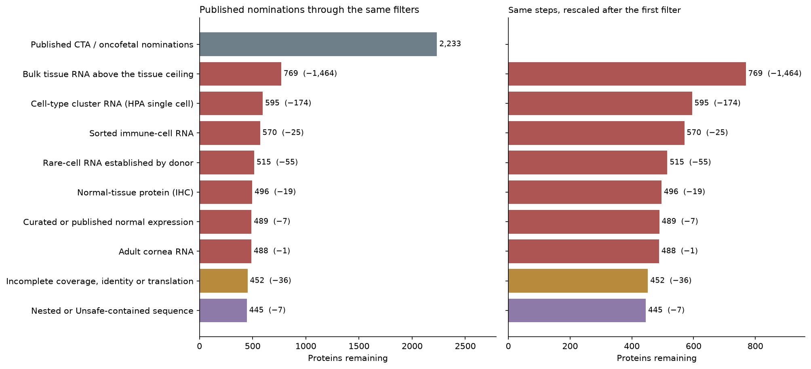
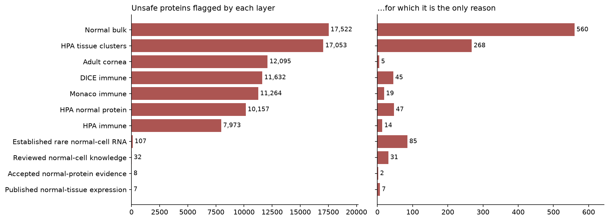
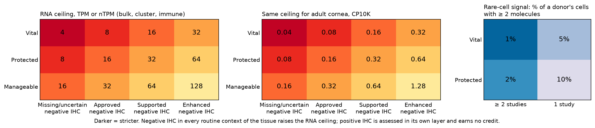
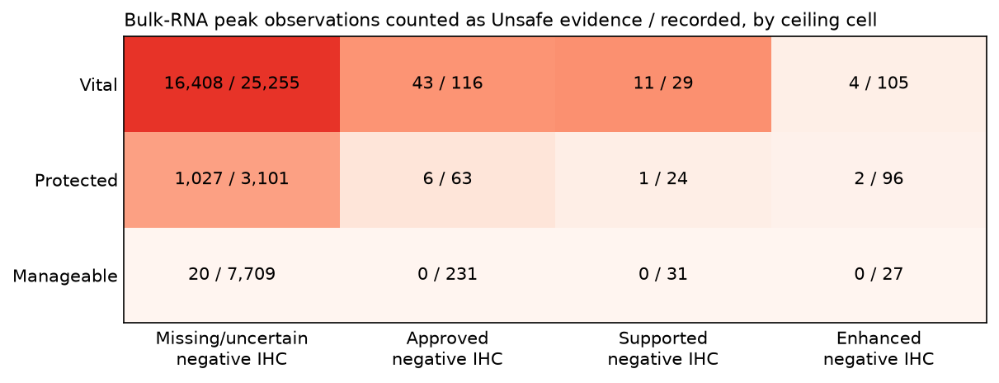
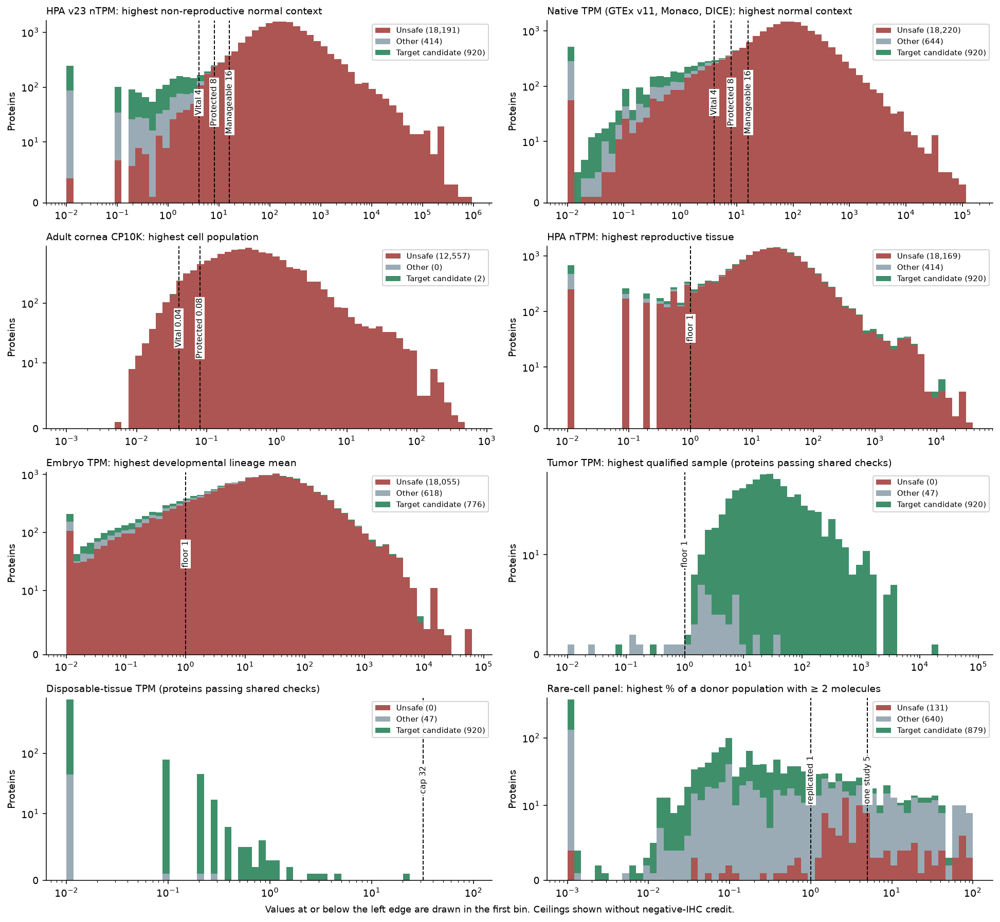
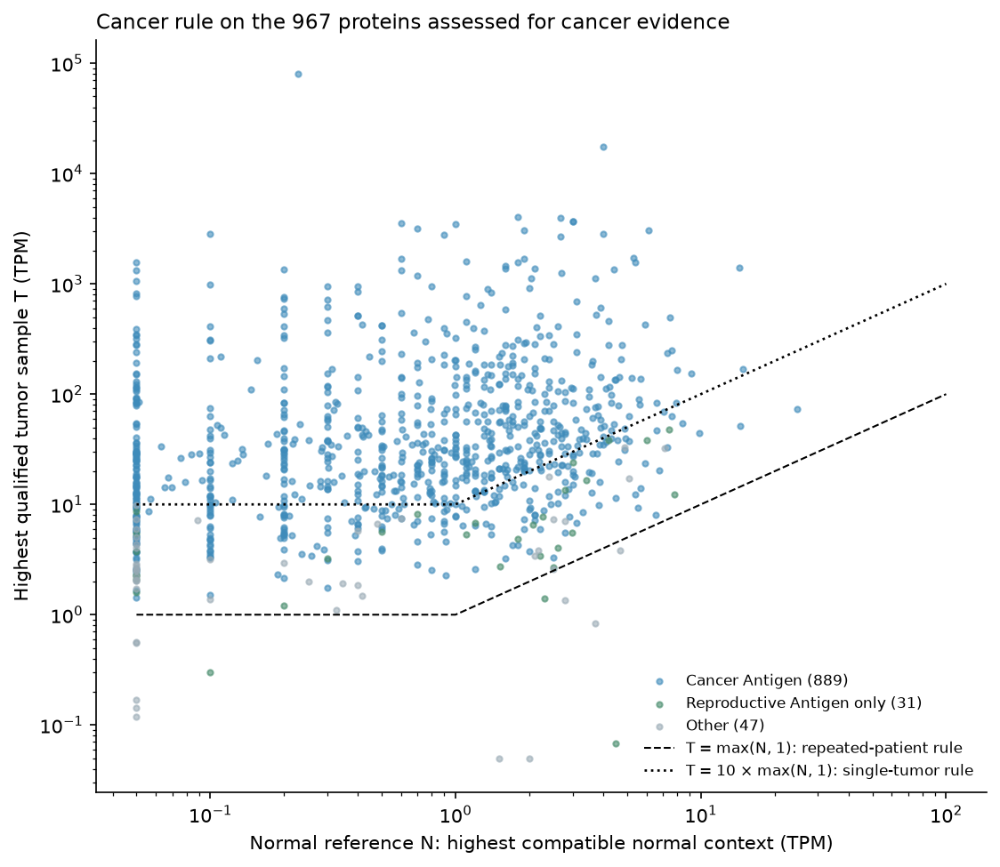
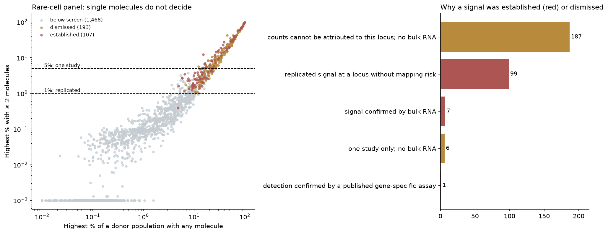
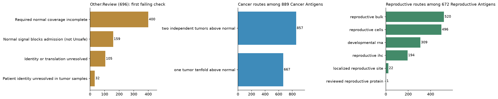

# Curation summary

Policy `oncoref.target-selection.2026-11-10.1`, 19,893 human protein records. **641 CTA, 248 Cancer Antigen only, 31 Reproductive Antigen only.** These are outputs of screening rules, not validated tumor antigens. Every figure is drawn from the [rebuilt catalog](index.md); thresholds are read from the policy constants.

## Rule-derived sets and published nominations

Of 641 CTA, 415 are published nominations and 226 are not. 1,788 published nominations are in neither set: 1,745 of all 2,233 nominations are Unsafe, 36 Other:Review and 7 Other:Sequence. A published nomination is an annotation; it never overrides an exclusion.

## Funnel by filtering idea

A protein leaves at the first idea that removes it, so later steps show only what each idea adds. The order is chosen so that every step removes something; the layers overlap heavily, as the next section shows.

| Filtering idea | Removed here | Remaining |
|---|---|---|
| All assessed proteins | 0 | 19,893 |
| Bulk tissue RNA above the tissue ceiling | 17,522 | 2,371 |
| Cell-type cluster RNA (HPA single cell) | 424 | 1,947 |
| Sorted immune-cell RNA | 96 | 1,851 |
| Rare-cell RNA established by donor | 85 | 1,766 |
| Normal-tissue protein (IHC) | 50 | 1,716 |
| Curated or published normal expression | 38 | 1,678 |
| Adult cornea RNA | 5 | 1,673 |
| Incomplete coverage, identity or translation | 696 | 977 |
| Nested or Unsafe-contained sequence | 42 | 935 |
| No qualifying expression or bounds fail | 15 | 920 |

| Filtering idea | Removed here | Remaining |
|---|---|---|
| Published CTA / oncofetal nominations | 0 | 2,233 |
| Bulk tissue RNA above the tissue ceiling | 1,464 | 769 |
| Cell-type cluster RNA (HPA single cell) | 174 | 595 |
| Sorted immune-cell RNA | 25 | 570 |
| Rare-cell RNA established by donor | 55 | 515 |
| Normal-tissue protein (IHC) | 19 | 496 |
| Curated or published normal expression | 7 | 489 |
| Adult cornea RNA | 1 | 488 |
| Incomplete coverage, identity or translation | 36 | 452 |
| Nested or Unsafe-contained sequence | 7 | 445 |

Steps that remove no published nomination are omitted from the second funnel. [All proteins](summary/funnel-all.csv) · [Published](summary/funnel-published.csv)

## Normal-expression layers

| Layer | Unsafe proteins flagged | Only reason |
|---|---|---|
| Normal bulk | 17,522 | 560 |
| HPA tissue clusters | 17,053 | 268 |
| Adult cornea | 12,095 | 5 |
| DICE immune | 11,632 | 45 |
| Monaco immune | 11,264 | 19 |
| HPA normal protein | 10,157 | 47 |
| HPA immune | 7,973 | 14 |
| Established rare normal-cell RNA | 107 | 85 |
| Reviewed normal-cell knowledge | 32 | 31 |
| Accepted normal-protein evidence | 8 | 2 |
| Published normal-tissue expression | 7 | 7 |

## Thresholds

Ceilings are tier base × 2 per negative-IHC reliability step (Vital 4, Protected 8, Manageable 16 without IHC credit). Exceeding a Vital or Protected ceiling is Unsafe; Manageable is Unsafe only above 128. These are screening conventions, not measured injury thresholds.

The second table counts recorded bulk-RNA peak observations, not proteins: one protein can contribute a peak per source.

## Expression distributions and where the thresholds fall

One value per protein on each source's own scale; scales are never pooled. Counts use a compressed axis so the small candidate group stays visible.

## Cancer rule

## Rare-cell RNA

[Donor-level evidence](../../normal-cell-atlas-20261110/rare-cell/index.md)

## Inside the later stages

- Required normal coverage incomplete: 400
- Identity or translation unresolved: 105
- Normal signal blocks admission (not Unsafe): 159
- Patient identity unresolved in tumor samples: 32

A protein can use several routes, so route counts exceed set sizes.
