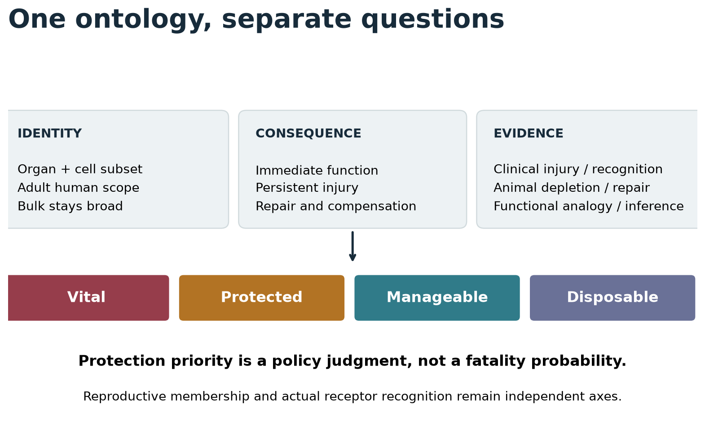
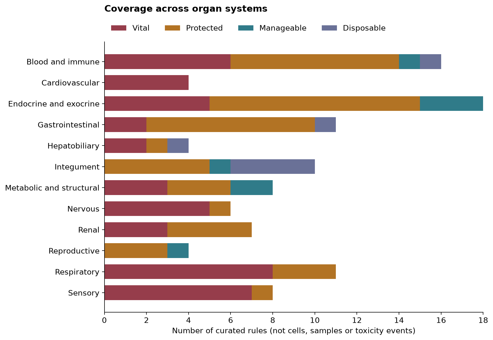
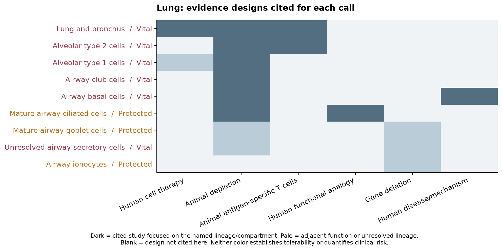
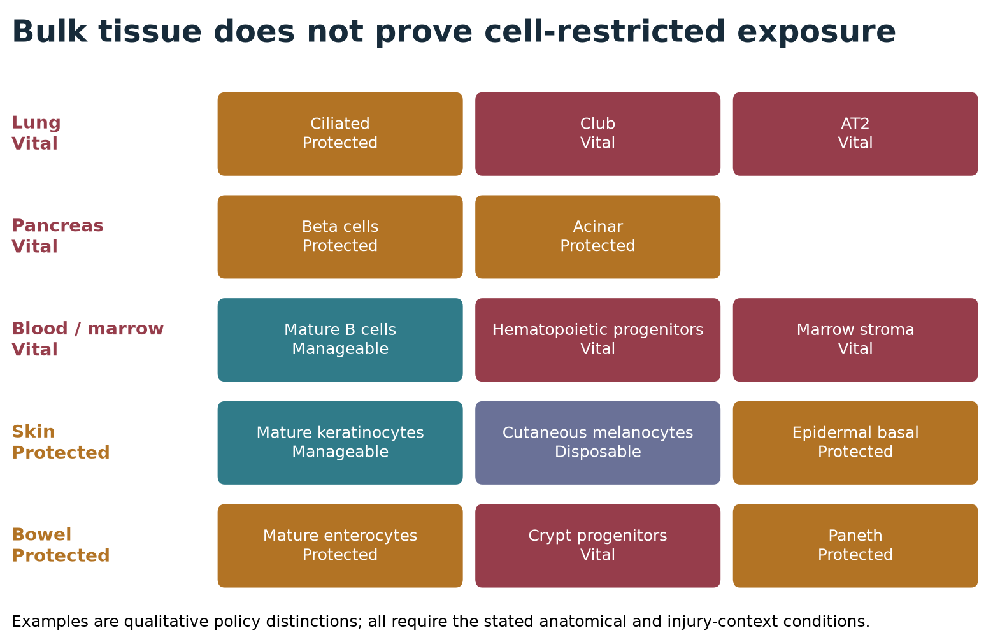

# Normal-tissue hazard ontology

Version 1.29.0 | reviewed 2026-11-03

107 curated rules; 50 references; 123 human anatomy concepts; 1072 native mapping rows.

This ontology assigns adult human compartments to four protection priorities.
It separates immediate functional loss, persistent injury, regenerative capacity
and available compensation. The assignments are policy judgments supported by
different kinds of evidence, not measured probabilities of fatal toxicity.

The initiating target, inflammatory amplifiers and the tissue causing final organ
failure can be different. A preserved stem-cell pool does not ensure recovery
under persistent recognition. Conversely, the label 'stem cell' alone does not
prove irreplaceability: alternative progenitors sometimes compensate.

Reproductive/developmental membership remains an independent anatomical axis.
RNA detection, accessible surface antigen, peptide-HLA presentation, functional
recognition and demonstrated tissue injury are distinct evidence states. This
registry classifies the consequence of injury; it does not manufacture missing
recognition evidence. Adult human calls are not validated animal or pediatric
tolerability claims.

## How the policy is applied

Bulk measurements use organ-level rules. A narrower exception requires a
resolved tissue and cell identity from a cellular assay. Unknown cell labels
inherit organ concern; mixed labels cannot earn a downgrade. Unknown anatomy,
conflicting rules and contexts outside adult human scope remain unresolved.

The RNA and IHC cascade reads these same assignments. Existing numeric RNA/IHC
ceilings are research parameters, not newly calibrated by the literature review.
In the existing brain/spinal-cord/heart/lung rare-cell panel, qualifying Vital
findings retain the Unsafe screen, while Protected findings create a candidate
review hold. The 1% detection line is a screening parameter, not a risk estimate.
Other organs have ontology entries without an implied new rare-cell data panel.

Disposable is a narrow conditional allowance for specified compartments. A
removable organ does not make its widely shared cell types disposable elsewhere.
The existing reproductive permission remains separate from the functional hazard
reported here. Historical reports retain their original versioned policy.

**Vital:** Highest protection priority: plausible life-threatening failure, major irreversible neurological/sensory loss, or loss of indispensable regenerative support.

**Protected:** Persistent functional or structural injury is a major concern; compensation is incomplete or direct immune-depletion evidence is insufficient.

**Manageable:** A defined compartment has credible replacement, compensation or supportive-treatment precedent; acute inflammation and persistent recognition still require review.

**Disposable:** Narrow conditional allowance for loss of a specified compartment; does not imply painless, reversible or inflammation-free ablation.

## Inventories and reproducibility

[PDF report](tissue-hazard-ontology.pdf) · [Interactive report](report.html) · [Assessments](assessments.csv) · [References](references.csv) · [Every human anatomy concept](canonical-anatomy.csv) · [Native mappings](native-mappings.csv) · [Registry JSON](registry.json) · [Classification changes](classification-changes.csv)

104 protein-group classifications differ from the 1.28.0 baseline. See the complete change table; counts are policy outcomes, not clinical events.

The change table includes prior and current exclusion reasons. [Current RNA contexts for changed proteins](changed-protein-rna-contexts.csv) retain native units, tiers and ceilings. These are source-specific peak summaries, not every observed cell. The rare-cell screen supplies separate detection-frequency evidence.

Reproduce: `python scripts/build_tissue_hazard_report.py`. Figures show rules and evidence designs, never calibrated toxicity scores. Native mappings record coverage, not absence of expression.

## Blood and immune

### Bone marrow — Vital

`marrow` | bulk rule | adult human | mechanistic inference

Marrow is a mixed regenerative organ; mature B-cell experience cannot be generalized to it.

**Acute loss:** Loss of blood-cell production can cause infection, anemia and bleeding.

**Persistent injury:** Stem-cell or niche depletion can prevent recovery.

**Repair:** Requires surviving progenitors and a functional stromal niche.

**Compensation:** Transfusion and transplantation do not establish general target tolerability.

**Recognition:** Target/receptor-specific evidence is required separately.

**Evidence scope:** Compartment-level mechanistic inference; cited clinical or experimental evidence does not quantify receptor-specific human risk.

**Evidence:** [maude2018](https://pmc.ncbi.nlm.nih.gov/articles/PMC5996391/), [tran2013](https://pmc.ncbi.nlm.nih.gov/articles/PMC3674706/), [roberts2013](https://pmc.ncbi.nlm.nih.gov/articles/PMC3674708/)

### Blood — Vital

`blood` | bulk rule | adult human | mechanistic inference

Bulk blood must not inherit a mature B-cell exception.

**Acute loss:** Distributed cell depletion can compromise oxygen delivery, hemostasis or host defence.

**Persistent injury:** Persistent targeting can prevent hematopoietic replenishment.

**Repair:** Renewal depends on spared marrow and antigen distribution during maturation.

**Compensation:** Lineage-specific support exists but is not equivalent across cell types.

**Recognition:** Target/receptor-specific evidence is required separately.

**Evidence scope:** Compartment-level mechanistic inference; cited clinical or experimental evidence does not quantify receptor-specific human risk.

**Evidence:** [maude2018](https://pmc.ncbi.nlm.nih.gov/articles/PMC5996391/), [sitc2021](https://pmc.ncbi.nlm.nih.gov/articles/PMC8237720/)

### Lymph nodes — Protected

`nodes` | bulk rule | adult human | mechanistic inference

Distinguish circulating immune cells from resident lymphatic and stromal structure.

**Acute loss:** Inflammation can disrupt immune organization and drainage.

**Persistent injury:** Lymphatic and stromal injury may cause lasting dysfunction.

**Repair:** Removal of one node does not model depletion of all nodes or shared lineages.

**Compensation:** No complete replacement for distributed nodal organization.

**Recognition:** Target/receptor-specific evidence is required separately.

**Evidence scope:** Compartment-level mechanistic inference; cited clinical or experimental evidence does not quantify receptor-specific human risk.

**Evidence:** [nci_lymph_nodes](https://www.cancer.gov/about-cancer/diagnosis-staging/staging/sentinel-node-biopsy-fact-sheet), [maude2018](https://pmc.ncbi.nlm.nih.gov/articles/PMC5996391/)

### Spleen — Protected

`spleen` | bulk rule | adult human | mechanistic inference

Surgical survival supports partial compensation, not a low-consequence or Disposable designation.

**Acute loss:** Inflammatory or vascular injury can be severe.

**Persistent injury:** Functional asplenia increases long-term infection risk.

**Repair:** Other immune organs compensate incompletely.

**Compensation:** Vaccination and infection management reduce, but do not remove, consequences.

**Recognition:** Target/receptor-specific evidence is required separately.

**Evidence scope:** Compartment-level mechanistic inference; cited clinical or experimental evidence does not quantify receptor-specific human risk.

**Evidence:** [kristinsson2014](https://haematologica.org/article/view/6942)

### Thymus — Protected

`thymus` | bulk rule | adult human | mechanistic inference

Adult thymectomy associations argue for protection; pediatric risk requires separate review.

**Acute loss:** Immediate effects vary with age and pre-existing immune reserve.

**Persistent injury:** Loss of T-cell renewal may have delayed consequences.

**Repair:** Adult involution does not establish absence of continuing function.

**Compensation:** No routine full replacement of thymic function.

**Recognition:** Target/receptor-specific evidence is required separately.

**Evidence scope:** Compartment-level mechanistic inference; cited clinical or experimental evidence does not quantify receptor-specific human risk.

**Evidence:** [kooshesh2023](https://pmc.ncbi.nlm.nih.gov/articles/PMC10557034/)

### Tonsil — Disposable

`tonsil` | bulk rule | adult human | mechanistic inference

The exception requires restriction to tonsillar tissue and excludes the same lymphocyte lineage elsewhere.

**Acute loss:** In-situ inflammation, swelling or bleeding can still be serious.

**Persistent injury:** Local organ loss is often compensated by other immune sites.

**Repair:** Allowance rests on local removal tolerance, not regeneration.

**Compensation:** Surgery is a local precedent, not evidence for systemic immune-lineage depletion.

**Recognition:** Target/receptor-specific evidence is required separately.

**Evidence scope:** Physiological/clinical analogy; no direct selective immune-depletion study is cited for this call.

**Evidence:** [nhs_tonsillectomy](https://www.england.nhs.uk/wp-content/uploads/2023/10/decision-support-tool-making-a-decision-about-recurrent-tonsillitis-in-children-and-adults.pdf)

### Mature B lymphocytes — Manageable

`mature_b` | cell rule | adult human | mechanistic inference

The exception is lineage specific and does not extend to HSCs, all marrow or all immune cells.

**Acute loss:** Depletion reduces humoral defence and may accompany systemic inflammatory toxicity.

**Persistent injury:** Aplasia and hypogammaglobulinemia may persist.

**Repair:** Renewal requires spared progenitors and cessation or evasion of recognition.

**Compensation:** Immunoglobulin replacement and infection management have direct clinical precedent.

**Recognition:** Target/receptor-specific evidence is required separately.

**Evidence scope:** Human antigen-directed T-cell injury or depletion provides a clinical anchor; findings remain receptor/product-specific and may not resolve every subset in this rule.

**Evidence:** [maude2018](https://pmc.ncbi.nlm.nih.gov/articles/PMC5996391/)

### T lymphocytes — Protected

`t_lymphocyte` | cell rule | adult human | mechanistic inference

Distributed cellular immunity cannot be assigned the mature B-cell compensation precedent.

**Acute loss:** Distributed loss can impair cellular immune defense and immune regulation.

**Persistent injury:** Persistent depletion can sustain susceptibility to infection and dysregulated immunity.

**Repair:** Restoration depends on spared progenitors, thymic/peripheral reserve and antigen expression in replacements.

**Compensation:** Antimicrobial support does not replace the range of T-cell functions.

**Recognition:** Target/receptor-specific evidence is required separately.

**Evidence scope:** Compartment-level mechanistic inference; cited clinical or experimental evidence does not quantify receptor-specific human risk.

**Evidence:** [maude2018](https://pmc.ncbi.nlm.nih.gov/articles/PMC5996391/), [kooshesh2023](https://pmc.ncbi.nlm.nih.gov/articles/PMC10557034/)

### Monocytes, macrophages and dendritic cells — Protected

`myeloid` | cell rule | adult human | mechanistic inference

Host defence and tissue-resident support vary by lineage and site; broad myeloid labels do not justify a low tier.

**Acute loss:** Depletion can compromise phagocytosis, antigen presentation and tissue-specific maintenance.

**Persistent injury:** Persistent loss can impair defense and repair; tissue-resident subsets differ in replenishment.

**Repair:** Blood-derived replenishment cannot be assumed equivalent to restoration of every resident macrophage population.

**Compensation:** Antimicrobial and supportive treatment cannot fully substitute for distributed myeloid function.

**Recognition:** Target/receptor-specific evidence is required separately.

**Evidence scope:** Compartment-level mechanistic inference; cited clinical or experimental evidence does not quantify receptor-specific human risk.

**Evidence:** [roy2014](https://pmc.ncbi.nlm.nih.gov/articles/PMC4001806/), [sitc2021](https://pmc.ncbi.nlm.nih.gov/articles/PMC8237720/)

### Granulocytes and NK cells — Protected

`granulocyte` | cell rule | adult human | mechanistic inference

Regeneration may be rapid if progenitors survive, but ongoing depletion can impair host defence; lineage and extent require review.

**Acute loss:** Loss can impair antimicrobial or cytotoxic innate defense; consequences differ by subset.

**Persistent injury:** Persistent depletion may sustain infection susceptibility.

**Repair:** Marrow reserve can replenish some short-lived subsets if progenitors and replacements are spared.

**Compensation:** Growth factors and antimicrobials have context-specific roles, not universal replacement of innate defense.

**Recognition:** Target/receptor-specific evidence is required separately.

**Evidence scope:** Physiological/clinical analogy; no direct selective immune-depletion study is cited for this call.

**Evidence:** [sitc2021](https://pmc.ncbi.nlm.nih.gov/articles/PMC8237720/)

### Hematopoietic stem/progenitor cells — Vital

`hsc` | cell rule | adult human | mechanistic inference

Distributed blood-cell renewal depends on surviving progenitors and niche support.

**Acute loss:** Loss of blood-cell production can cause infection, anemia and bleeding.

**Persistent injury:** Stem-cell or niche depletion can prevent recovery.

**Repair:** Requires surviving progenitors and a functional stromal niche.

**Compensation:** Transfusion and transplantation do not establish general target tolerability.

**Recognition:** Target/receptor-specific evidence is required separately.

**Evidence scope:** Compartment-level mechanistic inference; cited clinical or experimental evidence does not quantify receptor-specific human risk.

**Evidence:** [tran2013](https://pmc.ncbi.nlm.nih.gov/articles/PMC3674706/), [roberts2013](https://pmc.ncbi.nlm.nih.gov/articles/PMC3674708/)

### Marrow stromal niche cells — Vital

`marrow_stroma` | cell rule | adult human | mechanistic inference

Targeted niche-cell injury can compromise hematopoiesis; stromal identity is not a safe exemption.

**Acute loss:** Loss of blood-cell production can cause infection, anemia and bleeding.

**Persistent injury:** Stem-cell or niche depletion can prevent recovery.

**Repair:** Requires surviving progenitors and a functional stromal niche.

**Compensation:** Transfusion and transplantation do not establish general target tolerability.

**Recognition:** Target/receptor-specific evidence is required separately.

**Evidence scope:** Compartment-level mechanistic inference; cited clinical or experimental evidence does not quantify receptor-specific human risk.

**Evidence:** [tran2013](https://pmc.ncbi.nlm.nih.gov/articles/PMC3674706/), [roberts2013](https://pmc.ncbi.nlm.nih.gov/articles/PMC3674708/), [wang2014](https://pubmed.ncbi.nlm.nih.gov/24778279/)

### Erythroid cells — Vital

`erythroid` | cell rule | adult human | mechanistic inference

Oxygen transport and ongoing erythropoiesis are critical; mature erythrocytes differ in receptor accessibility from nucleated precursors.

**Acute loss:** Extensive loss can reduce oxygen-carrying capacity and cause severe anemia.

**Persistent injury:** Repeated targeting of precursors or mature cells can prevent durable correction.

**Repair:** Erythropoiesis requires spared progenitors, marrow support and nonrecognized replacement cells.

**Compensation:** Transfusion is substantial repeated support and may be ineffective if donor cells share the target.

**Recognition:** Target/receptor-specific evidence is required separately.

**Evidence scope:** Compartment-level mechanistic inference; cited clinical or experimental evidence does not quantify receptor-specific human risk.

**Evidence:** [roberts2013](https://pmc.ncbi.nlm.nih.gov/articles/PMC3674708/), [hpa_tissues](https://www.proteinatlas.org/humanproteome/tissue/data)

### Megakaryocytes and platelets — Vital

`megakaryocyte` | cell rule | adult human | mechanistic inference

Persistent loss can undermine hemostasis; anucleate platelets and marrow precursors require distinct recognition evidence.

**Acute loss:** Platelet loss can cause serious bleeding and impaired hemostasis.

**Persistent injury:** Persistent megakaryocyte or platelet targeting can sustain thrombocytopenia.

**Repair:** Platelet recovery requires spared megakaryopoiesis and survival of new platelets.

**Compensation:** Transfusions may be short-lived if replacement platelets remain targets.

**Recognition:** Target/receptor-specific evidence is required separately.

**Evidence scope:** Physiological/clinical analogy; no direct selective immune-depletion study is cited for this call.

**Evidence:** [hpa_tissues](https://www.proteinatlas.org/humanproteome/tissue/data), [sitc2021](https://pmc.ncbi.nlm.nih.gov/articles/PMC8237720/)

### Unresolved mature immune-cell mixtures — Protected

`pooled_leukocytes` | cell rule | adult human | mechanistic inference

A mature leukocyte mixture does not establish B-cell restriction; preserve the broader concern for loss of cellular defense.

**Acute loss:** Loss of a mature immune-cell mixture can compromise host defense and regulation.

**Persistent injury:** Persistent depletion may impair antimicrobial and adaptive responses.

**Repair:** Composition and surviving hematopoietic progenitors determine replacement.

**Compensation:** A B-cell-specific replacement precedent does not establish compensation for an unresolved leukocyte mixture.

**Recognition:** Mixed immune identity requires lineage resolution; no receptor-specific recognition is inferred.

**Evidence scope:** Compartment-level mechanistic inference; cited clinical or experimental evidence does not quantify receptor-specific human risk.

**Evidence:** [maude2018](https://pmc.ncbi.nlm.nih.gov/articles/PMC5996391/), [kooshesh2023](https://pmc.ncbi.nlm.nih.gov/articles/PMC10557034/)

### Plasma cells and plasmablasts — Protected

`plasma_cells` | cell rule | adult human | mechanistic inference

Direct BCMA clinical evidence demonstrates lasting humoral deficiency. Protect this antibody-secreting compartment separately from mature circulating B cells.

**Acute loss:** Loss reduces antibody secretion; consequences depend on residual antibodies and prior immune reserve.

**Persistent injury:** Prolonged plasma-cell aplasia can produce lasting deficits across immunoglobulin classes.

**Repair:** Recovery requires surviving B-cell precursors, differentiation and cessation or evasion of recognition.

**Compensation:** Immunoglobulin replacement provides partial support and does not reproduce all mucosal antibody functions.

**Recognition:** Target/receptor-specific evidence is required separately.

**Evidence scope:** Human cell-therapy depletion provides a clinical anchor; disease, prior treatment and conditioning complicate attribution.

**Evidence:** [wang2021_bcma](https://pmc.ncbi.nlm.nih.gov/articles/PMC9153033/)

## Cardiovascular

### Heart — Vital

`heart` | bulk rule | adult human | mechanistic inference

Protect bulk heart because expression cannot exclude contractile or conduction cells.

**Acute loss:** Pump or conduction failure can be immediately fatal.

**Persistent injury:** Lost contractile reserve and scar can persist.

**Repair:** Adult cardiomyocyte renewal is limited, not absent.

**Compensation:** Mechanical support/transplant are not routine compensation for target-mediated injury.

**Recognition:** Target/receptor-specific evidence is required separately.

**Evidence scope:** Human antigen-directed T-cell injury or depletion provides a clinical anchor; findings remain receptor/product-specific and may not resolve every subset in this rule.

**Evidence:** [bergmann2009](https://pmc.ncbi.nlm.nih.gov/articles/PMC2991140/), [linette2013](https://pmc.ncbi.nlm.nih.gov/articles/PMC3743463/)

### Blood vessels and endothelium — Vital

`vascular` | bulk rule | adult human | mechanistic inference

A broad vascular label does not locate a safely expendable vessel population.

**Acute loss:** Leak, thrombosis and disrupted perfusion can injure several organs.

**Persistent injury:** Vascular remodeling and ischemic injury can persist.

**Repair:** Endothelial repair depends on injury extent and the vascular bed.

**Compensation:** No general replacement for distributed vascular function.

**Recognition:** Target/receptor-specific evidence is required separately.

**Evidence scope:** Compartment-level mechanistic inference; cited clinical or experimental evidence does not quantify receptor-specific human risk.

**Evidence:** [sitc2021](https://pmc.ncbi.nlm.nih.gov/articles/PMC8237720/), [haas2023](https://pmc.ncbi.nlm.nih.gov/articles/PMC10422001/)

### Cardiomyocytes and conduction cells — Vital

`cardiomyocyte` | cell rule | adult human | mechanistic inference

Limited adult renewal and direct receptor-specific cardiac toxicity support high protection; electrically specialized subsets are not discounted by rarity.

**Acute loss:** Pump or conduction failure can be immediately fatal.

**Persistent injury:** Lost contractile reserve and scar can persist.

**Repair:** Adult cardiomyocyte renewal is limited, not absent.

**Compensation:** Mechanical support/transplant are not routine compensation for target-mediated injury.

**Recognition:** Target/receptor-specific evidence is required separately.

**Evidence scope:** Human antigen-directed T-cell injury or depletion provides a clinical anchor; findings remain receptor/product-specific and may not resolve every subset in this rule.

**Evidence:** [bergmann2009](https://pmc.ncbi.nlm.nih.gov/articles/PMC2991140/), [linette2013](https://pmc.ncbi.nlm.nih.gov/articles/PMC3743463/)

### Other vascular endothelial cells — Vital

`generic_endothelium` | cell rule | adult human | mechanistic inference

Distributed vascular barrier and perfusion functions remain high priority across organs.

**Acute loss:** Leak, thrombosis and disrupted perfusion can injure several organs.

**Persistent injury:** Vascular remodeling and ischemic injury can persist.

**Repair:** Endothelial repair depends on injury extent and the vascular bed.

**Compensation:** No general replacement for distributed vascular function.

**Recognition:** Target/receptor-specific evidence is required separately.

**Evidence scope:** Physiological/clinical analogy; no direct selective immune-depletion study is cited for this call.

**Evidence:** [sitc2021](https://pmc.ncbi.nlm.nih.gov/articles/PMC8237720/)

## Endocrine and exocrine

### Pancreas — Vital

`pancreas` | bulk rule | adult human | mechanistic inference

A broad pancreas signal retains Vital; isolated cell populations are assessed separately.

**Acute loss:** Inflammatory injury and endocrine failure can cause acute severe illness.

**Persistent injury:** Diabetes and digestive insufficiency can require lifelong support.

**Repair:** Endocrine and exocrine populations differ; bulk does not establish isolated beta-cell exposure.

**Compensation:** Insulin and enzymes replace selected outputs, not all acute organ injury.

**Recognition:** Target/receptor-specific evidence is required separately.

**Evidence scope:** Compartment-level mechanistic inference; cited clinical or experimental evidence does not quantify receptor-specific human risk.

**Evidence:** [stamatouli2018](https://pmc.ncbi.nlm.nih.gov/articles/PMC6054443/), [sitc2021](https://pmc.ncbi.nlm.nih.gov/articles/PMC8237720/)

### Adrenal gland — Vital

`adrenal` | bulk rule | adult human | mechanistic inference

Bulk adrenal cannot exclude multiple axes or rapidly destabilizing cortical injury.

**Acute loss:** Glucocorticoid/mineralocorticoid failure can precipitate crisis.

**Persistent injury:** Deficits require continuing replacement and stress dosing.

**Repair:** Reliable restoration after destructive immune injury is unestablished.

**Compensation:** Replacement mitigates deficiency but requires sustained clinical management.

**Recognition:** Target/receptor-specific evidence is required separately.

**Evidence scope:** Physiological/clinical analogy; no direct selective immune-depletion study is cited for this call.

**Evidence:** [niddk_adrenal](https://www.niddk.nih.gov/health-information/endocrine-diseases/adrenal-insufficiency-addisons-disease/definition-facts)

### Pituitary gland — Vital

`pituitary` | bulk rule | adult human | mechanistic inference

A mixed pituitary sample cannot establish exposure limited to a readily compensated axis.

**Acute loss:** ACTH failure and disturbed water balance may be life-threatening.

**Persistent injury:** Several hormone deficits may persist.

**Repair:** Clinical inflammatory injury shows incomplete hormonal recovery.

**Compensation:** Multiple hormones and fluid balance may need ongoing support.

**Recognition:** Target/receptor-specific evidence is required separately.

**Evidence scope:** Compartment-level mechanistic inference; cited clinical or experimental evidence does not quantify receptor-specific human risk.

**Evidence:** [hypophysitis2021](https://pmc.ncbi.nlm.nih.gov/articles/PMC8183642/)

### Thyroid gland — Manageable

`thyroid` | bulk rule | adult human | mechanistic inference

Manageable is conditional on controlling acute injury and maintaining replacement; not Disposable.

**Acute loss:** Destructive thyroiditis can release hormone and cause symptomatic thyrotoxicosis.

**Persistent injury:** Hypothyroidism may be permanent.

**Repair:** Functional recovery is variable; the rationale is replaceable output rather than guaranteed regeneration.

**Compensation:** Thyroid hormone replacement is an established form of compensation.

**Recognition:** Target/receptor-specific evidence is required separately.

**Evidence scope:** Compartment-level mechanistic inference; cited clinical or experimental evidence does not quantify receptor-specific human risk.

**Evidence:** [iyer2018](https://pmc.ncbi.nlm.nih.gov/articles/PMC6157359/)

### Parathyroid gland — Protected

`parathyroid` | bulk rule | adult human | mechanistic inference

Persistent homeostatic consequences justify more protection than a simple removable-gland analogy.

**Acute loss:** Calcium disturbance can affect neuromuscular and cardiac function.

**Persistent injury:** Persistent hormone deficiency can require complex supplementation.

**Repair:** Reliable regeneration after extensive immune injury is unestablished.

**Compensation:** Replacement of mineral balance is feasible but imperfect.

**Recognition:** Target/receptor-specific evidence is required separately.

**Evidence scope:** Physiological/clinical analogy; no direct selective immune-depletion study is cited for this call.

**Evidence:** [sitc2021](https://pmc.ncbi.nlm.nih.gov/articles/PMC8237720/), [hpa_tissues](https://www.proteinatlas.org/humanproteome/tissue/data)

### Salivary glands — Protected

`salivary` | bulk rule | adult human | mechanistic inference

Local accessibility does not ensure recovery of secretory tissue.

**Acute loss:** Inflammation can impair oral intake and secretion.

**Persistent injury:** Severe dryness, dental injury and infection risk can persist.

**Repair:** Clinical symptomatic recovery need not restore salivary flow.

**Compensation:** Symptomatic management incompletely replaces gland function.

**Recognition:** Target/receptor-specific evidence is required separately.

**Evidence scope:** Compartment-level mechanistic inference; cited clinical or experimental evidence does not quantify receptor-specific human risk.

**Evidence:** [warner2019](https://pubmed.ncbi.nlm.nih.gov/30996010/)

### Pancreatic beta cells — Protected

`beta` | cell rule | adult human | mechanistic inference

A cell-specific compensated endocrine deficit differs from whole-pancreas injury; Protected records the lasting burden and acute crisis risk.

**Acute loss:** Insulin deficiency can present with life-threatening ketoacidosis.

**Persistent injury:** Insulin dependence may be permanent.

**Repair:** Reliable restoration after destructive immune injury is not established.

**Compensation:** Insulin replacement permits survival but creates lifelong monitoring and treatment needs.

**Recognition:** Target/receptor-specific evidence is required separately.

**Evidence scope:** Compartment-level mechanistic inference; cited clinical or experimental evidence does not quantify receptor-specific human risk.

**Evidence:** [stamatouli2018](https://pmc.ncbi.nlm.nih.gov/articles/PMC6054443/)

### Pancreatic alpha cells — Protected

`pancreas_alpha` | cell rule | adult human | mechanistic inference

Counterregulatory hormone loss can disturb metabolic control; beta-cell replacement experience does not establish alpha-cell safety.

**Acute loss:** Glucagon deficiency could impair metabolic counterregulation.

**Persistent injury:** Persistent loss may impair defense against hypoglycemia, particularly with coexisting insulin deficiency.

**Repair:** Reliable recovery under ongoing alpha-cell recognition has not been established.

**Compensation:** Beta-cell insulin-replacement experience does not establish compensation for counterregulatory loss.

**Recognition:** Target/receptor-specific evidence is required separately.

**Evidence scope:** Compartment-level mechanistic inference; cited clinical or experimental evidence does not quantify receptor-specific human risk.

**Evidence:** [hpa_tissues](https://www.proteinatlas.org/humanproteome/tissue/data), [stamatouli2018](https://pmc.ncbi.nlm.nih.gov/articles/PMC6054443/)

### Pancreatic acinar cells — Protected

`pancreas_acinar` | cell rule | adult human | mechanistic inference

Enzyme replacement can compensate selected output loss; inflammatory pancreatic injury can remain severe.

**Acute loss:** Acinar destruction can initiate pancreatic inflammation and enzyme-mediated injury.

**Persistent injury:** Exocrine insufficiency and fibrosis can impair digestion.

**Repair:** Repair after finite injury depends on surviving cells and the ductal/stromal environment.

**Compensation:** Pancreatic enzymes can replace selected digestive outputs; they do not treat every consequence of acute pancreatitis.

**Recognition:** Target/receptor-specific evidence is required separately.

**Evidence scope:** Physiological/clinical analogy; no direct selective immune-depletion study is cited for this call.

**Evidence:** [sitc2021](https://pmc.ncbi.nlm.nih.gov/articles/PMC8237720/), [hpa_tissues](https://www.proteinatlas.org/humanproteome/tissue/data)

### Pancreatic ductal cells — Protected

`pancreas_duct` | cell rule | adult human | mechanistic inference

Duct injury and obstruction can propagate parenchymal inflammation; mature secretory-cell arguments do not establish ductal safety.

**Acute loss:** Duct epithelial injury can disrupt flow and promote pancreatic inflammation.

**Persistent injury:** Obstruction, fibrosis and secondary exocrine injury may persist.

**Repair:** Ductal repair requires an intact tissue environment; continued antigen recognition could injure replacements.

**Compensation:** Enzyme replacement does not correct duct obstruction or establish control of destructive inflammation.

**Recognition:** Target/receptor-specific evidence is required separately.

**Evidence scope:** Physiological/clinical analogy; no direct selective immune-depletion study is cited for this call.

**Evidence:** [sitc2021](https://pmc.ncbi.nlm.nih.gov/articles/PMC8237720/), [hpa_tissues](https://www.proteinatlas.org/humanproteome/tissue/data)

### Thyroid follicular cells — Manageable

`thyroid_follicular` | cell rule | adult human | mechanistic inference

Replacement of thyroid hormone supplies direct clinical compensation precedent, conditional on acute-injury control.

**Acute loss:** Destructive thyroiditis can release hormone and cause symptomatic thyrotoxicosis.

**Persistent injury:** Hypothyroidism may be permanent.

**Repair:** Functional recovery is variable; the rationale is replaceable output rather than guaranteed regeneration.

**Compensation:** Thyroid hormone replacement is an established form of compensation.

**Recognition:** Target/receptor-specific evidence is required separately.

**Evidence scope:** Compartment-level mechanistic inference; cited clinical or experimental evidence does not quantify receptor-specific human risk.

**Evidence:** [iyer2018](https://pmc.ncbi.nlm.nih.gov/articles/PMC6157359/)

### Thyroid parafollicular cells — Manageable

`thyroid_c` | cell rule | adult human | mechanistic inference

A restricted calcitonin-producing population has a different role from parathyroid calcium control; selective immune-killing evidence remains limited.

**Acute loss:** Selective calcitonin-cell loss differs from destructive injury to thyroid hormone-producing follicles.

**Persistent injury:** The endocrine consequence is loss of calcitonin secretion; selective immune-killing outcomes are poorly characterized.

**Repair:** This call does not depend on proven C-cell regeneration.

**Compensation:** Thyroidectomy provides indirect whole-organ survival precedent, but levothyroxine replaces follicular output, not calcitonin.

**Recognition:** Target/receptor-specific evidence is required separately.

**Evidence scope:** Identity/function evidence only; no direct selective-depletion or immune-injury study is cited for this call.

**Evidence:** [hpa_tissues](https://www.proteinatlas.org/humanproteome/tissue/data)

### Adrenal cortical cells — Vital

`adrenal_cortex` | cell rule | adult human | mechanistic inference

Hormone replacement exists, but rapid or persistent broad cortical injury can precipitate adrenal crisis.

**Acute loss:** Glucocorticoid/mineralocorticoid failure can precipitate crisis.

**Persistent injury:** Deficits require continuing replacement and stress dosing.

**Repair:** Reliable restoration after destructive immune injury is unestablished.

**Compensation:** Replacement mitigates deficiency but requires sustained clinical management.

**Recognition:** Target/receptor-specific evidence is required separately.

**Evidence scope:** Physiological/clinical analogy; no direct selective immune-depletion study is cited for this call.

**Evidence:** [niddk_adrenal](https://www.niddk.nih.gov/health-information/endocrine-diseases/adrenal-insufficiency-addisons-disease/definition-facts)

### Adrenal chromaffin cells — Protected

`adrenal_chromaffin` | cell rule | adult human | mechanistic inference

Catecholamine release and autonomic physiology require review; cortical replacement logic does not directly apply.

**Acute loss:** Inflammatory injury could disturb catecholamine release and cardiovascular responses.

**Persistent injury:** Medullary endocrine loss differs from adrenal cortical insufficiency.

**Repair:** Reliable chromaffin-cell recovery under persistent immune recognition is unestablished.

**Compensation:** Cortisol and mineralocorticoid replacement do not replace medullary function; extra-adrenal sympathetic compensation is an inference.

**Recognition:** Target/receptor-specific evidence is required separately.

**Evidence scope:** Physiological/clinical analogy; no direct selective immune-depletion study is cited for this call.

**Evidence:** [hpa_tissues](https://www.proteinatlas.org/humanproteome/tissue/data), [niddk_adrenal](https://www.niddk.nih.gov/health-information/endocrine-diseases/adrenal-insufficiency-addisons-disease/definition-facts)

### Pituitary corticotrophs — Vital

`pituitary_corticotroph` | cell rule | adult human | mechanistic inference

ACTH-axis failure can be acute and persistent; clinical hormone-deficit recovery is limited.

**Acute loss:** ACTH deficiency can cause secondary adrenal insufficiency and crisis.

**Persistent injury:** ACTH-axis deficits may require continuing glucocorticoid replacement.

**Repair:** Clinical hypophysitis shows limited recovery of the adrenal axis; this does not resolve selective corticotroph killing.

**Compensation:** Glucocorticoid replacement and stress dosing require ongoing management.

**Recognition:** Target/receptor-specific evidence is required separately.

**Evidence scope:** Compartment-level mechanistic inference; cited clinical or experimental evidence does not quantify receptor-specific human risk.

**Evidence:** [hypophysitis2021](https://pmc.ncbi.nlm.nih.gov/articles/PMC8183642/)

### Other identified anterior pituitary endocrine cells — Protected

`pituitary_other` | cell rule | adult human | mechanistic inference

Restricted axes can be supported, but enduring endocrine loss is consequential; mixed pituitary labels retain Vital.

**Acute loss:** The consequence depends on the recognized hormone-producing subset and local inflammation.

**Persistent injury:** Loss of selected axes can cause lasting endocrine and reproductive dysfunction.

**Repair:** Clinical recovery varies by hormone axis; mixed pituitary injury does not establish subset-specific regeneration.

**Compensation:** Selected hormonal deficits can be supported, but replacement and monitoring differ by axis.

**Recognition:** Target/receptor-specific evidence is required separately.

**Evidence scope:** Compartment-level mechanistic inference; cited clinical or experimental evidence does not quantify receptor-specific human risk.

**Evidence:** [hypophysitis2021](https://pmc.ncbi.nlm.nih.gov/articles/PMC8183642/)

### Salivary acinar cells — Protected

`salivary_acinar` | cell rule | adult human | mechanistic inference

Persistent loss of salivary output is clinically documented even when inflammatory symptoms improve.

**Acute loss:** Inflammation can impair oral intake and secretion.

**Persistent injury:** Severe dryness, dental injury and infection risk can persist.

**Repair:** Clinical symptomatic recovery need not restore salivary flow.

**Compensation:** Symptomatic management incompletely replaces gland function.

**Recognition:** Target/receptor-specific evidence is required separately.

**Evidence scope:** Compartment-level mechanistic inference; cited clinical or experimental evidence does not quantify receptor-specific human risk.

**Evidence:** [warner2019](https://pubmed.ncbi.nlm.nih.gov/30996010/)

### Salivary ductal cells — Protected

`salivary_duct` | cell rule | adult human | mechanistic inference

Drainage, secretion modification and repair may be impaired; local gland accessibility is not proof of reversibility.

**Acute loss:** Inflammation can impair oral intake and secretion.

**Persistent injury:** Severe dryness, dental injury and infection risk can persist.

**Repair:** Clinical symptomatic recovery need not restore salivary flow.

**Compensation:** Symptomatic management incompletely replaces gland function.

**Recognition:** Target/receptor-specific evidence is required separately.

**Evidence scope:** Compartment-level mechanistic inference; cited clinical or experimental evidence does not quantify receptor-specific human risk.

**Evidence:** [warner2019](https://pubmed.ncbi.nlm.nih.gov/30996010/)

## Gastrointestinal

### Small intestine — Vital

`small_bowel` | bulk rule | adult human | mechanistic inference

Renewal alone does not justify lowering a whole-organ small-intestine finding.

**Acute loss:** Diffuse barrier failure can cause sepsis and fluid loss.

**Persistent injury:** Extensive loss can compromise nutrient absorption and renewal.

**Repair:** Crypt alternatives can compensate for selected insults; shared progenitor targeting changes the result.

**Compensation:** Nutritional support does not guarantee control of destructive enteritis.

**Recognition:** Target/receptor-specific evidence is required separately.

**Evidence scope:** Compartment-level mechanistic inference; cited clinical or experimental evidence does not quantify receptor-specific human risk.

**Evidence:** [tian2011](https://www.nature.com/articles/nature10408), [parkhurst2011](https://pmc.ncbi.nlm.nih.gov/articles/PMC3048186/)

### Colon and rectum — Protected

`large_bowel` | bulk rule | adult human | mechanistic inference

Bulk bowel does not establish restriction to mature replaceable epithelium.

**Acute loss:** Colitis can cause severe diarrhea, bleeding or perforation.

**Persistent injury:** Persistent targeting can cause chronic injury and impaired repair.

**Repair:** Mature cells renew if regenerative compartments survive.

**Compensation:** Clinical recovery after some TCR injuries is not universal rescue.

**Recognition:** Target/receptor-specific evidence is required separately.

**Evidence scope:** Compartment-level mechanistic inference; cited clinical or experimental evidence does not quantify receptor-specific human risk.

**Evidence:** [parkhurst2011](https://pmc.ncbi.nlm.nih.gov/articles/PMC3048186/), [tian2011](https://www.nature.com/articles/nature10408)

### Esophagus and stomach — Protected

`upper_gi` | bulk rule | adult human | mechanistic inference

Mixed mucosa, glands and muscle merit protection even where some lining cells renew.

**Acute loss:** Mucosal injury can impair intake, bleed or perforate.

**Persistent injury:** Stricture and gland loss may be persistent.

**Repair:** Renewal requires surviving progenitors and control of inflammation.

**Compensation:** Supportive therapy and local access do not guarantee recovery.

**Recognition:** Target/receptor-specific evidence is required separately.

**Evidence scope:** Physiological/clinical analogy; no direct selective immune-depletion study is cited for this call.

**Evidence:** [sitc2021](https://pmc.ncbi.nlm.nih.gov/articles/PMC8237720/), [hpa_tissues](https://www.proteinatlas.org/humanproteome/tissue/data)

### Oral and upper-airway mucosa — Protected

`oral` | bulk rule | adult human | mechanistic inference

Bulk mucosal labels cannot exclude important underlying structures.

**Acute loss:** Injury can impair swallowing, intake or airway patency.

**Persistent injury:** Scarring, dryness and sensory deficits can persist.

**Repair:** Surface renewal differs from gland, neural and muscle repair.

**Compensation:** Local treatment is conditional on injury extent and persistence.

**Recognition:** Target/receptor-specific evidence is required separately.

**Evidence scope:** Compartment-level mechanistic inference; cited clinical or experimental evidence does not quantify receptor-specific human risk.

**Evidence:** [sitc2021](https://pmc.ncbi.nlm.nih.gov/articles/PMC8237720/), [warner2019](https://pubmed.ncbi.nlm.nih.gov/30996010/)

### Appendix — Disposable

`appendix` | bulk rule | adult human | mechanistic inference

Restriction must be to appendix, not a shared bowel or immune lineage.

**Acute loss:** In-situ inflammation may perforate or spread.

**Persistent injury:** Organ absence can be tolerated after controlled removal.

**Repair:** Removal tolerance, not regeneration, underlies the exception.

**Compensation:** Surgery is not equivalent to uncontrolled antigen-directed destruction.

**Recognition:** Target/receptor-specific evidence is required separately.

**Evidence scope:** Physiological/clinical analogy; no direct selective immune-depletion study is cited for this call.

**Evidence:** [nhs_appendix](https://www.nhs.uk/conditions/appendicitis/)

### Intestinal stem and undifferentiated crypt cells — Vital

`intestinal_crypt` | cell rule | adult human | mechanistic inference

Broad progenitor depletion threatens barrier renewal; selective Lgr5 ablation shows reserve, not tolerance of all regenerative-cell loss.

**Acute loss:** Diffuse barrier failure can cause sepsis and fluid loss.

**Persistent injury:** Extensive loss can compromise nutrient absorption and renewal.

**Repair:** Crypt alternatives can compensate for selected insults; shared progenitor targeting changes the result.

**Compensation:** Nutritional support does not guarantee control of destructive enteritis.

**Recognition:** Target/receptor-specific evidence is required separately.

**Evidence scope:** Lineage-focused animal depletion/repair evidence supports the mechanism; promoter specificity, injury kinetics and spared alternatives limit translation.

**Evidence:** [tian2011](https://www.nature.com/articles/nature10408), [parkhurst2011](https://pmc.ncbi.nlm.nih.gov/articles/PMC3048186/)

### Paneth cells — Protected

`intestinal_paneth` | cell rule | adult human | mechanistic inference

Antimicrobial and niche support functions differ from mature absorptive-cell loss; not a generic renewing-mucosa exception.

**Acute loss:** Loss can impair antimicrobial secretion and interactions with the crypt niche.

**Persistent injury:** Persistent loss may compromise host defense and regenerative support.

**Repair:** Other niche cells can contribute support; selective Lgr5 depletion is not direct evidence for Paneth-cell tolerability.

**Compensation:** Clinical control of colitis does not establish replacement of Paneth functions.

**Recognition:** Target/receptor-specific evidence is required separately.

**Evidence scope:** Compartment-level mechanistic inference; cited clinical or experimental evidence does not quantify receptor-specific human risk.

**Evidence:** [tian2011](https://www.nature.com/articles/nature10408)

### Mature intestinal absorptive cells — Protected

`enterocyte` | cell rule | adult human | mechanistic inference

Regenerative reserve supports replacement after finite injury, while extensive persistent loss threatens absorption and barrier function.

**Acute loss:** Diffuse barrier failure can cause sepsis and fluid loss.

**Persistent injury:** Extensive loss can compromise nutrient absorption and renewal.

**Repair:** Crypt alternatives can compensate for selected insults; shared progenitor targeting changes the result.

**Compensation:** Nutritional support does not guarantee control of destructive enteritis.

**Recognition:** Target/receptor-specific evidence is required separately.

**Evidence scope:** Compartment-level mechanistic inference; cited clinical or experimental evidence does not quantify receptor-specific human risk.

**Evidence:** [tian2011](https://www.nature.com/articles/nature10408), [parkhurst2011](https://pmc.ncbi.nlm.nih.gov/articles/PMC3048186/)

### Intestinal goblet cells — Protected

`intestinal_goblet` | cell rule | adult human | mechanistic inference

Mucus defence and epithelial interactions warrant protection; airway goblet and mucin experiments cannot establish gut-cell tolerability.

**Acute loss:** Colitis can cause severe diarrhea, bleeding or perforation.

**Persistent injury:** Persistent targeting can cause chronic injury and impaired repair.

**Repair:** Mature cells renew if regenerative compartments survive.

**Compensation:** Clinical recovery after some TCR injuries is not universal rescue.

**Recognition:** Target/receptor-specific evidence is required separately.

**Evidence scope:** Compartment-level mechanistic inference; cited clinical or experimental evidence does not quantify receptor-specific human risk.

**Evidence:** [tian2011](https://www.nature.com/articles/nature10408), [parkhurst2011](https://pmc.ncbi.nlm.nih.gov/articles/PMC3048186/)

### Enteroendocrine cells — Protected

`intestinal_endocrine` | cell rule | adult human | mechanistic inference

Distributed hormonal control cannot be inferred expendable from rarity; receptor-specific injury evidence is limited.

**Acute loss:** Loss of distributed gut hormone signals could disrupt metabolic and digestive regulation.

**Persistent injury:** Deficits may affect motility, nutrient sensing and endocrine signaling.

**Repair:** Replacement from crypt progenitors depends on survival and lack of repeated recognition.

**Compensation:** No general replacement regimen establishes control of broad enteroendocrine-cell loss.

**Recognition:** Target/receptor-specific evidence is required separately.

**Evidence scope:** Identity/function evidence only; no direct selective-depletion or immune-injury study is cited for this call.

**Evidence:** [hpa_tissues](https://www.proteinatlas.org/humanproteome/tissue/data)

### Unresolved bowel glandular epithelium — Protected

`bowel_glandular` | cell rule | adult human | mechanistic inference

A broad glandular label does not establish mature-cell restriction or preserved crypt progenitors.

**Acute loss:** Colitis can cause severe diarrhea, bleeding or perforation.

**Persistent injury:** Persistent targeting can cause chronic injury and impaired repair.

**Repair:** Mature cells renew if regenerative compartments survive.

**Compensation:** Clinical recovery after some TCR injuries is not universal rescue.

**Recognition:** Target/receptor-specific evidence is required separately.

**Evidence scope:** Compartment-level mechanistic inference; cited clinical or experimental evidence does not quantify receptor-specific human risk.

**Evidence:** [parkhurst2011](https://pmc.ncbi.nlm.nih.gov/articles/PMC3048186/), [tian2011](https://www.nature.com/articles/nature10408)

## Hepatobiliary

### Liver — Vital

`liver` | bulk rule | adult human | mechanistic inference

High regenerative capacity does not make widespread or repeated hepatic injury manageable.

**Acute loss:** Loss of detoxification and synthetic function can be life-threatening.

**Persistent injury:** Fibrosis, cholestasis and depleted regenerative reserve can persist.

**Repair:** Hepatocytes regenerate; biliary compensation depends on surviving lineages.

**Compensation:** Transplantation is not a general workaround for persistent antigen recognition.

**Recognition:** Target/receptor-specific evidence is required separately.

**Evidence scope:** Compartment-level mechanistic inference; cited clinical or experimental evidence does not quantify receptor-specific human risk.

**Evidence:** [raven2017](https://www.nature.com/articles/nature23015), [sitc2021](https://pmc.ncbi.nlm.nih.gov/articles/PMC8237720/)

### Gallbladder — Disposable

`gallbladder` | bulk rule | adult human | mechanistic inference

Local removability supports a narrow allowance rather than permission for generic biliary cells.

**Acute loss:** Inflammation, obstruction or bile leakage can be serious.

**Persistent injury:** Loss of storage function is generally compensated after removal.

**Repair:** Allowance rests on organ-removal experience.

**Compensation:** Adjacent bile ducts and liver are not covered by the exception.

**Recognition:** Target/receptor-specific evidence is required separately.

**Evidence scope:** Physiological/clinical analogy; no direct selective immune-depletion study is cited for this call.

**Evidence:** [niddk_gallbladder](https://www.niddk.nih.gov/health-information/digestive-diseases/gallstones/treatment)

### Hepatocytes — Vital

`hepatocyte` | cell rule | adult human | mechanistic inference

Finite-injury regeneration is substantial but depends on survivors; distributed persistent loss threatens metabolic and synthetic function.

**Acute loss:** Loss of detoxification and synthetic function can be life-threatening.

**Persistent injury:** Fibrosis, cholestasis and depleted regenerative reserve can persist.

**Repair:** Hepatocytes regenerate; biliary compensation depends on surviving lineages.

**Compensation:** Transplantation is not a general workaround for persistent antigen recognition.

**Recognition:** Target/receptor-specific evidence is required separately.

**Evidence scope:** Compartment-level mechanistic inference; cited clinical or experimental evidence does not quantify receptor-specific human risk.

**Evidence:** [raven2017](https://www.nature.com/articles/nature23015), [sitc2021](https://pmc.ncbi.nlm.nih.gov/articles/PMC8237720/)

### Cholangiocytes — Protected

`cholangiocyte` | cell rule | adult human | mechanistic inference

Biliary injury can cause chronic cholestasis and fibrosis; shared biliary/hepatocyte expression removes a potential repair route.

**Acute loss:** Bile-duct epithelial injury can impair bile flow and initiate cholestatic inflammation.

**Persistent injury:** Duct loss, cholestasis and fibrosis can become chronic.

**Repair:** Biliary repair and facultative hepatocyte contribution require surviving responsive populations.

**Compensation:** Drainage or transplantation is substantial intervention; suppressing inflammation need not restore lost ducts.

**Recognition:** Target/receptor-specific evidence is required separately.

**Evidence scope:** Compartment-level mechanistic inference; cited clinical or experimental evidence does not quantify receptor-specific human risk.

**Evidence:** [raven2017](https://www.nature.com/articles/nature23015), [sitc2021](https://pmc.ncbi.nlm.nih.gov/articles/PMC8237720/)

## Integument

### Skin — Protected

`skin` | bulk rule | adult human | mechanistic inference

Bulk skin is broader than cutaneous melanocytes or hair follicles and must retain barrier concern.

**Acute loss:** Extensive epithelial loss threatens barrier, fluid balance and infection control.

**Persistent injury:** Scarring, chronic wounds and lost appendages can persist.

**Repair:** Repair depends on viable epidermal and appendage progenitors and injury extent.

**Compensation:** Local treatment applies to selected injuries; extensive loss needs systemic care.

**Recognition:** Target/receptor-specific evidence is required separately.

**Evidence scope:** Compartment-level mechanistic inference; cited clinical or experimental evidence does not quantify receptor-specific human risk.

**Evidence:** [johnson2009](https://pmc.ncbi.nlm.nih.gov/articles/PMC2929689/), [sitc2021](https://pmc.ncbi.nlm.nih.gov/articles/PMC8237720/), [purba2019](https://pubmed.ncbi.nlm.nih.gov/31512803/)

### Cutaneous melanocytes — Disposable

`cutaneous_pigment` | bulk rule | adult human | mechanistic inference

Cutaneous restriction is essential; eye and inner-ear pigment cells are excluded.

**Acute loss:** Inflammation may accompany pigment-cell killing.

**Persistent injury:** Depigmentation may persist.

**Repair:** Return of pigment is not required for the conditional allowance.

**Compensation:** Sun protection and skin surveillance may be required.

**Recognition:** Target/receptor-specific evidence is required separately.

**Evidence scope:** Compartment-level mechanistic inference; cited clinical or experimental evidence does not quantify receptor-specific human risk.

**Evidence:** [johnson2009](https://pmc.ncbi.nlm.nih.gov/articles/PMC2929689/)

### Hair follicles — Disposable

`hair` | bulk rule | adult human | mechanistic inference

An explicit follicular sample can receive a narrow allowance; generic skin stem cells cannot.

**Acute loss:** Follicular inflammation can be painful and extensive.

**Persistent injury:** Alopecia can be permanent after stem-cell injury.

**Repair:** Regrowth depends on the surviving follicular stem-cell niche.

**Compensation:** Loss is generally compatible with systemic function, but can be consequential to the patient.

**Recognition:** Target/receptor-specific evidence is required separately.

**Evidence scope:** Compartment-level mechanistic inference; cited clinical or experimental evidence does not quantify receptor-specific human risk.

**Evidence:** [purba2019](https://pubmed.ncbi.nlm.nih.gov/31512803/)

### Basal epidermal keratinocytes — Protected

`epidermal_basal` | cell rule | adult human | mechanistic inference

The regenerative epidermal compartment requires protection even when mature keratinocytes can be replaced.

**Acute loss:** Extensive epithelial loss threatens barrier, fluid balance and infection control.

**Persistent injury:** Scarring, chronic wounds and lost appendages can persist.

**Repair:** Repair depends on viable epidermal and appendage progenitors and injury extent.

**Compensation:** Local treatment applies to selected injuries; extensive loss needs systemic care.

**Recognition:** Target/receptor-specific evidence is required separately.

**Evidence scope:** Compartment-level mechanistic inference; cited clinical or experimental evidence does not quantify receptor-specific human risk.

**Evidence:** [sitc2021](https://pmc.ncbi.nlm.nih.gov/articles/PMC8237720/), [purba2019](https://pubmed.ncbi.nlm.nih.gov/31512803/)

### Mature epidermal keratinocytes — Manageable

`keratinocyte` | cell rule | adult human | mechanistic inference

Conditional lower priority requires mature-cell restriction and spared regenerative reserve; broad keratinocyte labels stay Protected.

**Acute loss:** Extensive epithelial loss threatens barrier, fluid balance and infection control.

**Persistent injury:** Scarring, chronic wounds and lost appendages can persist.

**Repair:** Repair depends on viable epidermal and appendage progenitors and injury extent.

**Compensation:** Local treatment applies to selected injuries; extensive loss needs systemic care.

**Recognition:** Target/receptor-specific evidence is required separately.

**Evidence scope:** Physiological/clinical analogy; no direct selective immune-depletion study is cited for this call.

**Evidence:** [sitc2021](https://pmc.ncbi.nlm.nih.gov/articles/PMC8237720/), [hpa_tissues](https://www.proteinatlas.org/humanproteome/tissue/data)

### Cutaneous melanocytes identified by cell label — Disposable

`skin_melanocyte` | cell rule | adult human | mechanistic inference

Local skin pigment-cell loss has a specific clinical precedent; this rule is anatomically restricted.

**Acute loss:** Localized pigment-cell injury can cause inflammation and depigmentation.

**Persistent injury:** Depigmentation may persist; ocular and inner-ear melanocytes are outside this exception.

**Repair:** Recovery depends on surviving pigment-cell and follicular reservoirs.

**Compensation:** The allowance accepts a localized pigmentation deficit; it does not establish inflammatory control.

**Recognition:** Target/receptor-specific evidence is required separately.

**Evidence scope:** Human antigen-directed T-cell injury or depletion provides a clinical anchor; findings remain receptor/product-specific and may not resolve every subset in this rule.

**Evidence:** [johnson2009](https://pmc.ncbi.nlm.nih.gov/articles/PMC2929689/)

### Hair-follicle cells identified by cell label — Disposable

`skin_follicular` | cell rule | adult human | mechanistic inference

Narrow follicular loss can be tolerated; permanent alopecia is possible and generic epidermal stem cells are excluded.

**Acute loss:** Follicular injury can cause inflammation and hair loss.

**Persistent injury:** Alopecia can be persistent when follicular regenerative cells are lost.

**Repair:** Mature shaft-cell loss and stem-cell destruction differ in reversibility.

**Compensation:** Hair loss can be accepted in a defined context; generic epidermal loss is not included.

**Recognition:** Target/receptor-specific evidence is required separately.

**Evidence scope:** Compartment-level mechanistic inference; cited clinical or experimental evidence does not quantify receptor-specific human risk.

**Evidence:** [purba2019](https://pubmed.ncbi.nlm.nih.gov/31512803/)

### Sweat and sebaceous gland cells — Protected

`skin_glands` | cell rule | adult human | mechanistic inference

Distributed gland loss has barrier and thermoregulatory consequences; hair-follicle permission cannot be extended to every appendage.

**Acute loss:** Secretory loss can impair lubrication or sweating; extensive sweat-gland loss can impair heat control.

**Persistent injury:** Distributed gland loss may cause persistent dryness and thermoregulatory impairment.

**Repair:** Regeneration and surviving reserve vary by appendage and injury extent.

**Compensation:** Local skin care does not replace distributed thermoregulatory function.

**Recognition:** Target/receptor-specific evidence is required separately.

**Evidence scope:** Physiological/clinical analogy; no direct selective immune-depletion study is cited for this call.

**Evidence:** [hpa_tissues](https://www.proteinatlas.org/humanproteome/tissue/data), [sitc2021](https://pmc.ncbi.nlm.nih.gov/articles/PMC8237720/)

### Dermal fibroblasts — Protected

`dermal_fibroblast` | cell rule | adult human | mechanistic inference

Matrix and repair support warrant explicit review; fibroblast identity alone does not establish dispensability.

**Acute loss:** Disruption of matrix and wound-support functions can impair tissue integrity.

**Persistent injury:** Poor wound repair and altered matrix organization may persist.

**Repair:** Replacement requires viable stromal and epithelial interactions.

**Compensation:** Local wound management does not establish tolerance of distributed fibroblast killing.

**Recognition:** Target/receptor-specific evidence is required separately.

**Evidence scope:** Compartment-level mechanistic inference; cited clinical or experimental evidence does not quantify receptor-specific human risk.

**Evidence:** [murphy2011](https://pmc.ncbi.nlm.nih.gov/articles/PMC3152921/), [roberts2013](https://pmc.ncbi.nlm.nih.gov/articles/PMC3674708/)

### Other anatomically located fibroblasts — Protected

`generic_fibroblast` | cell rule | adult human | mechanistic inference

Protect matrix and regenerative support until a site-specific exception is justified; FAP studies demonstrate target-dependent systemic liabilities.

**Acute loss:** Distributed stromal injury can disrupt tissue support and repair.

**Persistent injury:** Persistent matrix, regenerative-niche or metabolic effects depend on anatomical distribution.

**Repair:** Turnover does not demonstrate successful replacement during ongoing immune attack.

**Compensation:** FAP-model outcomes differ by receptor and distribution; no general compensation precedent covers all fibroblasts.

**Recognition:** Target/receptor-specific evidence is required separately.

**Evidence scope:** Compartment-level mechanistic inference; cited clinical or experimental evidence does not quantify receptor-specific human risk.

**Evidence:** [tran2013](https://pmc.ncbi.nlm.nih.gov/articles/PMC3674706/), [roberts2013](https://pmc.ncbi.nlm.nih.gov/articles/PMC3674708/), [wang2014](https://pubmed.ncbi.nlm.nih.gov/24778279/)

## Metabolic and structural

### Adipose tissue — Manageable

`adipose` | bulk rule | adult human | mechanistic inference

Conditional lower priority for limited depot injury; pan-adipocyte targeting needs an explicit extent review.

**Acute loss:** Widespread inflammatory injury may disturb metabolism.

**Persistent injury:** Generalized fat loss can cause major metabolic dysfunction.

**Repair:** Adult turnover exists but does not imply rapid restoration of widespread loss.

**Compensation:** Compensation depends strongly on extent, depot and metabolic reserve.

**Recognition:** Target/receptor-specific evidence is required separately.

**Evidence scope:** Compartment-level mechanistic inference; cited clinical or experimental evidence does not quantify receptor-specific human risk.

**Evidence:** [spalding2008](https://www.nature.com/articles/nature06902), [sitc2021](https://pmc.ncbi.nlm.nih.gov/articles/PMC8237720/)

### Skeletal muscle — Vital

`skeletal` | bulk rule | adult human | mechanistic inference

A generic muscle label cannot exclude diaphragm or distributed injury.

**Acute loss:** Respiratory weakness or extensive myonecrosis may be life-threatening.

**Persistent injury:** Weakness and fibrosis may persist if regenerative support is damaged.

**Repair:** Satellite cells and supportive fibroblasts are required for effective repair.

**Compensation:** Support and rehabilitation do not replace destroyed respiratory muscle.

**Recognition:** Target/receptor-specific evidence is required separately.

**Evidence scope:** Compartment-level mechanistic inference; cited clinical or experimental evidence does not quantify receptor-specific human risk.

**Evidence:** [sambasivan2011](https://pubmed.ncbi.nlm.nih.gov/21828093/), [murphy2011](https://pmc.ncbi.nlm.nih.gov/articles/PMC3152921/), [sitc2021](https://pmc.ncbi.nlm.nih.gov/articles/PMC8237720/)

### Smooth muscle — Vital

`smooth` | bulk rule | adult human | mechanistic inference

Unknown anatomical site retains high protection; local uterine membership remains a separate scope.

**Acute loss:** Vascular or visceral contractile failure can threaten perfusion and organ function.

**Persistent injury:** Dysmotility or structural remodeling can persist.

**Repair:** Repair is site dependent and not established from a generic label.

**Compensation:** No single replacement applies to all smooth-muscle sites.

**Recognition:** Target/receptor-specific evidence is required separately.

**Evidence scope:** Physiological/clinical analogy; no direct selective immune-depletion study is cited for this call.

**Evidence:** [hpa_tissues](https://www.proteinatlas.org/humanproteome/tissue/data), [sitc2021](https://pmc.ncbi.nlm.nih.gov/articles/PMC8237720/)

### Cartilage — Protected

`cartilage` | bulk rule | adult human | mechanistic inference

Articular evidence supports protection; unknown cartilage site does not justify assuming a harmless joint compartment.

**Acute loss:** Location determines consequences, including airway support.

**Persistent injury:** Matrix damage and deformity may be persistent.

**Repair:** Adult articular collagen turns over slowly; this is indirect evidence for cell-loss effects.

**Compensation:** Symptom control does not restore structural integrity.

**Recognition:** Target/receptor-specific evidence is required separately.

**Evidence scope:** Compartment-level mechanistic inference; cited clinical or experimental evidence does not quantify receptor-specific human risk.

**Evidence:** [heinemeier2016](https://pubmed.ncbi.nlm.nih.gov/27384346/), [braaten2020](https://pmc.ncbi.nlm.nih.gov/articles/PMC7031780/)

### Skeletal-muscle satellite cells — Vital

`muscle_satellite` | cell rule | adult human | mechanistic inference

Selective ablation demonstrates indispensable regenerative capacity in the tested model.

**Acute loss:** An isolated finite loss may spare existing fibers initially while depleting regenerative reserve.

**Persistent injury:** Subsequent or concurrent muscle injury can fail to regenerate and produce lasting weakness/fibrosis.

**Repair:** Selective Pax7-compartment ablation directly impairs regeneration in experimental muscle injury.

**Compensation:** Rehabilitation cannot restore an eliminated regenerative compartment; widespread consequences are a mechanistic inference.

**Recognition:** Target/receptor-specific evidence is required separately.

**Evidence scope:** Lineage-focused animal depletion/repair evidence supports the mechanism; promoter specificity, injury kinetics and spared alternatives limit translation.

**Evidence:** [sambasivan2011](https://pubmed.ncbi.nlm.nih.gov/21828093/)

### Muscle fibroblasts and fibro-adipogenic support — Protected

`muscle_fibroblast` | cell rule | adult human | mechanistic inference

Repair depends on niche interactions; renewing stroma is not automatically low consequence.

**Acute loss:** Niche disruption can alter myogenic-cell dynamics during injury.

**Persistent injury:** Abnormal repair and matrix remodeling can persist.

**Repair:** Experimental fibroblast depletion impairs regeneration; dependence is niche-specific.

**Compensation:** Supportive care does not restore the cell interactions required for normal repair.

**Recognition:** Target/receptor-specific evidence is required separately.

**Evidence scope:** Lineage-focused animal depletion/repair evidence supports the mechanism; promoter specificity, injury kinetics and spared alternatives limit translation.

**Evidence:** [murphy2011](https://pmc.ncbi.nlm.nih.gov/articles/PMC3152921/), [roberts2013](https://pmc.ncbi.nlm.nih.gov/articles/PMC3674708/)

### Articular chondrocytes — Protected

`chondrocyte` | cell rule | adult human | mechanistic inference

Matrix maintenance and lasting structural damage justify protection; anatomical site remains important.

**Acute loss:** Location determines consequences, including airway support.

**Persistent injury:** Matrix damage and deformity may be persistent.

**Repair:** Adult articular collagen turns over slowly; this is indirect evidence for cell-loss effects.

**Compensation:** Symptom control does not restore structural integrity.

**Recognition:** Target/receptor-specific evidence is required separately.

**Evidence scope:** Compartment-level mechanistic inference; cited clinical or experimental evidence does not quantify receptor-specific human risk.

**Evidence:** [heinemeier2016](https://pubmed.ncbi.nlm.nih.gov/27384346/), [braaten2020](https://pmc.ncbi.nlm.nih.gov/articles/PMC7031780/)

### Adipocytes — Manageable

`adipocyte` | cell rule | adult human | mechanistic inference

Retain conditional depot-level compensation; widespread adipocyte recognition requires a separate metabolic extent assessment.

**Acute loss:** Widespread inflammatory injury may disturb metabolism.

**Persistent injury:** Generalized fat loss can cause major metabolic dysfunction.

**Repair:** Adult turnover exists but does not imply rapid restoration of widespread loss.

**Compensation:** Compensation depends strongly on extent, depot and metabolic reserve.

**Recognition:** Target/receptor-specific evidence is required separately.

**Evidence scope:** Compartment-level mechanistic inference; cited clinical or experimental evidence does not quantify receptor-specific human risk.

**Evidence:** [spalding2008](https://www.nature.com/articles/nature06902)

## Nervous

### Brain and spinal cord — Vital

`cns` | bulk rule | adult human | mechanistic inference

Small specialized populations can have high consequence; bulk dilution cannot establish safety.

**Acute loss:** Circuit disruption can cause major neurological disability or death.

**Persistent injury:** Neuronal loss and disconnection may be irreversible.

**Repair:** Repair varies by lineage; preservation of some progenitors does not restore complex circuits.

**Compensation:** Rehabilitation is not replacement of lost circuits.

**Recognition:** Target/receptor-specific evidence is required separately.

**Evidence scope:** Human antigen-directed T-cell injury or depletion provides a clinical anchor; findings remain receptor/product-specific and may not resolve every subset in this rule.

**Evidence:** [morgan2013](https://pmc.ncbi.nlm.nih.gov/articles/PMC3581823/)

### Peripheral nerve — Vital

`peripheral_nerve` | bulk rule | adult human | mechanistic inference

Potential regeneration is insufficient for a default downgrade of a mixed nerve sample.

**Acute loss:** Motor, sensory and autonomic failure may be disabling or life-threatening.

**Persistent injury:** Denervation and failed reinnervation can persist.

**Repair:** Axonal repair requires surviving neurons, Schwann cells and permissive paths.

**Compensation:** Support does not guarantee functional restoration.

**Recognition:** Target/receptor-specific evidence is required separately.

**Evidence scope:** Physiological/clinical analogy; no direct selective immune-depletion study is cited for this call.

**Evidence:** [sitc2021](https://pmc.ncbi.nlm.nih.gov/articles/PMC8237720/)

### CNS neurons — Vital

`neurons` | cell rule | adult human | mechanistic inference

Protect specialized neural circuits even where a small fraction of cells expresses the target.

**Acute loss:** Circuit disruption can cause major neurological disability or death.

**Persistent injury:** Neuronal loss and disconnection may be irreversible.

**Repair:** Repair varies by lineage; preservation of some progenitors does not restore complex circuits.

**Compensation:** Rehabilitation is not replacement of lost circuits.

**Recognition:** Target/receptor-specific evidence is required separately.

**Evidence scope:** Human antigen-directed T-cell injury or depletion provides a clinical anchor; findings remain receptor/product-specific and may not resolve every subset in this rule.

**Evidence:** [morgan2013](https://pmc.ncbi.nlm.nih.gov/articles/PMC3581823/)

### Astrocytes and oligodendroglia — Vital

`cns_glia` | cell rule | adult human | mechanistic inference

Distributed support, myelination and homeostatic roles can make non-neuronal loss disabling; neuron-to-glia equivalence is a mechanistic inference.

**Acute loss:** Loss of ion buffering, metabolic support or myelin can disrupt neural function.

**Persistent injury:** Demyelination, secondary axonal injury and disrupted homeostasis can persist.

**Repair:** Repair differs among astrocytes and oligodendrocyte-lineage cells; surviving progenitors do not guarantee restoration under repeated attack.

**Compensation:** Supportive care cannot replace distributed glial functions.

**Recognition:** Target/receptor-specific evidence is required separately.

**Evidence scope:** Compartment-level mechanistic inference; cited clinical or experimental evidence does not quantify receptor-specific human risk.

**Evidence:** [morgan2013](https://pmc.ncbi.nlm.nih.gov/articles/PMC3581823/), [hpa_tissues](https://www.proteinatlas.org/humanproteome/tissue/data)

### Ependymal cells — Protected

`ependymal` | cell rule | adult human | mechanistic inference

CSF-facing homeostasis and ciliary function warrant protection; airway-cilia policy must not be transferred to CNS ependyma.

**Acute loss:** Injury may disturb CSF-facing epithelial and ciliary functions.

**Persistent injury:** Persistent ventricular-lining injury may alter CSF homeostasis; direct selective clinical evidence is limited.

**Repair:** Airway ciliated-cell replacement is not evidence for adult ependymal repair.

**Compensation:** Treating downstream CSF disturbances would not necessarily restore the lining.

**Recognition:** Target/receptor-specific evidence is required separately.

**Evidence scope:** Identity/function evidence only; no direct selective-depletion or immune-injury study is cited for this call.

**Evidence:** [hpa_tissues](https://www.proteinatlas.org/humanproteome/tissue/data)

### Schwann cells — Vital

`schwann` | cell rule | adult human | mechanistic inference

Myelination and regeneration support are both at stake; peripheral repair depends on surviving axons and support cells.

**Acute loss:** Motor, sensory and autonomic failure may be disabling or life-threatening.

**Persistent injury:** Denervation and failed reinnervation can persist.

**Repair:** Axonal repair requires surviving neurons, Schwann cells and permissive paths.

**Compensation:** Support does not guarantee functional restoration.

**Recognition:** Target/receptor-specific evidence is required separately.

**Evidence scope:** Physiological/clinical analogy; no direct selective immune-depletion study is cited for this call.

**Evidence:** [hpa_tissues](https://www.proteinatlas.org/humanproteome/tissue/data), [sitc2021](https://pmc.ncbi.nlm.nih.gov/articles/PMC8237720/)

## Renal

### Kidney — Vital

`kidney` | bulk rule | adult human | mechanistic inference

Retain high protection for both irreversible glomerular loss and sustained tubular injury.

**Acute loss:** Filtration, electrolyte and volume failure can be life-threatening.

**Persistent injury:** Podocyte depletion and repeated tubular injury can cause sclerosis and fibrosis.

**Repair:** Tubules and podocytes have different repair capacity; both matter in bulk kidney.

**Compensation:** Dialysis is substantial support and does not prevent all injury consequences.

**Recognition:** Target/receptor-specific evidence is required separately.

**Evidence scope:** Compartment-level mechanistic inference; cited clinical or experimental evidence does not quantify receptor-specific human risk.

**Evidence:** [wharram2005](https://pubmed.ncbi.nlm.nih.gov/16107576/), [grgic2012](https://pmc.ncbi.nlm.nih.gov/articles/PMC3480325/)

### Bladder and ureter — Protected

`urinary` | bulk rule | adult human | mechanistic inference

Renewing urothelium does not make distributed or muscular injury low consequence.

**Acute loss:** Inflammation and obstruction can compromise urinary drainage.

**Persistent injury:** Stricture, poor compliance and barrier dysfunction can persist.

**Repair:** Urothelial regeneration depends on intact progenitor/stromal signaling.

**Compensation:** Diversion or reconstruction is substantial intervention, not ordinary compensation.

**Recognition:** Target/receptor-specific evidence is required separately.

**Evidence scope:** Compartment-level mechanistic inference; cited clinical or experimental evidence does not quantify receptor-specific human risk.

**Evidence:** [shin2011](https://www.nature.com/articles/nature09851), [sitc2021](https://pmc.ncbi.nlm.nih.gov/articles/PMC8237720/)

### Podocytes — Vital

`podocyte` | cell rule | adult human | mechanistic inference

Selective depletion directly supports progressive filtration-barrier failure and sclerosis.

**Acute loss:** Filtration-barrier disruption can cause substantial proteinuria.

**Persistent injury:** Progressive glomerulosclerosis and loss of filtration can follow depletion.

**Repair:** Podocyte replacement is limited; remaining cells can compensate only within model-dependent bounds.

**Compensation:** Dialysis does not restore the glomerular barrier and is not a simple replacement of podocyte function.

**Recognition:** Target/receptor-specific evidence is required separately.

**Evidence scope:** Lineage-focused animal depletion/repair evidence supports the mechanism; promoter specificity, injury kinetics and spared alternatives limit translation.

**Evidence:** [wharram2005](https://pubmed.ncbi.nlm.nih.gov/16107576/)

### Renal tubular epithelium — Vital

`renal_tubule` | cell rule | adult human | mechanistic inference

Renewal after limited injury does not protect against extensive or repeated loss of transport and homeostasis.

**Acute loss:** Filtration, electrolyte and volume failure can be life-threatening.

**Persistent injury:** Podocyte depletion and repeated tubular injury can cause sclerosis and fibrosis.

**Repair:** Tubules and podocytes have different repair capacity; both matter in bulk kidney.

**Compensation:** Dialysis is substantial support and does not prevent all injury consequences.

**Recognition:** Target/receptor-specific evidence is required separately.

**Evidence scope:** Lineage-focused animal depletion/repair evidence supports the mechanism; promoter specificity, injury kinetics and spared alternatives limit translation.

**Evidence:** [grgic2012](https://pmc.ncbi.nlm.nih.gov/articles/PMC3480325/)

### Mesangial cells — Protected

`renal_mesangial` | cell rule | adult human | mechanistic inference

Glomerular structural support warrants protection; direct selective immune-killing evidence is limited.

**Acute loss:** Loss of glomerular support and regulatory functions could impair filtration architecture.

**Persistent injury:** Persistent glomerular remodeling is a concern; selective human immune-depletion outcomes are unresolved.

**Repair:** Podocyte and tubular depletion studies are adjacent-compartment evidence, not direct mesangial regeneration measurements.

**Compensation:** Whole-kidney support does not establish manageable selective mesangial loss.

**Recognition:** Target/receptor-specific evidence is required separately.

**Evidence scope:** Compartment-level mechanistic inference; cited clinical or experimental evidence does not quantify receptor-specific human risk.

**Evidence:** [wharram2005](https://pubmed.ncbi.nlm.nih.gov/16107576/), [hpa_tissues](https://www.proteinatlas.org/humanproteome/tissue/data)

### Mature umbrella urothelial cells — Protected

`urothelial_surface` | cell rule | adult human | mechanistic inference

Finite-injury regeneration is established, but barrier dysfunction and persistent targeting remain consequential.

**Acute loss:** Inflammation and obstruction can compromise urinary drainage.

**Persistent injury:** Stricture, poor compliance and barrier dysfunction can persist.

**Repair:** Urothelial regeneration depends on intact progenitor/stromal signaling.

**Compensation:** Diversion or reconstruction is substantial intervention, not ordinary compensation.

**Recognition:** Target/receptor-specific evidence is required separately.

**Evidence scope:** Compartment-level mechanistic inference; cited clinical or experimental evidence does not quantify receptor-specific human risk.

**Evidence:** [shin2011](https://www.nature.com/articles/nature09851)

### Basal urothelial cells — Protected

`urothelial_basal` | cell rule | adult human | mechanistic inference

Protect regenerative and intermediate populations; continuous recognition can defeat surface renewal.

**Acute loss:** Inflammation and obstruction can compromise urinary drainage.

**Persistent injury:** Stricture, poor compliance and barrier dysfunction can persist.

**Repair:** Urothelial regeneration depends on intact progenitor/stromal signaling.

**Compensation:** Diversion or reconstruction is substantial intervention, not ordinary compensation.

**Recognition:** Target/receptor-specific evidence is required separately.

**Evidence scope:** Compartment-level mechanistic inference; cited clinical or experimental evidence does not quantify receptor-specific human risk.

**Evidence:** [shin2011](https://www.nature.com/articles/nature09851)

## Reproductive

### Testis — Protected

`male_gonad` | bulk rule | adult human | mechanistic inference

Reproductive expression is a CTA association axis, not evidence that testicular injury is harmless.

**Acute loss:** Inflammation can cause pain and endocrine disturbance.

**Persistent injury:** Fertility and androgen production can be permanently lost.

**Repair:** Germline renewal requires surviving stem and supporting cells.

**Compensation:** Hormone replacement cannot restore fertility.

**Recognition:** Target/receptor-specific evidence is required separately.

**Evidence scope:** Identity/function evidence only; no direct selective-depletion or immune-injury study is cited for this call.

**Evidence:** [openstax_male](https://openstax.org/books/anatomy-and-physiology/pages/27-1-anatomy-and-physiology-of-the-male-reproductive-system)

### Ovary — Protected

`female_gonad` | bulk rule | adult human | mechanistic inference

Reproductive membership must not be read as a severity category.

**Acute loss:** Inflammation may disrupt ovarian function.

**Persistent injury:** Oocyte depletion can cause irreversible infertility and endocrine failure.

**Repair:** Finite reserve differs from a renewable epithelial barrier.

**Compensation:** Hormone replacement does not replace oocyte reserve.

**Recognition:** Target/receptor-specific evidence is required separately.

**Evidence scope:** Identity/function evidence only; no direct selective-depletion or immune-injury study is cited for this call.

**Evidence:** [openstax_female](https://openstax.org/books/anatomy-and-physiology/pages/27-2-anatomy-and-physiology-of-the-female-reproductive-system)

### Reproductive ducts and accessory organs — Protected

`reproductive_tract` | bulk rule | adult human | mechanistic inference

Keep hazard separate from the project reproductive permission; broad organs contain several important cell populations.

**Acute loss:** Injury can cause inflammation, obstruction and mucosal damage.

**Persistent injury:** Infertility, scarring and functional losses may be persistent.

**Repair:** Repair differs between glands, ducts, muscle and mucosa.

**Compensation:** Selected removal is possible but not a general model for distributed immune injury.

**Recognition:** Target/receptor-specific evidence is required separately.

**Evidence scope:** Identity/function evidence only; no direct selective-depletion or immune-injury study is cited for this call.

**Evidence:** [openstax_female](https://openstax.org/books/anatomy-and-physiology/pages/27-2-anatomy-and-physiology-of-the-female-reproductive-system), [openstax_male](https://openstax.org/books/anatomy-and-physiology/pages/27-1-anatomy-and-physiology-of-the-male-reproductive-system)

### Mammary tissue — Manageable

`mammary` | bulk rule | adult human | mechanistic inference

Conditional lower priority applies to nonlactating adult context; reproductive membership remains independent.

**Acute loss:** Inflammation may be substantial, particularly during lactation.

**Persistent injury:** Loss can impair lactation and cause permanent structural changes.

**Repair:** Epithelial plasticity depends on physiological state and surviving progenitors.

**Compensation:** Systemic survival is compatible with gland loss; patient context remains important.

**Recognition:** Target/receptor-specific evidence is required separately.

**Evidence scope:** Identity/function evidence only; no direct selective-depletion or immune-injury study is cited for this call.

**Evidence:** [openstax_female](https://openstax.org/books/anatomy-and-physiology/pages/27-2-anatomy-and-physiology-of-the-female-reproductive-system)

## Respiratory

### Lung and bronchus — Vital

`lung` | bulk rule | adult human | mechanistic inference

Bulk lung includes alveolar, vascular and regenerative compartments; use explicit cell subsets for narrower calls.

**Acute loss:** Diffuse injury can cause edema and respiratory failure.

**Persistent injury:** Fibrosis and impaired clearance can persist.

**Repair:** AT2 and airway progenitors can repair finite injury but may be targeted themselves.

**Compensation:** Ventilation treats failure without proving recovery or stopping recognition.

**Recognition:** Target/receptor-specific evidence is required separately.

**Evidence scope:** Compartment-level mechanistic inference; cited clinical or experimental evidence does not quantify receptor-specific human risk.

**Evidence:** [garcia2016](https://pmc.ncbi.nlm.nih.gov/articles/PMC4821031/), [guild2023](https://pmc.ncbi.nlm.nih.gov/articles/PMC10579698/), [perl2011](https://pmc.ncbi.nlm.nih.gov/articles/PMC3056226/), [haas2023](https://pmc.ncbi.nlm.nih.gov/articles/PMC10422001/), [zhao2000](https://www.jci.org/articles/view/9786)

### Mature airway ciliated cells — Protected

`airway_ciliated` | cell rule | adult human | mechanistic inference

Lower immediate loss-of-function concern than alveolar failure is plausible; slow renewal and chronic consequences prevent an automatic Manageable allowance.

**Acute loss:** Loss impairs clearance; cytotoxic elimination also disrupts epithelial integrity.

**Persistent injury:** Infection and chronic airway damage can accumulate during sustained depletion.

**Repair:** Spared progenitors permit renewal, but selective depletion did not trigger rapid replacement in mice.

**Compensation:** Airway clearance and infection treatment do not fully replace ciliary function.

**Recognition:** Target/receptor-specific evidence is required separately.

**Evidence scope:** Lineage-focused animal depletion/repair evidence supports the mechanism; promoter specificity, injury kinetics and spared alternatives limit translation.

**Evidence:** [pardo2015](https://pmc.ncbi.nlm.nih.gov/articles/PMC4521991/), [dumm2019](https://pmc.ncbi.nlm.nih.gov/articles/PMC6377627/), [halbeisen2022](https://pmc.ncbi.nlm.nih.gov/articles/PMC9582507/)

### Airway club cells — Vital

`airway_club` | cell rule | adult human | mechanistic inference

Club cells cannot be treated as merely replaceable mature luminal cells; persistent loss directly threatens airway repair.

**Acute loss:** Secretory and airway progenitor function may be lost.

**Persistent injury:** Repeated depletion can exhaust repair and leave lasting peribronchiolar fibrosis.

**Repair:** Club cells themselves provide regenerative capacity; surviving basal or alternative populations may compensate only conditionally.

**Compensation:** Ventilation treats failure without proving recovery or stopping recognition.

**Recognition:** Target/receptor-specific evidence is required separately.

**Evidence scope:** Lineage-focused animal depletion/repair evidence supports the mechanism; promoter specificity, injury kinetics and spared alternatives limit translation.

**Evidence:** [perl2011](https://pmc.ncbi.nlm.nih.gov/articles/PMC3056226/), [tata2013](https://www.nature.com/articles/nature12777)

### Airway basal cells — Vital

`airway_basal` | cell rule | adult human | mechanistic inference

Protect principal airway progenitors while recording secretory-cell dedifferentiation as conditional counterevidence.

**Acute loss:** Depletion removes a principal conducting-airway regenerative compartment; immediate effects depend on existing epithelial integrity.

**Persistent injury:** Persistent loss can impair re-epithelialization and contribute to airway fibrosis.

**Repair:** Surviving secretory cells can dedifferentiate after finite basal-cell loss in mice; shared targeting can remove this alternative.

**Compensation:** Respiratory support does not replace the regenerative pool or establish control of continuing recognition.

**Recognition:** Target/receptor-specific evidence is required separately.

**Evidence scope:** Lineage-focused animal depletion/repair evidence supports the mechanism; promoter specificity, injury kinetics and spared alternatives limit translation.

**Evidence:** [clad2023](https://pubmed.ncbi.nlm.nih.gov/36946463/), [tata2013](https://www.nature.com/articles/nature12777)

### Mature airway goblet cells — Protected

`airway_goblet` | cell rule | adult human | mechanistic inference

Mucin knockout and altered differentiation are not cytotoxic ablation; sparse direct evidence supports a provisional Protected call.

**Acute loss:** Isolated loss principally disrupts mucus defence rather than alveolar gas exchange.

**Persistent injury:** Loss of secretory defence may permit recurrent infection and chronic injury.

**Repair:** Secretory-state plasticity is possible, but replacement cells may remain targets.

**Compensation:** Airway clearance and infection treatment do not reproduce all mucus-defense functions.

**Recognition:** Target/receptor-specific evidence is required separately.

**Evidence scope:** Compartment-level mechanistic inference; cited clinical or experimental evidence does not quantify receptor-specific human risk.

**Evidence:** [roy2014](https://pmc.ncbi.nlm.nih.gov/articles/PMC4001806/), [dumm2019](https://pmc.ncbi.nlm.nih.gov/articles/PMC6377627/)

### Unresolved airway secretory cells — Vital

`airway_secretory` | cell rule | adult human | mechanistic inference

A broad secretory label may include club progenitors or essential gland populations and cannot inherit a mature-goblet downgrade.

**Acute loss:** A broad secretory label may include both mature mucus-producing cells and regenerative club populations.

**Persistent injury:** Persistent targeting may compromise defense and renewal, depending on the actual cell mixture.

**Repair:** Unknown secretory identity cannot establish spared club or alternative progenitors.

**Compensation:** Support for mucus clearance does not compensate for loss of regeneration.

**Recognition:** Target/receptor-specific evidence is required separately.

**Evidence scope:** Compartment-level mechanistic inference; cited clinical or experimental evidence does not quantify receptor-specific human risk.

**Evidence:** [perl2011](https://pmc.ncbi.nlm.nih.gov/articles/PMC3056226/), [roy2014](https://pmc.ncbi.nlm.nih.gov/articles/PMC4001806/)

### Airway ionocytes — Protected

`airway_ionocyte` | cell rule | adult human | mechanistic inference

Specialized ion transport supports airway physiology; direct cell-depletion tolerability evidence is insufficient for a lower default.

**Acute loss:** Selective loss could alter airway ion transport and surface-liquid homeostasis.

**Persistent injury:** Persistent transport disturbance could impair mucus handling; selective immune-depletion outcomes remain unresolved.

**Repair:** Rarity is not evidence of dispensability, and regeneration after selective immune loss is unestablished.

**Compensation:** Compensation by other transport-expressing cells is a question for testing, not an established replacement strategy.

**Recognition:** Target/receptor-specific evidence is required separately.

**Evidence scope:** Compartment-level mechanistic inference; cited clinical or experimental evidence does not quantify receptor-specific human risk.

**Evidence:** [hpa_tissues](https://www.proteinatlas.org/humanproteome/tissue/data), [roy2014](https://pmc.ncbi.nlm.nih.gov/articles/PMC4001806/)

### Alveolar type 1 cells — Vital

`alveolar_at1` | cell rule | adult human | mechanistic inference

Barrier function merits high protection; record rapid AT2 compensation rather than describing AT1 cells as irreplaceable.

**Acute loss:** Extensive uncompensated loss can disrupt the gas-exchange epithelial barrier.

**Persistent injury:** Repeated injury can drive abnormal epithelial repair; barrier dysfunction depends on compensation.

**Repair:** AT2 cells can rapidly flatten and differentiate after finite AT1 injury; persistent recognition may alter repair states.

**Compensation:** Ventilation treats failure without proving recovery or stopping recognition.

**Recognition:** Target/receptor-specific evidence is required separately.

**Evidence scope:** Lineage-focused animal depletion/repair evidence supports the mechanism; promoter specificity, injury kinetics and spared alternatives limit translation.

**Evidence:** [guild2023](https://pmc.ncbi.nlm.nih.gov/articles/PMC10579698/), [haas2023](https://pmc.ncbi.nlm.nih.gov/articles/PMC10422001/)

### Alveolar type 2 cells — Vital

`alveolar_at2` | cell rule | adult human | mechanistic inference

Surfactant output and alveolar renewal combine immediate and regenerative consequences; animal depletion and antigen-specific injury support major hazard.

**Acute loss:** Loss threatens surfactant function and can initiate edema and respiratory failure.

**Persistent injury:** Depletion can impair alveolar repair and initiate fibrosis.

**Repair:** Recovery depends on surviving AT2/alternative progenitors, injury kinetics and supporting tissue.

**Compensation:** Ventilation supports gas exchange but does not restore the surfactant-producing regenerative compartment.

**Recognition:** Target/receptor-specific evidence is required separately.

**Evidence scope:** Lineage-focused animal depletion/repair evidence supports the mechanism; promoter specificity, injury kinetics and spared alternatives limit translation.

**Evidence:** [garcia2016](https://pmc.ncbi.nlm.nih.gov/articles/PMC4821031/), [zhao2000](https://www.jci.org/articles/view/9786)

### Unresolved alveolar epithelium — Vital

`alveolar_unspecified` | cell rule | adult human | mechanistic inference

Unresolved pneumocyte labels must not acquire the repair assumptions of an isolated mature subtype.

**Acute loss:** Diffuse injury can cause edema and respiratory failure.

**Persistent injury:** Persistent injury can compromise alveolar repair and produce fibrosis.

**Repair:** A broad pneumocyte label does not establish whether AT2 repair is spared.

**Compensation:** Ventilation treats failure without proving recovery or stopping recognition.

**Recognition:** Target/receptor-specific evidence is required separately.

**Evidence scope:** Compartment-level mechanistic inference; cited clinical or experimental evidence does not quantify receptor-specific human risk.

**Evidence:** [garcia2016](https://pmc.ncbi.nlm.nih.gov/articles/PMC4821031/), [guild2023](https://pmc.ncbi.nlm.nih.gov/articles/PMC10579698/), [haas2023](https://pmc.ncbi.nlm.nih.gov/articles/PMC10422001/)

### Pulmonary endothelium — Vital

`lung_endothelium` | cell rule | adult human | mechanistic inference

The alveolar-capillary interface can fail through direct recognition or secondary inflammatory vascular injury.

**Acute loss:** Vascular leak, edema and impaired perfusion can disrupt gas exchange.

**Persistent injury:** Persistent microvascular injury can impair alveolar function and tissue repair.

**Repair:** Alveolar epithelial repair does not establish endothelial recovery; vascular-bed and injury-extent effects matter.

**Compensation:** Respiratory support does not replace a functioning pulmonary microvascular barrier.

**Recognition:** Target/receptor-specific evidence is required separately.

**Evidence scope:** Compartment-level mechanistic inference; cited clinical or experimental evidence does not quantify receptor-specific human risk.

**Evidence:** [haas2023](https://pmc.ncbi.nlm.nih.gov/articles/PMC10422001/), [sitc2021](https://pmc.ncbi.nlm.nih.gov/articles/PMC8237720/)

## Sensory

### Eye and retina — Vital

`eye` | bulk rule | adult human | mechanistic inference

A bulk eye sample cannot establish restriction to replaceable surface epithelium.

**Acute loss:** Injury can cause vision loss.

**Persistent injury:** Retinal or optic damage may be irreversible.

**Repair:** Corneal epithelial repair and retinal neural replacement are different processes.

**Compensation:** Local treatment or grafting applies only to selected compartments.

**Recognition:** Target/receptor-specific evidence is required separately.

**Evidence scope:** Compartment-level mechanistic inference; cited clinical or experimental evidence does not quantify receptor-specific human risk.

**Evidence:** [johnson2009](https://pmc.ncbi.nlm.nih.gov/articles/PMC2929689/), [rama2010](https://www.nejm.org/doi/abs/10.1056/NEJMoa0905955), [collin2021](https://pmc.ncbi.nlm.nih.gov/articles/PMC8343164/)

### Inner ear — Vital

`inner_ear` | bulk rule | adult human | mechanistic inference

Critical sensory disability is included in Vital even when injury is not lethal.

**Acute loss:** Hearing and balance may be lost.

**Persistent injury:** Sensory deficits can persist despite suppression of inflammation.

**Repair:** Limited vestibular replacement in mice does not establish human cochlear regeneration.

**Compensation:** Assistive devices do not fully replace native sensory function.

**Recognition:** Target/receptor-specific evidence is required separately.

**Evidence scope:** Compartment-level mechanistic inference; cited clinical or experimental evidence does not quantify receptor-specific human risk.

**Evidence:** [golub2012](https://pmc.ncbi.nlm.nih.gov/articles/PMC3544304/), [johnson2009](https://pmc.ncbi.nlm.nih.gov/articles/PMC2929689/)

### Retinal neurons and photoreceptors — Vital

`retinal_neurons` | cell rule | adult human | mechanistic inference

Loss can irreversibly affect visual processing; a whole-eye immune-toxicity precedent does not resolve individual retinal lineages.

**Acute loss:** Injury can cause vision loss.

**Persistent injury:** Retinal or optic damage may be irreversible.

**Repair:** Adult human retinal circuit replacement is not reliably achieved after destructive loss.

**Compensation:** Vision aids do not restore native retinal circuits.

**Recognition:** Target/receptor-specific evidence is required separately.

**Evidence scope:** Compartment-level mechanistic inference; cited clinical or experimental evidence does not quantify receptor-specific human risk.

**Evidence:** [johnson2009](https://pmc.ncbi.nlm.nih.gov/articles/PMC2929689/), [hpa_tissues](https://www.proteinatlas.org/humanproteome/tissue/data)

### Retinal pigment epithelium — Vital

`rpe` | cell rule | adult human | mechanistic inference

Retinal support differs fundamentally from cutaneous pigment function; retain high protection.

**Acute loss:** Loss of retinal pigment epithelial support can compromise photoreceptor function.

**Persistent injury:** Secondary photoreceptor injury and visual loss may persist.

**Repair:** Restoring an organized functional RPE layer after diffuse immune loss is unestablished.

**Compensation:** Cutaneous depigmentation experience does not establish compensation for retinal support loss.

**Recognition:** Target/receptor-specific evidence is required separately.

**Evidence scope:** Compartment-level mechanistic inference; cited clinical or experimental evidence does not quantify receptor-specific human risk.

**Evidence:** [hpa_tissues](https://www.proteinatlas.org/humanproteome/tissue/data), [johnson2009](https://pmc.ncbi.nlm.nih.gov/articles/PMC2929689/)

### Limbal stem/progenitor cells — Vital

`limbal_stem` | cell rule | adult human | mechanistic inference

Protect the regenerative compartment needed to maintain a transparent corneal surface.

**Acute loss:** Injury can cause vision loss.

**Persistent injury:** Persistent epithelial defects, corneal opacity and loss of vision can follow injury; retinal loss is a separate compartment.

**Repair:** Loss of limbal reserve can prevent sustained corneal resurfacing; transplantation is conditional rescue.

**Compensation:** Local treatment or grafting applies only to selected compartments.

**Recognition:** Target/receptor-specific evidence is required separately.

**Evidence scope:** Compartment-level mechanistic inference; cited clinical or experimental evidence does not quantify receptor-specific human risk.

**Evidence:** [rama2010](https://www.nejm.org/doi/abs/10.1056/NEJMoa0905955), [collin2021](https://pmc.ncbi.nlm.nih.gov/articles/PMC8343164/)

### Mature corneal epithelial cells — Protected

`corneal_epithelium` | cell rule | adult human | mechanistic inference

Surface replacement is possible with spared limbal reserve; ulceration and scarring remain important.

**Acute loss:** Surface defects can cause pain, infection and impaired vision.

**Persistent injury:** Persistent epithelial defects and scarring can impair transparency.

**Repair:** Surface renewal depends on spared limbal and basal regenerative populations.

**Compensation:** Local support and selected grafts do not guarantee recovery during persistent recognition.

**Recognition:** Target/receptor-specific evidence is required separately.

**Evidence scope:** Compartment-level mechanistic inference; cited clinical or experimental evidence does not quantify receptor-specific human risk.

**Evidence:** [rama2010](https://www.nejm.org/doi/abs/10.1056/NEJMoa0905955), [collin2021](https://pmc.ncbi.nlm.nih.gov/articles/PMC8343164/)

### Corneal endothelium — Vital

`corneal_endothelium` | cell rule | adult human | mechanistic inference

Corneal transparency and fluid control are high-consequence sensory functions; vascular-endothelial analogies are inappropriate.

**Acute loss:** Loss of endothelial fluid regulation can cause corneal edema and impaired vision.

**Persistent injury:** Persistent edema and secondary structural changes can impair transparency.

**Repair:** Routine complete functional restoration after extensive adult human endothelial loss is not established.

**Compensation:** Selected endothelial grafting requires a permissive environment; it does not establish tolerance of continuing immune attack.

**Recognition:** Target/receptor-specific evidence is required separately.

**Evidence scope:** Identity/function evidence only; no direct selective-depletion or immune-injury study is cited for this call.

**Evidence:** [collin2021](https://pmc.ncbi.nlm.nih.gov/articles/PMC8343164/)

### Inner-ear hair cells — Vital

`ear_hair` | cell rule | adult human | mechanistic inference

Do not generalize limited mouse vestibular regeneration to recoverable human hearing.

**Acute loss:** Hearing and balance may be lost.

**Persistent injury:** Sensory deficits can persist despite suppression of inflammation.

**Repair:** Limited vestibular replacement in mice does not establish human cochlear regeneration.

**Compensation:** Assistive devices do not fully replace native sensory function.

**Recognition:** Target/receptor-specific evidence is required separately.

**Evidence scope:** Compartment-level mechanistic inference; cited clinical or experimental evidence does not quantify receptor-specific human risk.

**Evidence:** [golub2012](https://pmc.ncbi.nlm.nih.gov/articles/PMC3544304/)

## Evidence ledger

### pardo2015

[Parent stem cells can serve as niches for their daughter cells](https://pmc.ncbi.nlm.nih.gov/articles/PMC4521991/)

Model: mouse; design: selective ablation.

Approximately 79% ciliated-cell depletion did not accelerate replacement; basal and secretory populations persisted.

**Limit:** Large-airway homeostasis experiment, not human immune killing or a validated tolerability threshold.

### dumm2019

[Non-lytic clearance of influenza B virus from infected cells preserves epithelial barrier function](https://pmc.ncbi.nlm.nih.gov/articles/PMC6377627/)

Model: mouse; design: infection and ablation.

Depletion of infection-surviving, predominantly ciliated-like cells worsened epithelial permeability and recovery.

**Limit:** Mixed survivor population in an infected lung; not selective depletion of healthy mature ciliated cells.

### perl2011

[Conditional Depletion of Airway Progenitor Cells Induces Peribronchiolar Fibrosis](https://pmc.ncbi.nlm.nih.gov/articles/PMC3056226/)

Model: mouse; design: selective ablation.

Sustained club-compartment depletion caused persistent peribronchiolar fibrosis despite later epithelial regeneration.

**Limit:** Promoter-defined compartment and toxin exposure do not quantify human receptor-specific risk.

### guild2023

[Evidence for lung barrier regeneration by differentiation prior to binucleated and stem cell division](https://pmc.ncbi.nlm.nih.gov/articles/PMC10579698/)

Model: mouse; design: selective ablation.

AT2 differentiation rapidly compensated AT1 loss; repeated injury produced abnormal epithelial hyperplasia.

**Limit:** Intact repair under finite experimental insults is not proof of tolerance to persistent T-cell attack.

### garcia2016

[Targeted Type 2 Alveolar Cell Depletion: A Dynamic Functional Model for Lung Injury Repair](https://pmc.ncbi.nlm.nih.gov/articles/PMC4821031/)

Model: mouse; design: selective ablation.

AT2 depletion produced recovery, fibrosis or lethal edema depending on severity and kinetics.

**Limit:** Drug toxicity and model kinetics prevent transfer of depletion percentages to clinical thresholds.

### zhao2000

[Alveolar epithelial cell chemokine expression triggered by antigen-specific cytolytic CD8+ T cell recognition](https://www.jci.org/articles/view/9786)

Model: mouse; design: antigen specific t cells.

Alveolar antigen recognition initiated inflammatory recruitment and progressive lethal lung injury.

**Limit:** Transgenic antigen and transferred T cells; not a human engineered-TCR clinical risk estimate.

### haas2023

[Two cases of severe pulmonary toxicity from highly active mesothelin-directed CAR T cells](https://pmc.ncbi.nlm.nih.gov/articles/PMC10422001/)

Model: human; design: cell therapy clinical.

Two severe pulmonary toxicities, one fatal, implicated benign pneumocyte expression in injured lung.

**Limit:** AT1 versus AT2 initiation was not resolved; product, dose and pre-existing injury matter.

### halbeisen2022

[Lung function from school age to adulthood in primary ciliary dyskinesia](https://pmc.ncbi.nlm.nih.gov/articles/PMC9582507/)

Model: human; design: functional disease cohort.

Lung function declined on average in 486 patients, with heterogeneous trajectories despite treatment.

**Limit:** Inherited ciliary dysfunction is not epithelial ablation or an immune-toxicity model.

### roy2014

[Muc5b is required for airway defence](https://pmc.ncbi.nlm.nih.gov/articles/PMC4001806/)

Model: mouse; design: functional gene deletion.

Muc5b deficiency impaired clearance and host defence, unlike Muc5ac deficiency.

**Limit:** Mucin deletion is not goblet-cell killing; multiple secretory populations produce MUC5B.

### tata2013

[Dedifferentiation of committed epithelial cells into stem cells in vivo](https://www.nature.com/articles/nature12777)

Model: mouse; design: selective ablation and lineage tracing.

Secretory cells restored basal stem cells after basal-cell depletion.

**Limit:** Alternative repair depends on surviving populations and does not establish tolerance to repeated recognition.

### clad2023

[JAK-STAT activation contributes to cytotoxic T cell-mediated basal cell death in human chronic lung allograft dysfunction](https://pubmed.ncbi.nlm.nih.gov/36946463/)

Model: human; design: disease tissue and mechanistic.

Basal-cell MHC-I induction and cytotoxic T-cell killing were linked to airway-centered allograft injury.

**Limit:** Alloreactivity affects multiple compartments and is not an isolated engineered-receptor trial.

### bergmann2009

[Evidence for cardiomyocyte renewal in humans](https://pmc.ncbi.nlm.nih.gov/articles/PMC2991140/)

Model: human; design: cell turnover.

Carbon dating demonstrated limited adult cardiomyocyte renewal.

**Limit:** Renewal is nonzero; a turnover estimate does not measure replacement during acute destructive injury.

### linette2013

[Cardiovascular toxicity and titin cross-reactivity of affinity-enhanced T cells in myeloma and melanoma](https://pmc.ncbi.nlm.nih.gov/articles/PMC3743463/)

Model: human; design: cell therapy clinical.

Titin cross-recognition by an engineered TCR caused fatal cardiac toxicity.

**Limit:** Receptor-specific cross-reactivity; not evidence that every MAGEA3-directed receptor recognizes heart.

### morgan2013

[Cancer regression and neurologic toxicity following anti-MAGE-A3 TCR gene therapy](https://pmc.ncbi.nlm.nih.gov/articles/PMC3581823/)

Model: human; design: cell therapy clinical.

Severe neurological injury was associated with a cross-reactive TCR and neural MAGEA12 expression.

**Limit:** Peptide and receptor specificity matter; rare RNA detection alone does not reproduce this evidence.

### wharram2005

[Podocyte depletion causes glomerulosclerosis](https://pubmed.ncbi.nlm.nih.gov/16107576/)

Model: rat; design: selective ablation.

Increasing podocyte depletion caused persistent proteinuria, sclerosis and renal dysfunction.

**Limit:** Model depletion thresholds are not human safety cutoffs.

### grgic2012

[Targeted proximal tubule injury triggers interstitial fibrosis and glomerulosclerosis](https://pmc.ncbi.nlm.nih.gov/articles/PMC3480325/)

Model: mouse; design: selective ablation.

Repeated tubular injury caused chronic atrophy, fibrosis and secondary glomerular injury.

**Limit:** Cre distribution and toxin sensitivity qualify compartment specificity; not clinical immune targeting.

### raven2017

[Cholangiocytes act as facultative liver stem cells during impaired hepatocyte regeneration](https://www.nature.com/articles/nature23015)

Model: mouse; design: lineage tracing and injury.

Biliary cells contributed hepatocytes when hepatocyte proliferation was impaired.

**Limit:** Compensatory plasticity does not establish tolerance of combined biliary and hepatocyte destruction.

### parkhurst2011

[T cells targeting carcinoembryonic antigen can mediate regression of metastatic colorectal cancer but induce severe transient colitis](https://pmc.ncbi.nlm.nih.gov/articles/PMC3048186/)

Model: human; design: cell therapy clinical.

CEA-directed TCR treatment caused severe transient colitis in all three treated patients.

**Limit:** Recovery in a small product-specific trial does not establish general controllability of persistent mucosal targeting.

### tian2011

[A reserve stem cell population in small intestine renders Lgr5-positive cells dispensable](https://www.nature.com/articles/nature10408)

Model: mouse; design: selective ablation.

Alternative progenitors maintained intestinal epithelium during Lgr5-cell depletion.

**Limit:** An Lgr5-specific insult is narrower than destroying all crypt regenerative populations.

### maude2018

[Tisagenlecleucel in Children and Young Adults with B-Cell Lymphoblastic Leukemia](https://pmc.ncbi.nlm.nih.gov/articles/PMC5996391/)

Model: human; design: cell therapy clinical.

Responders developed B-cell aplasia; immunoglobulin replacement was commonly used.

**Limit:** Manageability requires support; this does not generalize to all lymphocytes or marrow progenitors.

### tran2013

[Immune targeting of fibroblast activation protein triggers recognition of multipotent bone marrow stromal cells and cachexia](https://pmc.ncbi.nlm.nih.gov/articles/PMC3674706/)

Model: mouse; design: car t experiment.

FAP-reactive T cells recognized marrow stromal cells and caused severe systemic toxicity.

**Limit:** Target distribution and receptor properties matter; not all fibroblasts or all FAP products have equivalent effects.

### roberts2013

[Depletion of stromal cells expressing fibroblast activation protein-alpha from skeletal muscle and bone marrow results in cachexia and anemia](https://pmc.ncbi.nlm.nih.gov/articles/PMC3674708/)

Model: mouse; design: selective ablation.

Distributed FAP-positive stromal depletion disrupted muscle and hematopoietic support.

**Limit:** Distributed target-defined cells differ from a localized dermal fibroblast population.

### wang2014

[Targeting Fibroblast Activation Protein in Tumor Stroma with Chimeric Antigen Receptor T Cells Can Inhibit Tumor Growth and Augment Host Immunity Without Severe Toxicity](https://pubmed.ncbi.nlm.nih.gov/24778279/)

Model: mouse; design: car t experiment.

A different FAP CAR achieved antitumor effects without the severe toxicity of other models.

**Limit:** Counterevidence emphasizes receptor/epitope and target-density dependence, not universal stromal safety.

### sambasivan2011

[Pax7-expressing satellite cells are indispensable for adult skeletal muscle regeneration](https://pubmed.ncbi.nlm.nih.gov/21828093/)

Model: mouse; design: selective ablation.

Satellite-cell depletion prevented normal muscle regeneration after injury.

**Limit:** Localized experimental depletion does not estimate human systemic immune toxicity.

### murphy2011

[Satellite cells, connective tissue fibroblasts and their interactions are crucial for muscle regeneration](https://pmc.ncbi.nlm.nih.gov/articles/PMC3152921/)

Model: mouse; design: selective ablation.

Fibroblast depletion altered satellite-cell dynamics and impaired regenerated myofibers.

**Limit:** Niche-specific dependence cannot be generalized to all fibroblast populations.

### stamatouli2018

[Collateral Damage: Insulin-Dependent Diabetes Induced With Checkpoint Inhibitors](https://pmc.ncbi.nlm.nih.gov/articles/PMC6054443/)

Model: human; design: checkpoint clinical cohort.

Checkpoint treatment was associated with insulin deficiency and frequent ketoacidosis at presentation.

**Limit:** Checkpoint autoimmunity is not selective engineered-TCR beta-cell killing; insulin replacement is ongoing support.

### iyer2018

[Immune-Related Thyroiditis with Immune Checkpoint Inhibitors](https://pmc.ncbi.nlm.nih.gov/articles/PMC6157359/)

Model: human; design: checkpoint clinical cohort.

Destructive thyroiditis often progressed to hypothyroidism requiring hormone replacement.

**Limit:** Controlling hormone deficiency does not establish control of acute inflammatory injury.

### hypophysitis2021

[Immune checkpoint inhibitor related hypophysitis: diagnostic criteria and recovery patterns](https://pmc.ncbi.nlm.nih.gov/articles/PMC8183642/)

Model: human; design: checkpoint clinical cohort.

Pituitary hormone deficits showed limited recovery, particularly the adrenal axis.

**Limit:** Anatomical swelling, affected axes and hormone support distinguish patients; not a cell-specific ablation trial.

### rama2010

[Limbal Stem-Cell Therapy and Long-Term Corneal Regeneration](https://www.nejm.org/doi/abs/10.1056/NEJMoa0905955)

Model: human; design: regenerative clinical.

Limbal-cell grafts restored corneal epithelial maintenance after destructive injury.

**Limit:** Successful transplantation does not make spontaneous limbal recovery reliable or treat retinal injury.

### golub2012

[Hair Cell Replacement in Adult Mouse Utricles after Targeted Ablation of Hair Cells with Diphtheria Toxin](https://pmc.ncbi.nlm.nih.gov/articles/PMC3544304/)

Model: mouse; design: selective ablation.

Adult vestibular hair-cell loss was followed by limited replacement.

**Limit:** Utricular findings do not establish restoration of human cochlear hearing.

### shin2011

[Hedgehog/Wnt feedback supports regenerative proliferation of epithelial stem cells in bladder](https://www.nature.com/articles/nature09851)

Model: mouse; design: injury and lineage tracing.

Urothelial and stromal signaling supported epithelial regeneration after injury.

**Limit:** Repair after finite injury is not evidence that continuous urothelial killing is tolerable.

### spalding2008

[Dynamics of fat cell turnover in humans](https://www.nature.com/articles/nature06902)

Model: human; design: cell turnover.

Adult adipocytes turn over while population size is regulated.

**Limit:** Turnover does not establish the metabolic tolerability of generalized adipocyte destruction.

### johnson2009

[Gene therapy with human and mouse T-cell receptors mediates cancer regression and targets normal tissues expressing cognate antigen](https://pmc.ncbi.nlm.nih.gov/articles/PMC2929689/)

Model: human; design: cell therapy clinical.

Melanocyte-antigen TCR therapy injured skin, eye and ear compartments.

**Limit:** Cutaneous depigmentation cannot justify ocular or cochlear melanocyte depletion.

### warner2019

[Sicca Syndrome Associated with Immune Checkpoint Inhibitor Therapy](https://pubmed.ncbi.nlm.nih.gov/30996010/)

Model: human; design: checkpoint clinical cohort.

Checkpoint-associated sicca included persistent salivary hypofunction.

**Limit:** Symptom improvement did not guarantee restoration of secretion; not selective receptor targeting.

### kristinsson2014

[Long-term risks after splenectomy among 8149 cancer-free American veterans](https://haematologica.org/article/view/6942)

Model: human; design: surgical cohort.

Splenectomy was associated with lasting infection and thromboembolic risks.

**Limit:** Observational organ-removal evidence is not systemic immune-cell depletion.

### kooshesh2023

[Health Consequences of Thymus Removal in Adults](https://pmc.ncbi.nlm.nih.gov/articles/PMC10557034/)

Model: human; design: surgical cohort.

Adult thymectomy was associated with adverse long-term health outcomes.

**Limit:** Observational association, potential confounding and adult context limit causal inference.

### heinemeier2016

[Radiocarbon dating reveals minimal collagen turnover in both healthy and osteoarthritic human cartilage](https://pubmed.ncbi.nlm.nih.gov/27384346/)

Model: human; design: matrix turnover.

Adult articular collagen showed very limited turnover.

**Limit:** Matrix turnover is not chondrocyte turnover or a direct immune-injury experiment.

### braaten2020

[Immune checkpoint inhibitor-induced inflammatory arthritis persists after immunotherapy cessation](https://pmc.ncbi.nlm.nih.gov/articles/PMC7031780/)

Model: human; design: checkpoint clinical cohort.

Inflammatory arthritis could persist after checkpoint treatment stopped.

**Limit:** Mixed joint tissues; not selective cartilage-cell ablation.

### nhs_tonsillectomy

[Making a decision about recurrent tonsillitis in children and adults](https://www.england.nhs.uk/wp-content/uploads/2023/10/decision-support-tool-making-a-decision-about-recurrent-tonsillitis-in-children-and-adults.pdf)

Model: human; design: clinical guidance.

Tonsil removal is an established treatment with recognized procedural risks.

**Limit:** Local removal is not systemic lymphocyte depletion.

### nhs_appendix

[Appendicitis](https://www.nhs.uk/conditions/appendicitis/)

Model: human; design: clinical guidance.

Appendectomy permits survival without the appendix.

**Limit:** Removal does not establish tolerance of in-situ perforation or shared intestinal targeting.

### niddk_gallbladder

[Treatment for Gallstones](https://www.niddk.nih.gov/health-information/digestive-diseases/gallstones/treatment)

Model: human; design: clinical guidance.

Cholecystectomy is an established treatment for symptomatic gallstones.

**Limit:** Does not justify bile-duct or liver targeting, or uncontrolled in-situ inflammation.

### niddk_adrenal

[Definition and Facts of Adrenal Insufficiency and Addison's Disease](https://www.niddk.nih.gov/health-information/endocrine-diseases/adrenal-insufficiency-addisons-disease/definition-facts)

Model: human; design: clinical guidance.

Adrenal insufficiency can cause crisis and requires hormone replacement.

**Limit:** Replacement availability does not establish acute-injury control.

### nci_lymph_nodes

[Sentinel Lymph Node Biopsy](https://www.cancer.gov/about-cancer/diagnosis-staging/staging/sentinel-node-biopsy-fact-sheet)

Model: human; design: clinical guidance.

Regional nodal surgery can cause lymphatic morbidity.

**Limit:** Regional excision is narrower than distributed lymphatic injury.

### sitc2021

[SITC clinical practice guideline on immune checkpoint inhibitor-related adverse events](https://pmc.ncbi.nlm.nih.gov/articles/PMC8237720/)

Model: human; design: clinical guidance.

Immune injuries span organ-specific acute and persistent consequences.

**Limit:** Checkpoint-toxicity management cannot validate engineered-cell killing for an untested compartment.

### hpa_tissues

[Human Protein Atlas tissue and cell-type definitions](https://www.proteinatlas.org/humanproteome/tissue/data)

Model: human; design: anatomy reference.

Defines tissue and cell annotations used for expression mapping.

**Limit:** Anatomy supports identity, not tolerability or receptor recognition.

### openstax_female

[Anatomy and Physiology: Female Reproductive System](https://openstax.org/books/anatomy-and-physiology/pages/27-2-anatomy-and-physiology-of-the-female-reproductive-system)

Model: human; design: anatomy reference.

Defines female reproductive organs and physiological functions.

**Limit:** Reproductive membership is independent of clinical hazard.

### openstax_male

[Anatomy and Physiology: Male Reproductive System](https://openstax.org/books/anatomy-and-physiology/pages/27-1-anatomy-and-physiology-of-the-male-reproductive-system)

Model: human; design: anatomy reference.

Defines male reproductive organs and physiological functions.

**Limit:** Reproductive membership is independent of clinical hazard.

### purba2019

[CDK4/6 inhibition mitigates stem cell damage in a novel model for taxane-induced alopecia](https://pubmed.ncbi.nlm.nih.gov/31512803/)

Model: human_ex_vivo; design: injury experiment.

Hair-follicle stem-cell injury was investigated in an experimental chemotherapy model.

**Limit:** Chemotherapy injury is not immune ablation; permanent alopecia remains possible.

### collin2021

[A single cell atlas of human cornea that defines its development, limbal progenitor cells and their interactions with the immune cells](https://pmc.ncbi.nlm.nih.gov/articles/PMC8343164/)

Model: human; design: cell atlas.

Distinguishes corneal and limbal cell populations.

**Limit:** Cell identity and expression alone do not measure toxicity.

### wang2021_bcma

[Humoral immune reconstitution after anti-BCMA CAR T-cell therapy in relapsed/refractory multiple myeloma](https://pmc.ncbi.nlm.nih.gov/articles/PMC9153033/)

Model: human; design: cell therapy clinical.

Normal marrow plasma-cell aplasia and prolonged hypogammaglobulinemia followed BCMA-directed CAR T-cell therapy.

**Limit:** Myeloma, prior therapies and conditioning affect immune recovery; this is not an isolated healthy-plasma-cell ablation trial.
