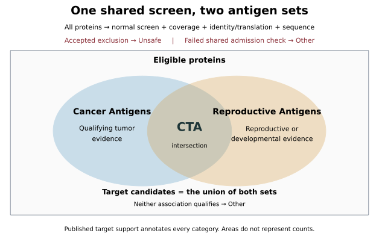

# Shared screen and antigen sets

**CTA = Cancer Antigens ∩ Reproductive Antigens.** Their union is **Target
candidates**. Both sets require the same normal-expression, coverage, translation
and sequence checks.

The [full next-policy definition](target-selection.md) gives the exact thresholds,
source requirements, API and paper roles. The evaluator is implemented; the catalog
rebuild is pending. The [released catalog](cta-selection.md) retains its prior
policy and counts.

| Evidence | Role |
|---|---|
| Accepted normal-tissue or applicable clinical exclusion | Establishes Unsafe, regardless of other evidence |
| Complete shared eligibility checks | Required for both antigen sets; not being Unsafe alone is insufficient |
| Qualifying tumor evidence | Establishes Cancer Antigen membership after the shared screen |
| Reproductive or developmental association | Establishes Reproductive Antigen membership after the shared screen |
| Curated published target nomination | Additional supporting evidence, with the exact protein–paper claim retained |
| Reproductive concentration | Descriptive measurement under the next policy |

Reproductive includes adult reproductive, placental, extraembryonic, embryonic
and fetal contexts. Neither publication nor a high tumor value overrides a normal
exclusion. An unassessed association remains visible; missing required normal
coverage blocks both memberships.

Proteins with identical selected reference sequences are counted together, with
every member locus retained. This is not an inventory of all alternative isoforms
or modified proteoforms. Human evidence does not transfer to another species
through orthology.
