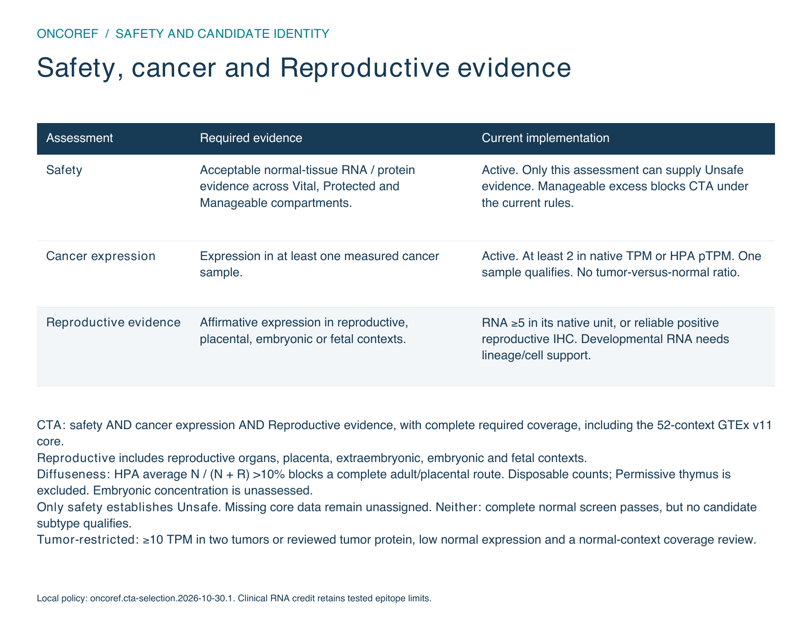

# Safety and CTA identity

**Only normal-tissue risk evidence can make a protein Unsafe.** CTA admission also
requires cancer expression, Reproductive evidence and adequate coverage.



[One-page PDF](images/cta-evidence-axes.pdf) · [Actual thresholds](cta-selection.md)

## Current decision logic

```text
Qualifying normal-tissue or applicable clinical safety exclusion -> Unsafe

Acceptable safety AND one qualifying cancer sample
AND a qualifying Reproductive route after concentration assessment
AND complete required coverage -> CTA

Otherwise: supported tumor restriction and normal coverage review -> Tumor-restricted
Otherwise: complete normal screen passes -> Neither
Remaining missing normal evidence or normal-screen holds -> unassigned
```

Reproductive means reproductive, placental, extraembryonic, embryonic and fetal.
Named branches retain anatomical and developmental precision. The current measured
routes are HPA adult/placental RNA ≥5 nTPM, reliable positive reproductive IHC,
or supported Tyser/Petropoulos embryonic
lineage mean ≥5 TPM (≥20 cells, ≥5 positive cells, ≥10% positive at ≥1 TPM).
The current inputs do not cover every fetal stage.

Cancer requires one sample ≥2 TPM or HPA pTPM, without a normal-expression ratio.
This establishes qualifying RNA, not necessarily translated protein, presentation
or expression in a specified fraction of patients.

Required coverage includes the fixed [GTEx v11](https://gtexportal.org/home/downloads/adult-gtex)
52-context bulk panel, every member locus, plus the existing normal bulk/cell/immune
panels. Optional DICE/cornea absence does not block admission; observed counterevidence
still counts. A missing measurement never becomes zero.

## Safety remains an independent assessment

Vital/Protected above-ceiling RNA or qualifying protein evidence can establish
Unsafe. Manageable excess blocks CTA without automatically establishing Unsafe.
Negative IHC adjusts the RNA ceiling only with the required antibody and local-cell
coverage. Missing or unrelated staining is not negative evidence. The exact numeric
rules remain in the [current policy table](cta-selection.md#uniform-human-rules).

Reviewed TCR-T clinical experience can add one RNA ladder step, capped at the
Enhanced-negative ceiling. It does not change the IHC grade or any cancer,
Reproductive, coverage or diffuseness criterion. The exact epitope/HLA/product
limitations and serious-event attribution remain attached to the protein-level
credit. [Clinical evidence and SAE review](audits/cta-tcr-trials-20261029/index.md).

## Profile concentration

The old rule requiring a Reproductive value above the highest normal measurement
has been removed. A single normal outlier should not define whether a protein is
diffuse. The score averages `N / (N + R)` over a fixed anatomy-weighted
normal panel, including Disposable tissues. N is that tissue's RNA; R is the source's
Reproductive reference. It is **not a percentage of tissues**.

The **HPA v23 >10% boundary is active** for completely measured adult/placental
profiles with a positive RNA reference and a qualifying RNA or IHC association.
RNA-only association still requires 5 nTPM. A zero RNA reference leaves concentration
unassessed even when IHC qualifies. Disposable tissues count;
**Permissive thymus is excluded from both the comparator and the reference**.
The fixed panel is 38 contexts / 29 anatomy units. A failed route with no other
qualifying Reproductive route and clear safety becomes Neither. MTCP1 moves to
Neither (24.53%). Independent Unsafe assignments do not change.

A weak adult reference does not decide embryonic identity. Supported embryonic
routes remain eligible with concentration explicitly unassessed until compatible
developmental/adult data exist. Missing HPA comparisons remain unassessed; the
GTEx core remains mandatory. [Method and measured impacts](audits/cta-unassigned-20261029/diffuseness-impact.md).

MAGE-A4, NY-ESO-1, PRAME, CTAG2 and XAGE1A/B retain CTA classification and GTEx
coverage. Removing the old maximum veto alone would admit TGIF2-RAB5IF and ATF7-NPFF;
both lack the required GTEx core and remain unassigned for that explicit reason.

All entries called **Proteins** collapse identical selected reference sequences;
originating loci remain listed. This is not a catalog of every alternative isoform
or modified proteoform. Human measurements and thresholds do not transfer to dog
or mouse through orthology.
