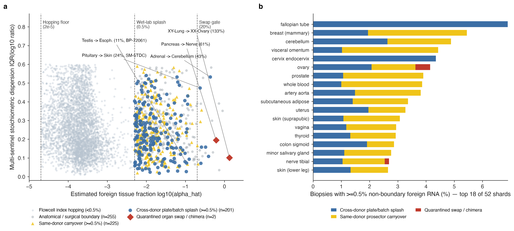
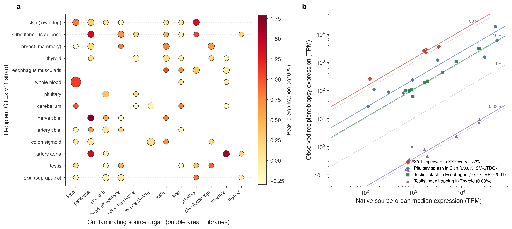
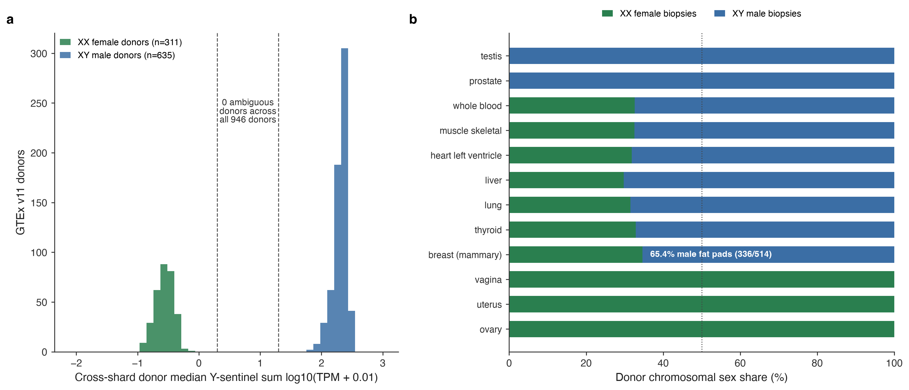
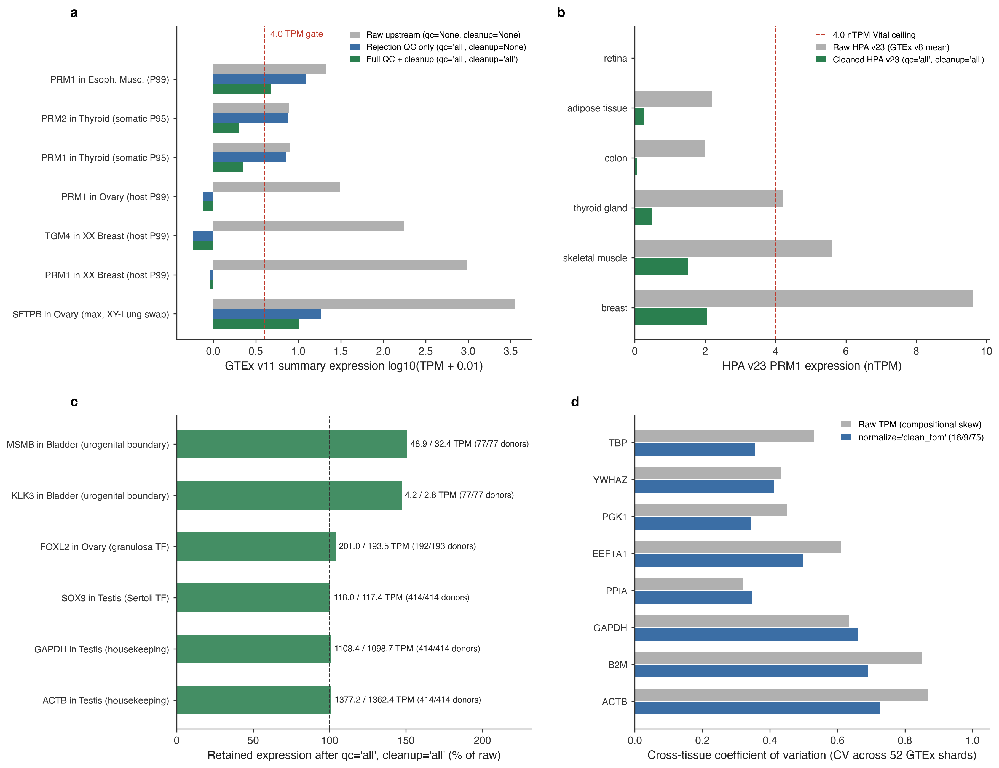
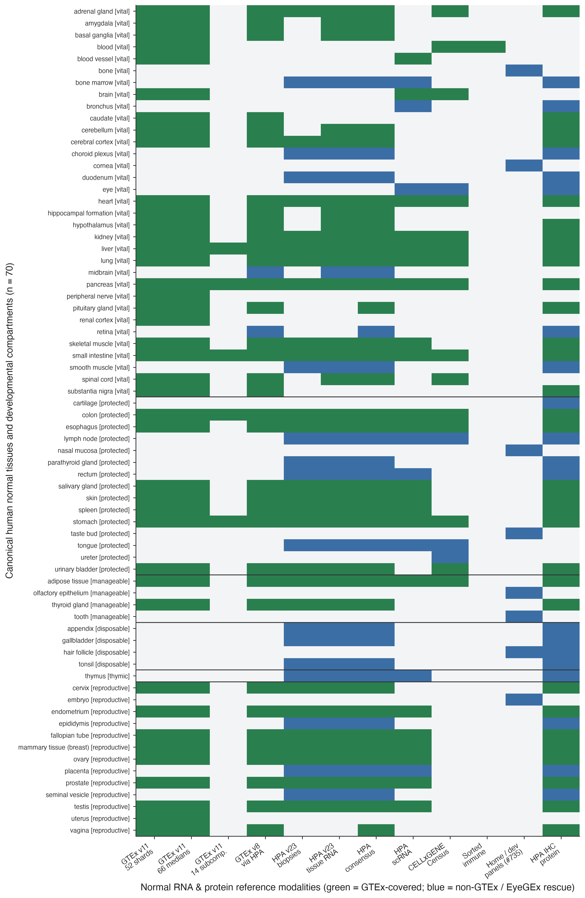

# GTEx Reference, QC, & Holistic Deconvolution

`oncoref.gtex` is the unified, version- and provider-agnostic interface for loading, rejecting, deconvolving, renormalizing, and caching Genotype-Tissue Expression (**GTEx**) normal human RNA-seq matrices across direct upstream releases (`v11`, `v10`, `v8`) and Human Protein Atlas redistributions (`HPA v23`).

Shared dataset-agnostic bulk primitives (`expand_ops` alias expansion, thread-safe Parquet caching, `NaN`-safe coordinate-descent `NNLS` mixture solving, and `scipy`-free Lentz `betainc` Harrell-Davis quantiles) live in **`oncoref.bulk_qc`**, while GTEx-specific provenance, topology, loaders, and figures live in the **`oncoref.gtex`** subpackage (`oncoref.gtex.spec`, `oncoref.gtex.deconvolution`, `oncoref.gtex.loaders`, `oncoref.gtex.plots`).

[Dated audit & downloadable tables](audits/gtex-holistic-deconvolution-20261124/index.md) · [Before/after evaluation CSV](audits/gtex-holistic-deconvolution-20261124/evaluation-before-after.csv) · [HPA v8 PRM1 cleanup CSV](audits/gtex-holistic-deconvolution-20261124/hpa-gtex-v8-prm1-cleanup.csv) · [Negative-control retention CSV](audits/gtex-holistic-deconvolution-20261124/negative-controls-retention.csv) · [Clean-TPM housekeeping CV CSV](audits/gtex-holistic-deconvolution-20261124/clean-tpm-housekeeping-cv.csv)

---

## 1. Supported Releases, Granularities, & Providers

| Provider | Release | Granularity | Columns / Shards | Upstream Statistic | Key Distinctions |
| :--- | :--- | :--- | :--- | :--- | :--- |
| `provider="direct"` | **`v11`** *(default)* | Per-sample shards (`sample_tpm`, `tissue_summary`) & donor medians (`tissue_rna`) | **52** primary biopsy shards (`18,637` libraries, `946` donors) + **14** histological sub-compartment medians + **2** cell lines (`68` median columns) | Individual library `TPM` or donor `median` / `p95` / `p99` / `host_exposure` | GENCODE v47; supports donor chromosomal sex filtering (`sex="XX"` / `"XY"`), tube-swap quarantine, `NaN` splash masking, hopping subtraction, & NNLS Harrell-Davis quantiles |
| `provider="direct"` | **`v10`** | Donor medians (`tissue_rna`, `tissue_summary(stat="median")`) | 54 tissue/cell columns | Donor `median` `TPM` | GENCODE v39 |
| `provider="direct"` | **`v8`** | Donor medians (`tissue_rna`, `tissue_summary(stat="median")`) | 54 tissue/cell columns | Donor `median` `TPM` | GENCODE v26 (2017 release) |
| `provider="hpa"` | **`v23`** | Tissue summaries (`tissue_rna`, `tissue_summary`) | 40 tissues & brain regions (`rna_tissue_gtex` + `rna_brain_gtex`), including **`retina` (EyeGEx)** | **Arithmetic mean** `TPM` / `nTPM` / `pTPM` | Redistributes uncleaned 2017 GTEx v8; 0% breakdown point means a single testis splash inflates tissue means (`PRM1 = 9.6 nTPM` in `breast`, `5.6 nTPM` in `skeletal muscle`); pass `hpa_unique_tissues_only=True` to isolate `retina` |

---

## 2. Three Orthogonal Processing Axes: `qc`, `cleanup`, & `normalize`

Every loader (`gtex.sample_tpm`, `gtex.tissue_rna`, `gtex.tissue_summary`) executes in strict **`qc → cleanup → normalize`** order and hashes the resolved `GtexSpec` + upstream file SHA-256 digests into a deterministic Parquet cache key under `<cache_base_dir>/derived/gtex/`:

| Kwarg | Scientific Role | Atomic Operations & `"all"` Alias | Physical Invariant |
| :--- | :--- | :--- | :--- |
| **`qc=`** | Sample / cell **rejection** | `ALL_QC = ("cell_lines", "swaps", "splash")`; `QC_ALIASES["all"] == frozenset(ALL_QC)` | Drops *in vitro* EBV/fibroblast cell lines (`"cell_lines"`), drops quarantined foreign-organ swaps/chimeras (`"swaps"`), and `NaN`-masks positive cells materially corrupted by `≥0.5%` splash or opposite-sex bleed (`bleed ≥ 0.15 TPM` and `≥ 20%` of observed `TPM`). **Never alters surviving observed numbers and never masks `0.0` zeros.** |
| **`cleanup=`** | Continuous **TPM & quantile estimation** | `ALL_CLEANUP = ("index_hopping", "deconvolution")`; `CLEANUP_ALIASES["all"] == frozenset(ALL_CLEANUP)` | Subtracts stoichiometric patterned-flowcell lane bleed (`2×10⁻⁵ .. 5×10⁻³` via conservative 25th-percentile anchor ratios, deduplicated per source lineage family) and applies 52-shard `NNLS` shadow-source suppression + purity-weighted Harrell-Davis Beta donor quantiles. |
| **`normalize=`** | Cross-cohort **scale renormalization** | `None` *(native `TPM`/`nTPM`)* or `"clean_tpm"` | Applies 16% ribosomal / 9% technical / 75% biological `normalization.clean_tpm` **after** `qc` and `cleanup`, preserving `NaN` splash masks. |

`"all"` is a pure alias in `gtex.QC_ALIASES` and `gtex.CLEANUP_ALIASES`: passing `qc="all"` produces the exact same `GtexSpec`, `hash()`, and Parquet cache key as `qc=["cell_lines", "swaps", "splash"]`.

---

## 3. Diagnostic Landscape of Contamination Across 18,637 GTEx v11 Libraries

### 3.1 Physical Separation of Swaps, Wet-Lab Splashes, Carryover, Boundaries, & Index Hopping



**Figure 1.** **(a)** Joint distribution of estimated foreign organ fraction `log10(α̂)` and multi-sentinel stoichiometric dispersion `IQR(log10(Y_g / μ_{S,g}))` across co-detected organ-specific anchor panels (`min_sentinels ≥ 3`, `185` lineage-disjoint anchors across `25` organ archetypes, reconciled with a `342`-gene 52-shard `NNLS` mixture). Vertical dashed boundaries separate patterned-flowcell index hopping (`2×10⁻⁵ – 5×10⁻³`), cross-donor 96-well plate / extraction-batch splashes (`≥0.5%`, `n = 201`), same-donor autopsy carryover (`n = 225`), and globally quarantined swaps/chimeras (`n = 2`: `GTEX-1GZHY-2426-SM-9JGGK` `XY`-Lung in `XX`-Ovary at `133.5%`; `GTEX-11GS4-2826-SM-5HL56` Pancreas in Tibial Nerve at `60.9%`). **(b)** Top 18 of 52 GTEx v11 primary shards ranked by prevalence of `≥0.5%` non-boundary foreign RNA.

### 3.2 Cross-Donor Wet-Lab Splash Matrix & Multi-Gene Stoichiometric Linearity



**Figure 2.** **(a)** Source organ × recipient shard bubble matrix of verified cross-donor wet-lab splashes and swaps (`plate_pipetting_splash` + `tube_swap`), requiring exact-organ cross-donor `SM-XXXX` 96-well co-plating (without same-donor co-plating), verified cross-donor `SMNABTCH`/`SMGEBTCH` batch sharing, or chromosomal sex (`XX` vs `XY`) impossibility. Intravascular `whole_blood` perfusion and contiguous surgical dissection planes (`prostate → bladder`, `gastrocnemius → tibial nerve`, `coronary/aorta ↔ myocardium/lung`, `cardia → stomach`) are strictly separated as `anatomical_boundary` (`0` false-positive blood splashes). **(b)** Multi-gene stoichiometric proportionality (`Y_{b,g} ≈ α̂ · μ_{S,g}` across `3–10` independent lineage anchors per organ) spanning four orders of magnitude from `133%` chimera swap down to `0.03%` flowcell index hopping.

### 3.3 Chromosomal Sex (`XX` vs `XY`) & Male-Cadaver Mammary Bias



**Figure 3.** **(a)** Cross-shard median Y-chromosome sentinel expression (`RPS4Y1 + DDX3Y + UTY + KDM5D`) across all `946` GTEx v11 donors separates `311 XX` female (`≤ 2 TPM`) and `635 XY` male (`≥ 20 TPM`) donors with **zero ambiguous donors**, preventing single-biopsy male splashes (`8–96 TPM` Y-RNA in individual `XX` libraries) from misclassifying donor sex. **(b)** Donor sex composition across representative shards: `Breast_Mammary_Tissue` is **65.4% male cadaver fat pads** (`336 XY` vs `178 XX`), explaining why unstratified bulk mammary summaries leak male autopsy testis splash (`PRM1` up to `961.6 TPM`, `TGM4` up to `176.7 TPM`) into female antigen screens unless filtered via `sex="XX"`.

---

## 4. Quantitative Evaluation of Cleaned GTEx Data



**Figure 4.** **(a)** Direct GTEx v11 donor summaries comparing raw upstream values (`qc=None, cleanup=None`), pure rejection QC (`qc="all", cleanup=None` — zero model subtraction on surviving values), and full QC + quantitative cleanup (`qc="all", cleanup="all"`): foreign swap and splash artifacts drop by `3.7×–1,053×` across evaluated benchmarks, bringing all somatic `P95` (`PRM1`/`PRM2` in `thyroid`: `8.05/7.76 → 2.20/1.97 TPM`) and `XX` `host_exposure` (`PRM1`/`TGM4` in `XX` `breast`: `961.6/176.7 → 0.91/0.57 TPM`) summaries cleanly below the `4.0 TPM` gate. **(b)** Cleaning HPA `v23`'s arithmetic-mean GTEx v8 redistribution (`provider="hpa", qc="all", cleanup="all"`): `PRM1` drops from `9.6 nTPM` to `2.05 nTPM` in `breast`, from `5.6 nTPM` to `1.50 nTPM` in `skeletal muscle`, and from `4.2 nTPM` to `0.48 nTPM` in `thyroid gland` (clearing the `4.0 nTPM` Vital safety ceiling) while `retina` (`EyeGEx`) is preserved. **(c)** Negative-control audit confirming **zero over-correction**: `ACTB`, `GAPDH`, and Sertoli `SOX9` in `testis` retain `414/414` (`100.0%`) donors and `100%` of native `P95`, `FOXL2` in `ovary` retains `192/192` clean `XX` donors, and urogenital boundary markers `KLK3` and `MSMB` in `bladder` remain `100%` unsubtracted. **(d)** Cross-tissue coefficient of variation (`CV`) across all 52 GTEx v11 shards for 8 canonical housekeeping genes before (`normalize=None`) vs. after `normalize="clean_tpm"`, removing 16% ribosomal / 9% technical compartment skew (mtDNA, rRNA, NUMT, and polyA-bias structural ncRNA) and lowering cross-tissue `CV` in 6 of 8 housekeeping genes (up to `32.7%` in `TBP`, mean `CV` `0.59 → 0.50`).

---

## 5. Comprehensive Human Tissue × Normal Source Coverage Grid



**Figure 5.** Canonical coverage across `70` human normal tissues and reproductive/embryonic compartments (`gtex.coverage_grid()` / `human.tissue_source_grid()`) across `12` normal source columns, ordered by clinical safety tier (`Vital`, `Protected`, `Manageable`, `Disposable`, `Thymic`, `Reproductive`). Green cells denote tissues covered by GTEx v11 primary shards; blue cells highlight compartments absent from GTEx v11 shards (`retina` via EyeGEx, `placenta`, `cornea`, `olfactory epithelium`, `nasal mucosa`, `taste bud`, `tooth`, `bone`, `cartilage`, `hair follicle`, `lymph node`, `tonsil`, `appendix`, `gallbladder`, `thymus`, `embryo`) that are rescued by orthogonal HPA surgical biopsies, scRNA, CELLxGENE Census, sorted immune panels, `#735` specialized home panels, and HPA IHC.

---

## 6. Quick Reference API

```python
from oncoref import gtex

# 1. Inspect available releases, tissues (52 shards + 14 v11 subcompartments), and source coverage grid
gtex.versions("direct", granularity="medians")   # ('v11', 'v10', 'v8')
gtex.versions("direct", granularity="samples")   # ('v11',)
gtex.versions("hpa")                             # ('v23',)
gtex.tissues("v11", include_subcompartments=True)
gtex.coverage_grid(missing_from_gtex=True)

# 2. Untouched upstream GCT / HPA table
raw_v11 = gtex.tissue_rna("v11", qc=None, cleanup=None)

# 3. Conservative rejection-only QC (drops cell lines & swaps, NaN-masks splashes; 0 subtraction!)
qc_only = gtex.sample_tpm("breast_mammary_tissue", qc="all", cleanup=None, sex="XX")

# 4. Full QC + quantitative cleanup + 16/9/75 clean-TPM renormalization (cached to Parquet)
clean_p95 = gtex.tissue_summary(
    version="v11",
    stat="p95",               # "median" | "p95" | "p99" | "max" | "host_exposure"
    qc="all",                 # alias for ("cell_lines", "swaps", "splash")
    cleanup="all",            # alias for ("index_hopping", "deconvolution")
    normalize="clean_tpm",
)

# 5. Inspect or clear materialized derived Parquet caches
gtex.cached_specs()
gtex.clear_derived_cache()
```

---

## 7. Harmonized Bulk `(qc=, cleanup=, normalize=)` Across Human Normal, Non-Human Species, & Tumor Cohorts

The same three-axis algebra in `oncoref.bulk_qc` (`qc=` sample/cell rejection, `cleanup=` continuous background subtraction & NNLS mixture adjustment, `normalize=` `None | "clean_tpm"`) and `"all"` alias contract extend across all bulk RNA loaders in `oncoref`:

| Bulk surface | `qc=` (`"all"` alias) | `cleanup=` (`"all"` alias) | `normalize=` | Key biological guardrails |
| :--- | :--- | :--- | :--- | :--- |
| **`oncoref.gtex`** (`tissue_summary`, `sample_tpm`, `tissue_rna`) | `("cell_lines", "swaps", "splash")` | `("index_hopping", "deconvolution")` | `None` or `"clean_tpm"` | Preserves anatomical urogenital/gastric boundary zones (`MSMB`/`KLK3` in bladder) and `100%` of endogenous `ACTB`/`GAPDH`/`SOX9` testis donors. |
| **HPA normal bulk** (`human_protein_atlas.rna_consensus`, `rna_tissue_hpa`) | `("duplicate_gtex_tissues", "splash")` | `("index_hopping", "deconvolution")` | `None` or `"clean_tpm"` (`TPM` tables) | `duplicate_gtex_tissues` drops HPA's `rna_tissue_gtex` duplicate tissues while retaining unique HPA surgical tissues (`placenta`, `choroid plexus`, `appendix`, `lymph node`, `thymus`, etc.) and EyeGEx `retina`. |
| **Sorted immune bulk** (`human_protein_atlas.immune_cells`) | `("ex_vivo_stimulated", "low_purity_sort")` | `("sort_carryover", "index_hopping")` | `None` or `"clean_tpm"` (`TPM` tables) | Drops *ex vivo* activated libraries, unfractionated mixtures (`total PBMC`), and `>= 4%` platelet sort failures while subtracting platelet (`PPBP`, `PF4`, `GP9`, `ITGA2B`, `TUBB1`, `GP1BA`) and reticulocyte (`HBB`, `HBA2`, `HBA1`, `HBD`, `ALAS2`, `SLC4A1`) carryover without discarding FACS-sorted B-cell subsets or touching monocyte `NRGN`. |
| **HPA tissue scRNA** (`human_protein_atlas.single_cell_tissues`) | `("misannotated_erythroid",)` | `("ambient_soup",)` | `None` | Drops misannotated hemoglobin-dominated clusters (`breast c-24`, `HBB = 597,120 nTPM`) and subtracts within-tissue parenchymal droplet soup (`>= 50,000 nTPM` dominators) from co-captured immune/stromal/adipocyte clusters. |
| **Non-human species** (`ExpressionDataset.process`, `barkbase.read`, `bgee_*.read`, `pfizer_canine_rna.read`, `doga.read`, `gse304066.read`, `species_expression.read_species_expression`) | `("pooled_libraries", "broad_background", "swaps", "splash")` | `("index_hopping", "deconvolution")` | `None` or `"clean_tpm"` | Derives organ panels strictly from within-dataset species-native medians (zero cross-species borrowing) and records explicit `MeasurementTransform` provenance on `ExpressionContract`. |
| **Bulk tumor cohorts** (`source_matrices.read`, `library_qc.apply_tumor_bulk_spec`) | `("broad_background", "unrelated_tissues", "normal_swaps")` | `("index_hopping", "adjacent_normal_stroma")` | `None` or `"clean_tpm"` | **Reproductive / CTA / oncofetal programs are strictly protected**: coordinated testis RNA (`library_qc` Note `R`) never rejects a tumor library, and CTA/reproductive genes are never subtracted during tumor `cleanup`. |

