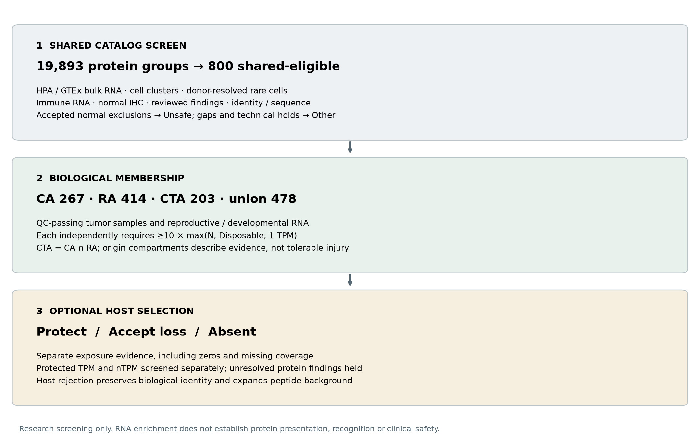

# oncoref

`oncoref` is the empirical reference layer for cancer genomics and antigen curation:
cancer-type ontology, RNA-seq cohorts, clean-TPM normalization, tumor mutational burden
(TMB), checkpoint-inhibitor (ICI) response, normal-tissue injury tiers, and genome-wide
Cancer and Reproductive Antigen (`CA`, `RA`, `CTA`) classification.

[Current antigen policy](target-selection.md) ·
[Host profiles & candidate filters](target-filters.md) ·
[CLI & curation build](curation.md) ·
[Antigen sets & peptide subtraction](antigen-sequences.md) ·
[Normal-tissue tier ontology](tissue-tiers.md) ·
[API guide](api.md)

## Current Antigen Curation Architecture

Across **19,893** human protein groups (**20,099** Ensembl 115 coding loci), the
[rebuilt catalog](audits/target-selection-20261110/rebuild/index.md)
classifies **203 CTA, 64 Cancer Antigen only, 211 Reproductive Antigen only, 1,162 Other and
18,253 Unsafe**:

1. **Shared normal-expression screen:** Seven normal-expression layers
   (HPA v23 individual biopsies & bulk, individual GTEx v11 tissue samples, HPA single-cell clusters, DICE/Monaco/HPA
   sorted immune subsets, donor-resolved CELLxGENE + Siletti single-cell UMI, HPA IHC,
   912-protein literature rubric, and adult cornea scRNA) mark **18,253** proteins `Unsafe`,
   while coverage, translation, sequence-containment, and expression-bound checks hold
   additional proteins in `Other`.
2. **Symmetric 10× compartment enrichment:** Against the shared
   somatic baseline **H₀ = max(Normal N, Disposable D, 1 TPM)**, Cancer Antigens (CA)
   and Reproductive Antigens (RA) independently require **≥ 10 × H₀** in QC-passing
   tumors or reproductive/embryonic samples. Their intersection is the default broad **CTA** set.
3. **Host selection:** Protect / Accept loss / Absent are explicit choices. Anatomy
   presets protect no reproductive tissue by default; protection is opt-in.
   Missing evidence for explicitly protected tissue remains unresolved;
   a host rejection does not relabel a CTA. [Contract and limits](host-selection.md).



[Interactive protein explorer](audits/target-selection-20261110/rebuild/report.html) ·
[Curation figures & funnels](audits/target-selection-20261110/rebuild/summary.md) ·
[Filter & host-profile report](audits/target-filters-20261112/report.html) ·
[Donor-level rare-cell RNA](audits/normal-cell-atlas-20261110/rare-cell/index.md) ·
[Release 1.42.0 notes](cta-release-1.42.0.md)

## Install & Quick Start

```bash
pip install oncoref
```

```python
from oncoref import antigen_sets, cancer_ontology, ici_response, target_filters

# Biological selection and a consistent view of decisions
selection = antigen_sets.select("CTA", mode="standard")
ctas = selection.proteins()
decisions = selection.decisions()
forbidden_bg = antigen_sets.proteins("Unsafe|Other")

# Cancer ontology and ICI response
crc_msi = cancer_ontology.cancer_type_records(subtype_group="MSI", under="CRC")
ici_response.best_available_ici_response("COAD_MSI")
```

## Stack Boundary

- **oncoref**: empirical base facts, source-linked curation, and canonical identifiers
  (cancer codes, Ensembl gene IDs, reference expression/normalization, epidemiology, TMB,
  ICI response, tissue-injury tiers, and `CA` / `RA` / `CTA` / `Unsafe` classifications).
- [**pirlygenes**](https://github.com/pirl-unc/pirlygenes): purpose-specific curated gene
  panels (lineage, TME, surfaceome, therapy signatures) keyed to `oncoref` IDs.
- [**trufflepig**](https://github.com/pirl-unc/trufflepig): per-sample QC narration,
  deconvolution, scoring, and sample-level interpretation rules.

## Start Here

- **Antigen sets and host choices:** Start with
  [Cancer and Reproductive Antigens](target-selection.md),
  [Target filters and host profiles](target-filters.md),
  [CLI and curation builds](curation.md), and
  [Antigen sequences & peptide subtraction](antigen-sequences.md).
- **Normal-tissue injury tiers (`Vital`, `Protected`, `Manageable`, `Disposable`):**
  See [Normal-tissue tier ontology](tissue-tiers.md).
- **Cancer vocabulary, subtypes, and cohorts:** Start with
  [Cancer Vocabulary](api.md#cancer-vocabulary).
- **Expression matrices and clean-TPM normalization:** Start with
  [Expression And Normalization](api.md#expression-and-normalization).
- **Anti-PD-1 / checkpoint-inhibitor response and TMB:** Start with
  [ICI Response](api.md#ici-response).

## Data Domains

| Domain | Preferred modules | Use for |
| --- | --- | --- |
| Current antigen curation | `oncoref.target_selection`, `oncoref.target_filters`, `oncoref.antigen_sets`, `oncoref.peptide_subtraction` | Genome-wide `CA`, `RA`, `CTA`, `Other`, `Unsafe` decisions, biological origins and explicit host tissue-loss choices, Ensembl 115 sequences, exact/edit-distance peptide subtraction |
| Tissue-loss tiers | `oncoref.tissue_tiers`, `oncoref.target_curation` | Cited bulk and cell-level tissue injury tiers (`Vital`, `Protected`, `Manageable`, `Disposable`), acute/persistent loss consequences, literature & nose/skin home records |
| Cancer vocabulary | `oncoref.cancer_ontology`, `oncoref.cohorts` | Registry records, aliases, hierarchy, subtype axes, MMR/MSI status, cohort IDs, matched normal tissues |
| Expression & QC | `oncoref.expression`, `oncoref.normalization`, `oncoref.library_qc`, `oncoref.samples` | Source-matrix ingestion, percentiles, clean TPM, housekeeping normalization, library-contamination screens, patient/donor deduplication |
| Burden & ICI response | `oncoref.ici_response`, `oncoref.tmb`, `oncoref.incidence`, `oncoref.fusions` | Anti-PD-1 and broader ICI response estimates, TMB, incidence/mortality, defining fusions |
| Genes, species & cache | `oncoref.gene_matching`, `oncoref.gene_ids`, `oncoref.human`, `oncoref.canine`, `oncoref.catalog`, `oncoref.reference_data` | Canonical Ensembl identities, species-scoped datasets, content-addressed reference caches |
| Compatibility snapshots | `oncoref.cta_selection`, `oncoref.cta`, `oncoref.target_sets` | Frozen 1.36.0 (`607 CTA`) and earlier HPA-derived snapshots retained for historical reproducibility |

## Historical Snapshots

Earlier versioned catalogs remain pinned under their original policies without affecting
current antigen APIs: the [1.38 CTpedia & tenfold review](ctpedia-filtering.md), the
[released 1.36.0 607-CTA report](audits/cta-definition-20261104/index.md) and
[sequence bundle](sequence-bundle.md), the
[47-protein cancer-only audit](audits/cancer-only-20261109/report.html), and October 2026
exploratory funnels (available under *Historical Snapshots & Audits* in the navigation).
