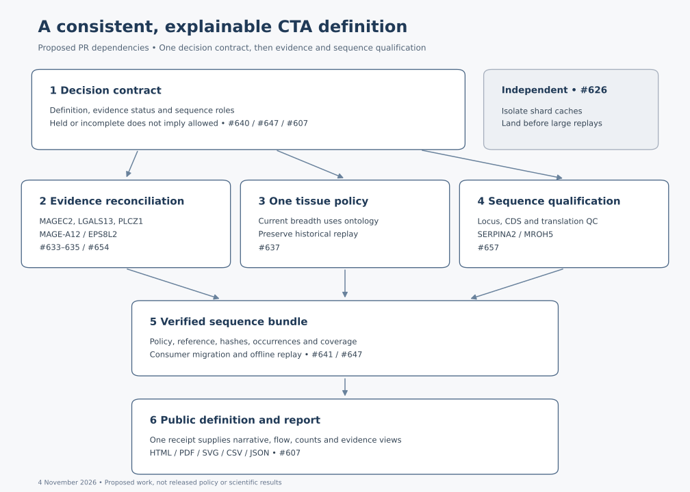

# CTA definition and release roadmap

Approved on 4 November 2026 against OncoRef 1.29.0 (`3f6d8b5`). The implementation now accompanies the coordinated 1.30.0 release. The series comprises six dependent PRs
and one independent cache PR; unresolved scientific cases require the explicit
adjudication described below.

The objective is one externally understandable definition, one versioned set of
decisions, and a reproducible explanation of how the reference universe becomes
CTA, Unsafe or Other. Evidence curation, sequence exports, documentation and
figures must implement the same contract.



## Implementation status

| Work | Pull request | Result |
|---|---|---|
| Decision contract | [#662](https://github.com/pirl-unc/oncoref/pull/662) | Merged |
| Cache isolation | [#663](https://github.com/pirl-unc/oncoref/pull/663) | Merged |
| Current and historical breadth | [#664](https://github.com/pirl-unc/oncoref/pull/664) | Merged |
| Historical findings and clinical causality | [#666](https://github.com/pirl-unc/oncoref/pull/666) | Merged |
| Translation qualification | [#667](https://github.com/pirl-unc/oncoref/pull/667) | Merged |
| Verified sequence bundle | [#668](https://github.com/pirl-unc/oncoref/pull/668) | Merged |
| Public definition and coordinated release | [#669](https://github.com/pirl-unc/oncoref/pull/669) | 1.30.0 reports and release assets |

The final policy yields **602 CTA, 18,243 Unsafe and 759 Other groups**, with
646 selected member loci. Complete and cached scientific replays are byte-identical.
The [release receipt](../audits/cta-definition-20261104/release-receipt.json)
binds the reports to their packaged data and source audits. The sections below
retain the original problem statement and acceptance criteria against 1.29.0.

The migration preserves uncertainty: MAGEC2, LGALS13 and PLCZ1 retain holds;
MAGEA12/EPS8L2 clinical attribution remains unresolved. The records identify which
sources were available only as abstracts. This completes the requested migration,
not every outstanding literature investigation. NUTM source recovery (#604/#665)
remains separate and is not represented as rebuilt in this release.

## The definition to establish

Use **OncoRef CTA candidate** as the explicitly qualified research-policy label:
a reference-resolved protein candidate with supported cancer expression and a
qualifying reproductive or developmental association, which passes the declared
normal-tissue evidence, coverage, translation and sequence-overlap requirements.
The public presentation should say **CTA and oncofetal candidate selection**,
because the current umbrella includes more than adult testicular expression.

Expose testicular, other adult reproductive, placental and embryonic/fetal support
as independent evidence routes. Multiple routes can apply. A developmental-only
route must remain visible rather than being described as adult testis restriction.
RNA support does not itself establish antigen presentation, receptor recognition
or clinical tolerability.

Keep three different questions explicit:

| Question | Output |
|---|---|
| What does the source establish? | An observation, its identity and anatomical scope, and accepted, unresolved or rejected interpretation |
| What does the named policy decide? | CTA, Unsafe or Other, all reasons, evidence status, and direct-target eligibility |
| What may a sequence consumer do? | Exclusion, review or no exclusion under the named reference policy, with translation and coverage status |

Unsafe remains a policy exclusion, not a claim of demonstrated toxicity. Other
includes both assessed noncandidates and unresolved cases, so it cannot alone
determine sequence allowance. Literature nomination is an annotation of the
reference universe, not a prerequisite or an exemption from normal evidence.

## Why the contract must come first

The 1.29.0 API contains 19,604 classified protein groups: 625 CTA, 18,351 Unsafe
and 628 Other. The Other subtypes are 550 Nonreproductive, 28 Nested, 27 Held,
19 Contained and 4 Diffuse. Within Other, **127 have incomplete evidence and eight
have a normal-evidence hold**; these statuses are not equivalent to the 27 Held
subtype assignments. `sequence_dispositions()` currently maps every Other row to
`allow`. A consumer fix must therefore inspect assessment and evidence status,
not merely the subtype name.

There are also competing descriptions of the denominator. The release reports
19,604 groups after universe qualification, whereas the public coverage metadata
still describes the 19,863-group input inventory. Both can be useful counts, but
they need different names. The current selection page also contains an old
policy identifier, 20 versus 19 Contained proteins, and a historical assertion
that all 698 earlier CTAs remain retained. These are reasons to generate current
prose and counts from one receipt.

MAGEC2, LGALS13 and PLCZ1 are CTA in the current API, while the historical findings
ledger retains unresolved records and the current `gene_knowledge` lookup has no
records for them. That is an evidence-migration question; it does not predetermine
an Unsafe conclusion. The old breadth panel also assigns skin, spleen and thymus
to Manageable, while the new functional-hazard registry assigns them Protected.

## PR sequence

### PR 1 — Define decisions, uncertainty and sequence roles

Issues: [#640](https://github.com/pirl-unc/oncoref/issues/640),
[#647](https://github.com/pirl-unc/oncoref/issues/647), and the current-policy
accounting portion of [#607](https://github.com/pirl-unc/oncoref/issues/607).

Establish the definition above, a stable gate inventory, explicit input and
qualified-universe counts, and a truth table for direct targeting and sequence
roles. Keep observations, adjudication status and policy consequences separate.
An accepted review can conclude that evidence remains unresolved; it must not
be encoded as an accepted positive observation merely to fit a schema.

Proposed role precedence:

1. An applicable Unsafe occurrence supplies exclusion evidence, even when the
   same sequence also has a CTA occurrence. Retain every contributing reason.
2. Unresolved normal evidence, insufficient required coverage, unresolved identity
   or unsupported translation requires review. A different Other subtype cannot
   erase that status. Missing sequence bytes remain an explicit coverage gap.
3. An adequately assessed Other record supplies no exclusion under this policy.
   This is not an assertion of absent normal expression or complete coverage.
4. A CTA record is a direct-target candidate only within its qualified sequence
   scope. It does not exempt shared sequence from other occurrences' exclusions.

Define the scope of exact subtraction and approximate near-self screening
explicitly. OncoRef supplies reference facts and roles; patient-HLA prediction,
similarity thresholds and downstream intervention decisions remain consumer policy.
No blanket legacy CTA exemption or second historical IHC filter may silently
replace the declared reference scope.

**Done when:** the status/role truth table is executable; all 1.29 Other records
are accounted for; decision and role deltas are published separately; category
totals reproduce the pinned baseline; current API/doc denominator and policy
labels agree. Do not recalibrate numerical expression thresholds in this PR.

### PR 2 — Reconcile historical findings and clinical counterevidence

Issues: [#633](https://github.com/pirl-unc/oncoref/issues/633),
[#634](https://github.com/pirl-unc/oncoref/issues/634),
[#635](https://github.com/pirl-unc/oncoref/issues/635),
[#654](https://github.com/pirl-unc/oncoref/issues/654). Depends on PR 1.

Give every relevant historical finding an explicit migration disposition:
retained, revised, superseded with a linked replacement, rejected with rationale,
or unresolved. Preserve the original finding and prior policy decision. Inventory
the wider historical ledger for omissions as part of this migration; do not claim
that this completes the full literature review in #636 or #638.

Adjudicate the MAGEC2 reagent/cerebellar conflict, LGALS13 galectin and adult-tissue
identity conflict, and PLCZ1 pancreatic RNA/isoform question. Preserve the earlier
rejection of the claimed PLCZ1 protein evidence: CFTR staining is not PLCZ1 staining.

For MAGE-A12, curate the original neurological-injury report and the later EPS8L2
re-examination together. Distinguish observed injury, receptor/peptide/HLA identity,
competing causal explanations and the gene-level policy consequence. Preserve the
independent rare-cell finding even if the clinical attribution changes.

**Done when:** the public finding API and per-candidate audit expose each case's
sources, reviewed portions, limitations, status and current effect; no unresolved
material finding disappears through migration; all category, role and sequence-
background changes are reported. Full-text availability and unresolved controls
are explicit. No gene-specific thresholds or required final categories.

### PR 3 — Align current breadth with the tissue ontology

Issue: [#637](https://github.com/pirl-unc/oncoref/issues/637). Depends on PR 1;
can be developed alongside PR 2.

Make the current bulk breadth panel resolve tiers through `tissue_hazards` and
retain a named historical panel for the 26 October replay. Version anatomy,
weights, ceilings and source identity together. Bulk measurements retain bulk
tiers; a cell-specific exception cannot lower an organ-level observation.

Keep the descriptive normal burden `sum(w * x / (x + L))` separate from the
existing reproductive concentration score `mean(N / (N + R))`. The first must
not improve when reproductive expression rises. Neither their meanings nor their
thresholds should be merged by sharing a convenient function.

**Done when:** current tiers match the registry; historical outputs reproduce;
weight conservation, missing-coverage bounds, donor independence, duplicate-study
handling and native units remain correct. Publish before/after profiles and
weight sensitivity. This descriptive update must not introduce an admission
cutoff or change membership by itself.

### PR 4 — Qualify the protein universe and translation records

Issue: [#657](https://github.com/pirl-unc/oncoref/issues/657). Depends on PR 1;
the final replay incorporates PRs 2 and 3.

Separate gene mapping, annotated CDS presence, translation completeness, primary
versus alternate locus, protein-equivalence grouping and experimental ncORF
support. Resolve SERPINA2 and MROH5 through general rules for `protein_coding_LoF`,
partial, ambiguous, NMD and alternate-locus records. An annotated FASTA entry is
not sufficient proof of a complete translation. An alternate locus cannot
silently replace the questioned primary locus.

Define which defects remove a record from the target universe and which retain a
record with sequence review required. Failed target qualification never establishes
Unsafe. Conversely, a record unsuitable for targeting may still contribute valid
normal-reference sequence evidence; do not discard its original sequence or
source occurrence merely because it is not a usable direct target.

**Done when:** every sequence has reproducible status and provenance; every
excluded/unresolved record has a reason; all member loci and isoforms remain
traceable; SERPINA2's current CTA status and MROH5's current Unsafe status have
explicit sequence-level consequences. Report counts of loci, transcripts,
sequence occurrences and exact-sequence groups separately.

### PR 5 — Ship the verified sequence bundle and migration API

Issues: [#641](https://github.com/pirl-unc/oncoref/issues/641), with the remaining
consumer migration in #640 and #647. Depends on PRs 1–4.

Provide one public loader for the selected current policy/reference pair, including
qualified target records, exclusion records, review records and explicit coverage
gaps. Reuse the existing ORFdata reference/occurrence identity contracts. Preserve
all occurrences and evidence when identical sequences are deduplicated.

Verify policy, reference, ontology/adjudication dependencies and all consumed
artifact hashes before use or cache reuse. Preserve full original records and
coordinate-bearing valid segments; never join across ambiguity, stops or records.
Missing translations, excluded-universe records and unsupported species/reference
mappings must remain visible. Require explicit, bounded acquisition and verified
offline replay.

Publish an old/current membership and sequence-role comparison. Historical
`unsafe.fasta.gz` plus `additional-forbidden.fasta.gz` remain a named historical
product; do not silently relabel them with the current classifier's policy ID.

**Done when:** a Vaxrank/ORFdata consumer can load the supported bundle without
private manifest knowledge, rejects mixed/tampered inputs, retains all duplicate
occurrences and exclusions, distinguishes empty results from missing coverage,
and reproduces its content identity offline. Approximate matching remains clearly
identified as downstream policy, with no claimed validation from exact matching.

### PR 6 — Publish the definition and generated candidate-to-CTA report

Issue: [#607](https://github.com/pirl-unc/oncoref/issues/607) and final documentation
for the preceding PRs. Depends on PRs 1–5. Build the report skeleton in PR 1 and
refresh previews in every PR; finalize the public account here.

Produce a short narrative definition, a full rule/parameter table, glossary,
interactive HTML report, PDF, reusable SVG/PNG figures and CSV/JSON audits. Use
the existing report generators and APIs rather than another independently
maintained definition. Include these four views:

1. **Universe accounting:** source annotation and nomination coverage; identity
   resolution; eligible coding/ncORF records; excluded or unresolved records;
   exact-sequence grouping. Literature nominations are an overlay, not the whole
   denominator. No disappearing or double-counted records.
2. **Decision flow and count funnel:** normal exclusions, evidence holds,
   reproductive/developmental support, cancer presence, concentration, translation
   and sequence containment. End with CTA, Unsafe and Other, visibly separating
   assessed Other from held/incomplete cases. Show a presentation order while
   retaining all independent decisions for every entity.
3. **Independent evidence and coverage:** an overlap matrix or UpSet-style figure
   shows multiple exclusion/hold reasons, measured panels and missing coverage.
   A first-exit funnel cannot imply that later evidence was never evaluated.
4. **Worked decisions and version transitions:** trace ordinary controls and
   the named MAGEC2/LGALS13/PLCZ1/MAGEA12/SERPINA2 cases from source findings through
   tiers, decision and sequence role. Include every changed entity in the export,
   including cases with an unchanged category but changed rationale or role.

Explain that one measured cancer sample above zero establishes the current policy's
presence criterion, not therapeutic abundance. Label numerical ceilings, rare-cell
detection and sequence-containment cutoffs as research choices, and disclose
calibration examples separately from independent validation. Expose age, assay,
paralog-mapping and optional-panel limitations beside the affected decisions.

**Done when:** all figures, tables, API totals, metadata, prose and exports derive
from one release receipt; every transition balances; all findings remain available
independent of presentation order; a new reader can reproduce a candidate's
classification and explain why it differs from its sequence role. Historical
reports remain frozen and plainly labeled.

### Independent PR — Isolate shard caches

Issue: [#626](https://github.com/pirl-unc/oncoref/issues/626). Small support PR;
start immediately and land before large replays where practical. It does not
depend on or define the biological policy.

Add an explicit documented shard-cache override, retaining the existing default.
Verify actual reads/writes, corrupt-cache recovery and source changes under the
override, and that the default cache's bytes and metadata remain untouched.
No migration, pruning or shared-environment package changes. Keep #591's broader
cache-retention work outside this PR.

## Release and review discipline

Each PR carries its own concrete API/data changes, documentation and meaningful
checks. Evidence-changing PRs also publish a pinned 1.29.0-to-proposed delta and an
adjacent-PR delta. Separate definition changes, new evidence, corrected identity,
role-only changes and display-only changes; changing several together must not
hide which one caused a transition. A target count of 625 is not an acceptance
criterion.

Use the repository-local release environment and isolated caches. Keep legacy
fixtures and released artifacts reproducible. Require the classification to be
invariant to presentation order; Unsafe evidence must retain precedence; a
missing assay cannot become zero or a negative finding; no human numerical policy
may transfer to dog or mouse by symbol or anatomical similarity.

Do not publish a current sequence bundle under an older decision receipt, or a
current report describing an unreleased policy as active. The final coordinated
release requires all six PRs' acceptance criteria. The cache PR can release
independently because its acceptance condition is unchanged scientific output.

## Source locations for implementation

- [Current decision API](https://github.com/pirl-unc/oncoref/blob/v1.29.0/oncoref/cta_selection.py) and
  [classification policy](https://github.com/pirl-unc/oncoref/blob/v1.29.0/oncoref/cta_selection_policy.py).
- [Historical findings](https://github.com/pirl-unc/oncoref/blob/v1.29.0/oncoref/data/cta-policy-findings.csv),
  [current knowledge API](https://github.com/pirl-unc/oncoref/blob/v1.29.0/oncoref/gene_knowledge.py), and
  [clinical trial ledger](https://github.com/pirl-unc/oncoref/blob/v1.29.0/oncoref/data/tcr-trial-evidence.json).
- [Tissue registry](https://github.com/pirl-unc/oncoref/blob/v1.29.0/oncoref/data/normal-tissue-hazards.yaml),
  [breadth calculation](https://github.com/pirl-unc/oncoref/blob/v1.29.0/oncoref/normal_expression_breadth.py), and
  [reproductive concentration](https://github.com/pirl-unc/oncoref/blob/v1.29.0/oncoref/expression_diffuseness.py).
- [Current audit API](https://github.com/pirl-unc/oncoref/blob/v1.29.0/oncoref/cta_selection_audit.py),
  [audit generator](https://github.com/pirl-unc/oncoref/blob/v1.29.0/scripts/build_cta_selection_audit.py), and
  [current selection documentation](../cta-selection.md).

The roadmap figure is a dependency diagram, not a scientific result or a promise
of final counts. Regenerate it with
`python scripts/build_cta_definition_roadmap.py`.

## Reproducing the coordinated release

The 1.31.0 follow-up moves all 259 formerly omitted records into classification
and retains translation support as CTA admission evidence. The
[inventory audit](../audits/cta-inventory-20261105/index.md) records 247
Other:Translation and 12 Unsafe calls, with no changes to the earlier 19,604
classifications. Preliminary tumor-restriction matches now have explicit
dispositions after independent normal evidence.

Use a repository-local environment with the `quantitative` and `reports` extras,
verified source caches and an isolated `ONCOREF_SHARD_CACHE_DIR`. Run the scientific
replay only when its evidence or policy changes:

```sh
python scripts/regenerate_cta_walkthrough.py --verify-replay
python scripts/build_cta_contract_report.py
python scripts/build_cta_sequence_bundle.py SOURCE BUNDLE --release 1.31.0
python scripts/build_cta_sequence_transition.py HISTORICAL BUNDLE
python scripts/build_cta_sequence_report.py
python scripts/build_cta_public_report.py
```

`SOURCE` is the verified native ORFdata source snapshot, `BUNDLE` is the output
directory and `HISTORICAL` contains the pinned historical sequence assets. The
[sequence audit](../audits/sequence-bundle-20261104/index.md) records their identities.
The slide builder requires the documented Artifact Tool runtime through
`RUNTIME_NODE_MODULES`, `ONCOREF_PRESENTATIONS_SKILL` and `RUNTIME_PYTHON`.
Finalize presentation assets before binding the final receipts:

```sh
python scripts/render_cta_source_walkthrough.py
CTA_SLIDE_BUILD_DIR=tmp/cta-source-slides-131 node scripts/build_cta_source_slides.mjs
python scripts/slides/assemble_pdf.py tmp/cta-source-slides-131 \
  docs/audits/cta-source-walkthrough-20261028/cta-selection-1.31.0.pdf
python scripts/render_cta_source_walkthrough.py
python scripts/regenerate_cta_walkthrough.py --finalize-receipts
python scripts/build_cta_public_report.py
```

The last rendering pass updates links to the finalized deck and PDF. It does not
recalculate biological evidence. The final public report then binds those outputs
through the walkthrough receipt. Full scientific replay and cached replay must
agree before publication; presentation edits alone do not require a second full
source ingestion.
