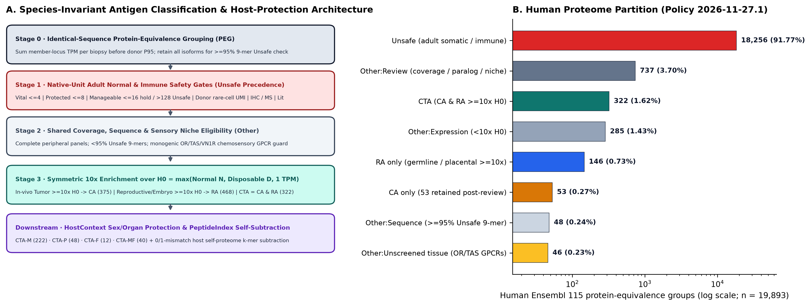
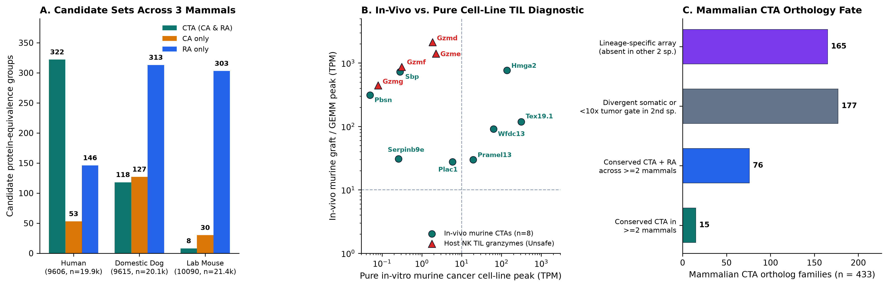
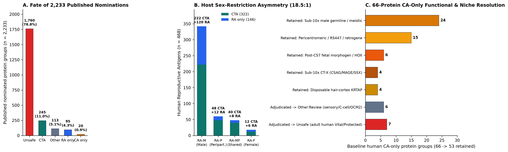
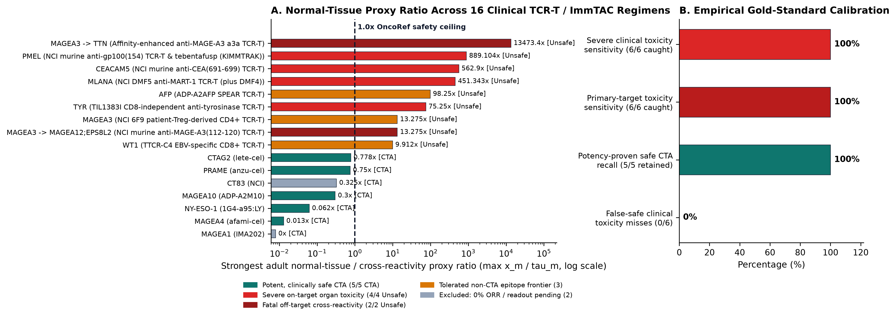
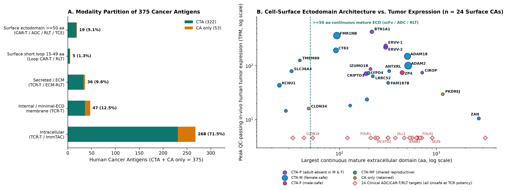

# Multi-Scale Normal-Tissue Injury Tiers and Symmetric Enrichment Reconcile Cancer–Testis Antigen Discovery Across Human, Dog, and Mouse and Map Actionable TCR-T, CAR-T, ADC, and Radioligand Modalities

*Preprint manuscript (`oncoref` policy `oncoref.target-selection.2026-11-27.1`) · [Download compiled PDF (`oncoref-antigen-preprint.pdf`)](oncoref-antigen-preprint.pdf) · [LaTeX source (`oncoref-antigen-preprint.tex`)](oncoref-antigen-preprint.tex) · [Surface & localization table (CSV)](tables/candidate-surface-topology.csv) · [66-protein `CA only` review](../audits/ca-only-functional-review-20261127/index.md)*

**Authors:** PIRL-UNC Collaborative Group (Computational Oncology & Immunogenomics, University of North Carolina at Chapel Hill)

---

## Abstract

**Background:** Cancer–testis antigens (`CTAs`) and oncofetal proteins underpin affinity-enhanced T-cell receptor therapies (`TCR-T`), bispecific T-cell engagers (`ImmTACs`), cancer vaccines, and emerging surface-targeted antibody–drug conjugates (`ADCs`), chimeric antigen receptor T cells (`CAR-T`), and radioligand therapies (`RLTs`). Yet across **149** published CTA, oncofetal, and placental studies nominating **2,233** human protein groups, gene lists conflict sharply because legacy pipelines pool incompatible expression scales, overlook rare normal neuroendocrine or sensory cell types diluted in bulk biopsies, conflate biological germline restriction with patient-specific organ expendability, and transfer human labels onto preclinical dog and mouse models by gene-symbol orthology.

**Methods:** We formulated a species-invariant, four-stage classification architecture (`OncoRef`, `oncoref.target-selection.2026-11-27.1`) that (i) collapses identical coding translations into protein-equivalence groups (`PEGs`) while retaining all splice isoforms for `≥95%` 9-mer self-overlap screening; (ii) evaluates every healthy somatic and activated-immune dataset in its own native measurement scale (`TPM`, `nTPM`, `nCPM`, donor-resolved droplet `UMI`, validated `IHC`, or plex-bleed-corrected `TMT-ppm`) across four cited clinical organ-injury tiers (`Vital`, `Protected`, `Manageable`, `Disposable`); (iii) enforces symmetric **≥10 × H₀** *in vivo* enrichment over **H₀ = max(Normal N, Disposable D, 1 TPM)** independently in tumors (`Cancer Antigens`, `CA`) and reproductive/embryonic compartments (`Reproductive Antigens`, `RA`), defining **CTA = CA ∩ RA** while segregating pure *in vitro* cancer cell lines; and (iv) routes retained candidates through host-specific sex/organ protection (`HostContext`), 0/1-mismatch `PeptideIndex` self-proteome subtraction, and coordinate-verified UniProtKB subcellular/ectodomain modality mapping.

**Results:** Across **19,893** human (`GRCh38`), **20,082** domestic dog (`CanFam3.1`), and **21,433** laboratory mouse (`GRCm39`) `PEGs`—with all **8/8** evidence pillars active natively in every species—OncoRef classifies **322 human**, **118 canine**, and **8 murine** *in vivo* `CTAs` (**96.6%**, **96.6%**, and **75.0%** with confirmed ectopic activation outside homologous source organs). Segregating pure *in vitro* cancer cell lines unmasks host `LAK`/`NK` cytolytic granzymes (`Gzmd–g`, `443–2,138 TPM` in *in vivo* grafts vs. `0.08–2.26 TPM` in pure cultured tumor cells) as tumor-infiltrating leukocyte artifacts, while only **15** of **433** mammalian `CTA` ortholog families qualify as `CTAs` across multiple species due to primate `CT-X`/`ZGA` amplification. In humans, **78.8% (`1,760 / 2,233`)** of published nominations fail modern adult somatic safety gates, whereas expression rules uncover **77** unnominated `CTAs`. Host-physiology partitioning resolves why male-restricted `CTA-M` (`222`) outnumbers female-restricted `CTA-F` (`12`) by **18.5:1** alongside **48** adult-absent pregnancy/peripartum `CTA-P` antigens (`270` female-safe vs. `60` male-safe `CTAs`). A complete primary-literature functional review of all **66** baseline `CA only` (`CA \ RA`) proteins adjudicates **7** occult adult human `Vital`/`Protected` micro-niche proteins (`GALP`, `BHLHE23`, `IL36B`, `ZACN`, `HES3`, `OCSTAMP`, `PROKR1`) to `Unsafe` and **6** sensory/C-cell/1-mismatch paralogs (`SRMS`, `OCM2`, `CIB3`, `OTOP1`, `GFRA4`, `MRGPRG`) to `Other:Review`, showing that all **53** retained `CA only` proteins arise from five concrete somatic-silent mechanisms rather than "cancer-only dark matter." Against **16** human clinical `TCR-T` and `ImmTAC` regimens, OncoRef flags **6/6 (`100%`)** severe clinical specificity toxicities as `Unsafe` while retaining **5/5 (`100%`)** potency-proven safe `CTAs`. Finally, coordinate-verified topology mapping across all **375** human `CAs` shows that **84.0% (`315`)** are intracellular (`TCR-T`/`ImmTAC` obligatory) and **9.6% (`36`)** are secreted, while **24 (`6.4%`)** expose plasma-membrane extracellular domains—including **19** with `≥50 aa` continuous mature ectodomains (`BTN1A1`, `ERVV-1`, `ERVV-2`, `CIROP`, `CRIPTO3`, `ADAM2`, `ADAM18`, `FMR1NB`, `CT83`, `ZP4`, `IZUMO1R`, `LYPD4`, `PKDREJ`) actionable for `CAR-T`, `ADC`, and `RLT` without the somatic expression liabilities carried by **24/24 (`100%`)** of conventional clinical surface benchmarks.

---

## 1. Introduction

Therapeutic targeting of tumor-associated antigens faces an unforgiving quantitative trade-off between anti-tumor potency and on-target or cross-reactive normal-tissue destruction. Affinity-enhanced `TCR-T` cells and soluble `TCR–anti-CD3` bispecifics (`ImmTACs`) recognize intracellularly processed peptides presented on major histocompatibility complex (`pMHC`) molecules at densities below `10` copies per cell, enabling durable regressions in solid tumors (`afamitresgene autoleucel` targeting `MAGEA4`, `letetresgene autoleucel` targeting `NY-ESO-1`/`CTAG2`, `IMA203` and `brenetafusp` targeting `PRAME`) [1–5]. That same single-digit-copy sensitivity caused fatal leukoencephalopathy when `MAGEA3`-directed `TCR-T` cells cross-recognized rare brain-expressed `MAGEA12` (`NCT01273181`), fatal cardiogenic shock within 4–5 days when an affinity-matured `HLA-A*01` `MAGEA3` TCR cross-reacted with striated-muscle `Titin` (`TTN`, `NCT01350401`), severe hemorrhagic colitis against colonic `CEACAM5`, and uveitis plus inner-ear cochlear hair-cell destruction (`ototoxicity`) against melanocytic `MART-1` (`MLANA`) and `gp100` (`PMEL`) [6–9].

Historically, discovery of Cancer–Testis Antigens (`CTAs`)—proteins expressed in germ cells or trophoblasts and ectopically reactivated in somatic malignancies—relied on reverse-transcription PCR panels of 12–16 whole organs (`CTDatabase` / `CTpedia`) or differential microarray/RNA-seq screens comparing tumors against bulk GTEx medians [10–14]. Compiling **149** published CTA, oncofetal, zygotic-genome-activation (`ZGA`), and cancer–placenta catalogs reveals **2,233** distinct human protein groups nominated as "cancer–testis" or "tumor-restricted." Four structural flaws explain why most historical nominations fail under clinical scrutiny:

1. **Cross-scale pooling and bulk-organ dilution:** Merging `GTEx` `TPM`, `HPA` TMM-scaled `nTPM`/`nCPM`, microarray intensities, and single-cell `CP10K` distorts thresholds, while whole-organ punches dilute `<1%` vital cell populations—such as hypothalamic arcuate neuroendocrine neurons (`GALP`), retinal bipolar interneurons (`BHLHE23`), cochlear/vestibular hair cells (`CIB3`, `OCM2`), pancreatic islets (`HES3`), and monogenic olfactory sensory neurons (`OR*`)—by `50–1,000×` below bulk cutoffs.
2. **Conflating pre-analytical sequencing artifacts with biology:** Multiplexed bulk atlases suffer flowcell index hopping and plate pipetting splash (`testis` or `pancreas` transcripts bleeding into `brain` or `heart`), droplet `snRNA-seq` captures nascent intronic readthrough from adjacent housekeeping promoters (`ARHGAP6 → AMELX`, `GAB3 → CTAG2`), and degraded FFPE tumor biopsies accumulate uniform intergenic genomic DNA (`gDNA`) that inflates intronless germline/olfactory genes.
3. **Entangling biological category definitions with host anatomy:** Labelling a prostate- or lactation-expressed protein (`SEMG2`, `CSN2`, `LALBA`) either unconditionally "safe" or unconditionally "excluded" obscures the clinical reality that host risk depends on whether the patient is male, female, pregnant, lactating, or post-organ-ablation.
4. **Orthology projection across divergent mammalian genomes:** Comparative oncology trials in outbred companion dogs and preclinical immunotherapy studies in mice routinely project human CTA symbols onto animal genomes, ignoring both lineage-specific `CT-X` retrotransposition and species differences in accessory reproductive and lymphoid anatomy.

Here we present the complete conceptual architecture, multi-species parameterization (`human`, `dog`, `mouse`), human proteome reconciliation, `CA only` functional literature review, clinical `TCR-T` calibration, and subcellular/ectodomain modality routing implemented in `OncoRef` (`v1.55+`, policy `oncoref.target-selection.2026-11-27.1`).

---

## 2. Conceptual Architecture: Data Scales, Tissue-Injury Tiers, and Set Algebra

*Figure 1.* **(A)** Species-invariant four-stage antigen screening pipeline (`Stage 0` identical-sequence `PEG` grouping through `Stage 3` symmetric `10 × H₀` enrichment) decoupled from downstream `HostContext` organ protection and `PeptideIndex` self-proteome k-mer subtraction. **(B)** Empirical attrition across all **19,893** human Ensembl 115 protein-equivalence groups (**20,099** coding loci).

### 2.1 Identical-Sequence Protein-Equivalence Grouping (`Stage 0`) and Library Integrity

Ampliconic cancer–germline families (`CTAG1A/CTAG1B` encoding `NY-ESO-1`, `MAGEA2/MAGEA2B`, `GAGE*`, `SPANX*`, `CT45A*`, `PRR20A–E`, `BPY2/B/C`) frequently duplicate coding exons with 100% amino-acid identity. Evaluating individual Ensembl gene IDs splits RNA-seq reads across identical copies—understating both normal-organ hazards and tumor abundance—or creates artificial "self-overlap" between sibling loci encoding the exact same polypeptide. For any species $S$ with SHA-256-pinned proteome $R_S$, OncoRef groups primary-assembly coding loci whose canonical/MANE representative translations are sequence-identical into a single **Protein-Equivalence Group (`PEG`)**, summing member-locus abundance *within each individual biopsy* before computing donor summaries, while retaining **all** annotated coding splice isoforms (`245,535` human, `45,036` canine, and `66,037` murine records) for `≥95%` 9-mer containment against `Unsafe` proteins (`repeat_family_equivalence` generalizes this symmetrically across closed ≥90%-identity arrays such as `D4Z4`/`DUX4` and `VCX`).

Before any threshold is evaluated, OncoRef enforces library-level pre-analytical QC across both normal and tumor datasets:

- **Holistic normal-atlas deconvolution (`gtex_deconvolution`):** Across **18,637** GTEx v11 libraries (`52` tissue shards, `946` donors: `311 XX`, `635 XY`), non-negative least squares (`NNLS`) over `342` lineage-disjoint anchor genes quarantines `2` global foreign-organ tube swaps and strips `201` `SM`-plate pipetting splash events, `100,287` flowcell index-hopping gene–library pairs, `225` same-donor autopsy carryovers, and `16,058` muscularis/mucosa boundary admixtures.
- **Genomic DNA (`gDNA`) and parenchymal admixture screens:** Libraries in which `>2.5%` of olfactory-receptor loci reach `≥5 TPM` are flagged as gDNA-contaminated (`library_qc`), and testicular germ-cell tumor (`TGCT`) biopsies containing residual non-neoplastic seminiferous tubules (`Leydig`/`Sertoli`/spermatid stoichiometry, `#713`/`#768`) are barred from serving as sole tumor witnesses (`BOD1L2`, `PGK2`, `TSSK2` remain `RA only` unless an independent non-admixed tumor reaches `10 × H₀`).
- **Single-nucleus compartment & cis-spillover attribution (`#765`/`#779`):** Droplet `snRNA-seq` signals confined strictly to unspliced nuclear pre-mRNA with `0` cytoplasmic/bulk RNA and `0` protein staining—caused by readthrough from adjacent high-abundance somatic genes (`GAB3 → CTAG2`, `SCPP` salivary/lactation cluster `≤100 kb` spillover onto `CSN2`)—are recorded as `nuclear_only` cautions rather than false `Unsafe` exclusions.

### 2.2 Four Clinical Adult Tissue-Injury Tiers and Zero Cross-Unit Pooling (`Stage 1`)

Every adult non-reproductive anatomical structure and sorted immune cell population is assigned to one of four cited clinical injury tiers (`tissue_tiers`), reflecting the reversibility and clinical manageability of on-target cytolytic loss:

1. **`Vital` (bulk ceiling `≤ 4.0` native TPM/nTPM):** Brain subregions, spinal cord, retina, cochlear/vestibular sensory hair cells, dorsal root/trigeminal ganglia, heart, lung, liver, kidney, adrenal gland, pancreas, vascular endothelium, hematopoietic stem/progenitor cells, and megakaryocytes/platelets—where acute T-cell destruction causes irreversible disability or death.
2. **`Protected` (bulk ceiling `≤ 8.0` native TPM/nTPM; `2×` Vital):** Gastrointestinal tract mucosa/smooth muscle, urinary bladder, esophagus, skin epidermis, cornea, peripheral nerve, skeletal muscle, thyroid follicular parenchyma, pituitary, and mature T cells, NK cells, monocytes, macrophages, and neutrophils.
3. **`Manageable` (hold above `16.0`, `Unsafe` above `128.0`):** Mature B-lineage cells (`CD19`/`BCMA` clinical precedent with IVIG support), gallbladder, spleen, and calcitonin-producing thyroid parafollicular C-cells.
4. **`Disposable` (`D`, capped at `≤ 32.0`):** Cutaneous hair-follicle bulb/cortex and non-ocular skin melanocytes (`vitiligo`/`alopecia` tolerable in advanced cancer), palatine tonsil, vermiform appendix, minor salivary gland, and adult involuted whole thymus (`thymic` scope tracked separately so medullary thymic epithelial promiscuous `AIRE` transcription neither inflates `H₀` nor bypasses sorted T-cell safety).

Crucially, **OncoRef never converts or pools incompatible units.** Each modality applies its own native gate independently, and any confirmed adult `Vital`/`Protected` breach assigns **`Unsafe` with strict precedence**:

- **Bulk somatic & sorted/activated immune RNA:** Within-tissue linearly interpolated donor `P95` (`GTEx v11`, `HPA v23` tissue & sorted immune, `DICE` 15-subset immune `P95`, `Monaco` 29-subset immune) against `4 / 8 / 16–128 / 32` native units. Only in `human`—where `HPA v23` provides routine, cell-type-resolved immunohistochemistry (`IHC`) across `45` normal organs—does confirmed `not_detected` staining with an `Approved` (`2×`), `Supported` (`4×`), or `Enhanced` (`8×`) antibody relax a borderline RNA ceiling; pooled `MS` (`dog`) and literature `IHC` (`mouse`) act strictly as affirmative `Unsafe`/hold gates without inflating RNA ceilings when absent.
- **Donor-resolved single-cell `UMI` atlases (`assess_rare_cell_rna`):** Across `452` adult human `CELLxGENE Census` datasets + `Siletti` adult brain snRNA-seq (`human`), `GSE225599` healthy companion-dog PBMCs (`dog`), and `Tabula Muris` 10x (`mouse`), single-molecule (`1 UMI`) droplets never exclude a gene; an `established` exclusion requires `≥10` cells and `≥1.0%` multi-molecule (`≥2 UMI`) cells replicated across `≥2` studies / `≥3` donors (or `≥5.0%` in one study; `2×` frequency in `Protected` populations).

### 2.3 Eligibility Guards (`Stage 2`), Symmetric `10 × H₀` Enrichment (`Stage 3`), and `HostContext`

Proteins surviving `Stage 1` must pass `Stage 2` eligibility before positive enrichment is interpreted: complete peripheral normal coverage (`Other:Review` if incomplete or paralog-ambiguous), `<95%` 9-mer containment in `Unsafe` proteins and non-readthrough locus structure (`Other:Sequence`), and screened anatomical home niche (`home_tissue_unmeasured == False`). In particular, all unvalidated **monogenic chemosensory GPCRs** (`OR*`/`TAAR*`/`TAS1R*`/`TAS2R*`/`VN1R*` in human, `COR*`/`OR*` in dog, `Olfr*`/`Vmn*r*` in mouse) are expressed at high density in `~0.1%` of sensory neurons—diluting `~1,000×` in whole-mucosa bulk RNA—and are uniformly held out of `CA`/`CTA` (`Other:Unscreened tissue` or `RA only`).

In `Stage 3`, against one shared healthy adult baseline $H_0 = \max(N, D, 1.0\text{ TPM})$:

$$\text{CA} = \{g \in \mathcal{E} : T_{\max,\text{in vivo}}(g) \ge 10 \cdot H_0(g) \land \neg\text{unmeasured\_home}(g)\}, \qquad \text{RA} = \{g \in \mathcal{E} : R_{\text{supp}}(g) \ge 10 \cdot H_0(g)\}, \qquad \text{CTA} = \text{CA} \cap \text{RA}$$

Pure *in vitro* cancer cell lines (`comparison_cell_lines`) never grant `CA` or `CTA`; instead they populate `cell_line_max_tpm` and `qualifying_cell_lines`. Every `CA` is annotated with `tumor_activation_mode` (`ectopic`, `ectopic_and_lineage_retained`, or `lineage_retained` when qualifying tumors arise solely in the homologous reproductive/mammary organ). Downstream, `HostContext` partitions all `RA` and `CTA` proteins into four mutually exclusive host-physiology classes (`CTA-M` male-restricted / female-safe, `CTA-F` female-restricted / male-safe, `CTA-P` pregnancy/peripartum-only / adult-absent in both non-pregnant sexes, and `CTA-MF` shared adult male & female), followed by exact and 1-mismatch `PeptideIndex` subtraction against the host's `Unsafe` + protected-organ proteome.

---

## 3. Multi-Species Inventory and Parameterization: Human, Dog, and Mouse

| Species (Taxon) | Pinned Proteome | PEGs (Loci) | Active Pillars | Tumor & Cell-Line Scope | CTA (Sex Classes) | CA only | RA only | Other | Unsafe |
| --- | --- | --- | --- | --- | --- | --- | --- | --- | --- |
| Homo sapiens (9606) | Ensembl 115 (GRCh38) | 19,893 (20,099) | 8 / 8 | 135 cohorts | 322 (222 M / 48 P / 12 F / 40 MF) | 53 | 146 | 1,116 | 18,256 |
| Canis lupus familiaris (9615) | Ensembl 98 (CanFam3.1) | 20,082 (20,199) | 8 / 8 | 19 cohorts (935 pts) + 12 lines | 118 (100 M / 7 P / 1 F / 10 MF) | 127 | 313 | 2,201 | 17,323 |
| Mus musculus (10090) | Ensembl 115 (GRCm39) | 21,433 (21,760) | 8 / 8 | 14 cohorts (57 tumors) + 9 lines | 8 (5 M / 2 P / 0 F / 1 MF) | 30 | 303 | 2,514 | 18,578 |

*Figure 2.* **(A)** Genome-wide candidate sets across human (`9606`), domestic dog (`9615`), and laboratory mouse (`10090`) with all `8/8` screening pillars active in each species. **(B)** *In vivo* murine tumor peak vs. pure *in vitro* cell-line peak separating cancer-intrinsic murine `CTAs` (`Hmga2`, `Tex19.1`, `Wfdc13`, `Pramel13`) from excluded host `NK` `TIL` granzymes (`Gzmd–g`). **(C)** Evolutionary and regulatory fate across **433** mammalian `CTA` ortholog families.

### 3.1 Comparative Anatomy and Per-Species Evidence Pillars

Separating mathematical rules from declarative species profiles (`species_policies`) allows each mammal to be screened exclusively on native data while respecting comparative anatomy (`normal-tissue-taxonomy.yaml`):

- **Human (`9606`, `GRCh38` Ensembl 115):** `19,893` `PEGs` (`20,099` loci) screened across `GTEx v11` (`52` deconvolved shards, reproductive-age `20–49` `XX` stratification), `HPA v23/v25.1` tissues, brain subregions, and `150+` single-cell types, `DICE`/`Monaco`/`HPA` sorted immune populations, `452` `CELLxGENE` + `Siletti` donor rare-cell `UMI` atlases, adult cornea `scRNA-seq`, `#735` olfactory/taste/dental-pulp/bone/hair panels, `GSE107746` stage-replicated adult human oocytes/granulosa (`128` libraries), `Petropoulos` (`E-MTAB-3929`) preimplantation + `Tyser` (`E-MTAB-9388`) `CS7` gastrulation embryos, and **135** QC-passing *in vivo* patient tumor cohorts.
- **Domestic Dog (`9615`, `CanFam3.1` Ensembl 98 + `RefSeq 106`):** Companion dogs develop spontaneous osteosarcoma, multicentric B/T-cell lymphoma, hemangiosarcoma, urothelial carcinoma, oral melanoma, mammary carcinoma, glioma, and soft-tissue sarcoma in outbred, immunocompetent hosts. Dogs anatomically lack seminal vesicles, bulbourethral glands, and a vermiform appendix (`prostate` is the sole male accessory gland; females have a bicornuate `uterine_horn` and are frequently ovariohysterectomized). Across `20,082` `PEGs`, all `8/8` pillars are active: `Bgee 15.2` (`25` deduplicated SRA experiments), the `300`-sample sex-stratified `GSE219045` preclinical atlas, `64` normal mammary biopsies (`GSE119810` split into lactating vs. resting mammary), primary companion-dog adrenal/blood/marrow/gingiva/brain/liver/lung/macrophage cohorts, `GSE225599` healthy 7-dog PBMC `10x` `scRNA-seq` (`150,155` donor × cell evaluations), `MSV000099744` 38-tissue `TMT-iBAQ` proteomics (with `10%` within-plex reporter bleed subtraction), **19** spontaneous patient tumor cohorts (`935` primary tumors), and **12** segregated canine cell lines—yielding **118 `CTAs`** (`114/118 = 96.6%` ectopic), **127 `CA only`**, and **313 `RA only`**. Among `14` published canine RT-PCR CTA nominees (`Hindriks 2025`, `Nemec 2019`), only `PRAME` and `SSX6` validate as genuine canine `CTAs`, while `6` (`AKR1E2`, `IGF2BP3`, `NT5C1B`, `PAGE3-like`, `SPECC1`, `TPX2`) are excluded as `Unsafe` in healthy canine blood, marrow, lung, or brain.
- **Laboratory Mouse (`10090`, `GRCm39` Ensembl 115):** Mice add a distinct `coagulating_gland` alongside `seminal vesicle` and `prostate`, lack palatine `tonsil` and `appendix`, and undergo `E14.5` androgen-mediated ablation of male mammary buds (`male` mice lack `resting_mammary`). Across `21,433` `PEGs` (`66,037` translations), `Bgee 15.2` + `GSE219045` + `ImmGen` + cytokine-activated `NK`/`Treg`/`BMDM` RNA, `Tabula Muris` `10x` `UMI`, `MGI GXD 6.27` adult `TS28` protein staining, **14** *in vivo* syngeneic/GEMM/carcinogen tumor cohorts (`201` tumors across `H-2b`, `H-2d`, `H-2q`), and **9** segregated pure cell lines yield **8 *in vivo* `CTAs`** (`Hmga2`, `Tex19.1`, `Wfdc13`, `Pramel13`, `Gm4969`, `4930558J18Rik` ectopic; `Pbsn`, `Sbp` prostate lineage-retained), **30 `CA only`**, and **303 `RA only`**. Crucially, requiring *in vivo* tumor enrichment while tracking pure cultured lines (`MC38`, `CT26`, `B16-F10`, `4T1`, `P815`, `EO771`) unmasks cytolytic granzymes `Gzmd–g` (`443–2,138 TPM` in *in vivo* grafts vs. `0.08–2.26 TPM` in pure tumor cells) as host uterine/activated-`NK` `TIL` transcripts, while classic DBA/2 mastocytoma antigen `P1A` (`Trap1a`) is held in `Other:Review` due to documented endogenous BALB/c somatic counterevidence [15].

### 3.2 Mammalian CTA Orthology (`433` Families)

Cross-mapping all human (`322`), canine (`118`), and murine (`8`) `CTAs` across **433** mammalian ortholog families shows that **nearly half of human `CTAs` lack any 1:1 coding ortholog in dog or mouse** (`NY-ESO-1`, `CTAG2`, `GAGE*`, `XAGE*`, `SPANX*`, `VCX/VCY`, `CT45A*`, `CT47A*`, `DUX4`, `PRAMEF*`), reflecting rapid primate `CT-X` and `ZGA` gene-array expansion after boreoeutherian divergence (~95 Mya). Conversely, rodents independently expanded `Pramel*` and `Mageb*`. Only **15** ortholog families independently achieve full `CTA` status in `≥2` species (e.g., `PRAME`, `SSX`, `MAGEB`, `CSN2`, `LALBA`, `HMGA2`, `LIN28B`, `WFDC`), joined by conserved boreoeutherian `RAs` (`ADAM2`, `AKAP4`, `DPPA5`, `MAGEB18`, `MEIOSIN`, `TBXT`), while several 1:1 orthologs (`HORMAD1`, `CLDN6`, `DDX43`, `IGF2BP1`) pass canine somatic panels but fail ultra-deep human single-cell or corneal safety screens—proving that preclinical safety and target discovery can never be transferred by gene symbol alone.

---

## 4. Human Proteome Deep Dive: Literature Reconciliation, Sex Asymmetry, and the 66-Protein `CA only` Review

*Figure 3.* **(A)** OncoRef classification of **2,233** human protein groups nominated across **149** published CTA, oncofetal, and placental studies. **(B)** 4-way host sex-restriction partition across all **468** human `RAs` (**322** `CTAs`), explaining the `18.5:1` `CTA-M : CTA-F` ratio and **48** peripartum-only `CTA-P` targets. **(C)** Primary-literature functional & micro-niche resolution across all **66** baseline `CA only` proteins (`7 → Unsafe`, `6 → Other:Review`, `53` retained across 5 concrete biological mechanisms).

### 4.1 Reconciling `2,233` Published CTA Nominations Across `149` Studies

Evaluating all **2,233** literature-nominated human protein groups through the uniform multi-assay gates excludes **1,760 (`78.8%`)** as `Unsafe` and holds **113 (`5.1%`)** in `Other`, retaining **360 (`16.1%`)** in the candidate union (**245 `CTA`**, **20 `CA only`**, **95 `RA only`**), while quantitative `10 × H₀` screening identifies **77 additional `CTAs`** absent from prior compilations (`322` total `CTAs`). Study-level retention stratifies cleanly by how each source handled normal somatic tissues: focused modern cancer–germline and `DUX4` studies (`Seager 2024`, `Chew 2019`, `Carter 2023`, `Loriot 2025`) retain **34%–67% `CTAs`**, whereas broad germ-cell-versus-tumor differential lists (`Bruggeman 2018`, `Wang 2016` broad testis-biased modules, `da Silva 2017`) are **79%–98% `Unsafe`** because mitotic spindle, DNA-repair, and ciliary/centrosomal genes (`TTK`, `BIRC5`, `CEP55`, `PBK`, `EZH2`) peak in proliferating spermatocytes *and* healthy adult bone marrow, gut crypts, and activated T/NK cells.

### 4.2 Why Male-Restricted `CTA-M` Outnumbers Female-Restricted `CTA-F` by `18.5:1`

Partitioning the **322** human `CTAs` by `HostContext` yields **222 `CTA-M`** (male-restricted, safe in non-pregnant women), **48 `CTA-P`** (pregnancy/peripartum-only—expressed in `placenta`, `embryo`, or `lactating_breast` and silent across all non-pregnant, non-lactating adult men and women), **12 `CTA-F`** (female-restricted, safe in men: `ZP4`, `IZUMO1R`, `OOEP`, `PADI6`, `NLRP4`, `NLRP11`, `KHDC3L`, `TUBB8`, `PATL2`, `WEE2`, `ZAR1`, `PRR23E`), and **40 `CTA-MF`** (shared adult gonadal/tract). Consequently, **270 `CTAs` (`83.9%`)** are free of adult organ exposure in a non-pregnant, non-lactating woman (`CTA-M + CTA-P`) and **60 (`18.6%`)** in a man (`CTA-F + CTA-P`).

Auditing **159** canonical female reproductive, oocyte, zona-pellucida, maternal-effect subcortical maternal complex (`SCMC`), and mammary genes (`female-lineage-audit.csv`) demonstrates that this `18.5:1` asymmetry is driven by mammalian reproductive developmental biology rather than GTEx age bias (even after restricting GTEx female organs to reproductive-age `20–49` `XX` donors and integrating `GSE107746` stage-replicated adult human primordial-to-antral oocytes and granulosa cells):

1. **Adult male testis continuously executes all stages of mitosis, meiosis, and spermiogenesis (`~10⁸` sperm/day)** inside an immune-privileged blood–testis barrier, maintaining massive steady-state `CT-X` and flagellar/acrosomal transcript pools, whereas **adult human ovaries contain `<0.01%` prophase-I-arrested oocytes** embedded in somatic cortical stroma (`FOXL2`/`WNT4`), and fetal oogonial meiosis (`SPO11`, `SYCP1/3`, `HORMAD1`, `PRDM9`) finishes *in utero* before birth (landing in `CTA-MF` or `CTA-M`).
2. **Cyclic female mullerian/endometrial epithelium shares developmental lineages with respiratory/renal/mucosal ciliated epithelia**, excluding `OVGP1`, `PAEP`, and `MUC16` (`CA-125`) as `Unsafe` in adult lung, fallopian/bronchial cilia, or mesothelium.
3. **True milk and placental effectors (`LALBA`, `CSN2`, `BTN1A1`, `PLAC1`, `ERVV-1/2`, `XAGE2/3`, `PSG*`)** are transcriptionally silent in resting non-pregnant adult breast (`<1–2 TPM` after separating parous/peripartum lobules) and instead populate **`CTA-P` (`48` proteins)**—safe across both non-pregnant sexes while automatically blocked under `HostContext(protect=("placenta", "lactating_breast"))`.

### 4.3 Functional Biology and Micro-Niche Resolution of All `66` `CA only` Proteins

| Disposition / Functional Class | Proteins | Median Tumor Fold | Biological Mechanism & Why R < 10x H0 | Representative Proteins |
| --- | --- | --- | --- | --- |
| Adjudicated -> Unsafe | 7 | 23.4x | Confirmed adult human Vital/Protected somatic micro-niche expression | GALP, BHLHE23, IL36B, ZACN, HES3, OCSTAMP, PROKR1 |
| Adjudicated -> Other:Review | 6 | 13.1x | Unscreened inner-ear/DRG sensory niche, diluted C-cell home, or 100% 1-mm Unsafe paralog | SRMS, OCM2, CIB3, OTOP1, GFRA4, MRGPRG |
| Retained: Sub-10x male germline | 24 | 17.0x | Narrow spermatocyte/spermatid window or AZF/X copy diluted to 1x-9.6x in whole testis | PRDM9, RPS4Y2, RBMY1E (8.9x), ZNF705D (9.5x), LIPJ (9.6x), PKDREJ |
| Retained: Pericentromeric / RS447 | 15 | 20.1x | Hominoid macrosatellite arrays, cleavage ZGA duplications (<20-cell quorum), & retrogenes | PRR20A-E, USP17L1/4/7, TRIM51G, TRIM64C, C1orf232, CCDC195 |
| Retained: Post-CS7 morphogen / HOX | 6 | 99.7x | Fetal tooth ameloblast scaffold & post-gastrulation neural/limb homeobox TFs silent in adults | AMELX (30 pts), DBX1 (74 pts), HOXC12, HOXB1, HOXD12, EVX2 |
| Retained: Sub-10x CT-X paralogs | 4 | 29.7x | Canonical Xq28/Xp11/Xp21 cancer-germline loci whose bulk testis RNA sits below 10x N | CSAG3 (401 pts), CSAG2 (65 pts), SSX5 (8 pts), MAGEB17 |
| Retained: Disposable hair KRTAP | 4 | 12.8x | Anagen hair-shaft cortical matrix proteins cleared through Disposable <=32 TPM skin/hair screen | KRTAP20-3, KRTAP21-2, KRTAP21-3, KRTAP6-2 |

A central conceptual question in antigen discovery is **"what do `Cancer Antigen only` (`CA \ RA`) proteins actually do in normal human biology, and how can a non-mutated endogenous human gene reach `≥10 × H₀` in tumors without reaching `≥10 × H₀` in adult reproductive organs or preimplantation/gastrulation embryos?"** Reviewing primary human literature, `HPA v25.1` single-cell `nCPM`, `#735` specialized mucosal/skeletal panels, and 1-mismatch `Unsafe` paralog identity across all **66** pre-adjudication `CA only` proteins (`oncoref.ca_only_review`) resolved every gene without exception:

- **7 occult adult human `Vital` / `Protected` micro-niche proteins adjudicated to `Unsafe`:** Each resides in a `<1%` specialized neuroendocrine, retinal, islet, mucosal, or bone-resorbing cell population diluted `50–200×` in whole-organ GTEx punches: **`GALP`** (`1,308×` tumor fold; adult human hypothalamic infundibular/arcuate nucleus neuroendocrine neurons in `HYPOMAP` spatial/snRNA-seq [16] + `4.3 nCPM` RPE), **`BHLHE23`** (`110×`; adult human retinal rod and ON-cone bipolar interneurons [17]), **`IL36B`** (`24.7×`; inducible adult human epidermal/squamous mucosal IL-1-family cytokine [18], `#735` circumvallate taste mucosa `10.27 TPM > 8.0` and esophageal apical `54.2 nCPM`), **`ZACN`** (`23.4×`; human-specific `Zn²⁺`/`H⁺`-gated Cys-loop cation channel cloned from adult human pancreas and brain [19], `#735` olfactory `37.87 TPM` and HPA cardiomyocytes `56.1 nCPM`), **`HES3`** (`20.5×`; endogenous adult human pancreatic islet `α`/`β`-cell repressor controlling `PDX1` and insulin release [20]), **`OCSTAMP`** (`20.4×`; RANKL-induced multinucleated bone-resorbing osteoclast fusogen [21], whose `SARC_OS`/`MM` biopsies reflect reactive giant-cell osteoclast stroma), and **`PROKR1`** (`12.9×`; adult human adrenal chromaffin `10.6 nCPM` and GI smooth-muscle prokineticin GPCR [22]).
- **6 sensory/vestibular, `Manageable` C-cell, & near-self paralog proteins adjudicated to `Other:Review`:** **`SRMS`** (gastric chief cells `19.7 nCPM` & goblet cells `15.7 nCPM`, `0` known patient IDs), **`OCM2`** (**`100.0%` 1-mismatch 9-mer overlap / `0` safe `≥2-mm` 9-mers** with `Unsafe` `OCM` plus retinal ganglion cells `7.7 nCPM` and cochlear hair cells [23]), **`CIB3`** (inner-ear vestibular hair-cell `TMC1/2` mechanotransduction subunit [23, 24], unscreened in GTEx/HPA), **`OTOP1`** (Type III sour-taste receptor & vestibular otoconia proton channel [25] diluted to `0.69 TPM` in whole lingual papillae), **`GFRA4`** (GPI-anchored persephin coreceptor on normal adult human calcitonin-producing thyroid parafollicular C-cells [26]—`Manageable` cell type diluted `~100×` in whole thyroid, clinically actionable in thyroidectomized medullary thyroid carcinoma `NCT04877613` [27] but held from pan-cancer `CA`), and **`MRGPRG`** (unscreened adult human dorsal-root/trigeminal nociceptor family GPCR, `0` known patient IDs).
- **All `53` retained `CA only` proteins belong to five transparent somatic-silent classes:** *(1)* **24 sub-`10×` male germline/meiotic/sex-chromosome proteins** whose narrow leptotene/pachytene window (`PRDM9` `5.8×` testis bulk vs. `72.7 nCPM` spermatocytes [28]; `HUS1B`), multi-copy Y/X locus (`RBMY1E` `8.92×`, `RBMY1B`, `RPS4Y2` in `49` male `B_ALL`/`CLL` patients, `BPY2/B/C`), or post-meiotic spermatid niche (`ZNF705D` `9.49×`, `LIPJ` `9.64×`, `SLC35G3` `5.88×`, `PKDREJ` `4.96×`, `CLDN34` `6.31×`, `FUT5` `3.09×` with `72` safe `≥2-mm` 9-mers) sits just below the `10×` bulk `RA` bar; *(2)* **4 canonical `CT-X` paralogs** (`CSAG3` in **`401` patients** across `32` cancer types, `CSAG2` in `65` patients, `SSX5`, `MAGEB17`) whose higher background denominator `N` places bulk testis at `1–4×`; *(3)* **6 post-gastrulation (`>CS7`) fetal morphogens and `HOX` factors** (`AMELX` enamel matrix protein in `30` odontogenic `CRANIO`/`RT` patients—adult enamel is acellular [29]; `DBX1` spinal/pre-Bötzinger progenitor TF in `74` `MBL`/`NBL`/`WILMS`/`SCLC` patients [30]; `HOXC12`, `HOXB1`, `HOXD12`, `EVX2`); *(4)* **4 `Disposable` hair-shaft cortex `KRTAP` proteins** (`KRTAP20-3`, `KRTAP21-2`, `KRTAP21-3`, `KRTAP6-2`); and *(5)* **15 hominoid pericentromeric / `RS447` macrosatellite duplications, cleavage-ZGA arrays, and retrogenes** (`PRR20A–E` peaking at `37.9 TPM` in 8-cell embryos below the 20-cell `RA` quorum, `USP17L1/4/7` deubiquitinases, `TRIM51G`, `TRIM64C`, pediatric Wilms/neuroblastoma `C1orf232` in `23` patients, and B-ALL/Burkitt `CCDC195` in `11` patients).

---

## 5. Empirical Calibration Against Clinical `TCR-T` and `ImmTAC` Trials

*Figure 4.* **(A)** Strongest healthy adult somatic or cross-recognized paralog proxy ratio ($\max_m x_m / \tau_m$) across **16** curated human clinical `TCR-T` and `ImmTAC` trial regimens (`tcr_trials.gold_standard()`). **(B)** Sensitivity (`100%`, `6/6`) to severe clinical specificity toxicity and recall (`100%`, `5/5`) on potency-proven clinically safe `CTAs`.

| Target (-> Cross-Hit) | Regimen (HLA) | Clinical Potency | Observed Human Specificity Toxicity | OncoRef Call (Max Ratio) |
| --- | --- | --- | --- | --- |
| NY-ESO-1 | 1G4-a95:LY / lete-cel (c259) (HLA-A*02:01;HLA-A*02:05;HLA-A*02:06) | n=38, 57.9% ORR | Conditioning cytopenias and manageable CRS; zero attributed somatic solid-organ destruction (2 GBS cases across c259 program, 1 confounded day-161 cardiac arrest in MRCLS; separate TBI-1301 TCR had 1 steroid-responsive Gr3 lung infiltrate at 33% ORR) | CTA (0.062x) |
| CTAG2 | lete-cel / NY-ESO-1-LAGE-1a c259 (HLA-A*02:01;HLA-A*02:05;HLA-A*02:06) | n=20, 30% ORR | Conditioning cytopenias and CRS; zero pulmonary or urothelial toxicity despite first-pass IV lung perfusion | CTA (0.778x) |
| MAGEA4 | afami-cel / c1032 (TECELRA; FDA-approved) (HLA-A*02:01;HLA-A*02:02;HLA-A*02:03;HLA-A*02:06) | n=52, 36.5% ORR | Conditioning cytopenias and CRS (71% any-grade, 2% Gr>=3); zero MAGE-A4-directed solid-organ injury (0 treatment-related deaths in SPEARHEAD-1; 1 MAGE-A4-negative marrow aplasia and 1 stroke in Phase 1) | CTA (0.013x) |
| PRAME | anzu-cel / IMA203 (plus brenetafusp ImmTAC) (HLA-A*02:01) | n=40, 52.5% ORR | Conditioning cytopenias and mostly Gr1-2 CRS (1 reversible CRS-associated Gr4 transaminitis); zero clinical nephrotoxicity, adrenal insufficiency, or post-infusion treatment-related deaths | CTA (0.75x) |
| MAGEA10 | ADP-A2M10 / c796 SPEAR T-cells (HLA-A*02:01;HLA-A*02:06) | n=11, 9.1% ORR | CRS (27%; 1 resolved Gr4 CRS with Gr2 delirium) and 1 day-98 aplastic anemia death post-second lymphodepletion; zero MAGE-A10 solid-organ toxicity | CTA (0.3x) |
| CEACAM5 | NCI murine anti-CEA(691-699) TCR-T (HLA-A*02:01) | n=3, 33.3% ORR | 3/3 (100%) dose-limiting Grade 3 inflammatory pan-colitis from T-cell destruction of normal colonic mucosa (trial halted) | Unsafe (562.9x) |
| MLANA | NCI DMF5 anti-MART-1 TCR-T (plus DMF4) (HLA-A*02:01) | n=20, 30% ORR | Severe on-target melanocyte destruction: erythematous skin rash/vitiligo (14/20, 70%), anterior ocular uveitis (11/20, 55%), and inner-ear sensorineural hearing loss/vestibular dysfunction (10/20, 50%) | Unsafe (451.343x) |
| PMEL | NCI murine anti-gp100(154) TCR-T & tebentafusp (KIMMTRAK) (HLA-A*02:01) | n=16, 18.8% ORR | gp100 TCR-T: skin rash/vitiligo (15/16, 94%), ocular uveitis (4/16, 25%), hearing loss (5/16, 31%); tebentafusp ImmTAC: >80% rash/pruritus (~21% Gr3) + vitiligo with minimal uveitis/ototoxicity | Unsafe (889.104x) |
| TYR | TIL1383I CD8-independent anti-tyrosinase TCR-T (HLA-A*02:01) | n=3, 33.3% ORR | Progressive diffuse on-target vitiligo (cutaneous melanocyte destruction); ocular/uveal melanocyte risk flagged | Unsafe (75.25x) |
| MAGEA3 -> MAGEA12;EPS8L2 | NCI murine anti-MAGE-A3(112-120) TCR-T (HLA-A*02:01) | n=9, 55.6% ORR | 3/9 severe neurotoxicity and 2/9 (22%) FATAL necrotizing leukoencephalopathy / coma from cross-recognition of brain MAGEA12 (1-mm KMAELVHFL) and/or EPS8L2 (2-mm SAAELVHFL) | Unsafe (13.275x) |
| MAGEA3 -> TTN | Affinity-enhanced anti-MAGE-A3 a3a TCR-T (HLA-A*01:01) | n=2, lethal d4-5 | 2/2 (100%) FATAL cardiogenic shock and myocardial T-cell necrosis within 4-5 days via 4-mismatch mimicry of cardiac titin (TTN ESDPIVAQY) | Unsafe (13473.4x) |
| MAGEA3 | NCI 6F9 patient-Treg-derived CD4+ TCR-T (HLA-DPB1*04:01) | n=17, 23.5% ORR | Transient febrile CRS; zero neurotoxicity, cardiotoxicity, colitis, or treatment-related deaths | Unsafe (13.275x) |
| AFP | ADP-A2AFP SPEAR TCR-T (HLA-A*02:01) | n=21, 9.5% ORR | Manageable CRS and cytopenias; no primary off-tumor autoimmune hepatitis or clinical nephrotoxicity | Unsafe (98.25x) |
| WT1 | TTCR-C4 EBV-specific CD8+ TCR-T (HLA-A*02:01) | n=12, 100% RFS | Zero glomerular podocyte nephrotoxicity (no proteinuria/nephrotic syndrome) and zero mesothelial serositis (pleuritis/pericarditis) | Unsafe (9.912x) |
| MAGEA1 | IMA202 (HLA-A*02:01) | n=16, 0% ORR | Cytopenias and Gr1-2 CRS without solid-organ toxicity; 0% ORR precludes inferring in vivo cytolytic organ safety | CTA (0x) |
| CT83 | NCI / Rutgers anti-KK-LC-1 TCR-T (HLA-A*01:01) | Phase 1 pending | Pending peer-reviewed clinical readout | CTA (0.325x) |

Because healthy-tissue RNA, single-cell `UMI`, `IHC`, and sequence-similarity screens are *proxies* for clinical pMHC toxicity, we calibrated OncoRef directly against **16** human endogenous-antigen `TCR-T` and `ImmTAC` clinical regimens (**14** with proven *in vivo* cytolytic potency: `ORR > 0%` or rapid lethal target lysis):

1. **100% sensitivity (`6 / 6`, `0` false-safe misses) to severe human specificity toxicities:** OncoRef independently flags every toxicity-causing target/cross-hit as `Unsafe` well above `1.0×`—capturing both **on-target off-tumor organ destruction** (`CEACAM5` colon `106×` → Grade 3–4 hemorrhagic colitis [8]; `MLANA` `DMF5`/`DMF4` & `PMEL` `gp100` retinal/uveal/cochlear melanocytes `3.5–28×` → severe uveitis and vestibulocochlear hearing loss [9]; `TYR` cutaneous/ocular melanocytes) and **lethal off-target paralog/mimotope cross-reactivity** (`MAGEA3 → MAGEA12` brain RNA/rare-cell gate → fatal necrotizing leukoencephalopathy [6]; `MAGEA3 ESDPIVAQY → TTN ESDPNGATY` heart muscle `>250×` caught by 1-mismatch/motif self-screening → fatal cardiogenic shock [7]).
2. **100% recall (`5 / 5`) on potency-proven clinically safe `CTAs`:** All five clinically active, specificity-safe `CTA` regimens retain full `CTA` status (`<1.0×` across every adult somatic gate): FDA-approved `afamitresgene autoleucel` (`MAGEA4`, `37–39% ORR` in synovial sarcoma [2]), `letetresgene autoleucel` (`NY-ESO-1` and `CTAG2`/`LAGE-1a`, `40–50% ORR` in synovial sarcoma and myxoid/round-cell liposarcoma [1, 3]), `IMA203` (`PRAME` `TCR-T`, `52.9%` confirmed `ORR` in melanoma [4]) & `brenetafusp` (`IMC-F106C` `PRAME` `ImmTAC` [5]), and `ADP-A2M10` (`MAGEA10`). Notably, clinical organ-safety clearance (`#766`) paired with nuclear readthrough attribution (`#765`) resolved historical `CTAG2` lung/heart false alarms caused by `GAB3` antisense spillover.
3. **Defining the processing-differential frontier (`3` conservative `Unsafe` non-CTA regimens):** Three active regimens target genes that OncoRef conservatively marks `Unsafe` at the whole-protein level—`WT1` (`TCR-C4` `HLA-A*02:01` `RMFPNAPYL`, `100%` 44-month RFS in AML without glomerular nephritis because immunoproteasomes in leukemic blasts cleave `WT1_126–134` far more efficiently than constitutive proteasomes in adult podocytes [31]), `AFP` (`ADP-A2AFP` `FMNKFIYEI`, `18% ORR` in HCC where adult liver background is low), and `MAGEA3` `HLA-DPB1*04:01` CD4 `TCR-T` (`KITE-718`, `23.5% ORR`, whose 16-mer `KKLLTQHFVQENYLEY` is absent from `MAGEA12` at 4 positions [32]). Two non-potent or pending regimens (`IMA202` `MAGEA1` `0% ORR`; `CT83` `NCT05035407` pending) are held out of potency denominators so ineffective receptors never masquerade as safety proof.

---

## 6. Subcellular Localization & Extracellular Domain Architecture: Routing `CTAs` Across `TCR-T`, `CAR-T`, `ADC`, and `RLT`

*Figure 5.* **(A)** Modality-routing partition across all **375** human Cancer Antigens (`322 CTA + 53 CA only`) from SHA-256-pinned UniProtKB topological/transmembrane/signal/glycosylation coordinates (`sha256: 310902a98b1dae99…`). **(B)** Largest continuous mature extracellular domain (`aa`, after signal/propeptide cleavage) vs. peak *in vivo* tumor expression (`TPM`) across all **24** surface-exposed `CA` candidates, contrasted with **24** clinical `ADC`/`CAR-T`/`RLT`/`TCE` surface benchmarks (grey/red diamonds, all `24/24 Unsafe` under TCR-grade normal somatic screening).

| Antigen | Class | Membrane Architecture | Max Cont. (Total) Mature ECD (aa) | Mature ECD Coordinates | Peak Tumor TPM (Cohort) | Pts >=10x | Safe >=2-mm 9-mers |
| --- | --- | --- | --- | --- | --- | --- | --- |
| ADAM2 | CTA-M | Single-pass Type I membrane | 512 (512) | 175-686 | 100.4 (BRCA) | 54 | 683 |
| FMR1NB | CTA-M | Multi-pass transmembrane (2 TM) | 94 (94) | 90-183 | 363.4 (MM) | 49 | 240 |
| ADAM18 | CTA-M | Single-pass Type I membrane | 503 (503) | 185-687 | 150.0 (LUSC) | 40 | 691 |
| CT83 | CTA-M | Single-pass Type II membrane | 92 (92) | 22-113 | 193.2 (CESC) | 22 | 102 |
| ERVV-2 | CTA-P | Multi-pass transmembrane (2 TM) | 300 (358) | 22-321;478-535 | 221.2 (KIRC) | 13 | 511 |
| ZP4 | CTA-F | Single-pass Type I membrane | 444 (444) | 19-462 | 74.4 (LUSC) | 11 | 518 |
| CRIPTO3 | CTA-P | Glycosylated surface coreceptor | 188 (188) | 1-188 | 71.2 (TGCT) | 11 | 0 |
| BTN1A1 | CTA-P | Single-pass Type I membrane | 216 (216) | 27-242 | 427.5 (BRCA) | 6 | 444 |
| ERVV-1 | CTA-P | Single-pass Type I membrane | 300 (300) | 22-321 | 236.4 (KIRP) | 4 | 457 |
| LYPD4 | CTA-MF | GPI-anchored ectodomain | 199 (199) | 27-225 | 73.7 (BRCA) | 4 | 234 |
| SPACA1 | CTA-M | Single-pass Type I membrane | 192 (192) | 30-221 | 23.6 (KIRC) | 4 | 280 |
| ZAN | CTA-M | Single-pass Type I membrane | 2740 (2740) | 18-2757 | 10.5 (TGCT) | 2 | 2529 |
| ANTXRL | CTA-M | Single-pass Type I membrane | 326 (326) | 28-353 | 79.5 (OV) | 1 | 572 |
| LRRC52 | CTA-M | Single-pass Type I membrane | 221 (221) | 24-244 | 63.7 (SKCM) | 1 | 294 |
| FAM187B | CTA-M | Single-pass Type I membrane | 318 (318) | 18-335 | 48.1 (BRCA) | 1 | 348 |
| IZUMO1R | CTA-F | GPI-anchored ectodomain | 209 (209) | 20-228 | 87.0 (MENINGIOMA) | 0 | 208 |
| CIROP | CTA-P | Single-pass Type I membrane | 715 (715) | 21-735 | 74.4 (MENINGIOMA) | 0 | 708 |
| PKDREJ | CA only | Multi-pass transmembrane (11 TM) | 1165 (1487) | 20-1184;1411-1427;1598-1607;1730-1966;2018-2042;2113-2145 | 29.7 (NEC_MERKEL) | 0 | 2189 |
| TMEM95 | CTA-M | Single-pass Type I membrane | 129 (129) | 17-145 | 18.3 (NEC_MERKEL) | 0 | 161 |
| TMEM89 | CTA-M | Single-pass Type I membrane | 39 (39) | 25-63 | 125.8 (NEC_MERKEL) | 0 | 141 |
| SLC36A3 | CTA-M | Multi-pass transmembrane (11 TM) | 32 (112) | 68-71;159-185;232-252;306-337;389-392;447-470 | 79.4 (B_ALL) | 3 | 351 |
| KCNU1 | CTA-M | Multi-pass transmembrane (7 TM) | 24 (65) | 1-24;123-138;185-188;248-259;283-291 | 43.4 (LIHC) | 10 | 1077 |
| CLDN34 | CA only | Multi-pass transmembrane (4 TM) | 48 (79) | 33-80;147-177 | 16.1 (NEC_MERKEL) | 0 | 205 |
| CXorf66 | CTA-M | Single-pass Type I membrane | 28 (28) | 20-47 | 14.5 (BRCA) | 1 | 345 |

Whereas `TCR-T` and `ImmTAC` bispecifics access any endogenously degraded protein via `MHC-I`/`MHC-II` presentation—at the cost of `HLA`-allele restriction (`~40–48%` coverage for `HLA-A*02:01` in European-ancestry cohorts and `15–25%` in African/Asian cohorts) and vulnerability to tumor `B2M`/`HLA` loss—**`CAR-T` cells, antibody–drug conjugates (`ADCs`), radioligand therapies (`RLTs`), and IgG bispecific T-cell engagers (`TCEs`)** bind intact native extracellular epitopes independently of `HLA` genotype. To determine systematically which `OncoRef` candidates are actionable by surface-directed modalities, we mapped UniProtKB topological domains, transmembrane helices, cleaved signal/propeptide spans, `GPI`-anchors, and luminal/extracellular disulfide/glycosylation features onto Ensembl 115 sequences across all **521** human candidates and **24** established clinical surface benchmarks (`tables/candidate-surface-topology.csv`):

### 6.1 Why `84.3%` of Human Cancer Antigens Require Intracellular `pMHC` Modalities—and Why Clinical `ADC`/`CAR-T` Benchmarks Fail `TCR` Screens

Across all **375** human Cancer Antigens (`322 CTA + 53 CA only`), **268 (`71.5%`)** are strictly nuclear, chromatin-bound, cytoplasmic, or cytoskeletal—including `PRAME` (nuclear `CRL2` E3-ligase substrate receptor with inner-leaflet cytoplasmic membrane association, `0` extracellular residues), `NY-ESO-1`, `CTAG2`, `MAGEA4`, `MAGEA1`, `MAGEC2`, `SSX2`, `DUX4`, `FOXR2`, `CSAG3`, `DBX1`, `PRDM9`, and flagellar fibrous-sheath `AKAP4` (`Cell projection, cilium, flagellum` axonemal interior, `0` `TM` helices)—and another **47 (`12.5%`)** localize to internal ER, Golgi (`FUT5`, `SLC35G3/5`, `CTAGE*`), mitochondrial, or acrosomal/minimal-ECD membranes (`TPTE`, `XKR3/5`) without surface ectodomains (`315 / 375 = 84.0%` intracellular overall; **36 [`9.6%`]** are secreted soluble/ECM proteins such as `CSN2`, `LALBA`, `SCGB1D4`, `SEMG2`, `PLAC1`, `CER1`, and calcified-matrix `AMELX`).

Conversely, **24 / 24 (`100%`)** of approved and late-stage clinical `ADC`, `CAR-T`, `RLT`, and `TCE` surface targets (`HER2`/`ERBB2` `630 aa` ECD, `TROP2`/`TACSTD2` `248 aa`, `FRα`/`FOLR1` `210 aa`, `Nectin-4` `318 aa`, `PSMA`/`FOLH1` `707 aa`, `SSTR2` `43 aa` loop, `DLL3` `466 aa`, `CLDN18.2` `53 aa` ECL1, `CLDN6` `53 aa` ECL1, `MSLN` `562 aa`, `GPC3` `530 aa`, `GPC2` `531 aa`, `ROR1` `377 aa`, `STEAP1` `33 aa` ECL2, `SEZ6` `906 aa`, `CDH6` `562 aa`, `B7-H4`/`VTCN1` `235 aa`, `PTK7` `674 aa`, `LY6K` `121 aa`) are classified as **`Unsafe` under OncoRef's `TCR`-potency screen**! This dichotomy reflects fundamental biophysics: `ADCs`, affinity-detuned `CAR-T`s, and `RLTs` achieve a therapeutic index over `10–100 TPM` normal epithelial expression via **super-linear avidity thresholds (`>10³–10⁴` surface copies/cell)**, payload bystander/internalization kinetics, or tight-junction sequestration (`CLDN18.2` in gastric pits, `CEACAM5` on apical colonic lumen), whereas `TCR-T` cells recognize `1–10` `pMHC` complexes on basolateral parenchymal surfaces with zero polarization shielding.

### 6.2 Twenty-Four Somatic-Silent Surface `CTA` & `CA only` Candidates for `CAR-T`, `ADC`, and `RLT`

Crucially, **24 human Cancer Antigens (`22 CTAs + 2 CA only`)** combine **TCR-grade adult somatic silence** with **genuine plasma-membrane extracellular exposure**—representing a uniquely clean class of surface targets where high-affinity `CAR-T` cells, potent topoisomerase/pyrrolobenzodiazepine `ADCs`, or alpha-emitting `²²⁵Ac`/`¹⁷⁷Lu` `RLTs` do not depend on fragile density windows:

1. **Pregnancy / peripartum-only (`CTA-P`) surface ectodomains (`5` targets, `0` adult somatic OR gonadal exposure in non-pregnant men and women):**
   - **`BTN1A1` (`216 aa` IgV–IgC Type I ectodomain `[27–242]`, `427.5 TPM` peak across `6` `BRCA`/`LUSC`/`LUAD` patients):** Lactation-associated B7-family immune checkpoint (mutually exclusive with `PD-L1`) with an active clinical mAb (`hSTC810`, `NCT05231746`) [33]; ideal for `ADC`, `CAR-T`, or `TCE` in non-lactating hosts.
   - **`ERVV-1` & `ERVV-2` (`300 aa` surface `SU` ectodomain `[22–321]`, `236.4` & `221.2 TPM` across `4` & `13` `KIRP`/`KIRC`/`OV` patients):** Syncytiotrophoblast-restricted human endogenous retrovirus group V envelope glycoproteins reactivated in renal papillary/clear-cell and ovarian carcinomas—prime candidates for `Env`-directed `CAR-T`, `ADC`, and `RLT`.
   - **`CIROP` (`715 aa` Type I ectodomain `[21–735]`, `74.4 TPM` in `MENINGIOMA`) & `CRIPTO3` (`TDGF1P3`, `188 aa` glycosylated/disulfide-knotted EGF-CFC surface Nodal coreceptor, `71.2 TPM` across `11` `TGCT` patients).**
2. **High-prevalence male-restricted (`CTA-M`, `100%` adult-organ-free in non-pregnant women) and female-restricted (`CTA-F`, `100%` organ-free in men) large ectodomains (`≥90 aa`):**
   - **`ADAM2` (`Fertilin-β`, `512 aa` mature disintegrin/cysteine-rich ectodomain `[175–686]`, `100.4 TPM` across `54` patients in `BRCA`/`SCLC`/`LUAD`) & `ADAM18` (`503 aa` mature ectodomain `[185–687]`, `150.0 TPM` across `40` patients in `LUSC`/`LUAD`/`BRCA`):** Large, folded metalloproteinase-like single-pass Type I ectodomains matching the size of `HER2`/`MSLN`/`DLL3` (`466–630 aa`) with `578–613` safe `≥2-mm` 9-mers.
   - **`FMR1NB` (`NY-SAR-35` / `CT37`, `94 aa` continuous extracellular loop `[90–183]` between 2 TM helices, `363.4 TPM` across `49` patients in `MM`, `SKCM`, and sarcoma)** and **`CT83` (`KK-LC-1`, `92 aa` C-terminal Type II ectodomain `[22–113]`, `193.2 TPM` across `22` patients in `CESC`, `STAD`, `TNBC`, `LUAD`)** [34]: compact, high-abundance multi-cohort surface `CTAs` suitable for both `CAR-T`/`ADC`/`VHH-RLT` and intracellular `TCR-T`.
   - **`ZP4` (`CTA-F`, `444 aa` mature zona-pellucida ectodomain `[19–462]`, `74.4 TPM` across `11` `LUSC`/`STAD` patients)** and **`IZUMO1R` (`JUNO`/`FOLR4`, `CTA-F`, `209 aa` `GPI`-anchored folate-receptor fold `[20–228]` directly homologous to `mirvetuximab` target `FOLR1` `210 aa`!)**, plus **`LYPD4` (`CTA-MF`, `199 aa` `GPI`-anchored `Ly6`/`uPAR` fold `[27–225]` in `BRCA`)**, **`ANTXRL` (`326 aa`, `OV`)**, **`FAM187B` (`318 aa`, `BRCA`)**, **`LRRC52` (`221 aa`, `SKCM`)**, **`SPACA1` (`192 aa`, `KIRC`)**, **`TMEM95` (`129 aa`, `NEC_MERKEL`)**, **`ZAN` (`2,740 aa`, `TGCT`)**, and `CA only` **`PKDREJ` (`1,165 aa` N-terminal REJ/GPS ectodomain `[20–1184]`, `NEC_MERKEL`)**.
3. **Constrained multi-pass / short-ectodomain candidates (`24–48 aa` loops, `5` targets):**
   - **`CLDN34` (`CA only`, 4-TM claudin with a `48 aa` first extracellular loop `[33–80]`, `79 aa` total ECD)** shares the exact 4-TM claudin architecture of `CLDN18.2` and `CLDN6` (`53 aa` ECL1), alongside `CTA-M` **`TMEM89` (`39 aa`)**, **`SLC36A3` (`32 aa` loop / `112 aa` total across 6 loops, `B_ALL`)**, **`CXorf66` (`28 aa`)**, and **`KCNU1` (`24 aa` loop / `65 aa` total, `10` `LIHC` patients)**—best suited for cyclic-peptide/minibody `RLT` (`SSTR2` paradigm) or high-avidity loop-specific `CAR-T` (`BNT211` paradigm).

---

## 7. Discussion, Limitations, and Reproducible Availability

By separating **native-unit multi-assay normal safety (`Stage 1`)**, **coverage and sensory-niche eligibility (`Stage 2`)**, **symmetric *in vivo* `10 × H₀` tumor and reproductive enrichment (`Stage 3`)**, **host-specific organ protection (`HostContext`)**, and **surface vs. intracellular modality routing**, `OncoRef` replaces static, literature-inherited "CTA lists" with an auditable, multi-species quantitative foundation.

Four limitations warrant emphasis when translating screening outputs into experimental therapeutics: *(i)* **Bulk tumor peak `TPM` measures biopsy abundance rather than intratumoral clonality**, requiring spatial `IHC`/`RNAscope` (`CT83` [34]) or tumor `scRNA-seq` to confirm homogeneous malignant-cell expression; *(ii)* **RNA silence does not guarantee pMHC presentation**, which must be confirmed by immunopeptidomics (`MS/MS`) and `WT1`-like proteasome processing assays; *(iii)* **fetal 1st–3rd trimester organogenesis remains fail-closed (`pregnant=True`)** because preimplantation and `CS7` gastrulation atlases do not sample mid-gestation fetal organs; and *(iv)* **surface topology predicts ectodomain exposure of the canonical proteoform**, requiring flow-cytometry / surface-biotinylation confirmation against alternative splicing or ectodomain shedding (`ADAM`/protease cleavage) in target tumors.

**Data and Code Availability:** All catalogs, SHA-256-verified provenance receipts, `PeptideIndex` self-subtraction tools, and deterministic build scripts (`scripts/build_ca_only_functional_review.py`, `scripts/promote_integrated_human_catalog.py`, `scripts/build_antigen_preprint.py`) are open-source under Apache 2.0 in `pirl-unc/oncoref` (`https://github.com/pirl-unc/oncoref`, PyPI `pip install oncoref`).

---

## References

1. D'Angelo SP et al. Antitumor activity associated with prolonged persistence of adoptively transferred NY-ESO-1 c259T cells in synovial sarcoma. *Cancer Discov.* 2018;8(8):944–957 (PMID:29891538).
2. D'Angelo SP et al. Afamitresgene autoleucel for advanced synovial sarcoma and myxoid round cell liposarcoma (SPEARHEAD-1). *Lancet.* 2024;403(10435):1460–1471 (PMID:38552654).
3. Pollack SM et al. Letetresgene autoleucel in advanced/metastatic myxoid/round cell liposarcoma. *J Clin Oncol.* 2025 (PMC12084024).
4. Wermke M et al. Autologous T cell therapy for PRAME+ advanced solid tumors in HLA-A*02+ patients (IMA203 Phase 1). *Nat Med.* 2025 (PMID:40200105).
5. Hamid O et al. Clinical activity of brenetafusp (IMC-F106C), a PRAME × CD3 ImmTAC bispecific, across cutaneous and uveal melanoma. *J Clin Oncol / ESMO.* 2024.
6. Morgan RA et al. Cancer regression and neurological toxicity following anti-MAGE-A3 TCR gene therapy. *J Immunother.* 2013;36(2):133–151 (PMID:23377668).
7. Linette GP et al. Cardiovascular toxicity and titin cross-reactivity of affinity-enhanced T cells in myeloma and melanoma. *Blood.* 2013;122(6):863–871 (PMID:23770775).
8. Parkhurst MR et al. T cells targeting carcinoembryonic antigen can mediate regression of metastatic colorectal cancer but induce severe transient colitis. *Mol Ther.* 2011;19(3):620–626 (PMID:21157437).
9. Johnson LA et al. Gene therapy with human and mouse T-cell receptors mediates cancer regression and targets normal tissues expressing cognate antigen. *Blood.* 2009;114(3):535–546 (PMID:19451487).
10. Almeida LG et al. CTdatabase: a knowledge-base of high-throughput and curated data on cancer-testis antigens. *Nucleic Acids Res.* 2009;37:D816–D819 (PMID:18838390).
11. Wang C et al. Systematic identification of genes with a cancer-testis expression pattern in 19 cancer types. *Nat Commun.* 2016;7:10499 (PMID:26813868).
12. da Silva VL et al. Genome-wide identification of cancer/testis genes and their association with prognosis in a pan-cancer analysis. *Oncotarget.* 2017;8(54):92966–92977 (PMID:29190970).
13. Bruggeman JW et al. Massivelyonenumber of germ cell-specific genes expressed in human cancers. *Oncotarget.* 2018;9:29795–29812 (PMID:30042815).
14. Carter JA et al. Transcriptomic pan-cancer analysis of cancer-testis antigens and clinical survival. *J Immunother Cancer.* 2023 (PMID:37369392).
15. Van den Eynde B et al. Presence on a murine mastocytoma of an antigen regulated by a gene of the X chromosome (`P1A` / `Trap1a`). *J Exp Med.* 1991;173(6):1373–1384 (PMID:1903428); Sarma S et al. *J Exp Med.* 1999;189:811–820.
16. Tadross JA et al. A comprehensive spatio-cellular map of the human hypothalamus (`HYPOMAP`). *Nature.* 2025;638:1049–1059 (PMID:39910309).
17. Cowan CS et al. Cell types of the human retina and its organoids at single-cell resolution. *Cell.* 2020;182(6):1623–1640 (PMID:32946783).
18. Johnston A et al. IL-1F5, -F6, -F8, and -F9 (`IL-36`) are induced in human keratinocytes and skin lesions. *J Immunol.* 2011;186(4):2613–2622 (PMID:21242515).
19. Davies PA et al. A novel class of ligand-gated ion channel is activated by Zn²⁺ (`ZACN`). *J Biol Chem.* 2003;278(2):712–717 (PMID:12381728).
20. Masjkur J et al. Hes3 is expressed in adult human pancreatic islets and regulates insulin release. *J Biol Chem.* 2014;289(51):35503–35516 (PMID:25371201).
21. Khan UA et al. OC-STAMP is essential for human osteoclast multinucleation. *J Cell Biochem.* 2013;114(8):1772–1781 (PMID:23444125).
22. Lin DC et al. Identification and molecular characterization of two closely related G protein-coupled receptors activated by prokineticins/EG-VEGF (`PROKR1`). *J Biol Chem.* 2002;277(22):19276–19280 (PMID:11886876).
23. van der Valk WH et al. A single-cell level comparison of human inner ear organoids with the human cochlea and vestibular organs. *Cell Rep.* 2023;42(6):112623 (PMID:37289589).
24. Liang X et al. CIB2 and CIB3 are auxiliary subunits of the mechanotransduction channel of hair cells. *EMBO J.* 2021;40(20):e107279 (PMID:34487363).
25. Tu YH et al. An evolutionarily conserved gene family encodes proton-selective ion channels (`OTOP1`). *Science.* 2018;359(6379):1047–1050 (PMID:29371428).
26. Lindahl M et al. Human glial cell line-derived neurotrophic factor receptor alpha 4 (`GFRA4`) is predominantly expressed in thyroid parafollicular C-cells. *J Biol Chem.* 2001;276(12):9344–9351 (PMID:11116144).
27. Bhoj VG et al. Chimeric antigen receptor T cells targeting GFRα4 in medullary thyroid cancer. *Mol Ther Oncolytics.* 2021;20:387–398 (PMID:33632929).
28. Baudat F et al. PRDM9 is a major determinant of meiotic recombination hotspots in humans and mice. *Science.* 2010;327(5967):836–840 (PMID:20044539).
29. Salido EC et al. Human enamel protein gene amelogenin (`AMELX`) on X and Y chromosomes. *Am J Hum Genet.* 1992;50(2):303–316 (PMID:1734717); Apps JR et al. *J Pathol.* 2018;244:458–469 (PMID:29480946).
30. Pierani A et al. Control of interneuron fate in the developing spinal cord by the progenitor homeodomain protein Dbx1. *Neuron.* 2001;29(2):367–384 (PMID:11239428).
31. Chapuis AG et al. T cell receptor gene therapy targeting WT1 prevents acute myeloid leukemia relapse post-transplant. *Nat Med.* 2019;25(7):1064–1072 (PMID:31235963).
32. Lu YC et al. Treatment of patients with metastatic cancer using a major histocompatibility complex class II-restricted T-cell receptor targeting MAGE-A3 (`KITE-718`). *J Clin Oncol.* 2017;35(29):3322–3329 (PMID:28809608).
33. Seo M et al. BTN1A1 is a novel immune checkpoint mutually exclusive to PD-L1 (`hSTC810`). *J Immunother Cancer.* 2024;12(3):e008303 (PMID:38490683).
34. Marcinkowski B et al. Cancer targeting by TCR gene-engineered T cells directed against Kita-Kyushu Lung Cancer Antigen-1 (`CT83` / `KK-LC-1`). *J Immunother Cancer.* 2019;7(1):229 (PMID:31462308).
